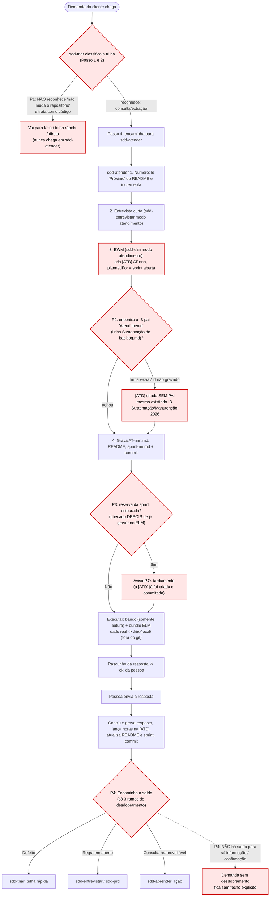
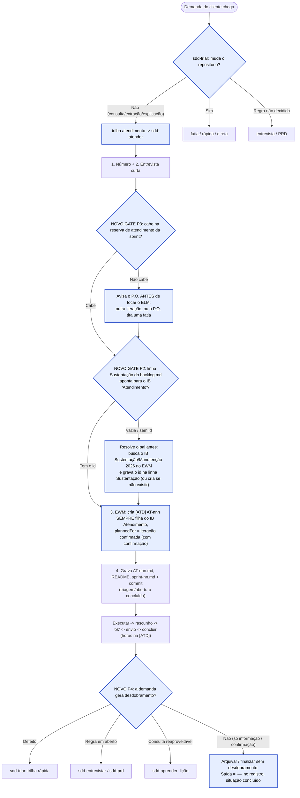

# Análise do fluxo da skill `sdd-atender`

Trilha de atendimento do power **sdd** — revisão do fluxo atual, com quatro problemas observados em execução e a correção proposta. Gerado em 15/10/2026.

**Legenda:** 🟩 passo normal · 🟥 problema observado · 🟦 correção proposta

---

## 1. Fluxo atual (como está hoje), com os problemas marcados

---

## 2. Os quatro problemas observados

### P1 — A `sdd-triar` não direcionou para a `sdd-atender`

A regra existe (Passo 1: "pedido de cliente sem mudança no repositório → trilha atendimento"; Passo 2: trilha **atendimento**; Passo 4: "Próximo → `sdd-atender`"). A falha está na **classificação**: o pedido foi lido como algo que vira código, então nunca caiu na trilha de atendimento. O roteamento depende de reconhecer "nada muda no repositório", e esse reconhecimento falhou.

### P2 — A `[ATD]` foi criada sem pai, existindo o IB Sustentação/Manutenção 2026

A `sdd-elm` é explícita: "**Todo trabalho tem pai**" e a `[ATD]` deve ser "filha do IB 'Atendimento'" indicado na linha `Sustentação:` do `backlog.md`. Quando essa linha está vazia ou não aponta para o IB de Sustentação/Manutenção 2026 já existente, o agente não encontra o pai e cria a tarefa solta — violando a regra, em vez de reutilizar o IB existente.

### P3 — Escrita no ELM antes de verificar a capacidade da sprint

A `[ATD]` é criada no Passo 3 com `plannedFor` = sprint aberta, e só no Passo 4 a skill avisa se a "reserva estourou". A verificação é **reativa** (avisa depois de já gravar e commitar), não preventiva. Não há gate "cabe na reserva da sprint?" antes de tocar o ELM.

### P4 — A saída da conclusão só prevê desdobramento, não o fecho simples

Hoje o nó "Encaminha a saída" (Passo 3.4 da `sdd-atender`) oferece apenas três ramos, todos de **desdobramento**: defeito → trilha rápida, regra em aberto → entrevista/PRD, consulta reaproveitável → lição. Mas boa parte das demandas de cliente é só **pedido de informação** ou **confirmação do que já aconteceu** — não gera defeito, nem regra, nem lição. Sem um ramo explícito de **arquivar / finalizar sem desdobramento**, essas demandas ficam sem fecho claro: ou o agente força um desdobramento que não existe, ou o atendimento é deixado "no ar" depois de concluído e commitado.

---

## 3. Fluxo corrigido (proposta)

### O que muda, por problema

| # | Onde | Correção proposta |
|---|---|---|
| P1 | sdd-triar, Passo 2 | Tornar a classificação explícita com uma pergunta de corte *antes* das trilhas de código: "esta demanda muda algum arquivo do repositório?" Se "não" → trilha atendimento obrigatória. Reforçar os gatilhos de atendimento ("extrai", "consulta na base", "por que o caso X deu Y", "relação para auditoria"). |
| P2 | sdd-atender Passo 3 / sdd-elm modo atendimento | Antes de criar a `[ATD]`, exigir que a linha `Sustentação:` do `backlog.md` aponte para o IB "Atendimento". Se vazia, buscar o IB Sustentação/Manutenção 2026 já existente no EWM e gravar o id (criar só se realmente não existir). Nenhuma `[ATD]` é criada sem pai. |
| P3 | sdd-atender, entre o Passo 2 e o 3 | Inserir o gate de capacidade *antes* da escrita no ELM: se a reserva de atendimento da sprint não comporta a demanda, avisar o P.O. e decidir (outra iteração ou retirar fatia) antes de criar e commitar a `[ATD]`. |
| P4 | sdd-atender, Passo 3.4 (Encaminha a saída) | Transformar a saída em uma decisão com um ramo de fecho simples além dos três de desdobramento: perguntar "esta demanda gera desdobramento?". Se **não** (só informação ou confirmação do que já aconteceu), **arquivar / finalizar sem desdobramento** — gravar `Saída: —` e situação `concluído` no registro e no `README.md`, sem abrir fatia, entrevista ou lição. Os ramos defeito / regra em aberto / consulta reaproveitável continuam disponíveis quando houver desdobramento real. |

---

*Fontes: skills `sdd-atender`, `sdd-triar`, `sdd-iniciar` e `sdd-elm` (power sdd, v2.3.0). Documento de análise — não altera as skills; a edição das `SKILL.md` é um passo separado, se desejado.*
