# Compilação das Análises e Desvios — Power SDD v2.3.0

> Gerado em: 2026-10-15 | Fontes: `validacao-skills-sdd.md` · `validacao-skills-sdd-2026-10-15.md` · `analise-sdd-atender.md`

**Legenda:** 🟩 passo normal · 🟥 problema / gap · 🟦 correção proposta / variação AFK

---

## Legenda dos fluxogramas

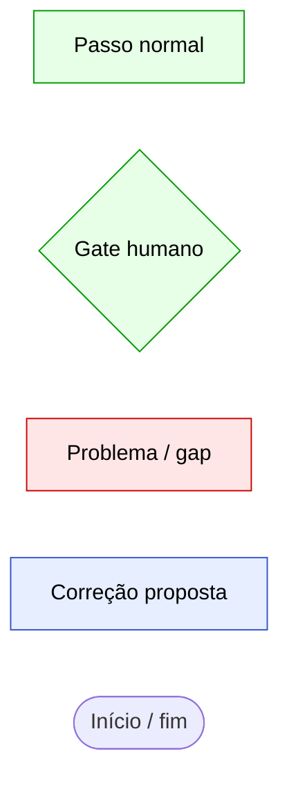

| Cor | Significado |
|-----|-------------|
| 🟩 Verde | Passo normal do fluxo esperado |
| 🟥 Vermelho | Problema, gap ou comportamento incorreto identificado |
| 🟦 Azul | Correção proposta ou comportamento AFK / variação |
| Losango `{}` | Gate humano (decisão que exige confirmação explícita) |

---

## 1. Mapeamento Macro dos Fluxos

### 1.1 Diagrama geral

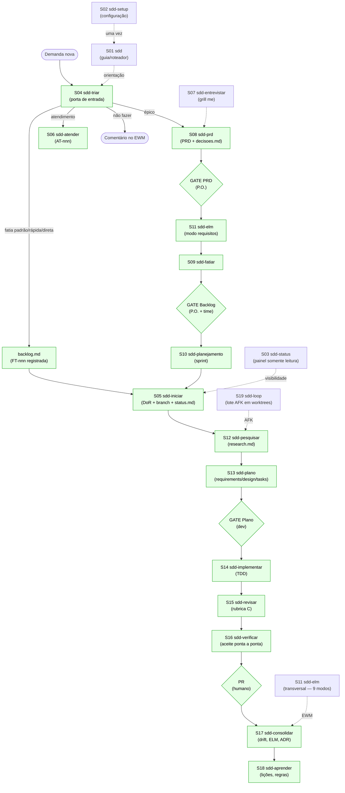

### 1.2 Trilhas

| Trilha | Quando usar | Caminho resumido |
|--------|-------------|-----------------|
| **direta** | diff cabe em 1 frase, sem regra nova | teste falha → correção → revisão C (diff) → PR |
| **rápida** | defeito ≤ 1 dia, comportamento correto já conhecido | bugfix.md + tasks.md → TDD → revisão → verificação → PR |
| **padrão** | fatia com regra clara, ficha aprovada | pesquisa → plano → GATE plano → TDD → revisão → verificação → PR → consolidação |
| **épico** | várias histórias ou decisão de produto em aberto | entrevista → PRD → GATE PRD → ELM → fatias → GATE backlog → planejamento → cada fatia na trilha padrão |
| **atendimento** | consulta/extração sem mudar o repositório | entrevista curta → AT no EWM → banco somente leitura → resposta → horas |

### 1.3 Gates humanos

| Gate | Skill | Quando | Pode ser dispensado? |
|------|-------|--------|----------------------|
| PRD | S08 Passo 5 | após revisão rubrica P | não |
| Backlog | S09 Passo 2 | após fatiamento | não |
| Ficha | S04 Passo 2 (padrão) | após entrevista | não |
| Plano | S13 Passo 5 | após análise rubrica L | AFK com "análise basta"; rápida com flag |
| PR | humano (merge) | após verificação | nunca |
| ELM / push / branch | todas | antes de qualquer escrita | nunca ("sim" explícito) |

### 1.4 Máquinas de estado

```
Fatia (status.md)
  pesquisando → planejando → plano-em-revisao → implementando →
  revisando → verificando → aceita → pr-aberto → concluida
  Desvio: bloqueada (de: <fase>) → volta à fase de origem
  Direta: implementando → revisando → verificando → pr-aberto

Fatia (backlog.md)
  backlog ⇄ pronta → concluida   •  dividida (substituida-por) · cancelada

Épico / PRD
  rascunho → em-revisao → aprovado → fatiado → concluido · cancelado

Atendimento (AT-nnn)
  aberto → concluido

Sprint
  aberta → fechada (não concluídas migram "→ sprint nn+1")

Conceito OKF (elm/*.md)
  draft → stable + verified humano → publicado (resource/id gravados)
```

### 1.5 Território de escrita (3 territórios)

| Território | Quem escreve | Regra obrigatória |
|------------|-------------|-------------------|
| **Base** (`<produto>/`, glossário, ADRs, `sdd.md` Regras aprendidas) | S04, S06, S07 (glossário), S08, S09, S10, S17, S18 | `git switch <base>` + `pull --ff-only`; árvore suja → avise e pare |
| **Branch da fatia** (`.kiro/specs/<ft>-<slug>/`) | S05, S12–S16, S19 | `backlog.md` nunca muda na branch de fatia; revisor/pesquisador não gravam `status.md` |
| **Local, fora do git** (`.kiro/local/`) | S06 (dados de cliente), S16 (evidência com dado real), S19 (worktrees, log), S15 (vereditos `wf/`) | dado de cliente nunca vai para o git |

---

## 2. Achados Consolidados

### 2.1 Achados do orquestrador (O1–O6)

> Fonte: `validacao-skills-sdd-2026-10-15.md` Parte 1, seção 1.7

| # | Severidade | Achado | Evidência |
|---|-----------|--------|-----------|
| **O1** | 🔴 Alta | **Skills sem agente.** `sdd-consolidar` e `sdd-aprender` não estão em nenhum agente; `sdd-iniciar` e `sdd-status` só no `sdd-orquestrador`, que não tem `git switch` nem `git pull --ff-only`. Na prática, iniciar, consolidar e aprender só funcionam na sessão padrão. | `sdd-setup/assets/agents/*.json`; `sdd-orquestrador.json` toolsSettings |
| **O2** | 🔴 Alta | **`[VER]` concluída antes do PR.** A `sdd-verificar` lança as horas e conclui a `[VER]` no ACEITO, antes da leitura humana do PR; mudança pedida no PR exige nova verificação com a tarefa já fechada. No loop/agente verificador (sem MCP) a `[VER]` vira `ELM pendente` e nenhuma skill a recolhe depois. | `sdd-verificar/SKILL.md` Passo 4; `sdd-consolidar/SKILL.md` Passo 2 |
| **O3** | 🟡 Baixa | **Trilha rápida e `design.md`.** README e `sdd-iniciar` descrevem a rápida como `bugfix.md` + `tasks.md`, mas os templates têm um `design.md` curto que `sdd-implementar`/`sdd-verificar` leem. Comportamento definido; apenas os resumos omitem o arquivo. | `sdd-plano/references/plano-templates.md:145` |
| **O4** | 🟠 Média | **Escritas na base sem o preâmbulo de base.** `sdd-atender` e `sdd-planejamento` (gravar sprint/encaixe) só dizem "commit na base" sem o padrão obrigatório `git switch`/`pull --ff-only`. | `sdd-atender §1.4 e §3.3`; `sdd-planejamento` Modo sprint 7 e Encaixe |
| **O5** | 🟠 Média | **Atendimento sem sprint aberta / Kanban.** `sdd-atender` grava linha no `sprint-<nn>.md` aberto; não há regra para Kanban nem para "nenhuma sprint aberta". | `sdd-atender §1.3` |
| **O6** | 🟡 Baixa | **Número do AT reservado antes da confirmação.** O AT-nnn é incrementado antes da entrevista e da confirmação no EWM; desistência queima o número. | `sdd-atender §1.1` |

### 2.2 Achados priorizados (A1–A5)

> Fonte: `validacao-skills-sdd-2026-10-15.md` Parte 5

| # | Severidade | Achado | Causa raiz |
|---|-----------|--------|------------|
| **A1** | 🔴 Alta | **Skills sem agente e agentes sem permissão.** `sdd-consolidar` e `sdd-aprender` não têm agente dono; `sdd-iniciar` no orquestrador não tem os comandos git necessários. | Design dos agentes não cobre o ciclo de vida completo (O1). |
| **A2** | 🔴 Alta | **Artefatos dos papéis sem dono de commit.** Revisor, verificador e pesquisador geram artefatos (`revisao-*.md`, `verificacao.md`, `research.md`) mas não têm passo de commit definido nas suas skills; o dono do commit é implícito. | Ausência de instrução explícita de "commit/push" em S12, S15, S16. |
| **A3** | 🔴 Alta | **Estado nunca limpo entre sessões.** O `status.md` só é commitado ao fechar a sessão (S03) ou no `sdd-iniciar`. Entre sessões, o estado em disco pode divergir do estado em memória. O commit do plano só ocorre no ramo "Aprovado" do gate. | Sem hook automático de save-state entre turnos. |
| **A4** | 🔴 Alta | **Revisão de código pode aprovar sem backpressure executado.** A rubrica C3 (testes por ambiente "não conta como achado") permite que a revisão seja aprovada sem evidência de execução. | `sdd-revisar/SKILL.md` rubrica C3, critério de ambiente. |
| **A5** | 🔴 Alta | **`[VER]` concluída antes do PR; `[REV]` com dois momentos.** Confirmação do O2: a tarefa `[VER]` é encerrada antes do merge humano. A `[REV]` tem dois momentos (rubrica L no plano e rubrica C no código) sem distinção de tarefa EWM. | `sdd-verificar` Passo 4 + `sdd-consolidar` Passo 2. |

**Achados de amplitude média (M1, M2, M4, M5) — resumo:**

| # | Severidade | Achado |
|---|-----------|--------|
| M1 | 🟠 Média | Modo autônomo (`sdd-loop`) sem limite de passos na própria skill. |
| M2 | 🟠 Média | Destinos ausentes: 2ª análise AJUSTAR, GATE recusado, verificação só com ambiente. |
| M4 | 🟠 Média | Idempotência do EWM e baixa de pendências (`ELM feito:` nenhuma skill manda escrever). |
| M5 | 🟠 Média | Atendimento incompleto (sem Kanban, AT incrementado antes da confirmação, conclusão de horas incorreta). |

### 2.3 Desvios identificados pelo usuário (D1–D5)

---

#### D1 — sdd-triar não deve iniciar nada

**Severidade:** 🟠 Média

**Descrição:** A `sdd-triar` termina seu Passo 4 perguntando "começar agora (sdd-iniciar)?", o que cria a impressão de que a própria triagem inicia a fatia. O papel da `sdd-triar` é *apenas registrar*, nunca iniciar.

**Evidência nas skills:**
- `sdd-triar/SKILL.md` Passo 4: "pergunta se inicia agora" — o verbo "iniciar" e a invocação de `sdd-iniciar` como consequência da triagem cria ambiguidade sobre quem é responsável pelo início.
- A separação conceitual é clara no README: "sdd-triar — não começa nada", mas o Passo 4 contradiz isso na prática.

**Como está:**

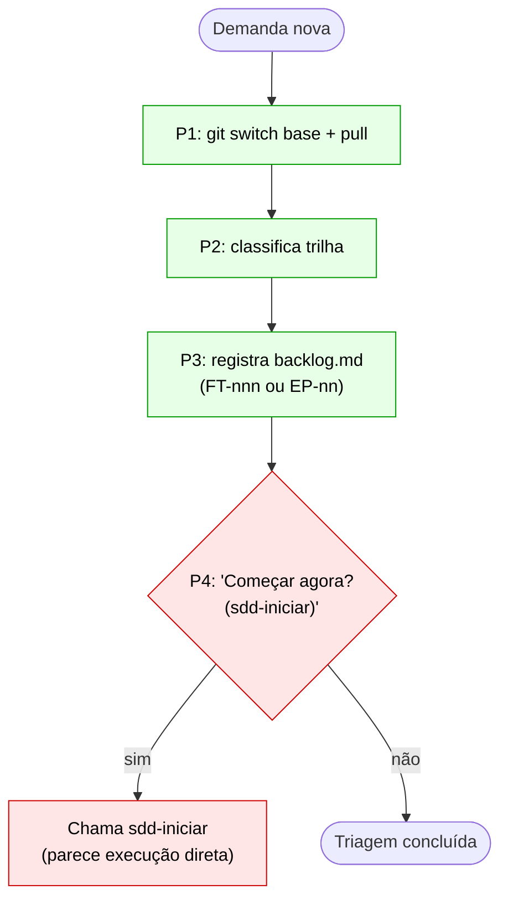

**Como deveria ser:**

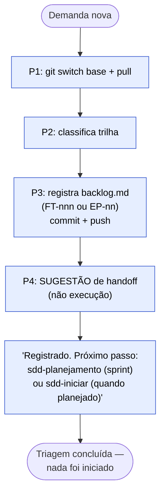

**Proposta de correção:** Alterar o Passo 4 da `sdd-triar` para encerrar com uma mensagem de handoff textual, sem invocar nem simular o `sdd-iniciar`. A frase deve ser: *"Registrado. Próximo passo natural: `sdd-planejamento` (encaixar na sprint) ou `sdd-iniciar` (quando a fatia já estiver planejada e pronta)."* Nenhuma chamada a outra skill deve ocorrer neste passo.

---

#### D2 — sdd-atender deve ser chamada pelo sdd-triar (não diretamente pelo usuário)

**Severidade:** 🔴 Alta

**Descrição:** A trilha de atendimento é decidida *dentro* do `sdd-triar` (Passo 2: "pedido de cliente sem mudança no repositório → trilha atendimento → `sdd-atender`"). O `sdd-atender` não deveria ser ativado diretamente pelo usuário sem passar pela triagem. O problema P1 da `analise-sdd-atender.md` confirma isso: a classificação falhou e o pedido foi lido como código porque o usuário foi direto ao `sdd-atender`.

**Evidência nas skills:**
- A *description* do `sdd-atender` cita gatilhos como "novo atendimento", "extrai os dados de" — esses gatilhos podem ser ativados diretamente, pulando a triagem.
- `sdd-triar/SKILL.md` Passo 1: "pedido de cliente sem mudança → trilha atendimento → `sdd-atender`" define a triagem como pré-condição.

**Como está:**

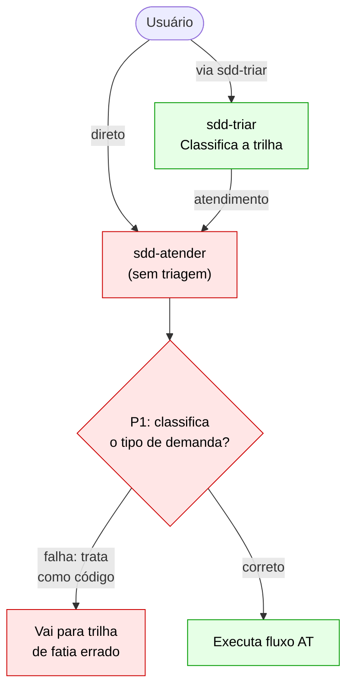

**Como deveria ser:**

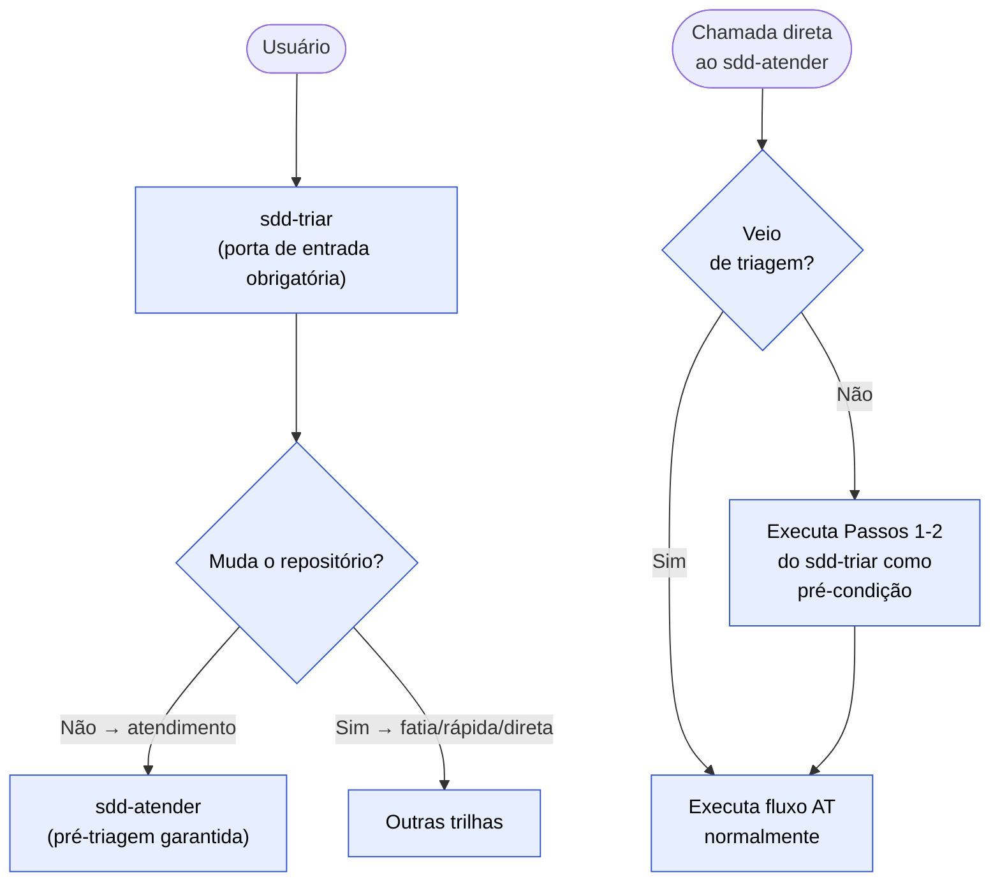

**Proposta de correção:** O `sdd-atender` deve, no início do seu fluxo, verificar se veio de uma triagem (pela presença de um parâmetro ou pelo contexto). Se não, executa os Passos 1 e 2 do `sdd-triar` como pré-condição antes de prosseguir. Isso garante que nenhum atendimento começa sem a classificação correta.

---

#### D3 — Verificar se faz sentido juntar sdd-triar + sdd-atender

**Severidade:** 🟡 Baixa (análise / decisão de design)

**Descrição:** Dado que `sdd-atender` é sempre iniciado pelo `sdd-triar`, é legítimo questionar se as duas skills deveriam ser fundidas.

**Análise da separação:**

| Critério | sdd-triar | sdd-atender |
|----------|-----------|-------------|
| Território git | Base (`backlog.md`) | Base (`sprint-nn.md`) + local (`.kiro/local/`) |
| Tipo de dado | Registro de backlog | Dados de cliente, extração de banco |
| Estado próprio | FT-nnn / EP-nn | AT-nnn (aberto → concluído) |
| Horas EWM | `[ESP]`/`[DEV]` via sdd-planejamento | `[ATD]` com horas do atendimento |
| Agente | `sdd-produto` | `sdd-produto` (mesmo agente) |

**Conclusão:** MANTER separados. A separação é justificada por territórios distintos de escrita e estados próprios. O que muda com o D2: tornar o `sdd-atender` inacessível diretamente (ou com verificação de pré-condição obrigatória), tornando-o um "modo" que só é acessível via `sdd-triar` ou com verificação explícita de que a triagem já ocorreu.

---

#### D4 — Só o sdd-iniciar inicia itens de backlog

**Severidade:** 🔴 Alta

**Descrição:** Várias skills mencionam `sdd-iniciar` como próximo passo (sugestão de handoff), mas apenas o `sdd-iniciar` verifica DoR, sprint, WIP e cria branch + `status.md`. Nenhuma outra skill deveria criar branch ou `status.md` — isso é responsabilidade exclusiva do `sdd-iniciar`.

**Evidência nas skills:**
- `sdd-triar` Passo 4: "começar agora → `sdd-iniciar`" (D1 endereça isso)
- `sdd-planejamento` Encaixe: "volta a `sdd-iniciar`" (correto — retorna o controle)
- `sdd-prd` após GATE: sugere `sdd-iniciar` (correto)
- `sdd-fatiar` após GATE: sugere `sdd-iniciar` (correto)
- `sdd-loop` Passo 2: cria `status.md` dentro da worktree — esse é um caso especial (o loop já passou pelo `sdd-iniciar` como orquestrador)

**Como está vs. como deveria ser:**

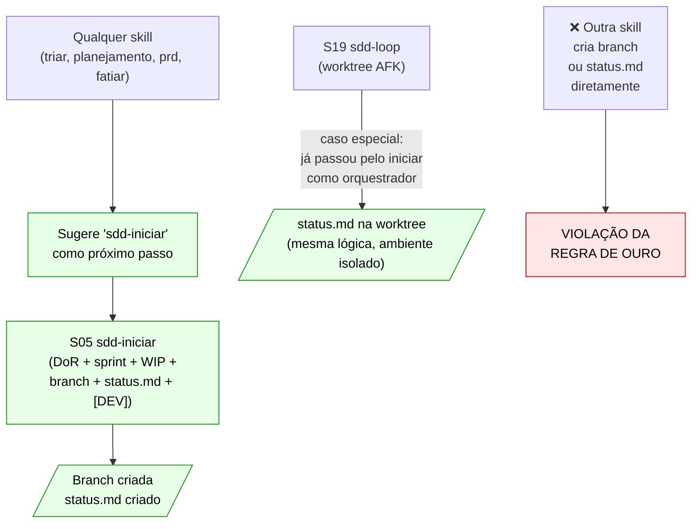

**Proposta de correção:** Acrescentar nas regras de ouro do `sdd.md` (Regras aprendidas): *"Nenhuma skill cria branch ou `.kiro/specs/<ft>/status.md` sem passar pelos Passos 3–4 do `sdd-iniciar` (DoR, sprint, WIP, branch, commit). O `sdd-loop` é a única exceção por ser o próprio orquestrador operando em worktree."*

---

#### D5 — sdd-iniciar e a tarefa [ESP] de épico

**Severidade:** 🟠 Média (gap de fluxo)

**Descrição:** O `sdd-iniciar` trata épicos redirecionando para `sdd-prd` (se PRD não existe) ou `sdd-fatiar` (se PRD já está aprovado). Mas falta o caso: **a `[ESP]` já foi criada pelo `sdd-planejamento` e uma pessoa quer "assumir" essa tarefa** (iniciar o trabalho de especificação do EP-nn).

**Evidência nas skills:**
- `sdd-iniciar` Passo 1 "O que chegou": `EP-nn → não é fatia → sdd-prd (ou sdd-fatiar, se o PRD já está aprovado)`. Isso redireciona *sempre* para criar/trabalhar o PRD do zero.
- `sdd-planejamento` Modo Sprint cria a tarefa `[ESP]` no EWM com `plannedFor` = sprint ativa.
- Gap: a pessoa que quer "começar a especificação do EP-03" (que já tem `[ESP]` planejada) não tem fluxo definido no `sdd-iniciar` para:
  1. Verificar DoR mínima da especificação (P.O. designado, PRD pendente)
  2. Assumir a `[ESP]` no EWM
  3. Encaminhar para o `sdd-prd` de forma rastreável

**Diagrama do gap:**

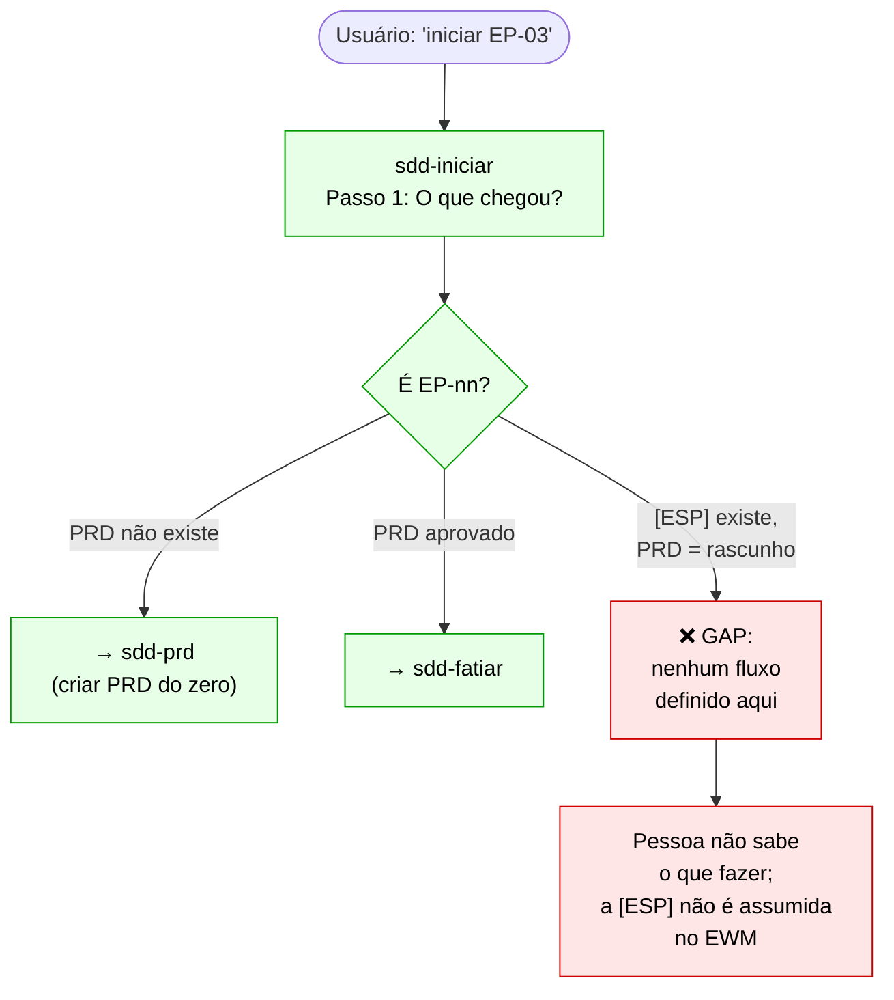

**Fluxo proposto para o gap:**

```mermaid
flowchart TD
    START([EP-nn com [ESP] planejada]) --> CHECK{"DoR mínima:\nP.O. designado +\nPRD = rascunho?"}:::fix
    CHECK -- "Não" --> BLOQUEIA["Bloqueia + lista\no que falta para DoR"]:::fix
    CHECK -- "Sim" --> ASSUME["Assume a [ESP]\nno EWM (pessoa = dev)"]:::fix
    ASSUME --> NOTE["Nota: NÃO cria branch\nnem status.md\n(não é fatia de código)"]:::fix
    NOTE --> PRD_WORK["→ sdd-prd\n(trabalhar o PRD\nna branch base)"]:::fix
    PRD_WORK --> HORAS["Horas da [ESP] têm dono\nregistrado no EWM"]:::fix

    classDef fix fill:#e6eeff,stroke:#3355cc,color:#000
```

**Proposta de correção:** Adicionar ao `sdd-iniciar` Passo 1 uma nova linha na tabela "O que chegou": *`EP-nn com PRD 'rascunho' E [ESP] já planejada → verifica DoR mínima (P.O. designado), assume a [ESP] no EWM, encaminha para sdd-prd. Nota: NÃO cria branch de fatia nem status.md — o trabalho é na base.`*

---

## 3. Análise por Skill

> Para cada skill: papel, agente que carrega, território de escrita, fluxograma principal e tabela de lacunas.

---

### S01 — sdd

| Campo | Valor |
|-------|-------|
| **Papel** | Guia do fluxo — explica trilhas, gates, princípios; direciona para a skill correta quando nenhuma outra se encaixa |
| **Agente** | nenhum (sessão padrão) |
| **Escreve em** | — (somente leitura) |

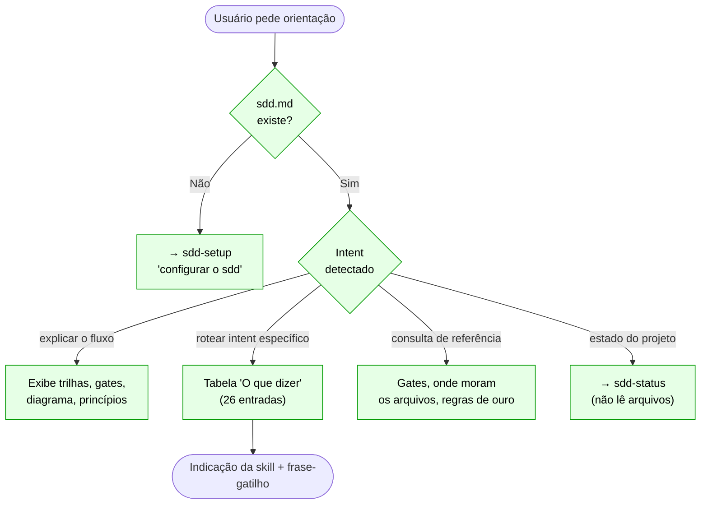

**Lacunas desta skill:**

| # | Severidade | Lacuna |
|---|-----------|--------|
| S01-G1 | 🟡 Baixa | Sobreposição de gatilhos com `sdd-status`: "o que eu faço agora" pode cair em qualquer uma das duas sem regra de desempate explícita. |
| S01-G3 | 🟡 Baixa | Tabela "Onde moram" omite `fatias/FT-*.md`, `equipe.json`, `acordos.md`, `sprints/`, `.kiro/local/loop-*.md`. |
| S01-G4 | 🟡 Baixa | Sem verificação de configuração: não checa `sdd.md` antes de rotear para skills que dependem dele. |

---

### S02 — sdd-setup

| Campo | Valor |
|-------|-------|
| **Papel** | Configura o fluxo sdd num projeto — detecta stack, gera agentes, steering, hooks e workflows |
| **Agente** | nenhum (sessão padrão) |
| **Escreve em** | `.kiro/steering/sdd.md` · `.kiro/agents/sdd-*.json` · `<produto>/backlog.md`, `planejamento/`, `atendimentos/` · `.gitignore` |

```mermaid
flowchart TD
    START([Gatilho: "configurar o sdd"]) --> DETECT{"sdd.md\nexiste?"}:::ok
    DETECT -- "Não + sem sdd2" --> INST["P0-P9: Instalação inicial"]:::ok
    DETECT -- "Sim" --> ATUAL["Modo atualização:\nmostra config atual,\npergunta o que muda"]:::ok
    DETECT -- "sdd2 detectado" --> MIG["Migração sdd2 → sdd"]:::ok

    INST --> P1["P1: detecta stack\npropõe tipo + testes"]:::ok
    P1 --> P2["P2: comandos de build"]:::ok
    P2 --> P3["P3: git, branch, PR"]:::ok
    P3 --> P6["P6: propõe 6 agentes\naguarda 'ok' por agente"]:::ok
    P6 --> P8["P8: monta em memória\nexibe resumo"]:::ok
    P8 --> GATE{"Gravar?\n(ok)"}:::ok
    GATE -- "ok" --> P9["P9: validação\nJSON + paths + kiro-cli"]:::ok
    P9 --> FIM([Setup concluído + sugestão de commit])

    classDef ok fill:#e6ffe6,stroke:#009900,color:#000
```

**Lacunas desta skill:**

| # | Severidade | Lacuna |
|---|-----------|--------|
| S02-G1 | 🟡 Baixa | O Fluxo 1 (instalação) não trata o caso em que `sdd-orquestrador.json` recebe `sdd-iniciar` mas não tem os comandos git necessários (O1). |

---

### S03 — sdd-status

| Campo | Valor |
|-------|-------|
| **Papel** | Painel somente leitura — onde parei, próxima ação, fechar sessão |
| **Agente** | `sdd-orquestrador` |
| **Escreve em** | `status.md` / `tasks.md` (somente ao fechar sessão) |

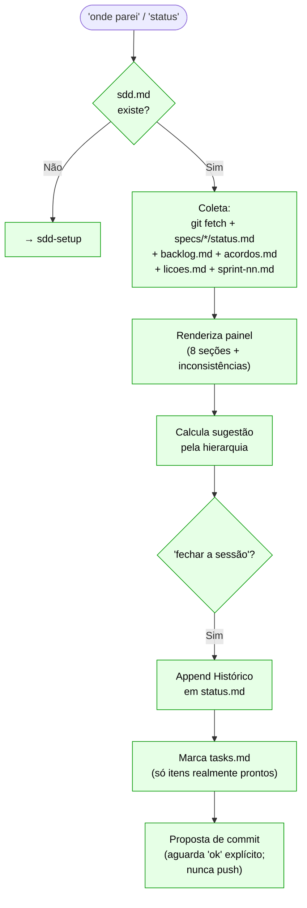

**Lacunas desta skill:**

| # | Severidade | Lacuna |
|---|-----------|--------|
| S03-G1 | 🟠 Média | `sdd-iniciar` e `sdd-status` no mesmo agente (`sdd-orquestrador`) mas o orquestrador não tem `git switch` para executar o `sdd-iniciar` (O1). |

---

### S04 — sdd-triar

| Campo | Valor |
|-------|-------|
| **Papel** | Porta de entrada de todo trabalho novo — decide trilha, registra no backlog, **não começa nada** |
| **Agente** | `sdd-produto` |
| **Escreve em** | `<produto>/backlog.md` · `<produto>/fatias/FT-*.md` (base) |

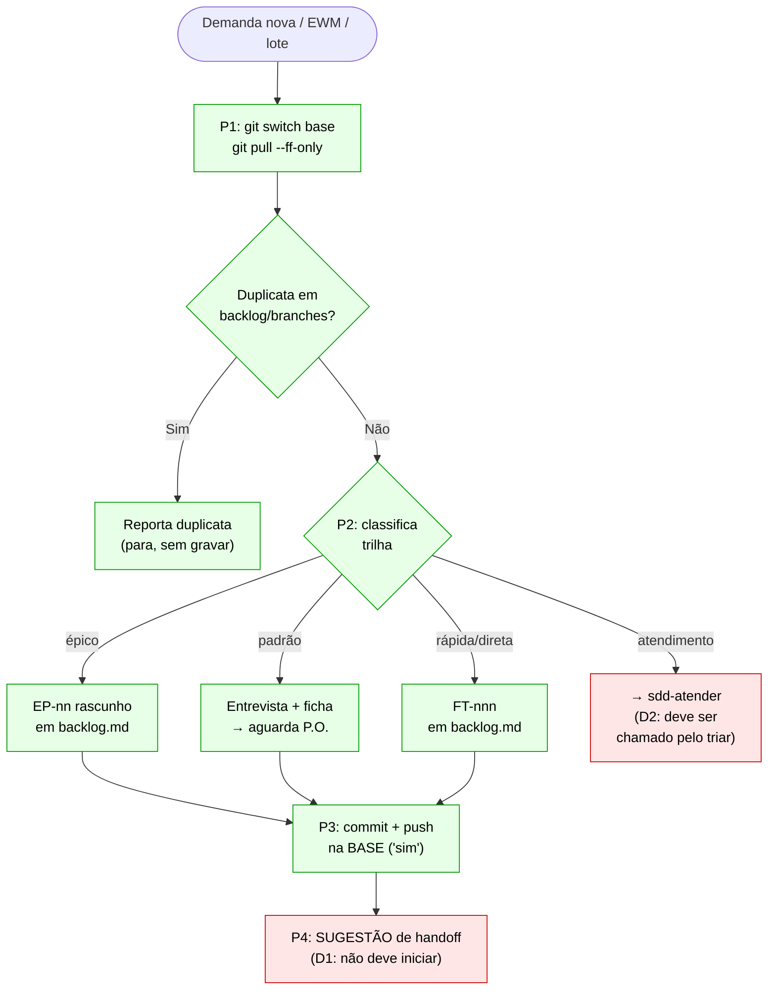

**Lacunas desta skill:**

| # | Severidade | Lacuna |
|---|-----------|--------|
| D1 | 🟠 Média | Passo 4 oferece "começar agora (sdd-iniciar)" como se fosse uma execução, não uma sugestão. Triar ≠ iniciar. |
| D2 | 🔴 Alta | A trilha atendimento invoca `sdd-atender` mas o `sdd-atender` pode ser ativado diretamente, pulando a triagem. |

---

### S05 — sdd-iniciar

| Campo | Valor |
|-------|-------|
| **Papel** | Ponto de compromisso — confere DoR, sprint, WIP; cria branch e status.md; assume tarefa no EWM |
| **Agente** | `sdd-orquestrador` |
| **Escreve em** | branch · `.kiro/specs/<ft>-<slug>/status.md` · `.config.kiro` (trilhas padrão/rápida) |

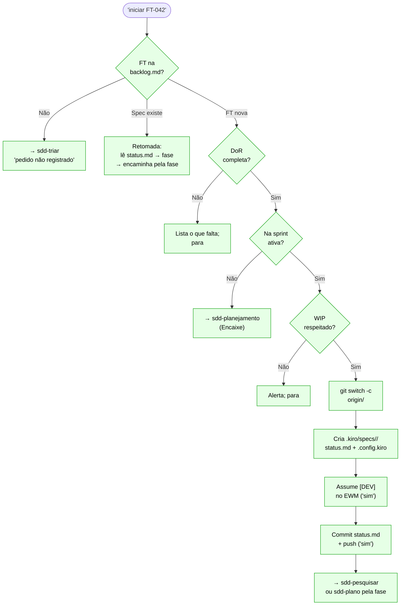

**Lacunas desta skill:**

| # | Severidade | Lacuna |
|---|-----------|--------|
| D4 | 🔴 Alta | Nenhuma regra de ouro proíbe explicitamente outras skills de criar branch/status.md diretamente. |
| D5 | 🟠 Média | Sem fluxo para `EP-nn com [ESP] já planejada` — a pessoa que quer assumir a especificação não tem caminho definido. |
| O1 | 🔴 Alta | O `sdd-orquestrador` não tem os comandos git necessários para executar os Passos 3-4 desta skill. |

---

### S06 — sdd-atender

| Campo | Valor |
|-------|-------|
| **Papel** | Trilha de atendimento sem mudança de repositório — consulta, extração, explicação |
| **Agente** | `sdd-produto` |
| **Escreve em** | `atendimentos/AT-nnn.md` · `sprint-<nn>.md` (base) · `.kiro/local/atendimentos/<id>/` |

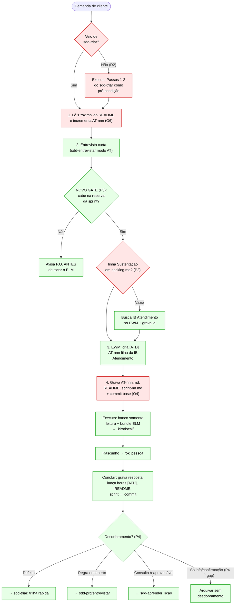

**Lacunas desta skill:**

| # | Severidade | Lacuna |
|---|-----------|--------|
| D2 | 🔴 Alta | Pode ser ativada diretamente sem passar pela triagem. |
| O4 | 🟠 Média | Escritas na base sem `git switch`/`pull --ff-only` explícito. |
| O5 | 🟠 Média | Sem regra para Kanban ou ausência de sprint aberta. |
| O6 | 🟡 Baixa | AT-nnn incrementado antes da confirmação no EWM. |
| P1 | 🔴 Alta | Classificação da triagem pode falhar → pedido tratado como código (ver `analise-sdd-atender.md`). |
| P2 | 🔴 Alta | `[ATD]` criada sem pai se linha Sustentação do backlog.md estiver vazia. |
| P3 | 🟠 Média | Verificação de capacidade da sprint é reativa (avisa depois de gravar no ELM). |
| P4 | 🟡 Baixa | Saída só prevê desdobramento; sem ramo de fecho simples. |

---

### S07 — sdd-entrevistar

| Campo | Valor |
|-------|-------|
| **Papel** | Entrevista "grill me" — percorre árvore de decisões em rodadas; responde automaticamente o que tem fonte |
| **Agente** | `sdd-produto` |
| **Escreve em** | `decisoes.md` (épico ou fatia) · `docs/glossario.md` (branch base) |

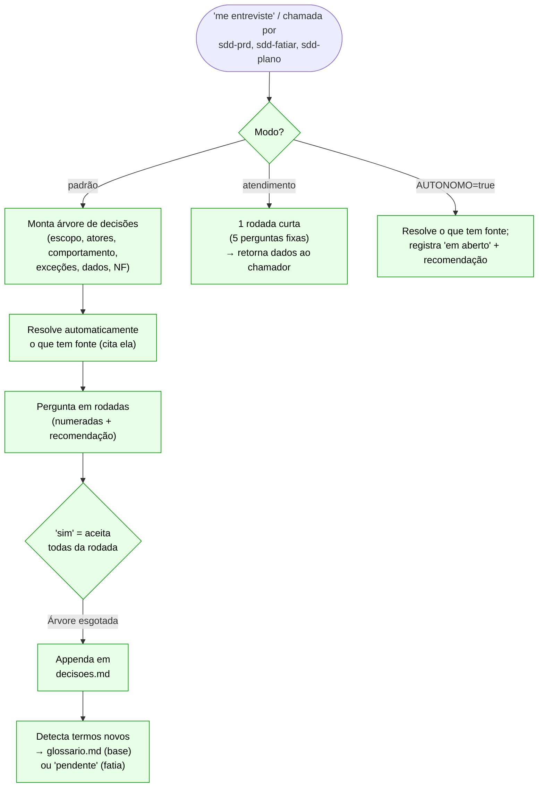

**Lacunas desta skill:**

| # | Severidade | Lacuna |
|---|-----------|--------|
| S07-G1 | 🟡 Baixa | Modo autônomo não tem limite de rodadas — pode gerar `decisoes.md` muito longo. |

---

### S08 — sdd-prd

| Campo | Valor |
|-------|-------|
| **Papel** | Escreve o PRD de um épico — histórias, regras, termos OKF; conduz o GATE PRD |
| **Agente** | `sdd-produto` |
| **Escreve em** | `<produto>/epicos/<EP>-<slug>/` (`prd.md`, `decisoes.md`, `elm/*.md`) (base) |

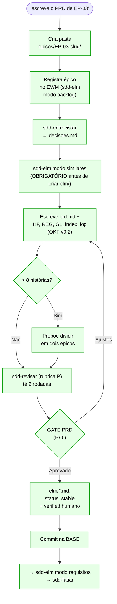

**Lacunas desta skill:**

| # | Severidade | Lacuna |
|---|-----------|--------|
| D5 | 🟠 Média | Quando recebe `EP-nn` com `[ESP]` já planejada, deveria ser o destino do `sdd-iniciar` com fluxo de "assumir especificação". |

---

### S09 — sdd-fatiar

| Campo | Valor |
|-------|-------|
| **Papel** | Quebra o PRD aprovado em fatias verticais (tracer bullets) com cobertura de cenários, tamanho, modo AFK/HITL |
| **Agente** | `sdd-produto` |
| **Escreve em** | `<produto>/backlog.md` · `prd.md` (base) |

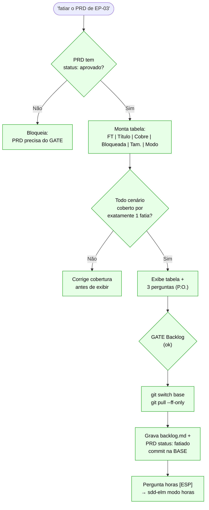

**Lacunas desta skill:**

| # | Severidade | Lacuna |
|---|-----------|--------|
| S09-G1 | 🟡 Baixa | O ELM pendente (quando MCP indisponível) é gravado no rodapé do PRD mas não há skill que o recolha sistematicamente depois. |

---

### S10 — sdd-planejamento

| Campo | Valor |
|-------|-------|
| **Papel** | Sprint, roadmap, acordos; review; retrospectiva; virada; encaixe de fatias |
| **Agente** | `sdd-produto` |
| **Escreve em** | `<produto>/planejamento/` (`equipe.json`, `acordos.md`, `roadmap.md`, `sprints/sprint-nn.md`) · `backlog.md` (base) |

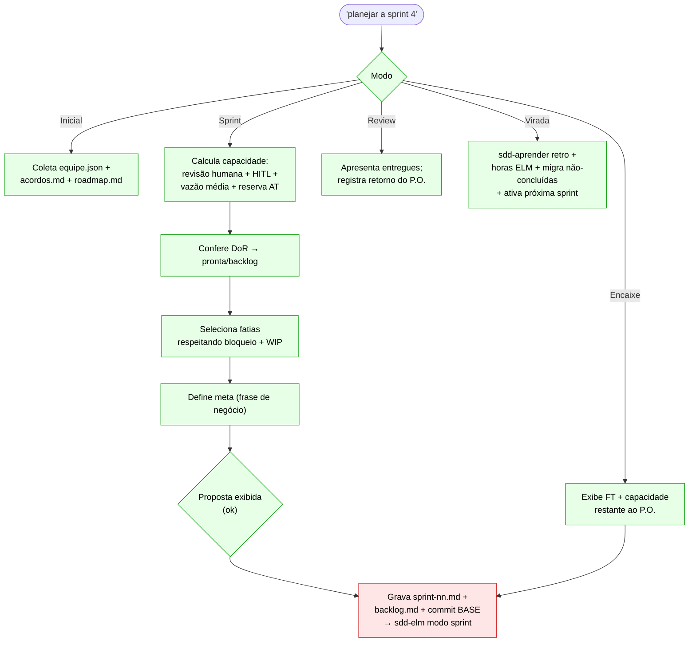

**Lacunas desta skill:**

| # | Severidade | Lacuna |
|---|-----------|--------|
| O4 | 🟠 Média | Modo Sprint Passo 7 e Encaixe dizem "commit na BASE" sem o preâmbulo `git switch`/`pull --ff-only`. |
| O1 | 🔴 Alta | `[ESP]` criada pelo planejamento + handoff para `sdd-iniciar` sem fluxo definido para o desenvolvedor assumir a especificação (D5). |

---

### S11 — sdd-elm

| Campo | Valor |
|-------|-------|
| **Papel** | Alimenta o IBM ELM (EWM/RTC, DOORS Next, ETM) — 9 modos: backlog, horas, sprint, similares, requisitos, as-built, testes, CT, conclusão |
| **Agente** | `sdd-produto` · `sdd-codificador` · `sdd-orquestrador` |
| **Escreve em** | ELM (IBM) · write-back em `elm/*.md` · `backlog.md` · `status.md` |

```mermaid
flowchart TD
    START(["Chamada com modo"]) --> MODO{"Modo?"}:::ok
    MODO -- "backlog" --> BKL["Cria épico/IB/tarefa\nno EWM; preenche col. elm"]:::ok
    MODO -- "horas" --> HORAS["Lança horas na tarefa\ndo EWM com confirmação"]:::ok
    MODO -- "sprint" --> SPRINT["Cria [DEV][REV][VER][ESP]\nplanejados para iteração"]:::ok
    MODO -- "similares" --> SIMIL["Busca no bundle ELM\nconceitos similares/relacionados"]:::ok
    MODO -- "requisitos" --> REQ["Publica HF/REG/GL\nem DOORS Next"]:::ok
    MODO -- "as-built" --> ASBUILT["Registra entregue real\nvs. planejado"]:::ok
    MODO -- "testes" → CT" --> CT["Publica CTs\nem ETM"]:::ok
    MODO -- "conclusão" --> CONCL["Conclui tarefa\nno EWM"]:::ok

    TODOS --> CONFIRM{"Confirmação\nexplícita ('sim')\nantes de escrever"}:::ok
    CONFIRM -- "sim" --> EWM_WRITE["Escreve no ELM"]:::ok
    CONFIRM -- "sem MCP" --> PEND["Grava 'ELM pendente'\nno artefato referente"]:::ok

    classDef ok fill:#e6ffe6,stroke:#009900,color:#000
```

**Lacunas desta skill:**

| # | Severidade | Lacuna |
|---|-----------|--------|
| M4 | 🟠 Média | Idempotência: nenhuma skill manda checar se a tarefa/item já existe antes de criar. A linha `ELM feito:` deveria ser atualizada por quem chama o modo, mas a instrução não é explícita. |
| A5 | 🔴 Alta | `[VER]` é concluída pela `sdd-verificar` (modo conclusão) antes do merge humano do PR. |

---

### S12 — sdd-pesquisar

| Campo | Valor |
|-------|-------|
| **Papel** | Pesquisa somente leitura — fluxo atual, análogos, schema real, restrições; compacta em `research.md` |
| **Agente** | `sdd-pesquisador` |
| **Escreve em** | `.kiro/specs/<ft>-<slug>/research.md` |

```mermaid
flowchart TD
    START(["Invocação com ft-slug"]) --> EXIST{"research.md\njá existe e\nestá atual?"}:::ok
    EXIST -- "Sim" --> RETORNA["Retorna existente\nsem regravar"]:::ok
    EXIST -- "Não" --> LEITURA["Lê: status.md,\nbacklog.md, PRD/ficha/defeito"]:::ok
    LEITURA --> FORMULA["Formula 3-7 perguntas\nque o plano precisará responder"]:::ok
    FORMULA --> INVESTIGA["Investiga:\n1. estrutura do projeto\n2. fluxo atual (arquivo:linha)\n3. análogos (1-2, com testes)\n4. reaproveitar\n5. schema real (MCP banco, leitura)\n6. docs ELM vs código\n7. como rodar testes da área"]:::ok
    INVESTIGA --> COMPACTA["Compacta em research.md\n(≤150 linhas, 9 seções)"]:::ok
    COMPACTA --> ATUALIZA{"Chamado\npelo agente?"}:::ok
    ATUALIZA -- "Por agente" --> NAOSTAT["NÃO grava status.md\n(quem chamou faz isso)"]:::ok
    ATUALIZA -- "Pela sessão" --> STAT["Atualiza fase\nem status.md"]:::ok

    classDef ok fill:#e6ffe6,stroke:#009900,color:#000
```

**Lacunas desta skill:**

| # | Severidade | Lacuna |
|---|-----------|--------|
| A2 | 🔴 Alta | Não há passo explícito de commit do `research.md` — o dono do commit é implícito. |

---

### S13 — sdd-plano

| Campo | Valor |
|-------|-------|
| **Papel** | Spec do Kiro — `requirements.md`/`bugfix.md`, `design.md`, `tasks.md`; conduz GATE do plano |
| **Agente** | `sdd-codificador` |
| **Escreve em** | `.kiro/specs/<ft>-<slug>/requirements.md` · `design.md` · `tasks.md` |

```mermaid
flowchart TD
    START(["'plano de FT-042'"]) --> PESQ{"research.md\nexiste?"}:::ok
    PESQ -- "Não" --> RUN_PESQ["→ sdd-pesquisar"]:::ok
    PESQ -- "Sim" --> TRIL{"Trilha?"}:::ok
    TRIL -- "padrão" --> REQ["Escreve requirements.md\n(critérios AC + SMT)"]:::ok
    TRIL -- "rápida" --> BUG["Escreve bugfix.md\n(causa raiz + correção)"]:::ok
    TRIL -- "direta" --> SKIP["Sem artefatos de plano\n→ sdd-implementar direto"]:::ok
    REQ & BUG --> DESIGN["Escreve design.md\n(arquitetura + correctness)"]:::ok
    DESIGN --> TASKS["Escreve tasks.md\n(checklist implementação)"]:::ok
    TASKS --> REVISAR["→ sdd-revisar (rubrica L)\n≤2 rodadas"]:::ok
    REVISAR --> GATE{"GATE Plano\n(dev / AFK basta com análise)"}:::ok
    GATE -- "Aprovado" --> STATUS["Atualiza status.md\nfase: implementando"]:::ok
    GATE -- "Ajustar" --> DESIGN
    STATUS --> IMPL["→ sdd-implementar"]:::ok

    classDef ok fill:#e6ffe6,stroke:#009900,color:#000
```

**Lacunas desta skill:**

| # | Severidade | Lacuna |
|---|-----------|--------|
| O3 | 🟡 Baixa | Resumos (README + `sdd-iniciar`) omitem o `design.md` curto na trilha rápida, criando expectativa errada. |
| A2 | 🔴 Alta | Sem instrução explícita de commit dos artefatos do plano após o GATE. |

---

### S14 — sdd-implementar

| Campo | Valor |
|-------|-------|
| **Papel** | TDD — ciclo vermelho→verde→refatorar; abre PR; gerencia achados da revisão |
| **Agente** | `sdd-codificador` |
| **Escreve em** | código · testes · `tasks.md` · `status.md` · PR |

```mermaid
flowchart TD
    START(["Fase: implementando"]) --> CICLO["Ciclo TDD:\n1. Teste que falha (RED)\n2. Código mínimo (GREEN)\n3. Refatorar"]:::ok
    CICLO --> TASKS_UP["Atualiza tasks.md\na cada item concluído"]:::ok
    TASKS_UP --> REVISAR["→ sdd-revisar (rubrica C)\nveredito: APROVADO/AJUSTAR/BLOQUEIO"]:::ok
    REVISAR -- "AJUSTAR" --> CORRIGE["Corrige (até\nbackpressure C3)"]:::ok
    REVISAR -- "APROVADO" --> VERIF["→ sdd-verificar"]:::ok
    VERIF -- "ACEITO" --> PR["Abre PR\n(título curto, evidência de aceite)"]:::ok
    VERIF -- "REJEITADO" --> CICLO
    PR --> STATUS_PR["Atualiza status.md\nfase: pr-aberto"]:::ok
    STATUS_PR --> AGUARDA["Aguarda merge\n(humano)"]:::ok
    AGUARDA --> CONSOLIDAR["→ sdd-consolidar\n(após merge)"]:::ok

    classDef ok fill:#e6ffe6,stroke:#009900,color:#000
```

**Lacunas desta skill:**

| # | Severidade | Lacuna |
|---|-----------|--------|
| A4 | 🔴 Alta | Rubrica C3: testes por ambiente "não conta como achado" permite aprovar sem evidência de execução. |

---

### S15 — sdd-revisar

| Campo | Valor |
|-------|-------|
| **Papel** | Revisão independente — 3 rubricas: P (PRD), L (lógica do plano), C (código) |
| **Agente** | `sdd-revisor` |
| **Escreve em** | `revisao-prd-<N>.md` · `analise-plano-<N>.md` · `revisao-codigo-<N>.md` · `.kiro/local/wf/<id>/*.json` |

```mermaid
flowchart TD
    START(["Chamada com rubrica"]) --> RUB{"Rubrica?"}:::ok
    RUB -- "P (PRD)" --> RPRD["Revisa prd.md:\nclareza, completude, Gherkin,\ntraceabilidade, coesão"]:::ok
    RUB -- "L (lógica do plano)" --> RPLANO["Revisa requirements + design:\ncorrectness, testes, design"]:::ok
    RUB -- "C (código)" --> RCOD["Revisa diff:\nsegurança, testes, estilo,\nbackpressure C3"]:::warn
    RPRD & RPLANO & RCOD --> VERD{"Veredito?"}:::ok
    VERD -- "APROVADO" --> OK["Grava artefato\nde revisão"]:::ok
    VERD -- "AJUSTAR" --> AJUST["Grava artefato\nc/ achados detalhados"]:::ok
    VERD -- "BLOQUEIO" --> BLOK["Grava + alerta:\nimpede avanço"]:::ok
    AJUST --> LIMITE{"Rodadas ≤ 2?"}:::ok
    LIMITE -- "Sim" --> RETORNA["Retorna ao chamador\npara correção"]:::ok
    LIMITE -- "Excedeu" --> ESC["Escala para humano"]:::ok

    classDef ok   fill:#e6ffe6,stroke:#009900,color:#000
    classDef warn fill:#ffe6e6,stroke:#cc0000,color:#000
```

**Lacunas desta skill:**

| # | Severidade | Lacuna |
|---|-----------|--------|
| A2 | 🔴 Alta | Revisor não tem passo de commit — quem commita o `revisao-*.md` é implícito. |
| A4 | 🔴 Alta | Rubrica C3 permite aprovar sem backpressure executado (ambiente "não conta"). |
| A5 | 🔴 Alta | `[REV]` não tem distinção de tarefa no EWM para rubrica L vs. rubrica C. |

---

### S16 — sdd-verificar

| Campo | Valor |
|-------|-------|
| **Papel** | Verificação de aceite ponta a ponta — executa CTs, coleta evidências, emite ACEITO/REJEITADO |
| **Agente** | `sdd-verificador` |
| **Escreve em** | `.kiro/specs/<ft>-<slug>/verificacao.md` · `CT.csv` · `massa/` · `evidencias/` (branch da fatia) |

```mermaid
flowchart TD
    START(["Fase: verificando"]) --> LER["Lê requirements.md,\ndesign.md, tasks.md,\nrevisao-codigo-N.md"]:::ok
    LER --> EXEC["Executa CTs:\nambiente, banco (leitura), API"]:::ok
    EXEC --> EVID["Coleta evidências\nem .kiro/local/\n(dado real nunca vai ao git)"]:::ok
    EVID --> RESULT{"Todos os CTs\npassaram?"}:::ok
    RESULT -- "Sim" --> ACEITO["ACEITO:\ngrava verificacao.md"]:::ok
    RESULT -- "Não" --> REJEIT["REJEITADO:\ngrava achados em verificacao.md\n→ sdd-implementar"]:::ok
    ACEITO --> HORAS["Lança horas [VER]\nno EWM"]:::warn
    HORAS --> CONCLUI["CONCLUI [VER]\nno EWM (O2: antes do PR!)"]:::warn
    CONCLUI --> STATUS["Atualiza status.md\nfase: aceita"]:::ok
    STATUS --> PROX["→ sdd-implementar Passo 5\n(abre PR)"]:::ok

    classDef ok   fill:#e6ffe6,stroke:#009900,color:#000
    classDef warn fill:#ffe6e6,stroke:#cc0000,color:#000
```

**Lacunas desta skill:**

| # | Severidade | Lacuna |
|---|-----------|--------|
| O2 / A5 | 🔴 Alta | `[VER]` é concluída no EWM antes do merge humano do PR. Se o PR exigir mudança, a tarefa já está fechada. |
| A2 | 🔴 Alta | Sem instrução explícita de commit de `verificacao.md`/`CT.csv`. |

---

### S17 — sdd-consolidar

| Campo | Valor |
|-------|-------|
| **Papel** | Fecha a fatia após o merge — drift, ELM as-built, CT→ETM, horas, ADR, glossário, backlog concluída |
| **Agente** | **nenhum** (sessão padrão) |
| **Escreve em** | ADRs · `docs/glossario.md` · `backlog.md` · `status.md` (base) · ELM (as-built, horas `[DEV][REV]`) |

```mermaid
flowchart TD
    START(["PR mergeado (humano)→\n'consolidar FT-042'"]) --> SWITCH["git switch base\ngit pull --ff-only"]:::ok
    SWITCH --> DRIFT{"Drift: o que\nfoi entregue difere\ndo planejado?"}:::ok
    DRIFT -- "Sim" --> ADR["Cria ADR ou atualiza\nconceito elm/ conforme\no as-built"]:::ok
    DRIFT -- "Não" --> ELM_AB
    ADR --> ELM_AB["sdd-elm modo as-built\n→ ELM como está de fato"]:::ok
    ELM_AB --> CTS["sdd-elm modo CT\n→ publica CTs no ETM"]:::ok
    CTS --> HORAS["sdd-elm modo horas\n→ lança horas [DEV] e [REV]\n(O2: [VER] já foi fechada)"]:::warn
    HORAS --> CONCLUI["sdd-elm modo conclusão\n→ conclui [DEV] e [REV]\nno EWM"]:::ok
    CONCLUI --> GLOSS["Termos pendentes\n→ glossario.md"]:::ok
    GLOSS --> BKL["backlog.md:\nFT-nnn status: concluida"]:::ok
    BKL --> APRENDER["→ sdd-aprender\n(lições da fatia)"]:::ok

    classDef ok   fill:#e6ffe6,stroke:#009900,color:#000
    classDef warn fill:#ffe6e6,stroke:#cc0000,color:#000
```

**Lacunas desta skill:**

| # | Severidade | Lacuna |
|---|-----------|--------|
| O1 / A1 | 🔴 Alta | Não está em nenhum agente — só funciona na sessão padrão (com o power carregado). |
| O2 | 🔴 Alta | Só trata `[DEV]` e `[REV]`; a `[VER]` já está fechada pela `sdd-verificar` (sem reversão possível). |

---

### S18 — sdd-aprender

| Campo | Valor |
|-------|-------|
| **Papel** | Aprendizado composto — lições de fatia, lições de retrospectiva, regras novas em `sdd.md` |
| **Agente** | **nenhum** (sessão padrão) |
| **Escreve em** | `aprendizado/licoes.md` · `sdd.md` seção "Regras aprendidas" · `aprendizado/avaliacoes/` |

```mermaid
flowchart TD
    START(["Chamada por sdd-consolidar\nou 'registrar lição'"]) --> MODO{"Modo?"}:::ok
    MODO -- "fatia" --> LICAO["Extrai lição da fatia:\no que deu certo,\no que deveria mudar"]:::ok
    MODO -- "retrospectiva" --> RETRO["Extrai lições da sprint:\nbom, melhorar, ações"]:::ok
    MODO -- "regra" --> REGRA["Atualiza sdd.md\nseção 'Regras aprendidas'"]:::ok
    LICAO & RETRO --> CATEG["Categoriza: processo,\ntécnica, ferramental, negócio"]:::ok
    CATEG --> APPEND["Appenda em\nticoes.md\n(NUNCA substitui)"]:::ok
    REGRA --> AVALIA["Avalia impacto:\nadequada, redundante, excessiva"]:::ok
    AVALIA --> REGISTRA["Registra avaliação\nem avaliacoes/"]:::ok

    classDef ok fill:#e6ffe6,stroke:#009900,color:#000
```

**Lacunas desta skill:**

| # | Severidade | Lacuna |
|---|-----------|--------|
| O1 / A1 | 🔴 Alta | Não está em nenhum agente — só funciona na sessão padrão. |
| S18-G1 | 🟡 Baixa | Sem critério claro de quando uma lição vira regra em `sdd.md`. |

---

### S19 — sdd-loop

| Campo | Valor |
|-------|-------|
| **Papel** | Execução AFK de várias fatias em paralelo em worktrees até o PR; orquestra subagentes |
| **Agente** | `sdd-orquestrador` |
| **Escreve em** | `.kiro/local/loop-<data>.md` · worktrees em `.kiro/local/wt/<ft>/` |

```mermaid
flowchart TD
    START(["'roda as fatias AFK'"]) --> LOTE["SL 1: monta lote\n(fatias prontas,\nWIP, modo AFK)"]:::ok
    LOTE --> WORKTREE["SL 2: para cada FT:\n- cria worktree\n- status.md\n- sdd-iniciar no contexto AFK"]:::ok
    WORKTREE --> SUBAG["Despacha subagentes\n(por fase):"]:::ok
    SUBAG --> PESQ["→ sdd-pesquisar (Haiku)"]:::ok
    SUBAG --> PLANO["→ sdd-plano (Sonnet)"]:::ok
    SUBAG --> IMPL["→ sdd-implementar (Sonnet)"]:::ok
    SUBAG --> REVIS["→ sdd-revisar (Haiku/Sonnet)"]:::ok
    SUBAG --> VERIF["→ sdd-verificar (Haiku)"]:::ok
    VERIF --> GATE_PR{"Resultado:\nACEITO?"}:::ok
    GATE_PR -- "ACEITO" --> PR["Abre PR\n(loop para aqui;\nhomem lê o PR)"]:::ok
    GATE_PR -- "REJEITADO" --> CICLO["Volta para\nsdd-implementar"]:::ok
    PR --> LOG["Atualiza log\nloop-<data>.md"]:::ok
    LOG --> LIMITE{"Passos ≤\nlimite? (M1)"}:::warn
    LIMITE -- "Sim" --> PROX["Próxima fase"]:::ok
    LIMITE -- "Não → M1" --> TRAVA["Loop sem limite\nexplícito na skill"]:::warn

    classDef ok   fill:#e6ffe6,stroke:#009900,color:#000
    classDef warn fill:#ffe6e6,stroke:#cc0000,color:#000
```

**Lacunas desta skill:**

| # | Severidade | Lacuna |
|---|-----------|--------|
| M1 | 🟠 Média | Sem limite de passos definido na própria skill (o limite existe no agente, mas a skill não o referencia). |
| O1 | 🔴 Alta | O `sdd-orquestrador` não tem todos os comandos git necessários para as fases que delega internamente. |

---

## 4. Mapa de Calor dos Achados

> 🔴 Alta · 🟠 Média · 🟡 Baixa · — Sem achado registrado

| Skill | O1 | O2 | O3 | O4 | O5 | O6 | A1 | A2 | A3 | A4 | A5 | D1 | D2 | D3 | D4 | D5 |
|-------|----|----|----|----|----|----|----|----|----|----|----|----|----|----|----|----|
| S01 sdd | — | — | — | — | — | — | — | — | — | — | — | — | — | — | — | — |
| S02 sdd-setup | 🟡 | — | — | — | — | — | 🟡 | — | — | — | — | — | — | — | — | — |
| S03 sdd-status | 🔴 | — | — | — | — | — | — | — | — | — | — | — | — | — | — | — |
| S04 sdd-triar | — | — | — | — | — | — | — | — | — | — | — | 🟠 | 🔴 | — | — | — |
| S05 sdd-iniciar | 🔴 | — | — | — | — | — | 🔴 | — | — | — | — | — | — | — | 🔴 | 🟠 |
| S06 sdd-atender | — | — | — | 🟠 | 🟠 | 🟡 | — | — | — | — | — | — | 🔴 | — | — | — |
| S07 sdd-entrevistar | — | — | — | — | — | — | — | — | — | — | — | — | — | — | — | — |
| S08 sdd-prd | — | — | — | — | — | — | — | — | — | — | — | — | — | — | — | 🟠 |
| S09 sdd-fatiar | — | — | — | — | — | — | — | — | — | — | — | — | — | — | — | — |
| S10 sdd-planejamento | 🟠 | — | — | 🟠 | — | — | — | — | — | — | — | — | — | — | — | 🟠 |
| S11 sdd-elm | — | 🔴 | — | — | — | — | — | — | — | — | 🔴 | — | — | — | — | — |
| S12 sdd-pesquisar | — | — | — | — | — | — | — | 🔴 | — | — | — | — | — | — | — | — |
| S13 sdd-plano | — | — | 🟡 | — | — | — | — | 🔴 | — | — | — | — | — | — | — | — |
| S14 sdd-implementar | — | — | — | — | — | — | — | — | — | 🔴 | — | — | — | — | — | — |
| S15 sdd-revisar | — | — | — | — | — | — | — | 🔴 | — | 🔴 | 🔴 | — | — | — | — | — |
| S16 sdd-verificar | — | 🔴 | — | — | — | — | — | 🔴 | — | — | 🔴 | — | — | — | — | — |
| S17 sdd-consolidar | 🔴 | 🔴 | — | — | — | — | 🔴 | — | — | — | — | — | — | — | — | — |
| S18 sdd-aprender | 🔴 | — | — | — | — | — | 🔴 | — | — | — | — | — | — | — | — | — |
| S19 sdd-loop | 🔴 | — | — | — | — | — | — | — | — | — | — | — | — | — | — | — |

### Contagem de achados por severidade

| Severidade | Total de incidências |
|------------|---------------------|
| 🔴 Alta | 24 |
| 🟠 Média | 10 |
| 🟡 Baixa | 5 |

### Top 5 skills com mais achados

| # | Skill | Alta | Média | Baixa |
|---|-------|------|-------|-------|
| 1 | S16 sdd-verificar | 3 | 0 | 0 |
| 2 | S15 sdd-revisar | 3 | 0 | 0 |
| 3 | S17 sdd-consolidar | 3 | 0 | 0 |
| 4 | S05 sdd-iniciar | 2 | 1 | 0 |
| 5 | S06 sdd-atender | 1 | 2 | 1 |

---

*Fontes: `validacao-skills-sdd.md` (análise local) · `validacao-skills-sdd-2026-10-15.md` (análise profunda em 5 partes) · `analise-sdd-atender.md` (análise do fluxo sdd-atender) · desvios D1–D5 identificados pelo usuário. Power sdd v2.3.0 — 19 skills. Documento de análise — não altera as skills; a edição das `SKILL.md` é um passo separado.*


---

## 5. Planejamento de Melhorias — Intenções de Mudança e Verificação

> **Nota metodológica:** Esta seção não define regras fixas. Cada item é uma *intenção de mudança* ou *ponto de verificação/batimento* contra o que já existe nas skills. O símbolo indica o status atual:
>
> | Símbolo | Significado |
> |---------|-------------|
> ✅ | Já existe e está alinhado com a intenção |
> 🔄 | Existe parcialmente — precisa ajuste |
> 🆕 | Proposta nova — não existe hoje |
> ❓ | A verificar em execução real (comportamento depende da PA/EWM) |
> ⚠️ | Ponto de atenção antes de modificar |
>
> **Agente responsável:** `sdd-produto` (P.O. / SM)  
> **Referências:** [Scrum Product Backlog Management](https://www.scrumstudy.com/article/professional-scrum-product-backlog-management-skills) · [Scrum.org — Product Backlog](https://scrum.org/resources/blog/great-product-owners-facilitate-toward-great-product-backlogs)

---

### Fluxo P1 — Planejamento Inicial (acordo do time + time + roadmap)

**Intenção:** Quando o projeto ainda não tem nada configurado — ou está sendo retomado — o agente `sdd-produto` conduz o planejamento inicial coletando equipe, acordos e roadmap.

#### Verificação contra o que existe

| Item da sugestão | Status | O que existe hoje | O que mudaria |
|---|---|---|---|
| Criar `acordos.md` | ✅ | `sdd-planejamento` Modo inicial já cria `acordos.md` em `<produto>/planejamento/` com cadência, WIP, DoR, DoD, tamanhos, reserva de atendimento | Sem mudança — já cobre |
| Criar `equipe.md` (mudar de JSON para MD) | 🔄 | Hoje existe `equipe.json` com schema próprio (`equipe.schema.json`) para validação automática | Ver análise ⚠️ abaixo |
| Se não encontrar backlog, sugerir `sdd-triar` | ✅ | `sdd-status` já verifica se `backlog.md` existe e sugere próximo passo; `sdd-planejamento` Modo sprint usa `backlog.md` | Poderia ser explicitado no Modo inicial do `sdd-planejamento` |

**⚠️ Análise: `equipe.json` → `equipe.md`**

A mudança de JSON para Markdown tem prós e contras relevantes:

| Aspecto | `equipe.json` (atual) | `equipe.md` (proposto) |
|---|---|---|
| Validação automática | ✅ `equipe.schema.json` valida estrutura | ❌ Sem validação — erros de formato só aparecem no uso |
| Legibilidade humana | 🔄 Legível mas menos natural | ✅ Tabela MD é muito mais fácil de ler e editar |
| Edição manual pelo P.O. | 🔄 Requer conhecer JSON | ✅ P.O. edita diretamente como tabela |
| Agentes lêem | ✅ Parse direto | 🔄 Requer parsing de tabela MD (mais frágil) |
| Histórico (`historico[]`) | ✅ Array JSON com métricas por sprint | 🔄 Seção MD com tabela de sprints |

**Recomendação:** Se a motivação principal é que o P.O./SM edite diretamente, a mudança faz sentido — mas exige:
1. Definir um formato de tabela MD padrão (equivalente ao schema)
2. Atualizar `sdd-planejamento` Modo inicial para ler/gravar MD
3. Atualizar o Modo sprint para atualizar a seção `## Histórico` em vez do array `historico[]`

```mermaid
flowchart TD
    START(["'monta o planejamento'"]) --> CHECK{"equipe.json\nou equipe.md\nexiste?"}:::ok
    CHECK -- "Sim → mostra" --> DELTA["Pergunta só\no que mudou"]:::ok
    CHECK -- "Não → coleta" --> COLETA["Coleta: pessoas,\npapel, horas/semana,\nhoras revisão+especif.,\natende: true/false"]:::ok
    COLETA --> FORMATO{"Formato\ndo arquivo?"}:::fix
    FORMATO -- "JSON atual" --> JSON["equipe.json\n(validação schema)"]:::ok
    FORMATO -- "MD proposto" --> MD["equipe.md\n(tabela legível,\nsem schema)"]:::fix
    JSON --> ACORDOS["Propõe acordos.md\n(cadência, WIP, DoR/DoD,\nreserva 20% atendimento)"]:::ok
    MD --> ACORDOS
    ACORDOS --> ROADMAP["Monta roadmap.md\n(épicos por valor/risco)"]:::ok
    ROADMAP --> VAZIO{"backlog.md\nexiste e tem épicos?"}:::ok
    VAZIO -- "Não" --> SUGERE["Sugere sdd-triar:\n'nenhum épico no backlog\nainda — triagem primeiro'"]:::fix
    VAZIO -- "Sim" --> FIM([Planejamento inicial concluído]):::ok

    classDef ok  fill:#e6ffe6,stroke:#009900,color:#000
    classDef fix fill:#e6eeff,stroke:#3355cc,color:#000
    classDef warn fill:#ffe6e6,stroke:#cc0000,color:#000
```

---

### Fluxo P2 — Ingestão / Criação do Backlog / Adição de Novas Demandas

**Intenção:** Qualquer nova demanda — de qualquer tipo — entra pelo `sdd-triar`. O resultado sempre vai para o `backlog.md`. O atendimento tem um caminho especial (cria tarefa no CCM e pode atualizar a equipe). Épicos em rascunho com informações em aberto devem ganhar uma tarefa de especificação `[ESP]`.

#### Verificação contra o que existe

| Item da sugestão | Status | O que existe hoje | O que mudaria |
|---|---|---|---|
| `sdd-triar` para toda demanda nova | ✅ | `sdd-triar` é a porta de entrada obrigatória do SDD | Sem mudança conceitual |
| Incluir no backlog independente do tipo | ✅ | `sdd-triar` registra épico, fatia padrão/rápida/direta e atendimento | Atendimento não vai para `backlog.md` — vai para `atendimentos/README.md` (ver ⚠️ abaixo) |
| Atendimento: atualizar equipe + criar tarefa CCM | 🔄 | `sdd-atender` cria `[ATD]` no CCM com `sdd-elm` modo atendimento; mas não atualiza `equipe.md/json` | 🆕 Passo novo: verificar se a pessoa designada tem `atende: true`; se não, perguntar se deve ser incluída |
| Fatia não-atendimento → backlog aguarda sprint | ✅ | `sdd-triar` registra com `sprint: —`; `sdd-planejamento` puxa para a sprint | Sem mudança |
| Épico em rascunho com info em aberto → criar `[ESP]` | 🆕 | Hoje: `EP-nn` rascunho é só uma linha no `backlog.md`. A pasta `/epicos/` e a `[ESP]` só são criadas quando `sdd-prd` ou `sdd-planejamento` rodam | Ver análise abaixo |

**⚠️ Atendimento e backlog.md:** O `sdd-atender` não registra no `backlog.md` — registra em `atendimentos/README.md`. Isso é intencional (atendimento não é trabalho de produto). Se a intenção é ter uma visão unificada de toda carga do time, o `sdd-status` já consolida os dois. Não recomenda-se mover AT para o `backlog.md`.

**🆕 Épico em rascunho → pasta `/epicos/` + `[ESP]`:**

Hoje o fluxo é: `sdd-triar` registra EP-nn como linha em `backlog.md` (status: rascunho) e encaminha para `sdd-prd`. O problema (D5) é que:
- A pasta `<produto>/epicos/<EP>-<slug>/` só é criada pelo `sdd-prd`
- A `[ESP]` só é criada pelo `sdd-planejamento` modo sprint
- Entre a triagem e o planejamento, não há lugar para guardar decisões preliminares, conversas e contexto do épico

**Proposta:** ao registrar um épico em rascunho, `sdd-triar` cria:
1. Pasta `<produto>/epicos/<EP>-<slug>/` com um `decisoes.md` inicial (só o cabeçalho)
2. Um `rascunho.md` com o pedido original e a origem
3. Ao planejar a sprint que inclui a `[ESP]`, o `sdd-planejamento` cria a tarefa `[ESP]` normalmente

```mermaid
flowchart TD
    START([Nova demanda]) --> TRIAR["sdd-triar\nPasso 1 e 2: classifica"]:::ok
    TRIAR --> TIPO{"Tipo?"}:::ok

    TIPO -- "Fatia padrão/rápida/direta" --> BACKLOG["backlog.md\n(FT-nnn com sprint: —)"]:::ok
    TIPO -- "Atendimento" --> AT_CHECK{"atende: true\nna equipe?"}:::fix
    AT_CHECK -- "Sim" --> ATENDER["→ sdd-atender\nAT-nnn + [ATD] no CCM"]:::ok
    AT_CHECK -- "Não → 🆕" --> UPDATE_EQUIPE["Pergunta: incluir\nnesta pessoa como atendente?\n(atualiza equipe.md)"]:::fix
    UPDATE_EQUIPE --> ATENDER

    TIPO -- "Épico" --> EPIC_LINE["backlog.md\n(EP-nn, status: rascunho)"]:::ok
    EPIC_LINE --> EPIC_PASTA{"🆕 Info suficiente\npara rascunho inicial?"}:::fix
    EPIC_PASTA -- "Sim" --> CRIA_PASTA["Cria pasta\nepicos/EP-nn-slug/\n+ decisoes.md (header)\n+ rascunho.md"]:::fix
    EPIC_PASTA -- "Não (muito vago)" --> ESPERA["Fica em backlog.md\nsem pasta\naté ter mais info"]:::ok
    CRIA_PASTA --> SPRINT_WAIT["Aguarda planejamento\nda sprint com [ESP]"]:::ok

    classDef ok  fill:#e6ffe6,stroke:#009900,color:#000
    classDef fix fill:#e6eeff,stroke:#3355cc,color:#000
```

---

### Fluxo P3 — Iniciar / Criar / Finalizar Sprint (Cerimônias)

**Intenção:** Cerimônias de sprint com regra explícita de 20% para atendimento/retrabalho, distribuição de atendimentos por quem tem `atende: true`, e revisão da possível fusão `sdd-triar` + `sdd-atender`.

#### Verificação contra o que existe

| Item da sugestão | Status | O que existe hoje | O que mudaria |
|---|---|---|---|
| 20% para atendimento | ✅ | `sdd-planejamento` Modo inicial: `reserva de atendimento (padrão 20% das horas de quem atende)` em `acordos.md` | Já implementado — confirmar na PA que está sendo aplicado |
| Distribuir atendimentos para quem tem `atende: true` | 🔄 | `sdd-atender` define responsável = "quem atende" mas não verifica o campo `atende` no `equipe.json/md` | 🆕 Adicionar verificação: ao criar `[ATD]`, checar `equipe.json` → `atende: true` para sugerir o responsável |
| Cerimônias de sprint | ✅ | `sdd-planejamento` tem: Modo sprint (planejamento), Review, Retrospectiva e Virada | Sem mudança conceitual |
| Retrabalho da sprint anterior | 🔄 | `sdd-planejamento` Modo sprint: fatias não concluídas migram, mas "retrabalho" não é um conceito explícito separado da reserva de atendimento | 🆕 Acrescentar na reserva: "20% das horas cobre atendimento E retrabalho não planejado da sprint anterior" |
| `sdd-triar` + `sdd-atender` = uma skill só | 🔄 | Analisado no D3: separação tem justificativa técnica (territórios git distintos) | Ver análise abaixo |

**Análise da fusão `sdd-triar` + `sdd-atender` (complemento ao D3):**

O usuário reforça que a separação gera confusão. Uma alternativa intermediária ao invés da fusão completa:

| Opção | Prós | Contras |
|---|---|---|
| **Manter separadas** (atual) | Responsabilidades claras; territórios git distintos | Confusão sobre qual chamar; D2 (chamada direta sem triagem) |
| **Fusão completa** | Uma skill, sem confusão | SKILL.md gigante; o git switch + pull da triagem conflita com a lógica de `.kiro/local/` do atendimento |
| **`sdd-atender` como modo do `sdd-triar`** ⭐ | `sdd-triar` classifica e, quando `trilha=atendimento`, continua na mesma sessão executando o fluxo AT | Quebra o princípio "triar não começa nada" — o AT começa dentro do triar |
| **`sdd-triar` como pré-condição obrigatória** (recomendação D3) | Mantém separação; garante triagem antes; fácil de implementar | Dois comandos ainda necessários |

**Recomendação final:** A opção "modo" é a mais pragmática e resolve a confusão sem fundir SKILL.md. Ao classificar como atendimento, `sdd-triar` pergunta: *"É um atendimento. Continuo e abro o AT agora?"* — se sim, transiciona para o fluxo do `sdd-atender` na mesma sessão.

```mermaid
flowchart TD
    SPRINT_START(["'planejar a sprint N'"]) --> CAP["Calcula capacidade:\n- horas de revisão (gargalo)\n- vazão média (3 sprints)\n- especificação [ESP]\n- reserva: 20% horas equipe\n  (atendimento + retrabalho)"]:::ok
    CAP --> RETRABALHO["🔄 Retrabalho sprint anterior:\nfatias migradas consomem\ncapacidade PRIMEIRO"]:::fix
    RETRABALHO --> SELECAO["Seleciona fatias 'pronta'\n(DoR, sem bloqueio)"]:::ok
    SELECAO --> DIST_AT["Distribui [ATD] para\npessoas com atende: true\n(❓ verifica equipe.json)"]:::fix
    DIST_AT --> META["Define meta da sprint"]:::ok
    META --> ELM["→ sdd-elm modo sprint\n(planos + tarefas no EWM)"]:::ok

    REVIEW_START(["Review da sprint"]) --> EVIDENCIAS["Apresenta evidências\ndo verificacao.md\npor fatia concluída"]:::ok
    EVIDENCIAS --> RETRO["Retrospectiva com dados\n(sdd-aprender)"]:::ok
    RETRO --> VIRADA["Virada:\nmigra não-concluídas,\nrecalibra reserva,\nplaneja próxima sprint"]:::ok

    classDef ok  fill:#e6ffe6,stroke:#009900,color:#000
    classDef fix fill:#e6eeff,stroke:#3355cc,color:#000
```

---

### Fluxo P4 — Iniciar / Executar Tarefas (sdd-orquestrador + sdd-iniciar)

**Intenção:** O `sdd-iniciar` deve cobrir **todos os tipos de tarefa** — não só fatias de código, mas também especificação `[ESP]`, atendimento `[ATD]` e revisão `[REV]`. Ao iniciar, o status no CCM muda para "Em Desenvolvimento". A revisão/especificação é sempre de uma pessoa independente.

#### Verificação contra o que existe

| Item da sugestão | Status | O que existe hoje | O que mudaria |
|---|---|---|---|
| Iniciar tarefa de qualquer tipo | 🔄 | `sdd-iniciar` trata FT-nnn (fatias), número EWM (DF/IB/tarefa), "próxima fatia". Para EP-nn → redireciona para `sdd-prd` sem assumir a `[ESP]` | 🆕 Novo caso: "EP-nn com `[ESP]` planejada" (D5) |
| Codificação → agente codificação | ✅ | `sdd-iniciar` encaminha para `sdd-plano`/`sdd-implementar` que usam `sdd-codificador` | Sem mudança |
| Especificação → pesquisa + entrevista + PRD | 🆕 | Hoje EP-nn vai direto para `sdd-prd` sem pesquisa prévia ou entrevista estruturada | 🆕 Adicionar ao fluxo de `[ESP]`: sdd-pesquisar → sdd-entrevistar → sdd-prd, guardando decisões em `/epicos/` |
| Épico draft → criar pasta `/epicos/` | 🆕 | Pasta criada só no `sdd-prd`; épico em rascunho não tem pasta | 🆕 `sdd-triar` cria a pasta ao registrar (P2 acima) |
| Atendimento → sugerir `sdd-pesquisar` | 🆕 | `sdd-atender` usa banco (somente leitura) e bundle ELM, mas não tem passo explícito de pesquisa no código | 🆕 Acrescentar: "Executar: antes das consultas SQL, sugerir `sdd-pesquisar` para análise de código se a demanda envolver lógica de negócio" |
| Mudar para "Em Desenvolvimento" no CCM ao iniciar | ❓ | `sdd-iniciar` Passo 4: "assumir a tarefa, **iniciá-la** (ação de `ccm_list_workitem_states`)" — a ação de início existe, mas o nome do estado na PA (ex.: "Em Andamento", "Em Desenvolvimento") depende da configuração da PA no EWM | ❓ Verificar na PA do projeto qual é o estado de início disponível em `ccm_list_workitem_states` |
| Revisão/especificação por pessoa independente → stand by | ✅ | `sdd-implementar` Passo 3: "Peça ao agente `sdd-revisor` (subagente) a rubrica C [...] Sem subagente disponível → pare e devolva: 'pronta para a revisão'"; o codificador fica em stand by aguardando `VEREDITO: APROVADO/REVISAR` | Fluxo já existe — ver verificação detalhada abaixo |

**❓ Verificação: "Em Desenvolvimento" no CCM**

O `sdd-iniciar` já faz a transição de estado via `ccm_list_workitem_states`, que retorna as ações disponíveis na PA. O nome exato do estado ("Em Desenvolvimento", "Em Andamento", etc.) é configurável por PA. Ponto a verificar na execução real:

```
Verificar: ccm_list_workitem_states(id=<tarefa>)
→ Deve retornar a ação que muda para o estado de desenvolvimento
→ Confirmar que o sdd.md tem a ação mapeada corretamente
→ Se o estado não for "Em Desenvolvimento", registrar o nome real no sdd.md
```

**✅ Verificação: Stand-by da revisão (como está hoje)**

O fluxo de revisão independente já existe e funciona assim:

```mermaid
flowchart TD
    IMPL["sdd-implementar\nPasso 1-2: TDD + validação"]:::ok
    IMPL --> STAND_BY["Passo 3: fase → 'revisando'\nPede revisão ao sdd-revisor\n(subagente, contexto limpo)"]:::ok
    STAND_BY --> REVISOR["sdd-revisor (subagente)\nRubrica C:\n- Executa backpressure\n- Verifica testes removidos\n- Dois eixos separados"]:::ok
    REVISOR --> VEREDITO{"VEREDITO?"}:::ok
    VEREDITO -- "APROVADO" --> VERIFICA["sdd-verificar\n(verificação de aceite)"]:::ok
    VEREDITO -- "REVISAR (1ª rodada)" --> CORRIGE["sdd-implementar corrige\n(volta ao Passo 0)"]:::ok
    VEREDITO -- "REVISAR (2ª rodada)" --> BLOQUEADA["fase: bloqueada\nAguarda decisão humana"]:::warn
    VERIFICA --> ACEITO{"ACEITO?"}:::ok
    ACEITO -- "Sim" --> PR["Abre PR\n(pessoa revisa)"]:::ok
    ACEITO -- "Não" --> CORRIGE2["sdd-implementar corrige\nachados da verificação"]:::ok

    classDef ok   fill:#e6ffe6,stroke:#009900,color:#000
    classDef warn fill:#ffe6e6,stroke:#cc0000,color:#000
```

**⚠️ Lacuna da revisão identificada (A2 + A3):** O `sdd-revisor` e o `sdd-verificador` não fazem commit dos seus relatórios (`revisao-codigo-N.md`, `verificacao.md`). Esses arquivos só entram na branch pelo Passo 0 da *próxima* sessão do `sdd-implementar`. O PR pode abrir citando arquivos que ainda não estão na branch.

**🆕 Fluxo proposto para [ESP] — tarefa de especificação de épico:**

```mermaid
flowchart TD
    START(["sdd-iniciar\nrecebe EP-nn"]) --> CHECK_ESP{"EP-nn tem\n[ESP] planejada\nno EWM?"}:::fix
    CHECK_ESP -- "Não → PRD do zero" --> PRD_NOVO["→ sdd-prd\n(cria pasta epicos/\ne inicia do zero)"]:::ok
    CHECK_ESP -- "PRD aprovado" --> FATIAR["→ sdd-fatiar"]:::ok
    CHECK_ESP -- "Sim ([ESP] existe) → 🆕" --> DOR_ESP{"DoR mínima:\nP.O. designado +\nPasta epicos/ existe?"}:::fix
    DOR_ESP -- "Não" --> BLOQUEIA["Para: lista\no que falta"]:::fix
    DOR_ESP -- "Sim" --> ASSUME_ESP["🆕 Assume a [ESP]\nno EWM (responsável = whoami)\nStatus → Em Desenvolvimento"]:::fix
    ASSUME_ESP --> NOTE["Nota: NÃO cria\nbranch de fatia\nnem status.md"]:::fix
    NOTE --> PESQUISAR["🆕 → sdd-pesquisar\n(pesquisa do domínio\ne código existente)"]:::fix
    PESQUISAR --> ENTREVISTAR["🆕 → sdd-entrevistar\n(grill me do épico\ngrava em epicos/EP-nn/decisoes.md)"]:::fix
    ENTREVISTAR --> PRD_WORK["→ sdd-prd\n(escreve PRD com\npesquisa e decisões já feitas)"]:::fix
    PRD_WORK --> HORAS_ESP["Horas da [ESP]\nlançadas ao concluir\n(sdd-elm modo horas)"]:::fix

    classDef ok  fill:#e6ffe6,stroke:#009900,color:#000
    classDef fix fill:#e6eeff,stroke:#3355cc,color:#000
    classDef warn fill:#ffe6e6,stroke:#cc0000,color:#000
```

---

### P4.1 — Tabela Resumo: Todos os Tipos de Tarefa no sdd-iniciar

| Tipo de tarefa | Hoje | Proposta | Cria branch? | Cria status.md? | Status EWM |
|---|---|---|---|---|---|
| `[DEV] FT-nnn` (fatia) | ✅ Fluxo padrão completo | Sem mudança | ✅ Sim | ✅ Sim | ❓ "Em Desenvolvimento" (verificar na PA) |
| `[REV] FT-nnn` (revisão) | 🔄 Só disponível via `sdd-revisar` como subagente | ❓ Falta fluxo explícito para "assumir a [REV]" | ❌ Não | ❌ Não (usa spec da fatia) | ❓ A verificar |
| `[VER] FT-nnn` (verificação) | 🔄 Idem `[REV]` | ❓ Falta fluxo para "assumir a [VER]" | ❌ Não | ❌ Não | ❓ A verificar |
| `[ESP] EP-nn` (especificação) | 🆕 Não existe | Fluxo P4 acima | ❌ Não | ❌ Não | 🆕 "Em Desenvolvimento" ao assumir |
| `[ATD] AT-nnn` (atendimento) | 🔄 Gerenciado pelo `sdd-atender` | 🆕 Sugerir `sdd-pesquisar` antes das consultas | ❌ Não | ❌ Não | ❓ A verificar |

---

### P4.2 — Mapa de Impacto das Propostas nas Skills Existentes

| Skill afetada | Mudança proposta | Tipo | Prioridade |
|---|---|---|---|
| `sdd-triar` | Ao registrar épico: criar pasta `/epicos/<EP>/` + `rascunho.md` (se info suficiente) | 🆕 Nova lógica no Passo 3 | Alta |
| `sdd-triar` | Ao classificar como atendimento: continuar como `sdd-atender` (fusão por modo) | 🔄 Mudança de comportamento | Média |
| `sdd-iniciar` | Novo caso: EP-nn com `[ESP]` → assumir + pesquisa + entrevista + PRD | 🆕 Nova linha na tabela "O que chegou" | Alta |
| `sdd-iniciar` | Novos casos: `[REV]` e `[VER]` como tarefas de uma pessoa | 🆕 Fluxo para papéis não-codificadores | Média |
| `sdd-planejamento` | Mudar `equipe.json` para `equipe.md` (tabela Markdown) | 🔄 Mudança de formato | Baixa |
| `sdd-planejamento` | Explicitar "20% = atendimento + retrabalho da sprint anterior" na reserva | 🔄 Ajuste na descrição do `acordos.md` | Baixa |
| `sdd-atender` | Verificar `atende: true` antes de designar responsável | 🆕 Nova verificação | Média |
| `sdd-atender` | Sugerir `sdd-pesquisar` quando demanda envolve lógica de negócio | 🆕 Novo passo na execução | Baixa |
| `sdd-implementar` | Commit de relatórios do revisor/verificador (A2) | 🔄 Correção de bug (A2) | Alta |
| `sdd-elm` | Verificar nome do estado "Em Desenvolvimento" na PA real | ❓ Verificação de configuração | Alta |

---

*Referências para as propostas: [Scrum Product Backlog Management — Scrum Study](https://www.scrumstudy.com/article/professional-scrum-product-backlog-management-skills) · [Product Backlog — Atlassian](https://www.atlassian.com/agile/scrum/backlogs) · [Great Product Owners — Scrum.org](https://scrum.org/resources/blog/great-product-owners-facilitate-toward-great-product-backlogs). Content was rephrased for compliance with licensing restrictions.*
