# Fluxos das Skills SDD — v2.4.0

> Data: 2026-10-15 | 19 skills | Baseado nas SKILL.md atuais após MX-01 a MX-13

---

## Legenda

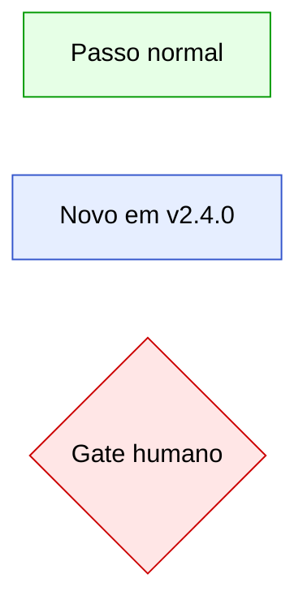

| Símbolo | Significado |
|---|---|
| `[ ]` | Passo / ação |
| `{ }` | Gate / decisão humana |
| `([ ])` | Início ou fim |
| `:::ok` | Fluxo normal (verde) |
| `:::fix` | Nó novo ou alterado em v2.4.0 (azul) |
| `:::warn` | Gate humano ou bloqueio (vermelho) |

---

## Índice rápido (19 skills)

| # | Skill | Papel | Agente | Versão |
|---|---|---|---|---|
| S01 | [sdd](#s01--sdd) | Guia do fluxo | Sessão padrão / todos | v2.4.0 |
| S02 | [sdd-setup](#s02--sdd-setup) | Configuração do fluxo | Sessão padrão | v2.4.0 |
| S03 | [sdd-status](#s03--sdd-status) | Painel de status | sdd-orquestrador / sessão padrão | v2.3.0 |
| S04 | [sdd-triar](#s04--sdd-triar) | Triagem e registro | sdd-produto | v2.4.0 |
| S05 | [sdd-iniciar](#s05--sdd-iniciar) | Compromisso e início | sdd-orquestrador / sessão padrão | v2.4.0 |
| S06 | [sdd-atender](#s06--sdd-atender) | Atendimento ao cliente | sdd-produto | v2.4.0 |
| S07 | [sdd-entrevistar](#s07--sdd-entrevistar) | Alinhamento de decisões | sdd-produto / sdd-codificador | v2.3.0 |
| S08 | [sdd-prd](#s08--sdd-prd) | Especificação de épico | sdd-produto | v2.3.0 |
| S09 | [sdd-fatiar](#s09--sdd-fatiar) | Fatias verticais | sdd-produto | v2.3.0 |
| S10 | [sdd-planejamento](#s10--sdd-planejamento) | Planejamento ágil | sdd-produto | v2.4.0 |
| S11 | [sdd-elm](#s11--sdd-elm) | Registro oficial ELM | sdd-produto / sdd-codificador / sdd-orquestrador | v2.3.0 |
| S12 | [sdd-pesquisar](#s12--sdd-pesquisar) | Pesquisa de código | sdd-pesquisador | v2.3.0 |
| S13 | [sdd-plano](#s13--sdd-plano) | Plano da fatia | sdd-codificador | v2.4.0 |
| S14 | [sdd-implementar](#s14--sdd-implementar) | Implementação TDD | sdd-codificador | v2.4.0 |
| S15 | [sdd-revisar](#s15--sdd-revisar) | Revisão independente | sdd-revisor | v2.3.0 |
| S16 | [sdd-verificar](#s16--sdd-verificar) | Verificação de aceite | sdd-verificador | v2.4.0 |
| S17 | [sdd-consolidar](#s17--sdd-consolidar) | Fechamento pós-merge | Sessão padrão | v2.4.0 |
| S18 | [sdd-aprender](#s18--sdd-aprender) | Aprendizado composto | Sessão padrão | v2.3.0 |
| S19 | [sdd-loop](#s19--sdd-loop) | Execução autônoma AFK | sdd-orquestrador | v2.4.0 |

---

## S01 — sdd

**Papel:** Guia do fluxo  | **Agente:** Sessão padrão / todos  | **Escreve em:** —  | **Versão:** v2.4.0

### Fluxograma

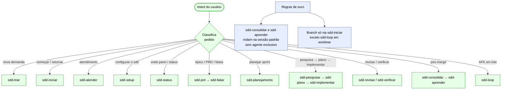

### Artefatos

| Artefato | Tipo | Ação |
|---|---|---|
| `.kiro/steering/sdd.md` | steering | lê |
| Orientação textual ao usuário | resposta | gera |

### ⚡ Mudanças v2.4.0

- **Skills sem agente exclusivo (MX-05):** `sdd-consolidar` e `sdd-aprender` rodam na sessão padrão; `sdd-iniciar` e `sdd-status` estão no `sdd-orquestrador` mas também funcionam sem ele.
- **Regra de branch (MX-05):** nenhuma skill cria branch ou `status.md` sem passar pelos Passos 3–4 do `sdd-iniciar`; exceção: `sdd-loop` (opera em worktree como orquestrador).

---

## S02 — sdd-setup

**Papel:** Configuração do fluxo  | **Agente:** Sessão padrão  | **Escreve em:** `.kiro/`, `<produto>/`, `.gitignore`  | **Versão:** v2.4.0

### Fluxograma

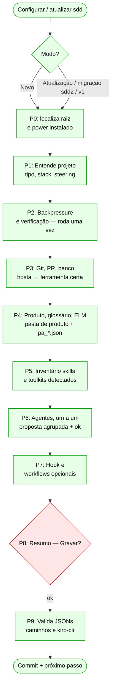

### Artefatos

| Artefato | Tipo | Ação |
|---|---|---|
| `.kiro/steering/sdd.md` | steering | cria / atualiza |
| `.kiro/agents/sdd-*.json` (6 agentes) | agentes | cria / atualiza |
| `.kiro/hooks/sdd.json` | hook | cria (opcional) |
| `.kiro/workflows/sdd-*.workflow.json` | workflows | cria (opcional) |
| `.kiro/sdd/http.sh` | script | cria (opcional) |
| `<produto>/backlog.md` | produto | cria (se ausente) |
| `<produto>/planejamento/equipe.json` | produto | cria (se ausente) |
| `<produto>/aprendizado/licoes.md` | produto | cria (se ausente) |
| `<produto>/atendimentos/README.md` | produto | cria (se ausente) |
| `.gitignore` | config | atualiza |

### ⚡ Mudanças v2.4.0

- **Suporte a `equipe.md` (MX-08):** no Passo 4 / Passo 8, aceita `equipe.json` (padrão com schema) ou `equipe.md` (Markdown alternativo) — usa o formato detectado; preferência por `equipe.json` para projetos novos.
- **Coluna `pasta` no backlog (MX-06):** `backlog.md` mínimo gerado já contempla a coluna `pasta` para épicos com pasta antecipada criada pelo `sdd-triar`.

---

## S03 — sdd-status

**Papel:** Painel de status (somente leitura)  | **Agente:** sdd-orquestrador / sessão padrão  | **Escreve em:** `status.md` (modo fechar sessão)  | **Versão:** v2.3.0

### Fluxograma

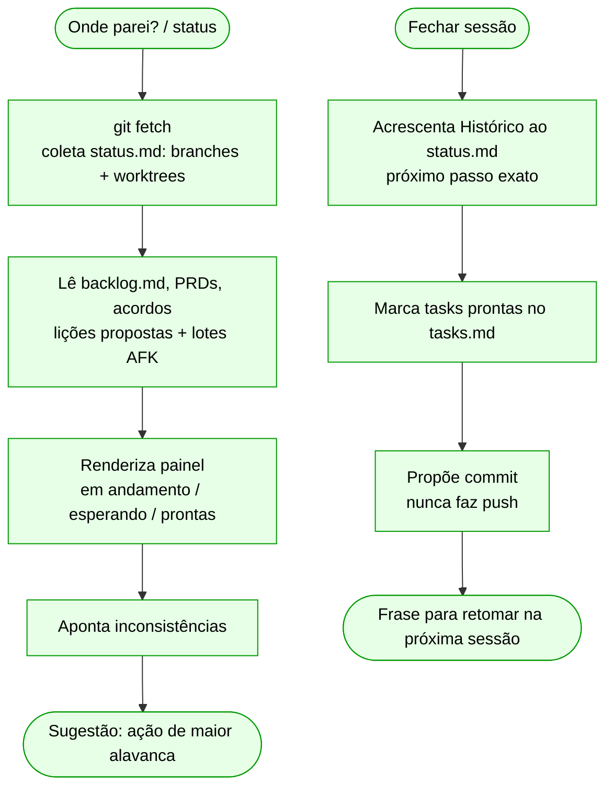

### Artefatos

| Artefato | Tipo | Ação |
|---|---|---|
| Painel textual | resposta | gera |
| `.kiro/specs/*/status.md` | spec | atualiza (modo fechar sessão) |

> Sem mudanças em v2.4.0.

---

## S04 — sdd-triar

**Papel:** Triagem e registro  | **Agente:** sdd-produto  | **Escreve em:** `<produto>/backlog.md`, fichas, pasta de épico  | **Versão:** v2.4.0

### Fluxograma

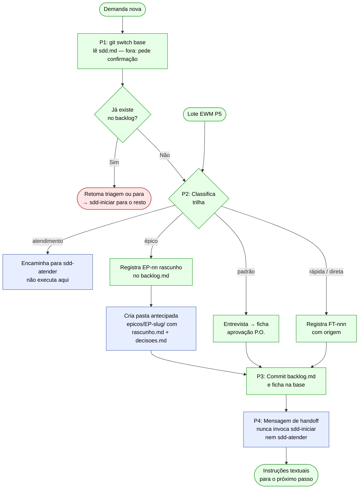

### Artefatos

| Artefato | Tipo | Ação |
|---|---|---|
| `<produto>/backlog.md` | produto | atualiza |
| `<produto>/fatias/FT-nnn-slug.md` | ficha | cria (trilha padrão) |
| `<produto>/epicos/EP-slug/rascunho.md` | épico | cria (se título > 3 palavras) |
| `<produto>/epicos/EP-slug/decisoes.md` | épico | cria (cabeçalho, se título > 3 palavras) |

### ⚡ Mudanças v2.4.0

- **Handoff textual (MX-04):** P4 encerra com mensagem de instrução pura — a skill não invoca nem simula `sdd-iniciar`, `sdd-atender` nem outra skill.
- **Pasta antecipada de épico (MX-06):** ao registrar épico com título > 3 palavras, cria `<produto>/epicos/<EP>-<slug>/` com `rascunho.md` (pedido original) e `decisoes.md` (só cabeçalho da tabela). Adiciona coluna `pasta` no `backlog.md`.
- **Atendimento → encaminhamento obrigatório (MX-04):** demandas classificadas como atendimento são encaminhadas para `sdd-atender`; a triagem não as executa.

---

## S05 — sdd-iniciar

**Papel:** Compromisso e início  | **Agente:** sdd-orquestrador / sessão padrão  | **Escreve em:** `.kiro/specs/*/`, branch, EWM  | **Versão:** v2.4.0

### Fluxograma

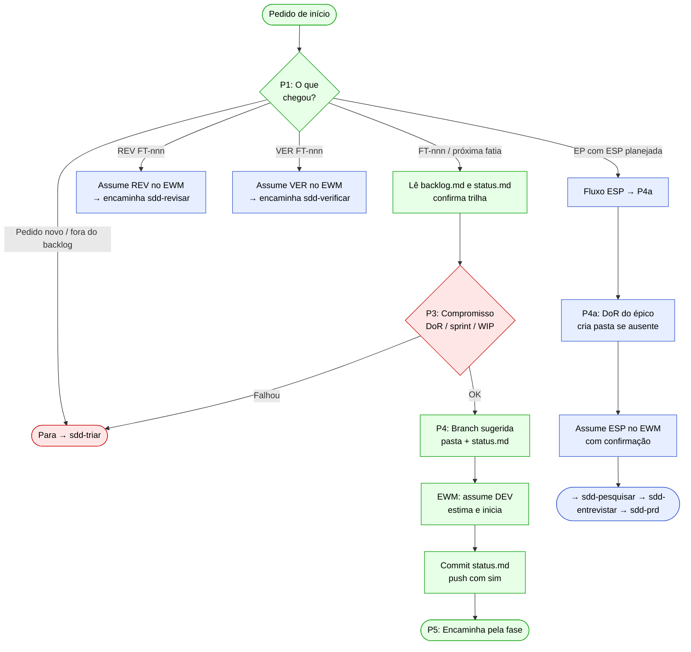

### Artefatos

| Artefato | Tipo | Ação |
|---|---|---|
| `.kiro/specs/<ft>-<slug>/status.md` | spec | cria |
| `.kiro/specs/<ft>-<slug>/.config.kiro` | spec | cria (padrão/rápida) |
| Branch da fatia | git | cria |
| EWM tarefa `[DEV]` / `[REV]` / `[VER]` | ELM | assume / cria |

### ⚡ Mudanças v2.4.0

- **[REV] e [VER] como tarefas assumíveis (MX-02):** quando chega `[REV] FT-nnn` ou `[VER] FT-nnn`, a skill assume a tarefa no EWM e encaminha diretamente para `sdd-revisar` (rubrica C) ou `sdd-verificar` — sem criar branch nova.
- **Fluxo [ESP] de épico (MX-07):** `EP-nn` com tarefa `[ESP]` planificada ativa o P4a: verifica DoR mínima, cria pasta do épico se ausente, assume `[ESP]` e encaminha para `sdd-pesquisar → sdd-entrevistar → sdd-prd`. Não cria branch de fatia.

---

## S06 — sdd-atender

**Papel:** Atendimento ao cliente  | **Agente:** sdd-produto  | **Escreve em:** `<produto>/atendimentos/`, `sprint-nn.md`, `.kiro/local/`  | **Versão:** v2.4.0

### Fluxograma

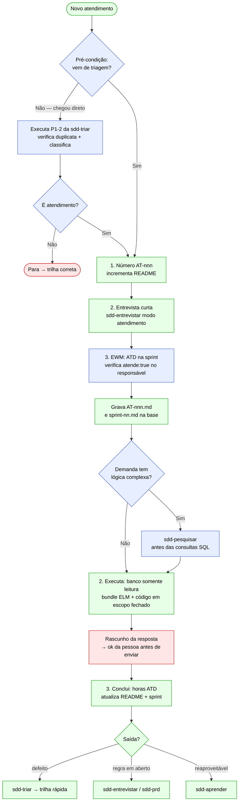

### Artefatos

| Artefato | Tipo | Ação |
|---|---|---|
| `<produto>/atendimentos/AT-nnn-slug.md` | atendimento | cria |
| `<produto>/atendimentos/README.md` | atendimento | atualiza |
| `<produto>/planejamento/sprints/sprint-nn.md` | sprint | atualiza (linha Atendimento) |
| EWM tarefa `[ATD]` | ELM | cria |
| `.kiro/local/atendimentos/AT-nnn/` | local (fora do git) | cria (extrações com dado real) |

### ⚡ Mudanças v2.4.0

- **Pré-condição obrigatória de triagem (MX-03):** se a demanda chega sem ter passado pelo `sdd-triar`, a skill executa os Passos 1–2 dele antes de abrir o atendimento; se não for atendimento, para e redireciona.
- **Verificação de `atende:true` (MX-09):** ao designar o responsável pela `[ATD]`, verifica no `equipe.json` quem tem `atende: true` e confirma se o indicado deve ser incluído.
- **`sdd-pesquisar` para lógica complexa (MX-12):** demandas com regras de cálculo ou fluxos condicionais acionam o `sdd-pesquisar` antes das consultas SQL; registra no AT a base da análise.

---

## S07 — sdd-entrevistar

**Papel:** Alinhamento de decisões  | **Agente:** sdd-produto / sdd-codificador  | **Escreve em:** `decisoes.md`, glossário  | **Versão:** v2.3.0

### Fluxograma

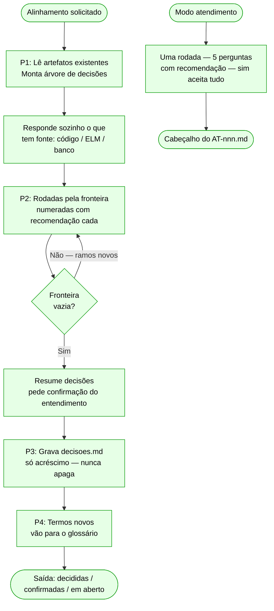

### Artefatos

| Artefato | Tipo | Ação |
|---|---|---|
| `<produto>/epicos/EP-slug/decisoes.md` ou `.kiro/specs/ft/decisoes.md` | decisões | cria / atualiza |
| `docs/glossario.md` | produto | atualiza (branch base, não na fatia) |

> Sem mudanças em v2.4.0.

---

## S08 — sdd-prd

**Papel:** Especificação de épico  | **Agente:** sdd-produto  | **Escreve em:** `<produto>/epicos/EP-slug/`  | **Versão:** v2.3.0

### Fluxograma

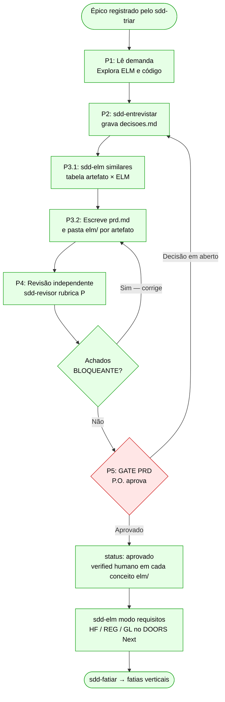

### Artefatos

| Artefato | Tipo | Ação |
|---|---|---|
| `<produto>/epicos/EP-slug/prd.md` | produto | cria |
| `<produto>/epicos/EP-slug/elm/*.md` + `index.md` + `log.md` | produto | cria |
| `<produto>/epicos/EP-slug/decisoes.md` | produto | atualiza |
| `<produto>/backlog.md` (coluna `prd`) | produto | atualiza |

> Sem mudanças em v2.4.0.

---

## S09 — sdd-fatiar

**Papel:** Fatias verticais (tracer bullets)  | **Agente:** sdd-produto  | **Escreve em:** `<produto>/backlog.md`  | **Versão:** v2.3.0

### Fluxograma

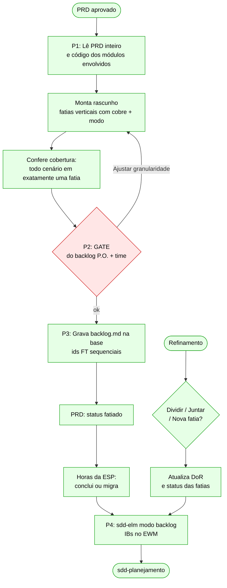

### Artefatos

| Artefato | Tipo | Ação |
|---|---|---|
| `<produto>/backlog.md` | produto | atualiza (linhas das fatias + status do épico) |
| `<produto>/epicos/EP-slug/prd.md` | produto | atualiza (status: fatiado) |

> Sem mudanças em v2.4.0.

---

## S10 — sdd-planejamento

**Papel:** Planejamento ágil  | **Agente:** sdd-produto  | **Escreve em:** `<produto>/planejamento/`, `backlog.md`  | **Versão:** v2.4.0

### Fluxograma

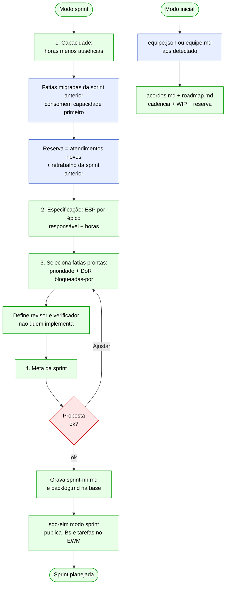

### Artefatos

| Artefato | Tipo | Ação |
|---|---|---|
| `<produto>/planejamento/sprints/sprint-nn.md` | planejamento | cria |
| `<produto>/planejamento/equipe.json` ou `equipe.md` | planejamento | cria / atualiza |
| `<produto>/planejamento/acordos.md` | planejamento | cria / atualiza |
| `<produto>/planejamento/roadmap.md` | planejamento | cria / atualiza |
| `<produto>/backlog.md` (sprint + responsavel + status) | produto | atualiza |

### ⚡ Mudanças v2.4.0

- **Reserva de atendimento ampliada (MX-08):** cobre atendimentos novos **e** retrabalho da sprint anterior; as fatias migradas consomem capacidade antes da seleção de novas fatias.
- **Suporte a `equipe.md` (MX-08):** aceita `equipe.json` (padrão, com validação de schema) ou `equipe.md` (Markdown alternativo, validado pela presença das colunas obrigatórias). Prefere `equipe.json` para projetos novos.

---

## S11 — sdd-elm

**Papel:** Registro oficial ELM  | **Agente:** sdd-produto / sdd-codificador / sdd-orquestrador (com MCP elm)  | **Escreve em:** ELM (DOORS, EWM, ETM), repositório  | **Versão:** v2.3.0

_Skill com múltiplos modos — dois diagramas abaixo._

### Fluxograma 1 — Modos de publicação (similares / requisitos / backlog / sprint)

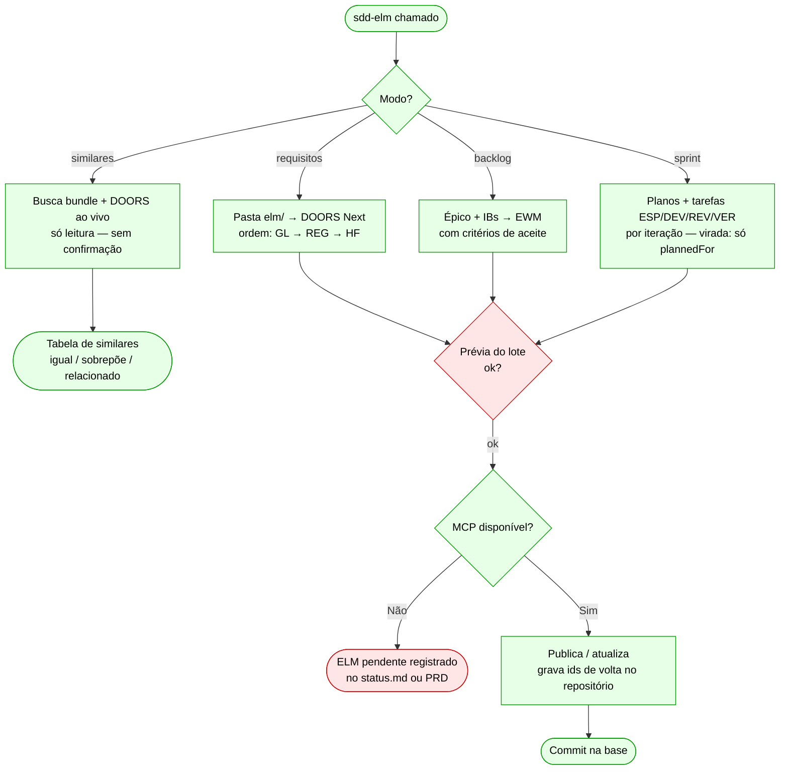

### Fluxograma 2 — Modos operacionais (atendimento / horas / testes / ET / conclusão)

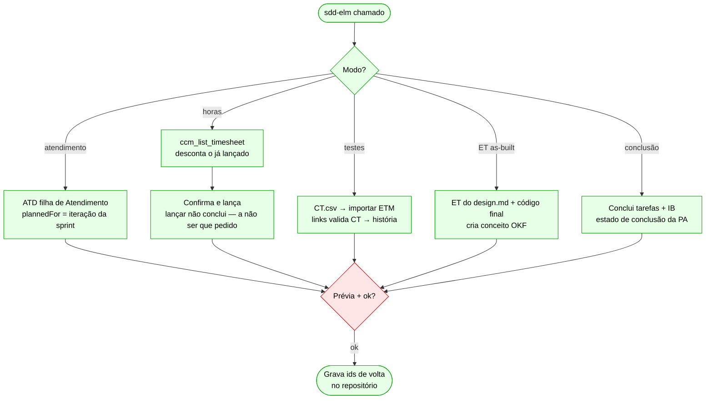

### Artefatos

| Artefato | Tipo | Ação |
|---|---|---|
| DOORS Next (HF, REG, GL) | ELM | cria / atualiza |
| EWM (IBs, tarefas, planos de iteração) | ELM | cria / atualiza |
| ETM (casos de teste, links) | ELM | importa / linka |
| Conceitos `elm/*.md` + `log.md` | repositório | atualiza (ids, resource) |
| `<produto>/backlog.md` (coluna `elm`) | produto | atualiza |

> Sem mudanças em v2.4.0.

---

## S12 — sdd-pesquisar

**Papel:** Pesquisa de código  | **Agente:** sdd-pesquisador  | **Escreve em:** `research.md`  | **Versão:** v2.3.0

### Fluxograma

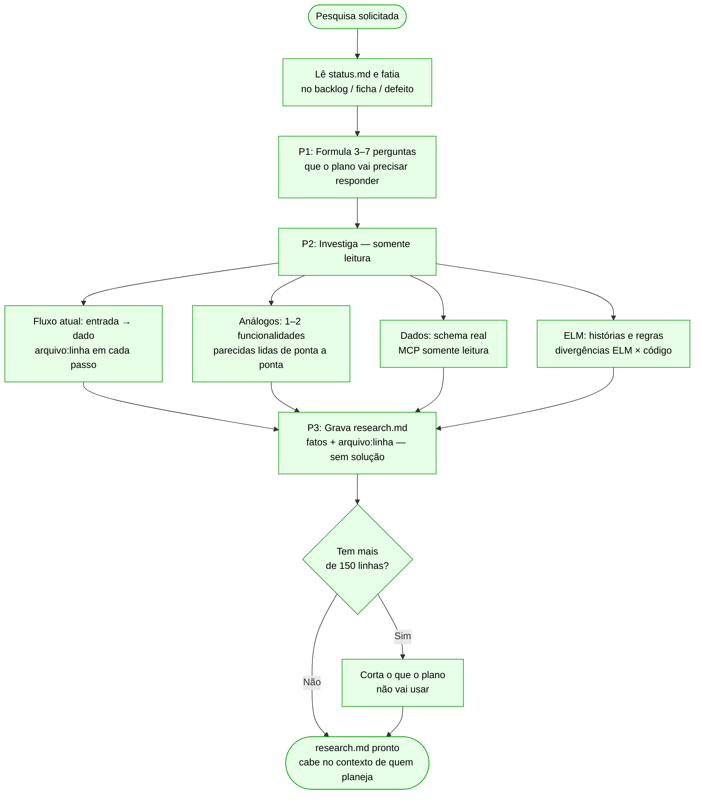

### Artefatos

| Artefato | Tipo | Ação |
|---|---|---|
| `.kiro/specs/<ft>-<slug>/research.md` | spec | cria |

> Sem mudanças em v2.4.0.

---

## S13 — sdd-plano

**Papel:** Plano da fatia  | **Agente:** sdd-codificador  | **Escreve em:** `.kiro/specs/<ft>/`  | **Versão:** v2.4.0

### Fluxograma

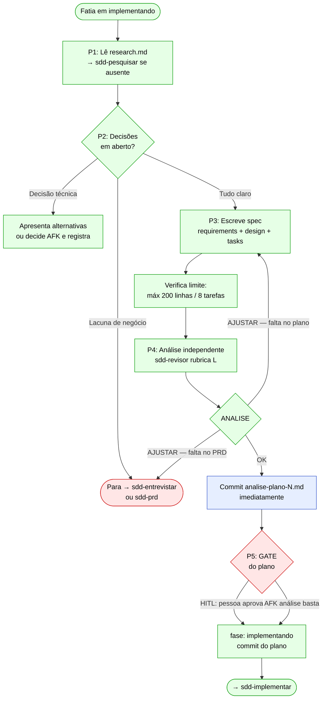

### Artefatos

| Artefato | Tipo | Ação |
|---|---|---|
| `.kiro/specs/<ft>-<slug>/requirements.md` ou `bugfix.md` | spec | cria |
| `.kiro/specs/<ft>-<slug>/design.md` | spec | cria |
| `.kiro/specs/<ft>-<slug>/tasks.md` | spec | cria |
| `.kiro/specs/<ft>-<slug>/analise-plano-N.md` | spec | commita (após ANALISE: OK) |

### ⚡ Mudanças v2.4.0

- **Commit imediato do `analise-plano-N.md` (MX-01):** com `ANALISE: OK`, a skill commita `analise-plano-<N>.md` antes de ir ao GATE do plano. O PR e a implementação citam esse arquivo; ele precisa estar na branch.

---

## S14 — sdd-implementar

**Papel:** Implementação TDD  | **Agente:** sdd-codificador  | **Escreve em:** código, testes, `status.md`, relatórios  | **Versão:** v2.4.0

### Fluxograma

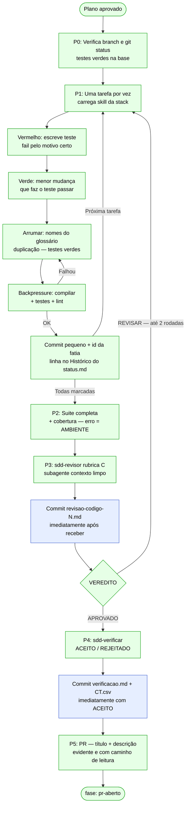

### Artefatos

| Artefato | Tipo | Ação |
|---|---|---|
| Código de produção e testes | repositório | cria / altera |
| `.kiro/specs/<ft>/revisao-codigo-N.md` | spec | commita (imediatamente ao receber) |
| `.kiro/specs/<ft>/verificacao.md` | spec | commita (imediatamente com ACEITO) |
| `.kiro/specs/<ft>/CT.csv` | spec | commita (imediatamente com ACEITO) |
| `.kiro/specs/<ft>/status.md` | spec | atualiza (fase + histórico) |

### ⚡ Mudanças v2.4.0

- **Commit imediato do `revisao-codigo-N.md` (MX-01):** assim que o revisor grava o relatório, a skill faz commit `FT-nnn registrar revisão N` antes de qualquer outra ação. O PR cita esse arquivo.
- **Commit imediato de `verificacao.md` + `CT.csv` (MX-01):** com `ACEITO`, commita `FT-nnn registrar verificação` antes de abrir o PR. Ambos precisam estar na branch antes da abertura.

---

## S15 — sdd-revisar

**Papel:** Revisão independente  | **Agente:** sdd-revisor  | **Escreve em:** relatório de revisão (nunca edita artefatos)  | **Versão:** v2.3.0

### Fluxograma

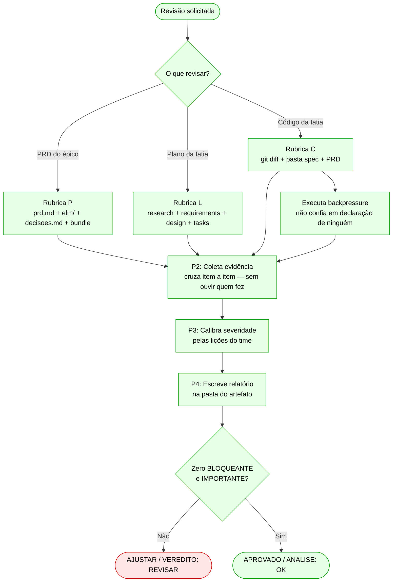

### Artefatos

| Artefato | Tipo | Ação |
|---|---|---|
| `<produto>/epicos/EP-slug/revisao-prd-N.md` | produto | cria |
| `.kiro/specs/<ft>/analise-plano-N.md` | spec | cria |
| `.kiro/specs/<ft>/revisao-codigo-N.md` | spec | cria |
| `.kiro/local/wf/<id>/plano.json` ou `codigo.json` | local | cria (quando chamado por workflow / loop) |

> Sem mudanças em v2.4.0.

---

## S16 — sdd-verificar

**Papel:** Verificação de aceite  | **Agente:** sdd-verificador  | **Escreve em:** `verificacao.md`, `CT.csv`, `evidencias/`  | **Versão:** v2.4.0

### Fluxograma

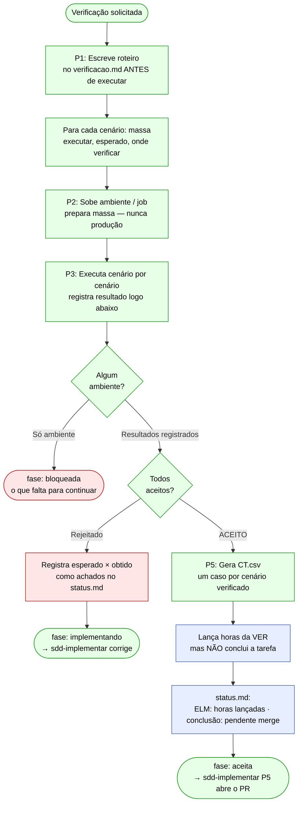

### Artefatos

| Artefato | Tipo | Ação |
|---|---|---|
| `.kiro/specs/<ft>/verificacao.md` | spec | cria |
| `.kiro/specs/<ft>/CT.csv` | spec | cria |
| `.kiro/specs/<ft>/massa/` | spec | cria (scripts de massa se necessário) |
| `.kiro/specs/<ft>/evidencias/` | spec | cria (screenshots, trechos) |
| `.kiro/local/verificacao/<ft>/` | local (fora do git) | cria (dado real de homol.) |

### ⚡ Mudanças v2.4.0

- **Horas da [VER] sem conclusão (MX-10):** com `ACEITO`, lança as horas na `[VER] FT-nnn` mas **não conclui a tarefa** — a conclusão fica para o `sdd-consolidar` após o merge, pois uma mudança pedida no PR reabre a verificação. Registra no `status.md`: `ELM: horas lançadas em [VER] FT-nnn · conclusão: pendente (merge)`.

---

## S17 — sdd-consolidar

**Papel:** Fechamento pós-merge  | **Agente:** Sessão padrão  | **Escreve em:** `status.md`, `backlog.md`, ELM, ADRs, glossário  | **Versão:** v2.4.0

### Fluxograma

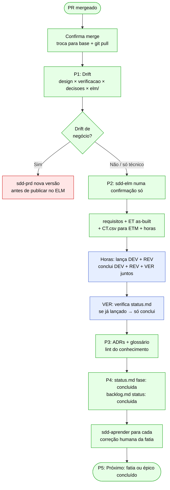

### Artefatos

| Artefato | Tipo | Ação |
|---|---|---|
| `.kiro/specs/<ft>/status.md` | spec | atualiza (fase: concluida) |
| `<produto>/backlog.md` | produto | atualiza (status: concluida + ids ELM) |
| `docs/glossario.md` | produto | atualiza (termos pendentes do decisoes.md) |
| `docs/adr/ADR-nnn.md` | produto | cria (decisões marcadas 'Vira ADR') |
| ELM (requisitos, ET, CTs, conclusão tarefas + IB) | ELM | via sdd-elm |

### ⚡ Mudanças v2.4.0

- **Conclusão da [VER] junto com [DEV] e [REV] (MX-10):** o Passo 2 conclui as três tarefas após o merge. Para a `[VER]`, verifica o campo `ELM: horas lançadas` no `status.md` — se o `sdd-verificar` já lançou, só conclui; se `ELM pendente`, lança as horas primeiro. A `[VER]` nunca é concluída antes do merge para não bloquear eventual retrabalho pedido no PR.

---

## S18 — sdd-aprender

**Papel:** Aprendizado composto  | **Agente:** Sessão padrão  | **Escreve em:** `licoes.md`, seção Regras aprendidas do `sdd.md`  | **Versão:** v2.3.0

### Fluxograma

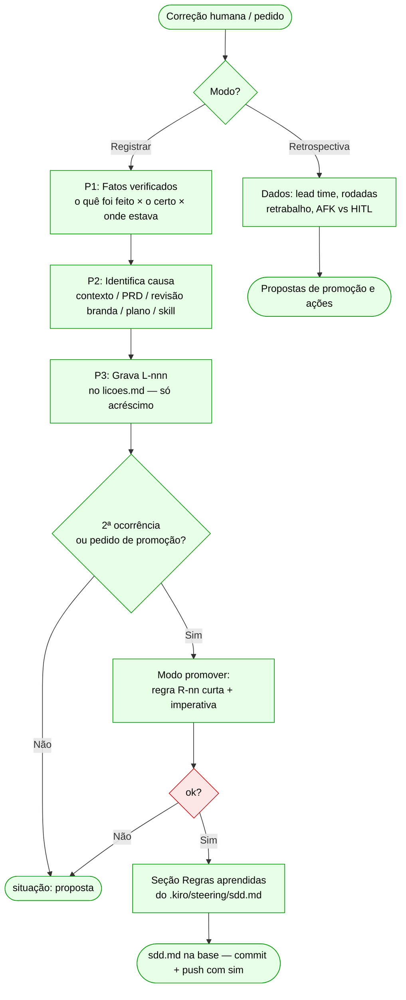

### Artefatos

| Artefato | Tipo | Ação |
|---|---|---|
| `<produto>/aprendizado/licoes.md` | aprendizado | atualiza (acréscimo) |
| `.kiro/steering/sdd.md` (seção Regras aprendidas) | steering | atualiza (com ok) |
| `<produto>/aprendizado/avaliacoes/` | aprendizado | cria (casos de avaliação, com ok) |

> Sem mudanças em v2.4.0.

---

## S19 — sdd-loop

**Papel:** Execução autônoma AFK  | **Agente:** sdd-orquestrador  | **Escreve em:** `.kiro/local/`, worktrees, via subagentes  | **Versão:** v2.4.0

_Skill com fluxo orquestrador/subagente — dois diagramas abaixo._

### Fluxograma 1 — Preparação do lote

```mermaid
flowchart TD
    A([Fatias AFK prontas]):::ok --> B[P0: Retomar?\nverifica loop-*.md existente]:::ok
    B --> C[P1: Candidatas\npronta + AFK da sprint por prioridade]:::ok
    C --> D{Fica de fora?\nHITL / direta / DoR / bloqueada / em andamento}:::ok
    D --> E[Limite: paralelismo do sdd.md\ne vagas WIP de revisão humana]:::ok
    E --> F{Proposta do lote\nConfirma?}:::warn
    F -->|Não| G([Para]):::warn
    F -->|Sim| H[Assume DEV no EWM\nsdd-elm modo sprint]:::ok
    H --> I[P2: git worktree add\n.kiro/local/wt/ft/ por fatia]:::ok
    I --> J[Cria status.md + pasta\npor fatia na worktree]:::ok
    J --> K[Grava loop-data.md\ntabela de estado por fatia]:::ok
    K --> L([Fase 1: pesquisa → início das fases]):::ok
    classDef ok   fill:#e6ffe6,stroke:#009900,color:#000
    classDef fix  fill:#e6eeff,stroke:#3355cc,color:#000
    classDef warn fill:#ffe6e6,stroke:#cc0000,color:#000
```

### Fluxograma 2 — Fases por fatia (subagentes)

```mermaid
flowchart TD
    F1[Fase 1: pesquisa\nsdd-pesquisador]:::ok --> F2[Fase 2: plano\nsdd-codificador]:::ok
    F2 --> F3[Fase 3: análise do plano\nsdd-revisor rubrica L]:::ok
    F3 --> OC1[Orquestrador commita\nanalise-plano-N.md]:::fix
    OC1 --> F4{Fase 4: GATE\ndo plano}:::warn
    F4 -->|aprovação humana| PA([Pausa fatia em plano-em-revisao\ncontinua com as outras]):::warn
    F4 -->|análise basta| F5[Fase 5: implementação\nsdd-codificador]:::ok
    F5 --> F6[Fase 6: revisão do código\nsdd-revisor rubrica C]:::ok
    F6 --> OC2[Orquestrador commita\nrevisao-codigo-N.md]:::fix
    OC2 --> F7[Fase 7: verificação\nsdd-verificador]:::ok
    F7 --> OC3[Orquestrador commita\nverificacao.md + CT.csv]:::fix
    OC3 --> F8[Fase 8: entrega\npush + PR se autorizado no lote]:::ok
    F8 --> BL{Bloqueio?}:::ok
    BL -->|sistêmico| STOP([Para lote inteiro]):::warn
    BL -->|individual| CONT[Registra e segue\ncom outras fatias]:::ok
    BL -->|PR aberto| WAIT([Aguarda revisão humana]):::ok
    classDef ok   fill:#e6ffe6,stroke:#009900,color:#000
    classDef fix  fill:#e6eeff,stroke:#3355cc,color:#000
    classDef warn fill:#ffe6e6,stroke:#cc0000,color:#000
```

### Artefatos

| Artefato | Tipo | Ação |
|---|---|---|
| `.kiro/local/loop-data.md` | local | cria / atualiza |
| `.kiro/local/wt/<ft>/` (worktrees) | local | cria / remove após merge |
| `.kiro/specs/<ft>/*` (via subagentes) | spec | criado pelos subagentes |
| `analise-plano-N.md`, `revisao-codigo-N.md`, `verificacao.md`, `CT.csv` | spec | commitado pelo orquestrador |

### ⚡ Mudanças v2.4.0

- **Commit dos relatórios pelo orquestrador (MX-01):** o `sdd-orquestrador` é responsável por commitar os relatórios após cada fase — `analise-plano-N.md` (fase 3), `revisao-codigo-N.md` (fase 6), `verificacao.md` e `CT.csv` (fase 7) — antes de iniciar a fase seguinte. Os subagentes que geram esses arquivos não fazem o commit.

---

## Resumo das mudanças v2.4.0 por skill

| Skill | MX | O que mudou |
|---|---|---|
| sdd | MX-05 | Regras de ouro: skills sem agente exclusivo + regra de criação de branch |
| sdd-setup | MX-08 | Suporte a `equipe.md` alternativo; coluna `pasta` no `backlog.md` gerado |
| sdd-triar | MX-04, MX-06 | Handoff textual (nunca invoca outra skill); pasta antecipada de épico; atendimento → encaminha obrigatório |
| sdd-iniciar | MX-02, MX-07 | `[REV]` e `[VER]` como tarefas assumíveis; fluxo P4a para EP com `[ESP]` planejada |
| sdd-atender | MX-03, MX-09, MX-12 | Pré-condição de triagem; verifica `atende:true`; aciona `sdd-pesquisar` para lógica complexa |
| sdd-plano | MX-01 | Commit imediato do `analise-plano-N.md` após `ANALISE: OK` |
| sdd-implementar | MX-01 | Commit imediato de `revisao-codigo-N.md`; commit imediato de `verificacao.md` + `CT.csv` com `ACEITO` |
| sdd-planejamento | MX-08 | Reserva = atend novo + retrabalho; migradas consomem capacidade primeiro; suporte a `equipe.md` |
| sdd-verificar | MX-10 | Lança horas da `[VER]` mas não conclui (conclusão no `sdd-consolidar` após merge) |
| sdd-consolidar | MX-10 | Conclui `[VER]` junto com `[DEV]` e `[REV]` após merge |
| sdd-loop | MX-01 | Orquestrador commita os relatórios de cada fase (analise-plano, revisao-codigo, verificacao, CT.csv) |

---

_Documento gerado automaticamente a partir das SKILL.md v2.4.0. Fontes canônicas: `/home/daniel/dataprev/kiro/powers/sdd/skills/`_
