# Plano de Melhorias — Power SDD v2.3.0

> **Versão:** 1.0.0 · **Data:** 2026-10-15 · **Power:** sdd v2.3.0 — 19 skills
> **Fontes:** validacao-skills-sdd.md · analise-sdd-atender.md · desvios D1–D5 · sugestões P1–P4
> **Status:** pronto para execução posterior

---

## Índice

| # | Título | Prioridade | Esforço | Skills |
|---|---|---|---|---|
| [MX-01](#mx-01--commit-de-relatórios-dos-papéis-independentes) | Commit de relatórios dos papéis independentes | 🔴 Alta | P (~1h) | sdd-plano, sdd-implementar, sdd-loop |
| [MX-02](#mx-02--sdd-iniciar--novo-caso-esp) | sdd-iniciar — novo caso [ESP] | 🔴 Alta | M (~2h) | sdd-iniciar, sdd-triar |
| [MX-03](#mx-03--sdd-atender-só-via-sdd-triar) | sdd-atender só via sdd-triar | 🔴 Alta | P (~1h) | sdd-atender |
| [MX-04](#mx-04--sdd-triar-não-inicia--passo-4-vira-sugestão-textual) | sdd-triar não inicia | 🔴 Alta | P (~30min) | sdd-triar |
| [MX-05](#mx-05--skills-sem-agente--mapear-responsabilidades) | Skills sem agente | 🔴 Alta | M (~2h) | sdd-setup, sdd |
| [MX-06](#mx-06--sdd-triar--criar-pasta-epicos-para-épicos-em-rascunho) | sdd-triar — criar pasta /epicos/ | 🟡 Média | P (~1h) | sdd-triar |
| [MX-07](#mx-07--sdd-iniciar--cobrir-rev-e-ver-como-tarefas-assumidas) | sdd-iniciar — cobrir [REV] e [VER] | 🟡 Média | P (~1h) | sdd-iniciar |
| [MX-08](#mx-08--sdd-planejamento--reserva-de-atendimento--atendimento--retrabalho) | Reserva = atendimento + retrabalho | 🟡 Média | P (~1h) | sdd-planejamento |
| [MX-09](#mx-09--sdd-atender--verificar-atende-true-antes-de-designar) | sdd-atender — verificar atende:true | 🟡 Média | P (~30min) | sdd-atender |
| [MX-10](#mx-10--ver-concluída-antes-do-pr--mover-para-a-consolidação) | [VER] concluída antes do PR | 🟡 Média | P (~1h) | sdd-verificar, sdd-consolidar |
| [MX-11](#mx-11--equipejson--equipémd-opcional) | equipe.json → equipe.md (opcional) | 🟢 Baixa | G (~3h) | sdd-planejamento, sdd-setup |
| [MX-12](#mx-12--sdd-atender--sugerir-sdd-pesquisar-para-demandas-complexas) | sdd-atender — sugerir sdd-pesquisar | 🟢 Baixa | P (~30min) | sdd-atender |
| [MX-13](#mx-13--sdd-triar--sdd-atender--modo-integrado-opcional) | sdd-triar + sdd-atender — modo integrado | 🟢 Baixa | M (~2h) | sdd-triar |

---

## Ordem Recomendada de Execução

```
Sprint 1 (alta prioridade, menor risco):
  MX-04 → MX-03 → MX-01 → MX-07

Sprint 2 (alta prioridade, maior escopo):
  MX-02 → MX-05

Sprint 3 (média prioridade):
  MX-09 → MX-12 → MX-06 → MX-08 → MX-10

Sprint 4 (baixa prioridade / opcional):
  MX-13 → MX-11
```

**Rationale:** MX-04 e MX-03 são cirúrgicos e corrigem problemas de fluxo imediatos. MX-01 desbloqueará MX-02 (que cria novos artefatos). MX-05 requer entender o mapa completo de agentes após MX-02 estar estabilizado. MX-08 e MX-10 têm dependências mútuas com a consolidação (aplicar juntos).

---

## Estimativa de Esforço

| Tamanho | Critério | MXs |
|---|---|---|
| P (~30min–1h) | Alteração cirúrgica em 1–2 passos de 1 skill | MX-01, MX-03, MX-04, MX-06, MX-07, MX-08, MX-09, MX-12 |
| M (~2h) | Novo passo, novo fluxo ou 2–3 skills afetadas | MX-02, MX-05, MX-10, MX-13 |
| G (~3h+) | Decisão de estrutura, múltiplos arquivos, risco de regressão | MX-11 |

**Total estimado:** ~17–20 horas (tamanhos P=8×0.75h + M=4×2h + G=1×3h)

---

---

## Grupo A — Alta Prioridade

---

## MX-01 — Commit de relatórios dos papéis independentes

**Prioridade:** 🔴 Alta
**Skills afetadas:** `sdd-plano` (Passo 4), `sdd-implementar` (Passos 3 e 4), `sdd-loop` (Passo 3)
**Origem:** A2 (verificação de artefatos — revisao-codigo-N.md, analise-plano-N.md, verificacao.md, CT.csv, research.md não commitados pelo papel que os recebe)

### Situação atual

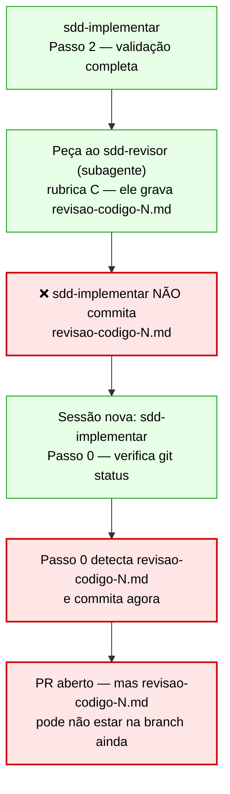

**Problema:** `sdd-revisor`, `sdd-verificador` e `sdd-pesquisador` gravam seus relatórios na pasta da fatia mas não os commitam. O commit só ocorre quando `sdd-implementar` Passo 0 roda na próxima sessão. Se o PR for aberto antes dessa sessão (por exemplo pelo `sdd-loop` ou pelo `sdd-orquestrador`), o PR citará `revisao-codigo-N.md`, `verificacao.md` e `CT.csv` que ainda não estão na branch remota.

### Situação proposta

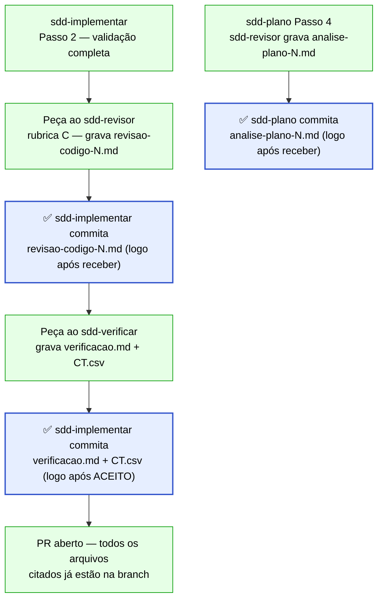

### Artefatos gerados / atualizados

| Artefato | Tipo | Ação | Criado por |
|---|---|---|---|
| `.kiro/specs/<ft>/revisao-codigo-N.md` | `.md` | Commit logo após receber do sdd-revisor | sdd-implementar (Passo 3) |
| `.kiro/specs/<ft>/verificacao.md` | `.md` | Commit logo após ACEITO do sdd-verificar | sdd-implementar (Passo 4) |
| `.kiro/specs/<ft>/CT.csv` | `.csv` | Commit junto com verificacao.md | sdd-implementar (Passo 4) |
| `.kiro/specs/<ft>/analise-plano-N.md` | `.md` | Commit logo após receber do sdd-revisor (rubrica L) | sdd-plano (Passo 4) |
| Log do loop `.kiro/local/loop-*.md` | `.md` | Commit dos relatórios após cada fase | sdd-loop (Passo 3) |

### Instruções de execução

#### `sdd-implementar/SKILL.md` — Passo 3

**Antes:**
```text
Peça ao agente **`sdd-revisor`** (subagente) a rubrica **C** passando só: id da fatia, pasta,
branch/worktree e rodada — **nunca** o seu raciocínio. Ele grava o `revisao-codigo-<N>.md`. Sem subagente
disponível (você é um agente sem essa ferramenta) → pare aqui e devolva a quem chamou: "pronta para a
revisão (rodada <N>)".
```

**Depois:**
```text
Peça ao agente **`sdd-revisor`** (subagente) a rubrica **C** passando só: id da fatia, pasta,
branch/worktree e rodada — **nunca** o seu raciocínio. Ele grava o `revisao-codigo-<N>.md`. Sem subagente
disponível (você é um agente sem essa ferramenta) → pare aqui e devolva a quem chamou: "pronta para a
revisão (rodada <N>)".

Assim que o `revisao-codigo-<N>.md` estiver gravado, **commite-o imediatamente** antes de prosseguir:
`FT-<nnn> registrar revisão <N>` — não espere a próxima sessão nem o Passo 0. O PR cita esse arquivo
e ele precisa estar na branch antes da abertura.
```

#### `sdd-implementar/SKILL.md` — Passo 4

**Antes:**
```text
Incremente "verificação" em Rodadas e siga para a **`sdd-verificar`** (cenários de aceite executados
de ponta a ponta, com evidência; de preferência pelo agente `sdd-verificador`). `ACEITO` → ela deixa
a fatia em `fase: aceita`; `REJEITADO` → devolve para cá os cenários reprovados (Passo 0).
```

**Depois:**
```text
Incremente "verificação" em Rodadas e siga para a **`sdd-verificar`** (cenários de aceite executados
de ponta a ponta, com evidência; de preferência pelo agente `sdd-verificador`). `ACEITO` → ela deixa
a fatia em `fase: aceita`; `REJEITADO` → devolve para cá os cenários reprovados (Passo 0).

Com `ACEITO`: **commite imediatamente** `verificacao.md` e `CT.csv` antes de prosseguir para o Passo 5:
`FT-<nnn> registrar verificação`. O PR cita esses arquivos e eles precisam estar na branch antes da abertura.
```

#### `sdd-plano/SKILL.md` — Passo 4

**Antes:**
```text
Incremente "revisão do plano" em Rodadas. Peça ao agente **`sdd-revisor`** (subagente) a rubrica **L**
([../sdd-revisar/references/rubricas.md](../sdd-revisar/references/rubricas.md)) — passe só a pasta da
fatia e a rodada; ele grava o `analise-plano-<N>.md`. Sem subagente disponível (agente sem essa ferramenta,
passo de workflow) → pare e devolva a quem chamou: "plano pronto para análise".
- `ANALISE: OK` → Passo 5.
- `AJUSTAR`: falta **do plano** → corrija e peça nova análise (até 2 rodadas); falta **do PRD** → Passo 2.
```

**Depois:**
```text
Incremente "revisão do plano" em Rodadas. Peça ao agente **`sdd-revisor`** (subagente) a rubrica **L**
([../sdd-revisar/references/rubricas.md](../sdd-revisar/references/rubricas.md)) — passe só a pasta da
fatia e a rodada; ele grava o `analise-plano-<N>.md`. Sem subagente disponível (agente sem essa ferramenta,
passo de workflow) → pare e devolva a quem chamou: "plano pronto para análise".
- `ANALISE: OK` → commite o `analise-plano-<N>.md` imediatamente (`FT-<nnn> registrar análise do plano <N>`)
  e siga para o Passo 5.
- `AJUSTAR`: falta **do plano** → corrija e peça nova análise (até 2 rodadas); falta **do PRD** → Passo 2.
```

#### `sdd-loop/SKILL.md` — Passo 3 (tabela de fases)

**Antes:** (após a linha da fase 3 — análise do plano)
```text
Depois de cada fase: grave a fase seguinte (`planejando` depois da pesquisa, `revisando` antes da revisão do
código), atualize o log, as Rodadas e o Histórico do `status.md`; commit pequeno na worktree
(inclusive dos relatórios do revisor e do verificador, que não commitam).
```

**Depois:**
```text
Depois de cada fase: grave a fase seguinte (`planejando` depois da pesquisa, `revisando` antes da revisão do
código), atualize o log, as Rodadas e o Histórico do `status.md`; **commite imediatamente** na worktree os
relatórios que chegaram nesta fase — `analise-plano-<N>.md` (fase 3), `revisao-codigo-<N>.md` (fase 6),
`verificacao.md` e `CT.csv` (fase 7) — antes de iniciar a fase seguinte. Esses arquivos não são commitados
pelos subagentes que os geram; o orquestrador é o responsável.
```

---

## MX-02 — sdd-iniciar — novo caso [ESP]

**Prioridade:** 🔴 Alta
**Skills afetadas:** `sdd-iniciar` (Passo 1 e Passo 4), `sdd-triar` (Passo 3)
**Origem:** D5 (EP-nn com [ESP] já planejada no EWM não tem fluxo em sdd-iniciar)

### Situação atual

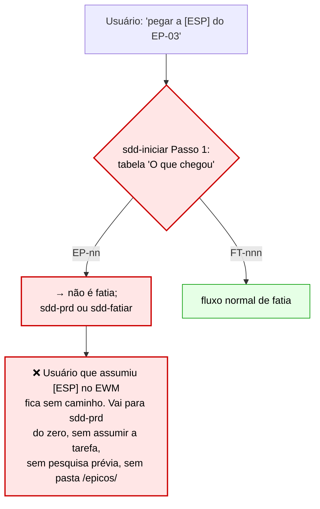

**Problema:** Quando a pessoa recebe uma tarefa `[ESP]` do EWM (já planejada na sprint, por exemplo no encaixe de especificação), o `sdd-iniciar` só sabe tratar `FT-nnn`. Para `EP-nn` a instrução é ir para `sdd-prd` ou `sdd-fatiar`, mas sem orientação de assumir a tarefa, sem criar a pasta `/epicos/` antecipada e sem pesquisa prévia.

### Situação proposta

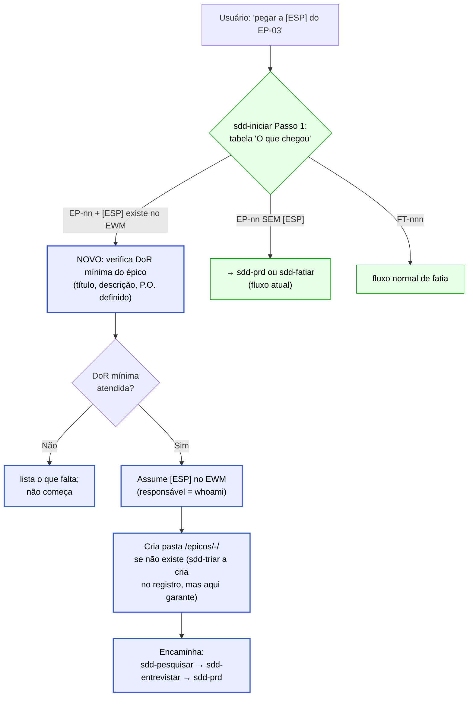

### Artefatos gerados / atualizados

| Artefato | Tipo | Ação | Criado por |
|---|---|---|---|
| `<produto>/epicos/<EP>-<slug>/` | pasta | Criar se não existe | sdd-iniciar (novo fluxo [ESP]) |
| `<produto>/epicos/<EP>-<slug>/decisoes.md` | `.md` | Criar com cabeçalho vazio | sdd-iniciar (novo fluxo [ESP]) |
| Tarefa `[ESP]` no EWM | ELM | Assumir e iniciar (responsável = whoami) | sdd-iniciar / sdd-elm |
| `<produto>/epicos/<EP>-<slug>/rascunho.md` | `.md` | Criar ao registrar épico | sdd-triar (Passo 3, MX-06 complementar) |

### Instruções de execução

#### `sdd-iniciar/SKILL.md` — Passo 1 (tabela "O que chegou")

Localizar a linha `EP-nn` na tabela e substituir por duas linhas:

**Antes:**
```text
| `EP-nn` | não é fatia: **`sdd-prd`** (ou `sdd-fatiar`, se o PRD já está aprovado) |
```

**Depois:**
```text
| `EP-nn` sem `[ESP]` assumida | não é fatia: **`sdd-prd`** (se PRD ainda não existe) ou **`sdd-fatiar`** (se PRD aprovado) |
| `EP-nn` com tarefa `[ESP]` no EWM (estado: `Novo` ou `Em andamento`) | fluxo [ESP] → Passo 4a |
```

#### `sdd-iniciar/SKILL.md` — Passo 4 (Encaminhar) — adicionar seção Passo 4a após o Passo 4 atual

**Adicionar após o bloco do Passo 4 (tabela de encaminhamento):**
```text
## Passo 4a — Fluxo [ESP] (tarefa de especificação de épico)

Para `EP-nn` com tarefa `[ESP]` detectada no Passo 1:

1. **DoR mínima do épico:** título (>5 palavras), descrição do problema (>2 frases), P.O. definido no `backlog.md`
   ou no EWM. Faltando → liste e pare: `sdd-triar` completa o registro antes.
2. **Pasta do épico:** verifique se `<produto>/epicos/<EP>-<slug>/` existe; se não → crie com `decisoes.md`
   (só o cabeçalho da tabela) e `rascunho.md` (título e a descrição do item EWM, sem dado inventado).
3. **Assumir:** pela `sdd-elm` modo *sprint* — assuma a `[ESP]` com responsável = `whoami` e inicie-a, com
   confirmação ("sim"). Sem MCP → `ELM pendente: assumir [ESP] EP-<nn>` na pasta do épico.
4. **Encaminhar:**
   ```
   🚦 EP-<nn> — <título> · [ESP] assumida · fase: especificando
   Pasta: <produto>/epicos/<EP>-<slug>/
   Próximo: sdd-pesquisar (ler código e bundle do ELM) → sdd-entrevistar → sdd-prd
   ```
   NÃO cria branch de fatia. NÃO cria status.md de fatia. NÃO registra em sprint de fatia.
```

---

## MX-03 — sdd-atender só via sdd-triar (pré-condição obrigatória)

**Prioridade:** 🔴 Alta
**Skills afetadas:** `sdd-atender` (início do fluxo, antes da Seção 1)
**Origem:** D2 + P1 da analise-sdd-atender.md (classificação falhou; pedido tratado como código)

### Situação atual

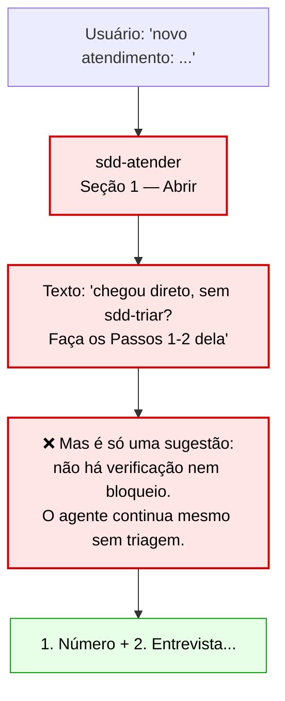

**Problema:** A `sdd-atender` tem uma menção textual ("chegou direto, sem a sdd-triar? Faça antes os Passos 1–2 dela"), mas não é uma pré-condição executável. O agente pode simplesmente ignorar e continuar. O problema P1 da `analise-sdd-atender.md` confirma: a classificação falhou e o pedido foi tratado como código, nunca chegando à `sdd-atender`.

### Situação proposta

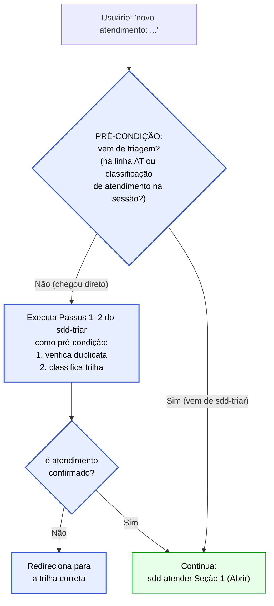

### Artefatos gerados / atualizados

| Artefato | Tipo | Ação | Criado por |
|---|---|---|---|
| Nenhum novo artefato | — | A pré-condição é um check de fluxo, não gera arquivo | — |

### Instruções de execução

#### `sdd-atender/SKILL.md` — Seção 1 "Abrir" (primeiro parágrafo)

**Antes:**
```text
Toda demanda passa pela triagem: chegou direto, sem a `sdd-triar`? Faça antes os Passos 1–2 dela
(já existe? é atendimento mesmo?).
```

**Depois:**
```text
**Pré-condição obrigatória:** toda demanda de atendimento passa pela triagem. Antes de qualquer passo
desta skill, verifique se a demanda já foi classificada como `atendimento` pela `sdd-triar` nesta sessão
ou numa sessão anterior (linha no `<produto>/atendimentos/README.md` ou encaminhamento explícito).

Chegou direto (sem triagem)? Execute os **Passos 1 e 2 da `sdd-triar`** como pré-condição:
1. Verifique duplicata (já existe AT, FT ou branch para esse pedido?).
2. Classifique a trilha: **se não for atendimento** (o pedido muda o repositório, exige regra nova, ou é
   defeito) → **pare** e redirecione para a trilha correta; não continue em `sdd-atender`.
3. Somente se a classificação for `atendimento` confirmado → prossiga para o item 1 abaixo.
```

---

## MX-04 — sdd-triar não inicia — Passo 4 vira sugestão textual

**Prioridade:** 🔴 Alta
**Skills afetadas:** `sdd-triar` (Passo 4)
**Origem:** D1 (sdd-triar Passo 4 pergunta "começar agora?" criando impressão de que a triagem inicia a fatia)

### Situação atual

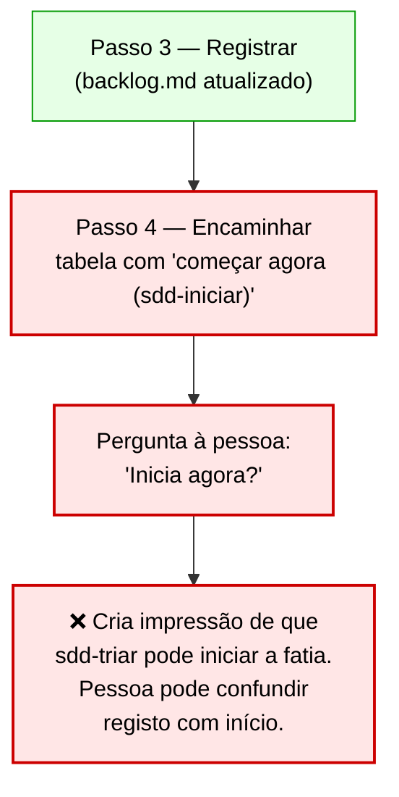

**Problema:** A linha final do Passo 4 diz "Pergunte; não comece sozinho" — o princípio está certo, mas a **tabela** do mesmo passo lista "começar agora (`sdd-iniciar`)" como uma opção de encaminhamento direta, o que cria a impressão de que a triagem pode disparar o início. O papel da `sdd-triar` é **exclusivamente** registrar.

### Situação proposta

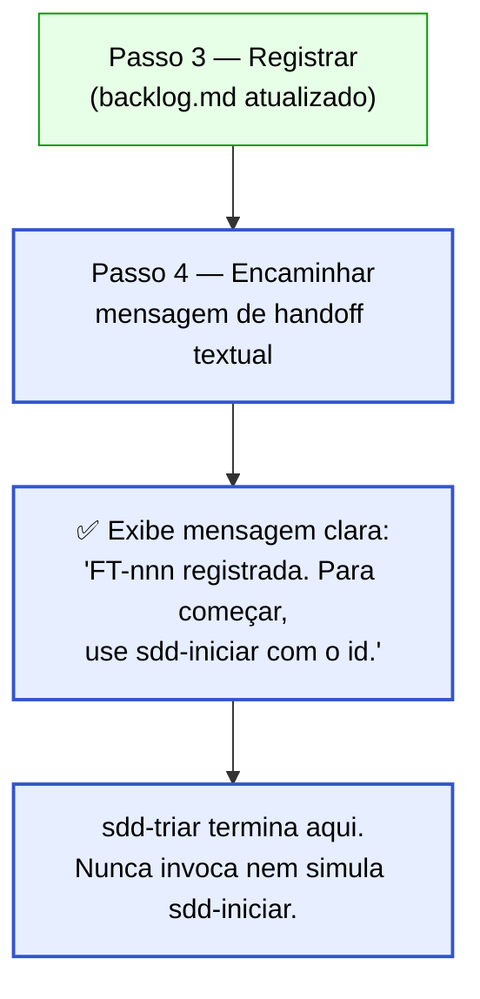

### Artefatos gerados / atualizados

| Artefato | Tipo | Ação | Criado por |
|---|---|---|---|
| Nenhum novo artefato | — | Mudança de comportamento, não de artefato | — |

### Instruções de execução

#### `sdd-triar/SKILL.md` — Passo 4 (bloco de saída e tabela)

**Antes:** (trecho do Passo 4, tabela de encaminhamento e última linha)
```text
| Registro | Próximo |
|---|---|
| épico | especificar agora (**`sdd-prd`**, com o `EP-nn`) ou deixar para o planejamento (seção Especificação da sprint) |
| fatia `pronta` (padrão, rápida, direta) | começar agora (**`sdd-iniciar`**: precisa estar na sprint aberta ou entrar por encaixe) ou deixar para o planejamento |
| fatia `backlog` | o que falta, e quem responde |
| atendimento | **`sdd-atender`** |

Pergunte; não comece sozinho.
```

**Depois:**
```text
```
📥 <FT-nnn | EP-nn | AT> — <título> · trilha <…> · <pronta | backlog: falta …> · modo <AFK | HITL | —>
Origem: <DF 4567 | IB 611 | pedido> · Ficha: <caminho | —> · EWM: <id | criado <id> | pendente | sem ELM>
Registrado. Para o próximo passo:
  - Épico → use `sdd-prd` (para especificar) ou aguarde o planejamento.
  - Fatia `pronta` → use `sdd-iniciar FT-<nnn>` para começar (precisa estar na sprint ou ter encaixe).
  - Fatia `backlog` → resolva o que falta (<item>) antes de iniciar.
  - Atendimento → use `sdd-atender`.
```

A triagem termina aqui. **Nunca invoque nem simule a `sdd-iniciar`**, mesmo que a pessoa diga "começa agora":
responda com a instrução acima e pare. Começar é responsabilidade da `sdd-iniciar`.
```

**Nota:** remover a última linha `"Pergunte; não comece sozinho."` — substituída pela instrução acima.

---

## MX-05 — Skills sem agente — mapear responsabilidades

**Prioridade:** 🔴 Alta
**Skills afetadas:** `sdd-setup` (assets/agents/), `sdd` (guia)
**Origem:** A1/O1 (sdd-consolidar e sdd-aprender sem agente; sdd-orquestrador sem git switch/pull; sdd-produto oferece início sem sdd-iniciar)

### Situação atual

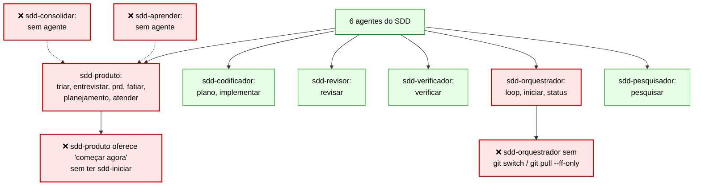

**Problema:**
- `sdd-consolidar` e `sdd-aprender` não estão em nenhum agente, portanto só funcionam na sessão padrão.
- `sdd-iniciar` e `sdd-status` estão somente no `sdd-orquestrador`, mas este não tem `git switch` nem `git pull --ff-only` em suas permissões/tools — sem elas, `sdd-iniciar` não consegue trocar de branch.
- `sdd-produto` exibe "começar agora (sdd-iniciar)" sem ter a skill `sdd-iniciar` no seu conjunto, criando confusão.

### Situação proposta

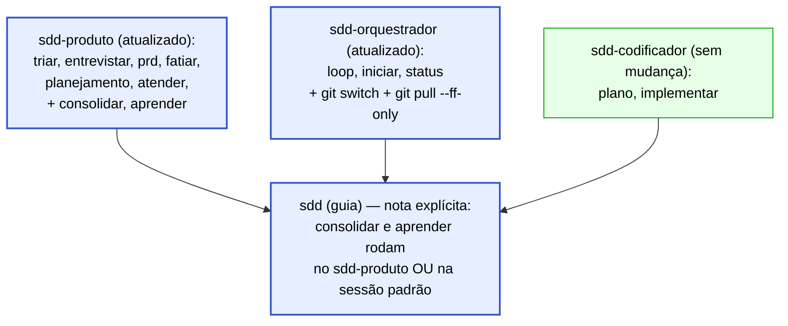

### Artefatos gerados / atualizados

| Artefato | Tipo | Ação | Criado por |
|---|---|---|---|
| `.kiro/agents/sdd-produto.json` | `.json` | Adicionar skills sdd-consolidar e sdd-aprender | sdd-setup (atualização dos agentes) |
| `.kiro/agents/sdd-orquestrador.json` | `.json` | Adicionar permissões git switch e git pull --ff-only | sdd-setup (atualização dos agentes) |
| `.kiro/steering/sdd.md` | `.md` | Atualizar tabela de agentes × skills | sdd-setup (regeneração) |
| `assets/agents/sdd-produto.json` (template) | `.json` | Adicionar skill refs para consolidar e aprender | sdd-setup skill assets |
| `assets/agents/sdd-orquestrador.json` (template) | `.json` | Adicionar git switch/pull no toolsSettings | sdd-setup skill assets |

### Instruções de execução

#### `sdd-setup/SKILL.md` — Passo 6 (tabela de agentes × skills)

Localizar a tabela de agentes com suas skills e atualizar as linhas do `sdd-produto` e `sdd-orquestrador`:

**Antes:** (linha sdd-produto na tabela de agentes)
```text
| `sdd-produto` | triar, entrevistar, prd, fatiar, planejamento, atender | ✅ escrita com confirmação |
```

**Depois:**
```text
| `sdd-produto` | triar, entrevistar, prd, fatiar, planejamento, atender, **consolidar, aprender** | ✅ escrita com confirmação |
```

**Antes:** (linha sdd-orquestrador na tabela)
```text
| `sdd-orquestrador` | loop, iniciar, status | ✅ escrita com confirmação |
```

**Depois:**
```text
| `sdd-orquestrador` | loop, iniciar, status | ✅ escrita com confirmação · **git switch e git pull --ff-only habilitados** |
```

#### `sdd-setup/SKILL.md` — Passo 9 (validação P9) — adicionar verificação

**Acrescentar ao final da lista de checagens do Passo 9:**
```text
- `sdd-produto` sem `sdd-consolidar` e `sdd-aprender` nas skills → aviso (essas skills ficam somente na
  sessão padrão; confirme se é intencional).
- `sdd-orquestrador` sem `git switch` nas permissões do agente → erro: `sdd-iniciar` precisa trocar de
  branch; adicione ao `toolsSettings` do agente.
```

#### `sdd/SKILL.md` — tabela de Agentes do Fluxo

**Antes:** (linha sdd-produto)
```text
| `sdd-produto` | triar, entrevistar, prd, fatiar, planejamento, atender | ✅ escrita com confirmação |
```

**Depois:**
```text
| `sdd-produto` | triar, entrevistar, prd, fatiar, planejamento, atender, consolidar, aprender | ✅ escrita com confirmação |
```

**Nota adicional após a tabela de agentes** — adicionar:
```text
> **Skills sem agente exclusivo:** `sdd-consolidar` e `sdd-aprender` estão no `sdd-produto` e também
> funcionam na sessão padrão (sem agente). `sdd-status` e `sdd-iniciar` requerem o `sdd-orquestrador`
> com permissão de `git switch` habilitada.
```

---

## Grupo B — Média Prioridade

---

## MX-06 — sdd-triar — criar pasta /epicos/ para épicos em rascunho

**Prioridade:** 🟡 Média
**Skills afetadas:** `sdd-triar` (Passo 3)
**Origem:** P2 (ao registrar EP-nn como rascunho, nenhuma pasta é criada para guardar contexto preliminar)

### Situação atual

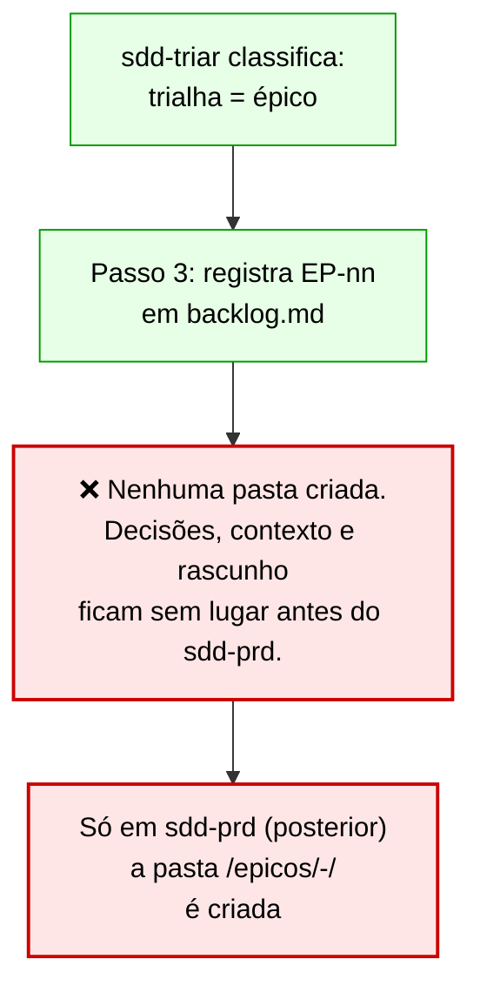

### Situação proposta

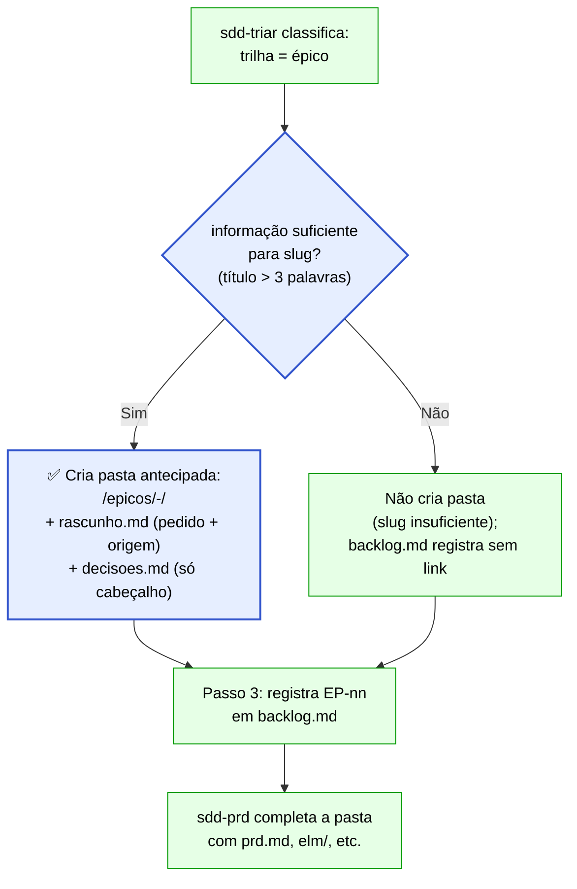

### Artefatos gerados / atualizados

| Artefato | Tipo | Ação | Criado por |
|---|---|---|---|
| `<produto>/epicos/<EP>-<slug>/rascunho.md` | `.md` | Criar com pedido original + origem | sdd-triar (Passo 3, épico) |
| `<produto>/epicos/<EP>-<slug>/decisoes.md` | `.md` | Criar com cabeçalho da tabela (vazio) | sdd-triar (Passo 3, épico) |
| `<produto>/backlog.md` | `.md` | Adicionar link para pasta (coluna `pasta`) | sdd-triar (Passo 3, épico) |

### Instruções de execução

#### `sdd-triar/SKILL.md` — Passo 3 (subseção Épico)

**Antes:**
```text
- **Épico:** próximo `EP-nn` de "Próximos ids"; linha em `## Épicos` com `status` `rascunho`, prioridade `—`
  (quem prioriza é o planejamento) e `prd` `—`. Com ELM: **`sdd-elm` modo *backlog***, só o épico
  ([EP-nn] <título>, descrição = o problema), com confirmação; o id vai para a coluna `elm`.
```

**Depois:**
```text
- **Épico:** próximo `EP-nn` de "Próximos ids"; linha em `## Épicos` com `status` `rascunho`, prioridade `—`
  (quem prioriza é o planejamento) e `prd` `—`. Com ELM: **`sdd-elm` modo *backlog***, só o épico
  (`[EP-nn] <título>`, descrição = o problema), com confirmação; o id vai para a coluna `elm`.

  **Pasta antecipada:** se o título tem mais de 3 palavras (slug formável), crie
  `<produto>/epicos/<EP>-<slug>/` com:
  - `rascunho.md`: o pedido original (nas palavras de quem pediu, sem dado inventado) + origem (EWM id,
    chamado, texto livre);
  - `decisoes.md`: só o cabeçalho da tabela `D | Pergunta | Decisão | Fonte | Data | Situação` (vazio).
  A pasta só é criada aqui; o `sdd-prd` completa com `prd.md`, `elm/` e os demais artefatos.
  Inclua o caminho relativo da pasta na coluna `pasta` do `backlog.md` (nova coluna após `prd`):
  `[pasta](epicos/<EP>-<slug>/)` ou `—` se não criada.
```

---

## MX-07 — sdd-iniciar — cobrir [REV] e [VER] como tarefas assumidas por pessoas

**Prioridade:** 🟡 Média
**Skills afetadas:** `sdd-iniciar` (Passo 1)
**Origem:** P4 (quando uma pessoa recebe tarefa [REV] ou [VER] no EWM, sdd-iniciar não tem fluxo para "assumir minha tarefa de revisar/verificar")

### Situação atual

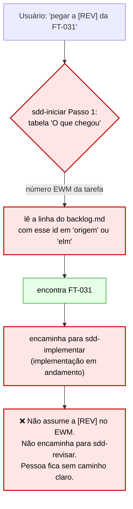

### Situação proposta

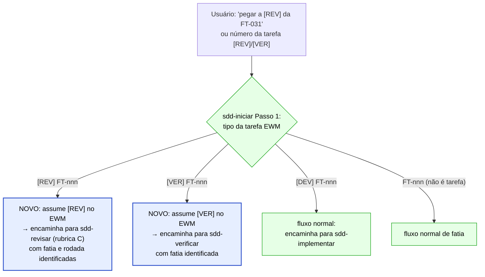

### Artefatos gerados / atualizados

| Artefato | Tipo | Ação | Criado por |
|---|---|---|---|
| Tarefa `[REV]` ou `[VER]` no EWM | ELM | Assumir e iniciar (responsável = whoami) | sdd-iniciar / sdd-elm |
| `.kiro/specs/<ft>/status.md` | `.md` | Leitura para identificar rodada atual | sdd-iniciar (somente leitura aqui) |

### Instruções de execução

#### `sdd-iniciar/SKILL.md` — Passo 1 (tabela "O que chegou")

**Antes:** (linha do número do EWM)
```text
| número do EWM (DF, IB, tarefa) | a linha do `backlog.md` com esse id em `origem` ou `elm`; tarefa `[DEV]`/`[REV]`/`[VER]` → a fatia do pai |
```

**Depois:**
```text
| número do EWM (DF, IB) | a linha do `backlog.md` com esse id em `origem` ou `elm` |
| tarefa `[DEV] FT-nnn` | a fatia pai → fluxo normal de início/retomada |
| tarefa `[REV] FT-nnn` (recebida por esta pessoa) | identifica a fatia pai → assume `[REV]` no EWM (responsável = `whoami`, inicia) com "sim" → encaminha para **`sdd-revisar`** (rubrica C), passando: fatia, pasta spec, branch, rodada atual (do `status.md`) |
| tarefa `[VER] FT-nnn` (recebida por esta pessoa) | identifica a fatia pai → assume `[VER]` no EWM (responsável = `whoami`, inicia) com "sim" → encaminha para **`sdd-verificar`**, passando: fatia, pasta spec, branch |
```

**Nota:** acrescentar após a tabela, antes da instrução sobre "Fatia já iniciada":
```text
Para tarefas `[REV]` e `[VER]`: não cria branch nova (a branch da fatia já existe); não repete o Passo 3
(compromisso); vai diretamente para sdd-revisar ou sdd-verificar após assumir no EWM. Sem o MCP → `ELM
pendente: assumir [REV|VER] FT-<nnn>` e encaminha da mesma forma.
```

---

## MX-08 — sdd-planejamento — reserva de atendimento = atendimento + retrabalho

**Prioridade:** 🟡 Média
**Skills afetadas:** `sdd-planejamento` (Modo sprint, Passo 1; Modo inicial, acordos)
**Origem:** P3 (a reserva de 20% cobre atendimento, mas retrabalho de fatias migradas não está explicitamente incluído)

### Situação atual

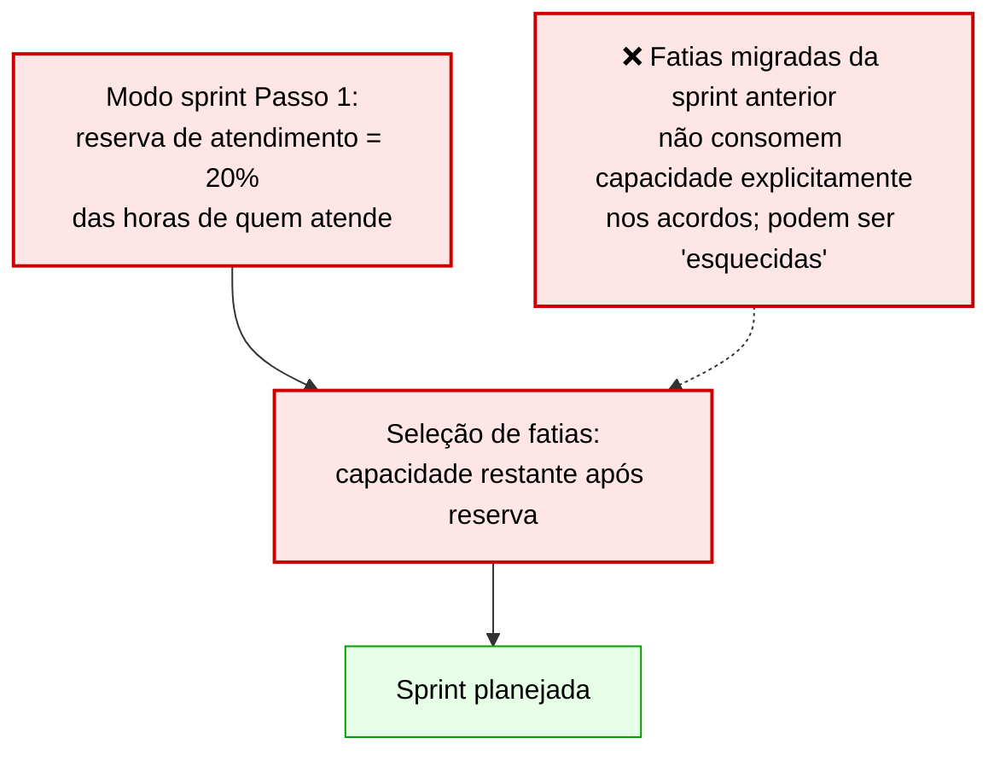

### Situação proposta

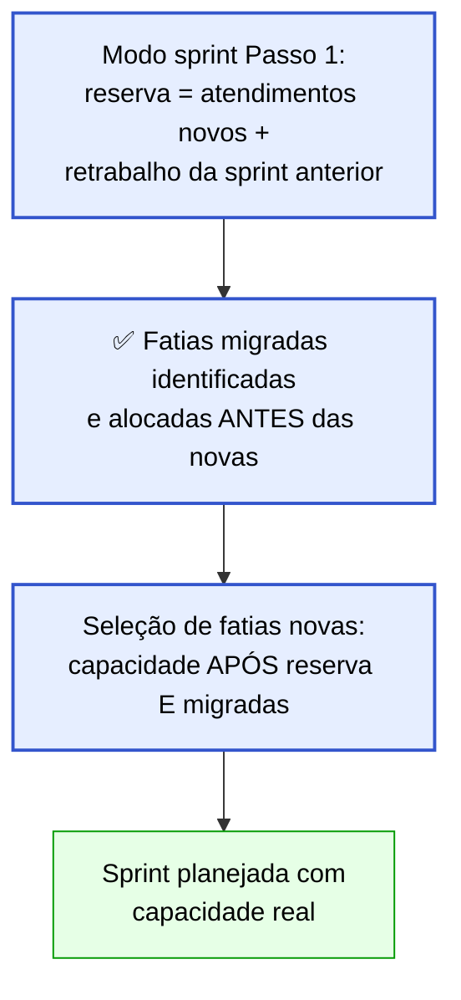

### Artefatos gerados / atualizados

| Artefato | Tipo | Ação | Criado por |
|---|---|---|---|
| `<produto>/planejamento/acordos.md` | `.md` | Atualizar definição de "reserva de atendimento" | sdd-planejamento (Modo inicial) |
| `<produto>/planejamento/sprints/sprint-<nn>.md` | `.md` | Seção Atendimento com "reserva = X + Y (retrabalho)" | sdd-planejamento (Modo sprint) |

### Instruções de execução

#### `sdd-planejamento/SKILL.md` — Modo inicial, acordos (item 2 — reserva)

**Antes:**
```text
   - **reserva de atendimento** (padrão 20% das horas de quem atende) e **lançamento de horas**
     (na conclusão de cada tarefa).
```

**Depois:**
```text
   - **reserva de atendimento** (padrão 20% das horas de quem atende, ajustável por histórico):
     a reserva cobre **atendimentos novos** (`[ATD]`) **e** o retrabalho da sprint anterior
     (fatias migradas não concluídas). No `acordos.md`, registre a definição:
     `reserva de atendimento = atendimentos novos + retrabalho (fatias migradas da sprint anterior)`.
   - **lançamento de horas** (na conclusão de cada tarefa).
```

#### `sdd-planejamento/SKILL.md` — Modo sprint, Passo 1 (reserva de atendimento)

**Antes:**
```text
   - **reserva de atendimento**: o percentual do `acordos.md` sobre as horas de quem atende,
     descontado antes de selecionar fatias.
```

**Depois:**
```text
   - **reserva de atendimento**: o percentual do `acordos.md` sobre as horas de quem atende,
     descontado antes de selecionar fatias. Calcule em duas partes:
     1. **Retrabalho:** fatias migradas da sprint anterior (não concluídas) — liste-as e aloque sua
        capacidade **primeiro**, antes de qualquer fatia nova. Elas não estão na reserva; consomem
        capacidade de entrega diretamente.
     2. **Atendimento novo:** a reserva percentual do `acordos.md` para `[ATD]` novas.
     A proposta da sprint exibe: `Atendimento: reserva <h>h (<p>% de <pessoas>) · retrabalho: <FT…>`.
```

#### `sdd-planejamento/SKILL.md` — Retrospectiva e virada (item 4)

**Antes:**
```text
4. Recalcule vazão média, velocidade e horas por tipo (`equipe.json` → `historico`), recalibre a reserva
   de atendimento pelo consumido e replaneje a próxima pelo modo sprint (migradas consomem capacidade
   primeiro).
```

**Depois:**
```text
4. Recalcule vazão média, velocidade e horas por tipo (`equipe.json` → `historico`), recalibre a reserva
   de atendimento pelo consumido e replaneje a próxima pelo modo sprint. **Migradas consomem capacidade
   de entrega primeiro** (item 1 do retrabalho, antes da reserva de atendimento novo): liste-as na
   proposta da próxima sprint como "Retrabalho: <FT…>" antes das fatias novas.
```

---

## MX-09 — sdd-atender — verificar atende:true antes de designar responsável

**Prioridade:** 🟡 Média
**Skills afetadas:** `sdd-atender` (Seção 1, item 1)
**Origem:** P2 (sdd-atender designa responsável sem verificar atende:true na equipe)

### Situação atual

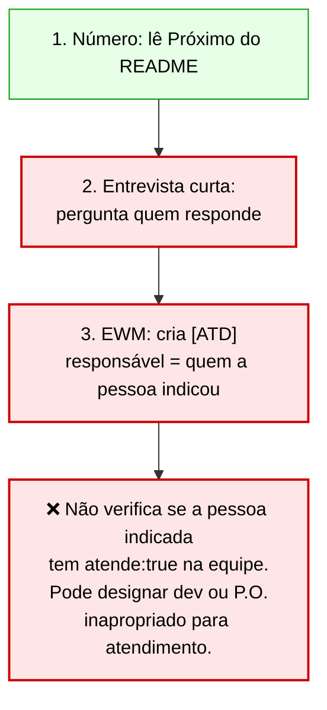

### Situação proposta

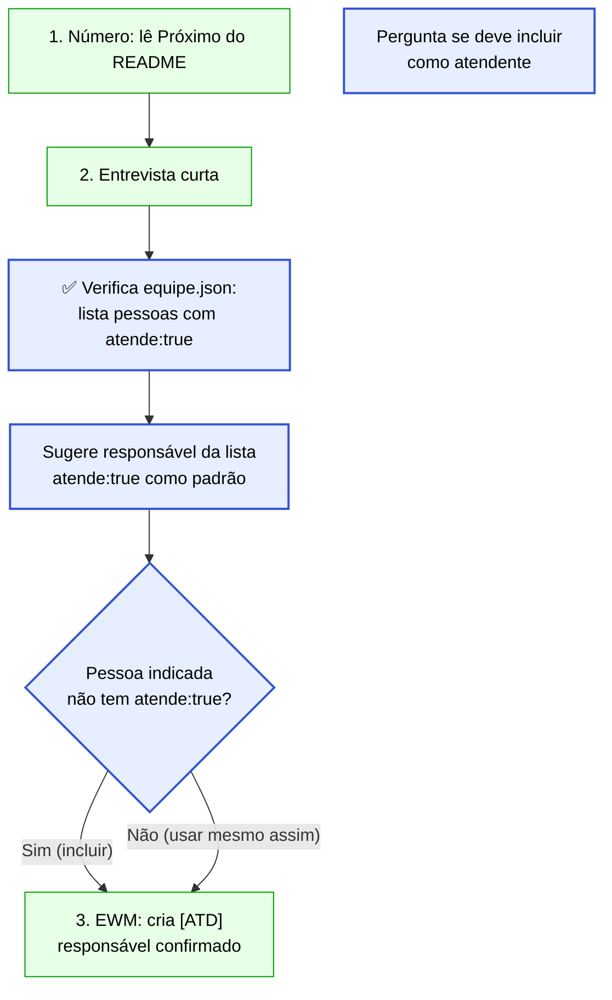

### Artefatos gerados / atualizados

| Artefato | Tipo | Ação | Criado por |
|---|---|---|---|
| `<produto>/planejamento/equipe.json` | `.json` | Leitura (campo `atende: true`) | sdd-atender (somente leitura) |
| Nenhum novo artefato gerado | — | Mudança de comportamento na designação | — |

### Instruções de execução

#### `sdd-atender/SKILL.md` — Seção 1, item 1 (Número) — acrescentar novo item após o atual item 1

**Antes:** (item 2 atual — Entrevista curta)
```text
2. **Entrevista curta** — `sdd-entrevistar` modo *atendimento* (uma rodada, com recomendação em cada
   pergunta): o que o cliente precisa receber, origem (chamado, e-mail, DF), prazo, **quem responde**,
   critério de pronto.
```

**Depois:**
```text
2. **Entrevista curta** — `sdd-entrevistar` modo *atendimento* (uma rodada, com recomendação em cada
   pergunta): o que o cliente precisa receber, origem (chamado, e-mail, DF), prazo, critério de pronto.

   **Responsável:** leia `<produto>/planejamento/equipe.json` e liste as pessoas com `"atende": true`
   como candidatas padrão. Se a pessoa indicou alguém que **não** tem `atende: true`, pergunte:
   `"<nome> não está na lista de atendentes (atende: true). Incluo como atendente ou escolho outro?"`.
   A confirmação vai para o campo `responsavel` da entrevista. Sem `equipe.json` ou campo ausente →
   continue com quem foi indicado, sem bloqueio.
```

---

## MX-10 — [VER] concluída antes do PR — mover para a consolidação

**Prioridade:** 🟡 Média
**Skills afetadas:** `sdd-verificar` (Passo 4 ACEITO), `sdd-consolidar` (Passo 2, seção horas)
**Origem:** O2/A5 (sdd-verificar conclui a [VER] antes da leitura humana do PR; mudança pedida no PR reabre verificação com a tarefa já fechada)

### Situação atual

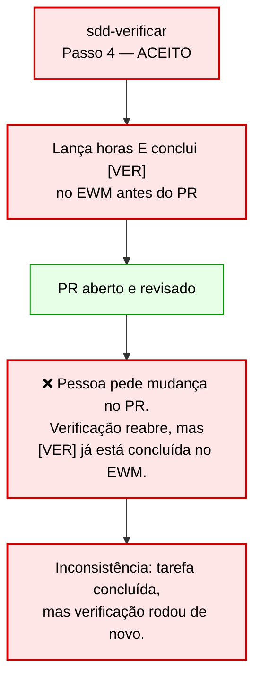

### Situação proposta

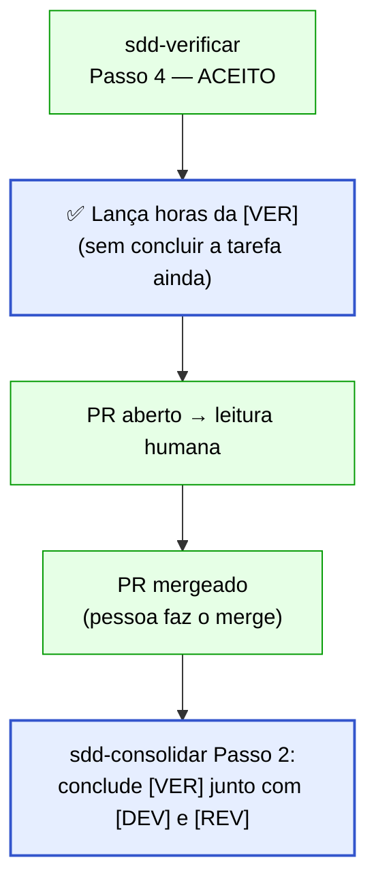

### Artefatos gerados / atualizados

| Artefato | Tipo | Ação | Criado por |
|---|---|---|---|
| `.kiro/specs/<ft>/status.md` | `.md` | Registrar horas lançadas e pendência de conclusão da [VER] | sdd-verificar (Passo 4) |
| Tarefa `[VER]` no EWM | ELM | Horas lançadas (mas NÃO concluída) no ACEITO | sdd-verificar / sdd-elm |
| Tarefa `[VER]` no EWM | ELM | Concluída após o merge | sdd-consolidar (Passo 2) |

### Instruções de execução

#### `sdd-verificar/SKILL.md` — Passo 4 (bloco ACEITO, trecho de horas e conclusão)

**Antes:**
```text
- **ACEITO** (todos aceitos) → gere o `CT.csv` (Passo 5), `fase: aceita` no `status.md` e devolva para a
  `sdd-implementar` abrir o PR (Passo 5 dela). **Horas da `[VER]`:** pergunte as horas a quem verificou
  (descontando o já lançado) → `sdd-elm` modo *horas* e *conclusão* na `[VER] FT-nnn`, com confirmação.
  Sem o MCP nesta sessão (agente `sdd-verificador`) → `ELM pendente: lançar <h>h em [VER] FT-nnn` no
  Histórico do `status.md`.
```

**Depois:**
```text
- **ACEITO** (todos aceitos) → gere o `CT.csv` (Passo 5), `fase: aceita` no `status.md` e devolva para a
  `sdd-implementar` abrir o PR (Passo 5 dela). **Horas da `[VER]`:** pergunte as horas a quem verificou
  (descontando o já lançado) → `sdd-elm` modo *horas* na `[VER] FT-nnn` (**sem** concluir a tarefa),
  com confirmação. A **conclusão da `[VER]`** acontece após o merge, no `sdd-consolidar` (junto com a
  `[DEV]` e a `[REV]`), para que uma mudança pedida no PR não gere inconsistência de tarefa fechada.
  Registre no Histórico do `status.md`: `ELM: horas lançadas em [VER] FT-nnn · conclusão: pendente (merge)`.
  Sem o MCP → `ELM pendente: lançar <h>h em [VER] FT-nnn (sem concluir)` no Histórico.
```

#### `sdd-consolidar/SKILL.md` — Passo 2 (subseção horas)

**Antes:** (trecho do Passo 2 referente às horas)
```text
- *horas* — o merge conclui a `[DEV]` e a `[REV]` (direta: só a `[DEV]`): pergunte as horas de cada
  uma (descontando o já lançado) e lance pela `sdd-elm` modo *horas*.
```

**Depois:**
```text
- *horas* — o merge conclui a `[DEV]`, a `[REV]` e a `[VER]` (direta: só a `[DEV]`): pergunte as horas
  de cada uma (descontando o já lançado) e lance pela `sdd-elm` modo *horas*. A `[VER]` tem horas já
  lançadas no ACEITO (sem conclusão); aqui lance apenas a diferença e **conclua** a tarefa. O EWM só
  aceita horas do responsável: tarefa de outra pessoa fica com
  `ELM pendente: concluir [VER] FT-nnn e lançar <h>h diferença (<login>)`.
```

---

## Grupo C — Baixa Prioridade

---

## MX-11 — equipe.json → equipe.md (opcional, se adotado)

**Prioridade:** 🟢 Baixa
**Skills afetadas:** `sdd-planejamento` (Modo inicial), `sdd-setup` (assets)
**Origem:** P1 (equipe.json é difícil de editar pelo P.O./SM diretamente; proposta de tabela Markdown)
**⚠️ Nota:** implementar somente se o time optar por Markdown. O JSON atual tem validação de schema (`equipe.schema.json`); a migração requer testar a leitura programática pelos agentes. Adotar apenas com consenso do time.

### Situação atual

```mermaid
flowchart TD
    SETUP["sdd-setup gera equipe.json\n(formato JSON com schema)"]:::ok
    PO["P.O./SM precisa editar\nequipe.json manualmente"]:::warn
    JSON["❌ JSON exige escaping,\naspas, vírgulas — difícil\npara edição direta sem IDE"]:::warn
    VALID["Validação automática\ncontra equipe.schema.json"]:::ok

    SETUP --> PO --> JSON --> VALID

    classDef warn fill:#ffe6e6,stroke:#cc0000,color:#000,stroke-width:2px;
    classDef ok fill:#e6ffe6,stroke:#009900,color:#000,stroke-width:1px;
```

### Situação proposta

```mermaid
flowchart TD
    SETUP["sdd-setup — pergunta\nno Passo 1: JSON ou Markdown?"]:::fix
    MD["Opção MD:\ngera equipe.md\n(tabela pessoas + seção histórico)"]:::fix
    JSON["Opção JSON (padrão):\nmantém equipe.json com schema"]:::ok
    PLAN["sdd-planejamento lê\nequipe.md ou equipe.json\n(detecta formato)"]:::fix
    COMPAT["⚠️ Ambos os formatos suportados\ndurante período de transição"]:::fix

    SETUP --> MD & JSON --> PLAN --> COMPAT

    classDef fix fill:#e6eeff,stroke:#3355cc,color:#000,stroke-width:2px;
    classDef ok fill:#e6ffe6,stroke:#009900,color:#000,stroke-width:1px;
```

### Artefatos gerados / atualizados

| Artefato | Tipo | Ação | Criado por |
|---|---|---|---|
| `<produto>/planejamento/equipe.md` | `.md` | Criar em substituição a equipe.json (se adotado) | sdd-setup (Passo 1, opção MD) |
| `assets/equipe-template.md` | `.md` | Novo template em Markdown | sdd-setup assets |
| `<produto>/planejamento/equipe.json` | `.json` | Manter (formato padrão) ou migrar | sdd-setup |

### Formato proposto para equipe.md

```markdown
## Pessoas

| Login | Nome | Papel | Horas/semana | Horas revisão/semana | Horas especificação/semana | Atende |
|---|---|---|---|---|---|---|
| joao.lima | João Lima | Dev | 40 | 6 | 0 | false |
| maria.silva | Maria Silva | QA | 40 | 8 | 2 | true |

## Ausências planejadas

| Login | Início | Fim | Horas ausentes |
|---|---|---|---|

## Histórico de sprints

| Sprint | Fatias concluídas | Pontos | Horas DEV | Horas REV | Horas VER | Horas ESP | Horas ATD |
|---|---|---|---|---|---|---|---|
```

### Instruções de execução

#### `sdd-setup/SKILL.md` — Passo 1 (coleta de equipe)

**Acrescentar ao final do item 1 da seção "Modo inicial":**
```text
   **Formato da equipe** (opcional — só pergunte se o time mencionar dificuldade com JSON):
   `"Prefere editar a equipe em JSON (com validação de schema) ou em Markdown (tabela, mais fácil de
   editar)? Padrão: JSON."` Se Markdown: use o template `assets/equipe-template.md` em vez do
   `equipe.schema.json`; o `sdd-planejamento` detecta o formato pelo nome do arquivo.
```

#### `sdd-planejamento/SKILL.md` — Modo inicial, item 1

**Acrescentar após "Valida JSON contra `equipe.schema.json`":**
```text
   Se o arquivo for `equipe.md` (formato Markdown): leia pelo parser de tabelas Markdown; as colunas
   mapeiam 1:1 para os campos do schema JSON. Não valide contra `equipe.schema.json` neste caso —
   valide pela presença das colunas obrigatórias (Login, Papel, Horas/semana).
```

---

## MX-12 — sdd-atender — sugerir sdd-pesquisar para demandas complexas

**Prioridade:** 🟢 Baixa
**Skills afetadas:** `sdd-atender` (Seção 2 — Executar)
**Origem:** P4 (sdd-atender vai direto para banco+bundle sem pesquisar o código, mesmo quando a demanda envolve lógica de negócio complexa)

### Situação atual

```mermaid
flowchart TD
    EXEC["Seção 2 — Executar"]:::ok
    FONTES["Fontes:\n1. banco (somente leitura)\n2. bundle do ELM\n3. código (escopo fechado)"]:::warn
    NOPESQ["❌ Para demandas com lógica complexa,\nnão há sugestão de sdd-pesquisar\nantes das consultas SQL"]:::warn
    RESP["Rascunho da resposta"]:::ok

    EXEC --> FONTES --> NOPESQ --> RESP

    classDef warn fill:#ffe6e6,stroke:#cc0000,color:#000,stroke-width:2px;
    classDef ok fill:#e6ffe6,stroke:#009900,color:#000,stroke-width:1px;
```

### Situação proposta

```mermaid
flowchart TD
    EXEC["Seção 2 — Executar"]:::ok
    CHECK{"Demanda envolve\nlógica de negócio?\n(não só dados)"}:::fix
    PESQ["✅ Sugerir sdd-pesquisar\nantes das consultas SQL"]:::fix
    FONTES["Fontes:\n1. banco (somente leitura)\n2. bundle do ELM\n3. código (escopo fechado)"]:::ok
    RESP["Rascunho da resposta"]:::ok

    EXEC --> CHECK
    CHECK -- "Sim" --> PESQ --> FONTES
    CHECK -- "Não (só dados)" --> FONTES
    FONTES --> RESP

    classDef fix fill:#e6eeff,stroke:#3355cc,color:#000,stroke-width:2px;
    classDef ok fill:#e6ffe6,stroke:#009900,color:#000,stroke-width:1px;
```

### Artefatos gerados / atualizados

| Artefato | Tipo | Ação | Criado por |
|---|---|---|---|
| Nenhum novo artefato | — | Mudança de comportamento (sugestão adicional) | — |

### Instruções de execução

#### `sdd-atender/SKILL.md` — Seção 2 "Executar", item 1

**Antes:**
```text
1. **Fontes, nesta ordem** — subagente `sdd-pesquisador`, se houver: banco pelo MCP de consulta
   (**somente leitura**) e bundle do ELM (`<rm.download.path>` do `sdd.md`). Código só se necessário
   e em escopo fechado: termos ou arquivos indicados e um limite de leitura, para não gastar tokens.
```

**Depois:**
```text
1. **Fontes, nesta ordem** — subagente `sdd-pesquisador`, se houver: banco pelo MCP de consulta
   (**somente leitura**) e bundle do ELM (`<rm.download.path>` do `sdd.md`). Código só se necessário
   e em escopo fechado: termos ou arquivos indicados e um limite de leitura, para não gastar tokens.

   **Demanda com lógica de negócio** (envolve regras, cálculos, fluxos de processo — não só uma extração
   de dados): antes de ir ao banco, sugira rodar o **`sdd-pesquisar`** (agente `sdd-pesquisador`) para
   localizar onde a lógica mora no código e no ELM. Isso evita respostas que contradizem o comportamento
   real do sistema. Se o tempo não permitir: registre no AT a limitação
   (`Nota: resposta baseada apenas no bundle do ELM e no banco; código não verificado`).
```

---

## MX-13 — sdd-triar + sdd-atender — modo integrado (opcional)

**Prioridade:** 🟢 Baixa
**Skills afetadas:** `sdd-triar` (Passo 2 e Passo 4)
**Origem:** D3 (separação gera confusão; alternativa de transição sem fusão completa)
**⚠️ Nota:** este MX é uma alternativa ao invés de fundir as skills. Ativa somente se o time decidir pela integração. Conflita com MX-04 (que reforça a separação) — implementar um OU outro, nunca ambos para a mesma interação de atendimento.

### Situação atual

```mermaid
flowchart TD
    TRIA["sdd-triar classifica:\ntrilha = atendimento"]:::ok
    P4["Passo 4: encaminha para sdd-atender"]:::warn
    SESS["❌ Usuário precisa iniciar\nnovamente com 'novo atendimento'.\nDuas invocações para um mesmo fluxo."]:::warn

    TRIA --> P4 --> SESS

    classDef warn fill:#ffe6e6,stroke:#cc0000,color:#000,stroke-width:2px;
    classDef ok fill:#e6ffe6,stroke:#009900,color:#000,stroke-width:1px;
```

### Situação proposta

```mermaid
flowchart TD
    TRIA["sdd-triar classifica:\ntrilha = atendimento"]:::ok
    PERGUNTA["Passo 4: pergunta\n'É atendimento. Abro o AT agora?'"]:::fix
    SIM["Sim → transiciona para\nfluxo sdd-atender na mesma sessão"]:::fix
    NAO["Não → handoff textual\n'use sdd-atender'"]:::ok
    AT["sdd-atender abre AT-nnn\n(pré-condição já satisfeita)"]:::fix

    TRIA --> PERGUNTA
    PERGUNTA -- "sim" --> SIM --> AT
    PERGUNTA -- "não" --> NAO

    classDef fix fill:#e6eeff,stroke:#3355cc,color:#000,stroke-width:2px;
    classDef ok fill:#e6ffe6,stroke:#009900,color:#000,stroke-width:1px;
```

### Artefatos gerados / atualizados

| Artefato | Tipo | Ação | Criado por |
|---|---|---|---|
| `<produto>/atendimentos/AT-<nnn>-<slug>.md` | `.md` | Criar (via transição para sdd-atender na mesma sessão) | sdd-triar → sdd-atender (integrado) |
| `<produto>/atendimentos/README.md` | `.md` | Atualizar Próximo + lista | sdd-triar → sdd-atender (integrado) |

### Instruções de execução

#### `sdd-triar/SKILL.md` — Passo 2 (tabela de trilhas, linha atendimento)

**Antes:**
```text
| **atendimento** | o cliente pede consulta, extração, explicação ou conferência; nada muda no repositório | `AT-nnn` pela **`sdd-atender`** (que abre e já atende, na reserva da sprint) |
```

**Depois:**
```text
| **atendimento** | o cliente pede consulta, extração, explicação ou conferência; nada muda no repositório | `AT-nnn` pela **`sdd-atender`** — ou, se o modo integrado estiver ativo (ver Passo 4), transiciona na mesma sessão |
```

#### `sdd-triar/SKILL.md` — Passo 4 (tabela de encaminhamento, linha atendimento)

**Antes:**
```text
| atendimento | **`sdd-atender`** |
```

**Depois:**
```text
| atendimento | **`sdd-atender`** — ou, se quiser abrir o AT agora: `"É um atendimento. Abro o AT agora? (sim/não)"`. Com "sim": execute o fluxo da `sdd-atender` Seção 1 (Abrir) na mesma sessão, com a pré-condição já satisfeita (a triagem acabou de confirmar a classificação). Com "não": handoff textual `"use sdd-atender"`. **Nunca transicione sem confirmar.** |
```

**Nota:** esta opção é mutuamente exclusiva com a forma estrita do MX-04 para atendimentos. Se o time adotar MX-13, o MX-04 ainda se aplica para as demais trilhas (fatia, épico, rápida, direta).

---

## Checklist de Validação

> Como saber que cada MX foi implementado corretamente.

### MX-01 — Commit de relatórios

- [ ] Após `sdd-revisar` gerar `revisao-codigo-N.md`, um commit com mensagem `FT-<nnn> registrar revisão <N>` aparece no log da branch **antes** do próximo passo.
- [ ] Após `sdd-verificar` retornar ACEITO, um commit com `FT-<nnn> registrar verificação` aparece **antes** do Passo 5 (PR).
- [ ] Após `sdd-revisar` (rubrica L) gerar `analise-plano-N.md`, um commit com `FT-<nnn> registrar análise do plano <N>` aparece **antes** do GATE.
- [ ] No `sdd-loop`, o log do loop registra commit dos relatórios após cada fase, e o `sdd-implementar` Passo 0 não precisa mais fazer esse commit retroativo.
- [ ] `git log --name-only` mostra `revisao-codigo-N.md` e `verificacao.md` na branch **antes** do commit de abertura do PR.

### MX-02 — Novo caso [ESP]

- [ ] Ao digitar `"pegar a [ESP] do EP-03"` no `sdd-iniciar`, o agente **não** vai para `sdd-prd` do zero.
- [ ] O agente verifica DoR mínima do épico e lista o que falta se incompleto.
- [ ] A pasta `<produto>/epicos/<EP>-<slug>/` é criada se não existia.
- [ ] A tarefa `[ESP]` no EWM é assumida com `responsavel = whoami` e iniciada (estado atualizado).
- [ ] O encaminhamento é `sdd-pesquisar → sdd-entrevistar → sdd-prd` (sem criar branch de fatia).

### MX-03 — Pré-condição sdd-atender

- [ ] Ao chamar `sdd-atender` diretamente (sem triagem prévia), o agente executa os Passos 1–2 do `sdd-triar` primeiro.
- [ ] Se a classificação não for atendimento (ex.: muda o repositório), o agente **para** e redireciona — não abre AT.
- [ ] Se a classificação for atendimento, o fluxo normal da `sdd-atender` prossegue sem repetição da triagem.

### MX-04 — sdd-triar não inicia

- [ ] O Passo 4 da `sdd-triar` exibe a mensagem de handoff formatada (bloco com FT-nnn, trilha, registrado, Próximo).
- [ ] O Passo 4 **nunca** invoca nem simula `sdd-iniciar`, mesmo com "começa agora" da pessoa.
- [ ] A linha final `"Pergunte; não comece sozinho."` foi substituída pela instrução clara de parada.
- [ ] Teste: digitar `"começa agora"` após triagem → o agente responde com a instrução de usar `sdd-iniciar`, sem criar branch ou pasta.

### MX-05 — Skills sem agente

- [ ] `sdd-produto.json` lista `sdd-consolidar` e `sdd-aprender` nas suas skills.
- [ ] `sdd-orquestrador.json` tem `git switch` e `git pull --ff-only` habilitados no `toolsSettings`.
- [ ] `kiro-cli agent validate` passa para todos os 6 agentes sem erros sobre skills ausentes.
- [ ] A tabela de agentes no `sdd.md` está atualizada refletindo o novo mapeamento.
- [ ] A nota "Skills sem agente exclusivo" está presente na seção de agentes do guia.

### MX-06 — Pasta /epicos/ antecipada

- [ ] Ao registrar um épico com título de mais de 3 palavras, `sdd-triar` cria `<produto>/epicos/<EP>-<slug>/`.
- [ ] A pasta contém `rascunho.md` (com o pedido original) e `decisoes.md` (com o cabeçalho vazio).
- [ ] O `backlog.md` tem a coluna `pasta` preenchida com o link relativo.
- [ ] Épico com título curto (≤3 palavras): pasta **não** é criada; coluna `pasta` = `—`.
- [ ] `sdd-prd` encontra a pasta existente e não a recria (complementa com `prd.md` e `elm/`).

### MX-07 — [REV] e [VER] no sdd-iniciar

- [ ] Ao fornecer o número EWM de uma `[REV] FT-031`, o `sdd-iniciar` identifica a fatia pai.
- [ ] O agente assume a `[REV]` no EWM (responsável = whoami) e inicia a tarefa (com "sim").
- [ ] O encaminhamento é para `sdd-revisar` com rubrica C e a rodada correta (lida do `status.md`).
- [ ] Mesmo fluxo para `[VER]`: assume no EWM → encaminha para `sdd-verificar`.
- [ ] Sem MCP: `ELM pendente: assumir [REV|VER]` registrado; encaminhamento acontece mesmo assim.

### MX-08 — Reserva = atendimento + retrabalho

- [ ] O `acordos.md` gerado pelo `sdd-planejamento` modo inicial contém a definição: `reserva = atendimentos novos + retrabalho (fatias migradas)`.
- [ ] Na proposta de sprint, a linha de Atendimento exibe: `reserva <h>h (<p>%) · retrabalho: <FT…>`.
- [ ] Fatias migradas aparecem **antes** das fatias novas na seleção da sprint.
- [ ] A virada de sprint menciona "Migradas consomem capacidade de entrega primeiro".

### MX-09 — Verificar atende:true

- [ ] Ao abrir um AT, o agente lê `equipe.json` e lista pessoas com `atende: true` como candidatas.
- [ ] Se a pessoa indicou alguém sem `atende: true`, a pergunta de confirmação é feita.
- [ ] Sem `equipe.json` ou campo ausente: o fluxo continua sem bloqueio.

### MX-10 — [VER] concluída apenas no consolidar

- [ ] Ao retornar ACEITO, `sdd-verificar` lança horas na `[VER]` mas **não** conclui a tarefa.
- [ ] O `status.md` registra: `ELM: horas lançadas em [VER] FT-nnn · conclusão: pendente (merge)`.
- [ ] No `sdd-consolidar` Passo 2, a `[VER]` é concluída junto com `[DEV]` e `[REV]`.
- [ ] Teste: simular mudança pedida no PR após ACEITO — a `[VER]` ainda está aberta e pode ser reaberta sem inconsistência de tarefa fechada.

### MX-11 — equipe.md (opcional)

- [ ] `sdd-setup` pergunta o formato preferido no Passo 1 (somente se o time mencionar dificuldade com JSON).
- [ ] Com resposta "Markdown": `equipe.md` é gerado com a tabela no formato especificado.
- [ ] `sdd-planejamento` detecta `equipe.md` e lê as colunas sem erro.
- [ ] Com resposta "JSON" (padrão): `equipe.json` é gerado normalmente; nada muda.

### MX-12 — Sugerir sdd-pesquisar

- [ ] Para demandas que mencionam lógica de negócio (regras, cálculos, fluxos), `sdd-atender` sugere `sdd-pesquisar` antes das consultas SQL.
- [ ] Para extrações simples de dados (sem lógica), a sugestão **não** é feita (evitar overhead).
- [ ] Quando o tempo não permite pesquisa: a nota `"resposta baseada apenas no bundle do ELM e no banco"` aparece no registro AT.

### MX-13 — Modo integrado (opcional)

- [ ] Ao classificar como atendimento, `sdd-triar` pergunta `"É atendimento. Abro o AT agora?"`.
- [ ] Com "sim": o fluxo `sdd-atender` Seção 1 (Abrir) é executado na mesma sessão, sem reinvocação.
- [ ] Com "não": handoff textual `"use sdd-atender"` e a `sdd-triar` termina.
- [ ] Para outras trilhas (épico, padrão, rápida, direta), o comportamento do MX-04 se mantém (handoff textual puro, sem pergunta de início).

---

*Fim do plano de melhorias — sdd v2.3.0 · 13 melhorias · Gerado em 2026-10-15*
