# Validação e verificação das skills do power `sdd` (v2.4.0)

> Gerado em 2026-10-15 sobre o commit `703c7fb` de `powers/sdd/` (19 skills `sdd-*`). Só leitura: nada no power
> foi alterado. Substitui, para a v2.4.0, a rodada anterior (`validacao-skills-sdd-2026-10-15.md`, commit `3b727bd`).

## Objetivo

Validar se o fluxo de desenvolvimento proposto pelo power `sdd` é coeso, com fluxos bem definidos, e se a execução
literal das regras produz o que foi proposto, inclusive os arquivos que cada fluxo grava. Esta rodada também confere
o texto contra uma **divergência já apontada pelo dono do fluxo** (D0): a entrada única (`sdd-triar` +
`sdd-atender`) terminando no `backlog.md`, e — no refinamento — skills por papel com a `sdd-iniciar` como hub e dois
modos de execução (HITL assíncrono por pessoa × AFK em fluxo único).

## Sumário

1. [Método](#método)
2. [Parte 1 — Mapeamento dos fluxos de trabalho](#parte-1--mapeamento-dos-fluxos-de-trabalho-orquestrador--opus)
3. [D0 — Divergência apontada pelo dono](#d0--divergência-apontada-pelo-dono-entrada-única-e-início-único)
4. [Resultados por skill — fluxo de execução (Mermaid) e divergências](#resultados-por-skill--fluxo-de-execução-e-divergências)
   — S01 a S19
5. [Parte 5 — Consolidação](#parte-5--consolidação-orquestrador--opus)
6. [Anexo A — Partes 2, 3 e 4 por grupo](#anexo-a--partes-2-3-e-4-por-grupo-saída-dos-agentes)
7. [Plano de correção e ajuste das skills, em etapas](#plano-de-correção-e-ajuste-das-skills-em-etapas)

## Método

| Parte | Quem executou | Entrada | Saída |
|---|---|---|---|
| 1 · Mapeamento dos fluxos | orquestrador (Opus) | README, guia `sdd`, os 19 `SKILL.md`, agentes, diff desde a rodada anterior | mapa macro, handoffs, máquinas de estado, D0, o que mudou desde `3b727bd` |
| 2 · Plano do fluxo esperado | 5 agentes **Sonnet**, um por grupo | `SKILL.md` + `references/` + `assets/` | um item por fluxo: gatilho → pré-condições → processamento → resultado, com lacunas |
| 3 · Teste do Quarto Chinês | 5 agentes **Haiku**, executor mecânico | o plano da Parte 2 + o texto das regras, sem contexto global | por fluxo e por uma variação de borda: input exato → regra aplicada (arquivo:linha) → output, com veredito |
| 4 · Persistência e artefatos | 5 agentes **Sonnet** | Partes 2 e 3 + templates, schemas, permissões dos agentes | por arquivo: diretório, formato, estrutura, sucesso, diretório inacessível; confirma ou refuta a Parte 3 |
| Fluxo em Mermaid | 5 agentes **Sonnet** (por skill) · orquestrador (fluxos-alvo do D0) | Parte 2 + fonte | um diagrama por skill (até 3 nas grandes), com as lacunas em vermelho; sintaxe validada pelo orquestrador (`mermaid.parse`) |
| Divergências por skill | 5 agentes **Sonnet** | Partes 2–4 + fonte | lista deduplicada por skill, cada item conferido na fonte, com correção sugerida |
| 5 · Consolidação e plano | orquestrador (**Opus**) | tudo acima + conferência na fonte das divergências de severidade Alta | matriz, achados transversais, veredito, plano de correção em etapas |

Grupos: **G1** = S01 `sdd`, S02 `sdd-setup`, S03 `sdd-status` · **G2** = S04 `sdd-triar`, S05 `sdd-iniciar`,
S06 `sdd-atender`, S07 `sdd-entrevistar` · **G3** = S08 `sdd-prd`, S09 `sdd-fatiar`, S10 `sdd-planejamento`,
S11 `sdd-elm` · **G4** = S12 `sdd-pesquisar`, S13 `sdd-plano`, S14 `sdd-implementar`, S15 `sdd-revisar` ·
**G5** = S16 `sdd-verificar`, S17 `sdd-consolidar`, S18 `sdd-aprender`, S19 `sdd-loop`.

**Vereditos da Parte 3:** `DETERMINÍSTICO` (uma só saída possível) · `AMBÍGUO` (a regra admite duas leituras) ·
`SEM REGRA` (o input não tem regra que o trate) · `CONFLITO` (duas regras mandam coisas diferentes).
**Vereditos da Parte 4:** `OK` · `DIVERGENTE` · `NÃO ESPECIFICADO`.
**Verificação das divergências:** `CONFIRMADO` (conferido na fonte) · `PLAUSÍVEL` (coerente com o texto, depende de
execução real: permissões do Kiro, comportamento do modelo).

**Como ler as citações:** `arquivo:linha` relativo a `powers/sdd/skills/`. Os agentes abreviam alguns nomes
(ex.: `T` = `sdd-triar/SKILL.md`, `A` = `sdd-atender/SKILL.md`, `I` = `sdd-iniciar/SKILL.md`, `BKL` =
`sdd-fatiar/references/backlog.md`); cada grupo traz a legenda no Anexo A.

**Limites:** é uma simulação sobre o texto. Nenhuma conversa real com o Kiro foi executada, e nenhum ELM, banco ou
repositório de projeto foi tocado. O executor da Parte 3 (Haiku) erra às vezes; a Parte 4 e a consolidação por grupo
refutam esses erros (tabelas de refutação no Anexo A). `kiro-cli` não está disponível no ambiente, então
`kiro-cli agent validate` e a validação de workflows do Kiro não rodaram; os JSON foram validados por parse e, quando
há schema, por `jsonschema`.

## Parte 1 — Mapeamento dos fluxos de trabalho (orquestrador · Opus)

### 1.1 Mapa macro (como está no texto, v2.4.0)

```
             ┌──────────── configuração (uma vez) ────────────┐
             │ S02 sdd-setup → .kiro/steering/sdd.md, agentes,│
             │ hook, workflows, http.sh, pasta do produto     │
             └────────────────────────┬───────────────────────┘
                                      ▼   (toda skill: "sem sdd.md → ofereça a sdd-setup e pare")
ENTRADA   S04 sdd-triar ──┬─ épico ─────────► EP-nn rascunho (+ pasta antecipada) ─► "use sdd-prd"
          (base, não      ├─ padrão s/ épico ► FT + ficha (P.O. aprova)  ┐
           começa nada,   ├─ rápida/direta ──► FT sem épico              ├─► backlog.md (base) ─► "use sdd-iniciar"
           não invoca     ├─ não fazer ──────► comentário no EWM         │
           outra skill)   └─ atendimento ────► nada gravado ─► "use sdd-atender"
          S06 sdd-atender ── (pré-condição: refaz Passos 1–2 da triar) ─► AT-nnn + [ATD] + linha no sprint-<nn>.md
                             └► executa (banco/bundle) ─► resposta "ok" ─► horas ─► conclui   (NÃO grava backlog.md)
PRODUTO   S08 sdd-prd ─(S07 entrevistar, S11 elm similares, S15 revisar P)─► GATE PRD
            └► S11 elm requisitos ─► S09 sdd-fatiar ─► GATE backlog ─► [ESP] horas
          S10 sdd-planejamento: inicial (equipe.json|equipe.md/acordos/roadmap) · sprint · encaixe · review · virada
FATIA     S05 sdd-iniciar (FT, DF/IB, [DEV], [REV]→revisar, [VER]→verificar, EP com [ESP]→Passo 4a; NÃO aceita AT-nnn)
            ├─ padrão/rápida: S12 pesquisar → S13 plano (S15 revisar L, commit da análise) → GATE plano
            │                  → S14 implementar (TDD, S15 revisar C, commit da revisão) → S16 verificar (commit) → PR
            └─ direta: S14 "Trilha direta" (teste→mudança→S15 C sobre o diff→PR curto)
          S19 sdd-loop: o mesmo, por subagentes, para lotes AFK em worktrees (.kiro/local/wt/<ft>)
DEPOIS    merge (pessoa) → S17 sdd-consolidar (drift, ELM as-built, CT→ETM, horas e conclusão de [DEV]/[REV]/[VER],
            ADR, glossário, backlog concluida) → S18 sdd-aprender (lições, regras, retrospectiva)
TRANSVERSAL  S03 sdd-status (painel / fechar sessão) · S11 sdd-elm (modos) · S01 sdd (guia/roteador)
```

### 1.2 Mapa macro esperado pelo dono do fluxo (divergência D0, revisão 2)

```
ENTRADA   sdd-triar (única entrada; registra, não começa) ─► linha no backlog.md ─► "mais algum item para triar?"
            ├─ épico · padrão · rápida · direta ─► EP-nn / FT-nnn (+ ficha)
            ├─ atendimento ─► AT-nnn + sugere a sprint atual + cria [ATD] (com "sim") ─► fim
            └─ não fazer ─► comentário no EWM

HUB       sdd-iniciar ‹work item› ─► skill do papel  (cada uma: Passo 0 = sdd-elm modo assumir, se não iniciada)
            EP · [ESP] ─► sdd-especificar (Especificador) ─► entrevistar → prd → fatiar
            FT · DF/IB · [DEV] ─► sdd-codificar (Dev) ─► pesquisar → plano → implementar → PR
            [REV] ─► sdd-revisar (Revisor)      [VER] ─► sdd-verificar (QA)      AT · [ATD] ─► sdd-atender

MODOS     HITL: subfluxos assíncronos por pessoa — DEV termina no PR · REV aprova → VER · VER aceita → pronta para merge
                reprovação na REV/VER → retrabalho anotado → codificador retoma no mesmo PR
          AFK:  um fluxo só (sdd-loop / orquestrador + subagentes), sem gate interno; responsável = quem disparou
DEPOIS    merge (pessoa) ─► sdd-consolidar (as-built, CTs, item de backlog) ─► sdd-aprender
```

### 1.3 Catálogo das skills

| # | Skill | Raia | Agente que a carrega (template da setup) | Escreve em |
|---|---|---|---|---|
| S01 | `sdd` | guia | nenhum (sessão padrão) | — |
| S02 | `sdd-setup` | configuração | nenhum (sessão padrão) | `.kiro/steering`, `.kiro/agents`, `.kiro/hooks`, `.kiro/workflows`, `.kiro/sdd`, `<produto>/` |
| S03 | `sdd-status` | transversal | `sdd-orquestrador` | só `status.md`/`tasks.md` ao fechar sessão |
| S04 | `sdd-triar` | entrada | `sdd-produto` | `backlog.md`, `fatias/FT-*.md`, `epicos/<EP>-<slug>/` (rascunho) — base |
| S05 | `sdd-iniciar` | fatia | `sdd-orquestrador` | branch, `.kiro/specs/<ft>-<slug>/status.md`, `.config.kiro`; `epicos/<EP>/` no fluxo [ESP] |
| S06 | `sdd-atender` | entrada + execução | `sdd-produto` | `atendimentos/`, `sprint-<nn>.md` (base); `.kiro/local/atendimentos/` |
| S07 | `sdd-entrevistar` | produto | `sdd-produto` | `decisoes.md`, ficha (Decisões), glossário (base) |
| S08 | `sdd-prd` | produto | `sdd-produto` | `epicos/<EP>-<slug>/` (`prd.md`, `decisoes.md`, `elm/`) |
| S09 | `sdd-fatiar` | produto | `sdd-produto` | `backlog.md`, `prd.md` |
| S10 | `sdd-planejamento` | produto | `sdd-produto` | `planejamento/` (`equipe.json` ou `equipe.md`, `acordos.md`, `roadmap.md`, `sprints/`) |
| S11 | `sdd-elm` | transversal | `sdd-produto`, `sdd-codificador`, `sdd-orquestrador` | ELM + write-back em `elm/`, `backlog.md`, `status.md` |
| S12 | `sdd-pesquisar` | fatia | `sdd-pesquisador` | `research.md` |
| S13 | `sdd-plano` | fatia | `sdd-codificador` | `requirements.md`/`bugfix.md`, `design.md`, `tasks.md` |
| S14 | `sdd-implementar` | fatia | `sdd-codificador` | código, testes, `tasks.md`, `status.md`, PR |
| S15 | `sdd-revisar` | fatia/produto | `sdd-revisor` | `revisao-prd-<N>.md`, `analise-plano-<N>.md`, `revisao-codigo-<N>.md`, `.kiro/local/wf/<id>/*.json` |
| S16 | `sdd-verificar` | fatia | `sdd-verificador` | `verificacao.md`, `CT.csv`, `massa/`, `evidencias/` |
| S17 | `sdd-consolidar` | depois | nenhum (sessão padrão — declarado no guia) | ADRs, glossário, `backlog.md`, `status.md` (base) |
| S18 | `sdd-aprender` | depois | nenhum (sessão padrão — declarado no guia) | `aprendizado/licoes.md`, `sdd.md` (Regras aprendidas), `aprendizado/avaliacoes/` |
| S19 | `sdd-loop` | fatia (lote) | `sdd-orquestrador` | `.kiro/local/loop-<data>.md`, worktrees |

### 1.4 Passagens (handoffs) entre skills

| De | Para | Gatilho | O que passa (em disco) |
|---|---|---|---|
| S04 triar | S08 prd | épico registrado — instrução "use `sdd-prd`" (a triar não invoca) | linha `EP-nn rascunho`, pasta `epicos/<EP>-<slug>/` |
| S04 triar | S05 iniciar | fatia `pronta` — instrução "use `sdd-iniciar FT-nnn`" | linha `FT-nnn` + ficha (na base) |
| S04 triar | S06 atender | trilha atendimento — instrução "use `sdd-atender`" | **nada** (o pedido não é gravado) |
| S06 atender | S04 triar | chegou direto: pré-condição "execute os Passos 1 e 2 da `sdd-triar`" | — |
| S06 atender | S04 triar | defeito encontrado na conclusão | `origem AT-nnn` |
| S05 iniciar | S04 triar | pedido em texto / id fora do backlog / trilha que não serve | — |
| S05 iniciar | S15 revisar · S16 verificar | tarefa `[REV]`/`[VER]` recebida | `status.md` da fatia |
| S05 iniciar | Passo 4a → S12/S07/S08 | `EP-nn` com `[ESP]` | `epicos/<EP>-<slug>/` |
| S08 prd | S07 entrevistar · S11 elm · S09 fatiar | Passo 2 · 3.1 · após o GATE | `decisoes.md` · `elm/*.md` · `prd.md aprovado` |
| S09 fatiar | S10 planejamento | GATE do backlog | fatias `pronta` |
| S05 iniciar | S10 planejamento (Encaixe) | fatia fora da sprint aberta | decisão do P.O. no `sprint-<nn>.md` |
| S05 iniciar | S13 / S14 / S16 | pela `fase` do `status.md` | pasta da fatia |
| S13 plano | S12 pesquisar · S15 revisar (L) · S14 | sem `research.md` · Passo 4 · GATE | `research.md` · `analise-plano-<N>.md` (commit) · `fase: implementando` |
| S14 implementar | S15 revisar (C) · S16 verificar | Passos 3 e 4 | `revisao-codigo-<N>.md` (commit) · `verificacao.md` + `CT.csv` (commit) |
| S14 implementar | S17 consolidar | PR mergeado (pessoa) | `fase: pr-aberto` + merge |
| S17 consolidar | S18 aprender | correções humanas da fatia | `licoes.md` |
| S19 loop | S12–S16 (subagentes) | `AUTONOMO=true` por fase | worktree + `status.md` |

### 1.5 Máquinas de estado

```
Fatia (status.md, branch da fatia)
  pesquisando → planejando → plano-em-revisao → implementando → revisando → verificando → aceita → pr-aberto → concluida
  direta: implementando → … → pr-aberto       desvio: bloqueada (de: <fase>) → volta à fase de origem
  WIP de revisão humana = plano-em-revisao + aceita + pr-aberto
Fatia (backlog.md, base)       backlog ⇄ pronta → concluida   ·  dividida (substituida-por) · cancelada
Épico / PRD                    rascunho → em-revisao → aprovado → fatiado → concluido · cancelado
Épico com [ESP]                (sem status.md) "fase: especificando" só na mensagem do Passo 4a — sem estado em disco
Ficha (sem épico)              rascunho → aprovada por <P.O.> em <data>   (mudança → volta a rascunho)
Conceito OKF (elm/*.md)        draft → stable + verified humano → publicado
Atendimento (AT-nnn)           aberto → concluido   (só em atendimentos/README.md e no AT; ausente do backlog.md)
Sprint (sprint-<nn>.md)        aberta → fechada (não concluídas migram "→ sprint <nn+1>")
Tarefas EWM                    [ESP] [DEV] [REV] [VER] [ATD]: criada → em andamento → horas → concluída
                               [VER]: horas no ACEITO, conclusão no merge (v2.4.0)
```

### 1.6 Gates humanos

| Gate | Skill | Pode ser dispensado? |
|---|---|---|
| PRD | S08 Passo 5 | não |
| Backlog | S09 Passo 2 | não |
| Ficha | S04 Passo 2 (padrão) | não |
| Plano | S13 Passo 5 | AFK com "análise basta"; rápida com `GATE na trilha rápida = não` |
| Resposta do atendimento | S06 §2.3 | não ("ok" antes de enviar; quem envia é a pessoa) |
| PR | humano (merge) | nunca |
| Escrita no ELM / push / troca de branch | todas | nunca ("sim" de uma pessoa) |

### 1.7 Onde se escreve (três territórios)

| Território | Quem escreve | Regra |
|---|---|---|
| **Base** (`<produto>/`, glossário, ADRs, `sdd.md` Regras aprendidas) | S04, S05 ([ESP]), S06, S07, S08, S09, S10, S17, S18 | `git switch <base>` + `pull --ff-only`; árvore suja → avise e pare; push/PR curto com "sim" |
| **Branch da fatia** (`.kiro/specs/<ft>-<slug>/`) | S05, S12–S16, S19 | `backlog.md` nunca muda aqui; revisor/pesquisador/verificador não commitam — quem pede a rodada commita (v2.4.0) |
| **Local, fora do git** (`.kiro/local/`) | S06, S16, S19, S15 (`wf/`) | dado de cliente nunca vai para o git |

### 1.8 O que mudou desde a rodada anterior (3b727bd → 703c7fb)

| Achado anterior | Situação em v2.4.0 | Evidência |
|---|---|---|
| A2 — artefatos dos papéis sem dono de commit | **Corrigido em parte**: plano, implementar e loop commitam análise, revisão, verificação e `CT.csv` assim que chegam. `research.md` e `revisao-prd-<N>.md` seguem sem regra | `sdd-plano/SKILL.md:64`, `sdd-implementar/SKILL.md:80,95`, `sdd-loop/SKILL.md:93` |
| A5 — `[VER]` concluída antes do PR | **Corrigido**: horas no ACEITO, conclusão no merge pela consolidar | `sdd-verificar/SKILL.md:79`, `sdd-consolidar/SKILL.md:48` |
| A1 / O1 — skills sem agente | **Documentado, não resolvido**: o guia declara que consolidar/aprender rodam na sessão padrão; o orquestrador continua sem `git switch`/`git pull --ff-only` para a iniciar, e o `sdd-produto` (onde a triar sugere "use `sdd-iniciar`") não tem a iniciar | `sdd/SKILL.md:128,132`; `sdd-setup/assets/agents/sdd-orquestrador.json` |
| M5 / O5 — atendimento sem Kanban / sem sprint aberta | **Não resolvido** | `sdd-atender/SKILL.md` §1.3 |
| O6 — número AT queimado antes da confirmação | **Não resolvido** | `sdd-atender/SKILL.md` §1.1 |
| M6 — `equipe.json` fora do schema | **Contornado**: formato alternativo `equipe.md` sem schema; o roteiro ainda não coleta `inicio`/`duracao` | `sdd-planejamento/SKILL.md:29-38` |
| Novo | **Versões inconsistentes**: `plugin.json` = 2.3.0; 8 skills em 2.3.0 e 11 em 2.4.0 | `plugin.json:4`; `metadata.version` dos SKILL.md |
| Novo | **Triar ↔ atender em ciclo**: a triar proíbe invocar ou simular outra skill e manda "use `sdd-atender`"; a atender manda executar os Passos 1–2 da triar como pré-condição | `sdd-triar/SKILL.md:129`; `sdd-atender/SKILL.md:33` |

## D0 — Divergência apontada pelo dono: entrada única e início único

> Expectativa declarada antes da rodada: **unir `sdd-triar` e `sdd-atender`** numa só skill de entrada; as duas
> terminam com a **inclusão no `backlog.md`**. Quando a triagem for **atendimento**: sugerir incluí-lo na **sprint
> atual**, criar o item no ELM (`[ATD]`) e **encerrar**. A **`sdd-iniciar`** passa a iniciar **todo tipo de
> tarefa**, inclusive o atendimento.
>
> **Refinamento do dono (depois da primeira versão):** quebrar por papel. A `sdd-iniciar` vira um **hub** que
> encaminha o work item para a skill do papel (`sdd-codificar`, `sdd-revisar`, `sdd-verificar`, `sdd-especificar`,
> `sdd-atender`); cada uma, ao executar, inicia a sua tarefa no ALM se ainda não foi iniciada. O fluxo tem **dois
> modos**: HITL (subfluxos assíncronos por pessoa, a `[DEV]` termina no PR) e AFK (um fluxo só, coordenado pela IA).
> A `sdd-triar`, no fim, pergunta se há mais itens para triar. D0.3 a D0.7 trazem o desenho e as perguntas abertas.

**Veredito do orquestrador: DIVERGENTE — confirmado na fonte.** O texto v2.4.0 implementa outro desenho: duas
skills de entrada que se chamam uma à outra, atendimento fora do `backlog.md`, e abertura + execução + conclusão do
AT dentro da `sdd-atender`, sem passar pela `sdd-iniciar`.

### D0.1 Atual × esperado

| # | Ponto | Texto atual | Esperado | Imp. |
|---|---|---|---|---|
| 1 | Skills de entrada | duas: `sdd-triar` ("Toda demanda nova entra por aqui") e `sdd-atender`; o guia lista as duas | uma | Alta |
| 2 | Chamada entre elas | triar: "Atendimento → use `sdd-atender`" e "**Nunca invoque nem simule outra skill**" (`sdd-triar/SKILL.md:129`); atender: "Chegou direto? Execute os **Passos 1 e 2 da `sdd-triar`**" (`sdd-atender/SKILL.md:33`); iniciar: "carregue a `sdd-triar`… volta aqui com o id" (`sdd-iniciar/SKILL.md:39`) | sem ida e volta | Alta — **CONFLITO** |
| 3 | AT no `backlog.md` | "**Atendimento:** nada aqui; a `sdd-atender` numera, registra e abre a `[ATD]`" (`sdd-triar/SKILL.md:108`). O AT mora em `atendimentos/README.md`, `AT-*.md` e na seção Atendimento do `sprint-<nn>.md`; o `backlog.md` não tem seção para AT | toda triagem termina com uma linha no `backlog.md` | Alta |
| 4 | Quem cria a `[ATD]` | `sdd-atender` §1.3, depois da entrevista curta; `sdd-elm` modo atendimento diz "(`sdd-atender`)" como chamador (`sdd-elm/SKILL.md:180`) | a triagem, com "sim" | Média |
| 5 | Sprint | a atender põe a `[ATD]` na sprint aberta **sem perguntar** e só avisa se a reserva estourar; sem regra para Kanban ou sem sprint aberta | a triagem **sugere** a sprint atual | Média |
| 6 | Quem executa | a atender executa (banco, bundle, resposta) e conclui na mesma skill | a triagem encerra; a execução começa na `sdd-iniciar` | Alta |
| 7 | `sdd-iniciar` aceita `AT-nnn` | não: entradas, trilhas, tarefas (`[DEV]/[REV]/[VER]`), fases e Passo 4 (branch + `.kiro/specs/`) não têm atendimento; id fora do backlog vai à triar | sim | Alta |
| 8 | Compromisso do AT | sem DoR, sem WIP, sem conferir responsável/sprint com `acordos.md` | o Passo 3 da iniciar vale para o AT | Média |
| 9 | Lote do EWM | "Atendimentos não são abertos no lote: ficam listados para a `sdd-atender` e voltam a cada lote até virarem AT" (`sdd-triar/SKILL.md:159-160`) | o lote registra o AT no backlog e cria a `[ATD]` | Média |
| 10 | Guia `sdd` | `triar ─► … AT ─► atender`; linha "atender um pedido de cliente → `sdd-atender`" (`sdd/SKILL.md:86`) | `triar ─► backlog ─► iniciar` | Média |
| 11 | Agentes | `sdd-produto` carrega triar **e** atender (`sdd-produto.json:15,20`), **não** carrega iniciar; iniciar só no `sdd-orquestrador`, sem `git switch`/`git pull --ff-only` | a entrada no `sdd-produto`; a iniciar acessível a quem executa | Média |

### D0.2 Testes cegos do desenho esperado sobre o texto atual

Os três testes foram simulados pelo executor mecânico da Parte 3 (Haiku, G2) e conferidos pelo orquestrador na
fonte. "Veredito do executor" mede se o texto atual é determinístico; "× esperado" compara com o desenho do dono.

| Teste | Input | O que o texto atual produz | Veredito do executor | × esperado |
|---|---|---|---|---|
| T1 | `sdd-triar`: "o cliente pediu a relação de contas bloqueadas em setembro" | trilha atendimento → **nada gravado** (`sdd-triar/SKILL.md:108`) → bloco 📥 com campos de fatia vazios → "Atendimento → use `sdd-atender`" → fim (`:129`). Não há linha no backlog, `[ATD]` nem sugestão de sprint | DETERMINÍSTICO | DIVERGENTE |
| T2 | o mesmo pedido direto na `sdd-atender` | refaz os Passos 1–2 da triar → AT-013 (README já passa a AT-014) → entrevista → `[ATD]` com "sim" → grava AT, README, `sprint-<nn>.md`, commit → **segue para Executar** (não encerra; não passa pelo backlog) | AMBÍGUO (as respostas da entrevista não têm arquivo antes do item 4) · orquestrador: também **CONFLITO** `sdd-atender:33` × `sdd-triar:129` | DIVERGENTE |
| T3 | `sdd-iniciar`: "iniciar o AT-013" | AT-013 não está em `status.md` nem no `backlog.md` → "não está registrado → carregue a `sdd-triar`" (`sdd-iniciar/SKILL.md:39`). A triar não tem entrada para id de AT; seguindo o Passo 4 dela, a atender **abriria um AT novo** em vez de iniciar o AT-013 | SEM REGRA | DIVERGENTE — e risco de AT duplicado |

### D0.3 Desenho-alvo, revisão 2: skills por papel, `sdd-iniciar` como hub

> Refinado pelo dono depois da primeira versão deste documento. Substitui a proposta anterior ("a `sdd-iniciar`
> executa o atendimento").

**Princípios**

1. **Uma skill por papel, uma tarefa do EWM por papel.** Cada tarefa (`[ESP]` `[DEV]` `[REV]` `[VER]` `[ATD]`) tem
   uma skill dona, que pode ser chamada **direto** pela pessoa daquele papel.
2. **`sdd-iniciar` é só um hub.** Recebe o work item informado (ou "minha próxima tarefa"), descobre o tipo e diz
   qual skill usar. Não tem regra de negócio própria.
3. **Quem executa, assume.** Toda skill de papel começa pelo mesmo Passo 0: se a tarefa dela ainda não foi iniciada
   no ALM, assume e inicia (responsável = `whoami`, estado "em andamento" da PA, ex.: *Em Desenvolvimento*). A regra
   fica num lugar só: **`sdd-elm` modo *assumir***, que não repete o que já foi feito (tarefa minha e em andamento →
   nada a fazer).
4. **Toda entrada nova passa pela `sdd-triar`**, que registra no `backlog.md` e **não começa nada**. No atendimento,
   ela sugere a sprint atual, cria a `[ATD]` e encerra.
5. **Papel "Analista" passa a "Especificador"** (`equipe.json`, schema, template, `arquivos.md`; o valor antigo
   continua aceito na leitura).

| Work item informado | Hub `sdd-iniciar` → skill | Papel / agente | O que a skill faz |
|---|---|---|---|
| texto, ou id fora do backlog | `sdd-triar` | P.O. / `sdd-produto` | triagem → linha no `backlog.md` → "mais algum item para triar?" |
| `EP-nn`, `[ESP]` | **`sdd-especificar`** (nova) | Especificador / `sdd-produto` | assume a `[ESP]` → pasta do épico → encaminha pelo estado: `sdd-entrevistar` → `sdd-prd` → `sdd-fatiar` → horas da `[ESP]` |
| `FT-nnn`, DF/IB, `[DEV]` | **`sdd-codificar`** (a parte de código da `sdd-iniciar` atual) | Dev / `sdd-codificador` | compromisso (DoR, sprint/encaixe, WIP) → branch → `status.md` → assume a `[DEV]` → `sdd-pesquisar` → `sdd-plano` → `sdd-implementar` → PR |
| `[REV]` | `sdd-revisar` | Revisor / `sdd-revisor` | assume a `[REV]` → rubrica C sobre o PR |
| `[VER]` | `sdd-verificar` | Verificador (QA) / `sdd-verificador` | assume a `[VER]` → cenários de aceite com evidência |
| `AT-nnn`, `[ATD]` | `sdd-atender` (só execução) | quem atende / `sdd-produto` | assume a `[ATD]` (*Em Desenvolvimento*) → executa → finaliza → pergunta os desdobramentos |
| "minha próxima tarefa" | lista as tarefas abertas da pessoa (`whoami`) na sprint, de qualquer tipo | — | a pessoa escolhe; o hub encaminha |

**Triagem em sequência.** No fim de cada triagem (item avulso ou lote do EWM), a `sdd-triar` pergunta *"Mais algum
item para triar?"*. Se a resposta for "sim", ela volta ao Passo 1 na mesma sessão, já na base (sem novo `switch`
nem `pull`), e só faz o commit no final. Se for "não", mostra o resumo do que foi registrado (ids, trilhas,
pendências) e encerra. Recomeçar a própria skill não fere a regra "nunca invoque outra skill".

**Desdobramentos do atendimento.** Ao finalizar, a `sdd-atender` registra a resposta, lança o saldo de horas e
conclui a `[ATD]` (horas também podem ser lançadas durante o atendimento, D0.8). Depois pergunta o que mais sai dali:

- **arquivar:** nada mais a fazer;
- **gerar alteração:** "use `sdd-triar` com origem `AT-nnn`";
- **regra em aberto:** `sdd-entrevistar`;
- **consulta reaproveitável:** lição pela `sdd-aprender`.

Como na triagem, ela só instrui e para, sem invocar a próxima skill.

### D0.4 Dois modos de execução: HITL (vários subfluxos assíncronos) × AFK (um fluxo só)

Entendimento do dono: **quando a IA coordena e executa tudo, é um fluxo só, sem gate; quando há pessoas no fluxo, são
vários subfluxos assíncronos**, um por papel, ligados pelo PR e pelas tarefas do EWM.

| | **HITL** — pessoas nos papéis | **AFK** — a IA coordena |
|---|---|---|
| Quem roda | cada pessoa, na sua sessão, chamando a skill do seu papel (pelo hub ou direto) | o `sdd-orquestrador` (`sdd-loop`, ou `sdd-codificar` em modo AFK), com subagentes |
| Fim do codificador | **o PR**: a revisão automática (rubrica C, subagente) roda antes como backpressure; a `[DEV]` é concluída (horas lançadas) quando o PR abre | o lote leva a fatia até o PR |
| Quem define o modo | o `modo` da fatia no `backlog.md`: na triagem (fatia sem épico) ou no fatiamento/planejamento (fatia de épico). Vale para todos os papéis da fatia, sem mistura | idem |
| Revisão | subfluxo 2: o revisor assume a `[REV]` e revisa o PR. Aprovado → segue para a VER; reprovado → **a `[DEV]` é reaberta**, o retrabalho é anotado e volta ao codificador | subagente revisor, rubrica C, até 2 rodadas |
| Verificação | subfluxo 3: o verificador assume a `[VER]`. Aceito → **PR pronto para o merge**; rejeitado → volta ao codificador (retrabalho) | subagente verificador |
| Gates | GATE do plano e merge (pessoas) | fatia **sem épico**: sem GATE do plano (a análise L basta) · fatia **de épico**: mantém o GATE do plano · PRD e backlog do épico nunca são AFK · merge sempre de uma pessoa |
| Responsável pelas tarefas | cada pessoa, a sua tarefa (`[DEV]`, `[REV]`, `[VER]` criadas no ELM) | quem disparou o fluxo: só a `[DEV]` — `[REV]`/`[VER]` não são criadas no ELM (Q8) |
| Onde mora o estado | `status.md` na branch do PR; cada papel commita o seu relatório e a fase | idem, commitado pelo orquestrador |

**Hoje o texto implementa só o modelo AFK, também para o HITL.** A `sdd-implementar` chama revisão e verificação
como subagentes **antes** do PR (Passos 3–4), e o PR só abre com `fase: aceita`. A `[DEV]` e a `[REV]` só são
concluídas no merge, pela `sdd-consolidar`. O fluxo assíncrono por pessoas não existe: a `sdd-iniciar` só aceita
`[REV]`/`[VER]` como atalho para a mesma skill, e a fatia já terá passado pelo subagente.

**Estados da fatia (`status.md`) propostos**

```
HITL  pesquisando → planejando → plano-em-revisao → implementando → pr-aberto ([DEV] concluída)
        → em-revisao ([REV] assumida) → em-verificacao ([VER] assumida) → pronta-para-merge → concluida (merge + consolidar)
        reprovada na REV ou na VER → retrabalho (de: em-revisao | em-verificacao), [DEV] reaberta → implementando → pr-aberto (mesmo PR, [DEV] concluída de novo)
AFK   pesquisando → planejando → implementando → revisando → verificando → aceita → pronta-para-merge → concluida
WIP esperando pessoa (HITL) = plano-em-revisao + pr-aberto + em-revisao + em-verificacao + pronta-para-merge
```

**Conclusão por papel (consequência).** As horas são lançadas *durante* a tarefa (D0.8); cada skill de papel
**conclui** a **sua** tarefa ao terminar, perguntando só o saldo de horas:
`[DEV]` no PR, `[REV]` ao aprovar, `[VER]` ao aceitar, `[ESP]` no fim do fatiamento, `[ATD]` ao finalizar. A
`sdd-consolidar` deixa de concluir `[DEV]`/`[REV]`/`[VER]`; fica com o item de backlog, o ELM *as-built*, os CTs e a
documentação. **Retrabalho:** a `[DEV]` é reaberta (ação de reabertura da PA, pelo modo *assumir*), as horas do
retrabalho são lançadas nela e ela é concluída de novo quando o PR é atualizado; a PA sem ação de reabertura →
`ELM pendente: reabrir [DEV] FT-nnn` e aviso. **Horas no AFK:** só na `[DEV]`, o saldo ao concluir (Q4).

Para isso, **revisor e verificador passam a ter o MCP do ELM** (assumir, reabrir, lançar horas). Só o pesquisador
continua sem ele; a regra de ouro do guia muda junto.

### D0.5 Fluxos-alvo em Mermaid

**Hub e skills por papel**

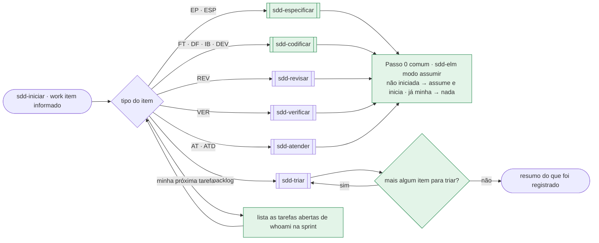

**HITL: subfluxos assíncronos por papel**

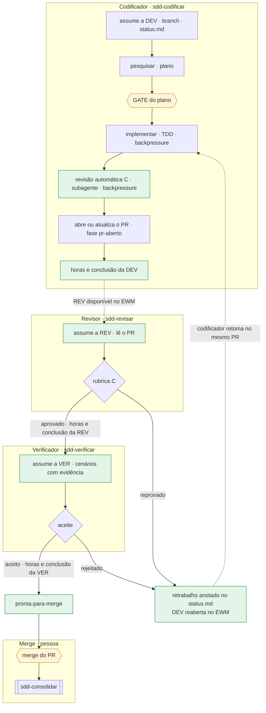

**AFK: um fluxo só, coordenado pela IA**

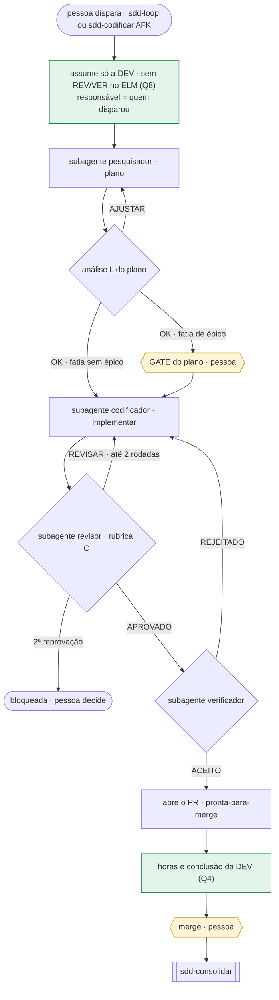

### D0.6 O que muda em cada arquivo

| Arquivo | Mudança |
|---|---|
| `sdd-iniciar/SKILL.md` | vira o hub: tabela "work item → skill", "minha próxima tarefa"; sai a lógica de compromisso, branch e Passo 4a |
| `sdd-codificar/SKILL.md` (nova) | o conteúdo de código da `sdd-iniciar` atual (Passos 2–5); modo HITL termina no PR com a `[DEV]` concluída |
| `sdd-especificar/SKILL.md` (nova) | o Passo 4a atual (`[ESP]`) + roteamento entrevistar → prd → fatiar + horas da `[ESP]` |
| `sdd-revisar/SKILL.md`, `sdd-verificar/SKILL.md` | Passo 0 *assumir*; modo HITL sobre o PR (commit do relatório e da fase na branch do PR, push com "sim"); aprovado/aceito → horas e conclusão da própria tarefa; reprovado → `retrabalho` |
| `sdd-implementar/SKILL.md` | Passos 3–4 (revisão e verificação por subagente) só no AFK; no HITL termina no Passo 5 (PR); retoma o `retrabalho` |
| `sdd-atender/SKILL.md` | sai a §1 Abrir; Passo 0 *assumir*; finalizar → desdobramentos |
| `sdd-triar/SKILL.md` | atendimento registrado aqui (linha no backlog, sprint sugerida, `[ATD]`); "mais algum item para triar?" no fim do item e do lote |
| `sdd-elm/SKILL.md` | modo *assumir* (idempotente); modo atendimento chamado pela triar; horas por papel |
| `sdd-iniciar/references/status-template.md` | fases `em-revisao`, `em-verificacao`, `pronta-para-merge`, `retrabalho (de: …)`; campo Modo `HITL/AFK`; Rodadas e retrabalho por papel |
| `sdd-consolidar/SKILL.md` | deixa de concluir `[DEV]`/`[REV]`/`[VER]` |
| `sdd-loop/SKILL.md` | é o modo AFK; responsável = quem disparou |
| `sdd-status/SKILL.md` | painel por papel ("esperando revisão", "esperando verificação", "pronto para merge"); WIP com as fases novas |
| `sdd-fatiar/references/backlog.md` | seção `## Atendimentos` e `AT-nnn` em "Próximos ids" |
| `sdd-planejamento` (+ schema, template, `arquivos.md`) | papel Especificador; Encaixe e virada com AT |
| agentes (`sdd-setup/assets/agents/`) | `sdd-produto` carrega `sdd-especificar` e `sdd-iniciar`; `sdd-codificador` carrega `sdd-codificar` e `sdd-iniciar`; `sdd-revisor` e `sdd-verificador` ganham o MCP do ELM (assumir, reabrir, horas) e `git add`/`commit` (HITL) |
| `sdd/SKILL.md`, `README.md`, steering | trilhas, mapa, "O que dizer" e gates com os dois modos; regra de ouro do MCP: só o pesquisador fica sem ele |

### D0.7 Decisões do dono sobre o fluxo (2026-10-15)

| # | Pergunta | Decisão | Consequência no texto |
|---|---|---|---|
| Q1 | Retrabalho com a `[DEV]` já concluída | **reabrir a `[DEV]`** | modo *assumir* da `sdd-elm` também reabre (ação da PA); horas do retrabalho na própria `[DEV]`; concluída de novo no PR atualizado |
| Q2 | Como revisor e verificador assumem a tarefa | **os agentes deles têm acesso ao ELM**, também para lançar horas | `sdd-revisor.json` e `sdd-verificador.json` ganham o MCP; a regra de ouro "revisor e verificador não têm o MCP" sai do guia e do steering |
| Q3 | AFK dispensa o GATE do plano? | **sim, mas não para épicos** | leitura do orquestrador, com a qual concordo: fatia sem épico em AFK dispensa o GATE do plano; **fatia de épico mantém o GATE do plano** (comportamento novo vindo do PRD, onde aprovar o plano rende mais); PRD e backlog do épico nunca são AFK. **Leitura confirmada pelo dono** |
| Q4 | Horas no AFK | **só na `[DEV]`, ao concluir** | no AFK lança-se uma vez, o saldo na `[DEV]` quando a fatia chega ao PR; revisão e verificação por subagente não lançam horas (não há tarefa delas, Q8) |
| Q5 | HITL: revisão automática antes do PR | **sim** | `sdd-implementar` roda a rubrica C por subagente como backpressure antes do PR, sem relatório oficial nem rodada; a `[REV]` humana continua |
| Q6 | A VER só começa com a REV aprovada | **sim** | sequencial: `em-revisao` → `em-verificacao` |
| Q7 | Mistura de modos por papel | **não: o modo é da fatia**, definido na triagem (sem épico) ou no fatiamento/planejamento (de épico) | o `modo` do `backlog.md` vale para todos os papéis; o `status.md` copia o modo da fatia |
| Q8 | Tarefas `[REV]`/`[VER]` no AFK | **REV e VER existem no AFK como etapas do fluxo, disparadas automaticamente pela IA com subagentes, sem intervenção humana — por isso não têm tarefa no ELM**; **fatia HITL cria as duas** | `sdd-elm` modo *sprint* e `sdd-planejamento` criam `[REV]`/`[VER]` só para fatia `modo: HITL`; no AFK a `sdd-loop` assume e conclui só a `[DEV]` (responsável = quem disparou); a capacidade de revisão/verificação do AFK sai da reserva de `[REV]`/`[VER]` da sprint |

### D0.8 Conceito do dono: lançar horas ≠ concluir a tarefa

> **Registro do dono (2026-10-15):** o lançamento de horas em tarefas iniciadas é a **constatação do empenho de
> tempo** naquela tarefa. Ele **não significa conclusão nem finalização**. É uma etapa para a empresa gerar
> relatórios e acompanhar o trabalho de cada pessoa.

**Regra proposta (única, no steering e no guia):**

- **Lançar** horas é um registro que pode ser repetido em qualquer tarefa **iniciada** (`[ESP]` `[DEV]` `[REV]`
  `[VER]` `[ATD]`), a qualquer momento: ao fechar cada sessão de trabalho (`sdd-status`, "fechar a sessão"), numa
  fronteira de fase ou quando a pessoa pedir. Lançar não muda o estado da tarefa, e o GATE não é exceção: as horas
  gastas até o GATE podem ser lançadas.
- **Concluir** é um evento separado, da skill do papel, quando o trabalho dela termina (D0.4). Na conclusão, a
  skill pergunta só o **saldo** ainda não lançado e então muda o estado.
- No **retrabalho**, a `[DEV]` reaberta recebe novos lançamentos, como qualquer tarefa iniciada (Q1).
- O relatório da `sdd-elm` modo *horas* (planejadas × lançadas por pessoa e por tipo) passa a acompanhar o trabalho
  em andamento, não só o concluído.

**Onde o texto atual contradiz o conceito**

| Evidência | Texto atual | Ajuste |
|---|---|---|
| `sdd/SKILL.md:34` | "As horas são lançadas na conclusão de cada tarefa, nunca nos GATEs" | lançadas durante a tarefa, a qualquer momento; conclusão é outro evento |
| `sdd-setup/assets/steering/sdd.md:16` | "horas lançadas na conclusão, nunca nos GATEs" | idem |
| `sdd-planejamento/references/arquivos.md:71` | "Na conclusão de cada tarefa (e sob pedido a qualquer momento); nunca nos GATEs intermediários" | inverter a ênfase: a qualquer momento em tarefa iniciada; o saldo na conclusão |
| `sdd-planejamento/SKILL.md:64` | acordo "lançamento de horas (na conclusão de cada tarefa)" | acordo do time: cadência de lançamento (ex.: ao fim de cada sessão ou dia) |
| `sdd-atender/SKILL.md:113` | "Horas só na conclusão (…); **nunca no meio do atendimento**" | contradição direta: remover |
| `sdd-atender/SKILL.md:67` | "`sdd-elm` modo *horas* lança e conclui a tarefa" | lança o saldo; a conclusão é o modo *conclusão* |
| `sdd-iniciar/SKILL.md:164` | "as horas são lançadas na `[ESP]` ao concluir" | lançadas durante a especificação; saldo ao concluir |
| `sdd-fatiar/SKILL.md:80-81` | "o GATE do backlog conclui a especificação — pergunte as horas" | manter a conclusão no GATE, perguntando só o saldo |
| `sdd-consolidar/SKILL.md:48-55` | horas de `[DEV]`/`[REV]`/`[VER]` perguntadas no merge | sai com a Etapa 2 (cada papel conclui a sua); o merge não lança horas |
| `sdd-status/SKILL.md` ("fechar a sessão") | não pergunta horas | **novo:** "Quanto tempo nesta sessão em `<tarefa>`?" → `sdd-elm` modo *horas*, com "sim" |

O modo *horas* da `sdd-elm` já separa lançar de concluir (`sdd-elm/SKILL.md:184`: "Concluir: depois do lançamento
das horas"). O conflito está nas skills que o chamam e na regra do guia.

## Resultados por skill — fluxo de execução e divergências

Para cada skill: o fluxo de execução **como o texto atual manda** (nós vermelhos = lacuna ou divergência; os ids entre parênteses nos rótulos, como `G2-05`, são os achados da Parte 2 no Anexo A) e a lista consolidada de divergências das Partes 2–4, conferida na fonte. Detalhe de cada fluxo (gatilho, processamento, output; teste cego; arquivos) no Anexo A, grupo indicado.

## S01 · `sdd`

_Grupo G1 · detalhe no Anexo A — G1._

### Fluxo de execução

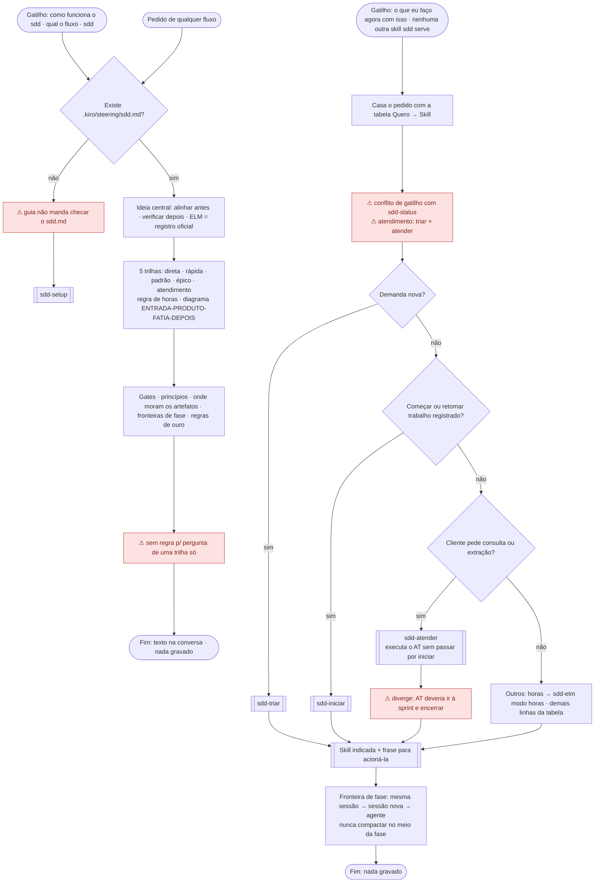

Vermelho: S01-F3 (sem checagem do `sdd.md`), S01-F1 (trilha única), S01-F2 (gatilho concorrente com `sdd-status`, triar × atender) e divergência do dono (AT executado por `atender`, fora de `iniciar`).

### Divergências

**Resumo:** fluxos 3 (P2) · Parte 3: 0 DET · 4 AMB · 1 SEM REGRA · 1 CONFL · Parte 4: 1 OK · 0 DIV · 0 N/E

| # | Sev. | Tipo | Divergência | Evidência (arquivo:linha) | Partes | Verificação | Correção sugerida |
|---|---|---|---|---|---|---|---|
| S01-D1 | Alta | expectativa do dono | O guia manda "toda demanda nova" pela `sdd-triar` (`:22`), mas lista o pedido de cliente também como entrada direta da `sdd-atender` (`:86`). A trilha atendimento **executa** o AT (entrevista, `[ATD]`, banco/bundle, resposta, horas) (`:31`) e o diagrama desvia AT para `atender` sem passar por `iniciar` (`:37`). `:81` lista os tipos da `sdd-iniciar` sem atendimento, e `sdd-iniciar/SKILL.md` não tem nenhuma ocorrência de "atend"/"ATD". Contraria os itens 1-3 do dono. | `sdd/SKILL.md:22`, `:31`, `:37`, `:81`, `:86`; `sdd-iniciar/SKILL.md` (0 ocorrências) | P2, P3 | CONFIRMADO | No guia: fundir as linhas `:80` e `:86` numa entrada só (triar); trilha atendimento (`:31`) = triar → `[ATD]` na sprint atual → encerrar; incluir atendimento nos tipos de `:81` e no diagrama (`:37`) via `iniciar`. Detalhe nas skills de G2. |
| S01-D2 | Média | roteamento | "o que eu faço agora com isso" é gatilho do guia (`:3`), mas "o que fazer agora" também é do `sdd-status` (`guia:79`; `status:3`). Não há regra de desempate; "nenhuma outra skill se encaixa" não tem critério. | `sdd/SKILL.md:3`, `:79`; `sdd-status/SKILL.md:3` | P2, P3 | CONFIRMADO | Tirar "o que eu faço agora com isso" do gatilho do guia, ou escrever no guia: "se a pergunta é sobre o estado do trabalho, vale a `sdd-status`; o guia só responde sobre o método". |
| S01-D3 | Baixa | ambíguo | "Sem ele, comece por 'configurar o sdd'" não manda checar se `sdd.md` existe, não diz se o guia aciona a `sdd-setup` ou só indica, e não dá ordem quando o pedido é "como funciona o sdd" sem `sdd.md` (explicar × configurar). A checagem explícita está só em `status:12-13`. | `sdd/SKILL.md:17-18`; `sdd-status/SKILL.md:12-13` | P2, P3, P4 | CONFIRMADO | Em `:17-18`: "se o arquivo não existe, explique o que for pedido e ofereça a `sdd-setup` ao fim; para qualquer outro fluxo, ofereça-a antes". |
| S01-D4 | Baixa | sem regra | Pedido para explicar **uma** skill ("o que é o sdd-status?") não tem regra: o guia só devolve o nome da skill. | `sdd/SKILL.md:76-97` | P3 | CONFIRMADO | Uma linha no guia: "explicar uma skill → resumir o `description` dela e indicar o gatilho". |

---


## S02 · `sdd-setup`

_Grupo G1 · detalhe no Anexo A — G1._

### Fluxo de execução

#### Primeira configuração (S02-F1)

```mermaid
flowchart TD
  S(["Gatilho: configurar o sdd · setup do sdd · criar os agentes do sdd"])
  H1[["Handoff de sdd ou sdd-status"]]
  P0["Passo 0 · raiz git · pasta do power · KIRO_HOME · caminhos relativos"]
  D0{"Já existe sdd.md ou agentes sdd-*.json?"}
  UPD[["Modo atualização S02-F2"]]
  P1["Passo 1 · lê README · AGENTS · build · steering · árvore · git log -20<br/>propõe Entendi assim"]
  G1{{"Confirma: sim ou corrija"}}
  P2["Passo 2 · comandos: compilar · testes · lint · cobertura · executar"]
  G2{{"Oferece rodar os comandos uma vez"}}
  P3["Passo 3 · branch base · prefixo · commit · PR pelo host · MCP de banco"]
  X1["⚠ padrão de PR: base protegida e senão iguais"]
  P4["Passo 4 · pasta do produto · glossário · ADRs · ELM e MCP · bundle do RM"]
  P5["Passo 5 · inventário de toolkits e skills avulsas"]
  P6["Passo 6 · por agente: skills · MCPs · modelo · subagentes · autonomia"]
  X2["⚠ tabela do Passo 6 omite sdd-elm"]
  G3{{"Uma confirmação por agente"}}
  P7["Passo 7 · hook sdd-backpressure se há compilar e testes · workflows se habilitados"]
  P8["Passo 8 · monta em memória sdd.md · agentes · hook · workflows · produto"]
  X3["⚠ sem checar a branch · ⚠ gravações antes do resumo"]
  G4{{"Gravar? ok"}}
  X4["⚠ sem regra p/ recusa"]
  W1[("steering/sdd.md")]
  W2[("agents/sdd-*.json · 6 agentes")]
  W3[("hooks/sdd.json · workflows · sdd/http.sh · opcionais")]
  W4[("produto: backlog.md · equipe.json · licoes.md · atendimentos/README.md")]
  X5["⚠ equipe.json: criada aqui ou pelo planejamento?"]
  W5[("gitignore com .kiro/local/")]
  P9["Passo 9 · valida JSON · name · placeholders · mcp · skill:// · kiro-cli agent validate"]
  G5{{"Commit sugerido: confirma"}}
  HO[["Handoff: nova demanda → sdd-triar · vamos trabalhar → sdd-iniciar · onde parei → sdd-status"]]
  F(["Fim"])

  S --> P0
  H1 --> P0
  P0 --> D0
  D0 -->|"sim"| UPD
  D0 -->|"não"| P1 --> G1 --> P2 --> G2 --> P3 --> X1 --> P4 --> P5 --> P6 --> X2 --> G3 --> P7 --> P8 --> X3 --> G4
  G4 -->|"não"| X4
  G4 -->|"ok"| W1 --> W2 --> W3 --> W4 --> X5 --> W5 --> P9 --> G5 --> HO --> F

  classDef div fill:#fde2e2,stroke:#c0392b,color:#7b241c
  classDef gate fill:#fff4d6,stroke:#b7950b
  class X1,X2,X3,X4,X5 div
  class G1,G2,G3,G4,G5 gate
```

#### Atualização, migrações e toolkit (S02-F2 a F5)

```mermaid
flowchart TD
  S(["Gatilho: atualizar os agentes ou a configuração do sdd · ligar o toolkit"])
  D1{"Existe sdd2*.md ou agentes sdd2-*.json?"}
  D2{"Existe sdd-projeto.md sem sdd.md?"}
  M3["F3 · plano de migração sdd2 → sdd numa mensagem"]
  G3{{"ok na migração"}}
  M3b["sdd2.md e sdd2-projeto.md → sdd.md · licoes → Regras aprendidas · fechar-sessao removido<br/>hook · workflows · http.sh renomeados · produto e aprendizado movidos"]
  W3[("git mv · git rm · specs não muda")]
  X3["⚠ não reescreve nomes sdd2 internos × regenerar dos templates"]
  M4["F4 · oferece reaproveitar valores da v1: steering · branch · prefixo · commit · PR · comandos · ELM · skills"]
  G4{{"ok para git rm do sdd-projeto · sdd-especificador · prompts v1"}}
  X4["⚠ sem tabela de equivalência v1 → v2"]
  U1["F2 · mostra a configuração atual em tabela"]
  G1{{"O que mudar? nada = só regenerar"}}
  U2["Passos 1–7 só sobre o que mudou"]
  D5{"Toolkit ou skills novas?"}
  T5["F5 · inventário Passo 5 · compara com o sdd.md<br/>pergunta só as skills novas por agente"]
  X5["⚠ sim por agente × uma confirmação por agente"]
  U3["Passo 8 · agentes, hook e workflows dos templates atuais<br/>regras aprendidas mantidas · produto só acrescenta o que falta"]
  X2["⚠ sem comparação de versão do power · linha Gerado pela sdd-setup não atualizada"]
  D6{"Agente editado à mão?"}
  G6{{"Mostra diff e pergunta antes de sobrescrever"}}
  W1[("agents/sdd-*.json com skill:// extras")]
  W2[("steering/sdd.md · colunas de skills")]
  P9["Passo 9 · valida · sobra só sdd.md e nenhum sdd2-*"]
  G9{{"Commit sugerido com o que foi movido ou removido"}}
  F(["Fim"])

  S --> D1
  D1 -->|"sim"| M3 --> G3 --> M3b --> W3 --> X3 --> U1
  D1 -->|"não"| D2
  D2 -->|"sim"| M4 --> G4 --> X4 --> U1
  D2 -->|"não"| U1
  U1 --> G1 --> U2 --> D5
  D5 -->|"sim"| T5 --> X5 --> U3
  D5 -->|"não"| U3
  U3 --> X2 --> D6
  D6 -->|"sim"| G6 --> W1
  D6 -->|"não"| W1
  W1 --> W2 --> P9 --> G9 --> F

  classDef div fill:#fde2e2,stroke:#c0392b,color:#7b241c
  classDef gate fill:#fff4d6,stroke:#b7950b
  class X2,X3,X4,X5 div
  class G1,G3,G4,G6,G9 gate
```

Vermelho: S02-F1 (branch não conferida, gravação antes do Passo 8, recusa sem regra, `equipe.json`, `sdd-elm` omitido, padrão de PR), S02-F2 (versão do power), S02-F3 (nomes `sdd2` internos), S02-F4 (equivalência v1) e S02-F5 (sim por agente).

### Divergências

**Resumo:** fluxos 5 (P2) · Parte 3: 2 DET · 3 AMB · 2 SEM REGRA · 3 CONFL · Parte 4: 11 OK · 6 DIV · 4 N/E

| # | Sev. | Tipo | Divergência | Evidência (arquivo:linha) | Partes | Verificação | Correção sugerida |
|---|---|---|---|---|---|---|---|
| S02-D1 | Média | conflito | "Nada é gravado antes do resumo do Passo 8 e do 'ok'" × gravações com "ok" próprio antes: entrada do ELM no `~/.kiro/settings/mcp.json` (Passo 4), exclusão de `.kiro/local/` na config de ferramentas (Passo 9), migração `git mv`/`git rm` (Passo 0) e execução dos comandos (Passo 2). | `sdd-setup/SKILL.md:26` × `:150-153`, `:273-275`, `:49-59`, `:92-104` | P2, P3, P4 | CONFIRMADO | Em `:26`: "nada no projeto é gravado antes do Passo 8, exceto o que tem 'ok' próprio descrito no passo (migração, `mcp.json` do usuário, exclusão em ferramentas)". Ou mover essas gravações para a lista do resumo do Passo 8. |
| S02-D2 | Média | persistência | `equipe.json` aparece como arquivo criado no Passo 8.4, mas "gerado pelo `sdd-planejamento` Modo inicial", sem conteúdo definido. O schema exige `atualizado`, `projeto`, `membros`; sem pessoas não há como gravar um arquivo válido. O Modo inicial grava `equipe.json` só depois de perguntar pessoas e horas. `acordos.md`, `roadmap.md` e `sprints/` nunca são criados pela setup. | `sdd-setup/SKILL.md:241-244`; `sdd-planejamento/SKILL.md:29-36`; `sdd-planejamento/assets/equipe.schema.json:7` | P2, P3, P4 | CONFIRMADO | Tirar `equipe.json` da lista do Passo 8.4 e dizer "criado pela `sdd-planejamento` Modo inicial; até lá o painel usa WIP 2"; ou fixar um conteúdo mínimo válido. |
| S02-D3 | Média | conflito | Modo atualização: "refaça só o que mudou nas respostas" × "montar `.kiro/steering/sdd.md` ← template com as respostas". Com a resposta "nada — só regenerar os agentes", não está dito se o `sdd.md` é regravado. O rodapé "Gerado pela `sdd-setup` (power `sdd` x.y.z)" não tem regra de atualização nem fonte para a versão (`plugin.json` 2.3.0; skills 2.4.0). A skill também não diz como obter o "diff" nem comparar a versão antiga. | `sdd-setup/SKILL.md:44-48` × `:231-234`; `sdd-setup/assets/steering/sdd.md:19`; `powers/sdd/plugin.json:4` | P2, P3, P4 | CONFIRMADO | Em `:231-234`: "modo atualização: `sdd.md` só é regravado se uma resposta mudou; nesse caso atualize também a linha do rodapé com a versão de `plugin.json`". Alinhar `plugin.json` à versão das skills. |
| S02-D4 | Média | conflito | Migração `sdd2`: mover hook e workflows "sem mudar o conteúdo dos movidos" × em atualização hook e workflows saem "sempre" dos templates atuais. Para o hook, as duas ordens dão resultados diferentes (nomes `sdd2` e `.kiro/sdd2/` internos). Origem ausente (`.kiro/sdd2/http.sh`) e migração interrompida no meio não têm regra. | `sdd-setup/SKILL.md:58` × `:46-48`; `:54-56` | P2, P3, P4 | CONFIRMADO | Em `:58`: "mova só o nome; hook e workflows são regravados do template no Passo 8 (a movimentação serve ao histórico do git)". Acrescentar: "origem ausente → ignore e siga". |
| S02-D5 | Média | persistência | Glossário e ADRs: "o padrão é criá-los", mas o Passo 8 não os lista e as Regras só autorizam "o que a pessoa pediu para criar". Nenhum passo grava os arquivos; os agentes já apontam para eles. | `sdd-setup/SKILL.md:123-124` × `:231-248`, `:301-302`; `assets/agents/sdd-produto.json:42-43` | P3, P4 | CONFIRMADO | Listar `docs/glossario.md` e `docs/adr/` no Passo 8 (itens 4-5) e no resumo; a confirmação do "Padrões aplicados" vale como pedido. |
| S02-D6 | Média | persistência | O `backlog.md` mínimo traz só a tabela `## Épicos`. O formato oficial exige `## Fatias — sem épico`, que a `sdd-triar` escreve. Falta dizer quem cria a seção. | `sdd-setup/SKILL.md:241-242`; `sdd-fatiar/references/backlog.md:31`, `:37` | P4 | CONFIRMADO (omissão); efeito na triagem PLAUSÍVEL | Em `:242`: incluir `## Fatias — sem épico` com as colunas do `sdd-fatiar/references/backlog.md:31-46`, ou mandar a `sdd-triar` criá-la. |
| S02-D7 | Média | persistência | A setup não define a branch onde grava `sdd.md` e `<produto>/` nem confere se é a base, embora o produto seja "nunca em branch de fatia". O commit é só "sugerido", sem mensagem e sem branch. No Passo 3, os dois ramos de "Artefatos de produto" (base protegida / senão) dão o mesmo padrão. | `sdd-setup/SKILL.md:115`, `:241-248`, `:293-295`; `assets/steering/sdd.md:61` | P2, P3, P4 | CONFIRMADO | Passo 8: "confira que a branch atual é a base (ou crie `<prefixo>/sdd-setup`); mensagem do commit = padrão do `sdd.md`". Em `:115`: diferenciar os ramos (ex.: base protegida → PR; senão → direto na base). |
| S02-D8 | Média | sem regra | Recusa do "Gravar?", recusa do Kiro em um arquivo de `.kiro/agents|hooks|workflows` e gravação parcial (ex.: 5 de 6 agentes) não têm texto. O Passo 9 só confere "os seis" depois. | `sdd-setup/SKILL.md:250-264`, `:281-282` | P2, P4 | CONFIRMADO | Acrescentar ao Passo 8: "'não' → volte ao ponto que a pessoa indicar; recusa de um arquivo → refaça só ele; nunca deixe o fluxo com menos de seis agentes sem avisar". |
| S02-D9 | Média | ambíguo | Migração da v1: "ofereça reaproveitar" os valores do `sdd-projeto.md` × "o que tem padrão detectado é decidido sem perguntar". Sem precedência quando a branch base (ou outro valor) diverge. | `sdd-setup/SKILL.md:60-62` × `:20-24` | P3 | CONFIRMADO | Em `:60-62`: "valor da v1 e valor detectado diferentes → mostre os dois e peça a escolha numa linha da tabela Padrões aplicados". |
| S02-D10 | Média | permissão | Nada diz em qual sessão rodar a setup. Ela não está em `resources` de nenhum agente; `sdd-codificador` nega `write` em `.kiro/steering|agents|hooks|workflows` e em `{{PRODUTO}}`, e `sdd-produto` só escreve em `{{PRODUTO}}/**` e afins. Rodar a setup num agente do fluxo falha sem mensagem. Na sessão padrão funciona. | `sdd-setup/SKILL.md` (sem menção); `sdd-setup/assets/agents/sdd-codificador.json:39-49`; `sdd-produto.json:40-47` | P4 | CONFIRMADO (omissão); negação PLAUSÍVEL (depende do Kiro) | Passo 0: "rode esta skill na sessão padrão do Kiro (sem agente `sdd-*`); nos agentes do fluxo ela é negada". |
| S02-D11 | Baixa | roteamento | Fim da setup oferece 3 handoffs (`triar`, `iniciar`, `status`), sem atendimento. A tabela do Passo 6 põe `atender` junto com `triar` em `sdd-produto` e `iniciar` só em `sdd-orquestrador`, de modo que o AT não começa por `iniciar` nos agentes. Segue o desenho atual; diverge da expectativa do dono. | `sdd-setup/SKILL.md:176`, `:181`, `:296-297` | P2 | CONFIRMADO | Acompanhar a decisão de S01-D1: se `iniciar` passar a iniciar AT, ajustar `:176`/`:181` e o handoff de `:296-297`. |
| S02-D12 | Baixa | ambíguo | Toolkit: "uma mensagem e **uma** confirmação ('ok')" por agente × "nunca ligado sem a pessoa dizer sim, agente por agente". Não está dito se "ok" conta como "sim". | `sdd-setup/SKILL.md:183-184` × `:305`; `references/toolkits.md:89` | P2, P3 | CONFIRMADO | Em `:305`: "o 'ok' à proposta do agente vale como sim para as skills marcadas nela". |
| S02-D13 | Baixa | sem regra | Manifesto de toolkit que aponta para `SKILL.md` inexistente: só o Passo 9 acusa, depois de gravar. O `toolkit.json` não é validado contra `assets/toolkit.schema.json` em nenhum passo. | `sdd-setup/SKILL.md:159-167`, `:276-279`; `references/toolkits.md:52-56`; `assets/toolkit.schema.json` | P3, P4 | CONFIRMADO | No Passo 5: validar o manifesto pelo schema e descartar (com aviso) skill declarada que não existe, antes de oferecê-la. |
| S02-D14 | Baixa | formato | O Passo 9 confere `{{…}}` nos agentes, mas não `<…>` sobrando no `sdd.md` (exigido em `:232-233`) nem os resíduos da v1 (`sdd-especificador.json`, `prompts/sdd-*.md`); `:271-272` cita só `sdd2*` e `sdd-projeto.md`. | `sdd-setup/SKILL.md:232-233`, `:266-272`, `:62-65` | P4 | CONFIRMADO | Acrescentar ao Passo 9: "`sdd.md` sem `<…>`; sem `.kiro/agents/sdd-especificador.json` nem `.kiro/agents/prompts/sdd-*.md`". |
| S02-D15 | Baixa | formato | Tabela do Passo 6 ("Já tem") omite `sdd-elm`, mas os templates o carregam em produto, codificador e orquestrador. | `sdd-setup/SKILL.md:174-181`; `assets/agents/sdd-produto.json:21`, `sdd-codificador.json:17`, `sdd-orquestrador.json:20` | P2, P3 | CONFIRMADO | Acrescentar `elm` às linhas dos três agentes na coluna "Já tem". |
| S02-D16 | Baixa | persistência | Sem git a setup só avisa e segue, mas o Passo 3 (branch base, prefixo, PR) depende de git e não tem valor de reserva. | `sdd-setup/SKILL.md:31`, `:106-115` | P3 | CONFIRMADO | Em `:31`: "sem git → avise e preencha branch/prefixo/PR com 'não há' no `sdd.md`". |
| S02-D17 | Baixa | persistência | Comando do hook (`{{COMPILAR}}`/`{{TESTES}}`) e URL do `http.sh` entram em JSON e em `BASE='…'` sem regra de escape; aspas ou `\` quebram o arquivo. Só o Passo 9 pegaria o hook. | `sdd-setup/assets/hooks/sdd.json:10`; `assets/scripts/http.sh` (BASE); `sdd-setup/SKILL.md:266-268` | P4 | PLAUSÍVEL (testado só por substituição manual) | Passo 8: "escape `"` e `\` no JSON; recuse URL com `'`". |
| S02-D18 | Baixa | formato | Versões desalinhadas no mesmo commit: `plugin.json` 2.3.0; `sdd`, `sdd-setup` 2.4.0; `sdd-status` e outras 2.3.0. Alimenta o rodapé do `sdd.md` (S02-D3). | `powers/sdd/plugin.json:4`; `sdd/SKILL.md:7`; `sdd-setup/SKILL.md:7`; `sdd-status/SKILL.md:7` | P2, P3, P4 | CONFIRMADO | Definir uma versão do power e alinhar `plugin.json` à maior versão das skills. |

---


## S03 · `sdd-status`

_Grupo G1 · detalhe no Anexo A — G1._

### Fluxo de execução

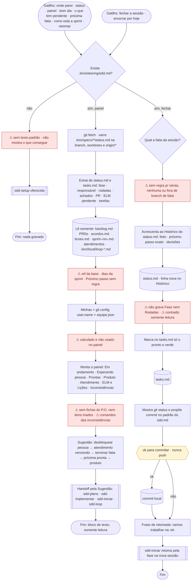

Vermelho: S03-F2 (sem texto-padrão), S03-F1 (fontes ausentes, Minhas sem uso, seção Produto incompleta), S03-F3 (fatia-alvo indefinida, grava apesar de somente leitura, sem Fase e Rodadas).

### Divergências

**Resumo:** fluxos 3 (P2) · Parte 3: 1 DET · 3 AMB · 2 SEM REGRA · 0 CONFL · Parte 4: 5 OK · 0 DIV · 2 N/E

| # | Sev. | Tipo | Divergência | Evidência (arquivo:linha) | Partes | Verificação | Correção sugerida |
|---|---|---|---|---|---|---|---|
| S03-D1 | Média | sem regra | "Fechar a sessão" não define a fatia-alvo (várias em andamento, nenhuma) nem checa a branch; "ao encerrar uma sessão numa fatia" não cobre sessão na base, de produto, triagem ou planejamento. A fatia vem da branch por inferência. | `sdd-status/SKILL.md:88-96` | P2, P3, P4 | CONFIRMADO | Em `:88`: "fatia = a da branch atual (`.kiro/specs/<ft>/` com `status.md`); fora de fatia, não grave: resuma a sessão no chat e sugira o próximo passo". |
| S03-D2 | Média | conflito | O painel é "somente leitura: não altera arquivo, branch nem ELM", mas "fechar a sessão" grava `status.md` e `tasks.md` antes do "ok" do commit. A exceção existe só pela frase "modo da última seção". Se o "ok" for recusado, sobram arquivos modificados sem commit. | `sdd-status/SKILL.md:12`, `:91-95` | P2, P3, P4 | CONFIRMADO | Em `:12`: "só o modo Fechar a sessão grava (status.md, tasks.md); o painel não". Em `:94-95`: dizer que os arquivos ficam no disco se não houver "ok". |
| S03-D3 | Média | permissão | Fechar a sessão exige gravar `status.md`/`tasks.md` e commitar. `sdd-status` está em `resources` só do `sdd-orquestrador`; `sdd-codificador` não a carrega e `sdd-produto` não grava `status.md`. Fechar a sessão no codificador depende do power carregado na sessão. | `sdd-status/SKILL.md:88-96`; `sdd-setup/assets/agents/sdd-orquestrador.json:19`; `sdd-codificador.json:15-17`; `sdd-produto.json:40-47`; `sdd/SKILL.md:128-131` | P2, P3, P4 | CONFIRMADO (recursos); efeito PLAUSÍVEL | Pôr `sdd-status` nos `resources` do codificador (ou dizer no guia que fechar a sessão roda na sessão padrão / orquestrador). |
| S03-D4 | Média | ambíguo | O painel usa dados sem fonte: "(`<dias>` dias restantes)", coluna "Próximo passo" (a tabela fase→skill está em `sdd-iniciar/SKILL.md:133-140`), ref da "base" para ler o `backlog.md` (`origin/<base>` ou checkout local?), e as inconsistências "backlog alterado em branch de fatia", "elm/ verified" e "sem commit há 3 dias úteis" sem comando. | `sdd-status/SKILL.md:24`, `:41`, `:44`, `:74-79`; `sdd-iniciar/SKILL.md:133-140` | P2, P3 | CONFIRMADO | Citar as fontes: datas da `sprint-<nn>.md`, tabela fase→skill do `sdd-iniciar`, `origin/<base>` da seção Git do `sdd.md`; um comando por inconsistência. |
| S03-D5 | Média | sem regra | `<produto>/backlog.md` ausente não tem regra (diferente de `acordos.md`, `:28-29`). Afeta as seções Produto e Prontas. | `sdd-status/SKILL.md:24` | P3, P4 | CONFIRMADO | Em `:24`: "sem `backlog.md` → seção Produto vazia e sugira a `sdd-setup` modo atualização". |
| S03-D6 | Baixa | ambíguo | Sem `sdd.md`, a skill manda dizer e oferecer a setup, mas não diz se mostra o que consegue (`status.md` soltos). | `sdd-status/SKILL.md:12-13` | P2, P3 | CONFIRMADO | Em `:13`: "e pare" (ou "e mostre o painel parcial"). |
| S03-D7 | Baixa | ambíguo | "Pronto e verde" no `tasks.md` não diz o que comprova o verde (testes, backpressure, aceite). | `sdd-status/SKILL.md:93` | P3, P4 | CONFIRMADO | Em `:93`: "verde = comandos de compilar/testes do `sdd.md` passaram nesta sessão". |
| S03-D8 | Baixa | persistência | Fechar a sessão acrescenta só ao Histórico; não grava `Fase` nem `Rodadas` (a fase é da skill da fase). Se a fase mudou na sessão, nada garante o registro. | `sdd-status/SKILL.md:91-95`; `sdd-iniciar/references/status-template.md:18-26` | P2, P3, P4 | CONFIRMADO | Em `:91`: "não altere Fase/Rodadas; se a sessão terminou no meio de uma fase, registre isso no Histórico". |
| S03-D9 | Baixa | expectativa do dono | O painel só cobre EP/PRD na seção Produto; fichas de fatia sem épico aguardando o P.O. (gate "Ficha") e itens recém-triados não aparecem. "Minhas" é calculado e o painel não filtra nem destaca por pessoa. | `sdd-status/SKILL.md:35-36`, `:54-56`; `sdd/SKILL.md:52` | P2 | CONFIRMADO (omissão); relevância PLAUSÍVEL | Acrescentar à seção Produto "fichas aguardando P.O." e destacar as "minhas" no painel. |

---


## S04 · `sdd-triar`

_Grupo G2 · detalhe no Anexo A — G2._

### Fluxo de execução

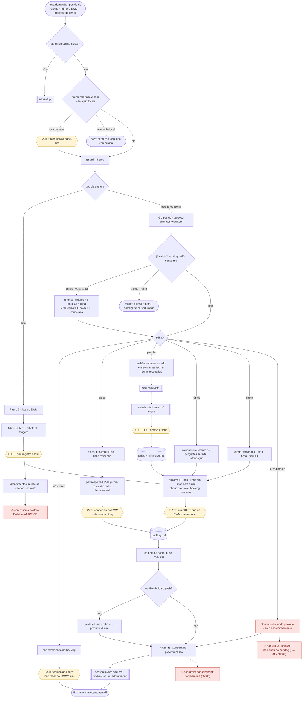

Vermelho: atendimento só é encaminhado, sem registro nem `[ATD]` (S04-F5 · G2-01/03/06) e lote que não abre AT (S04-F9 · G2-07).

### Divergências

**Resumo:** fluxos 10 (P2) · Parte 3: 9 DET · 9 AMB · 3 SEM REGRA · 0 CONFL (21 linhas, com T1) · Parte 4: 6 OK · 7 DIV · 12 N/E (1 linha mista "OK estrutura / aprovação N/E" contada em N/E)

| # | Sev. | Tipo | Divergência | Evidência (arquivo:linha) | Partes | Verificação | Correção sugerida |
|---|---|---|---|---|---|---|---|
| S04-D1 | Alta | expectativa do dono | Atendimento não é registrado na triagem: "nada aqui", sem `backlog.md`, sem `[ATD]`, sem sugestão de sprint; encerra com "use `sdd-atender`". Lote do EWM também não abre AT. **Ver D0** (D0.1 #1, 3, 4, 5, 6, 9; T1) | `sdd-triar/SKILL.md:56,108,126,159-160` | P2, P3, P4 | CONFIRMADO | Ver D0.3/D0.4 |
| S04-D2 | Média | persistência | T manda "push ou PR curto com o sim", mas o `sdd-produto` nega `git push` e o STEER manda entregar o comando. A `sdd-iniciar` exige o registro em `origin/<base>`; o elo depende da pessoa e a triar não diz | `sdd-triar/SKILL.md:110-111`; `sdd-setup/assets/steering/sdd.md:61`; `sdd-produto.json:112`; `sdd-iniciar/SKILL.md:91-93` | P4 | CONFIRMADO | Em T:110-111, trocar por "commit na base; o agente entrega o comando de push/PR (a pessoa executa)" e repetir no bloco de saída |
| S04-D3 | Média | persistência | T cria a coluna `pasta` no `backlog.md` ("nova após `prd`"), mas o formato de `## Épicos` no BKL não a define; a migração de backlog antigo só cobre `trilha`/`ficha` | `sdd-triar/SKILL.md:73-75,91-92` × `sdd-fatiar/references/backlog.md:21` | P2, P4 | CONFIRMADO | Acrescentar `pasta` ao cabeçalho de `## Épicos` no BKL e estender a regra de migração (T:73-75) a ela |
| S04-D4 | Média | persistência | Backlog mínimo da setup só traz `## Épicos`; T grava em `## Fatias — sem épico` sem mandar criar a seção | `sdd-triar/SKILL.md:93`; `sdd-setup/SKILL.md:242-243`; BKL:29-35 | P4 | CONFIRMADO | Em T Passo 3: "seção ausente → crie com o cabeçalho do BKL", ou a setup já cria as duas seções |
| S04-D5 | Média | sem regra | `git pull --ff-only` falhando (base divergente) não tem tratamento | `sdd-triar/SKILL.md:26-27` | P2, P3, P4 | CONFIRMADO | Acrescentar "se o ff falhar → avise e pare; não faça merge/rebase" |
| S04-D6 | Média | ambíguo | Aprovação da ficha: `aprovada por <login> em <data>` sem dizer quem escreve nem como o login do P.O. é verificado (mensagem na conversa vale?) | `sdd-triar/SKILL.md:62-63`; `sdd-triar/references/ficha.md:46` | P2, P3, P4 | CONFIRMADO | Definir: a pessoa que aprova diz o login/nome; o agente escreve; sem login → fica `rascunho` |
| S04-D7 | Média | ambíguo | Atendimento = "nada muda no repositório", mas "corrige o saldo da conta 123" (escrita no banco) cabe em atendimento (T:56), rápida (T:54) e em A:111 ("vira fatia ou rápida") | `sdd-triar/SKILL.md:54,56`; `sdd-atender/SKILL.md:111` | P3 | CONFIRMADO | Em T:56 acrescentar "pedido que escreve em dado de produção não é atendimento: rápida" |
| S04-D8 | Baixa | formato | Bloco `📥 … pronta \| backlog … modo …` não tem valor para épico nem atendimento | `sdd-triar/SKILL.md:120-121` | P2, P3 | CONFIRMADO | Variante do bloco para épico (`—`) e para AT (id, sprint, `[ATD]`, "Para executar: …") |
| S04-D9 | Baixa | ambíguo | "Títulos parecidos" na checagem de duplicata sem critério | `sdd-triar/SKILL.md:37-38` | P2, P3 | CONFIRMADO | Definir: mesmo verbo + objeto, ou perguntar à pessoa quando houver dúvida |
| S04-D10 | Baixa | sem regra | "Não fazer" em texto, sem id do EWM, não deixa rastro; reaparece em cada pedido igual | `sdd-triar/SKILL.md:67-69` | P2, P3, P4 | CONFIRMADO | Dizer explicitamente que é aceito (nada gravado) ou registrar em `obs`/linha `cancelada` |
| S04-D11 | Baixa | sem regra | Ficha aprovada alterada com fatia já iniciada: "avise quem a conduz", sem meio nem destino | `sdd-triar/SKILL.md:167-168` | P2, P3, P4 | CONFIRMADO | Indicar o meio (comentário na `[DEV]` do EWM, ou `ELM pendente`) |
| S04-D12 | Baixa | ambíguo | Direta exige "sem risco de dado", rápida e padrão não falam disso: "arredondar o juros" admite três trilhas | `sdd-triar/SKILL.md:53-55` | P3 | CONFIRMADO | Em T:54, "risco de dado → rápida/padrão, nunca direta" |
| S04-D13 | Baixa | formato | `decisoes.md` do épico nasce com cabeçalho `Fonte` (T:89, I:152) e a entrevista usa `# Decisões — …` + `Fonte / quem decidiu` | `sdd-triar/SKILL.md:89` × `sdd-entrevistar/SKILL.md:72`; `sdd-iniciar/SKILL.md:152` | P4 | CONFIRMADO | Usar o cabeçalho de E:70-72 nos três pontos |
| S04-D14 | Baixa | persistência | Épico sem MCP: `elm` = `pendente` (T:82-83), mas `sdd-elm` manda o `ELM pendente:` para o rodapé do PRD, que ainda não existe | `sdd-triar/SKILL.md:82-83` × `sdd-elm/SKILL.md:23-24` | P3, P4 | CONFIRMADO | Em T: "o `pendente` na coluna `elm` basta; a `sdd-prd` cria a tarefa e registra" |
| S04-D15 | Baixa | persistência | Mensagem de commit da triagem: o padrão do `sdd.md` é de fatia (`FT-<nnn> <verbo> …`) | `sdd-triar/SKILL.md:110`; `sdd-setup/assets/steering/sdd.md:59` | P4 | PLAUSÍVEL | Dar padrão de commit para backlog/ficha/AT no steering |


## S05 · `sdd-iniciar`

_Grupo G2 · detalhe no Anexo A — G2._

### Fluxo de execução

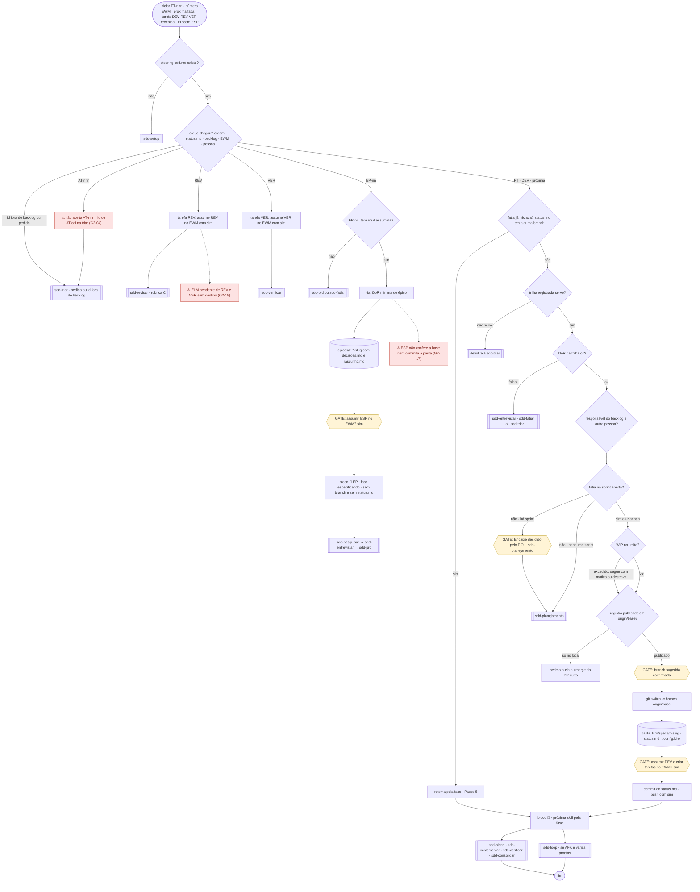

Vermelho: sem entrada, trilha, tarefas nem fase para `AT-nnn` (S05-F · G2-04); fluxo `[ESP]` sem base/commit (G2-17); `ELM pendente` de `[REV]`/`[VER]` sem destino (G2-18).

### Divergências

**Resumo:** fluxos 11 (P2) · Parte 3: 15 DET · 2 AMB · 5 SEM REGRA · 1 CONFL (23 linhas, com T3) · Parte 4: 7 OK · 1 DIV · 4 N/E

| # | Sev. | Tipo | Divergência | Evidência (arquivo:linha) | Partes | Verificação | Correção sugerida |
|---|---|---|---|---|---|---|---|
| S05-D1 | Alta | expectativa do dono | `sdd-iniciar` não aceita `AT-nnn`/`[ATD]`: sem linha de entrada, trilha, fase ou Passo 4 (branch + `.kiro/specs/`) para atendimento; "iniciar o AT-013" (T3) → SEM REGRA e risco de a triar/atender abrir AT duplicado. **Ver D0** (D0.1 #7, 8, 11) | `sdd-iniciar/SKILL.md:29-39,57-61,97-118,133-140,168` | P2, P3, P4 | CONFIRMADO | Ver D0.3/D0.4 |
| S05-D2 | Alta | conflito | I:39 manda carregar a `sdd-triar`, que "volta aqui com o id"; T:129 proíbe a triar de invocar ou simular outra skill (nem `sdd-iniciar`). O ciclo só fecha por instrução manual. Também D0.1 #2 | `sdd-iniciar/SKILL.md:39,168` × `sdd-triar/SKILL.md:129-130` | P2, P3, P4 | CONFIRMADO | Em I:39: "diga à pessoa para invocar a `sdd-triar`; depois ela volta com `sdd-iniciar <id>`" (sem "carregue", sem "volta aqui") |
| S05-D3 | Média | permissão | `sdd-iniciar` só está no `sdd-orquestrador`, cujo `write` não inclui `{{PRODUTO}}/**`; o Passo 4a cria `<produto>/epicos/<EP>-<slug>/` ali, sem conferir a base e sem definir commit. O `sdd-produto` tem o caminho, mas não carrega `sdd-iniciar`. O Passo 4a ainda aparece depois do Passo 5 | `sdd-iniciar/SKILL.md:147-164`; `sdd-orquestrador.json:18,39-44`; `sdd-produto.json:15-20` | P2, P3, P4 | CONFIRMADO | Carregar `sdd-iniciar` no `sdd-produto` (ou liberar `{{PRODUTO}}/**`); no 4a: conferir base e fixar commit; mover o 4a para antes do Passo 5 |
| S05-D4 | Média | permissão | O Passo 4 manda `git switch -c … origin/<base>`; o `sdd-orquestrador` não tem `git switch` nem `git pull --ff-only` na allowlist (cada uso vira confirmação do Kiro). `git push` é `ask` | `sdd-iniciar/SKILL.md:97-102,123`; `sdd-orquestrador.json:109,228` | P4 | PLAUSÍVEL | Incluir `git switch -c .*`/`git pull --ff-only.*` no orquestrador, ou avisar na skill que haverá confirmação |
| S05-D5 | Média | ambíguo | "Próxima fatia" com empate de prioridade (e `responsavel` de outra pessoa) sem desempate | `sdd-iniciar/SKILL.md:36` | P2, P3 | CONFIRMADO | Desempate: menor id; ou perguntar quando houver mais de uma |
| S05-D6 | Baixa | sem regra | Fase `concluida` existe no `status.md` mas não na tabela de encaminhamento | `sdd-iniciar/SKILL.md:133-140`; `sdd-iniciar/references/status-template.md:19` | P2, P3, P4 | CONFIRMADO | Linha `concluida` → "já consolidada; nada a fazer" (ou `sdd-consolidar`) |
| S05-D7 | Baixa | ambíguo | DoR de padrão falha: três destinos (`sdd-entrevistar`, `sdd-fatiar`, `sdd-triar`) sem critério | `sdd-iniciar/SKILL.md:76-77` | P3 | CONFIRMADO | Mapear: regra/cenário faltando → entrevistar; ficha sem aprovação → triar; fatia de épico → fatiar |
| S05-D8 | Baixa | sem regra | `[REV]`/`[VER]` atribuída a outra pessoa não tem ramo | `sdd-iniciar/SKILL.md:34-35` | P3 | CONFIRMADO | "De outra pessoa → avise e não assuma" |
| S05-D9 | Baixa | persistência | `ELM pendente` sem destino nos ramos `[REV]/[VER]` (I:42-43) e `[ESP]` ("na pasta do épico", I:155-156) | `sdd-iniciar/SKILL.md:42-43,155-156`; `status-template.md:40` | P2, P4 | CONFIRMADO | Nomear: Histórico do `status.md` (REV/VER) e `rascunho.md` do épico (ESP) |
| S05-D10 | Baixa | sem regra | `EP-nn` sem `[ESP]` com PRD `em-revisao` não tem linha | `sdd-iniciar/SKILL.md:37` | P2, P3 | CONFIRMADO | Acrescentar "PRD em revisão → aguarde a aprovação (`sdd-prd`)" |
| S05-D11 | Baixa | formato | `status.md` grava trilha sem acento (`padrao \| rapida`); o backlog usa `padrão`/`rápida` | `sdd-iniciar/references/status-template.md:7` × BKL:44 | P4 | CONFIRMADO | Alinhar o template ao backlog |
| S05-D12 | Baixa | persistência | I:104 só cita `specType`; `specId` (uuid) e `workflowType` vêm de `sdd-plano/references/plano-templates.md:9-18`; `python3 -c` (alternativa do template) fora da allowlist do orquestrador | `sdd-iniciar/SKILL.md:104` | P4 | PLAUSÍVEL | Remeter ao template em I:104 |


## S06 · `sdd-atender`

_Grupo G2 · detalhe no Anexo A — G2._

### Fluxo de execução

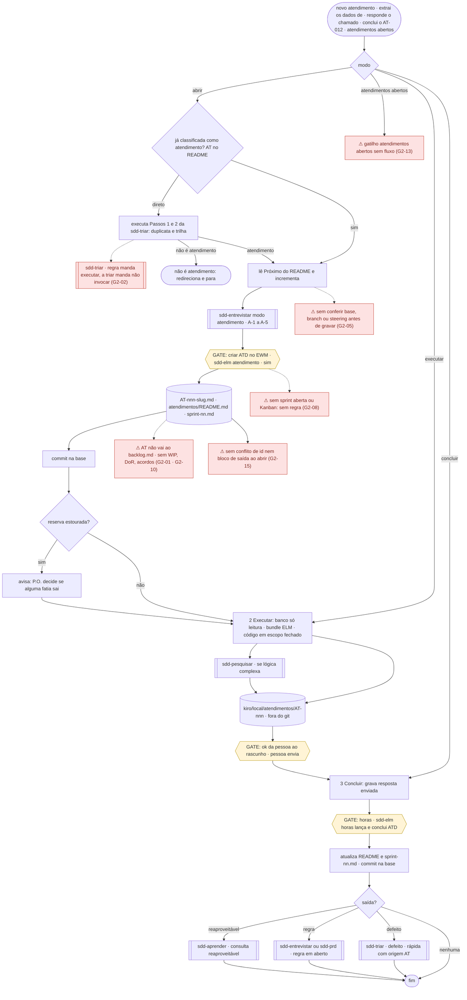

Vermelho: pré-condição contraditória com a triar (G2-02), gravação sem checar base (G2-05), sem sprint/Kanban (G2-08), AT fora do backlog e sem WIP/DoR (G2-01/10), gatilho sem fluxo (G2-13), sem conflito de id (G2-15).

### Divergências

**Resumo:** fluxos 6 (P2) · Parte 3: 5 DET · 5 AMB · 3 SEM REGRA · 0 CONFL (13 linhas, com T2; o orquestrador viu em T2 também um CONFLITO com T:129, tratado em D0 e S05-D2) · Parte 4: 3 OK · 1 DIV · 8 N/E

| # | Sev. | Tipo | Divergência | Evidência (arquivo:linha) | Partes | Verificação | Correção sugerida |
|---|---|---|---|---|---|---|---|
| S06-D1 | Alta | expectativa do dono | Atender é segunda skill de entrada (refaz Passos 1-2 da triar), abre o AT fora do `backlog.md`, cria a `[ATD]` na sprint sem sugerir, e executa e conclui na mesma skill sem passar pela `sdd-iniciar`. **Ver D0** (D0.1 #1-6, 8; T2) | `sdd-atender/SKILL.md:3,29-50,64-74` | P2, P3, P4 | CONFIRMADO | Ver D0.3/D0.4 (opção 1: atender vira só execução) |
| S06-D2 | Média | persistência | `Próximo` é lido e incrementado no item 1 (A:39), antes da entrevista e do arquivo (A:46); abandono no meio queima o número ("nunca reaproveitado", A:22) e deixa o README sujo | `sdd-atender/SKILL.md:22,39-46` | P4 | CONFIRMADO | Incrementar `Próximo` só no item 4, junto do `AT-…md` |
| S06-D3 | Média | persistência | Caminho "já triado" não confere base, árvore limpa nem `pull --ff-only` antes de gravar README/AT/sprint e commitar "na base"; só o caminho direto herda o "Antes de tudo" via "Passos 1 e 2". Sem tratamento de conflito de id de AT no push | `sdd-atender/SKILL.md:29-33,46` × `sdd-triar/SKILL.md:26-28,111-115` | P2, P3, P4 | CONFIRMADO | No início de §1: "confira a base como a triar (T:26-28)" e copiar a regra de conflito de id |
| S06-D4 | Média | sem regra | Sem sprint aberta (Kanban, ou antes do primeiro planejamento) não há regra para `plannedFor` nem para a linha do `sprint-<nn>.md`; a iniciar trata Kanban/sem sprint | `sdd-atender/SKILL.md:43-46` × `sdd-iniciar/SKILL.md:83-85` | P2, P4 | CONFIRMADO | Kanban → iteração corrente; sem sprint → `[ATD]` sem `plannedFor` e sem linha de sprint, avisar |
| S06-D5 | Média | sem regra | Sem MCP de consulta (banco) a Execução não tem caminho; A:57-58 cobre só "sem tempo" | `sdd-atender/SKILL.md:52-58` | P3 | CONFIRMADO | "Sem MCP de banco → entregue o SQL para a pessoa rodar; registre `ELM`/consulta pendente" |
| S06-D6 | Baixa | sem regra | Gatilho "atendimentos abertos" na description sem passo no corpo; a listagem é do `sdd-status` | `sdd-atender/SKILL.md:3` × `sdd-status/SKILL.md:32,58` | P2, P3, P4 | CONFIRMADO | Tirar o gatilho da description ou mandar para `sdd-status` |
| S06-D7 | Baixa | ambíguo | Saídas sem critério: escrita no banco → "fatia ou rápida" (A:111); regra não decidida → "entrevistar ou PRD" (A:73; E:122-123) | `sdd-atender/SKILL.md:73,111` | P3 | CONFIRMADO | Tamanho/impacto: regra pontual → entrevistar; capacidade nova → PRD; escrita → rápida |
| S06-D8 | Baixa | persistência | Nenhum commit ao fim de Executar (registro e Consultas ficam sujos até Concluir); `Situação` só `aberto \| concluido` (sem cancelado), e atendimento que atravessa a virada não é tratado aqui (planejamento migra `[ATD]`) | `sdd-atender/SKILL.md:52-62,82` × `sdd-planejamento/SKILL.md:142` | P2, P4 | CONFIRMADO | Acrescentar `cancelado`/`→ sprint <nn+1>` e dizer que a Consultas é commitada na conclusão |
| S06-D9 | Baixa | formato | Abrir não tem bloco de saída; sem MCP o item 3 não diz que grava `ELM: pendente` (formato A:103 prevê) | `sdd-atender/SKILL.md:42-50,103` | P2, P4 | CONFIRMADO | Bloco `📥 AT-nnn …` e "sem MCP → `Tarefa ELM` `pendente`" |


## S07 · `sdd-entrevistar`

_Grupo G2 · detalhe no Anexo A — G2._

### Fluxo de execução

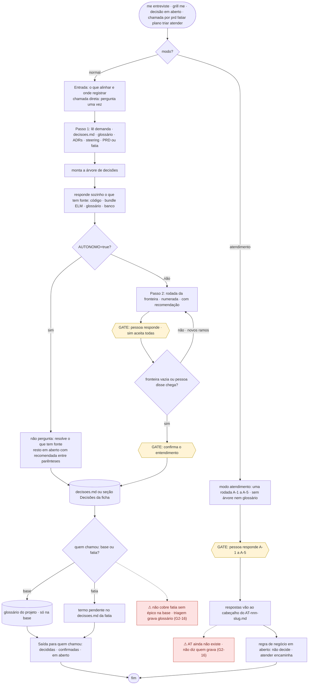

Vermelho: caso da fatia sem épico na base e ausência de dono da gravação das respostas A-1..A-5 (S07-F · G2-16).

### Divergências

**Resumo:** fluxos 5 (P2) · Parte 3: 3 DET · 3 AMB · 4 SEM REGRA · 0 CONFL (10 linhas) · Parte 4: 3 OK · 0 DIV · 3 N/E

| # | Sev. | Tipo | Divergência | Evidência (arquivo:linha) | Partes | Verificação | Correção sugerida |
|---|---|---|---|---|---|---|---|
| S07-D1 | Média | expectativa do dono | Modo atendimento amarrado à `sdd-atender` (E:3, 108, 122-123); no desenho do dono a entrevista curta roda na triagem. **Ver D0** (D0.3) | `sdd-entrevistar/SKILL.md:3,108,122-123` | P2 | CONFIRMADO | Chamador do modo atendimento = `sdd-triar` (ver D0.4) |
| S07-D2 | Média | ambíguo | E:122 manda gravar as respostas A-1..A-5 no cabeçalho do `AT-nnn-slug.md`, que só existe após o item 4 da atender; quem grava e quando não é dito | `sdd-entrevistar/SKILL.md:122` × `sdd-atender/SKILL.md:40-46` | P2, P3, P4 | CONFIRMADO | Em E:122: "devolva as respostas a quem chamou; ele grava no cabeçalho" |
| S07-D3 | Média | ambíguo | A "uma rodada" da triagem rápida/direta (T:64-65) não é o modo completo nem o modo atendimento; E:17-20 não cita a triagem rápida | `sdd-triar/SKILL.md:64-65` × `sdd-entrevistar/SKILL.md:17-20,40-63,108-120` | P3 | CONFIRMADO | Criar em E o modo "rodada única" (sem árvore, sem glossário), usado pela triagem rápida/direta |
| S07-D4 | Média | sem regra | Chamada direta ("onde registrar? não sei") e `AUTONOMO=true` sem destino: sem default | `sdd-entrevistar/SKILL.md:20,130` | P2, P3, P4 | CONFIRMADO | Default: `<produto>/epicos/<EP>-<slug>/decisoes.md` ou ficha; autônomo sem destino → devolva `em aberto` na resposta, sem gravar |
| S07-D5 | Baixa | sem regra | "Quais decisões estão em aberto" é gatilho sem modo de listagem; sem `decisoes.md` não há saída | `sdd-entrevistar/SKILL.md:3,23-63` | P2, P3 | CONFIRMADO | Modo listagem: lê `decisoes.md` e mostra `em aberto`; ausente → "nenhuma" |
| S07-D6 | Baixa | ambíguo | E:96-98 só distingue "fatia na branch dela"; a fatia sem épico na base (glossário gravado na triagem, ficha.md:57) não está em E. Skill em v2.3.0 (demais 2.4.0) | `sdd-entrevistar/SKILL.md:7,96-98` × `sdd-triar/references/ficha.md:56-57` | P2, P4 | CONFIRMADO | Citar a triagem na base em E:96 |


## S08 · `sdd-prd`

_Grupo G3 · detalhe no Anexo A — G3._

### Fluxo de execução

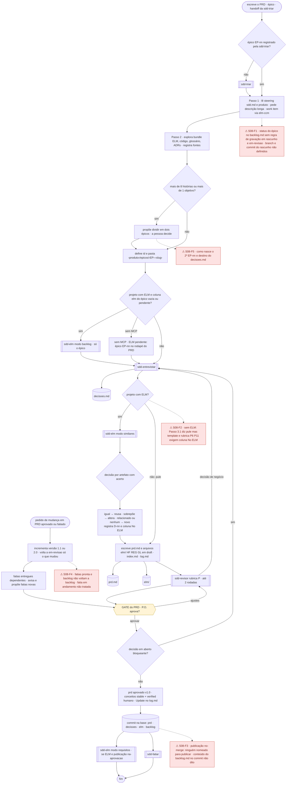

Nós vermelhos: lacunas da Parte 2 — S08-F1 (status do épico/branch), S08-F2 (projeto sem ELM), S08-F3 (no-merge), S08-F4 (reabertura do PRD fatiado), S08-F5 (épico dividido).

### Divergências

**Resumo:** fluxos 5 (P2) · Parte 3: 4 DET · 3 AMB · 2 SEM REGRA · 1 CONFL · Parte 4: 4 OK · 5 DIV · 9 N/E

| # | Sev. | Tipo | Divergência | Evidência (arquivo:linha) | Partes | Verificação | Correção sugerida |
|---|---|---|---|---|---|---|---|
| S08-D1 | Alta | sem regra | Rascunho do PRD (`prd.md`, `decisoes.md`, `elm/`) fica sem commit e sem regra de branch até o GATE. A `sdd-elm` commita `EP-nn - Publicar no ELM` já no Passo 1.4, sem dizer o que entra. Troca de branch perde o rascunho. Só a `sdd-fatiar` manda `git switch <base>` + `pull --ff-only` | `sdd-prd/SKILL.md:43-46,120-122`; `sdd-elm/SKILL.md:42`; `sdd-fatiar/references/backlog.md:82` | P2, P4 | CONFIRMADO | No Passo 1 da `sdd-prd`: `git switch <base>` + `pull --ff-only` antes de criar a pasta do épico; dizer que o rascunho fica sem commit até o GATE e que o commit do Passo 1.4 leva só a linha do `backlog.md` |
| S08-D2 | Média | conflito | `verified.by`: "login de quem aprovou" × "login do P.O."; com aprovação delegada os valores divergem. Além disso, o GATE grava `verified` como mapa, enquanto a mudança pós-aprovação e o `okf-elm.md` falam em lista que acumula | `sdd-prd/SKILL.md:119,132` × `sdd-prd/references/okf-elm.md:61,70` | P2, P3, P4 | CONFIRMADO | Escolher um: `by: human:<login de quem aprovou>`; alinhar `okf-elm.md:61` e declarar `verified` como lista desde o 1.0 |
| S08-D3 | Média | sem regra | PRD reaberto (`aprovado`/`fatiado` → `em-revisao`): nenhum passo grava o `status` do épico no `backlog.md` nem devolve a `backlog` as fatias `pronta`; a regra existe, mas ninguém a dispara. Também as transições `rascunho → em-revisao` não são gravadas (só o GATE commita o `backlog.md`) | `sdd-prd/SKILL.md:105,121,130-134` × `sdd-fatiar/references/backlog.md:62,75` | P2, P3, P4 | CONFIRMADO | Em "Mudança depois de aprovado": gravar `status` do épico no `backlog.md` e chamar a conferência da DoR da `sdd-fatiar` (fatias `pronta` voltam a `backlog`, `obs: falta: PRD reaberto`) |
| S08-D4 | Média | persistência | Commit do GATE: não diz o que muda no `backlog.md` (status do épico `aprovado`?); mensagem de commit do "padrão do `sdd.md`" é de fatia (`FT-<nnn> …`), sem equivalente para épico | `sdd-prd/SKILL.md:120-122`; `sdd-setup/assets/steering/sdd.md:59` | P2, P3, P4 | CONFIRMADO | Definir no GATE: `backlog.md` recebe `status: aprovado` do `EP-nn`; mensagem `EP-<nn> Aprovar PRD`; fixar o formato de épico no `sdd.md` |
| S08-D5 | Média | persistência | `decisoes.md` do Passo 3.1 manda registrar artefato, id ELM, relação, decisão, motivo, mas a tabela real tem `D · Pergunta · Decisão · Fonte · Data · Situação` (sem colunas para artefato/id/relação) | `sdd-prd/SKILL.md:68` × `sdd-entrevistar/SKILL.md:72` | P4 | CONFIRMADO | Dizer que esses campos entram em "Decisão"/"Fonte" (ex.: `REG-01 reusa 2101 (igual)`), ou acrescentar colunas opcionais no formato da `sdd-entrevistar` |
| S08-D6 | Média | persistência | `revisao-prd-<N>.md` é gravado na pasta do épico e não está na lista de commit do GATE | `sdd-revisar/SKILL.md:55` × `sdd-prd/SKILL.md:120-121` | P4 | PLAUSÍVEL | Incluir `revisao-prd-*.md` no commit do GATE (ou declarar que é descartável) |
| S08-D7 | Baixa | formato | Rodapé do `prd.md` não tem campo de aprovador, mas o GATE manda gravar "quem aprovou" ali; versões 1.1/2.0 também "no rodapé", sem formato de histórico | `sdd-prd/SKILL.md:118,130` × `sdd-prd/references/prd-template.md:80` | P4 | CONFIRMADO | Acrescentar no template o rodapé `Aprovado por <login> em <data>` e uma linha por versão |
| S08-D8 | Baixa | conflito | Projeto sem ELM: Passo 3.1 diz "pule", mas template e rubrica P6/P11 exigem a coluna "No ELM" | `sdd-prd/SKILL.md:72`; `references/prd-template.md:35`; `sdd-revisar/references/rubricas.md:19,24` | P2, P4 | CONFIRMADO | Sem ELM: coluna "No ELM" = `—` e rubrica P6/P11 marcada n/a; escrever isso no Passo 3.1 |
| S08-D9 | Baixa | ambíguo | `1.1` (correção) × `2.0` (mudança de escopo) sem critério; limiar "~8 histórias" aproximado | `sdd-prd/SKILL.md:98,130` | P3 | CONFIRMADO | Critério: muda valor/limite de regra ou cenário = 2.0; texto/typo = 1.1; fixar o limiar (ex.: > 8) |
| S08-D10 | Baixa | sem regra | Épico dividido em dois: não diz quem registra o 2º `EP-nn` (`sdd-triar`?) nem o destino do `decisoes.md` já escrito | `sdd-prd/SKILL.md:98`; `sdd-fatiar/references/backlog.md:16,61` | P2, P4 | CONFIRMADO | Se aceita a divisão: voltar à `sdd-triar` para o 2º `EP-nn` e partir o `decisoes.md` por épico |
| S08-D11 | Baixa | sem regra | Similares: artefato sem 3–6 palavras-chave; cópia do bundle (`<id>-<slug>.md`) para `elm/` (`HF-nn-<slug>.md`) sem regra de renomear; sem MCP e sem bundle | `sdd-elm/SKILL.md:53-55`; `sdd-prd/SKILL.md:85-89`; `okf-elm.md:29` | P3, P4 | CONFIRMADO | Pedir as palavras-chave à pessoa; renomear para o padrão `elm/` mantendo `id`/`resource`; sem fonte nenhuma, "novo (sem verificação)" |
| S08-D12 | Baixa | formato | Exemplo do `okf-elm.md` traz `generated by: sdd/2.1.0`; skills do grupo estão em 2.3.0/2.4.0 | `sdd-prd/references/okf-elm.md:48` | P2, P4 | CONFIRMADO | Trocar para `sdd/<versão do power>` |
| S08-D13 | Alta | expectativa do dono | Atendimento fora do backlog, `[ATD]` e encaixe de AT: o PRD/épico não toca nisso, mas o `backlog.md` (sem seção de AT) é compartilhado | ver D0 | P2 | CONFIRMADO | ver D0 |

---


## S09 · `sdd-fatiar`

_Grupo G3 · detalhe no Anexo A — G3._

### Fluxo de execução

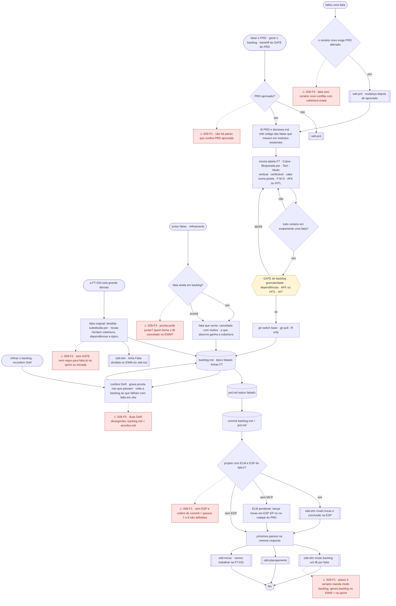

Nós vermelhos: S09-F1 (sem conferência do PRD, backlog no EWM na-sprint, ESP/commit), S09-F2 (divisão), S09-F3 (junção), S09-F4 (fatia sem cenário), S09-F5 (DoR duplicada).

### Divergências

**Resumo:** fluxos 5 (P2) · Parte 3: 0 DET · 3 AMB · 4 SEM REGRA · 3 CONFL · Parte 4: 1 OK · 3 DIV · 5 N/E

| # | Sev. | Tipo | Divergência | Evidência (arquivo:linha) | Partes | Verificação | Correção sugerida |
|---|---|---|---|---|---|---|---|
| S09-D1 | Alta | conflito | Duas DoR com resultado diferente para a mesma fatia: "dependências concluídas ou **planejadas antes**" × "concluídas ou **na mesma sprint antes dela**" (+ "cabe numa janela de contexto" só no `acordos.md`). A `sdd-planejamento` regrava `pronta` sem dizer qual vale. O `pronta` gravado depende de quem roda | `sdd-fatiar/references/backlog.md:74` × `sdd-planejamento/references/arquivos.md:76,78`; `sdd-planejamento/SKILL.md:83` | P2, P3, P4 | CONFIRMADO | Uma só DoR (a do `backlog.md`, que é por trilha); `arquivos.md` passa a só apontar para ela, e a regra de dependência vira "na mesma sprint antes dela ou concluídas" |
| S09-D2 | Alta | roteamento | Passo 4 manda `sdd-elm` modo backlog sempre "com ELM", mas `backlog no EWM` = `ao-fatiar \| na-sprint`; com `na-sprint` o passo cria IBs que a `sdd-elm` só cria na sprint | `sdd-fatiar/SKILL.md:87` × `sdd-elm/SKILL.md:135` × `sdd-setup/assets/steering/sdd.md:72` | P2, P3, P4 | CONFIRMADO | No Passo 4: "se `backlog no EWM` = `ao-fatiar`, chame o modo backlog; se `na-sprint`, a `sdd-planejamento` chama" |
| S09-D3 | Média | sem regra | PRD declarado `aprovado` na entrada, mas nenhum passo confere; fatiar PRD `em-revisao` grava `fatiado` sobre rascunho | `sdd-fatiar/SKILL.md:16,78` | P2, P3, P4 | CONFIRMADO | Passo 1: ler `status` do `prd.md`; se não `aprovado`, parar e mandar à `sdd-prd` |
| S09-D4 | Média | conflito | Horas da `[ESP]` lançadas/concluídas no GATE do backlog × "nunca nos GATEs" (`sdd.md`, `sdd/SKILL.md`) e "nunca nos GATEs **intermediários**" (`arquivos.md`). Redação inconsistente; o GATE do backlog conclui a `[ESP]`, então é conclusão de tarefa. Sem `[ESP]` (PRD feito fora de sprint) não há regra; `sdd-elm` modo conclusão não cita `[ESP]` | `sdd-fatiar/SKILL.md:80-83` × `sdd-setup/assets/steering/sdd.md:16` × `sdd-planejamento/references/arquivos.md:71`; `sdd-elm/SKILL.md:218-221` | P2, P3, P4 | CONFIRMADO | Uniformizar para "nunca nos GATEs, salvo a conclusão da `[ESP]` no GATE do backlog"; sem `[ESP]` = pular o passo 7; incluir `[ESP]` no escopo do modo conclusão |
| S09-D5 | Média | conflito | "Fatia sem cenário → corrija" (cobertura exata) × prefactoring/fatia de preparação, e "fatia nova exige cenário novo e PRD alterado" | `sdd-fatiar/SKILL.md:31-32,56-57,100` | P2, P3, P4 | CONFIRMADO | Admitir fatia de preparação com `cobre: —` e `obs: prefactoring de FT-x`; `:100` vale só para cenário novo |
| S09-D6 | Média | sem regra | Dividir: não diz como repartir a cobertura; se repete o GATE; nem o que fazer com fatia já na sprint, com `status.md` ou branch. Grafia de `obs` diverge (`substituida-por: [FT-x, FT-y]` × `substituida-por FT-…`) | `sdd-fatiar/SKILL.md:96-98` × `references/backlog.md:48` | P2, P3, P4 | CONFIRMADO | Dividir só fatia `backlog`/`pronta` fora de sprint (iniciada: parar e reportar); repartir `cobre` com "ok" da pessoa; uma grafia (`substituida-por FT-x, FT-y`) |
| S09-D7 | Média | sem regra | Juntar: "só fatias em `backlog`" exclui `pronta` sem dizer a resposta; o texto não manda a fatia que absorve ficar com o `cobre` da que some; IB da fatia cancelada no EWM sem dono (a `sdd-elm` nunca apaga) | `sdd-fatiar/SKILL.md:99`; `sdd-elm/SKILL.md:46` | P2, P3, P4 | CONFIRMADO | Aceitar `pronta` (volta a `backlog` ao juntar); somar `cobre`; pedir à pessoa a marcação de obsoleto no IB (regra 6) |
| S09-D8 | Média | sem regra | Depois do PRD alterado por "faltou uma fatia", nada manda repetir o fatiamento (só da fatia nova) nem o GATE | `sdd-fatiar/SKILL.md:100` | P2, P3, P4 | CONFIRMADO | Acrescentar: "alterado o PRD, repita os Passos 1–3 só para a fatia nova" |
| S09-D9 | Média | persistência | Pendências e commits: `ELM pendente: lançar … em [ESP]` vai ao rodapé do PRD já commitado no passo 6 (alteração sem commit); mensagem de commit de `backlog.md`+`prd.md` indefinida; ordem commit × passos 7/8 não dita | `sdd-fatiar/SKILL.md:79-83` | P2, P4 | CONFIRMADO | Fazer o passo 7 antes do commit, ou dizer que a pendência entra no commit seguinte; fixar mensagem `EP-<nn> Fatiar PRD` |
| S09-D10 | Baixa | ambíguo | "Perguntar à pessoa (uma vez…)" × "Ajuste e repita até ok" | `sdd-fatiar/SKILL.md:59,70` | P2, P3 | CONFIRMADO | Título do Passo 2: "Perguntar à pessoa (com a tabela)" |
| S09-D11 | Baixa | persistência | Épico `fatiado` existe no `backlog.md` e no `prd.md` (dois lugares); só diz-se que o mesmo commit grava os dois | `sdd-fatiar/SKILL.md:77-79` | P2, P4 | PLAUSÍVEL | Declarar que o `backlog.md` é a fonte e o `prd.md` espelha |
| S09-D12 | Alta | expectativa do dono | Atendimento fora do backlog: `backlog.md` não tem seção para AT (só `origem`) | ver D0 | P2 | CONFIRMADO | ver D0 |

---


## S10 · `sdd-planejamento`

_Grupo G3 · detalhe no Anexo A — G3._

### Fluxo de execução

#### modo inicial e modo sprint

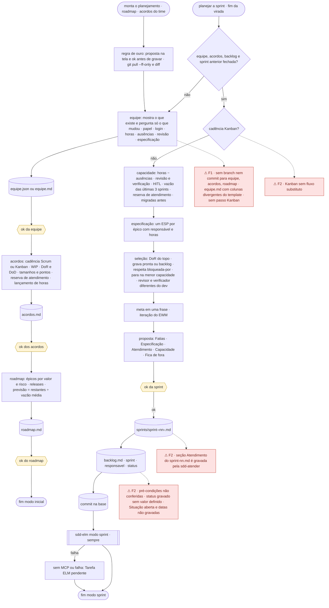

Nós vermelhos: S10-F1 (commit/branch, equipe.md, Kanban), S10-F2 (Kanban, pré-condições, valor de status, Situação/datas, Atendimento).

#### durante a sprint, encaixe, review e virada

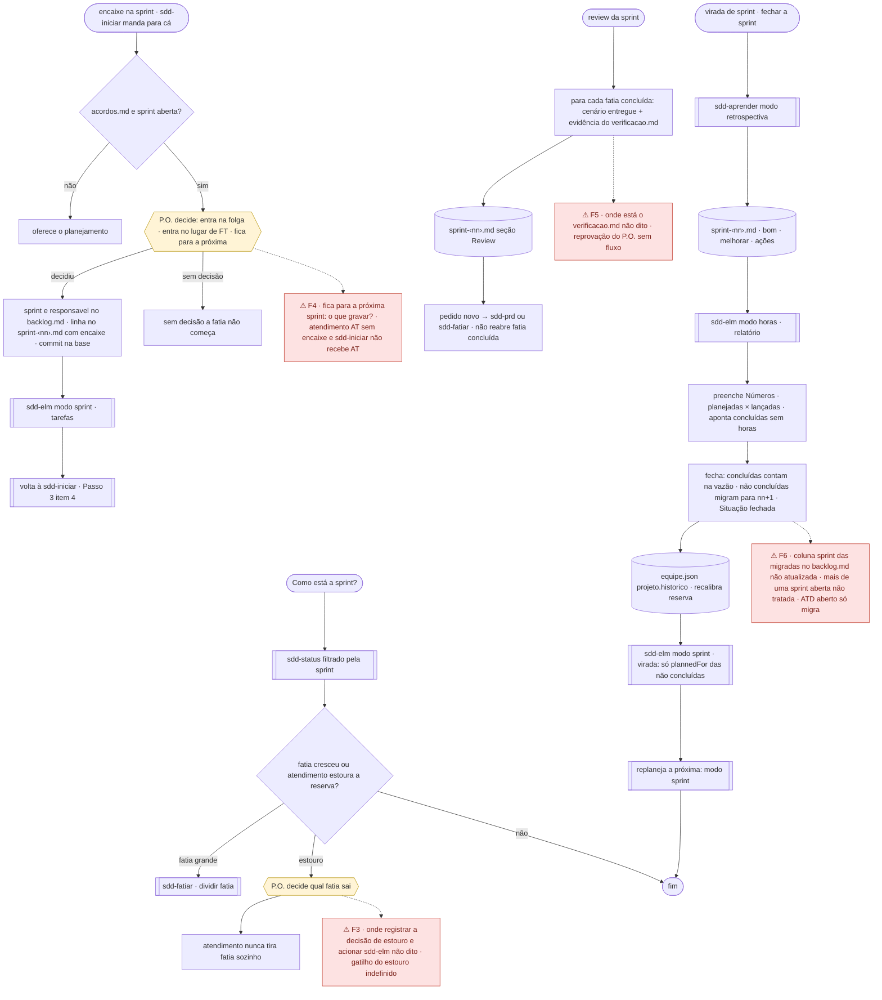

Nós vermelhos: S10-F3 (estouro), S10-F4 (encaixe sem AT, próxima sprint), S10-F5 (review), S10-F6 (virada sem atualizar o backlog.md).

### Divergências

**Resumo:** fluxos 6 (P2) · Parte 3: 3 DET · 1 AMB · 7 SEM REGRA · 1 CONFL · Parte 4: 2 OK · 5 DIV · 7 N/E

| # | Sev. | Tipo | Divergência | Evidência (arquivo:linha) | Partes | Verificação | Correção sugerida |
|---|---|---|---|---|---|---|---|
| S10-D1 | Alta | persistência | `equipe.json` montado só com o que o roteiro coleta não valida: faltam `projeto.inicio`, `projeto.nome`, `membros[].ativo`; `cadencia`, `duracao-sprint-semanas` e `pontos-por-tamanho` só nascem no passo 2 (acordos), depois da gravação do passo 1 | `sdd-planejamento/assets/equipe.schema.json:14,76`; `sdd-planejamento/SKILL.md:29-36,54-61` | P3, P4 | CONFIRMADO | No passo 1, perguntar também `nome`, `inicio` da sprint 1 e `ativo`; gravar `equipe.json` só depois dos acordos (ou gravar os campos de cadência com os padrões e ajustar no passo 2) |
| S10-D2 | Média | persistência | `status`/revisor/verificador "no `backlog.md`" (modo sprint e encaixe), mas o `backlog.md` não tem essas colunas; revisor e verificador só existem no `sprint-<nn>.md`. Valor de `status` a gravar não é dito ("em andamento" não é gravado) _Ajuste do orquestrador: a coluna `status` existe no `backlog.md`; o problema é revisor/verificador sem coluna e o valor de `status` não dito — Média, não Alta._ | `sdd-planejamento/SKILL.md:88,103,122-123` × `sdd-fatiar/references/backlog.md:27,51` | P2, P3, P4 | CONFIRMADO | Gravar no `backlog.md` só `sprint`, `responsavel` e `status: pronta`; revisor/verificador no `sprint-<nn>.md` (tabela Fatias) |
| S10-D3 | Alta | sem regra | Virada: fatias não concluídas migram ("→ sprint nn+1") só no arquivo da sprint antiga; a coluna `sprint` das fatias no `backlog.md` nunca vira nn+1 | `sdd-planejamento/SKILL.md:142-144`; `sdd-fatiar/references/backlog.md:52` | P2, P3, P4 | CONFIRMADO | No passo 3 da virada: atualizar `sprint` = nn+1 no `backlog.md` e criar a linha na sprint nova |
| S10-D4 | Média | conflito | `equipe.md`: colunas obrigatórias divergem (SKILL: Login, Papel, Horas/semana; template: + Nome); `Ativo` só no template; ausências `Horas ausentes` × `Motivo`; histórico 8 × 10 colunas; sem validação de "um P.O. ativo" | `sdd-planejamento/SKILL.md:40-51` × `assets/equipe-template.md:14,19,31,41` | P2, P3, P4 | CONFIRMADO | O SKILL passa a citar o `equipe-template.md` como único formato e a mesma lista de colunas obrigatórias |
| S10-D5 | Média | persistência | "Tarefa ELM" é mandada gravar para todas as tarefas, mas só as tabelas Especificação e Atendimento do `sprint-<nn>.md` têm a coluna; fatias só têm `elm` no `backlog.md`. Sem MCP, "Tarefa ELM = pendente" não existe para fatias | `sdd-elm/SKILL.md:174-175`; `sdd-planejamento/SKILL.md:105-106` × `references/arquivos.md:115,122,130` | P4 | CONFIRMADO | Acrescentar "Tarefa ELM" à tabela Fatias do `sprint-<nn>.md`, ou limitar a regra a ESP/ATD e dizer que fatia usa `elm` do `backlog.md` |
| S10-D6 | Média | ambíguo | "Pare ao atingir a menor das capacidades" compara horas, fatias e pontos sem conversão; HITL "consome horas de dev" sem fórmula | `sdd-planejamento/SKILL.md:78,86` | P2, P3 | CONFIRMADO | Dizer qual capacidade manda (revisão em horas) e que vazão/pontos são teto de conferência |
| S10-D7 | Média | sem regra | Sprint anterior ainda `aberta` não é conferida; duas sprints `aberta` sem regra de qual fechar | `sdd-planejamento/SKILL.md:70-78,142`; `references/arquivos.md:111` | P2, P3, P4 | CONFIRMADO | Modo sprint exige a anterior `fechada` (senão oferecer a virada); virada fecha a de menor número `aberta` e avisa se houver mais de uma |
| S10-D8 | Média | persistência | Planejamento (`equipe`, `acordos`, `roadmap`, review, virada) sem branch nem commit; só sprint e encaixe commitam na base. Mensagem de commit indefinida; `sdd-aprender` (retrospectiva) não está nos `resources` do `sdd-produto` nem de nenhum agente | `sdd-planejamento/SKILL.md:27-66,103,124,137`; `sdd-setup/assets/agents/sdd-produto.json:13-21` | P2, P4 | CONFIRMADO | Regra única: planejamento é artefato de produto, base + `pull --ff-only`, commit pequeno por etapa; incluir `sdd-aprender` nos `resources` do `sdd-produto` |
| S10-D9 | Média | sem regra | Encaixe: "fica para a próxima sprint" sem ação (`sprint` fica `—` ou nn+1?); "entra no lugar de" não toca a linha da fatia que sai no `sprint-<nn>.md`. Estouro da reserva: não diz onde registrar a decisão nem quem soma o consumido; não aciona `sdd-elm` | `sdd-planejamento/SKILL.md:112-113,120-126` | P2, P3, P4 | CONFIRMADO | Gravar `sprint` = nn+1 em "próxima"; marcar a linha da que sai com `encaixe: saiu para <FT>`; estouro de reserva = linha `encaixe:` no `sprint-<nn>.md` + `sdd-elm` modo sprint |
| S10-D10 | Média | sem regra | Sem fluxo Kanban: modo sprint, encaixe e virada assumem sprint; só a `sdd-iniciar` diz "Kanban → não há sprint" | `sdd-planejamento/SKILL.md:55-56,68-106`; `sdd-iniciar/SKILL.md:83` | P2 | CONFIRMADO | Seção "Kanban" no planejamento: sem `sprint-<nn>.md`, WIP e revisão semanal do backlog, horas por `[ESP]`/`[ATD]` |
| S10-D11 | Baixa | sem regra | Review sem `verificacao.md` (arquivada ou só na branch) sem regra; reprovação do P.O. só vira "fatia nova" | `sdd-planejamento/SKILL.md:131-133` | P2, P3 | CONFIRMADO | Sem arquivo: registrar "sem evidência" na linha do Review e abrir fatia/defeito |
| S10-D12 | Baixa | formato | Passo "ok" do modo sprint não menciona `Situação: aberta` nem datas início/fim; mensagem de commit indefinida; `Sprint N - Publicar no ELM` não cabe em `<FT\|EP> - Publicar no ELM` | `sdd-planejamento/SKILL.md:103`; `references/arquivos.md:104-111`; `sdd-elm/SKILL.md:42` | P2, P4 | CONFIRMADO | Passo 7: gravar `Situação: aberta` e datas derivadas de `inicio`+`duracao`; ampliar o padrão de commit da `sdd-elm` |
| S10-D13 | Alta | expectativa do dono | Encaixe só cobre fatia; AT entra na sprint pela `sdd-atender` sem passar pelo planejamento; virada só migra `[ATD]` no arquivo da sprint | ver D0 | P2 | CONFIRMADO | ver D0 |

---


## S11 · `sdd-elm`

_Grupo G3 · detalhe no Anexo A — G3._

### Fluxo de execução

#### similares, requisitos e backlog

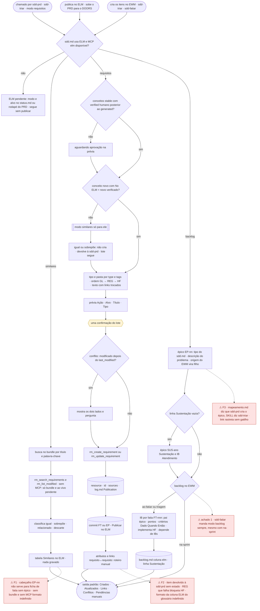

Nós vermelhos: S11-F1 (similares sem épico/sem fonte), S11-F2 (devolução, bloqueio de HF, glossário), S11-F3 (quem cria o épico, link rastreia), e a divergência de `na-sprint` vinda do S09.

#### sprint, atendimento e horas

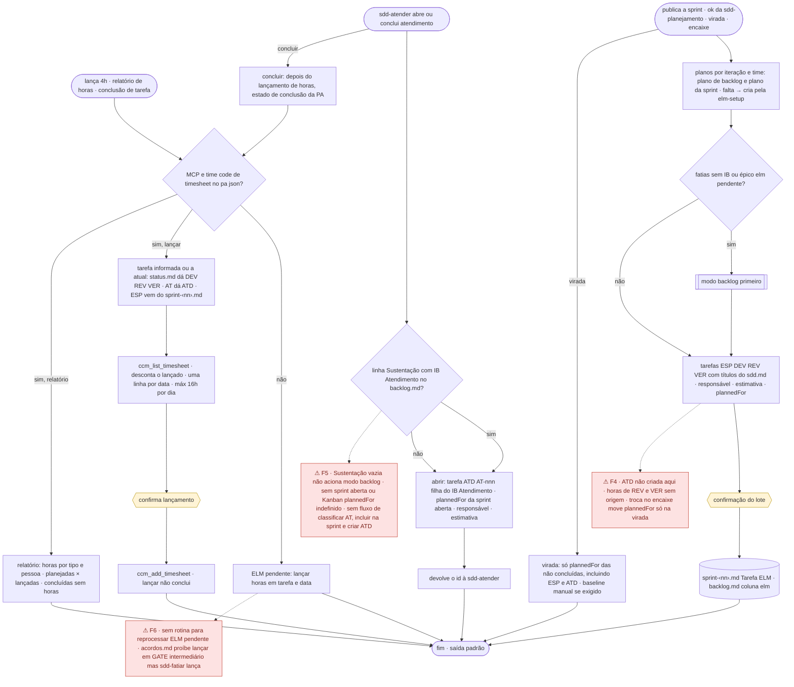

Nós vermelhos: S11-F4 (ATD e horas de REV/VER), S11-F5 (atendimento sem Sustentação, sem sprint, divergência do dono), S11-F6 (pendências sem reprocesso, exceção de GATE).

#### testes, ET as-built, conclusão e sem ELM

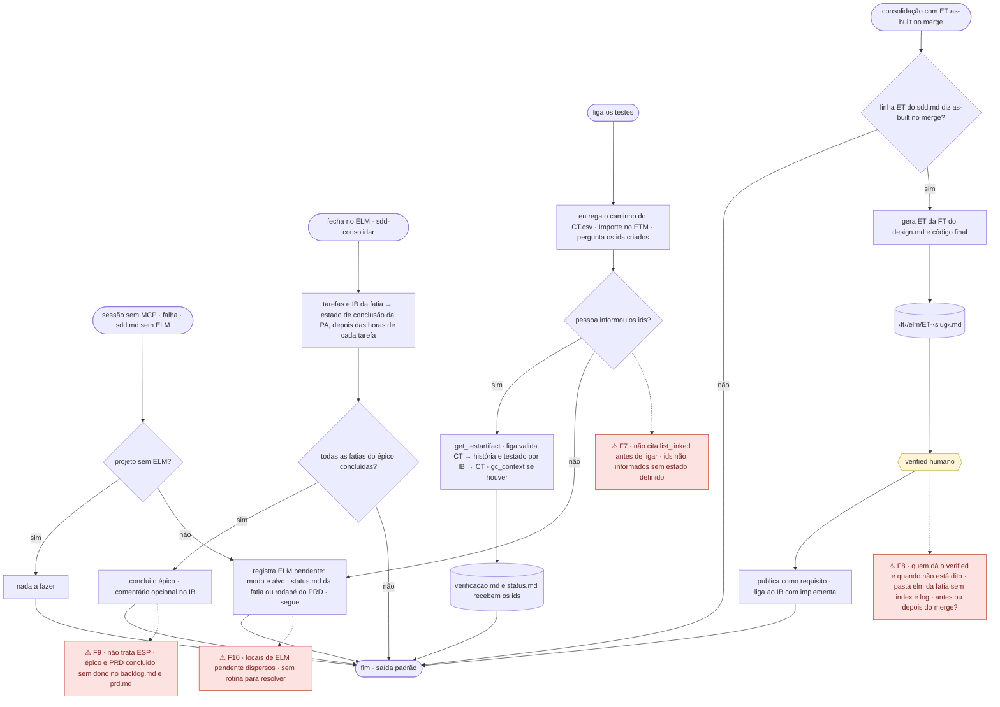

Nós vermelhos: S11-F7 (testes), S11-F8 (ET as-built), S11-F9 (conclusão sem ESP e sem dono do status concluído), S11-F10 (pendências dispersas).

### Divergências

**Resumo:** fluxos 10 (P2) · Parte 3: 8 DET · 4 AMB · 5 SEM REGRA · 3 CONFL · Parte 4: 3 OK · 3 DIV · 7 N/E

| # | Sev. | Tipo | Divergência | Evidência (arquivo:linha) | Partes | Verificação | Correção sugerida |
|---|---|---|---|---|---|---|---|
| S11-D1 | Alta | permissão | ET as-built: nenhum agente reúne as duas permissões. `sdd-produto` publica (`rm_*`) mas não escreve em `.kiro/specs/*/elm/`; `sdd-codificador` escreve ali mas não tem `rm_*`. Também `ELM pendente` em `status.md` cai fora do `allowedPaths` do `sdd-produto` e do alcance de revisor/verificador/pesquisador | `sdd-elm/SKILL.md:23-24,215-216`; `sdd-setup/assets/agents/sdd-produto.json:40-47`; `sdd-setup/references/agentes.md:67-68` | P4 | PLAUSÍVEL | Gerar e publicar a ET no `sdd-produto` (acrescentar `.kiro/specs/*/elm/**` ao `allowedPaths`) ou publicá-la a partir do `sdd-consolidar` em sessão com MCP; declarar quem registra `ELM pendente` sem escrita |
| S11-D2 | Alta | persistência | Idempotência das tarefas: a busca de publicação interrompida usa título com `[FT-031]`, mas as tarefas se chamam `[DEV] FT-031 …`/`[ESP] EP-05 …` (sem colchete). Queda entre criar e gravar o id duplica `[DEV]/[REV]/[VER]/[ESP]/[ATD]` | `sdd-elm/SKILL.md:35` × `sdd-setup/assets/steering/sdd.md:78` | P4 | CONFIRMADO | Buscar tarefa por `<tipo> FT-nnn` + pai; `[ATD]` por `AT-nnn`; escrever isso na regra 2 |
| S11-D3 | Média | conflito | Local da pendência: `status.md` da fatia ou rodapé do PRD (`:23-24`) × coluna "Tarefa ELM" = `pendente` (modo sprint) × três destinos para horas (`status.md`, AT, `sprint-<nn>.md`). Fatia sem `status.md` não tem onde registrar; sem rotina que reprocesse | `sdd-elm/SKILL.md:23-24,196-197` × `sdd-planejamento/SKILL.md:105-106`; `sdd-fatiar/references/backlog.md:53` | P2, P3, P4 | CONFIRMADO | Tabela única "modo → onde grava a pendência" na `sdd-elm`; fatia sem `status.md` usa `elm: pendente` no `backlog.md`; `sdd-status` lista as pendências |
| S11-D4 | Média | sem regra | Modo atendimento: linha `Sustentação:` vazia não chama o modo backlog; sem sprint aberta/Kanban `plannedFor` fica indefinido; idempotência da `[ATD]` (`AT-nnn`) não citada | `sdd-elm/SKILL.md:133-134,182-183` | P2, P3, P4 | CONFIRMADO | Abrir: "se `Sustentação:` vazia, rode antes o item 2 do modo backlog"; sem sprint aberta, perguntar a iteração (ver também D0) |
| S11-D5 | Média | roteamento | Quem cria o épico no EWM: `mapeamento.md` diz `sdd-prd`; o SKILL diz `sdd-triar` (a `sdd-prd` só se ficou pendente) | `sdd-elm/references/mapeamento.md:13` × `sdd-elm/SKILL.md:126` | P2 | CONFIRMADO | `mapeamento.md:13`: "quando o `EP-nn` é registrado (`sdd-triar`)" |
| S11-D6 | Média | formato | Modo sprint grava "Tarefa ELM" (ver S10-D5) e usa commit `<FT\|EP> - Publicar no ELM`, que não cobre `Sprint N`. Fatia migrada no encaixe com troca: só a virada descreve mover `plannedFor` | `sdd-elm/SKILL.md:42,174-178` | P2, P4 | CONFIRMADO | Acrescentar `Sprint <nn> - Publicar no ELM`; descrever o `plannedFor` da troca no modo sprint |
| S11-D7 | Média | persistência | Modo testes: o `CT.csv` não tem coluna de cenário/história, então não há regra para o link `valida`; sem ids importados fica só a pergunta, sem pendência; `verificacao.md`/`status.md` ficam fora do `sdd-produto` e o verificador não tem MCP; falta `list_linked_*` antes de ligar | `sdd-elm/SKILL.md:205-209`; `sdd-elm/references/mapeamento.md:41-42`; `sdd-setup/assets/steering/sdd.md:80` | P2, P3, P4 | CONFIRMADO | Acrescentar coluna `cenário` (HF#c.c) ao `CT.csv`; sem ids, `ELM pendente: ligar testes`; dizer qual agente executa o modo |
| S11-D8 | Média | sem regra | Modo conclusão não cobre a `[ESP]` (que a `sdd-fatiar` conclui por ele) nem marca épico/PRD `concluido` no `backlog.md`/`prd.md` (sem dono em "Quem escreve o quê") | `sdd-elm/SKILL.md:218-221`; `sdd-fatiar/SKILL.md:81`; `sdd-fatiar/references/backlog.md:43,57-68` | P2, P3, P4 | CONFIRMADO | Incluir `[ESP]` no escopo; tornar `sdd-consolidar` dono do `status: concluido` do épico quando a última fatia fecha |
| S11-D9 | Média | ambíguo | Falha no meio da publicação de requisitos: "registre e siga" × "rode de novo"; REG falha → HF que a embute fica bloqueada, sem regra para o lote | `sdd-elm/SKILL.md:23-24,43-44,93-94` | P2, P3, P4 | CONFIRMADO | Falha de GL/REG: não criar HF dependente, registrar `ELM pendente` e retomar na próxima chamada do modo |
| S11-D10 | Média | ambíguo | Publicação `no-merge`: o GATE do PRD só oferece `sdd-elm` quando `na-aprovacao`; quem publica no merge é a `sdd-consolidar` (Passo 2), mas o GATE não diz isso. Item "igual/sobrepõe" devolvido à `sdd-prd` e não decidido deixa o PRD sem o conceito publicado, sem estado | `sdd-prd/SKILL.md:123-126`; `sdd-consolidar/SKILL.md:40` | P2 | PLAUSÍVEL | GATE: "`no-merge` → só `sdd-fatiar`; a publicação ocorre na `sdd-consolidar`" |
| S11-D11 | Baixa | ambíguo | Cabeçalho do bloco de similares usa `EP-<nn>`; ficha de fatia sem épico tem `FT-nnn`. Classificação igual/sobrepõe sem critério operacional | `sdd-elm/SKILL.md:51,65-66,72` | P3 | CONFIRMADO | Cabeçalho `— <EP-nn \| FT-nnn>`; critério: mesmo comportamento/valor = igual; mesmo comportamento, valor ou escopo diferente = sobrepõe |
| S11-D12 | Baixa | ambíguo | ET: "mesmo formato" não diz se `index.md`/`log.md` entram na pasta `elm/` da fatia; `sources` apontaria para `design.md` | `sdd-elm/SKILL.md:215`; `sdd-prd/references/okf-elm.md:10,16-23` | P3, P4 | CONFIRMADO | Dizer que a pasta `elm/` da fatia leva `index.md` e `log.md` e que `sources` da ET cita `design.md` |
| S11-D13 | Baixa | formato | Saída padrão `Criados/Atualizados/…` não serve a similares, horas e relatório (têm formato próprio); linha `Sustentação:` não rola de ano; linha parcial é indistinguível de vazia; horas lançadas por quem não é o responsável sem regra | `sdd-elm/SKILL.md:69-78,133-134,193,225-229`; `sdd-fatiar/references/backlog.md:55` | P2, P4 | CONFIRMADO | Limitar a saída padrão a requisitos/backlog/sprint/conclusão; `Sustentação:` com ano e um id por item |
| S11-D14 | Alta | expectativa do dono | Modo atendimento só abre a `[ATD]` quando a `sdd-atender` executa; chamador `sdd-atender`; AT não passa por `sdd-iniciar`; `mapeamento.md:21` "abertura do atendimento" | ver D0 | P2 | CONFIRMADO | ver D0 |

---


## S12 · `sdd-pesquisar`

_Grupo G4 · detalhe no Anexo A — G4._

### Fluxo de execução

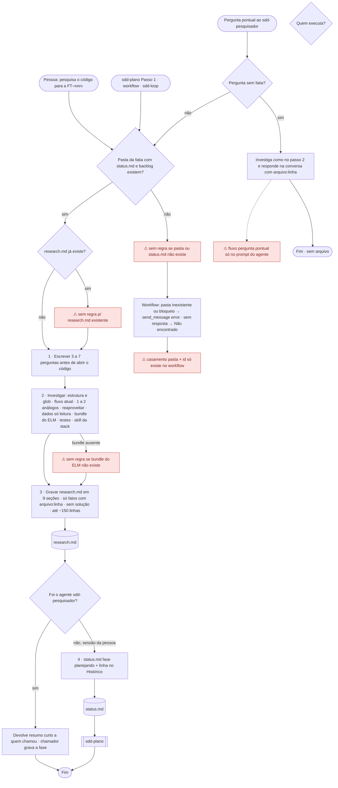

Vermelho: lacunas de S12-F1 (research.md existente, pasta ausente, bundle ausente), S12-F2 (casamento pasta × id) e S12-F3 (fluxo só no prompt do agente).

### Divergências

**Resumo:** fluxos 3 (P2) · Parte 3: 4 DET · 1 AMB · 1 SEM REGRA · 0 CONFL · Parte 4: 2 OK · 0 DIV · 3 N/E

| # | Sev. | Tipo | Divergência | Evidência (arquivo:linha) | Partes | Verificação | Correção sugerida |
|---|---|---|---|---|---|---|---|
| S12-D1 | Média | sem regra | A entrada exige pasta com `status.md` e a skill não diz o que fazer sem ela; também não diz o que fazer se `research.md` já existe (replanejamento: sobrescrever, atualizar?). Resposta de chat não prescrita | `PES:19-23`, `:85-87` | P2, P3, P4 | CONFIRMADO | Em "Entrada": sem pasta/`status.md` → pare e mande para a `sdd-iniciar`; `research.md` existente → leia, atualize só o que mudou e diga na resposta o que mudou |
| S12-D2 | Média | ambíguo | "Pergunta pontual → responda direto, sem gravar" existe só no prompt do agente; a skill não a descreve. Um pedido "responda e grave em research.md" cabe nas duas regras (resposta × pesquisa de fatia) | `AG/sdd-pesquisador.json:4` × `PES:3,15-17` | P2, P3, P4 | CONFIRMADO | Acrescentar seção "Pergunta pontual" em `PES`: sem pasta de fatia → resposta curta com `arquivo:linha`, sem arquivo; pedido de gravar só vale com pasta de fatia |
| S12-D3 | Baixa | sem regra | A `sdd-iniciar` promete "pesquisa curta" na trilha rápida, mas `sdd-pesquisar` não tem modo curto (9 seções fixas, ≲150 linhas) | `INI:60` × `PES:50-84` | P2, P3 | CONFIRMADO | Em `PES`: trilha rápida → só as seções Fluxo atual, Testes e Não encontrado, ancoradas no defeito |
| S12-D4 | Baixa | sem regra | O passo "Documentação" manda ler o bundle do ELM; o `sdd.md` admite `Bundle do ELM = não há` e a skill não dá ramo para isso | `PES:43-44` × `SD:31` | P2 | CONFIRMADO | Acrescentar "bundle `não há` → pule e registre em 'Não encontrado'" (mesma lacuna em S15-D5) |

---


## S13 · `sdd-plano`

_Grupo G4 · detalhe no Anexo A — G4._

### Fluxo de execução

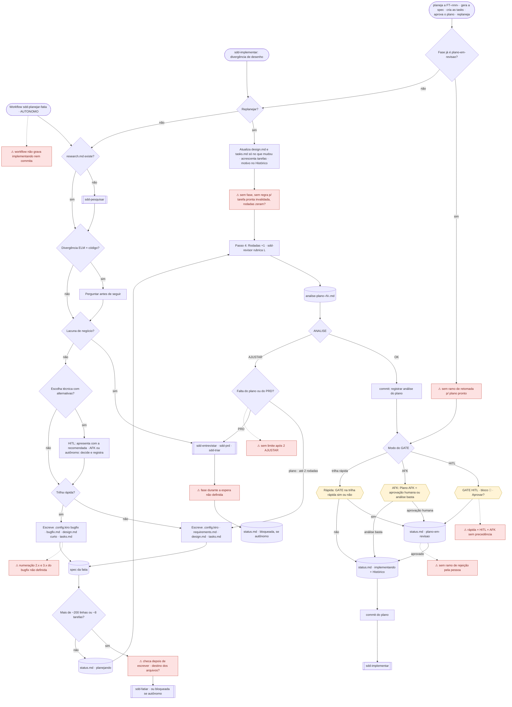

Vermelho: lacunas de S13-F1 (espera sem fase), F3 (numeração bugfix), F4 (checagem de tamanho tardia), F5 (sem limite após AJUSTAR), F6/F7/F8 (rejeição no GATE, precedência rápida/AFK/HITL, workflow sem fechamento do GATE), F9 (replanejar sem fase) e retomada de `plano-em-revisao`. Para o workflow (F10), o modo autônomo segue Q3 e Q4 sem perguntas.

### Divergências

**Resumo:** fluxos 10 (P2) · Parte 3: 8 DET · 6 AMB · 4 SEM REGRA · 2 CONFL · Parte 4: 9 OK · 6 DIV · 9 N/E

| # | Sev. | Tipo | Divergência | Evidência (arquivo:linha) | Partes | Verificação | Correção sugerida |
|---|---|---|---|---|---|---|---|
| S13-D1 | Alta | persistência | O commit do GATE é só "os arquivos do plano". Não nomeia `research.md`, `.config.kiro` nem `status.md` (nenhum tem outro commit), e o commit imediato de PLN:64 leva só o `analise-plano-N.md`. Sobra árvore suja e o Passo 0 da implementação para (só perdoa relatórios). A recomendação de "sessão nova" agrava. `AJUSTAR` também fica sem commit | `PLN:64`, `:86`; `IMP:20-22`; `INI:124`; `PES:85-91` | P3, P4 | CONFIRMADO | `PLN:86`: "commite `.config.kiro`, `research.md`, `requirements`/`bugfix`, `design`, `tasks` **e `status.md`**: `FT-<nnn> registrar plano`"; `PLN:64`: levar o `status.md` junto no commit imediato |
| S13-D2 | Alta | persistência | "Análise basta" (AFK) e "rápida sem GATE" seguem direto, sem passar pelo ramo "Aprovado": sem Histórico e **sem commit do plano**. No loop, só a opção "aprovação humana" manda commitar | `PLN:82-85` × `PLN:86`; `LOOP:86` | P3, P4 | CONFIRMADO | Tirar o commit e o Histórico do último item e pôr abaixo da lista: "qualquer ramo que termine em `implementando` → Histórico + commit do plano" |
| S13-D3 | Alta | conflito | HITL: "sempre uma pessoa aprova" × trilha rápida com `GATE rápida = não`: "segue com ANALISE: OK". Rápida em HITL cai nas duas; STT admite "rápida sem GATE" mas não resolve | `PLN:81` × `PLN:84` (`STT:21-22`) | P2, P3, P4 | CONFIRMADO | Escrever a precedência: "A trilha rápida decide antes do modo (`GATE rápida = não` dispensa a pessoa mesmo em HITL)" — ou o inverso, mas dito |
| S13-D4 | Alta | conflito | Workflow `sdd-planejar-fatia`: o passo `plano` proíbe análise e GATE; `ajustar` encerra com "OK sem GATE pendente → nada mais". Resultado: fase fica `planejando`, ninguém grava `implementando` (PLN:82-83), ninguém commita `analise-plano-N` (PLN:64) nem o plano. Contradiz a skill | `WFP:24`, `:49` × `PLN:64`, `:82-83` | P2, P3, P4 | CONFIRMADO | Em `WFP:49`: OK sem GATE → `fase: implementando` + Histórico; passo final do codificador que commita `analise-plano-N.md`, o plano e o `status.md` |
| S13-D5 | Média | sem regra | O GATE só tem o ramo "Aprovado". "Não aprovo, muda a tarefa 3" não tem destino (fase, nova análise, rodada) | `PLN:86` | P2, P3, P4 | CONFIRMADO | Acrescentar "Pediu ajuste → `fase: planejando`, corrija o que a pessoa pediu, repita Passos 4–5" |
| S13-D6 | Média | sem regra | "Até 2 rodadas" de `AJUSTAR` por falta do plano: nada diz o que vem depois (nem se são 2 no total ou 2 correções). O `sdd-loop` resolve (`bloqueada`), a skill e o workflow não: `onMaxIterations: pause` sem efeito definido, e a última correção feita em `ajustar` nunca é reanalisada | `PLN:66`; `WFP:29-30`, `:49` × `LOOP:85` | P2, P3, P4 | CONFIRMADO (efeito do `pause`: PLAUSÍVEL) | `PLN:66`: "2 rodadas totais sem OK → `fase: bloqueada (de: planejando)` com os dois relatórios e devolva à pessoa"; mesma regra no prompt de `ajustar` |
| S13-D7 | Média | ambíguo | `bloqueada` aparece em duas formas: `fase: bloqueada` (PLN:53-54, :98-99; IMP:62, :86) × `bloqueada (de: <fase>)` com "motivo e a pergunta exata" (STT:19; INI:140). O template não tem campo para motivo/pergunta. Retomar ("volta à fase de origem") exige a origem | `PLN:53-54`, `:98-99`; `IMP:62`, `:86` × `STT:18-20`; `INI:140` | P2, P3, P4 | CONFIRMADO | Trocar as quatro ocorrências por `bloqueada (de: <fase>)` + linha no Histórico com motivo/pergunta; (corrigir também em IMP) |
| S13-D8 | Média | ambíguo | Replanejar: `PLN:56` põe `planejando` durante a análise; `PLN:92-94` não diz a fase do replanejamento nem se as rodadas zeram. E "nunca desmarque as prontas" deixa sem saída a tarefa pronta cujo desenho mudou | `PLN:56`, `:92-94` (`STT:18-19`) | P2, P3, P4 | CONFIRMADO | Em "Replanejar": `fase: planejando` (depois `plano-em-revisao`/`implementando` pelo GATE); rodadas continuam; tarefa pronta afetada → nova tarefa `[R<n>]` "refazer" no fim |
| S13-D9 | Média | ambíguo | Fatia grande: a checagem (~200 linhas / ~8 tarefas) é o item 5, depois de escrever 1–3; "em vez de escrever um plano maior" não diz se para antes ou descarta. Destino de `research.md` e dos arquivos já escritos fica indefinido; a proposta de divisão não tem estrutura | `PLN:52-54` | P2, P3, P4 | CONFIRMADO | Mover a checagem para antes do item 1 (estimar tarefas pelo `research.md`/critérios) e dizer "mantenha `research.md`; não grave os demais" |
| S13-D10 | Média | sem regra | Lacuna de negócio em HITL: "pare" sem fase nem forma de retomar. Só o autônomo grava `bloqueada` | `PLN:33-34` × `PLN:98-99` | P2, P4 | CONFIRMADO | Gravar `bloqueada (de: planejando)` também em HITL, ou dizer "a fase não muda; a pessoa devolve a resposta e você retoma do Passo 2" |
| S13-D11 | Baixa | ambíguo | Dois pontos do GATE sem destino claro: o commit não tem mensagem (padrão está em SD:59); "segue com ANALISE: OK" não diz se o Histórico entra (ver D2) | `PLN:83`, `:86` × `SD:59` | P3, P4 | CONFIRMADO | Citar a mensagem: `FT-<nnn> registrar plano` (alinhada ao padrão de commit do `sdd.md`) |
| S13-D12 | Baixa | persistência | `.config.kiro`: a regra "se não existe" quase nunca dispara (a `sdd-iniciar` já cria) e não corrige `specType` divergente (rápida com `feature`). O fallback `python3 -c` de PT:12 não está na allowlist do codificador (só `uuidgen`) | `PLN:40`; `INI:103-106`; `PT:11-12` × `AG/sdd-codificador.json:77` | P3, P4 | CONFIRMADO | `PLN:40`: "se não existe **ou o `specType` não bate com a trilha**, crie/corrija"; tirar o `python3 -c` de PT:12 |

---


## S14 · `sdd-implementar`

_Grupo G4 · detalhe no Anexo A — G4._

### Fluxo de execução

```mermaid
flowchart TD
  T1(["implementa a FT-‹nnn› · executa as tasks · continua a implementação · corrige os achados"])
  T2(["AUTONOMO · workflow sdd-entregar-fatia"])
  TD(["Fatia de trilha direta"])
  Q0{"Trilha direta?"}
  DI["Direta: 1 teste que falha · 2 mudança · 3 backpressure · 4 sdd-revisar rubrica C com o pedido · 5 PR curto"]
  D11["⚠ direta: sem Passo 0, sem aceita, relatório só na conversa, sem rodadas"]
  P0A{"Branch atual é a do status.md?"}
  P0B{"Árvore limpa, exceto relatórios e evidências?"}
  D1["⚠ status.md e tasks.md sujos não são exceção"]
  STOP(["Avisa e para"])
  P0C["git pull --ff-only · ou git fetch sem upstream"]
  P0D["Achados abertos viram tarefas R‹n› no fim do tasks.md"]
  P0E["Roda os testes uma vez · vermelho = ambiente, registra e avisa"]
  CIC["Para cada tarefa: 1 skill da stack · 2 vermelho · 3 verde · 4 arrumar · 5 backpressure"]
  CMT["6 · marca x e commit pequeno · 7 · linha no Histórico"]
  D8["⚠ subtarefas e tarefas opcionais não tratadas"]
  DV{"Plano diverge do código ou teste suspeito?"}
  DIV["Bloco Divergência na tarefa N: Esperado · Encontrado · Por que importa"]
  D10["⚠ sem fase nem registro na divergência"]
  RPL[["sdd-plano replanejar · sdd-entrevistar · sdd-prd"]]
  TR{"2 tentativas sem avançar?"}
  BLQ[("status.md · bloqueada")]
  MORE{"Todas as tarefas x?"}
  VAL["Passo 2 · compilar + suíte inteira + lint + cobertura"]
  AMB["AMBIENTE registrado no status.md"]
  D4["⚠ o que fazer após AMBIENTE?"]
  REV["Passo 3 · fase revisando · Rodadas +1 · sdd-revisor rubrica C"]
  RF[("revisao-codigo-‹N›.md + commit")]
  VR{"VEREDITO"}
  R2{"2ª reprovação?"}
  OPC{{"bloqueada · 3 opções: orientar · voltar ao plano · aceitar achados restantes"}}
  VER["Passo 4 · Rodadas +1 · sdd-verificar"]
  VF[("verificacao.md + CT.csv + commit")]
  D9["⚠ sem limite de rodadas na verificação"]
  VV{"Verificação"}
  PRH["Passo 5 · fetch · compara com origin base · monta texto do PR"]
  D16["⚠ sem ferramenta de PR não há link · dois pushes"]
  SIM{{"Uma confirmação: push e abrir PR"}}
  PRA[("status.md · pr-aberto + link")]
  H1[["sdd-consolidar após o merge"]]
  NOAG["Agente codificador: para em pronta para o PR"]

  T1 --> Q0
  TD --> Q0
  Q0 -->|"sim"| DI
  DI --> D11
  D11 --> PRH
  T2 --> Q0
  Q0 -->|"não"| P0A
  P0A -->|"não"| STOP
  P0A -->|"sim"| P0B
  P0B -->|"não"| D1
  D1 --> STOP
  P0B -->|"sim"| P0C
  P0C --> P0D
  P0D --> P0E
  P0E --> CIC
  CIC --> DV
  DV -->|"sim"| DIV
  DIV --> D10
  D10 --> RPL
  DV -->|"não"| CMT
  CMT -.-> D8
  CMT --> TR
  TR -->|"sim"| BLQ
  TR -->|"não"| MORE
  MORE -->|"não"| CIC
  MORE -->|"sim"| VAL
  VAL -->|"erro de ambiente"| AMB
  AMB --> D4
  D4 --> REV
  VAL -->|"verde"| REV
  REV --> RF
  RF --> VR
  VR -->|"APROVADO"| VER
  VR -->|"REVISAR"| R2
  R2 -->|"não · tarefas R‹n›"| P0D
  R2 -->|"sim"| OPC
  OPC --> BLQ
  VER --> VF
  VF --> D9
  D9 --> VV
  VV -->|"ACEITO · fase aceita"| PRH
  VV -->|"REJEITADO"| P0D
  PRH --> D16
  D16 --> SIM
  SIM --> PRA
  PRA --> H1
  PRH -.->|"agente"| NOAG

  classDef div fill:#fde2e2,stroke:#c0392b,color:#7b241c
  classDef gate fill:#fff4d6,stroke:#b7950b
  class D1,D4,D8,D9,D10,D11,D16 div
  class OPC,SIM gate
```

Vermelho: S14-F1 (árvore suja pelo próprio ciclo, Achado 1), F2 (subtarefas e opcionais), F3 (divergência sem fase), F4 (AMBIENTE), F6 (verificação sem limite), F7 (PR sem ferramenta, dois pushes), F9 (direta incompleta). O workflow autônomo (F10) percorre o mesmo fluxo sem perguntas, sem push nem PR, e sem gravar `bloqueada` nem commitar relatórios.

### Divergências

**Resumo:** fluxos 10 (P2) · Parte 3: 12 DET · 7 AMB · 1 SEM REGRA · 0 CONFL · Parte 4: 7 OK · 8 DIV · 4 N/E

| # | Sev. | Tipo | Divergência | Evidência (arquivo:linha) | Partes | Verificação | Correção sugerida |
|---|---|---|---|---|---|---|---|
| S14-D1 | Alta | persistência | `status.md` sujo trava o Passo 0. O ciclo grava o Histórico (item 7) **depois** do commit da tarefa (item 6); `revisando`/Rodadas saem antes do relatório e fora do commit dele; o verificador grava `aceita`; só `pr-aberto` commita tudo. A exceção do Passo 0 não inclui `status.md`; "contexto cheio → sessão nova" cai na própria parada. As regras novas cobrem só relatórios | `IMP:20-22`, `:46-47`, `:64-65`, `:75`, `:80-82`, `:95-96`, `:124`; `STT:13` | P2, P3, P4 | CONFIRMADO | Inverter 6–7 (Histórico antes do commit) para o commit levar `status.md`; IMP:64-65 e os dois "commite imediatamente" passam a incluir `status.md`; Passo 0 perdoa só `status.md` e `tasks.md` com alteração de estado |
| S14-D2 | Alta | persistência | Workflow `sdd-entregar-fatia` não commita `revisao-codigo-N.md`, `verificacao.md`, `CT.csv` nem `status.md` (cobre só Passos 0–2; a skill commita nos Passos 3–4). No PR a pessoa cai no Passo 0 sujo. Além disso, `revisão do código` fica `0` com `revisao-codigo-1.md` no disco quando a 1ª rodada aprova (o incremento só ocorre no `implementar` seguinte) | `WFE:31`, `:45` × `IMP:80-82`, `:95-96` | P2, P3, P4 | CONFIRMADO | Passo `registrar` do codificador depois de `revisar` e de `verificar` (commit dos relatórios + `status.md`) e fixar quem incrementa a rodada: o `revisar`/`registrar`, não o `implementar` seguinte |
| S14-D3 | Média | persistência | O commit imediato de `verificacao.md`+`CT.csv` deixa `evidencias/` e `massa/` de fora, embora `verificacao.md` as cite e o PR dependa delas. `verificacao.md` REJEITADO também não tem commit imediato | `IMP:95-96`; `VER:46,57`; `IMP:21-22` | P4 | CONFIRMADO | IMP:95: commitar `verificacao.md`, `CT.csv`, `evidencias/` e `massa/` (sem dado real, como já manda o prompt do codificador); REJEITADO: commitar `verificacao.md` antes de devolver ao Passo 0 |
| S14-D4 | Média | permissão | O Passo 4 manda o `sdd-verificador` ("de preferência"), mas o `sdd-codificador` só delega a `sdd-pesquisador` e `sdd-revisor` e não carrega `sdd-verificar`. Os Passos 3 e 5 têm "pare e devolva"; o Passo 4 não | `IMP:91` × `AG/sdd-codificador.json:6-9,12-16`; `IMP:77-78`, `:102-103` | P3, P4 | CONFIRMADO | IMP:91: "como agente sem a skill/subagente, pare e devolva 'revisão aprovada; pronta para a verificação (rodada N)'" |
| S14-D5 | Média | ambíguo | "Para cada tarefa" não diz se subtarefas (`1.1`, `1.2`) contam, nem se tarefas opcionais `[ ]*` entram em "todas `[x]`" (Passo 2) e em "primeiro item não marcado" (Passo 0). O checkpoint (última tarefa) coincide com o Passo 2 | `IMP:24,33,69` × `PT:159-175` | P2, P3 | CONFIRMADO | Passo 1: "a unidade é a tarefa de nível 1; marque `1.x` no ciclo e a pai ao fim; `[ ]*` é opcional e não bloqueia o Passo 2; o checkpoint é o Passo 2" |
| S14-D6 | Média | ambíguo | Divergência plano × código: a diferença de assinatura cabe em "muda o desenho → replanejar" e em "decisão técnica equivalente → decida". A divergência também não manda gravar o bloco nem mudar a fase | `IMP:52-58` | P2, P3, P4 | CONFIRMADO | Critério objetivo: o que está na forma do programa/assinaturas do `design.md` e muda → replanejar; detalhe interno não listado → decida e registre; dizer onde o bloco fica (Histórico) |
| S14-D7 | Média | ambíguo | Achado de PR em "Achados abertos" vira `[R<n>]`; mas "muda comportamento de negócio → P.O." (IMP:57) pega o mesmo achado ("o bloqueio deve ser de 5 falhas"). Quem escreve os achados do PR na tabela também não é dito | `IMP:24-27` × `IMP:57` | P3, P4 | CONFIRMADO | IMP:24: "antes de virar `[R<n>]`, achado que muda regra de negócio vai ao P.O. (`sdd-entrevistar`)"; dizer que a pessoa grava os achados do PR |
| S14-D8 | Média | ambíguo | Teto "até 2 rodadas" da revisão × REJEITADO que manda refazer o ciclo (Passo 0 → 3). Com revisão na rodada 2, a rodada seguinte é 3 ou bloqueio? Sem limite para verificação. O `sdd-loop` diz "REJEITADO → volta à 5 uma vez; de novo → bloqueada" | `IMP:85`, `:92-93` × `LOOP:89` | P2, P3 | CONFIRMADO | IMP:85/93: o teto da revisão conta por ciclo de correção (zera após REJEITADO) e a verificação tem teto próprio (2) → `bloqueada (de: verificando)` |
| S14-D9 | Média | sem regra | Passo 2: só erro de ambiente tem ação (`AMBIENTE` no `status.md`). Falha real da suíte (outro módulo, causa na fatia) não tem destino; o que fazer após `AMBIENTE` (parar? seguir à revisão, onde C3 também vira `AMBIENTE`?) e o vermelho inicial do Passo 0 ("registre e avise") também não | `IMP:28-29`, `:69-71` | P2, P3 | CONFIRMADO | Passo 2: falha da fatia → tarefa `[R<n>]` e volta ao Passo 1; `AMBIENTE` → registre e pare (`bloqueada (de: implementando)`) |
| S14-D10 | Média | persistência | Trilha direta: a mudança não tem commit prescrito (o PR depende da branch); relatório da revisão só na conversa (perde-se); `REVISAR` não tem ramo (corrigir? quantas rodadas?); vai a `pr-aberto` sem `aceita`, que o Passo 5 exige; sem Passo 0 | `IMP:100`, `:128-136`; `REV:30` | P2, P3, P4 | CONFIRMADO | Acrescentar na lista: commit da mudança antes da revisão; `REVISAR` → corrija e reveja (até 2); `IMP:100`: "(direta: dispensa `aceita`)"; relatório resumido no corpo do PR |
| S14-D11 | Média | ambíguo | Workflow `entregar`: `send_message severity error` e `onMaxIterations: pause` sem efeito definido — o erro encerra o workflow ou o repeat segue para a 2ª iteração? Nenhum passo grava `bloqueada` nem as 3 opções da 2ª reprovação. Mesmo em `WFP` | `WFE:17-18`, `:37`; `WFP:29-30` × `IMP:86-87` | P2, P3, P4 | PLAUSÍVEL | Prompt do `revisar`: erro → "encerre aqui, nenhum passo seguinte"; após o repeat, passo que grava `bloqueada (de: revisando)` se `codigo.json` ≠ APROVADO |
| S14-D12 | Baixa | formato | Mensagens fixas `FT-<nnn> registrar …` valem para o padrão `FT-<nnn> <verbo> …` de SD:59; se o projeto usa `Task <id> - …`, as skills contradizem o `sdd.md` | `PLN:64`; `IMP:80`, `:95` × `SD:59` | P4 | CONFIRMADO | Escrever "mensagem no padrão do `sdd.md`, com o texto `registrar …`" |
| S14-D13 | Baixa | ambíguo | Passo 5: sem ferramenta de PR só se entrega texto, mas `pr-aberto` exige o link; e há dois `push` com o mesmo "sim" (antes e depois do `status.md`) | `IMP:122-124` | P2, P3, P4 | CONFIRMADO | IMP:123: sem ferramenta → fase continua `aceita` e o texto é entregue; IMP:124: um só `push`, ou dizer que o "sim" cobre os dois |
| S14-D14 | Baixa | roteamento | Achados vindos do PR: a tabela da `sdd-iniciar` manda `pr-aberto` só para "aguardar o merge"; IMP trata achados de PR. "Melhoria vista no caminho é registrada pela `sdd-triar`" sem passo que a aciona | `INI:138` × `IMP:25-26`; `IMP:147`; `REV:66` | P2 | CONFIRMADO | `INI:138`: `pr-aberto` + "corrige os achados" → `sdd-implementar`; IMP:147: "diga à pessoa para acionar a `sdd-triar`" |

---


## S15 · `sdd-revisar`

_Grupo G4 · detalhe no Anexo A — G4._

### Fluxo de execução

```mermaid
flowchart TD
  TP(["revisa o PRD · fim da sdd-prd"])
  TL(["analisa o plano · Passo 4 da sdd-plano · passo analisar"])
  TC(["code review · revisa a FT-‹nnn› · Passo 3 da sdd-implementar · passo revisar"])
  TD(["Trilha direta: revisão do diff"])
  C0["Comum: lê steering e regras aprendidas · contexto limpo · ignora justificativas · não edita nem commita"]
  Q1{"Qual rubrica?"}
  RP["Rubrica P · P1 a P11 sobre prd.md, elm, decisoes, glossário"]
  D1["⚠ como achar a pasta do épico e a rodada ‹N›"]
  RL["Rubrica L · L1 a L10 sobre research, requisitos, design, tasks, backlog"]
  D2["⚠ L1 na rápida com cobre preenchido · itens 2.x e 3.x"]
  RC["Rubrica C · lê diff inteiro · executa backpressure · caça testes removidos ou enfraquecidos"]
  EX["Eixo Spec C1 a C7 · eixo Padrões C8 a C14 · tabelas separadas"]
  D3["⚠ revisor por eixo em paralelo: quem consolida?"]
  AMB{"C3 falhou por ambiente?"}
  D4["⚠ AMBIENTE com resto OK pode dar APROVADO"]
  CAL["Calibragem: consulta licoes.md · revisao-branda sobe uma severidade"]
  D5["⚠ SUGESTÃO subida passa a reprovar · mesmo tipo indefinido"]
  SEV["Severidade final · achado sem evidência não entra · fora da fatia = SUGESTÃO"]
  D6["⚠ sugestões não acionam a sdd-triar"]
  FP[("revisao-prd-‹N›.md · RESULTADO PRONTO ou AJUSTAR")]
  FL[("analise-plano-‹N›.md · ANALISE OK ou AJUSTAR")]
  FC[("revisao-codigo-‹N›.md · VEREDITO APROVADO ou REVISAR")]
  FD["Relatório só na conversa · C1 C2 C6 contra o pedido · VEREDITO"]
  D7["⚠ C2 C6 C7 C11 sem N/A explícito"]
  WF{"Pediram JSON (workflow ou loop)?"}
  JS[("plano.json ou codigo.json em .kiro/local/wf")]
  D8["⚠ PENDENTE e id do workflow não estão na skill · sem JSON p/ rubrica P"]
  FIM(["Devolve ao chamador · última linha é o fecho exato"])

  TP --> C0
  TL --> C0
  TC --> C0
  TD --> C0
  C0 --> Q1
  Q1 -->|"P"| RP
  RP --> D1
  D1 --> CAL
  Q1 -->|"L"| RL
  RL --> D2
  D2 --> CAL
  Q1 -->|"C"| RC
  RC --> EX
  EX --> D3
  D3 --> AMB
  AMB -->|"sim"| D4
  D4 --> CAL
  AMB -->|"não"| CAL
  CAL --> D5
  D5 --> SEV
  SEV --> D6
  D6 --> Q2{"Origem do pedido?"}
  Q2 -->|"PRD"| FP
  Q2 -->|"plano"| FL
  Q2 -->|"código da fatia"| FC
  Q2 -->|"trilha direta"| FD
  FD --> D7
  D7 --> FIM
  FP --> FIM
  FL --> WF
  FC --> WF
  WF -->|"sim"| JS
  JS --> D8
  D8 --> FIM
  WF -->|"não"| FIM

  classDef div fill:#fde2e2,stroke:#c0392b,color:#7b241c
  classDef gate fill:#fff4d6,stroke:#b7950b
  class D1,D2,D3,D4,D5,D6,D7,D8 div
```

Vermelho: S15-F1 (pasta e rodada), F2 (rápida), F3 (consolidação por eixo, AMBIENTE), F4 (itens sem N/A na direta), F5 (JSON do workflow), F6 (calibragem × sugestões nunca reprovam) e Achado 12 (sugestões sem encaminhamento).

### Divergências

**Resumo:** fluxos 6 (P2) · Parte 3: 4 DET · 5 AMB · 2 SEM REGRA · 1 CONFL · Parte 4: 1 OK · 0 DIV · 5 N/E

| # | Sev. | Tipo | Divergência | Evidência (arquivo:linha) | Partes | Verificação | Correção sugerida |
|---|---|---|---|---|---|---|---|
| S15-D1 | Média | conflito | Calibragem sobe SUGESTÃO até IMPORTANTE, que reprova; mas "Sugestões nunca reprovam". "Mesmo tipo de problema" não é definido | `REV:48-50` × `REV:60`; `RB:3-4` | P2, P3, P4 | CONFIRMADO | REV:48: "mesmo tipo = mesmo item da rubrica (ex.: C5)"; REV:60: "sugestões, **salvo as promovidas por lição**, nunca reprovam" (ou limitar a subida a IMPORTANTE→BLOQUEANTE) |
| S15-D2 | Média | ambíguo | `<N>` do relatório = "próxima rodada" (REV:56), mas quem chama já passa a rodada (PLN:60, IMP:75) e os workflows incrementam depois sem passar N. Para o PRD não há regra de contagem (`revisao-prd-<N>`) | `REV:55-56`; `PLN:60-62`; `IMP:75`; `WFP:49`; `WFE:31` | P2, P3, P4 | CONFIRMADO | REV:56: "`<N>` = a rodada passada por quem chamou; sem ela, 1 + o maior `<N>` já existente na pasta" |
| S15-D3 | Média | ambíguo | C3 falha por ambiente → `AMBIENTE`, "não conta como achado", mas o fecho só admite APROVADO ou REVISAR. Se o resto passa, o veredito pode ser APROVADO sem backpressure comprovado | `RB:80-81` | P2, P3, P4 | CONFIRMADO | RB:80: "C3 `AMBIENTE` → `VEREDITO: REVISAR` com a linha 'backpressure não comprovado — reexecutar'" (ou criar fecho próprio) |
| S15-D4 | Média | ambíguo | Trilha direta: C7 e C11 pedem `design.md`, que não existe; C2 e C6 também não têm fonte. `REV:30` só trata C1, C2, C6 "contra o pedido" e não marca N/A | `REV:30` × `RB:62`, `:71`, `:97` | P2, P3, P4 | CONFIRMADO | REV:30: "na direta, C2/C6 contra o pedido; C7 e C11 → N/A" |
| S15-D5 | Média | sem regra | P6 manda conferir o ELM também no bundle, mas o `sdd.md` admite `Bundle do ELM = não há` | `RB:19`; `REV:27` × `SD:31` | P2, P3 | CONFIRMADO | RB:19: "bundle `não há` → confira só o ELM por MCP e registre N/A para o bundle" |
| S15-D6 | Média | persistência | `revisao-prd-N.md` fica sem quem commite: produto vai para a base, nunca para branch de fatia, e sdd-prd não lista o relatório | `REV:55-56`; sdd-prd/SKILL.md:121 | P4 | CONFIRMADO | sdd-prd/SKILL.md:121: acrescentar `revisao-prd-<N>.md` à lista de commit do PRD |
| S15-D7 | Baixa | ambíguo | JSON do veredito: `<id>` não é definido; `PENDENTE` (passo `zerar`) não está em REV:57-58; em worktree o revisor só escreve `.kiro/local/wf/*/` da raiz, sem variante em `wt/` | `REV:56-58`; `WFP:12`, `:43` × `AG/sdd-revisor.json:38-39` | P2, P3, P4 | CONFIRMADO (worktree: PLAUSÍVEL) | REV:56: "`<id>` = id da fatia dado por quem chamou (ex.: FT-031); `PENDENTE` é gravado só pelo passo `zerar`; em worktree, no caminho do repositório principal" |
| S15-D8 | Baixa | ambíguo | L1 em trilha rápida: "cobre vazio" → `bugfix.md`; com `cobre` preenchido e `bugfix.md` (sem `requirements.md`) a fatia cai nas duas condições | `RB:32` | P2, P3 | CONFIRMADO | RB:32: "trilha rápida: o `bugfix.md` substitui o `requirements.md`, com ou sem `cobre`" |
| S15-D9 | Baixa | sem regra | Com subagentes, "um revisor por eixo em paralelo" não diz quem consolida o relatório único e a última linha | `REV:42-43` | P2, P4 | CONFIRMADO | REV:43: "o revisor de entrada consolida os dois eixos e escreve o relatório único" |

---


## S16 · `sdd-verificar`

_Grupo G5 · detalhe no Anexo A — G5._

### Fluxo de execução

```mermaid
flowchart TD
  T1(["verifica a FT · testa a fatia · executa cenários"])
  T2(["implementar Passo 4 · iniciar fase verificando · loop fase 7"])
  T1 --> C1
  T2 --> C1
  C1{"revisão APROVADO, branch da fatia e Verificação de aceite do sdd.md?"}
  C1 -->|"não"| STOP(["parar"])
  C1 -->|"sim"| C2{"Banco DDL = pendente?"}
  C2 -->|"sim"| BLK
  C2 -->|"não"| P1["status.md: fase verificando + Histórico"]
  C1 -.-> D1["⚠ não diz como conferir APROVADO nem a branch (S16-F1)"]
  C2 -.-> D2["⚠ pendente: só diz pare, sem fase (S16-F4)"]
  P1 --> P2["Roteiro no verificacao.md antes de executar: Massa · Executar · Esperado · Verificar"]
  P2 --> P3["Subir app/job (Executar do sdd.md) · massa por scripts · banco só leitura"]
  P3 --> P4["Executar cenário a cenário: backend http.sh/curl · batch · frontend Playwright · dados"]
  P4 --> P5["Repetição 2x e erro em um item"]
  P5 --> E1[("verificacao.md · evidencias · massa")]
  E1 --> DEC{"Resultado dos cenários?"}
  DEC -->|"todos ✅"| ACE
  DEC -->|"algum ❌"| REJ
  DEC -->|"só ⚠ ambiente"| BLK
  DEC -->|"❌ e ⚠ misto"| X1["⚠ sem estado para misto nem BLOQUEADO no bloco 🔎 (S16-F4)"]
  ACE["🔎 VERIFICACAO: ACEITO"] --> A1["Gerar CT.csv"]
  A1 --> A2[("CT.csv · 7 colunas · UTF-8 BOM · ponto e vírgula")]
  A2 --> A3[("status.md: fase aceita")]
  A3 --> A4{{"Horas da VER: perguntar a quem verificou"}}
  A4 --> A5[["sdd-elm modo horas na VER, sem concluir"]]
  A4 -.-> D3["⚠ loop sem pessoa · contradiz horas só na conclusão (S16-F2)"]
  A5 --> A6[("status.md: ELM horas lançadas · conclusão pendente (merge)")]
  A6 --> A7[["sdd-implementar Passo 5: abrir PR"]]
  A1 -.-> D4["⚠ login ELM do verificador · numeração CT · BOM (S16-F6)"]
  REJ["🔎 VERIFICACAO: REJEITADO"] --> R1[("status.md: achados esperado x obtido + fase implementando")]
  R1 --> R2[["sdd-implementar corrige tarefas R‹n›"]]
  R2 --> R3["Reverificação rodada N+1: só rejeitados + repetição"]
  R3 --> DEC
  R3 -.-> D5["⚠ aceitos da rodada 1 não reconferidos (S16-F5)"]
  R1 -.-> D6["⚠ sem teto de rodadas fora do loop · cenário errado no PRD sem estado (S16-F3)"]
  BLK[("status.md: fase bloqueada de verificando, com motivo")] --> END1(["fim: ninguém corrige código"])
  A7 --> END2(["fim"])

  classDef div fill:#fde2e2,stroke:#c0392b,color:#7b241c
  classDef gate fill:#fff4d6,stroke:#b7950b
  class D1,D2,D3,D4,D5,D6,X1 div
  class A4 gate
```

Nós vermelhos: lacunas de S16-F1 (conferência do APROVADO), F2 (horas sem pessoa no loop), F3 (sem teto de rodadas), F4 (DDL pendente e caso misto sem estado), F5 (regressão não reconferida), F6 (CT.csv: login, numeração, BOM).

### Divergências

**Resumo:** fluxos 6 (P2) · Parte 3: 3 DET · 4 AMB · 4 SEM REGRA · 1 CONFL · Parte 4: 5 OK · 3 DIV · 6 N/E

| # | Sev. | Tipo | Divergência | Evidência (arquivo:linha) | Partes | Verificação | Correção sugerida |
|---|---|---|---|---|---|---|---|
| S16-D1 | Média | persistência | `evidencias/` e `massa/` são gravadas pelo verificador (que não commita) e ficam **fora do commit imediato** do ACEITO (`sdd-implementar/SKILL.md:95` nomeia só `verificacao.md` e `CT.csv`). Só entram no Passo 0 da **próxima** sessão da `sdd-implementar` (`:20-22`), e o Passo 5 (PR) segue na mesma sessão: o PR pode abrir citando evidência que não está na branch. _Ajuste do orquestrador: a Parte 4 dizia "nenhuma lista de commit"; o Passo 0 as inclui, então a severidade cai para Média._ | `sdd-verificar/SKILL.md:57,63` × `sdd-loop/SKILL.md:90,94-96` × `sdd-implementar/SKILL.md:95-96` × `V.json:105-109` | P2, P3, P4 | CONFIRMADO | Nas três listas de commit (loop fase 7, `sdd-implementar` Passo 4) acrescentar `evidencias/` e `massa/` da pasta da fatia (sem dado real de pessoa). |
| S16-D2 | Média | persistência | Pedido direto "verifica a FT-031" e rejeição fora do loop: ninguém commita `verificacao.md`, `status.md` nem `CT.csv`. A `sdd-implementar` só commita "com ACEITO"; o verificador não tem `git add/commit`. | `sdd-implementar/SKILL.md:95-96` × `V.json:105-109` × `sdd-verificar/SKILL.md:94-95` | P4 | CONFIRMADO | No fim do Passo 4, dizer quem commita no pedido direto e no REJEITADO fora do loop (a pessoa, ou a `sdd-implementar` Passo 0 ao receber os achados). |
| S16-D3 | Média | conflito | Rodadas de verificação: o workflow manda o **verificador** incrementar; a skill e o template dizem que quem pediu incrementa e que o verificador só incrementa em pedido direto. Risco de contagem dupla. | `sdd-setup/assets/workflows/sdd-entregar-fatia.workflow.json:45` × `sdd-verificar/SKILL.md:94-95` × `template:25-27` | P2, P3, P4 | CONFIRMADO | No prompt do passo `verificar` do workflow, trocar "Incremente verificação" por "o chamador já incrementou" (ou mover o incremento para o passo anterior). |
| S16-D4 | Média | ambíguo | "Revisão `APROVADO`" na Entrada não diz onde conferir (arquivo/campo). A `sdd-implementar` usa `VEREDITO: APROVADO` em `revisao-codigo-<N>.md`. Sem regra para pasta sem `design.md` (trilha padrão) ou sem `status.md`. | `sdd-verificar/SKILL.md:22,29-31` × `sdd-implementar/SKILL.md:84` | P2, P3 | CONFIRMADO | Entrada: "último `revisao-codigo-<N>.md` com `VEREDITO: APROVADO`"; e "faltando `design.md`/`bugfix.md`/`status.md`: pare e diga o que falta". |
| S16-D5 | Média | ambíguo | Rodada 2: `verificacao.md` sobrescreve ou anexa? Se sobrescrever, os ✅ da rodada 1 somem e o `CT.csv` ("todos os verificados") perde a fonte. Os aceitos da rodada 1 também não são reconferidos após mudança de código. | `sdd-verificar/SKILL.md:29-39,84` × `references/ct-csv.md:3` | P2, P3, P4 | CONFIRMADO | Mandar anexar um bloco `## Rodada <N>` por rodada e, na rodada ≥2, repetir também os cenários que tocam o código alterado. |
| S16-D6 | Média | sem regra | `CT.csv`: Responsável = "login do ELM de quem verificou" sem fonte para o verificador (sem MCP, sem identidade ELM); `CT<nn>` sem regra de numeração; BOM depende da ferramenta `write` sem plano B; Status "padrão do projeto" pode estar vazio no `sdd.md` × "deixe vazios os que não souber". Formato em si validado (BOM, `;`, LF, 7 campos). | `references/ct-csv.md:9,14-15,21-23` × `steering:80` | P2, P3, P4 | CONFIRMADO | Em `ct-csv.md`: Responsável vazio quando o login não for conhecido (a `sdd-elm` completa na importação); `CT01..` reiniciando por fatia; e fallback para o BOM (gerar por script). |
| S16-D7 | Média | sem regra | Banco (DDL) = `pendente` → "pare" sem dizer se grava `fase: bloqueada` (com motivo/pergunta). O bloco 🔎 só admite ACEITO/REJEITADO. | `sdd-verificar/SKILL.md:48,70-74,86` | P2, P3, P4 | CONFIRMADO | Em `:48`: "grave `fase: bloqueada (de: verificando)` com a DDL que falta e pare". |
| S16-D8 | Média | sem regra | Fora do loop não há teto de rodadas de verificação (2×) nem estado para "cenário errado no PRD" (só "é com o P.O."). | `sdd-loop/SKILL.md:89` × `sdd-verificar/SKILL.md:83-85` × `sdd-implementar/SKILL.md:82-86` | P2, P3 | CONFIRMADO | Em `:83-85`: "2ª rejeição seguida → `bloqueada` com a pergunta ao P.O."; cenário errado no PRD → `bloqueada` (de: verificando). |
| S16-D9 | Média | permissão | O verificador precisa subir app/job, Playwright e scripts de massa. O template cru só tem git leitura, `cd .kiro/local/wt/*` e `http.sh`; a setup acrescenta executar/testes/massa. `includeMcpJson: false` (MCP de banco/browser dependem da troca na setup). A skill não diz o que fazer quando o comando é negado. | `sdd-verificar/SKILL.md:43-47,60-64` × `V.json:47-68,114` × `sdd-setup/references/agentes.md:51-52` | P2, P3 (refutado em parte por P4) | PLAUSÍVEL | Em Passo 3: comando/ferramenta negado ou ausente → `⚠️ ambiente` com o comando que faltou (não improvisar). |
| S16-D10 | Baixa | ambíguo | Horas da `[VER]` lançadas no aceite × "horas lançadas na conclusão, nunca nos GATEs". A skill justifica (a `[VER]` não é concluída aqui), mas a redação do steering contradiz na letra. | `sdd-verificar/SKILL.md:77-82` × `steering:16` | P2, P3 (P4: rebaixou CONFLITO a AMBÍGUO) | CONFIRMADO | `steering:16`: "…lançadas na conclusão; a `[VER]` pode ter horas lançadas no aceite, mas só conclui no `sdd-consolidar`". |
| S16-D11 | Baixa | sem regra | Cenário misto ❌ + ⚠️ → REJEITADO; o ⚠️ não ganha estado gravado (só texto). | `sdd-verificar/SKILL.md:83,86` | P2, P3, P4 | CONFIRMADO | Mandar registrar o ⚠️ como achado "ambiente" no `status.md` junto dos ❌. |


## S17 · `sdd-consolidar`

_Grupo G5 · detalhe no Anexo A — G5._

### Fluxo de execução

```mermaid
flowchart TD
  T1(["PR mergeado · fecha a FT · consolidar · fatia entregue"])
  T1 --> E1{"PR mergeado? git branch -r --merged ou ferramenta de PR"}
  E1 -->|"não"| STOP1(["parar sem gravar"])
  E1 -.-> D1["⚠ squash/rebase não detectado · PR fechado e fase ≠ pr-aberto sem regra (S17-F6)"]
  E1 -->|"sim"| E2{{"Troco para base? sim"}}
  E2 -.-> D2["⚠ resposta não indefinida"]
  E2 --> E3{"Alterações locais não commitadas?"}
  E3 -->|"sim"| STOP2(["avisar e parar, sem stash nem reset"])
  E3 -->|"não"| E4["git pull --ff-only na base"]
  E4 --> TR{"Trilha da fatia?"}
  TR -->|"direta"| DIR["Passo 2 só horas DEV e backlog"]
  TR -->|"padrão"| P1
  TR -->|"rápida"| X1["⚠ trilha rápida não citada (S17-F1)"]
  X1 --> P1
  DIR --> P4
  P1["Passo 1 Drift: design, achados, verificacao, decisoes ou ficha, conceitos elm x bundle"]
  P1 --> DR{"Mudou regra, cenário ou valor?"}
  DR -->|"só técnico"| P2
  DR -->|"sim"| F3["Mostrar a diferença"]
  F3 --> F3b[["sdd-prd (ou sdd-triar se sem épico)"]]
  F3b --> X2["⚠ aprovação do PO pendente: suspende ou segue ELM pendente? (S17-F3)"]
  X2 --> P2
  P2{"MCP elm disponível?"}
  P2 -->|"não ou falha"| EP[("status.md Histórico: ELM pendente ‹ação›")]
  P2 -->|"sim"| P2a{{"Uma confirmação: requisitos · regra as-built · ET · testes · horas · backlog"}}
  P2a --> P2b[["sdd-elm: requisitos, CT.csv e links valida, horas DEV REV VER, concluir tarefas e IB"]]
  P2b --> P2c["Bundle no repositório: sugerir elm-sync"]
  EP --> P3
  P2c --> P3
  P2 -.-> X3["⚠ concluida com tarefas abertas no EWM (S17-F4)"]
  P3["Passo 3: ADRs Vira ADR? e glossário, cada um com ok"]
  P3 --> L{"Fim de épico ou pedido?"}
  L -->|"sim"| LINT["Lint do conhecimento: glossário, ADRs, bundle, steering"]
  LINT --> X4["⚠ sem formato nem destino · fatia nova sem sdd-triar (S17-F5)"]
  L -->|"não"| P4
  X4 --> P4
  P4["Passo 4 Fechar na base"]
  P4 --> W1[("status.md concluida · backlog.md concluida · ADRs · glossário")]
  W1 --> W2{"Todas as fatias do épico concluídas?"}
  W2 -->|"sim"| W3[("épico concluido no PRD e no backlog")]
  W2 -->|"não"| W4
  W3 --> W4[["sdd-aprender registrar por correção humana · retrospectiva opcional"]]
  W4 --> W5[("commit padrão do sdd.md: direto ou PR curto")]
  W5 --> OUT(["✅ FT concluída · ELM · Drift · Épico c/t · Lições n"])
  OUT -.-> X5["⚠ bloco sem variante sem épico · ordem commit x aprender (S17-F1)"]

  classDef div fill:#fde2e2,stroke:#c0392b,color:#7b241c
  classDef gate fill:#fff4d6,stroke:#b7950b
  class D1,D2,X1,X2,X3,X4,X5 div
  class E2,P2a gate
```

Nós vermelhos: S17-F1 (trilha rápida, bloco sem épico, ordem de commits), F3 (drift pós-merge e aprovação do PO), F4 (concluída com ELM pendente), F5 (lint sem formato), F6 (merge squash, PR fechado).

### Divergências

**Resumo:** fluxos 6 (P2) · Parte 3: 4 DET · 4 AMB · 4 SEM REGRA · 0 CONFL · Parte 4: 5 OK · 1 DIV · 5 N/E

| # | Sev. | Tipo | Divergência | Evidência (arquivo:linha) | Partes | Verificação | Correção sugerida |
|---|---|---|---|---|---|---|---|
| S17-D1 | Alta | persistência | Detecção do merge por `git branch -r --merged origin/<base>` falha com squash/rebase e com branch remota apagada ("delete branch on merge"). "A ferramenta de PR" não é nomeada. Resultado: parada indevida sem gravar. | `sdd-consolidar/SKILL.md:16-17` | P2, P3, P4 | CONFIRMADO | Trocar por: confirmar pela ferramenta de PR do `sdd.md` (estado `merged`); `--merged` só como atalho; sem ferramenta, perguntar à pessoa. |
| S17-D2 | Alta | persistência | A Entrada só aceita `pr-aberto`. A fase 8 do loop não manda commitar/dar push do `status.md` com `pr-aberto` e o link do PR (o Passo 5.4 da `sdd-implementar` manda). Se o push não ocorre, o `status.md` mergeado fica `aceita` e a consolidação não o reconhece. Fase `aceita`/`bloqueada`/PR fechado sem merge: sem regra. | `sdd-consolidar/SKILL.md:16` × `sdd-loop/SKILL.md:90` × `sdd-implementar/SKILL.md:124` | P4, P3 (F6b) | CONFIRMADO | Loop fase 8: repetir o item 4 do Passo 5 (status `pr-aberto` + link commitado e empurrado). Consolidar: fase `aceita` com PR mergeado → tratar como `pr-aberto` e gravar a fase. |
| S17-D3 | Média | persistência | Commit na base sem dizer se há push (o `sdd.md` exige "sim" para push). Ordem entre o commit da consolidação e os do `sdd-aprender` (que exige base limpa e commit/push próprio) não definida. | `sdd-consolidar/SKILL.md:82-85` × `steering:13,61` × `sdd-aprender/SKILL.md:19-21` | P2, P4 | CONFIRMADO | Passo 4: registrar lições **depois** do commit da consolidação, ou incluí-las no mesmo commit/PR curto; pedir o "sim" de push uma vez. |
| S17-D4 | Média | ambíguo | Drift de negócio: "acione a `sdd-prd` antes de publicar" não diz se o Passo 4 (fechar) para ou segue com `ELM pendente`; qual lado vence quando o corpo do bundle difere do conceito. | `sdd-consolidar/SKILL.md:34-35` | P2, P3, P4 | CONFIRMADO | Acrescentar: "Passos 2 e 4 aguardam a nova versão; sem aprovação, feche com `ELM pendente: publicar requisitos` e `Drift: PRD v1.1 pendente`". |
| S17-D5 | Média | sem regra | Trilha rápida e ausência do campo `Trilha`: só a direta é separada; a rápida (sem `design.md`/ADR/ET) e o `status.md` sem `Trilha` não têm regra; o bloco ✅ assume épico (`Épico EP-nn`). | `sdd-consolidar/SKILL.md:21,29,65,92` | P2, P3 | CONFIRMADO | Dizer "sem `Trilha` → padrão; rápida → pula ADR/ET/`design.md` no Passo 1"; bloco ✅: omitir a linha do épico quando não houver. |
| S17-D6 | Média | ambíguo | Trilha direta: `:21` exclui o Passo 3, mas o Passo 4 manda gravar "ADRs e glossário do Passo 3". | `sdd-consolidar/SKILL.md:21,80` | P2, P3, P4 | CONFIRMADO | `:80`: "…ADRs e glossário do Passo 3 (exceto na trilha direta)". |
| S17-D7 | Baixa | sem regra | Lint do conhecimento: sem formato/destino; "fatia nova" sem apontar `sdd-triar`; bundle do ELM = `não há` (steering:31) sem regra de pular. | `sdd-consolidar/SKILL.md:71-73` × `steering:31` | P2, P3, P4 | CONFIRMADO | Lint: lista na conversa; achado → correção na fonte ou fatia via `sdd-triar`; "bundle `não há`: compare só as outras três fontes". |
| S17-D8 | Baixa | ambíguo | Sem MCP e `ELM pendente: lançar … [VER]` no `status.md`: `:50-51` ("lance as horas primeiro") parece conflitar com `:54-55`/`:57-58`. P4 mostrou que sem MCP vale `:57-58`, então é só clareza. | `sdd-consolidar/SKILL.md:50-51,54-58` | P3 (parcialmente refutado por P4) | CONFIRMADO (redação) | `:50-51`: prefixar "com o MCP:". |
| S17-D9 | Baixa | sem regra | Saída da Entrada: sem resposta "não" ao "Troco para `<base>`?"; mensagem de parada livre. | `sdd-consolidar/SKILL.md:17-19` | P2 | PLAUSÍVEL | `:17`: "não → pare sem gravar". |


## S18 · `sdd-aprender`

_Grupo G5 · detalhe no Anexo A — G5._

### Fluxo de execução

```mermaid
flowchart TD
  T1(["isso está errado, aprenda · registra a lição"])
  T1b(["consolidar Passo 4 · atender · resumo do loop"])
  T2(["2ª ocorrência · pedido · agente sempre erra X"])
  T3(["retrospectiva (fatia, épico, sprint)"])
  T4(["resumo das lições"])
  T5(["regra virou checagem, rubrica, ADR ou skill"])

  T1 --> R0
  T1b --> R0
  R0["git switch base + pull --ff-only"]
  R0 -.-> D0["⚠ troca de branch sem o sim do steering (S18-F1)"]
  R0 --> R1["Fatos: feito arquivo:linha x certo · onde a informação estava"]
  R1 --> R2["Propor causa: 7 valores"]
  R2 --> R2g{{"Pessoa confirma a causa"}}
  R2g --> R3{"Ordem de preferência"}
  R3 -->|"mecânico"| R3a["Checagem determinística, não vira texto"]
  R3 -->|"julgamento"| R3b[("licoes.md: L-nnn acréscimo")]
  R3 -->|"domínio"| R3c["Glossário, ADR ou PRD"]
  R3 -->|"stack"| R3d["Skill do toolkit, avisar quem mantém"]
  R3b -.-> D1["⚠ licoes.md não criado pela setup · numeração L-nnn · causa ambiente (S18-F1)"]
  R3a --> R4
  R3b --> R4
  R3c --> R4
  R3d --> R4
  R4{"Mesma causa e tipo de erro, ou pedido?"}
  R4 -->|"sim"| PR0
  R4 -->|"não"| R5
  R5{{"Commit e push ou PR curto: sim"}}
  R5 --> END1(["fim"])

  T2 --> PR0
  PR0["Redigir R-nn: título · aplica a · severidade · ✅ ❌ · Origem"]
  PR0 --> PR1{{"Diff da seção Regras aprendidas: ok"}}
  PR1 --> PR2[("steering sdd.md: Regras aprendidas")]
  PR2 --> PR3[("licoes.md: Situação promovida → R-nn")]
  PR3 -.-> D2["⚠ editar lição contradiz só acréscimo (S18-F2)"]
  PR2 -.-> D3["⚠ PRD e pesquisa não leem a seção · sem limite de tamanho (S18-F2)"]
  PR3 --> R5

  T3 --> RT1["Reunir status, revisao, verificacao, licoes, backlog"]
  RT1 --> RT2["Bloco 🔁 Retrospectiva: Fluxo · Onde o humano corrigiu · Autonomia · Propostas"]
  RT2 --> RT3{{"Quais propostas aplicar?"}}
  RT3 --> END1
  RT2 -.-> D4["⚠ sem arquivo · lead time sem fórmula (S18-F3)"]

  T4 --> X4["⚠ gatilho sem modo: SEM REGRA (S18-F4)"]

  T5 --> M1["Remover a regra do sdd.md"]
  M1 --> M2[("licoes.md: movida para ‹destino›")]
  M2 --> M3[("aprendizado/avaliacoes: pedido + resultado esperado")]
  M1 -.-> D5["⚠ remoção sem ok · setup diz nunca apague regras promovidas (S18-F5)"]
  M3 --> END1

  classDef div fill:#fde2e2,stroke:#c0392b,color:#7b241c
  classDef gate fill:#fff4d6,stroke:#b7950b
  class D0,D1,D2,D3,D4,D5,X4 div
  class R2g,R5,PR1,RT3 gate
```

Nós vermelhos: S18-F1 (branch sem sim, arquivo e numeração indefinidos), F2 (contradição de só acréscimo, regras que ninguém lê), F3 (retro sem arquivo), F4 (resumo das lições sem fluxo), F5 (remoção em conflito com a setup).

### Divergências

**Resumo:** fluxos 5 (P2) · Parte 3: 1 DET · 1 AMB · 5 SEM REGRA · 3 CONFL · Parte 4: 0 OK · 3 DIV · 4 N/E

| # | Sev. | Tipo | Divergência | Evidência (arquivo:linha) | Partes | Verificação | Correção sugerida |
|---|---|---|---|---|---|---|---|
| S18-D1 | Média | conflito | `sdd-aprender` manda `git switch <base>` sem pedir o "sim" que o steering exige para troca de branch; a `sdd-consolidar` pede. | `sdd-aprender/SKILL.md:19-21` × `steering:13` × `sdd/SKILL.md:120` × `sdd-consolidar/SKILL.md:17` | P2, P3, P4 | CONFIRMADO | `:19`: "pergunte 'Troco para `<base>`? (sim)' antes do `git switch`" (igual à consolidar). |
| S18-D2 | Média | permissão | A seção Regras aprendidas fica em `.kiro/steering/sdd.md`, que nenhum agente grava (codificador nega; produto não lista; orquestrador nega só na worktree). Só a sessão padrão grava; a skill não diz isso nem a rota se negado. A mesma skill roda na sessão padrão com o `sdd-produto`? Não grava o `status.md`. | `sdd-aprender/SKILL.md:70-71` × `sdd/SKILL.md:128-130` × `sdd-setup/assets/agents/sdd-codificador.json` (denied steering) | P4 | PLAUSÍVEL | Acrescentar em Modo promover: "rode na sessão padrão; sem permissão, entregue o diff para a pessoa aplicar". |
| S18-D3 | Média | roteamento | O gatilho "a cada correção" do modo registrar não é chamado por `sdd-revisar`, `sdd-implementar` nem `sdd-verificar` (grep vazio); só pela `sdd-consolidar` Passo 4 (pós-merge). Fatia abandonada/bloqueada perde a lição. | `sdd-aprender/SKILL.md:3,26-31` × `sdd-consolidar/SKILL.md:82` | P2 | CONFIRMADO | Em `sdd-implementar` Passo 0 (achados/rejeitados) e no `bloqueada` do loop: "anote a correção; registre pela `sdd-aprender` na consolidação ou ao abandonar". |
| S18-D4 | Média | sem regra | Gatilho "resumo das lições" na description sem modo correspondente (modos: registrar, promover, retrospectiva). | `sdd-aprender/SKILL.md:3,28,59,79` | P2, P3, P4 | CONFIRMADO | Tirar da description, ou criar modo "resumo" (lista `licoes.md` por `Situação`/causa; a contagem já é da `sdd-status`). |
| S18-D5 | Média | sem regra | `avaliacoes/` sem formato, sem criação (a setup cria só `licoes.md`), sem quem/quando roda a conferência. Numeração `L-nnn`/`R-nn` indefinida; `licoes.md` ausente em migração sem regra (a setup cria em condições normais). | `sdd-aprender/SKILL.md:48-51,75-77` × `sdd-setup/SKILL.md:245` | P2 (corrigido por P3/P4), P3, P4 | CONFIRMADO | Definir: `L-nnn` = último + 1 no arquivo; `avaliacoes/<L-nnn>.md` com Pedido/Esperado; criar a pasta/arquivo se faltar. |
| S18-D6 | Baixa | ambíguo | "Só acréscimo / nunca apague lição" × editar `Situação` da lição ao promover/descartar; remoção de regra promovida (`→ movida para`) sem "ok" e sem relação explícita com "nunca apague regras promovidas" da setup (escopo da setup: modo atualização — não é conflito). | `sdd-aprender/SKILL.md:15,54,70,74-75,97` × `sdd-setup/SKILL.md:234` | P2, P3 (CONFLITO) → P4 rebaixou | CONFIRMADO (redação) | `:15`/`:97`: "só acréscimo, exceto o campo `Situação`"; `:74`: remover regra com "ok" e dizer que é diferente da atualização da setup. |
| S18-D7 | Baixa | sem regra | Promover sem lição de origem (`Origem: L-nnn` obrigatório); retrospectiva de sprint sem regra de quais fatias; lead time sem fórmula; retro não persiste. | `sdd-aprender/SKILL.md:67,83-92` | P2, P3, P4 | CONFIRMADO | Promover: criar a lição antes (modo registrar); retro: início = `fatia iniciada`, fim = merge; opção de gravar o bloco em arquivo. |


## S19 · `sdd-loop`

_Grupo G5 · detalhe no Anexo A — G5._

### Fluxo de execução

```mermaid
flowchart TD
  T1(["roda as fatias AFK · modo AFK · leva a FT até o PR"])
  T1b(["oferta do sdd-iniciar"])
  T1 --> L0
  T1b --> L0
  L0{"Existe loop-*.md com fatias não finalizadas?"}
  L0 -->|"sim"| RET["Mostrar fatia, fase, rodada, último resultado"]
  RET --> RETg{{"Retoma?"}}
  RETg -->|"sim"| PH
  RETg -->|"não"| L1
  RET -.-> D1["⚠ vários logs · worktree ausente · sem reconfirmar push/PR e DEV (S19-F2)"]
  L0 -->|"não"| L1
  L1["Ler sdd.md e acordos.md: WIP padrão 2"]
  L1 --> L2["Candidatas: pedidas ou pronta+AFK da sprint · excluir HITL, direta, DoR, bloqueada-por, em andamento"]
  L2 --> L3["Limite: paralelismo do sdd.md e vagas de WIP humano"]
  L3 --> L4{"Lote vazio?"}
  L4 -->|"sim"| D2["⚠ sem mensagem (S19-F1)"]
  L4 -->|"não"| L5{{"🤖 Loop AFK: tabela, Plano AFK, push+PR, EWM · Confirma? uma vez"}}
  L5 -.-> D3["⚠ resposta não ou ajuste parcial (S19-F1)"]
  L5 -->|"sim"| L6[["sdd-elm assume DEV (sem MCP: ELM pendente)"]]
  L6 --> L7[("loop-AAAA-MM-DD-HHMM.md em .kiro/local")]
  L7 --> W1["Por fatia: git worktree add .kiro/local/wt/‹ft› a partir da base"]
  W1 --> W2[("pasta da fatia + status.md pesquisando, commit na branch")]
  W2 --> PH

  PH["Ciclo de fases: um subagente novo por fase com AUTONOMO=true"]
  PH --> F1["1 pesquisa · sdd-pesquisador → research.md"]
  F1 --> F2["2 plano · sdd-codificador → spec Kiro"]
  F2 --> F3["3 análise do plano · sdd-revisor rubrica L"]
  F3 --> F3d{"ANALISE OK em 2 rodadas?"}
  F3d -->|"não"| BLQ
  F3d -->|"sim"| F4{{"4 GATE do plano: Plano AFK exige aprovação humana?"}}
  F4 -->|"aprovação"| PAU[("status.md: plano-em-revisao, fatia para")]
  F4 -->|"análise basta"| F5
  F2 -.-> D4["⚠ trilha rápida sem GATE nem análise descritos (S19-F4)"]
  F5["5 implementação · sdd-codificador → tarefas e backpressure verde"]
  F5 --> F6["6 revisão do código · sdd-revisor rubrica C"]
  F6 --> F6d{"VEREDITO APROVADO?"}
  F6d -->|"reprovado 1ª vez"| F5
  F6d -->|"2ª reprovação"| BLQ
  F6d -->|"sim"| F7["7 verificação · sdd-verificador"]
  F7 --> F7d{"ACEITO?"}
  F7d -->|"REJEITADO 1ª vez"| F5
  F7d -->|"REJEITADO 2ª vez"| BLQ
  F7d -->|"sim"| F8["8 entrega: fase aceita, commitar o que faltar"]
  F8 --> F8b[("push + PR se autorizado: fase pr-aberto")]
  F7 -.-> D5["⚠ quem grava aceita e incrementa Rodadas · evidencias e massa sem commit (S19-F4)"]
  F3 -.-> CM["Orquestrador commita analise-plano, revisao-codigo, verificacao, CT.csv"]

  PAU --> APR{{"aprovo o plano da FT"}}
  APR -->|"aprovado"| F5
  APR -->|"ajuste"| F2
  APR -.-> D6["⚠ quem retoma sem orquestrador ativo · aprovação sem registro (S19-F5)"]

  BLQ[("status.md: bloqueada de ‹fase› com pergunta exata")]
  BLQ --> SYS{"Problema sistêmico? build quebrado, ambiente, mesmo erro em 2 fatias"}
  SYS -->|"sim"| STOP(["parar o lote inteiro"])
  SYS -->|"não"| NEXT["Seguir com as outras fatias"]
  SYS -.-> D7["⚠ ambiente numa fatia: bloqueada ou sistêmico? (S19-F6)"]
  NEXT --> SUM
  F8b --> SUM
  STOP --> SUM
  SUM["Fim do lote → 🤖 resultado: FT, PR, rodadas, aguardando pessoa, ELM pendente, lições"]
  SUM --> H{{"Tabela de horas DEV sugeridas: ajusta e confirma uma vez"}}
  H --> H2[["sdd-elm modo horas, sem concluir"]]
  H2 --> WT["Worktrees ficam até o merge · remover sem --force"]
  WT --> END1(["fim"])
  H -.-> D8["⚠ origem das horas · VER sem ninguém · quem remove worktree (S19-F7)"]

  classDef div fill:#fde2e2,stroke:#c0392b,color:#7b241c
  classDef gate fill:#fff4d6,stroke:#b7950b
  class D1,D2,D3,D4,D5,D6,D7,D8 div
  class RETg,L5,F4,APR,H gate
```

Nós vermelhos: S19-F1 (lote vazio, resposta não), F2 (retomada), F4 (trilha rápida, dupla escrita de aceita, evidencias sem commit), F5 (retomada do plano), F6 (ambiente: fatia ou sistêmico), F7 (horas e remoção de worktrees).

### Divergências

**Resumo:** fluxos 7 (P2) · Parte 3: 3 DET · 4 AMB · 4 SEM REGRA · 3 CONFL · Parte 4: 10 OK · 4 DIV · 3 N/E

| # | Sev. | Tipo | Divergência | Evidência (arquivo:linha) | Partes | Verificação | Correção sugerida |
|---|---|---|---|---|---|---|---|
| S19-D1 | Alta | permissão | O loop manda remover a worktree após o merge (`git worktree remove`, sem `--force`), mas **nenhum** agente pode (denied em todos os `.json`). A `sdd-consolidar` não cita. Com `evidencias/` não rastreadas, o comando sem `--force` ainda falha. | `sdd-loop/SKILL.md:122` × `O.json:95` (e `V.json:81`, `…codificador.json:91`, `…produto.json:88`, `…revisor.json:76`, `…pesquisador.json:71`) × `sdd-consolidar/SKILL.md` (sem menção) | P2, P3, P4 | CONFIRMADO | `:122`: "a pessoa (ou a sessão padrão) remove na consolidação"; acrescentar o passo na `sdd-consolidar` Passo 4 (`git worktree remove`, sem `--force`). |
| S19-D2 | Alta | conflito | `⚠️ ambiente` numa fatia: `sdd-verificar` bloqueia só a fatia; o loop trata "ambiente fora do ar" como sistêmico e **para o lote**. Não diz quando é um ou outro. | `sdd-verificar/SKILL.md:86` × `sdd-loop/SKILL.md:107-110` | P2, P3, P4 | CONFIRMADO | Loop Passo 4: "⚠️ ambiente em uma fatia → bloqueada; no mesmo ambiente em duas fatias → pare o lote". |
| S19-D3 | Média | persistência | Fase 8: `pr-aberto` + link do PR não é commitado/empurrado (ver S17-D2). Fatia fica `aceita` no mergeado. | `sdd-loop/SKILL.md:90` × `sdd-implementar/SKILL.md:124` | P4 | CONFIRMADO | Fase 8: "grave `pr-aberto` com o link, commite e, com a autorização do lote, empurre". |
| S19-D4 | Média | sem regra | Loop: lote vazio (nenhuma candidata) e resposta "não"/ajuste parcial à proposta sem mensagem/destino; "ordem de prioridade" sem critério quando há mais candidatas que vagas. | `sdd-loop/SKILL.md:26,32-46` | P2, P3 | CONFIRMADO | Passo 1: "lote vazio → diga os motivos das exclusões e pare"; "não → nada é gravado"; prioridade = ordem do backlog da sprint. |
| S19-D5 | Média | sem regra | Retomada (Passo 0): "não finalizadas" não diz se `pr-aberto` conta; vários `loop-*.md`; log divergente do `status.md`; worktree removida/ausente (retomada e aprovação de plano) ou já existente (`git worktree add` falha); quem retoma a aprovação sem o orquestrador; sem re-confirmação de push/PR. | `sdd-loop/SKILL.md:21-22,56-60,98-100` | P2, P3, P4 | CONFIRMADO | Passo 0: finalizada = `pr-aberto`/`bloqueada`/`concluida`; log mais recente; Passo 2: worktree existente → reutilizar; ausente → recriar com `git worktree add <path> <branch>`. |
| S19-D6 | Média | conflito | Horas: no loop `[REV]`/`[VER]` "lançadas por quem revisa/verifica"; no loop ninguém o faz (verificador sem MCP/sem pessoa); a consolidação pergunta de novo descontando o lançado. Não há contradição fatal (P4 refutou o CONFLITO); sobra redundância e critério das horas `[DEV]` sugeridas não dado. | `sdd-loop/SKILL.md:119-121` × `sdd-consolidar/SKILL.md:48-53` × `sdd-verificar/SKILL.md:77-82` | P2, P3 (refutado em parte por P4) | CONFIRMADO (redação) | `:120-121`: "no loop, `[REV]`/`[VER]` ficam para a `sdd-consolidar`"; horas sugeridas = tempo informado pela pessoa. |
| S19-D7 | Média | sem regra | Trilha rápida no loop: fases 2–4 pressupõem `design.md`/GATE; a rápida produz `bugfix.md`+`tasks.md` e não é descrita; a direta é excluída. | `sdd-loop/SKILL.md:30,84-86` | P2 | PLAUSÍVEL | Passo 1: excluir a trilha rápida também, ou descrever as fases 2–4 dela. |
| S19-D8 | Baixa | ambíguo | `fase: aceita` é gravada pelo verificador (`sdd-verificar:76`) e pelo orquestrador (fase 8); mesmo valor, o template aceita ambos. Sem divergência de dado; só dupla redação. | `sdd-verificar/SKILL.md:76` × `sdd-loop/SKILL.md:90` × `template:23-24` | P2, P3 (CONFLITO refutado por P4) | CONFIRMADO (redação) | Opcional: loop fase 8: "grave `aceita` se o verificador não gravou". |

## Parte 5 — Consolidação (orquestrador · Opus)

### 5.1 Matriz por skill

Contagens tiradas do resumo de cada skill na consolidação por grupo. Parte 3 conta o fluxo principal e a variação de
borda (e, no G2, os testes T1–T3); Parte 4 conta as linhas de arquivo. **Alta/Média/Baixa** = divergências
confirmadas, sem as linhas da expectativa do dono, que estão na coluna **D0**. São indicativas, não uma nota.

| Skill | Fluxos (P2) | DET | AMB | SEM REGRA | CONFL | OK | DIV | N/E | Alta | Média | Baixa | D0 |
|---|---|---|---|---|---|---|---|---|---|---|---|---|
| S01 `sdd` | 3 | 0 | 4 | 1 | 1 | 1 | 0 | 0 | 0 | 1 | 2 | 1 |
| S02 `sdd-setup` | 5 | 2 | 3 | 2 | 3 | 11 | 6 | 4 | 0 | 10 | 8 | 0 |
| S03 `sdd-status` | 3 | 1 | 3 | 2 | 0 | 5 | 0 | 2 | 0 | 5 | 3 | 1 |
| S04 `sdd-triar` | 10 | 9 | 9 | 3 | 0 | 6 | 7 | 12 | 0 | 6 | 8 | 1 |
| S05 `sdd-iniciar` | 11 | 15 | 2 | 5 | 1 | 7 | 1 | 4 | 1 | 3 | 7 | 1 |
| S06 `sdd-atender` | 6 | 5 | 5 | 3 | 0 | 3 | 1 | 8 | 0 | 4 | 4 | 1 |
| S07 `sdd-entrevistar` | 5 | 3 | 3 | 4 | 0 | 3 | 0 | 3 | 0 | 3 | 2 | 1 |
| S08 `sdd-prd` | 5 | 4 | 3 | 2 | 1 | 4 | 5 | 9 | 1 | 5 | 6 | 1 |
| S09 `sdd-fatiar` | 5 | 0 | 3 | 4 | 3 | 1 | 3 | 5 | 2 | 7 | 2 | 1 |
| S10 `sdd-planejamento` | 6 | 3 | 1 | 7 | 1 | 2 | 5 | 7 | 2 | 8 | 2 | 1 |
| S11 `sdd-elm` | 10 | 8 | 4 | 5 | 3 | 3 | 3 | 7 | 2 | 8 | 3 | 1 |
| S12 `sdd-pesquisar` | 3 | 4 | 1 | 1 | 0 | 2 | 0 | 3 | 0 | 2 | 2 | 0 |
| S13 `sdd-plano` | 10 | 8 | 6 | 4 | 2 | 9 | 6 | 9 | 4 | 6 | 2 | 0 |
| S14 `sdd-implementar` | 10 | 12 | 7 | 1 | 0 | 7 | 8 | 4 | 2 | 9 | 3 | 0 |
| S15 `sdd-revisar` | 6 | 4 | 5 | 2 | 1 | 1 | 0 | 5 | 0 | 6 | 3 | 0 |
| S16 `sdd-verificar` | 6 | 3 | 4 | 4 | 1 | 5 | 3 | 6 | 0 | 9 | 2 | 0 |
| S17 `sdd-consolidar` | 6 | 4 | 4 | 4 | 0 | 5 | 1 | 5 | 2 | 4 | 3 | 0 |
| S18 `sdd-aprender` | 5 | 1 | 1 | 5 | 3 | 0 | 3 | 4 | 0 | 5 | 2 | 0 |
| S19 `sdd-loop` | 7 | 3 | 4 | 4 | 3 | 10 | 4 | 3 | 2 | 5 | 1 | 0 |
| **Total** | **122** | **89** | **72** | **63** | **23** | **85** | **56** | **100** | **18** | **106** | **65** | **10** |

### 5.2 Veredito geral

**O caminho principal continua coeso; a entrada diverge do desenho do dono, e o estado em disco ainda não fecha entre
sessões.**

O que se sustenta:

- **Caminho feliz fechado na sessão padrão.** Todo handoff do caminho principal tem origem, destino e artefato em
  disco: triar → iniciar → pesquisar → plano → GATE → implementar → revisar → verificar → PR → merge → consolidar →
  aprender. A máquina de estados da fatia é a mesma em `sdd-iniciar`, `sdd-status`, `sdd-loop` e no template.
- **Gates e regras de ouro uniformes.** "Sim" para ELM, push e branch; `ELM pendente` em vez de travar; dado de
  cliente em `.kiro/local/`; oráculo protegido; `backlog.md` só na base.
- **Correções da v2.4.0 funcionam onde foram aplicadas.** Os relatórios de análise, revisão e verificação agora são
  commitados assim que chegam (fecha boa parte do A2 anterior); a `[VER]` só é concluída no merge (fecha o A5).
- **Assets válidos.** 6 agentes, hook, 2 workflows, `toolkit.schema.json` e `equipe.schema.json` fazem parse; o
  `http.sh` passa em `sh -n` e rejeita entradas inválidas. Todos os diagramas Mermaid deste documento passam em
  `mermaid.parse`.

O que não se sustenta:

- **D0 — entrada e início.** Hoje há duas skills de entrada em ciclo (`sdd-triar:129` × `sdd-atender:33`), o
  atendimento não entra no `backlog.md`, a `[ATD]` nasce na skill que executa, e a `sdd-iniciar` não aceita
  `AT-nnn`. Os três testes cegos (T1–T3) divergem do esperado; T3 pode até abrir um AT duplicado.
- **D0.4 — modos de execução.** O dono descreve dois modos (HITL em subfluxos assíncronos por pessoa, AFK em fluxo
  único); o texto só tem o AFK, aplicado também quando há pessoas nos papéis.
- **Estado nunca limpo entre sessões (persiste da rodada anterior, agora mais estreito).** O `status.md` fica sujo
  depois de cada tarefa, do plano sem GATE e dos workflows, e o Passo 0 da `sdd-implementar` só perdoa relatórios.
- **Execução literal raramente é determinística.** Dos blocos do teste cego, só ~36% são `DETERMINÍSTICO`; o resto
  se divide entre ambiguidade, falta de regra e conflito (matriz 5.1).
- **Falha de escrita sem regra em todas as skills.** Para "o que acontece se o diretório estiver inacessível, a
  permissão for negada ou a confirmação do Kiro for recusada?", a resposta da Parte 4 é **NÃO ESPECIFICADO** em todos
  os fluxos com escrita — exceto "crie a pasta se não existir" (ficha, pasta do épico) e o `ELM pendente`.

### 5.3 Achados transversais

| # | Sev. | Achado | Divergências | Etapa do plano |
|---|---|---|---|---|
| X1 | Alta | **Entrada dupla e início parcial (D0).** Triar e atender em ciclo; AT fora do backlog; `[ATD]` criada por quem executa; iniciar sem AT; lote não registra AT; guia e agentes roteiam pela atender | D0; S01-D1, S04-D1, S05-D1, S05-D2, S06-D1, S07-D1, S08–S11 (linhas D0) | 1 |
| X2 | Alta | **`status.md` e plano sem commit.** Histórico gravado depois do commit da tarefa; plano com "análise basta"/rápida sem GATE sem commit; `research.md`, `.config.kiro` e `status.md` fora de qualquer commit; workflows sem passo de commit e sem `implementando`; `evidencias/`/`massa/` fora do commit imediato; `revisao-prd-<N>.md` sem dono | S13-D1, S13-D2, S13-D4, S14-D1, S14-D2, S16-D1, S15 (revisao-prd), S08-D1 | 3 |
| X3 | Alta | **Skills × agentes × permissões.** `sdd-iniciar` só no `sdd-orquestrador`, sem `git switch`/`pull --ff-only` e sem `{{PRODUTO}}/**`; `sdd-produto` sem iniciar e sem push; ET as-built sem agente com as duas permissões; `git worktree remove` negado a todos; consolidar/aprender só na sessão padrão | S05-D3, S05-D4, S11-D1, S19-D1, S04-D2, S02/S03 (resources) | 4 |
| X4 | Alta | **Base e backlog sem dono por coluna.** Escrita na base sem o preâmbulo (prd, planejamento, atender já triado; aprender troca de branch sem "sim"); `pull --ff-only` que falha sem regra; colunas sem formato (`pasta`) ou sem dono (revisor/verificador, `sprint` na virada, status do épico); seção "sem épico" não criada pela setup | S04-D3–D5, S06-D3, S08-D1, S10-D2, S10-D3, S18-D1, S17-D1, S17-D2 | 5 |
| X5 | Alta | **EWM não idempotente e `ELM pendente` disperso.** Busca de publicação interrompida por `[FT-031]` não acha `[DEV] FT-031 …` → tarefas duplicadas; `fatiar` cria IB mesmo com `na-sprint`; `ELM pendente` gravado em lugares diferentes por modo, sem rotina que o recolha | S11-D2, S09-D2, S11-D3 | 6 |
| X6 | Média | **Falha de escrita sem regra** (pasta ausente, permissão negada, confirmação recusada, gravação parcial) | todas as skills com escrita (Parte 4) | 7 |
| X7 | Média | **Regras repetidas com redações diferentes.** Duas DoR; horas em três redações; "rodada `<N>`" com três contadores; `bloqueada` sem `(de: <fase>)` em plano e implementar; cabeçalho do `decisoes.md` em três lugares; GATE da rápida × HITL | S09-D1, S13-D3, S15-D2, S13-D7, S16-D8, S16-D10 | 7–8 |
| X8 | Média | **Lote AFK e ambiente.** `⚠️ ambiente` numa fatia bloqueia a fatia (verificar) ou para o lote (loop); `pr-aberto` + link sem commit na fase 8 do loop | S19-D2, S17-D2 | 7 |
| X9 | Baixa | **Consistência de versão e de commit.** `plugin.json` e 8 skills em 2.3.0, 11 em 2.4.0; mensagens de commit fixas `FT-<nnn> registrar …` × padrão `Task <id> - …` admitido no `sdd.md`; sem padrão para backlog/ficha/AT/sprint | S02-D18, S14-D12 | 8 |
| X10 | Média | **`equipe.json` do modo inicial ainda não valida** contra o schema (faltam `projeto.nome`, `projeto.inicio`, `membros[].ativo`; cadência só nasce no passo dos acordos) | S10-D1 | 8 |
| X11 | Alta | **Modo HITL assíncrono inexistente (D0.4).** O texto só descreve o modo AFK, também para pessoas: revisão e verificação por subagente **antes** do PR, PR só com `fase: aceita`, `[DEV]`/`[REV]`/`[VER]` concluídas no merge. Não há subfluxo de revisor e verificador humanos sobre o PR, nem registro de retrabalho | D0.4; `sdd-implementar` Passos 3–5; `sdd-consolidar/SKILL.md:48` | 2 |

### 5.4 Divergências de severidade Alta (fora D0), conferidas pelo orquestrador

| Id | Tipo | Divergência (resumo) | Evidência | Verificação |
|---|---|---|---|---|
| S05-D2 | conflito | `sdd-iniciar` manda "carregar a `sdd-triar`, que volta aqui"; a triar proíbe invocar outra skill | `sdd-iniciar/SKILL.md:39` × `sdd-triar/SKILL.md:129` | CONFIRMADO |
| S13-D1 | persistência | commit do GATE não nomeia `research.md`, `.config.kiro`, `status.md`; o commit imediato leva só a análise | `sdd-plano/SKILL.md:64,86` | CONFIRMADO |
| S13-D2 | persistência | "análise basta" e rápida sem GATE seguem sem Histórico e sem commit do plano (o commit só está no ramo "Aprovado") | `sdd-plano/SKILL.md:81-86` | CONFIRMADO |
| S13-D3 | conflito | HITL "sempre uma pessoa aprova" × rápida com `GATE na trilha rápida = não` "segue com ANALISE: OK" | `sdd-plano/SKILL.md:80,83-84` | CONFIRMADO |
| S13-D4 | conflito | workflow `sdd-planejar-fatia`: "OK sem GATE pendente → nada mais" — ninguém grava `implementando` nem commita | `sdd-setup/assets/workflows/sdd-planejar-fatia.workflow.json` | CONFIRMADO |
| S14-D1 | persistência | item 6 commita a tarefa, item 7 grava o Histórico depois → `status.md` sujo; Passo 0 só perdoa relatórios | `sdd-implementar/SKILL.md:20-22,46-47` | CONFIRMADO |
| S14-D2 | persistência | workflow `sdd-entregar-fatia` não commita revisão, verificação, `CT.csv` nem `status.md` | `sdd-setup/assets/workflows/sdd-entregar-fatia.workflow.json` | CONFIRMADO (Parte 4) |
| S08-D1 | sem regra | rascunho do PRD sem branch nem commit até o GATE; troca de branch o perde | `sdd-prd/SKILL.md:43-46,120-122` | CONFIRMADO (Parte 4) |
| S09-D1 | conflito | duas DoR: dependências "planejadas antes" × "na mesma sprint antes dela" | `sdd-fatiar/references/backlog.md` × `sdd-planejamento/references/arquivos.md` | CONFIRMADO (Parte 4) |
| S09-D2 | roteamento | `sdd-fatiar` chama o modo backlog "com ELM" sempre; com `na-sprint` cria IBs cedo | `sdd-fatiar/SKILL.md:87` × `sdd-elm/SKILL.md:135` | CONFIRMADO |
| S10-D1 | persistência | `equipe.json` do roteiro não valida no schema | `sdd-planejamento/assets/equipe.schema.json` | VALIDADO (jsonschema, Parte 4) |
| S10-D3 | sem regra | virada migra fatias só no arquivo da sprint antiga; `sprint` no `backlog.md` não muda | `sdd-planejamento/SKILL.md:142-144` | CONFIRMADO |
| S11-D1 | permissão | ET as-built: `sdd-produto` publica mas não escreve em `.kiro/specs/*/elm/`; `sdd-codificador` escreve mas não publica | `sdd-produto.json` (`allowedPaths`) × `sdd-codificador.json` (tools) | CONFIRMADO |
| S11-D2 | persistência | busca de publicação interrompida por `[FT-031]` não casa `[DEV] FT-031 Implementar` → tarefa duplicada | `sdd-elm/SKILL.md:35` × `sdd-setup/assets/steering/sdd.md:78` | CONFIRMADO |
| S17-D1 | persistência | merge detectado por `git branch -r --merged`, que falha com squash/rebase e branch apagada | `sdd-consolidar/SKILL.md:16-17` | CONFIRMADO |
| S17-D2 | persistência | loop fase 8 não commita `pr-aberto` + link; a consolidação só aceita `pr-aberto` | `sdd-loop/SKILL.md:90` × `sdd-consolidar/SKILL.md:16` | CONFIRMADO |
| S19-D1 | permissão | o loop manda `git worktree remove`; todos os agentes o negam; ninguém é dono da remoção | `sdd-loop/SKILL.md:122` × `sdd-orquestrador.json:95` | CONFIRMADO |
| S19-D2 | conflito | `⚠️ ambiente`: a verificar bloqueia a fatia; o loop para o lote | `sdd-verificar/SKILL.md:86` × `sdd-loop/SKILL.md:107-110` | CONFIRMADO |

**Ajustes do orquestrador sobre a consolidação por grupo:** S16-D1 (`evidencias/`/`massa/`) caiu de Alta para Média,
porque o Passo 0 da `sdd-implementar` as commita, mas só na sessão seguinte. S10-D2 caiu para Média, porque a
coluna `status` existe no `backlog.md`; faltam só as colunas de revisor/verificador e o valor a gravar.

**Refutações relevantes da Parte 3** (detalhe nas tabelas de refutação do Anexo A): a Parte 2 do G3 tem 26 fluxos e
a do G4 tem 29, e todos tiveram teste cego. O formato da coluna ELM do glossário existe (`sdd-entrevistar`). A ET
as-built é um momento só (na consolidação), não um conflito. Horas "no GATE do backlog" são no máximo `AMBÍGUO`
(`arquivos.md` fala em "GATEs intermediários").

## Anexo A — Partes 2, 3 e 4 por grupo (saída dos agentes)

Texto dos agentes, sem edição de conteúdo (só os níveis de título foram ajustados). As afirmações da Parte 3 (executor mecânico) que a Parte 4 refutou estão na seção "Confirmações e refutações" de cada grupo e nas tabelas de refutação da consolidação por grupo, abaixo.

### Anexo A — G1

#### G1 · Parte 2 — Plano do fluxo esperado (Sonnet)

##### Parte 2 — Plano do fluxo esperado · G1 (S01 `sdd`, S02 `sdd-setup`, S03 `sdd-status`)

Citações relativas a `powers/sdd/skills/`. Abreviações: `setup` = `sdd-setup/SKILL.md`; `agentes` = `sdd-setup/references/agentes.md`.

---

###### S01 · `sdd` (guia)

| Fluxo | Gatilho | Output principal |
|---|---|---|
| S01-F1 Explicar o fluxo | "como funciona o sdd", "qual o fluxo", "sdd" | explicação em texto (trilhas, fases, gates, artefatos), sem gravar nada |
| S01-F2 Rotear pedido / próximo passo | "o que eu faço agora com isso" | indicação da skill certa (tabela "O que dizer") |
| S01-F3 Projeto sem configuração | pedido de qualquer fluxo sem `.kiro/steering/sdd.md` | encaminha para "configurar o sdd" (`sdd-setup`) |

###### S01-F1 · Explicar o fluxo
- **Gatilho:** "como funciona o sdd", "qual o fluxo", "sdd" (`sdd/SKILL.md:3`); pedido de entender/explicar o fluxo.
- **Pré-condições:** nenhuma declarada. A skill não lê arquivo do projeto.
- **Processamento:**
  1. Apresenta a ideia central (alinhamento antes, verificação depois; ELM = registro oficial) (`sdd/SKILL.md:12-15`).
  2. Mostra as 5 trilhas: direta, rápida, padrão, épico, atendimento (`sdd/SKILL.md:25-31`), a regra de horas por tarefa (`:33-34`) e o diagrama ENTRADA→PRODUTO→FATIA→DEPOIS (`:36-44`).
  3. Gates (`:46-56`), princípios (`:58-72`), onde moram os artefatos (`:99-109`), fronteiras de fase (`:111-115`), regras de ouro (`:117-133`).
- **Resultado esperado:** texto na conversa. Nenhum arquivo gravado, nenhum handoff. Sem formato de resposta fixo (a skill é referência, não procedimento).
- **Lacunas:** não define o que responder quando a pessoa pergunta de uma trilha só (resumo ou tabela inteira?). Não diz se verifica a existência do `sdd.md` antes de explicar.

###### S01-F2 · Rotear pedido / decidir o próximo passo
- **Gatilho:** "o que eu faço agora com isso"; "decidir o próximo passo quando nenhuma outra skill sdd se encaixa" (`sdd/SKILL.md:3`).
- **Pré-condições:** nenhuma. Não consulta `status.md`, `backlog.md` nem git.
- **Processamento:**
  1. Casa o pedido com a tabela "Quero… → Skill" (`:76-97`). Ex.: demanda nova → `sdd-triar` (`:80`); começar/retomar trabalho registrado → `sdd-iniciar` (`:81`); cliente pede consulta/extração → `sdd-atender` (`:86`); horas → `sdd-elm` modo *horas* (`:87`).
  2. Regra de entrada: "toda demanda nova entra pela `sdd-triar`" (`:22-23`).
  3. Fronteira de fase: seguir na sessão → sessão nova → agente; nunca compactar no meio da fase (`:113-115`).
- **Resultado esperado:** nome da skill (e frase para acioná-la). Nada gravado.
- **Lacunas:**
  - "o que eu faço agora" também é gatilho de `sdd-status` ("o que fazer agora", `sdd/SKILL.md:79`; `sdd-status/SKILL.md:3` "o que tem pendente", "qual a próxima fatia"). Qual skill vence não está dito.
  - Pedido de atendimento tem duas entradas: `sdd-triar` (`:22`, `:37`) e `sdd-atender` (`:86`). O guia não diz qual vale para um pedido novo de cliente.
  - Pedido de lote do EWM, lição, retro estão na tabela; "revisar PR de outra pessoa" só aparece via `sdd-revisar` genérico (`:91`).

###### S01-F3 · Projeto sem configuração
- **Gatilho:** qualquer uso do guia num repositório sem `.kiro/steering/sdd.md`.
- **Pré-condições:** ausência do arquivo (o texto não manda conferir, só descreve).
- **Processamento:** "Sem ele, comece por 'configurar o sdd'" (`sdd/SKILL.md:17-18`).
- **Resultado esperado:** orientação para acionar `sdd-setup`. Nada gravado.
- **Lacunas:** o guia não manda checar a existência do `sdd.md`. A checagem explícita está só em `sdd-status/SKILL.md:12-13`.

###### Divergência com a expectativa do dono (entrada: triar + atender fundidas; AT na sprint atual e encerra; iniciar inicia tudo)
- `sdd/SKILL.md:22-23`: `sdd-triar` registra "sem começar"; `sdd-iniciar` começa o "já registrado e planejado". Compatível com o item 3 só se AT passasse pelo backlog. Hoje não passa.
- `sdd/SKILL.md:31`: a trilha atendimento é "entrevista curta → `[ATD]` no EWM → banco e bundle → resposta com 'ok' → horas". Ela **executa** o atendimento. A expectativa é triar/incluir na sprint/criar `[ATD]`/encerrar.
- `sdd/SKILL.md:37`: diagrama "AT ─► atender" desvia o AT da `iniciar` (a FATIA só mostra `iniciar` para FT). Contraria o item 3.
- `sdd/SKILL.md:81` lista os tipos de `sdd-iniciar` (fatia, defeito, item do EWM, [REV]/[VER]/[ESP]) sem atendimento. `sdd/SKILL.md:86` mantém `sdd-atender` como skill própria. `sdd-iniciar/SKILL.md` não menciona `[ATD]`/atendimento (grep vazio). Contraria os itens 1 e 3.
- `sdd-setup/SKILL.md:176` põe `atender` junto com `triar` no `sdd-produto` (duas skills), e `:181` põe `iniciar` no `sdd-orquestrador`: o AT não tem como começar por `iniciar` nos agentes.

---

###### S02 · `sdd-setup`

| Fluxo | Gatilho | Output principal |
|---|---|---|
| S02-F1 Primeira configuração | "configurar o sdd", "setup do sdd", "criar os agentes do sdd" | `.kiro/steering/sdd.md`, 6 agentes, hook/workflows opcionais, `<produto>/`, `.gitignore` |
| S02-F2 Modo atualização | "atualizar os agentes do sdd", "atualizar a configuração do sdd" | mesmos arquivos refeitos dos templates atuais, com diff |
| S02-F3 Migração `sdd2` → `sdd` | projeto com `.kiro/steering/sdd2*.md` / `.kiro/agents/sdd2-*.json` | arquivos movidos/removidos por `git mv`/`git rm` + novo layout |
| S02-F4 Vindo da v1 do `sdd` | `sdd-projeto.md` sem `sdd.md` | valores reaproveitados; agentes v1 substituídos; resíduos removidos |
| S02-F5 Ligar toolkit / skills novas | "ligar o toolkit" | agentes com `skill://` extras + colunas "Oferecidas e recusadas" |

###### S02-F1 · Primeira configuração
- **Gatilho:** "configurar o sdd", "setup do sdd", "criar os agentes do sdd" (`setup:3`); ou handoff de `sdd`/`sdd-status` (`sdd/SKILL.md:17`, `sdd-status/SKILL.md:13`).
- **Pré-condições:** repositório git (sem git: só avisa, segue) (`setup:31`); power instalado em `~/.kiro/powers/installed/sdd/` com `skills/sdd-setup/SKILL.md` (`:32-36`); `KIRO_HOME` tratada (`:37-39`). Nem `.kiro/steering/sdd.md` nem `.kiro/agents/sdd-*.json` existem (senão é F2).
- **Processamento:**
  1. **Passo 0** — raiz (`git rev-parse --show-toplevel`), pasta do power (`{{POWER}}`, relativa ao home), regra de caminhos relativos nos arquivos gerados (`:29-43`).
  2. **Passo 1** — lê README, AGENTS.md, build, steering, árvore, `git log -20`; propõe bloco "🔎 Entendi assim" e pede "sim/corrija" (`:67-82`); steering de produto/tecnologia/estrutura (um papel por vez) e regras críticas (`:86-90`).
  3. **Passo 2** — propõe comandos (compilar, testes, teste único, lint, cobertura, executar, exercitar, massa) e **oferece rodá-los uma vez**; falha → mostra erro, a pessoa decide (`:92-104`).
  4. **Passo 3** — branch base, prefixo, padrão de commit, abrir PR pelo host do `origin` (gh/glab/entregar texto), MCP de banco (só a tool de consulta), artefatos de produto (`:106-115`).
  5. **Passo 4** — pasta do produto (padrão `.kiro/planejamento`), glossário (`docs/glossario.md`), ADRs (`docs/adr`), ELM: power + `pa_*.json`; tabela "ELM — padrões aplicados"; MCP do ELM no `mcp.json`; bundle do RM (`:117-157`).
  6. **Passo 5** — inventário de toolkits e skills avulsas, exceto `sdd*`, `sdd2*`, `elm*` (`:159-167`; `references/toolkits.md:34-50`).
  7. **Passo 6** — por agente (produto, pesquisador, codificador, revisor, verificador, orquestrador), **uma mensagem e uma confirmação** com skills/MCPs/modelo/subagentes (`:169-193`); padrões de skills, MCP de banco, MCP `elm`, modelo, subagentes (`:195-206`); registra oferecidas e recusadas (`:208-209`); autonomia sem perguntas, só a URL do ambiente de teste (`:211-219`).
  8. **Passo 7** — hook `sdd-backpressure` ligado se há compilar+testes; workflows só se o recurso está habilitado (`:221-227`; `references/automacoes.md:6-42`).
  9. **Passo 8** — monta em memória: `sdd.md` ← `assets/steering/sdd.md`; `.kiro/agents/sdd-*.json` ← `assets/agents/` (placeholders, nos dois blocos V2/V3, sem regenerar `permissions`); hook, workflows, `.kiro/sdd/http.sh`; `<produto>/backlog.md`, `planejamento/equipe.json`, `aprendizado/licoes.md`, `atendimentos/README.md`; `.gitignore` com `.kiro/local/` (`:231-248`). Mostra o resumo "⚙️ sdd — …" e pede "Gravar? ('ok')" (`:250-261`). Avisa que o Kiro confirma cada arquivo em `.kiro/agents|hooks|workflows` (`:263-264`).
  10. **Passo 9** — valida: parse dos JSON, `name` = arquivo, sem `{{…}}`, `includeMcpJson` e regra `mcp` coerentes, MCP do ELM só em produto/codificador/orquestrador, só um steering `sdd.md`, `skill://`/`file://` existentes e relativos, `kiro-cli agent validate/list`, `.kiro/local/` ignorado pelas ferramentas, herança de skills, workspace não confiável (`:266-291`).
  11. Sugere o commit (lista de arquivos) com confirmação (`:293-295`).
- **Resultado esperado (output):**
  - Mensagens: bloco "🔎 Entendi assim", tabelas "Padrões aplicados" por bloco, uma proposta "🤖 sdd-<agente>" por agente, resumo "⚙️ sdd — …" com "Gravar?", mensagem final de próximo passo.
  - Arquivos: `.kiro/steering/sdd.md` (tabelas Projeto/Comandos/Verificação/Git-banco-autonomia/ELM/Agentes + Regras aprendidas vazia); `.kiro/agents/sdd-{produto,pesquisador,codificador,revisor,verificador,orquestrador}.json`; `.kiro/hooks/sdd.json` (opcional); `.kiro/workflows/sdd-planejar-fatia.workflow.json` e `sdd-entregar-fatia.workflow.json` (opcional); `.kiro/sdd/http.sh` (opcional); `<produto>/backlog.md` (mínimo), `<produto>/planejamento/equipe.json`, `<produto>/aprendizado/licoes.md` (`# Lições`), `<produto>/atendimentos/README.md` (`# Atendimentos`, `Próximo: AT-001`, tabela vazia); `.gitignore`.
  - Handoff (`:296-297`): "nova demanda: …" → `sdd-triar` (épico → `sdd-prd`); "vamos trabalhar na <id>" → `sdd-iniciar`; "onde parei?" → `sdd-status`.
- **Lacunas:**
  - Em qual branch gravar os arquivos do produto e abrir o commit não é definido; `sdd.md` diz que o produto é "nunca em branch de fatia" (`assets/steering/sdd.md:61`) mas o Passo 8 não confere a branch atual.
  - `equipe.json` está no Passo 8.4 como arquivo criado "padrão, gerado pelo `sdd-planejamento` Modo inicial" (`:243-244`): a setup cria ou só deixa para o Modo inicial? Não diz o conteúdo. `acordos.md`, `roadmap.md`, `sprints/` nunca são criados pela setup.
  - Tabela do Passo 6 (`:174-181`) não lista `sdd-elm`, mas os templates a carregam em produto, codificador e orquestrador (`assets/agents/sdd-produto.json:21`, `sdd-codificador.json:17`, `sdd-orquestrador.json:20`).
  - "Nada é gravado antes do resumo do Passo 8" (`:26`) × ofertas de gravar antes: `mcp.json` do usuário com "ok" (`:152-153`), exclusão de `.kiro/local/` em ferramentas (`:274-275`), execução de comandos no Passo 2.
  - Recusa ou "não" no Gravar?: sem texto (cancela? ajusta?).
  - "Padrão de abrir PR" quando artefatos de produto: ramo "base protegida" e "senão" produzem o mesmo padrão (`:115`).

###### S02-F2 · Modo atualização
- **Gatilho:** "atualizar os agentes do sdd", "atualizar a configuração do sdd", "ligar o toolkit" (`setup:3`); já existe `.kiro/steering/sdd.md` ou `.kiro/agents/sdd-*.json` (`:44`).
- **Pré-condições:** as mesmas de F1 (Passo 0).
- **Processamento:**
  1. Mostra a configuração atual em tabela; pergunta o que mudar ("nada — só regenerar os agentes") (`:44-46`).
  2. Refaz só o que mudou nas respostas; agentes, hook e workflows **sempre** dos templates atuais com os valores do projeto; mostra diff de cada um (`:46-48`).
  3. Passos 1–7 só sobre o que mudou; skills "novas" = fora das colunas Skills extras e Oferecidas e recusadas (`:208-209`; `references/toolkits.md:126-130`).
  4. Passo 8: regras aprendidas do `sdd.md` ficam como estão (`:233-234`); `<produto>/` só acrescenta o que falta (`:246-247`); agente editado à mão → diff e pergunta antes de sobrescrever (`:263`).
  5. Passo 9 e commit como em F1.
- **Resultado esperado:** diffs por arquivo + arquivos regravados; skill que sumiu sai do agente com aviso (`toolkits.md:129-130`).
- **Lacunas:** não diz como achar o "diff" do power (versão anterior × atual) nem como saber que o `sdd.md` foi gerado por versão antiga (o rodapé tem a versão, `assets/steering/sdd.md:19`, mas a skill não manda compará-la). Não manda atualizar a linha "Gerado pela sdd-setup (power sdd x.y.z) em data".

###### S02-F3 · Migração `sdd2` → `sdd`
- **Gatilho:** existe `.kiro/steering/sdd2*.md` ou `.kiro/agents/sdd2-*.json` (`setup:49-50`).
- **Pré-condições:** modo atualização; plano apresentado numa mensagem e "ok".
- **Processamento:** (`:51-59`)
  1. `sdd2.md` + `sdd2-projeto.md` → seções do novo `sdd.md`; `sdd2-licoes.md` → Regras aprendidas (sem perder nenhuma); `sdd2-fechar-sessao.md` → removido.
  2. `.kiro/agents/sdd2-*.json` removidos; `hooks/sdd2.json` → `hooks/sdd.json`; `workflows/sdd2-*` → `sdd-*`; `.kiro/sdd2/http.sh` → `.kiro/sdd/http.sh`.
  3. `.kiro/produto/` → pasta do produto; `.kiro/aprendizado/` → `<produto>/aprendizado/`.
  4. `git mv`/`git rm` (não versionado: `mv`/`rm`); diz que `.kiro/specs/` não muda.
  5. Prossegue F1/F2; Passo 9 confere que sobrou só `sdd.md` e nenhum `sdd2-*` (`:271-272`).
- **Resultado esperado:** layout novo; commit sugerido com "o que a migração moveu ou removeu" (`:293-294`).
- **Lacunas:** conteúdo interno dos workflows/hook movidos não é reescrito (nomes `sdd2` dentro dos JSON, caminhos `.kiro/sdd2/`), mas o texto manda "sem mudar o conteúdo dos movidos" e, em F2, regenerar hook e workflows dos templates — as duas ordens convivem sem prioridade dita. Não cobre `.kiro/specs/*/status.md` com campos antigos.

###### S02-F4 · Vindo da v1 do `sdd`
- **Gatilho:** existe `.kiro/steering/sdd-projeto.md` e não existe `.kiro/steering/sdd.md` (`setup:60`).
- **Processamento:** oferece reaproveitar steering, branch base, prefixo, commit, PR, comandos, gate de cobertura, banco, testes funcionais, ELM e skills por agente; agentes `sdd-codificador`, `sdd-revisor`, `sdd-orquestrador` v1 são substituídos no Passo 8 com diff; `sdd-especificador.json`, `.kiro/agents/prompts/sdd-*.md`, `sdd-projeto.md` saem por `git rm` com "ok" (`:60-65`).
- **Resultado esperado:** idem F1, com valores pré-preenchidos; remoções listadas.
- **Lacunas:** tabela de equivalência v1→v2 por campo não existe; o que a pessoa vê (pergunta ou "Padrões aplicados") não é dito.

###### S02-F5 · Ligar toolkit / skills novas
- **Gatilho:** "ligar o toolkit", "atualizar os agentes do sdd" depois de toolkit novo (`setup:3`; `toolkits.md:126-130`).
- **Pré-condições:** modo atualização; toolkit em `.kiro/toolkits/`, `~/.kiro/toolkits/`, powers instalados ou skills com `metadata.toolkit` (`toolkits.md:34-44`).
- **Processamento:** inventário (Passo 5) → compara com o `sdd.md` → pergunta só sobre skills novas por agente, pré-marcadas por `papeis` apenas se o toolkit é "detectado" (`toolkits.md:96-101`; `setup:195-197`) → regrava o agente.
- **Resultado esperado:** agente com `skill://` extras e `resources` `file://` do steering do toolkit; `sdd.md` atualizado nas colunas de skills; "Toolkits: nenhum — <tipo>" quando não há (`toolkits.md:121-124`).
- **Lacunas:** "Toolkit nunca é ligado sem a pessoa dizer sim, agente por agente" (`setup:305`) × "uma mensagem e uma confirmação" por agente (`:183-184`): o "sim por agente" é a confirmação da proposta? Provável, mas o texto não unifica.

---

###### S03 · `sdd-status`

| Fluxo | Gatilho | Output principal |
|---|---|---|
| S03-F1 Painel "onde parei" | "onde parei", "status", "painel", "bom dia", "o que tem pendente", "qual a próxima fatia", "como está a sprint", "retomar" | bloco 📊 com seções e 👉 Sugestão |
| S03-F2 Projeto sem `sdd.md` | qualquer gatilho sem `.kiro/steering/sdd.md` | aviso + oferta da `sdd-setup` |
| S03-F3 Fechar a sessão | "fechar a sessão", "encerrar por hoje" | Histórico do `status.md` atualizado, `tasks.md`, commit proposto, frase de retomada |

###### S03-F1 · Painel
- **Gatilho:** "onde parei", "status", "painel", "bom dia", "o que tem pendente", "qual a próxima fatia", "como está a sprint", "retomar" (`sdd-status/SKILL.md:3`).
- **Pré-condições:** `.kiro/steering/sdd.md` existe (`:12-13`); repositório git com `origin`.
- **Processamento:**
  1. `git fetch --quiet`; varre `.kiro/specs/*/status.md` na branch atual, nas worktrees e nas branches `origin/*` (via `git ls-tree`/`git show`) (`:17-20`).
  2. Extrai de cada `status.md`: fatia, título, trilha, modo, fase, responsável, rodadas, achados abertos, PR, ELM, Banco, data da última linha do Histórico, `ELM pendente:` sem `ELM feito:` (`:21-22`); de cada `tasks.md`: `[x]`/total e primeiro pendente (`:23`).
  3. Lê `<produto>/backlog.md` da base (épicos por status, `pronta` sem `status.md`, sprint aberta e meta), PRDs (`status`, `ELM pendente:` no rodapé) (`:24-27`); `planejamento/acordos.md` (WIP; sem arquivo: 2 e sugere `sdd-planejamento` modo inicial) (`:28-29`); `aprendizado/licoes.md` com situação `proposta` (`:30`); `sprint-<nn>.md` (Especificação, Atendimento reserva × consumido, `ELM pendente:`) e `atendimentos/README.md` + `AT-*.md` abertos (`:31-33`); `.kiro/local/loop-*.md` (`:34`).
  4. "Minhas" = responsável = `git config user.name` cruzado com `equipe.json`; sem correspondência, pergunta o login uma vez (`:35-36`).
  5. Monta o painel (`:40-64`): 🔨 Em andamento · 👀 Esperando pessoa (WIP n/limite = `plano-em-revisao` + `aceita` + `pr-aberto`) · ✅ Prontas por prioridade · 📄 Produto · 🎧 Atendimento · 🏛️ ELM pendente / 🔁 Lições · ⚠️ Inconsistências · 👉 Sugestão.
  6. Sugestão por ordem: desbloquear espera de pessoa → atendimento com prazo vencendo → terminar fatia em andamento → começar a próxima pronta (AFK em quantidade → `sdd-loop`) → trabalho de produto (`:66-68`).
  7. Aponta as 10 inconsistências da lista (`:70-81`); tarefa concluída sem horas não entra (`:83-84`).
- **Resultado esperado:** bloco de texto na conversa (formato `:40-64`). Nada gravado: painel somente leitura (`:12`). Handoff: a Sugestão nomeia a próxima skill/ação (ex.: `sdd-plano`, `sdd-implementar`, `sdd-iniciar`, `sdd-loop`).
- **Lacunas:**
  - Como ler o `backlog.md` "da base" (ref remoto `origin/<base>` ou checkout local) e a "base" em si (vem da seção Git do `sdd.md`, não citada).
  - "(<dias> dias restantes)" sem fonte (datas da sprint em `sprint-<nn>.md`/`equipe.json` não citadas).
  - Coluna "Próximo passo" sem regra; a tabela fase→skill está em `sdd-iniciar/SKILL.md:133-140`, não referenciada aqui.
  - "Minhas" é calculado (`:35-36`) mas o painel não filtra nem destaca por pessoa.
  - Seção Produto só cobre EP/PRD (`:54-56`): fichas de fatia sem épico aguardando o P.O. (Gate "Ficha", `sdd/SKILL.md:52`) e itens triados recentemente não aparecem.
  - Pedido de PRs de outras pessoas (`pr-aberto` link) depende do campo PR do `status.md`; não consulta o host.
  - Detecção de "`backlog.md` alterado numa branch de fatia", "conceito de `elm/` verified/resource/generated.at" e "sem commit há 3 dias úteis" (`:74-79`) não dizem o comando.

###### S03-F2 · Projeto sem `sdd.md`
- **Gatilho:** qualquer gatilho de F1/F3 sem `.kiro/steering/sdd.md`.
- **Processamento:** "diga que o fluxo não está configurado e ofereça a `sdd-setup`" (`sdd-status/SKILL.md:12-13`).
- **Resultado esperado:** mensagem curta e oferta; nada gravado.
- **Lacunas:** sem texto-padrão; sem dizer se mostra o que consegue (ex.: `status.md` soltos) mesmo assim.

###### S03-F3 · Fechar a sessão
- **Gatilho:** "fechar a sessão", "encerrar por hoje" (`sdd-status/SKILL.md:3`, `:12`).
- **Pré-condições:** sessão trabalhando numa fatia; `sdd.md` existe. Não declara checar a branch atual nem a fatia.
- **Processamento:** (`:88-96`)
  1. Acrescenta ao Histórico do `status.md` da fatia: o que foi feito, **próximo passo exato**, decisões da sessão.
  2. Marca no `tasks.md` só o que está pronto e verde.
  3. Mostra `git status` e propõe o commit do que está pronto (padrão do `sdd.md`); grava só com "ok"; nunca push.
  4. Termina com a frase para retomar (ex.: "vamos trabalhar na FT-031").
- **Resultado esperado:** `.kiro/specs/<ft>-<slug>/status.md` (linha nova no Histórico, formato `<AAAA-MM-DD HH:MM> — …` conforme `sdd-iniciar/references/status-template.md:42`), `tasks.md` com `[x]`, commit local após "ok", frase de retomada. Handoff: nova sessão → `sdd-iniciar` retoma pela fase (`sdd-iniciar/SKILL.md:46`).
- **Lacunas:**
  - Qual fatia, quando há várias em andamento ou nenhuma (sessão de produto, atendimento, triagem, planejamento): sem regra.
  - Escreve arquivos apesar de "o painel é somente leitura" (`:12`): a exceção só é resolvida pela frase "modo da última seção".
  - Não manda gravar a `Fase` nem `Rodadas`; só o Histórico. Se a fase mudou na sessão, quem grava? (`status-template.md:23`: a skill da fase.)
  - Não trata sessão fora de branch de fatia (ex.: base) nem `status.md` com conflito.
  - Sessão com `sdd-orquestrador`/loop: o orquestrador tem a skill `sdd-status` (`assets/agents/sdd-orquestrador.json:19`), mas o agente codificador/produto não; fechar a sessão no `sdd-codificador` depende do power carregado na sessão padrão (`sdd/SKILL.md:128-131`).

---

###### Achados do grupo

| # | Sev. | Achado | Evidência |
|---|---|---|---|
| 1 | Alta | Divergência com a expectativa do dono: o atendimento tem skill própria que **executa** o AT (entrevista → `[ATD]` → banco/bundle → resposta → horas); o guia não manda incluí-lo na sprint e encerrar. | `sdd/SKILL.md:31`, `:37`, `:86` |
| 2 | Alta | `sdd-iniciar` não cobre atendimento: tipos aceitos excluem `[ATD]`/AT; o diagrama desvia AT para `atender` sem passar por `iniciar`. | `sdd/SKILL.md:37`, `:81`; `sdd-iniciar/SKILL.md` (sem ocorrência de atendimento) |
| 3 | Média | Dois gatilhos concorrentes: "o que eu faço agora com isso" no guia × "o que tem pendente / qual a próxima fatia / retomar" no `sdd-status`; e "sdd" solto × "configurar o sdd". | `sdd/SKILL.md:3`, `:79`; `sdd-status/SKILL.md:3` |
| 4 | Média | `sdd-triar` e `sdd-atender` aparecem em duas linhas distintas da tabela e em duas skills do `sdd-produto`; entrada de pedido de cliente é ambígua. | `sdd/SKILL.md:22`, `:80`, `:86`; `sdd-setup/SKILL.md:176` |
| 5 | Média | `sdd-status` se diz somente leitura e depois grava (`status.md`, `tasks.md`, commit). Exceção resolvida só por "modo da última seção". | `sdd-status/SKILL.md:12`, `:91-95` |
| 6 | Média | "Fechar a sessão" não define fatia-alvo (várias, nenhuma, fora de branch de fatia) nem checa a branch antes de gravar/commitar. | `sdd-status/SKILL.md:88-96` |
| 7 | Média | Painel sem fonte para: dias restantes da sprint, ref da "base" para ler o `backlog.md`, regra do "Próximo passo", comandos das inconsistências. | `sdd-status/SKILL.md:25`, `:41`, `:44`, `:74-79` |
| 8 | Média | Painel não mostra fichas pendentes do P.O. (Gate "Ficha") nem itens recém-triados; "Minhas" é calculado e não usado. | `sdd-status/SKILL.md:35-36`, `:54-56`; `sdd/SKILL.md:52` |
| 9 | Média | Setup: `equipe.json` listado como criado no Passo 8, mas "gerado pelo `sdd-planejamento` Modo inicial"; `acordos.md`/`sprints/` não criados; o painel trata a falta de `acordos.md` como normal. | `sdd-setup/SKILL.md:243-244`; `sdd-status/SKILL.md:28-29` |
| 10 | Média | Setup: "nada é gravado antes do resumo do Passo 8" × gravações/ações antes (migração com "ok" próprio, `mcp.json` do usuário, ajuste de ferramentas, comandos do Passo 2). | `sdd-setup/SKILL.md:26`, `:51-59`, `:152-153`, `:274-275`, `:92-104` |
| 11 | Média | Setup não define a branch onde grava `<produto>/` e `sdd.md` nem confere se é a base, embora o produto seja "nunca em branch de fatia". Ramos do Passo 3 "base protegida/senão" dão o mesmo padrão. | `sdd-setup/SKILL.md:115`, `:241-248`; `assets/steering/sdd.md:61` |
| 12 | Baixa | Tabela do Passo 6 omite `sdd-elm` que os templates carregam em produto, codificador e orquestrador. | `sdd-setup/SKILL.md:174-181`; `assets/agents/sdd-produto.json:21`, `sdd-codificador.json:17`, `sdd-orquestrador.json:20` |
| 13 | Baixa | Setup termina com 3 handoffs (`triar`, `iniciar`, `status`) e nenhum para atendimento; coerente com a skill atual, divergente da expectativa. | `sdd-setup/SKILL.md:296-297` |
| 14 | Baixa | Versões desalinhadas no mesmo commit: `sdd-status` 2.3.0 (e outras 2.3.0) × `sdd`/`sdd-setup` 2.4.0. | `sdd-status/SKILL.md:7`; `sdd/SKILL.md:7`; `sdd-setup/SKILL.md:7` |
| 15 | Baixa | Guia: regra "nenhuma skill cria branch/`status.md` sem Passos 3–4 do `sdd-iniciar`" tem exceção só para `sdd-loop`; `sdd-triar` com ficha/direta e `sdd-atender` gravam em `.kiro/specs`? (não); mas a regra não cobre `sdd-iniciar` Passo 4a ([ESP]), que cria pasta de épico. | `sdd/SKILL.md:132-133`; `sdd-iniciar/SKILL.md:95`, `:145` |
| 16 | Baixa | Migração `sdd2`: "sem mudar o conteúdo dos movidos" × regeneração de hook/workflows a partir dos templates (nomes `sdd2` internos ficariam ou seriam trocados?). | `sdd-setup/SKILL.md:58`, `:46-48` |
| 17 | Baixa | Setup referencia `assets/equipe-template.md` (sem `../sdd-planejamento/`) no texto do link; o destino do link está certo, o rótulo confunde com os assets da própria setup. | `sdd-setup/SKILL.md:244` |

#### G1 · Parte 3 — Teste do Quarto Chinês (Haiku)

##### Parte 3 — Teste do Quarto Chinês · G1 (S01 `sdd`, S02 `sdd-setup`, S03 `sdd-status`)

Fonte: `powers/sdd/skills/` (commit 703c7fb). Plano: `p2-G1.md`. Citações conferidas com `grep -n`/`cat -n`.
Abreviações: `sdd:` = `sdd/SKILL.md`; `setup:` = `sdd-setup/SKILL.md`; `status:` = `sdd-status/SKILL.md`.
Regra de execução: só a regra escrita. Input fora de qualquer regra → SEM REGRA.

###### Tabela-resumo

| Fluxo | Input | Veredito |
|---|---|---|
| S01-F1 Explicar o fluxo | `sdd` / "como funciona o sdd", sdd.md presente | AMBÍGUO |
| S01-F1 (borda) | "o que é o sdd-status?" (explicar uma skill) | SEM REGRA |
| S01-F2 Rotear pedido | "o que eu faço agora com isso" | AMBÍGUO |
| S01-F2 (borda) | "um cliente pediu uma extração" (pedido de cliente) | CONFLITO |
| S01-F3 Projeto sem configuração | "sdd" / pedido "criar endpoint", sem `sdd.md` | AMBÍGUO |
| S01-F3 (borda) | "como funciona o sdd", sem `sdd.md` | AMBÍGUO |
| S02-F1 Primeira configuração | "configurar o sdd", repo Maven/Spring Batch, sem `.kiro/steering/sdd.md` | AMBÍGUO |
| S02-F1 (borda) | igual, com `pa_*.json` e sem servidor `elm` no `mcp.json` | CONFLITO |
| S02-F2 Modo atualização | "nada — só regenerar os agentes" (sdd.md v2.3.0 presente) | CONFLITO |
| S02-F2 (borda) | pessoa diz que editou `sdd-codificador.json` à mão | DETERMINÍSTICO |
| S02-F3 Migração `sdd2` | "configurar o sdd" com arquivos `sdd2*` | CONFLITO |
| S02-F3 (borda) | `.kiro/sdd2/http.sh` ausente | SEM REGRA |
| S02-F4 Vindo da v1 | `sdd-projeto.md` sem `sdd.md` | AMBÍGUO |
| S02-F4 (borda) | `sdd-projeto.md` e `sdd.md` presentes | DETERMINÍSTICO |
| S02-F5 Ligar toolkit | "ligar o toolkit", `spring-batch` detectado, resposta "ok" | AMBÍGUO |
| S02-F5 (borda) | `toolkit.json` declara skill cujo `SKILL.md` não existe | SEM REGRA |
| S03-F1 Painel | "onde parei", sdd.md presente, status.md em 2 branches | AMBÍGUO |
| S03-F1 (borda) | `<produto>/backlog.md` ausente | SEM REGRA |
| S03-F2 Projeto sem `sdd.md` | "status", sem `.kiro/steering/sdd.md` | DETERMINÍSTICO |
| S03-F2 (borda) | sem `sdd.md`, mas há `status.md` soltos | AMBÍGUO |
| S03-F3 Fechar a sessão | "fechar a sessão" na branch `feature/ft-031-cadastro` | AMBÍGUO |
| S03-F3 (borda) | "fechar a sessão" na branch `main` (base) | SEM REGRA |

---

###### S01 · `sdd` (guia)

###### S01-F1 · Explicar o fluxo
Input exato: `sdd` / "como funciona o sdd". Estado: `.kiro/steering/sdd.md` presente. Nenhum arquivo do projeto é lido pela skill.
Regra aplicada:
- SE pedido para entender ou explicar o fluxo ENTÃO apresentar ideia central, trilhas, gates, princípios e regras de ouro (`sdd:3`, `sdd:12-15`, `sdd:25-34`, `sdd:46-72`, `sdd:117-133`)
- SE fluxo explicado ENTÃO não gravar arquivo e não fazer handoff (`sdd:3`: a skill é referência; sem regra de escrita)
Output gerado: texto na conversa, com o conteúdo das seções citadas. Nenhum arquivo gravado.
Veredito: AMBÍGUO — "explicar" não diz se o texto é o guia inteiro ou um resumo (`sdd:3` "Use para entender ou explicar"; nenhuma regra de formato).

###### S01-F1 (borda) · Explicar uma skill isolada
Input exato: "o que é o sdd-status?". Estado: sdd.md presente.
Regra aplicada:
- SE pedido de explicar uma skill específica ENTÃO ? — nenhuma regra. Único trecho com skill é a tabela de roteamento, que devolve só o nome da skill (`sdd:76-97`).
Output gerado: nenhum definido. Nenhum arquivo.
Veredito: SEM REGRA — o guia não trata explicação de uma skill isolada.

---

###### S01-F2 · Rotear pedido / próximo passo
Input exato: "o que eu faço agora com isso". Estado: sdd.md presente; nenhum contexto de fatia; `status.md` existe em branches (não consultado pelo guia).
Regra aplicada:
- SE pedido casa com o gatilho "o que eu faço agora com isso" ENTÃO aplica-se o guia (`sdd:3`)
- SE nenhuma outra skill sdd se encaixa ENTÃO o guia decide o próximo passo (`sdd:3`, "decidir o próximo passo quando nenhuma outra skill sdd se encaixa")
- SE pedido é "saber onde parei / o que fazer agora" ENTÃO `sdd-status` (`sdd:79`)
- SE descrição do `sdd-status` contém "o que fazer agora" ENTÃO aplicar `sdd-status` (`status:3`)
Output gerado: nome da skill (tabela `sdd:76-97`) e frase para acioná-la. Nada gravado.
Veredito: AMBÍGUO — duas leituras: (a) o guia responde, por `sdd:3`; (b) `sdd-status`, pela frase "o que fazer agora" de `sdd:79` e `status:3`. O input não contém a frase exata nem a do `status:3`, e "encaixa" não tem critério escrito.

###### S01-F2 (borda) · Pedido de atendimento de cliente
Input exato: "um cliente pediu uma extração de dados". Estado: sdd.md presente.
Regra aplicada:
- SE demanda nova ENTÃO "entra pela `sdd-triar`" (`sdd:22`)
- SE pedido de cliente (consulta, extração) sem mudar o código ENTÃO `sdd-atender` (`sdd:86`)
- SE atendimento ENTÃO "AT ─► atender" depois de triagem (`sdd:37`)
Output gerado: (a) "sdd-triar"; ou (b) "sdd-atender". Nada gravado nesta etapa.
Veredito: CONFLITO — `sdd:22` manda toda demanda nova pela triagem; `sdd:86` manda o pedido de cliente direto para `sdd-atender`. Diagrama (`sdd:37`) não resolve: só mostra a passagem após triar.

---

###### S01-F3 · Projeto sem configuração
Input exato: "sdd" / "crie um endpoint de consulta", repo sem `.kiro/steering/sdd.md`. Estado: `.kiro/agents/sdd-*.json` ausentes.
Regra aplicada:
- SE uso do guia em projeto sem `.kiro/steering/sdd.md` ENTÃO "comece por 'configurar o sdd'" (`sdd:17-18`)
- SE checar se o arquivo existe ENTÃO ? — `sdd:17-18` não manda checar; a checagem explícita só está em `status:12-13`.
Output gerado: frase "Sem ele, comece por 'configurar o sdd'". Nada gravado.
Veredito: AMBÍGUO — "comece por" pode ser (a) acionar `sdd-setup` agora, ou (b) apenas indicar à pessoa. Não há regra de checagem do arquivo no guia.

###### S01-F3 (borda) · Explicar o fluxo sem configuração
Input exato: "como funciona o sdd", sem `.kiro/steering/sdd.md`.
Regra aplicada:
- SE pedido "como funciona o sdd" ENTÃO explicar o fluxo (`sdd:3`)
- SE projeto sem sdd.md ENTÃO "comece por 'configurar o sdd'" (`sdd:17-18`)
Output gerado: explicação (F1) e/ou indicação de configurar (F3). Ordem e prioridade não definidas. Nada gravado.
Veredito: AMBÍGUO — as duas regras pedem saídas diferentes e nenhuma diz qual vem primeiro.

---

###### S02 · `sdd-setup`

Estado comum (S02-F1 main): repo git com `origin` em `github.com`, branch `main`, `pom.xml` com `spring-batch-core`, README com `mvn -q test` e `mvn -q -DskipTests compile`; `.kiro/steering/product.md` presente, sem `tech.md`; power em `~/.kiro/powers/installed/sdd/skills/sdd-setup/SKILL.md`; sem `pa_*.json`, sem power `elm`, sem toolkit, sem MCP de banco; `gh` no PATH e autenticado; sem `backlog.md`, sem `docs/glossario.md`, sem `docs/adr`; `KIRO_HOME` não definida.

###### S02-F1 · Primeira configuração
Input exato: "configurar o sdd" + estado comum acima.
Regra aplicada:
- SE pedido "configurar o sdd" ENTÃO sdd-setup (`setup:3`)
- SE há git ENTÃO seguir (`setup:31`)
- SE power em `~/.kiro/powers/installed/sdd/` com `skills/sdd-setup/SKILL.md` ENTÃO caminho `~/.kiro/powers/installed/sdd` (`setup:32-36`)
- SE KIRO_HOME não definida ENTÃO caminhos do home (`setup:37-39`)
- SE nem sdd.md nem `sdd-*.json` existem ENTÃO modo criação (`setup:44`)
- SE Passo 1 ENTÃO propor bloco "Entendi assim" e perguntar "Está certo?" (`setup:73-82`)
- SE há build e README com comandos ENTÃO Passo 2 propõe os comandos e oferece rodá-los uma vez (`setup:92-104`)
- SE "pasta do produto" sem `backlog.md` ENTÃO padrão `.kiro/planejamento` (`setup:119-122`)
- SE Passo 8 ENTÃO montar em memória; mostrar resumo; pedir "ok" antes de gravar (`setup:229-261`)
- SE hook: há compilar e testar ENTÃO `sdd-backpressure` ligado (`setup:223-225`; `automacoes.md:6-17`)
- SE workflows: recurso não habilitado ENTÃO não instalar (`setup:224-226`)
- SE `<produto>/` sem `equipe.json` ENTÃO criar `equipe.json` "padrão, gerado pelo `sdd-planejamento` Modo inicial" (`setup:241-244`)
- SE Passo 4 ELM sem `pa_*.json` ENTÃO `Usa ELM: não` (`setup:126-129`)
- SE sem toolkit detectado ENTÃO "Toolkits: nenhum — batch" (`toolkits.md:119-124`)
- SE glossário/ADR não existem ENTÃO "o padrão é criá-los" (`setup:123-124`)
Output gerado: (imediato) bloco "Entendi assim — <projeto>" com tipos, stack, testes, steering (`setup:75-82`) e pergunta "Está certo? (sim / corrija)". Depois de "ok" no resumo do Passo 8, gravaria:
- `.kiro/steering/sdd.md`
- `.kiro/agents/sdd-produto.json`, `sdd-pesquisador.json`, `sdd-codificador.json`, `sdd-revisor.json`, `sdd-verificador.json`, `sdd-orquestrador.json`
- `.kiro/hooks/sdd.json`
- `.kiro/planejamento/backlog.md`, `.kiro/planejamento/aprendizado/licoes.md`, `.kiro/planejamento/atendimentos/README.md`
- `.kiro/planejamento/planejamento/equipe.json` (ver veredito)
- `.gitignore` (acrescenta `.kiro/local/`, `setup:248`)
- não gravaria `.kiro/sdd/http.sh` (sem verificação HTTP informada; `setup:239`)
- glossário e ADRs: a regra manda criá-los (`setup:123-124`), mas Passo 8 não os lista (ver achado 2)
Veredito: AMBÍGUO — `setup:241-244` diz que `equipe.json` é criado pela setup, e ao mesmo tempo que é "gerado pelo `sdd-planejamento` Modo inicial". Não se sabe se a setup grava o arquivo ou só o deixa para a outra skill. O resto do fluxo é determinístico.

###### S02-F1 (borda) · MCP do ELM ausente
Input exato: estado comum, mas com `pa_*.json` em `.kiro/config/power/elm/` e servidor `elm` ausente de `.kiro/settings/mcp.json` e de `~/.kiro/settings/mcp.json`. Pessoa ainda não disse "ok".
Regra aplicada:
- SE Passo 4 com `pa_*.json` ENTÃO montar seção ELM e mostrar tabela "padrões aplicados" (`setup:131-149`)
- SE MCP do ELM não está no `mcp.json` ENTÃO oferecer acrescentar a entrada no `mcp.json` do usuário, "com 'ok'" (`setup:150-153`)
- SE "nada é gravado antes do resumo do Passo 8 e do 'ok'" ENTÃO nenhuma gravação antes do Passo 8 (`setup:26`)
Output gerado: oferta de acrescentar em `~/.kiro/settings/mcp.json` com "ok". Se "ok" no Passo 4, grava antes do Passo 8.
Veredito: CONFLITO — `setup:26` proíbe gravar antes do resumo do Passo 8; `setup:152-153` manda gravar com "ok" no Passo 4. Mesmo conflito em `setup:273-275` (exclusão em ferramentas com "ok").

---

###### S02-F2 · Modo atualização
Input exato: "atualizar a configuração do sdd" → resposta "nada — só regenerar os agentes". Estado: `.kiro/steering/sdd.md` com rodapé `power sdd 2.3.0` (`assets/steering/sdd.md:19`); `sdd-*.json` presentes; sem toolkit novo.
Regra aplicada:
- SE sdd.md ou `sdd-*.json` existem ENTÃO modo atualização (`setup:44`)
- SE modo atualização ENTÃO mostrar configuração atual em tabela e perguntar o que muda (`setup:44-46`)
- SE "refaça só o que mudou nas respostas" ENTÃO sdd.md só é refeito se algo mudou (`setup:46-47`)
- SE modo atualização ENTÃO agentes, hook e workflows sempre dos templates atuais, com diff (`setup:46-48`)
- SE Passo 8 ENTÃO `.kiro/steering/sdd.md` ← template com as respostas (`setup:231-233`); regras aprendidas ficam (`setup:233-234`)
- SE Passo 8 ENTÃO mostrar diff de cada arquivo que muda (`setup:250-251`)
Output gerado: diffs de `sdd-*.json`, hook e (se houver) workflows; `sdd.md` regravado ou não, conforme a regra que prevalece. Nada gravado antes do "ok".
Veredito: CONFLITO — para `sdd.md`, `setup:46-47` manda refazer só o que mudou (com "nada", não refaz), e `setup:231-233` manda montar `sdd.md` a partir do template no Passo 8. Além disso, a linha de rodapé (`sdd-setup/assets/steering/sdd.md:19`, "power `sdd` <x.y.z>") não tem regra de atualização, e a origem de `x.y.z` não é dita: `plugin.json:4` diz 2.3.0; as skills dizem 2.4.0.

###### S02-F2 (borda) · Agente editado à mão
Input exato: a pessoa informa que editou `.kiro/agents/sdd-codificador.json` à mão. Modo atualização.
Regra aplicada:
- SE agente existente editado à mão ENTÃO mostrar diff e perguntar antes de sobrescrever (`setup:263`)
- SE modo atualização ENTÃO agentes sempre dos templates (`setup:46-48`)
Output gerado: diff do `sdd-codificador.json` e a pergunta "sobrescrever?". Nenhum arquivo gravado antes da resposta.
Veredito: DETERMINÍSTICO — a regra específica (`setup:263`) prevalece sobre a geral com resposta única. (A detecção de "editado à mão" não tem método escrito; a pessoa informou, o que basta neste input.)

---

###### S02-F3 · Migração `sdd2` → `sdd`
Input exato: "configurar o sdd" com `.kiro/steering/sdd2.md`, `sdd2-projeto.md`, `sdd2-licoes.md`, `sdd2-fechar-sessao.md`; `.kiro/agents/sdd2-*.json` (6); `.kiro/hooks/sdd2.json`; `.kiro/workflows/sdd2-planejar-fatia.workflow.json`, `sdd2-entregar-fatia.workflow.json`; `.kiro/sdd2/http.sh`; `.kiro/produto/backlog.md`; `.kiro/aprendizado/licoes.md`; fatia `.kiro/specs/ft-031-x/` em andamento.
Regra aplicada:
- SE existe `sdd2*.md` ou `sdd2-*.json` ENTÃO migração; plano numa mensagem com "ok" (`setup:49-50`)
- SE migração ENTÃO `sdd2.md` e `sdd2-projeto.md` → seções de `sdd.md`; `sdd2-licoes.md` → Regras aprendidas; `sdd2-fechar-sessao.md` removido (`setup:51-53`)
- SE migração ENTÃO `sdd2-*.json` removidos; `hooks/sdd2.json` → `hooks/sdd.json`; `workflows/sdd2-*` → `sdd-*`; `sdd2/http.sh` → `sdd/http.sh` (`setup:54-56`)
- SE migração ENTÃO `.kiro/produto/` → pasta do produto; `.kiro/aprendizado/` → `<produto>/aprendizado/` (`setup:57`)
- SE movimento ENTÃO `git mv`/`git rm`, "sem mudar o conteúdo dos movidos"; `.kiro/specs/` não muda (`setup:58-59`)
- SE modo atualização ENTÃO hook e workflows sempre regenerados dos templates atuais (`setup:46-48`)
Output gerado: plano de migração numa mensagem; com "ok": `git mv` de `hooks/sdd2.json` → `hooks/sdd.json` e de `workflows/sdd2-*` → `sdd-*`, `git rm` dos `sdd2-*.json` e de `sdd2-fechar-sessao.md`; e regravação de `hooks/sdd.json` e dos workflows a partir dos templates (conteúdo novo).
Veredito: CONFLITO — `setup:58` manda não mudar o conteúdo do hook e dos workflows movidos; `setup:46-48` manda regenerá-los dos templates. Para o hook, as duas regras pedem resultados diferentes.

###### S02-F3 (borda) · Caminho de origem inexistente
Input exato: migração, mas `.kiro/sdd2/http.sh` não existe (o hook ainda cita `.kiro/sdd2/`).
Regra aplicada:
- SE `.kiro/sdd2/http.sh` existe ENTÃO `git mv` para `.kiro/sdd/http.sh` (`setup:56`)
- SE o arquivo de origem não existe ENTÃO ? — nenhuma regra.
Output gerado: nada para o `http.sh`. Nenhum tratamento para a referência quebrada no hook.
Veredito: SEM REGRA — `setup:56` só cobre o movimento de arquivo existente; nada diz o que fazer com o arquivo ausente nem com a referência.

---

###### S02-F4 · Vindo da v1 do `sdd`
Input exato: "configurar o sdd" com `.kiro/steering/sdd-projeto.md` (branch base `develop`, PR por `gh`), `.kiro/agents/sdd-codificador.json`, `sdd-revisor.json`, `sdd-orquestrador.json`, `sdd-especificador.json`, `.kiro/agents/prompts/sdd-*.md`. Sem `sdd.md`. Detecção (`git symbolic-ref refs/remotes/origin/HEAD`) dá `main`.
Regra aplicada:
- SE `sdd-projeto.md` existe e `sdd.md` não existe ENTÃO oferecer reaproveitar (`setup:60-62`)
- SE padrão detectado no projeto ENTÃO decidido sem perguntar (`setup:20-24`)
- SE agente v1 com mesmo nome dos novos ENTÃO substituído no Passo 8, com diff (`setup:62-64`)
- SE arquivo só da v1 (`sdd-especificador.json`, `prompts/sdd-*.md`, `sdd-projeto.md`) ENTÃO sai com `git rm` e "ok" (`setup:64-65`)
Output gerado: oferta de reaproveitar (steering, branch base, prefixo, commit, PR, comandos, cobertura, banco, testes funcionais, ELM, skills por agente). Com "ok": grava com a branch base do valor v1 (`develop`) ou do detectado (`main`)? Não está escrito.
Veredito: AMBÍGUO — `setup:61` manda reaproveitar o valor da v1; `setup:20-24` manda usar o valor detectado sem perguntar. Nenhuma regra diz qual prevalece quando os dois divergem.

###### S02-F4 (borda) · `sdd.md` já existe
Input exato: como S02-F4, mais `.kiro/steering/sdd.md` presente.
Regra aplicada:
- SE `sdd-projeto.md` existe e `sdd.md` NÃO existe ENTÃO oferta da v1 (`setup:60`)
- SE `sdd.md` existe ENTÃO modo atualização (`setup:44`)
Output gerado: modo atualização (S02-F2), sem oferta da v1.
Veredito: DETERMINÍSTICO — a condição de `setup:60` é falsa; só `setup:44` dispara.

---

###### S02-F5 · Ligar toolkit / skills novas
Input exato: "ligar o toolkit", `sdd.md` presente, `.kiro/toolkits/spring-batch/toolkit.json` com `deteccao` (`pom.xml` contém `spring-batch-core`) → detectado; skills `skills/spring-batch-job/SKILL.md` (papeis codificador, revisor) e `skills/spring-batch-teste/SKILL.md` (codificador, verificador). Agente `sdd-codificador` existente; pessoa responde "ok" à proposta do codificador.
Regra aplicada:
- SE "ligar o toolkit" ENTÃO sdd-setup em modo atualização (`setup:3`, `setup:44`)
- SE inventário ENTÃO procurar toolkits e skills e marcar "detectado" pelo `deteccao` (`setup:159-167`; `toolkits.md:34-44`)
- SE toolkit detectado com papel do agente ENTÃO skill pré-marcada; não detectado → desmarcada (`toolkits.md:96-101`; `setup:195-197`)
- SE proposta por agente ENTÃO uma mensagem e uma confirmação ("ok", ou o que muda) (`setup:183-184`)
- SE toolkit novo ENTÃO nunca ligado sem a pessoa dizer "sim", agente por agente (`setup:305`; `toolkits.md:89`)
Output gerado: proposta do codificador com `[x] spring-batch-job`, `[x] spring-batch-teste`. Com "ok": regrava `.kiro/agents/sdd-codificador.json` com `skill://` e `file://` das duas (com diff e confirmação do Kiro, `setup:263-264`).
Veredito: AMBÍGUO — `setup:183-184` aceita "ok" como confirmação; `setup:305` e `toolkits.md:89` exigem que a pessoa diga "sim". Não está dito se "ok" conta como "sim".

###### S02-F5 (borda) · Skill declarada que não existe
Input exato: `toolkit.json` do spring-batch declara `skills/spring-batch-job/SKILL.md`, mas o arquivo não existe.
Regra aplicada:
- SE skill vem do manifesto ENTÃO listar no inventário (`toolkits.md:52-56`)
- SE a skill declarada não existe ENTÃO ? — o inventário (`setup:159-167`) lista o que encontra; a validação `skill://` só ocorre no Passo 9 depois de gravar (`setup:276-279`).
Output gerado: nada definido para a proposta do Passo 6.
Veredito: SEM REGRA — nenhuma regra trata manifesto que aponta para arquivo inexistente antes da gravação.

---

###### S03 · `sdd-status`

Estado comum (S03-F1 main): branch `main`, `origin` presente, sdd.md presente, `<produto>` = `.kiro/planejamento` com `backlog.md`, `planejamento/sprints/sprint-07.md` (`Situação: aberta`, meta preenchida), `planejamento/equipe.json`, sem `acordos.md`, sem atendimento aberto; `.kiro/specs/ft-031-cadastro/status.md` na branch `origin/feature/ft-031-cadastro` (fase `plano-em-revisao`); `.kiro/specs/ft-030-x/status.md` em `origin/feature/ft-030-x` (fase `aceita`).

###### S03-F1 · Painel "onde parei"
Input exato: "onde parei" + estado comum.
Regra aplicada:
- SE pedido "onde parei" ENTÃO aplicar `status` (`status:3`)
- SE painel ENTÃO não alterar arquivo, branch nem ELM (`status:12`)
- SE coleta ENTÃO `git fetch --quiet`; varrer `status.md` na branch, worktrees e `origin/*` (`status:17-20`)
- SE `status.md` ENTÃO extrair fatia, trilha, modo, fase, responsável, achados, PR, ELM, Banco, data (`status:21-22`)
- SE `tasks.md` ENTÃO `[x]`/total e primeiro pendente (`status:23`)
- SE backlog da base ENTÃO épicos, fatias `pronta`, sprint aberta e meta (`status:24-26`)
- SE sem `acordos.md` ENTÃO WIP = 2 e sugerir `sdd-planejamento` modo inicial (`status:28-29`)
- SE "minhas" ENTÃO responsável = `git config user.name` cruzado com `equipe.json` (`status:35-36`)
- SE montar painel ENTÃO usar o formato `status:40-64`
- SE Sugestão ENTÃO ordem `status:66-68`
- SE inconsistência da lista ENTÃO apontar (`status:70-81`)
Output gerado: bloco "sdd — <projeto> · sprint 07 (<dias> dias restantes) · meta: …", com tabela "Em andamento" (FT-031 plano-em-revisao, FT-030 aceita), "Esperando pessoa" (WIP 1/2), "Prontas", "Produto", "Atendimento", "ELM", "Sugestão". Nada gravado.
Veredito: AMBÍGUO — `(<dias> dias restantes)` (`status:41`) não tem fonte nomeada (datas não citadas); coluna "Próximo passo" (`status:44`) não tem regra; "backlog.md (da base)" (`status:24`) não diz se é `origin/<base>` ou checkout local.

###### S03-F1 (borda) · `backlog.md` ausente
Input exato: estado comum, sem `<produto>/backlog.md`.
Regra aplicada:
- SE backlog ausente ENTÃO ? — `status:24` só manda ler; nenhuma regra para arquivo inexistente (ao contrário de `acordos.md`, `status:28-29`, e `atendimentos`, `status:31-33`).
Output gerado: nada definido para a seção Produto e para "Prontas".
Veredito: SEM REGRA — o caso de backlog ausente não tem regra.

---

###### S03-F2 · Projeto sem `sdd.md`
Input exato: "status" num repo sem `.kiro/steering/sdd.md`; há `.kiro/specs/*/status.md`.
Regra aplicada:
- SE sem `.kiro/steering/sdd.md` ENTÃO dizer que o fluxo não está configurado e oferecer `sdd-setup` (`status:12-13`)
Output gerado: mensagem: "o fluxo sdd não está configurado neste projeto" + oferta de `sdd-setup`. Nada gravado.
Veredito: DETERMINÍSTICO — uma única saída: a mensagem e a oferta.

###### S03-F2 (borda) · Mostrar o que for possível
Input exato: sdd.md ausente, mas há `status.md` soltos em branches.
Regra aplicada:
- SE sem sdd.md ENTÃO dizer e oferecer setup (`status:12-13`)
- SE painel ENTÃO montar o painel (`status:40-64`)
Output gerado: (a) só mensagem e oferta; ou (b) mensagem e painel parcial. A regra não diz.
Veredito: AMBÍGUO — `status:12-13` não diz se o painel parcial é mostrado ou omitido.

---

###### S03-F3 · Fechar a sessão
Input exato: "fechar a sessão" na branch `feature/ft-031-cadastro`. Estado: `.kiro/specs/ft-031-cadastro/status.md` com último Histórico `2026-10-14 16:20 — …`; `tasks.md` com 4 de 6 `[x]`; duas tarefas feitas nesta sessão, com testes passando; `git status` com alterações; sdd.md presente.
Regra aplicada:
- SE pedido "fechar a sessão" ENTÃO modo "Fechar a sessão" da última seção (exceção a somente leitura) (`status:12`, `status:86`)
- SE fechar numa fatia ENTÃO acrescentar ao Histórico o feito, o próximo passo exato e as decisões (`status:91-92`)
- SE tarefa realmente pronta e verde ENTÃO marcar `[x]` no `tasks.md` (`status:93`)
- SE encerrar ENTÃO mostrar `git status`, propor commit do pronto; gravar só com "ok"; nunca push (`status:94-95`)
- SE encerrar ENTÃO terminar com frase de retomada (`status:96`)
- SE Histórico ENTÃO linha no formato `<AAAA-MM-DD HH:MM> — …` (`sdd-iniciar/references/status-template.md:42`)
Output gerado: (1) `.kiro/specs/ft-031-cadastro/status.md` com nova linha no Histórico; (2) `.kiro/specs/ft-031-cadastro/tasks.md` com as duas tarefas `[x]`; (3) texto com `git status` e proposta de commit; (4) após "ok", commit local (sem push). Frase de retomada: "vamos trabalhar na FT-031". Fase não alterada.
Veredito: AMBÍGUO — (a) "pronto e verde" (`status:93`) não diz o que comprova verde (testes, backpressure, aceite); (b) a fatia-alvo é a da branch atual, mas nenhuma regra manda usar a branch (`status:88`, "numa fatia", sem critério).

###### S03-F3 (borda) · Sessão na branch base
Input exato: "fechar a sessão" na branch `main`, sem fatia tocada.
Regra aplicada:
- SE pedido "fechar a sessão" ENTÃO modo de fechamento (`status:12`)
- SE encerrar "numa fatia" ENTÃO passos 1–4 (`status:88-96`); a sessão não está numa fatia, e nenhuma regra manda o que fazer nesse caso.
Output gerado: nenhum definido.
Veredito: SEM REGRA — `status:88` só cobre sessão numa fatia; sessão de produto, triagem ou planejamento fora de fatia não tem regra.

---

###### Achados do executor

| # | Veredito | Achado | Arquivo:linha |
|---|---|---|---|
| 1 | CONFLITO | Setup diz que nada é gravado antes do Passo 8, mas oferece gravar `mcp.json` do usuário com "ok" no Passo 4 e exclusão de `.kiro/local/` em ferramentas com "ok" no Passo 9. | `sdd-setup/SKILL.md:26` × `:152-153`, `:273-275` |
| 2 | CONFLITO | Glossário e ADRs: Passo 4 manda criá-los quando não existem, mas as regras só permitem gravar o que a pessoa pediu, e o Passo 8 não os lista. | `sdd-setup/SKILL.md:123-124` × `:301-302`; Passo 8 em `:231-248` |
| 3 | AMBÍGUO | `equipe.json`: a setup o cria (Passo 8.4) ou só o deixa para `sdd-planejamento` Modo inicial? | `sdd-setup/SKILL.md:241-244`; `sdd-planejamento/SKILL.md:29-36` |
| 4 | CONFLITO | Modo atualização: refazer só o que mudou (não refaz `sdd.md` com "nada") × montar `sdd.md` a partir do template no Passo 8. | `sdd-setup/SKILL.md:46-47` × `:231-233` |
| 5 | CONFLITO | Migração `sdd2`: hook e workflows são regenerados dos templates × conteúdo dos movidos não muda. | `sdd-setup/SKILL.md:46-48` × `:58` |
| 6 | AMBÍGUO | Linha de rodapé do `sdd.md` (`power sdd <x.y.z>`) sem regra de atualização e sem fonte para `x.y.z`. `plugin.json` diz 2.3.0; as skills dizem 2.4.0. | `sdd-setup/assets/steering/sdd.md:19`; `powers/sdd/plugin.json:4` |
| 7 | AMBÍGUO | Migração v1: reaproveitar o valor da v1 × usar o valor detectado sem perguntar. Sem precedência para branch base divergente. | `sdd-setup/SKILL.md:61` × `:20-24` |
| 8 | AMBÍGUO | Toolkit: "ok" da proposta do agente × "dizer sim, agente por agente". Não está dito se "ok" conta como "sim". | `sdd-setup/SKILL.md:183-184` × `:305`; `references/toolkits.md:89` |
| 9 | SEM REGRA | Sem git: a setup avisa e segue, mas a tabela do Passo 3 (branch base, PR, prefixo) depende de git e não tem valor de reserva. | `sdd-setup/SKILL.md:31`, `:106-115` |
| 10 | SEM REGRA | Manifesto de toolkit apontando para skill inexistente: nenhuma regra antes da gravação; só o Passo 9 valida. | `sdd-setup/references/toolkits.md:52-56`; `SKILL.md:276-279` |
| 11 | Baixa | Artefatos de produto: os dois ramos ("base protegida" e "senão") dão o mesmo padrão, então o ramo é redundante. | `sdd-setup/SKILL.md:115` |
| 12 | Baixa | Passo 8 não confere a branch atual antes de gravar `<produto>/` e `sdd.md`, embora o produto seja "nunca em branch de fatia". | `sdd-setup/SKILL.md:229-248`; `sdd-setup/assets/steering/sdd.md:61` |
| 13 | Baixa | Tabela do Passo 6 não lista `sdd-elm`, mas os templates o carregam em produto, codificador e orquestrador. | `sdd-setup/SKILL.md:174-181`; `assets/agents/sdd-produto.json:21`, `sdd-codificador.json:17`, `sdd-orquestrador.json:20` |
| 14 | AMBÍGUO | Gatilhos do guia: "o que eu faço agora com isso" cai no guia (por `sdd:3`) ou no `sdd-status` (pelo "o que fazer agora" de `sdd:79` e `status:3`). | `sdd/SKILL.md:3`, `:79`; `sdd-status/SKILL.md:3` |
| 15 | CONFLITO | Pedido de cliente: triagem obrigatória para toda demanda nova × atendimento direto. Repete a divergência já apontada para o dono (triar + atender). Detalhe em G2. | `sdd/SKILL.md:22` × `:86` (e `:37`, `:31`) |
| 16 | AMBÍGUO | "Sem sdd.md, comece por configurar o sdd": não diz se executa a setup ou só indica; não manda checar o arquivo (a checagem está só em `status`). | `sdd/SKILL.md:17-18`; `sdd-status/SKILL.md:12-13` |
| 17 | AMBÍGUO | Guia × `sdd-status` na mesma pergunta: não há regra de desempate; o painel de "onde parei" e o guia de "explicar" são parecidos. | `sdd/SKILL.md:3`; `sdd-status/SKILL.md:3` |
| 18 | AMBÍGUO | `sdd-status` diz "somente leitura" e depois grava no fechamento. A exceção resolve pelo "modo da última seção", mas a fatia-alvo e a checagem de branch não são ditas. | `sdd-status/SKILL.md:12`, `:88-96` |
| 19 | AMBÍGUO | Fechar sessão: "pronto e verde" não diz o que comprova o verde (testes, backpressure, aceite). | `sdd-status/SKILL.md:93` |
| 20 | SEM REGRA | Fechar sessão fora de fatia (base, produto, triagem, planejamento) não tem regra. | `sdd-status/SKILL.md:88` |
| 21 | AMBÍGUO | Painel: `(<dias> dias restantes)` sem fonte; coluna "Próximo passo" sem regra; "backlog.md (da base)" sem ref. | `sdd-status/SKILL.md:24`, `:41`, `:44` |
| 22 | SEM REGRA | Painel com backlog ausente: não há regra para a seção Produto nem para "Prontas". | `sdd-status/SKILL.md:24` |
| 23 | AMBÍGUO | Sem sdd.md com `status.md` soltos: não diz se o painel parcial aparece. | `sdd-status/SKILL.md:12-13` |
| 24 | Baixa | Fechar sessão não atualiza a Fase. Só o Histórico. Quem muda a fase é a skill da fase. | `sdd-status/SKILL.md:91-95`; `sdd-iniciar/references/status-template.md:18` |
| 25 | Baixa | `sdd-codificador` não tem `sdd-status` em `resources`, mas o guia diz que `sdd-status` funciona na sessão padrão. Fechar sessão no codificador depende do power carregado. | `sdd/SKILL.md:128-131`; `sdd-setup/assets/agents/sdd-codificador.json:15-17` |
| 26 | Baixa | Versões no mesmo commit: skill `sdd` e `sdd-setup` em 2.4.0, `sdd-status` em 2.3.0, `plugin.json` em 2.3.0. | `sdd/SKILL.md:7`; `sdd-status/SKILL.md:7`; `plugin.json:4` |

Verdicts: 22 blocos (11 fluxos x principal + borda): DETERMINÍSTICO 3 · AMBÍGUO 10 · SEM REGRA 5 · CONFLITO 4.

#### G1 · Parte 4 — Persistência e artefatos (Sonnet)

##### Parte 4 — Persistência e artefatos · G1 (S01 `sdd`, S02 `sdd-setup`, S03 `sdd-status`)

Citações relativas a `powers/sdd/skills/` (commit 703c7fb). `setup` = `sdd-setup/SKILL.md`; `status` = `sdd-status/SKILL.md`;
`ag/<x>.json` = `sdd-setup/assets/agents/sdd-<x>.json`.

###### Validações executadas (de fato)

| Alvo | Como | Resultado |
|---|---|---|
| 6 agentes `assets/agents/*.json` | `json.load` (python3 -I) | parse OK nos 6 |
| `assets/hooks/sdd.json` | `json.load` | parse OK |
| 2 workflows `assets/workflows/*.json` | `json.load` | parse OK; agentes citados (`sdd-pesquisador`, `sdd-codificador`, `sdd-revisor`, `sdd-verificador`) existem em `assets/agents/` |
| `assets/toolkit.schema.json` | `json.load` + `check_schema` (jsonschema 3.2, valida como Draft7; o schema declara 2020-12) | schema válido; `required`: nome, versao, descricao, tipos-de-projeto, skills. Não há `toolkit.json` de exemplo na fonte para validar contra ele |
| Placeholders | substituí `{{POWER}} {{PRODUTO}} {{GLOSSARIO}} {{ADR}} {{SKILLS_EXTRAS}} {{SUBAGENTES}} {{COMPILAR}} {{TESTES}} {{URL_TESTE}}` e reparsei | JSON continua válido; nenhum `{{…}}` sobra. Valor com aspas ou `\` em `{{COMPILAR}}`/`{{TESTES}}` quebraria o JSON do hook: a setup não manda escapar (só o Passo 9 pegaria) |
| Espelho V2 × V3 de `write` | comparei `toolsSettings.write.allowedPaths/deniedPaths` com `permissions.rules` `fs_write` allow/deny | idênticos nos 6 agentes |
| `assets/scripts/http.sh` | `sh -n` (original e com `{{URL_TESTE}}` trocado) | sintaxe OK |
| `http.sh` em execução | método `TRACE`; caminho sem `/`; caminho com espaço; corpo `../x.json`; corpo fora de `massa/`; `massa/../../x.json`; corpo inexistente; corpo válido em `.kiro/specs/ft-1/massa/` | cada erro sai com `exit 2` e mensagem; corpo válido chega ao `curl` (falha de conexão esperada, URL de teste `127.0.0.1:9`) |
| `assets/equipe-template.md` (link `setup:244`) | `ls sdd-planejamento/assets/` | existe, junto de `equipe.schema.json` (`required`: atualizado, projeto, membros) |

Não validei contra o Kiro (`kiro-cli agent validate`, `validate_workflow`): não há `kiro-cli` aqui. O gatilho `PostTaskExec` do hook não tem schema na fonte.

###### Quem executa o quê (permissões que importam)

- `sdd-setup` e `sdd-status` não estão em `resources` de nenhum agente que escreve em `.kiro/steering|agents|hooks|workflows` (setup: em nenhum; status: só `ag/orquestrador.json:19`). A setup roda, portanto, na **sessão padrão** do Kiro, sem allowlist `sdd`; o Kiro confirma cada arquivo em `.kiro/agents|hooks|workflows` (`setup:263-264`).
- Se a setup rodasse em `sdd-codificador`: `write.deniedPaths` bloqueia `**/.kiro/agents|hooks|workflows|steering/**`, `{{PRODUTO}}/**` e `**/.kiro/sdd/**` (`ag/codificador.json:39-49`). Em `sdd-produto`: `write.allowedPaths` só tem `{{PRODUTO}}/**`, glossário, ADR, `decisoes.md`, `.kiro/local/atendimentos/**` (`ag/produto.json:40-47`): sem `.kiro/steering`. O texto não diz "rode a setup na sessão padrão" (achado 1).
- Fechar a sessão (`status:88-96`) grava `status.md`, `tasks.md` e commita: `sdd-orquestrador` (`write` = `.kiro/specs/**`, `.kiro/local/wt/*/**`; `git add/commit` liberados) e `sdd-codificador` (`write ./**`, `git add/commit` liberados; mas **sem** `sdd-status` em `resources`, `ag/codificador.json:15-17`) conseguem; `sdd-produto` não grava `status.md` (fora da allowlist); `sdd-verificador` grava `status.md` mas não tem `git add/commit` (negados).

---

###### S01 · `sdd` (guia)

###### S01-F1 · Explicar o fluxo / S01-F2 · Rotear / S01-F3 · Sem configuração
| Arquivo | Diretório esperado | Formato | Estrutura | Quem grava | Sucesso | Inacessível / negado / parcial | Veredito |
|---|---|---|---|---|---|---|---|
| nenhum (resposta em texto na conversa) | — | — | — | ninguém; a skill é referência (`sdd/SKILL.md:3`, `:12-15`) | n/a: nada gravado, nada a commitar | n/a. `.kiro/steering/sdd.md` ausente: o guia só diz "comece por 'configurar o sdd'" (`sdd/SKILL.md:17-18`), sem checar o arquivo | OK |

Nada para persistir. A Parte 3 também não gerou arquivo (confirmado).

---

###### S02 · `sdd-setup`

###### S02-F1 · Primeira configuração
Estado da Parte 3: produto `.kiro/planejamento`, branch `main`, hook sim, workflows não, `http.sh` não, sem ELM.

| Arquivo | Diretório esperado (exato) | Formato / extensão | Estrutura interna exigida | Quem grava e permite? | Sucesso (gravado + commit) | Inacessível / negado / parcial | Veredito |
|---|---|---|---|---|---|---|---|
| steering | `.kiro/steering/sdd.md` (`setup:232`) | Markdown com frontmatter `inclusion: always` | template `assets/steering/sdd.md`: Projeto, Comandos, Verificação, Git/banco/autonomia, ELM, Agentes, Regras aprendidas (`assets/steering/sdd.md:1-103`); "nada de `<…>` sobrando" (`setup:232-233`); rodapé "power `sdd` <x.y.z>" sem fonte para a versão (plugin.json:4 = 2.3.0; skills 2.4.0) | sessão padrão; sem allowlist; Kiro não pede confirmação extra (`.kiro/steering` fora da lista de `setup:263`) | grava após "ok" do Passo 8; commit só **sugerido** (`setup:293-295`), com confirmação, sem mensagem nem branch definidas; `sdd-iniciar`/`status` o acham pelo caminho fixo (`status:12`) | recusa no "Gravar?": sem texto. Escrita parcial: sem regra. Passo 9 não confere `<…>` sobrando no `sdd.md` (só `{{…}}` em agentes, `setup:268`) | DIVERGENTE |
| 6 agentes | `.kiro/agents/sdd-{produto,pesquisador,codificador,revisor,verificador,orquestrador}.json` (`setup:235`) | JSON | `name`=arquivo, `tools`, `resources`, `toolsSettings` (V2) + `permissions.rules` (V3) em espelho (`references/agentes.md:4-27`) | sessão padrão; Kiro confirma cada arquivo (`setup:263-264`) | parse e substituição OK (validado); espelho V2=V3 OK; Passo 9 manda `kiro-cli agent validate` (`setup:281`); commit sugerido | confirmação do Kiro recusada para um agente: ficam 5 de 6; sem regra (Passo 9 só manda checar "os seis", `setup:282`). Glossário/ADR recusados: manda remover linhas `{{GLOSSARIO}}`/`{{ADR}}` dos agentes (`setup:124-125`) mas não diz que são dois blocos | OK |
| hook | `.kiro/hooks/sdd.json` (`setup:238`; `references/automacoes.md:8`) | JSON | `version`, `hooks[]` com `name`, `trigger` `PostTaskExec`, `command`, `timeout` 900 | sessão padrão; Kiro confirma (`setup:263`) | parse OK (validado); ligado se há compilar+testes (`setup:223`) | comando com `"` ou `\` quebra o JSON; sem regra de escape | OK |
| workflows (opcional) | `.kiro/workflows/sdd-planejar-fatia.workflow.json`, `sdd-entregar-fatia.workflow.json` (`setup:238`) | JSON `.workflow.json` | `name`, `description`, `inputs`, `steps` | sessão padrão; Kiro confirma | parse OK, agentes existem (validado); Passo 9 manda `validate_workflow` (`setup:279-280`); erro → oferece remover | Workflows desabilitado: não instala (`setup:224`), coerente com a Parte 3 | OK |
| `http.sh` (opcional) | `.kiro/sdd/http.sh` (`setup:239`) | `.sh` POSIX | `{{URL_TESTE}}` trocada, sem barra no fim | sessão padrão. Depois, nenhum agente escreve nele: `**/.kiro/sdd/**` negado ao codificador (`ag/codificador.json:48`); só o verificador o executa (`ag/verificador.json`, `sh \.kiro/sdd/http\.sh .*`) | `sh -n` OK e execução testada (validado). Não gravado no estado da Parte 3 | URL com `'` quebraria o `BASE='…'`; sem regra | OK |
| backlog mínimo | `<produto>/backlog.md` = `.kiro/planejamento/backlog.md` (`setup:241`) | Markdown | setup grava `# Backlog — <nome>`, `Próximos ids: EP-01 · FT-001`, `Sustentação: —`, tabela `## Épicos` vazia (`setup:242`). O formato do `sdd-fatiar` também exige `## Fatias — sem épico` com colunas próprias (`sdd-fatiar/references/backlog.md:30-33`) e a `sdd-triar` escreve nela (`sdd-triar/SKILL.md:93`) | sessão padrão (se fosse `sdd-produto`: permitido por `{{PRODUTO}}/**`, `ag/produto.json:41`) | gravado e (sugerido) commitado; `sdd-triar`/`status` o acham (`status:24`). A seção "sem épico" não existe: a triagem terá de criá-la, sem regra escrita | produto "nunca em branch de fatia" (`assets/steering/sdd.md:61`): a setup não confere a branch antes de gravar nem de commitar | DIVERGENTE |
| equipe | `<produto>/planejamento/equipe.json` (`setup:243-244`) | JSON, schema `sdd-planejamento/assets/equipe.schema.json` | `atualizado`, `projeto`, `membros` obrigatórios; a setup diz "padrão, gerado pelo `sdd-planejamento` Modo inicial" e não dá conteúdo | sessão padrão | **não dá para gravar**: sem pessoas não há `membros`; o painel trata a falta como normal (`status:28-29`). Não validado: nenhum conteúdo especificado | criar vazio, criar `{}` ou deixar para o Modo inicial: sem regra | NÃO ESPECIFICADO |
| lições | `<produto>/aprendizado/licoes.md` (`setup:245`) | Markdown | só `# Lições`; entradas `## L-<nnn> · …` acrescentadas pela `sdd-aprender` (`sdd-aprender/SKILL.md:48-54`) | sessão padrão | compatível com o log só-acréscimo | — | OK |
| atendimentos | `<produto>/atendimentos/README.md` (`setup:245-246`) | Markdown | `# Atendimentos`, `Próximo: AT-001`, tabela `\| AT \| Pedido \| Situação \|` vazia; bate com `sdd-atender/SKILL.md:21` | sessão padrão | compatível com a `sdd-atender` (lê `Próximo`) | — | OK |
| glossário e ADRs | `docs/glossario.md`, `docs/adr/` (`setup:123-124`) | Markdown | nenhuma | "o padrão é criá-los", mas o Passo 8 não os lista e `setup:301-302` só autoriza "o que a pessoa pediu para criar" | **não gravados**: nenhum passo cria os arquivos; os agentes já apontam para eles (`ag/produto.json:42-43`) | arquivo ausente: o agente escreve nele só se criar na hora | NÃO ESPECIFICADO |
| `.gitignore` | `.gitignore` na raiz (`setup:248`) | texto | linha `.kiro/local/` se faltar | sessão padrão | OK; commit sugerido | `.gitignore` inexistente: não diz se cria | OK |
| `mcp.json` do usuário (ELM) | `~/.kiro/settings/mcp.json` (`setup:152-153`) | JSON | mesma entrada do power `elm` | sessão padrão, com "ok" próprio | grava **antes** do Passo 8; fora do repositório, sem commit | contradiz "nada é gravado antes do resumo do Passo 8" (`setup:26`) | DIVERGENTE |
| commit da setup | branch atual; mensagem não definida | git | lista de arquivos de `setup:293-294` | sessão padrão (`git add/commit` sem allowlist) | só com confirmação; push não mencionado | recusa: não diz | NÃO ESPECIFICADO |

###### S02-F2 · Modo atualização
| Arquivo | Diretório esperado | Formato | Estrutura | Quem grava | Sucesso | Inacessível / negado / parcial | Veredito |
|---|---|---|---|---|---|---|---|
| agentes, hook, workflows | mesmos caminhos de F1; "sempre dos templates atuais" (`setup:46-48`) | JSON | regrava com valores do projeto; diff mostrado (`setup:250`) | sessão padrão; Kiro confirma cada um | regravados e commit sugerido | editado à mão: diff + pergunta (`setup:263`). Recusa em um arquivo: sem regra | OK |
| `.kiro/steering/sdd.md` | `.kiro/steering/sdd.md` | Markdown | "Regras aprendidas" preservadas (`setup:233-234`); resposta "nada — só regenerar" (`setup:45`) × "montar `sdd.md` do template" (`setup:232`); rodapé de versão sem regra | sessão padrão | com "nada", não está dito se regrava; o rodapé "power sdd 2.3.0" fica velho | — | DIVERGENTE |
| `<produto>/…` | pasta do produto | os de F1 | "só o que falta" (`setup:246-247`) | sessão padrão | OK | — | OK |

###### S02-F3 · Migração `sdd2` → `sdd`
| Arquivo | Diretório esperado | Formato | Estrutura | Quem grava | Sucesso | Inacessível / negado / parcial | Veredito |
|---|---|---|---|---|---|---|---|
| `hooks/sdd2.json` → `hooks/sdd.json`; `workflows/sdd2-*` → `sdd-*`; `sdd2/http.sh` → `sdd/http.sh` | `.kiro/hooks/`, `.kiro/workflows/`, `.kiro/sdd/` (`setup:54-56`) | JSON / sh | `git mv` "sem mudar o conteúdo" (`setup:58`) × regerar do template (`setup:46-48`); nomes `sdd2` internos (agentes, caminho `.kiro/sdd2/`) ficam ou são trocados? | sessão padrão; `git mv` sem allowlist | movidos com "ok" do plano; commit sugerido com "o que a migração moveu ou removeu" (`setup:293-294`) | origem inexistente (`http.sh`): sem regra. Falha no meio da migração (alguns movidos, outros não): sem regra | DIVERGENTE |
| `sdd2*.md` → seções de `sdd.md`; `sdd2-licoes.md` → Regras aprendidas | `.kiro/steering/sdd.md` | Markdown | "sem perder nenhuma" regra (`setup:52`) | sessão padrão | Passo 9 confere que sobrou só `sdd.md` (`setup:271-272`) | regra promovida mal formatada: sem tratamento | OK |
| `.kiro/produto/`, `.kiro/aprendizado/` → pasta do produto | `<produto>/`, `<produto>/aprendizado/` (`setup:57`) | — | `git mv` | sessão padrão | `.kiro/specs/` não muda (`setup:58-59`) | `status.md` das fatias com `sdd2` no texto: sem regra | OK |

###### S02-F4 · Vindo da v1 (`sdd-projeto.md`)
| Arquivo | Diretório esperado | Formato | Estrutura | Quem grava | Sucesso | Inacessível / negado / parcial | Veredito |
|---|---|---|---|---|---|---|---|
| `sdd.md` e agentes novos | como F1 | — | valores da v1 reaproveitados (`setup:60-62`) × valor detectado "sem perguntar" (`setup:20-24`); sem precedência quando a base diverge | sessão padrão | grava no Passo 8 | `sdd-especificador.json`, `prompts/sdd-*.md`, `sdd-projeto.md` saem por `git rm` com "ok" (`setup:64-65`); recusa do "ok" mantém resíduo, e o Passo 9 não confere `sdd-especificador`/`prompts` (`setup:271-272` só cita `sdd2` e `sdd-projeto.md`) | DIVERGENTE |

###### S02-F5 · Ligar toolkit
| Arquivo | Diretório esperado | Formato | Estrutura | Quem grava | Sucesso | Inacessível / negado / parcial | Veredito |
|---|---|---|---|---|---|---|---|
| `.kiro/agents/sdd-<agente>.json` | `.kiro/agents/` | JSON | `skill://` extras e `file://` do steering do toolkit (`references/toolkits.md:96-101`) nos dois blocos | sessão padrão; Kiro confirma | regrava o agente; colunas "Skills extras" e "Oferecidas e recusadas" do `sdd.md` atualizadas (`setup:208-209`) | `SKILL.md` declarado e inexistente: Passo 9 acusa só depois de gravar (`setup:276-277`). `toolkit.json`: schema existe e é válido, mas a setup **não manda validar** o manifesto contra `assets/toolkit.schema.json` | NÃO ESPECIFICADO |

---

###### S03 · `sdd-status`

###### S03-F1 · Painel / S03-F2 · Sem `sdd.md`
| Arquivo | Diretório esperado | Formato | Estrutura | Quem grava | Sucesso | Inacessível / negado / parcial | Veredito |
|---|---|---|---|---|---|---|---|
| nenhum (painel na conversa) | — | bloco 📊 (`status:40-64`) | — | ninguém: somente leitura (`status:12`); só `git fetch`, `git ls-tree`, `git show`, permitidos em orquestrador/codificador/produto | n/a | `backlog.md` ausente: sem regra; `acordos.md` ausente: WIP 2 (`status:28-29`); sem `sdd.md`: aviso + oferta da setup (`status:12-13`) | OK (S03-F2) · NÃO ESPECIFICADO (backlog ausente) |

###### S03-F3 · Fechar a sessão (branch `feature/ft-031-cadastro`)
| Arquivo | Diretório esperado (exato) | Formato / extensão | Estrutura interna exigida | Quem grava e permite? | Sucesso (gravado + commit) | Inacessível / negado / parcial | Veredito |
|---|---|---|---|---|---|---|---|
| Histórico do `status.md` | `.kiro/specs/ft-031-cadastro/status.md` (fatia da branch; `status:91`) | Markdown | linha nova no fim do `## Histórico`: `- <AAAA-MM-DD HH:MM> — …` (`sdd-iniciar/references/status-template.md:42`), com feito, **próximo passo exato**, decisões. A Parte 3 gerou esse formato | `sdd-orquestrador` (`.kiro/specs/**`) ou `sdd-codificador` (`./**`); `sdd-produto` **não** (fora da allowlist); `sdd-status` só no orquestrador | gravado; fica na branch da fatia; retomada: `sdd-iniciar` lê o `status.md` e retoma pela fase (`sdd-iniciar/SKILL.md:46`) | `status.md` com conflito ou ausente: sem regra. Branch base/sem fatia: sem regra (`status:88`) | OK |
| `tasks.md` | `.kiro/specs/ft-031-cadastro/tasks.md` | Markdown, `[x]` | marca só o "pronto e verde" (`status:93`); "verde" sem critério | idem | `[x]` gravado; `status` lê `[x]`/total (`status:23`) | idem | OK |
| commit | branch `feature/ft-031-cadastro`, local | git | mensagem pelo padrão do `sdd.md` (`status:94`) | orquestrador/codificador: `git add .*`, `git commit .*` liberados; verificador/pesquisador/revisor: negados | commit só com "ok"; **nunca push** (`status:94-95`); a Parte 3 acertou | "ok" recusado: fica sem commit, arquivos já gravados no disco (gravação antes do "ok"). Push/PR negados por `*git push*` no codificador (`ag/codificador.json` V3) | OK |
| frase de retomada | conversa | texto | "vamos trabalhar na FT-031" (`status:96`) | — | `sdd-iniciar` aceita esse gatilho | — | OK |

Fechar a sessão fora de fatia (base, produto, triagem): sem arquivo-alvo definido → NÃO ESPECIFICADO.

---

###### Confirmações e refutações da Parte 3

| Fluxo | Afirmação do executor | Confirma / refuta | Evidência |
|---|---|---|---|
| S02-F1 | grava `.kiro/planejamento/{backlog.md,aprendizado/licoes.md,atendimentos/README.md,planejamento/equipe.json}` e `.gitignore` | confirma os caminhos; refuto que `equipe.json` seja gravável: a setup não dá conteúdo e o schema exige `membros` | `setup:241-247`; `sdd-planejamento/assets/equipe.schema.json` (required) |
| S02-F1 | não grava `http.sh` sem verificação HTTP | confirma | `setup:238-240` |
| S02-F1 | hook gravado; workflows não | confirma | `setup:223-226`; `references/automacoes.md:6-17` |
| S02-F1 | `backlog.md` mínimo "é o necessário" | refuta em parte: falta a seção `## Fatias — sem épico` do formato oficial | `setup:242` × `sdd-fatiar/references/backlog.md:30-33` |
| S02-F1 | glossário/ADR não listados no Passo 8 (achado 2) | confirma, e acrescenta: ninguém os cria; agentes apontam para eles | `setup:123-124`, `:301-302`; `ag/produto.json:42-43` |
| S02-F1 (borda) | CONFLITO: `mcp.json` antes do Passo 8 | confirma | `setup:26` × `:152-153`, `:274-275` |
| S02-F2 | CONFLITO sobre `sdd.md` | confirma | `setup:46-47` × `:232-233` |
| S02-F2 | agente editado à mão: determinístico | confirma | `setup:263` |
| S02-F2 | `plugin.json:4` = 2.3.0; skills 2.4.0 | confirma (e `sdd-status` 2.3.0) | `plugin.json:4`; `sdd/SKILL.md:7`; `sdd-setup/SKILL.md:7`; `status:7` |
| S02-F3 | CONFLITO hook movido × regerado | confirma | `setup:58` × `:46-48` |
| S02-F3 (borda) | `http.sh` de origem ausente: sem regra | confirma | `setup:56` |
| S02-F4 | AMBÍGUO v1 × detectado | confirma | `setup:61` × `:20-24` |
| S02-F5 | AMBÍGUO "ok" × "sim" | confirma | `setup:183-184` × `:305` |
| S02-F5 (borda) | manifesto aponta skill inexistente: sem regra | confirma; falta também validar o `toolkit.json` pelo schema | `setup:276-277`; `assets/toolkit.schema.json` |
| S03-F3 | grava `status.md` e `tasks.md` na branch da fatia | confirma, mas a fatia-alvo vem do nome da branch por inferência; permissão: só orquestrador e codificador conseguem | `status:88-96`; `ag/orquestrador.json:39-47`; `ag/produto.json:40-47` |
| S03-F3 | Fase não alterada | confirma | `status:91-95`; `status-template.md:18-26` |
| S03-F3 (borda) | `main` sem fatia: sem regra | confirma | `status:88` |
| S03-F1 (borda) | `backlog.md` ausente: sem regra | confirma | `status:24` |
| Achado 25 | `sdd-codificador` sem `sdd-status` | confirma (`resources` só plano, implementar, elm) | `ag/codificador.json:15-17` |
| S01-F1 a F3 | nenhum arquivo gravado | confirma | `sdd/SKILL.md:3` |

Nenhuma afirmação do executor foi refutada de fato, exceto a ressalva do `equipe.json` e do `backlog.md` mínimo.

---

###### Achados de persistência

| # | Sev. | Achado | Evidência |
|---|---|---|---|
| 1 | Alta | Nenhuma regra diz em qual sessão rodar a `sdd-setup`. Em `sdd-codificador` o `write` nega `.kiro/steering|agents|hooks|workflows/**`, `{{PRODUTO}}/**` e `.kiro/sdd/**`; em `sdd-produto` só `{{PRODUTO}}/**` e afins é permitido. Rodar a setup ali falha com negação e não há texto para esse caso. | `ag/codificador.json:39-49`; `ag/produto.json:40-47`; `setup` (sem menção) |
| 2 | Alta | `<produto>/planejamento/equipe.json` aparece como arquivo criado pela setup, mas sem conteúdo definido (o schema exige `atualizado`, `projeto`, `membros`) e remetido ao Modo inicial. A setup entrega um estado sem esse arquivo, ou com arquivo inválido. | `setup:243-244`; `sdd-planejamento/assets/equipe.schema.json`; `sdd-planejamento/SKILL.md:29-36` |
| 3 | Média | Glossário e ADRs: "o padrão é criá-los", mas o Passo 8 não os grava e as Regras só autorizam o que a pessoa pediu. Os agentes já têm `write` neles, e o `sdd.md` registra o caminho. | `setup:123-124`, `:231-248`, `:301-302`; `ag/produto.json:42-43` |
| 4 | Média | O `backlog.md` mínimo não traz `## Fatias — sem épico`, seção exigida pelo formato oficial e usada pela `sdd-triar`. Falta a regra de quem a cria. | `setup:242`; `sdd-fatiar/references/backlog.md:30-33`; `sdd-triar/SKILL.md:93` |
| 5 | Média | A setup não confere a branch antes de gravar `<produto>/` e `sdd.md`, embora o produto seja "nunca em branch de fatia". O commit é só "sugerido", sem mensagem, sem branch e sem dizer se há push/PR para o artefato de produto. | `setup:241-248`, `:293-295`; `assets/steering/sdd.md:61` |
| 6 | Média | Gravações fora do Passo 8: `mcp.json` do usuário (Passo 4), exclusão em ferramentas (Passo 9), `git mv`/`git rm` da migração. Contradizem "nada é gravado antes do resumo do Passo 8". | `setup:26`, `:49-59`, `:152-153`, `:274-275` |
| 7 | Média | Modo atualização: com a resposta "nada", o `sdd.md` não tem regra clara (refazer só o que mudou × montar do template). O rodapé "power `sdd` <x.y.z>" não é atualizado e a versão não tem fonte (plugin.json 2.3.0, skills 2.4.0). | `setup:46-47`, `:232-233`; `assets/steering/sdd.md:19`; `plugin.json:4` |
| 8 | Média | Migração `sdd2`: mover "sem mudar o conteúdo" × regerar hook e workflows dos templates; sem regra para origem ausente e para migração interrompida no meio. | `setup:46-48`, `:54-58` |
| 9 | Média | Recusa do "Gravar?", recusa do Kiro em um arquivo de `.kiro/agents|hooks|workflows` e gravação parcial (ex.: 5 de 6 agentes): sem texto. O Passo 9 só confere "os seis" depois. | `setup:250-264`, `:281-282` |
| 10 | Média | Fechar a sessão grava `status.md`/`tasks.md` antes do "ok" do commit; recusado o "ok", sobram arquivos modificados sem commit. Só `sdd-orquestrador` e `sdd-codificador` conseguem gravar e commitar; o codificador não carrega `sdd-status`; o produto não grava `status.md`. | `status:91-95`; `ag/orquestrador.json:19,39-47`; `ag/codificador.json:15-17`; `ag/produto.json:40-47` |
| 11 | Média | Fechar a sessão fora de fatia (base, produto, triagem, planejamento): sem arquivo-alvo nem regra; a fatia-alvo é inferida da branch sem regra escrita. | `status:88-96` |
| 12 | Baixa | Passo 9 não confere `<…>` sobrando no `sdd.md` (só `{{…}}` nos agentes) nem resíduos da v1 (`sdd-especificador.json`, `prompts/`). | `setup:232-233`, `:268`, `:271-272`, `:62-65` |
| 13 | Baixa | O comando do hook e a URL do `http.sh` entram em JSON e em `'…'` sem regra de escape; aspas quebram o arquivo. | `assets/hooks/sdd.json:10`; `assets/scripts/http.sh:BASE` |
| 14 | Baixa | O manifesto `toolkit.json` não é validado contra `assets/toolkit.schema.json` por nenhum passo da setup; o schema (válido) não tem uso mandado. | `assets/toolkit.schema.json`; `setup:159-167`, `:276-279` |
| 15 | Baixa | `setup:244` linka `../sdd-planejamento/assets/equipe-template.md` mas o rótulo é `assets/equipe-template.md`, que parece ser da própria setup. O destino existe. | `setup:244` |
| 16 | Baixa | Validação dos ativos: 6 agentes, hook, 2 workflows e schema fazem parse; `http.sh` passa em `sh -n` e bloqueia método, caminho, corpo fora de `massa/` e `..`. Espelho V2 × V3 de `write` íntegro nos 6 agentes. Sem defeito encontrado nos artefatos. | validação executada acima |

#### G1 · Refutações e itens transversais da consolidação por grupo (Sonnet)

##### Refutações

| Afirmação | Origem | Por que não procede | Evidência |
|---|---|---|---|
| A regra "nenhuma skill cria branch/`status.md` sem os Passos 3-4 do `sdd-iniciar`" não cobre o Passo 4a ([ESP]) que cria pasta de épico | P2 #15 | A regra fala de branch e de `.kiro/specs/<ft>/status.md`; pasta de épico não é `status.md` de fatia. Sem contradição textual. | `sdd/SKILL.md:132-133` |
| O rótulo `assets/equipe-template.md` confunde com os assets da setup | P2 #17; P4 #15 | O destino do link (`../sdd-planejamento/assets/equipe-template.md`) está certo e existe; é só rótulo, sem efeito na execução. | `sdd-setup/SKILL.md:244`; P4 (`ls sdd-planejamento/assets/`) |
| "Explicar o fluxo" é AMBÍGUO (resumo ou guia inteiro) | P3 S01-F1 | O guia é referência sem formato fixo; qualquer das duas saídas atende o pedido. Não gera divergência de fluxo. | `sdd/SKILL.md:3`, `:12-15` |
| `equipe.json` é "gravável" pela setup (P3 aceitou o caminho) | P3 (refutado por P4) | Confirmado por P4 e por mim: sem `membros` o arquivo é inválido; vira S02-D2. | `sdd-planejamento/assets/equipe.schema.json:7` |
| `backlog.md` mínimo da setup "é o necessário" | P3 (refutado por P4) | Falta `## Fatias — sem épico` do formato oficial; vira S02-D6. | `sdd-setup/SKILL.md:242`; `sdd-fatiar/references/backlog.md:31` |
| Defeito nos artefatos (agentes, hook, workflows, schema, `http.sh`) | P4 #16 | Nenhum defeito: parse, espelho V2 x V3 e `sh -n` passaram. Não é divergência. | P4 "Validações executadas" |

##### Itens transversais

- Entrada de atendimento (triar × atender, `[ATD]` na sprint, `iniciar` para AT): afeta guia, setup (`:176`, `:181`, `:296-297`) e G2; ver S01-D1 e S02-D11.
- Falha de escrita / recusa sem regra (Gravar? recusado, Kiro recusa arquivo, "ok" do commit recusado após gravar): setup (S02-D8) e `sdd-status` (S03-D2); provável também nas demais skills que gravam.
- Commit "sugerido" sem mensagem/branch definidas em setup e fechamento de sessão; conferir se as skills de G2-G5 têm regra de branch e de mensagem.
- Versões desalinhadas entre `plugin.json` (2.3.0) e skills (2.3.0 e 2.4.0); o rodapé do `sdd.md` depende disso (S02-D3, S02-D18).
- Quem consegue rodar a skill (setup, `sdd-status`): `resources` e `write` dos agentes não cobrem os casos (S02-D10, S03-D3); checar `resources` das demais skills em G2-G5.
- `equipe.json`/`acordos.md`/`sprints/`: setup referencia, mas só o `sdd-planejamento` Modo inicial cria; G3 deve fechar a regra (S02-D2).
- Backlog mínimo sem seção "sem épico": `sdd-triar` (G2) e `sdd-fatiar` (G3) devem dizer quem cria (S02-D6).


### Anexo A — G2

#### G2 · Parte 2 — Plano do fluxo esperado (Sonnet)

##### P2 · G2 — Plano do fluxo esperado: S04 `sdd-triar`, S05 `sdd-iniciar`, S06 `sdd-atender`, S07 `sdd-entrevistar`

Base: powers/sdd v2.4.0 (703c7fb). Citações `arquivo:linha` relativas a `powers/sdd/skills/`. `T` = `sdd-triar/SKILL.md`, `I` = `sdd-iniciar/SKILL.md`, `A` = `sdd-atender/SKILL.md`, `E` = `sdd-entrevistar/SKILL.md`, `G` = `sdd/SKILL.md`.
Obs.: `sdd-entrevistar` está em versão 2.3.0 (E:7); as demais em 2.4.0.

---

###### S04 · `sdd-triar`

| Fluxo | Gatilho | Output principal |
|---|---|---|
| S04-F1 Épico | pedido/item com várias histórias | linha `EP-nn` `rascunho` + pasta `epicos/<EP>-<slug>/` + `[EP-nn]` no EWM |
| S04-F2 Padrão | regra de negócio clara, uma fatia | `FT-nnn` + ficha `fatias/FT-nnn-<slug>.md` (aprovada ou `falta:`) |
| S04-F3 Rápida | defeito/ajuste ≤ 1 dia sem regra nova | `FT-nnn` sem épico (+ ficha só se a origem não traz o esperado) |
| S04-F4 Direta | diff cabe numa frase | `FT-nnn` tamanho `P`, sem ficha, sem IB |
| S04-F5 Atendimento | pedido de cliente sem mudar o repo | só o encaminhamento "use `sdd-atender`" — nada gravado |
| S04-F6 Retomada | item já existente que volta | linha atualizada (mesmo id) ou `EP-nn` novo + fatia `cancelada` |
| S04-F7 Duplicado / resto | achou no backlog, `AT` ou `status.md` | mostra a linha e para |
| S04-F8 Não fazer | já entregue / fora do produto / recusado | nada no backlog; comentário `sdd: não fazer` no EWM (com "sim") |
| S04-F9 Lote do EWM | "importar do EWM", "triar os defeitos do time" | tabela de triagem + registro de todas as linhas |
| S04-F10 Pré-condições (base, steering) | toda invocação | troca para a base / pare |

Frases de gatilho (T:3): "nova demanda", "chegou um pedido", "o cliente pediu", "nova funcionalidade", "registra o defeito 4567", "coloca no backlog", "triagem", "aprova a ficha da FT-040", "importar do EWM", "triar os defeitos do time".

###### S04-F10 · Pré-condições (comuns a F1–F9)
- **Gatilho:** qualquer invocação.
- **Pré-condições:** `.kiro/steering/sdd.md` existe (T:20); branch = base; sem alteração local não commitada (T:26-28).
- **Processamento:** (1) sem steering → oferece `sdd-setup` ("configurar o sdd") e pare (T:20). (2) fora da base → "Troco para `<base>` para triar? (sim)"; no fim oferece voltar à branch anterior; depois `git pull --ff-only` (T:26-27). (3) alterações locais → avisa e para; nunca oferece descartar/`stash`/`reset` (T:27-28).
- **Resultado:** triagem só segue na base atualizada.
- **Lacunas:** `pull --ff-only` falhando (base divergente) não tem tratamento. Os "Passos 1 e 2" que a `sdd-atender` manda executar (A:33) incluem esta troca de branch — a atender não a menciona.

###### S04-F1 · Épico
- **Gatilho:** funcionalidade nova com várias histórias/fatias, > ~3 dias, mais de um objetivo ou decisão de produto em aberto (T:52); padrão que passaria de ~3 cenários ou de uma regra nova independente (T:59-60).
- **Pré-condições:** F10; "Já existe?" sem achado (T:37-47).
- **Processamento:** (1) lê a entrada: texto = a própria descrição; número EWM → `elm-ccm` `ccm_get_workitem`; sem power → pede título/descrição/comportamento, nunca inventa (T:32-33). (2) Diz a trilha e o motivo numa linha (T:59). (3) Próximo `EP-nn` de "Próximos ids"; linha em `## Épicos`: `status` `rascunho`, prioridade `—`, `prd` `—` (T:77-78). (4) Com ELM: `sdd-elm` modo *backlog*, só o épico `[EP-nn] <título>`, descrição = problema, com confirmação; grava o id em `elm`. Item EWM de origem: se já é tipo de épico, é o épico; se o tipo é o mesmo (IB pai) pergunta épico ou filho; senão cria o épico e o item vira filho (T:78-82). Sem MCP → `elm` = `pendente` (T:82-83). (5) Pasta antecipada se título > 3 palavras: `<produto>/epicos/<EP>-<slug>/rascunho.md` (pedido original + origem) e `decisoes.md` (só o cabeçalho `D | Pergunta | Decisão | Fonte | Data | Situação`); coluna `pasta` `[pasta](epicos/<EP>-<slug>/)` ou `—` (T:85-92). (6) Atualiza "Próximos ids"; commit pequeno (padrão do `sdd.md`); push/PR curto com "sim" (T:110-111). (7) Conflito de id no push: não faz merge/rebase; pede `git pull --rebase`, mantém o remoto, pega o próximo id, troca o título no EWM com "sim" (T:111-115).
- **Resultado (output):** bloco T:120-121 (`📥 EP-nn — <título> · trilha épico · backlog … · modo —`; `Origem … Ficha: — · EWM: …`) + "Épico → use `sdd-prd` … ou aguarde o planejamento" (T:123). Arquivos: `<produto>/backlog.md` (linha em `## Épicos`), `<produto>/epicos/<EP>-<slug>/{rascunho.md,decisoes.md}`. Handoff: `sdd-prd`.
- **Lacunas:** o bloco T:120 mostra "pronta | backlog: falta" e "modo" que não se aplicam a épico. Slug com ≤ 3 palavras: pasta não é criada e `sdd-prd` cria depois (T:90) — regra dita, mas sem aviso na saída. Coluna `pasta` "nova após `prd`" (T:91): migração do backlog antigo só descrita para `trilha`/`ficha` (T:73-75), não para `pasta`.

###### S04-F2 · Padrão (fatia sem épico com ficha)
- **Gatilho:** uma fatia (≤ G) que cria/muda regra de negócio clara, sem decisão de produto em aberto (T:53).
- **Pré-condições:** F10; sem duplicata.
- **Processamento:** (1) Rodadas da `sdd-entrevistar` até fechar regras e cenários, gravando na seção Decisões da ficha, que nasce aqui com o próximo `FT-nnn` (T:61-62; E:19-20). (2) Regra nova/alterada → `sdd-elm` modo *similares* (só leitura) antes de escrevê-la (T:62; ficha.md:51-53). (3) P.O. aprova a ficha; sem aprovação → `backlog` com `falta: aprovação do P.O.` (T:62-63; ficha.md:46-47). (4) Registro: renomeia seção antiga `## Fatias — trilha rápida` se existir e acrescenta colunas `trilha`/`ficha` (T:73-75); linha em `## Fatias — sem épico` com `trilha`, `origem`, `ficha` `[ficha](fatias/FT-<nnn>-<slug>.md)`, `tamanho`, `modo` (AFK se esperado e teste claros e sem dado sensível), prioridade/`sprint`/`responsavel` `—`, `status` `pronta` (ficha aprovada) ou `backlog` + `obs` `falta: …` (T:93-100). (5) Ficha em `<produto>/fatias/FT-<nnn>-<slug>.md` no formato de `sdd-triar/references/ficha.md` (T:101-103; ficha.md:10-42). (6) EWM: item de origem → nada a criar; sem origem e `backlog no EWM` = `ao-fatiar` → `sdd-elm` modo *backlog* cria IB `[FT-nnn]` sob o épico de Sustentação, com confirmação; `na-sprint` → planejamento cria (T:104-107). (7) Commit/push/conflito de id como F1 (T:110-115); termo novo vai ao glossário (ficha.md:57).
- **Resultado (output):** bloco T:120-121 + "Fatia `pronta` → use `sdd-iniciar FT-<nnn>` (precisa estar na sprint ou ter encaixe aprovado)" ou "Fatia `backlog` → resolva o que falta" (T:124-125). Arquivos: `backlog.md`, `fatias/FT-nnn-slug.md`, glossário.
- **Lacunas:** quem é o "P.O." que aprova e como a aprovação chega (comentário? commit?) — a ficha pede `aprovada por <login> em <data>` (ficha.md:46) mas não diz quem a escreve nem verifica o login. Ficha `rascunho` + `status` `backlog`: o retorno à triagem acontece só por nova invocação (T:40-44). Ordem do commit: ficha aprovada só depois da entrevista, mas o `FT-nnn` é consumido na entrevista (T:62) e "Próximos ids" só é atualizado no Passo 3 (T:110) — risco de colisão em sessões paralelas (mitigado só no push, T:111).

###### S04-F3 · Rápida
- **Gatilho:** defeito/ajuste ≤ 1 dia, comportamento certo já documentado ou óbvio (T:54).
- **Pré-condições:** F10.
- **Processamento:** (1) Falta informação (esperado, onde, como reproduzir) → **uma** rodada no formato da `sdd-entrevistar` (T:64-65). (2) Fatos o agente busca (código, bundle ELM, banco só leitura) (T:66). (3) Registro: como F2, `tamanho` P/M, `origem` (`DF 4567`, `IB 611`, `AT-012`, `pedido: …`) (T:94-96); ficha só se a origem não traz o esperado (seção `## Comportamento`, ficha.md:54-55); `pronta` se comportamento claro, sem regra nova, ≤ M (T:98-99). (4) EWM: origem existente → nada; sem origem + `ao-fatiar` → IB `[FT-nnn]` (T:104-107). (5) Commit/push (T:110-115).
- **Resultado (output):** bloco T:120-121; handoff `sdd-iniciar FT-nnn` ou "resolva o que falta".
- **Lacunas:** "rápida com regra nova descoberta depois" só é tratada na `sdd-iniciar` (I:52-55, devolve à triar) — o retorno cai em F6.

###### S04-F4 · Direta
- **Gatilho:** diff cabe numa frase, sem regra nova, sem risco de dado (T:55).
- **Processamento:** como F3, com `tamanho` P, sem ficha nunca (T:103), sem IB (a `[DEV]` nasce no planejamento ou no encaixe) (T:106-107); `pronta` se o pedido cabe numa frase (T:99). Falta info → uma rodada (T:64).
- **Resultado:** bloco T:120-121; "Fatia `pronta` → `sdd-iniciar`". A direta também é planejada: a `[DEV]` é onde as horas são lançadas (T:55).
- **Lacunas:** —

###### S04-F5 · Atendimento (encaminhamento)
- **Gatilho:** "pedido de cliente sem mudança no repositório ('extrai as contas bloqueadas', 'por que o caso X deu Y?')" (T:35, 56).
- **Pré-condições:** F10; duplicata verificada em `AT-*.md` `**Origem:**` (T:38).
- **Processamento:** (1) Classifica `atendimento`. (2) "Nada aqui; a `sdd-atender` numera, registra e abre a `[ATD]`" (T:108). (3) Nenhum `backlog.md`, `FT`, `AT` ou EWM é gravado (não há linha de AT no backlog; backlog.md:45 só cita `AT-012` como origem de uma fatia).
- **Resultado (output):** bloco T:120 com `📥 AT — <título> · trilha atendimento …` e "Atendimento → use `sdd-atender`" (T:126). Nenhum arquivo. Handoff manual: a pessoa invoca `sdd-atender`.
- **Lacunas:** o bloco T:120-121 mostra "Fatia `pronta`/ficha/EWM" sem sentido para AT; não há campo de "origem" persistida entre a triagem e a `sdd-atender` (a ligação é só a sessão, ou o `AT-nnn` no README, A:30-31). Triagem sem registro → nova sessão repete a triagem (A:33).

###### S04-F6 · Retomada de fatia sem épico que volta
- **Gatilho:** "aprova a ficha da FT-040" ou fatia `backlog` com `falta:`, ficha `rascunho`/a aprovar, mudança na ficha (pedida ou devolvida pela `sdd-plano`/`sdd-consolidar`) ou trilha que não serve (devolvida pela `sdd-iniciar`/`sdd-implementar`) (T:40-43).
- **Processamento:** (1) mostra a linha achada (T:39). (2) Passo 2 com o mesmo `FT` e a ficha existente (T:43-44). (3) Passo 3 só atualiza a linha, sem id novo (T:44). (4) Virou épico → `EP-nn` novo e a fatia `cancelada` com `obs` `substituida-por EP-nn` (T:44-45). (5) Ficha aprovada só muda por pedido explícito: volta a `rascunho`, mostra a diferença, pede aprovação de novo; fatia já iniciada → avisa quem a conduz (T:167-168).
- **Resultado:** linha atualizada + ficha; bloco T:120.
- **Lacunas:** "avisa quem a conduz" não diz como (comentário no EWM? mensagem?). Atualizar ficha com a fatia já em branch exige gravar na base — o fluxo diverge da branch sem regra de sincronização.

###### S04-F7 · Duplicado / "o resto"
- **Gatilho:** "Já existe?" acha id em `backlog.md` (`FT`/`EP`, `origem`, `elm`, títulos parecidos), `**Origem:**` de `AT-*.md` ou `status.md` de branches (T:37-39).
- **Processamento:** mostra a linha; se não é retomada (F6) → **pare**: começar/retomar é `sdd-iniciar`; mudar fatia de épico é refinamento da `sdd-fatiar` (T:45-46).
- **Resultado:** a linha achada + indicação da skill. Nada gravado.
- **Lacunas:** "títulos parecidos" não tem critério; nada sobre pedido duplicado em formulação diferente.

###### S04-F8 · Não fazer
- **Gatilho:** já entregue, fora do produto, recusado pelo P.O. (T:67).
- **Processamento:** nada no backlog; item EWM → oferece comentário `sdd: não fazer — <motivo>` (`add_comment_to_workitem`, com "sim"); fechar o item é do P.O. na UI (T:67-69).
- **Resultado:** só o comentário no EWM; o comentário tira o item dos próximos lotes (T:68, 142).
- **Lacunas:** pedido em texto "não fazer" não deixa rastro em lugar nenhum (reaparece a cada pedido igual).

###### S04-F9 · Lote do EWM
- **Gatilho:** "importar do EWM", "triar os defeitos do time" (T:34, 134).
- **Pré-condições:** power `elm` e MCP na sessão; senão "a importação precisa do MCP" e para (T:134-135); F10.
- **Processamento:** (1) Filtro com padrão e uma confirmação: time do `pa_*.json` (vários → pergunta), tipos Defeito e Item de Backlog, estado `Novo`; `ccm_list_workitems` por tipo (T:137-139). (2) Exclui: id já em `backlog.md` (`origem`/`elm`) ou no `**Origem:**` de `AT-*.md`; itens criados pelo fluxo (títulos `[EP-`, `[FT-`, `[SUS-`, `[ESP]`, `[DEV]`, `[REV]`, `[VER]`, `[ATD]`); tarefas; item com pai do fluxo ou comentário `sdd: não fazer`; > 15 itens → mostra contagem e pede filtro (T:139-143). (3) Lê cada item (`ccm_get_workitem`) e monta a tabela `📥 Lote EWM` (colunas Item/Tipo/Título/Trilha/Status/Motivo) com **uma** confirmação; ajuste por linha (T:144-155). (4) "sim": Passo 3 por linha, um commit para o lote, EWM numa confirmação só (T:157-158). (5) Padrão no lote → ficha em `rascunho` só com o Pedido e `falta: regras, cenários e aprovação do P.O.` (T:158-159). (6) **Atendimentos não são abertos no lote**: ficam listados para a `sdd-atender` e voltam a cada lote até virarem AT (T:159-160).
- **Resultado:** tabela com ids criados e pendências (T:161); `backlog.md` + fichas `rascunho`; atendimentos só listados.
- **Lacunas:** o lote não tem regra para a tabela mostrar o próximo passo por linha; os atendimentos "voltam a cada lote" — o item EWM de origem do atendimento nunca é vinculado antes de o AT existir (risco de repetir indefinidamente). Linha do exemplo "IB 615 … atendimento · —" não grava nada (T:154).

---

###### S05 · `sdd-iniciar`

| Fluxo | Gatilho | Output principal |
|---|---|---|
| S05-F1 Iniciar fatia (padrão/rápida) | "vamos trabalhar na FT-031", "pegar a task 123", "corrigir o defeito 4567", "começar" | branch + `.kiro/specs/<ft>-<slug>/status.md` + `.config.kiro`, `[DEV]` assumida |
| S05-F2 Iniciar fatia direta | idem, trilha direta | branch + pasta só com `status.md` (`implementando`) |
| S05-F3 Retomar | "retomar a FT-031" | bloco 🚦 pela fase do `status.md` |
| S05-F4 Próxima fatia | "próxima fatia" | idem F1 para a `pronta` de maior prioridade |
| S05-F5 Tarefa `[REV]` | tarefa `[REV] FT-nnn` recebida | `[REV]` assumida → `sdd-revisar` |
| S05-F6 Tarefa `[VER]` | tarefa `[VER] FT-nnn` recebida | `[VER]` assumida → `sdd-verificar` |
| S05-F7 Tarefa `[DEV]` | tarefa `[DEV] FT-nnn` | = F1/F3 pela fatia pai |
| S05-F8 `EP-nn` sem `[ESP]` | `EP-nn` | redireciona `sdd-prd`/`sdd-fatiar` |
| S05-F9 `[ESP]` (Passo 4a) | `EP-nn` com `[ESP]` Novo/Em andamento | `[ESP]` assumida + pasta do épico, sem branch |
| S05-F10 Fora do backlog | pedido em texto / id desconhecido | carrega `sdd-triar` |
| S05-F11 Compromisso falha | DoR, responsável, sprint, WIP, registro | diz qual item e o caminho; não começa |

###### S05-F1 · Iniciar fatia (padrão e rápida)
- **Gatilho:** `FT-nnn` ou número EWM que `backlog.md` conhece em `origem`/`elm` (I:31-32); description I:3.
- **Pré-condições:** steering `sdd.md` (I:19); id achado em (1) `status.md` das branches ou (2) `backlog.md` — EWM e pessoa só completam dados (I:23-27); fatia sem `status.md` em nenhuma branch.
- **Processamento:** (1) Passo 2: a trilha vem do registro — fatia de épico = padrão; sem épico = coluna `trilha`; trilha que não serve → devolve à `sdd-triar` (I:52-55). (2) Passo 3, tudo antes de criar branch/EWM: DoR da trilha (I:68-77); responsável (outra pessoa → pergunta; trocar é do planejamento) (I:78-79); sprint aberta (`sprint` do backlog = `sprint-<nn>.md` com `**Situação:** aberta`), senão **Encaixe** pela `sdd-planejamento`; Kanban (`acordos.md`) → `sdd-elm` modo *sprint* põe na iteração corrente; nenhuma sprint aberta e nada em `acordos.md` → oferece `sdd-planejamento` e não começa (I:80-85); WIP (`plano-em-revisao`+`aceita`+`pr-aberto`; PR parado > 1 dia) — pode seguir com `WIP excedido: <motivo>` no Histórico (I:86-90); registro publicado em `origin/<base>` (`git grep -q`), senão pede push/merge (I:91-93). (3) Passo 4: sugere branch `<prefixo><ft>-<slug>` e **aguarda**; confirmado → `git fetch` + `git switch -c <branch> origin/<base>` (I:97-102). (4) Pasta `.kiro/specs/<ft>-<slug>/` com `status.md` (references/status-template.md) e `.config.kiro` (`specType` `feature`/`bugfix`) (I:103-106). (5) Backlog não muda (I:107-108). (6) EWM (pergunta única, só com "sim"): assume a tarefa do implementador (`[DEV]`), inicia, estimativa; tarefa inexistente → `sdd-elm` modo *sprint* cria `[DEV]` `[REV]` `[VER]` conforme tabela I:114-118; grava ids no campo ELM do `status.md` (I:109-122). (7) Commit do `status.md`; push da branch com "sim" (I:123).
- **Resultado (output):** bloco `🚦 FT-<nnn> — <título> · trilha · modo · fase` + linhas Épico/Cobre/Branch/Pasta + `Próximo: <skill>` (I:127-131) pela fase (tabela I:133-140: `pesquisando` → `sdd-plano`). Modo AFK + várias padrão/rápida prontas → oferece `sdd-loop` (I:142-143). Arquivos: `.kiro/specs/<ft>-<slug>/status.md` (fase `pesquisando`, Histórico `fatia iniciada (sdd-iniciar)`), `.config.kiro`. Backlog intocado.
- **Lacunas:** Passo 3 item 3 não define o que fazer quando a fatia está na sprint mas `[DEV]` ainda `pendente`; item 4 de I:109-122 diz "pergunta única" mas há várias confirmações (branch, EWM, push). Ordem Passo 3 → Passo 4 e "registro publicado" (item 5) exige push antes mesmo da branch existir.

###### S05-F2 · Iniciar fatia direta
- **Gatilho:** como F1, trilha `direta` (I:61).
- **Processamento:** F1 até o Passo 3 integral (nada começa sem item planejado, nem a direta, I:80-81); Passo 4: pasta com só o `status.md` (fase `implementando`), sem `.config.kiro` (I:105-106); tarefas: só a `[DEV]` (I:117-118). Caminho: teste que falha (se houver comportamento) → mudança → backpressure → revisão `sdd-revisar` rubrica C sobre o diff → PR (I:61).
- **Resultado:** bloco I:127-131 com `Próximo: sdd-implementar (trilha direta: a seção Trilha direta)` (I:136).
- **Lacunas:** —

###### S05-F3 · Retomar fatia já iniciada
- **Gatilho:** "retomar a FT-031"; fatia com pasta em `.kiro/specs/` nesta branch, worktrees ou remotas (`git grep -l '<id>' <ref> -- '.kiro/specs/*/status.md'`) (I:45-46).
- **Processamento:** lê o `status.md` e retoma pela fase (Passo 5) **sem repetir o Passo 3** (I:46-47). Branch diferente → pergunta se troca; alterações locais → avisa e para (I:47-48). Fase `bloqueada (de: <fase>)` → mostra motivo e pergunta; resolvido → volta à skill da fase de origem (I:140).
- **Resultado:** bloco I:127-131 + `Próximo` pela tabela I:133-140 (`pr-aberto` → aguardar merge → `sdd-consolidar`; `aceita` → `sdd-implementar` Passo 5).
- **Lacunas:** fase `concluida` não está na tabela I:133-140.

###### S05-F4 · "próxima fatia"
- **Gatilho:** "próxima fatia" (I:36).
- **Processamento:** a `pronta` de maior prioridade da sprint aberta sem `status.md` em nenhuma branch (Kanban: topo do backlog) → segue F1.
- **Resultado:** F1. **Lacunas:** empate de prioridade e `responsavel` de outra pessoa não têm desempate; nada diz para ignorar `AT` (não existem no backlog).

###### S05-F5/F6 · Tarefa `[REV]` / `[VER]`
- **Gatilho:** tarefa `[REV] FT-nnn` / `[VER] FT-nnn` recebida por esta pessoa (I:34-35).
- **Processamento:** identifica a fatia pai → assume a tarefa no EWM (responsável = `whoami`, inicia) com "sim" → encaminha a `sdd-revisar` (rubrica C; passa fatia, pasta spec, branch, rodada do `status.md`) ou `sdd-verificar` (passa fatia, pasta spec, branch). Não cria branch nova e não repete o Passo 3 (I:41-42). Sem MCP → `ELM pendente: assumir [REV|VER] FT-<nnn>` e encaminha igual (I:42-43).
- **Resultado:** encaminhamento; nada gravado além do `ELM pendente` (onde? o texto não diz — o `status.md` da fatia, presumivelmente).
- **Lacunas:** onde registrar o `ELM pendente` nesses ramos.

###### S05-F7 · Tarefa `[DEV]`
- **Gatilho:** `[DEV] FT-nnn` (I:33). **Processamento:** "a fatia do pai → fluxo normal de início/retomada" (F1 ou F3).

###### S05-F8 · `EP-nn` sem `[ESP]` assumida
- **Gatilho:** `EP-nn` (I:37). **Processamento:** não é fatia → `sdd-prd` se o PRD não existe, `sdd-fatiar` se aprovado. **Resultado:** só redirecionamento. **Lacunas:** não diz o que fazer com PRD `em-revisao`.

###### S05-F9 · Fluxo `[ESP]` (Passo 4a)
- **Gatilho:** `EP-nn` com tarefa `[ESP]` em `Novo` ou `Em andamento` (I:38, 147).
- **Processamento:** (1) DoR mínima do épico: título > 5 palavras, descrição > 2 frases, P.O. definido; faltando → lista e pára (a `sdd-triar` completa) (I:149-150). (2) Cria `<produto>/epicos/<EP>-<slug>/` se não existe, com `decisoes.md` (cabeçalho) e `rascunho.md` (título e descrição do item EWM) (I:151-153). (3) `sdd-elm` modo *sprint*: assume a `[ESP]` (`whoami`), inicia, com "sim"; sem MCP → `ELM pendente: assumir [ESP] EP-<nn>` na pasta do épico (I:154-156). (4) Bloco `🚦 EP-<nn> — <título> · [ESP] assumida · fase: especificando` + `Próximo: sdd-pesquisar → sdd-entrevistar → sdd-prd` (I:158-162).
- **Resultado:** pasta do épico; **sem** branch, **sem** `status.md`, **sem** sprint de fatia (I:163-164). Trabalho de especificação na base.
- **Lacunas:** a pasta do épico é artefato de produto (só na base) — I:151 não confere se a branch atual é a base; sem commit definido para a pasta criada. "P.O. definido" – onde olhar não é fixo. O "Passo 4a" aparece depois do Passo 5 (ordem do arquivo).

###### S05-F10 · Pedido novo / id fora do backlog
- **Gatilho:** "pedido em texto, ou id que não está no backlog" (I:39).
- **Processamento:** "não está registrado → carregue a **`sdd-triar`**: ela registra e, se a pessoa quiser começar agora, volta aqui com o id" (I:39); regra I:168.
- **Resultado:** carga da `sdd-triar` (contradiz T:129, que proíbe invocar skill; e o T:18/T:126 nunca "volta aqui": ele só instrui a pessoa).
- **Lacunas:** I:39 diz "carregue", T:129 diz "nunca invoque". Ver achado G2-02.

###### S05-F11 · Compromisso reprovado
- **Gatilho:** qualquer item do Passo 3 falha. **Processamento:** "diga qual e o caminho, e não comece" (I:65-66); DoR falha → `sdd-entrevistar`, `sdd-fatiar` ou `sdd-triar` (I:76-77); fora da sprint → `sdd-planejamento` Encaixe (I:81-82); WIP é aviso (a pessoa pode seguir). **Resultado:** mensagem de bloqueio, nada gravado. **Lacunas:** —

---

###### S06 · `sdd-atender`

| Fluxo | Gatilho | Output principal |
|---|---|---|
| S06-F1 Abrir (chegou direto) | "novo atendimento: o cliente X pediu …", "extrai os dados de", "consulta na base para o cliente", "responde o chamado" | `AT-nnn`, `[ATD]` no EWM, README, sprint, commit |
| S06-F2 Abrir (já triado) | idem, com classificação `atendimento` na sessão ou `AT` no README | idem F1 sem refazer a triagem |
| S06-F3 Executar | atendimento aberto | resposta redigida; extração em `.kiro/local/atendimentos/AT-nnn/` |
| S06-F4 Concluir | "enviei", "conclui o AT-012" | registro fechado, horas lançadas, `[ATD]` concluída |
| S06-F5 Listar "atendimentos abertos" | "atendimentos abertos" (A:3) | sem texto |
| S06-F6 Não é atendimento | pedido muda repo / regra não decidida | devolve à `sdd-triar` |

###### S06-F1/F2 · Abrir
- **Gatilho:** A:3 ("novo atendimento", "extrai os dados de", "consulta na base para o cliente", "responde o chamado").
- **Pré-condições:** **obrigatória** (A:29): a demanda já foi classificada `atendimento` pela `sdd-triar` nesta sessão ou anterior (encaminhamento explícito ou linha `AT-nnn` em `<produto>/atendimentos/README.md`) (A:29-32). Não conferido pela skill: steering `sdd.md`, base/branch, `equipe.json`, sprint aberta.
- **Processamento:** (0) Chegou direto → "execute os **Passos 1 e 2 da `sdd-triar`**" (A:33): duplicata (A:34), classifica a trilha; se não é atendimento → pára e redireciona (A:35-36); só se `atendimento` confirmado segue (A:37). (1) Número: lê `Próximo` do `README.md` e já incrementa (A:39). (2) `sdd-entrevistar` modo *atendimento*, uma rodada A-1..A-5: o que receber, origem, prazo, quem responde, critério de pronto (A:40-41; E:108-123). (3) EWM com confirmação, `sdd-elm` modo *atendimento*: tarefa `[ATD] AT-<nnn> <título>`, filha do IB "Atendimento" (linha `Sustentação:` do backlog), `plannedFor` = iteração da sprint aberta, responsável = quem atende (confere `atende: true` em `equipe.json`; se não tem, pergunta se inclui), estimativa, estado em andamento (A:42-45; sdd-elm/SKILL.md:180-183). (4) Grava `AT-<nnn>-<slug>.md`, a linha no `README.md` e a linha na seção Atendimento do `sprint-<nn>.md`; commit na base. Reserva estourada → avisa; P.O. decide se alguma fatia sai (A:46-48; sdd-planejamento/SKILL.md:112).
- **Resultado (output):** arquivos `<produto>/atendimentos/AT-<nnn>-<slug>.md` (formato A:78-105; cabeçalho com Origem/Pedido por/Prazo/Responsável/Tarefa ELM/Situação `aberto`/Critério de pronto), `<produto>/atendimentos/README.md` (`Próximo` incrementado + linha `AT · pedido · situação`), `<produto>/planejamento/sprints/sprint-<nn>.md` (linha `AT | Pedido | Origem | Responsável | Horas | Tarefa ELM | Situação`, sdd-planejamento/references/arquivos.md:128-132). A skill **não define** bloco de saída nem handoff após abrir; segue direto para Executar (A:50). **Nada entra no `backlog.md`.**
- **Lacunas:** sem sprint aberta (Kanban, ou antes do primeiro planejamento) → `plannedFor` e linha do sprint indefinidos; sem MCP → `Tarefa ELM` `pendente`/`ELM: pendente` existe no formato (A:103) mas o passo 3 não diz; sem a checagem de base/pull (T:26-28) o commit "na base" (A:46) não tem pré-condição; conflito de id de AT no push sem regra (a triar tem T:111-115); nenhum bloco de resposta com `🎧`.

###### S06-F3 · Executar
- **Gatilho:** AT aberto (continuação de F1/F2).
- **Processamento:** (1) Fontes na ordem: subagente `sdd-pesquisador` se houver — banco pelo MCP (somente leitura) e bundle do ELM; código só em escopo fechado (termos/arquivos indicados e limite de leitura); lógica complexa → considerar `sdd-pesquisar` antes do SQL e registrar `"análise baseada em pesquisa de código"`; sem tempo → `"resposta baseada apenas no bundle do ELM e no banco"` na seção Consultas (A:52-58). (2) Resultado com dado real → `.kiro/local/atendimentos/AT-<nnn>/` (fora do git); no registro só consulta SQL, contagem, caminho e resumo sem identificar pessoas (A:59-60, 109-111). (3) Rascunho da resposta → "ok" da pessoa; o agente nunca envia e-mail nem responde chamado (A:61-62).
- **Resultado:** `.kiro/local/atendimentos/AT-<nnn>/*` (extrações, respostas com dado real); seção Consultas do `AT-nnn-slug.md`; rascunho exibido.
- **Lacunas:** a regra "Banco só leitura; pedido que exige escrita não é atendimento" (A:111) aparece só nas Regras, sem ponto de parada no passo; "considere acionar `sdd-pesquisar`" é opcional sem critério (A:55-57). Nenhum commit definido ao fim de Executar.

###### S06-F4 · Concluir
- **Gatilho:** "enviei", "conclui o AT-012" (A:64).
- **Processamento:** (1) Grava no registro a resposta enviada (sem dado de cliente) (A:66). (2) Horas: pergunta, desconta o já lançado → `sdd-elm` modo *horas* lança e conclui a `[ATD]`, com confirmação; sem MCP → `ELM pendente: lançar <h>h em [ATD] AT-<nnn>` no registro (A:67-69; sdd-elm/SKILL.md:184-185). (3) Atualiza situação no `README.md` e no `sprint-<nn>.md`; commit na base (A:70). (4) Encaminha a saída: defeito → `sdd-triar` registra trilha rápida com `origem` `AT-<nnn>` (começar → `sdd-iniciar`); regra não decidida → `sdd-entrevistar` ou `sdd-prd`; consulta reaproveitável → lição `sdd-aprender` (A:71-74).
- **Resultado:** `AT-nnn-slug.md` com `Situação: concluido`, seções Resposta enviada/Horas e `Saída:`; README e sprint atualizados.
- **Lacunas:** "Horas só na conclusão" (A:113) vs. horas parciais em `[ATD]` que passam de um sprint (migra, planejamento/SKILL.md:142) — sem passo de "atendimento não concluído na virada" aqui. Atendimento cancelado/recusado pelo cliente: sem situação (só `aberto | concluido`, A:82).

###### S06-F5 · "atendimentos abertos"
- **Gatilho:** A:3 ("atendimentos abertos"). **Processamento:** nenhum passo no corpo; quem lista é `sdd-status` (sdd-status/SKILL.md:32, 58). **Lacuna:** gatilho sem fluxo.

###### S06-F6 · Não é atendimento
- **Gatilho:** pedido muda comportamento (fatia/rápida/direta) ou regra que ninguém decidiu (A:16-17); pedido que exige escrita no banco (A:111).
- **Processamento:** "devolva à `sdd-triar`" (A:16) — ou, no ramo F1, "pare e redirecione" (A:36).
- **Resultado:** redirecionamento; nada gravado. **Lacunas:** devolver "à triar" = a atender não pode invocá-la (T:129 só proíbe o inverso), mas o texto não diz quem carrega.

---

###### S07 · `sdd-entrevistar`

| Fluxo | Gatilho | Output principal |
|---|---|---|
| S07-F1 Entrevista completa | "me entreviste", "grill me", "vamos alinhar", "o que falta definir"; chamada por `sdd-prd`/`sdd-fatiar`/`sdd-plano`/`sdd-triar` | `decisoes.md` + glossário + bloco "Entrevista — …" |
| S07-F2 Triagem de ficha | chamada pela `sdd-triar` (padrão) | seção Decisões da ficha |
| S07-F3 Modo atendimento | chamada pela `sdd-atender` | cabeçalho do `AT-nnn-slug.md` (A-1..A-5) |
| S07-F4 Modo autônomo | `AUTONOMO=true` | `decisoes.md` com `(recomendada: …)` em aberto |
| S07-F5 "quais decisões estão em aberto" | description E:3 | lista de `em aberto` |

###### S07-F1 · Entrevista completa
- **Gatilho:** E:3; ou "sempre que sdd-prd, sdd-fatiar ou sdd-plano encontrarem decisão em aberto".
- **Pré-condições:** o que alinhar e onde registrar vêm de quem chamou; chamada direta → pergunta uma vez (E:17-20); glossário no `sdd.md` (seção Projeto; padrão `docs/glossario.md`) (E:21).
- **Processamento:** (1) Lê demanda, `decisoes.md`, glossário, ADRs, steering de produto, PRD/fatia (E:25-26). (2) Monta a árvore sem perguntar: escopo → atores → comportamento → exceções → dados → integrações → não funcionais → fora de escopo (E:27-29). (3) Responde sozinho o que tem fonte, citando: código `arquivo:linha`, bundle ELM, glossário, banco só leitura; vira `confirmada — fonte` (E:30-36). (4) Rodadas pela fronteira (até ~5 perguntas), numeradas `D-nn`, com contexto e **recomendação com motivo**; "sim" aceita todas; resposta vaga → registra a recomendada e diz (E:40-59). (5) Termina quando a fronteira esvazia: resume e **pede confirmação** antes de quem chamou escrever; "chega" deixa o resto `em aberto` (E:62-63). (6) Registra `decisoes.md` (cria na primeira; só acréscimo; revisão substitui) com colunas `D | Pergunta | Decisão | Fonte / quem decidiu | Data | Situação`; situações `decidida` · `confirmada` · `em aberto` · `substituída` (E:67-81). (7) Glossário: termo novo/renomeado/desambiguado vai para o glossário (`Termo | Definição | Evitar | Fonte | ELM`); só na base; entrevista de **fatia** na branch dela grava `termo pendente` no `decisoes.md` (E:85-98).
- **Resultado (output):** bloco `Entrevista — <EP|FT> · <N> decisões: … · Termos no glossário … · Em aberto (bloqueiam?)` (E:102-105); arquivos: `<produto>/epicos/<EP>-<slug>/decisoes.md` ou `.kiro/specs/<ft>-<slug>/decisoes.md`; glossário. Devolve o controle a quem chamou.
- **Lacunas:** "chamada direta → pergunte uma vez" onde registrar, sem default. Não define commit dos arquivos gravados (a skill chamadora commita). Sem convenção para o `D-nn` em chamadas sucessivas além de "acréscimo".

###### S07-F2 · Triagem de ficha (sem épico)
- **Gatilho:** chamada pela `sdd-triar` no ramo padrão (T:61-62).
- **Processamento:** F1, mas registra na seção Decisões da ficha `<produto>/fatias/FT-<nnn>-<slug>.md` (E:19-20; ficha.md:56). Como a triagem roda na base, o glossário pode ser gravado (ficha.md:57).
- **Resultado:** ficha com Decisões; bloco de saída; E:96-98 não se aplica (base).
- **Lacunas:** E:96 só distingue "entrevista de fatia (na branch dela)"; o caso "fatia sem épico na base" não é dito em E.

###### S07-F3 · Modo atendimento
- **Gatilho:** chamada pela `sdd-atender` (E:3, 108; A:40).
- **Processamento:** uma rodada só, sem árvore e sem glossário, formato numerado `A-1..A-5` com recomendação (E:110-120). Regra de negócio em aberto → não decide: `sdd-atender` encaminha a entrevista completa ou PRD (E:122-123).
- **Resultado:** respostas vão para o cabeçalho do `AT-<nnn>-<slug>.md`, não para `decisoes.md` (E:122).
- **Lacunas:** o bloco de saída de E:102-105 não se aplica; a rodada acontece antes de o `AT-nnn-slug.md` existir (A:39-46) — quem grava as respostas é a `sdd-atender`, não dito.

###### S07-F4 · Modo autônomo
- **Gatilho:** `AUTONOMO=true`, chamado por agente sem pessoa (E:130).
- **Processamento:** não pergunta; monta árvore, resolve o que tem fonte, registra o resto `em aberto` com `(recomendada: …)` na coluna Decisão (E:130-132).
- **Resultado:** `decisoes.md`; quem chamou não pode tratar recomendação como decisão (E:132).
- **Lacunas:** quais agentes chamam em modo autônomo não está em E (só no `sdd-loop`).

###### S07-F5 · "quais decisões estão em aberto" / "o que falta definir"
- **Gatilho:** E:3. **Processamento:** nenhum passo dedicado: cairia no F1 inteiro (árvore + rodada). **Lacuna:** sem modo de apenas listar o `em aberto`.

---

###### Atual × esperado pelo dono (triar + atender + iniciar)

| # | Ponto | Texto atual (arquivo:linha) | Esperado pelo dono | Impacto |
|---|---|---|---|---|
| 1 | Skills de entrada | Duas skills: `sdd-triar` (T:10, "Toda demanda nova entra por aqui", T:16) e `sdd-atender` (A:10); o guia também lista as duas como linhas separadas (G:80, 86) | **Uma** skill de entrada (triar absorve atender) | Alto: remove skill, ajusta guia, setup, agentes, descrições, README |
| 2 | Como se chamam | `sdd-atender` manda executar "Passos 1 e 2 da `sdd-triar`" como pré-condição (A:33-37); `sdd-triar` encaminha com "use `sdd-atender`" (T:56, 126) e **proíbe** invocar/simular outra skill (T:129-130); `sdd-iniciar` manda "carregue a `sdd-triar`" (I:39) e a triar diz "volta aqui" só por instrução | Sem ida e volta entre skills de entrada; entrada única | Alto: hoje há ciclo (triar → atender → triar) e regra contraditória (I:39 × T:129) |
| 3 | Atendimento no `backlog.md` | Triar: "Atendimento: nada aqui" (T:108); `backlog.md` não tem seção/linha de AT (fatiar/references/backlog.md:45 só cita `AT-012` como `origem` de fatia); AT mora em `<produto>/atendimentos/README.md` e `AT-*.md` (A:21-23, 46) e na seção Atendimento do `sprint-<nn>.md` (A:25; planejamento/references/arquivos.md:126-132) | Tanto triar quanto atender **terminam incluindo o item no `backlog.md`** | Alto: criar seção/colunas de AT no backlog; fonte de verdade única; `sdd-status`, "Já existe?" (T:37-38) e lote (T:139) passam a ler o backlog |
| 4 | Quem cria a `[ATD]` e quando | A `sdd-atender` abre a `[ATD]` na abertura do AT, depois da entrevista curta (A:42-45; sdd-elm/SKILL.md:180-183); triar não cria (T:108) | A **triagem** cria o item no ELM `[ATD]` quando classifica `atendimento` | Médio: mover A:42-45 para a triagem; `sdd-elm` modo atendimento passa a ser chamado por triar (hoje o modo *backlog* é o que a triar chama, T:79, 105) |
| 5 | Sprint | A atender grava a linha em `sprint-<nn>.md` sozinha e só **avisa** se estourar a reserva (A:46-48); `[ATD]` entra em `plannedFor` da sprint aberta sem pergunta (A:43-44); o Encaixe da `sdd-planejamento` cobre só fatia `pronta` (planejamento/SKILL.md:115-126) e a reserva é decidida no estouro (planejamento/SKILL.md:112) | Triagem **sugere** incluir o atendimento na sprint atual (decisão registrada) | Médio: precisa de passo "sugerir sprint atual" + definição de quem confirma (P.O.?) e de Encaixe para atendimento |
| 6 | Quem executa o atendimento e quando a triagem encerra | A atender executa na mesma sessão da abertura (A:50-62) e conclui na própria skill (A:64-74); a triar encerra sem executar (T:56, 129) mas encaminha para `sdd-atender` | A triagem **encerra** após criar `[ATD]` (sem executar); a execução começa em outra skill | Alto: separar abrir de executar; a atender deixa de ser skill de entrada |
| 7 | `sdd-iniciar` aceita `AT-nnn`? | Não. A tabela de entradas (I:29-39) só tem `FT`, número EWM, `[DEV]/[REV]/[VER]`, "próxima fatia", `EP`, `[ESP]`; id fora de `status.md`/`backlog.md` vai para triar (I:26-27, 39, 168); a tabela de trilhas (I:57-61) e de fases (I:133-140) não têm atendimento; Passo 4 cria branch e `.kiro/specs/` (I:97-106), que atendimento não usa | `sdd-iniciar` inicia **todo tipo de tarefa**, incluindo AT | Alto: nova linha de entrada, trilha `atendimento` sem branch/spec, tarefa `[ATD]` (I:109-118 só lista `[DEV]/[REV]/[VER]`), regra de WIP/sprint própria, fase de destino (Executar/Concluir) |
| 8 | Início do atendimento hoje | O "começo" do AT é abrir o registro (A:39-48), sem DoR, sem WIP, sem confirmar sprint ou responsável com `acordos.md` | Início pelo ponto de compromisso (`sdd-iniciar`) | Médio: DoR do AT (A-1..A-5 completos) e WIP |
| 9 | Lote do EWM com atendimentos | "Atendimentos não são abertos no lote: ficam listados para a `sdd-atender` e voltam a cada lote até virarem AT" (T:159-160) | Atendimento entra no `backlog.md` (e `[ATD]`) já no lote | Médio: lote passa a criar `AT-nnn` + `[ATD]` (com um "sim"); some a volta repetida; T:139 deixa de depender do `**Origem:**` do `AT-*.md` |
| 10 | Roteamento no guia `sdd` | G:22-23 (triar entra, iniciar começa); fluxo G:37 `triar ─► backlog: … · AT ─► atender`; linha G:86 "atender um pedido de cliente … → `sdd-atender`"; trilha G:31 "entrevista curta → `[ATD]` → banco → resposta → horas" | `triar ─► backlog (inclui AT) ─► iniciar` | Alto: reescrever G:22-23, 31, 37, 86; sai linha da `sdd-atender` |
| 11 | Roteamento nos agentes | `sdd-produto.json:15,20` carrega `sdd-triar` e `sdd-atender`; prompt manda "pedido de cliente sem mudança no código → `sdd-atender`" (sdd-produto.json:4); boas-vindas "…atendimento" (sdd-produto.json:129); `sdd-iniciar` só em `sdd-orquestrador.json:18` (agente do loop) e `sdd-setup/SKILL.md:176,181` agrupa `atender` em `sdd-produto` e `iniciar` em `sdd-orquestrador`; steering `sdd.md:9-10` | Entrada única em produto; iniciar (inclusive AT) acessível a quem executa | Médio/Alto: o agente que atende (`sdd-produto`) não carrega `sdd-iniciar`; o `sdd-orquestrador` carrega `sdd-iniciar` mas não tem a tarefa de atender; decidir onde roda a execução do AT |
| 12 | `sdd-elm` modo atendimento | Chamado pela `sdd-atender` na abertura; filha do IB "Atendimento" (sdd-elm/SKILL.md:180-185); IB e épico de Sustentação criados no modo backlog (sdd-elm/SKILL.md:133-134) | Chamado pela triagem; concluir pelo modo horas na conclusão | Baixo/Médio: texto do modo e do mapeamento (sdd-elm/references/mapeamento.md:21) mudam o chamador |
| 13 | `sdd-planejamento` | Reserva de atendimento sai antes de selecionar fatias (planejamento/SKILL.md:62, 76, 99); virada migra `[ATD]` não concluídos (planejamento/SKILL.md:142-146); seção Atendimento do `sprint-<nn>.md` é escrita pela atender (arquivos.md:126-135, 157) | Item de AT no backlog com `sprint` e `responsavel` como as fatias | Médio: coluna `sprint`/`responsavel` do backlog e seção Atendimento do sprint viram duplicadas ou derivadas |

###### Esboço do fluxo-alvo

```
ENTRADA UNIFICADA  (sdd-triar absorve sdd-atender; atender deixa de existir como skill de entrada)

 gatilho: "nova demanda", "o cliente pediu", "extrai os dados de", "responde o chamado", "registra o defeito 4567",
          "importar do EWM" (lote)
 pré:     steering sdd.md · base atualizada (pull --ff-only) · sem alteração local
 1. Lê o pedido (texto | EWM | lote) e procura duplicado (backlog.md, AT, status.md)
 2. Triagem → trilha:  épico | padrão | rápida | direta | atendimento
 3. se trilha ≠ atendimento:  (igual hoje) FT/EP no backlog.md (+ ficha / pasta do épico / EWM)
 4. se trilha = atendimento:
      a) entrevista curta (modo atendimento: A-1..A-5)
      b) número AT-nnn (README de atendimentos, Próximo +1)
      c) item AT-nnn no backlog.md  (seção "## Atendimentos": id · título · origem · prazo · status · sprint · responsavel · elm)
      d) sugerir a sprint atual ("entra na sprint 5? reserva 8h, consumido 3h") ──► P.O. confirma | próxima sprint
      e) criar [ATD] AT-nnn no ELM (sdd-elm modo atendimento, pai = IB "Atendimento", plannedFor = sprint escolhida), com "sim"
      f) grava AT-nnn-slug.md (cabeçalho = A-1..A-5, Situação aberto), README, sprint-nn.md; commit na base
 5. ENCERRA com o bloco 📥 AT-nnn … · sprint <nn> · [ATD] <id> · "Para executar: sdd-iniciar AT-nnn"
    (não executa o atendimento; não invoca outra skill)

sdd-iniciar aceita AT-nnn
 entrada:  "iniciar o AT-012" | "[ATD] AT-012" recebida | número EWM que o backlog.md liga a um AT | "próxima" (inclui AT)
 Passo 1:  acha AT-nnn no backlog.md (seção Atendimentos) / README; senão → sdd-triar
 Passo 2:  trilha = atendimento  (sem branch, sem .kiro/specs/, sem status.md de fatia)
 Passo 3:  compromisso: DoR do AT (A-1..A-5 completos) · responsável com atende:true · sprint aberta (reserva) ·
           WIP/reserva excedida → decisão do P.O.
 Passo 4:  assume [ATD] no EWM (whoami, iniciar, com "sim"); AT-nnn-slug.md → Situação em-andamento; pasta local
           .kiro/local/atendimentos/AT-nnn/  (dado de cliente fora do git)
 Passo 5:  executa  (hoje A:50-62: banco só leitura + bundle, código em escopo fechado, rascunho → "ok")
           concluir ("enviei"): resposta no registro, horas (sdd-elm modo horas), [ATD] concluída, backlog/README/sprint atualizados
           saída: defeito → triar (rápida, origem AT-nnn) · regra aberta → entrevistar/prd · consulta reaproveitável → aprender
```

---

###### Achados do grupo

| # | Severidade | Achado | Evidência |
|---|---|---|---|
| G2-01 | Alta | Divergência central com o dono: existem duas skills de entrada (`sdd-triar`, `sdd-atender`) e o atendimento não entra no `backlog.md`; o AT vive em `atendimentos/README.md`, `AT-*.md` e `sprint-<nn>.md` | T:56, 108; A:21-25, 46; fatiar/references/backlog.md:45; arquivos.md:126-132 |
| G2-02 | Alta | Regra contraditória sobre invocar outra skill: a atender manda executar Passos 1–2 da triar; a triar "nunca invoque nem simule outra skill"; a iniciar diz "carregue a `sdd-triar`... volta aqui com o id" mas a triar apenas instrui a pessoa | A:33-37; T:129-130; I:39; T:124 |
| G2-03 | Alta | Triagem não cria nem registra o atendimento: `[ATD]` só nasce na atender, depois da entrevista; o dono espera que a triagem sugira a sprint atual, crie o `[ATD]` e encerre | T:56, 108, 126; A:39-48; sdd-elm/SKILL.md:180-183 |
| G2-04 | Alta | `sdd-iniciar` não aceita `AT-nnn`: entradas, trilhas, tarefas (`[DEV]/[REV]/[VER]`), fases e Passo 4 (branch + `.kiro/specs/`) não têm atendimento; id fora de backlog/status vai à triar | I:29-39, 57-61, 97-118, 133-140, 168 |
| G2-05 | Alta | O Passo 1 da triar (que a atender manda executar) inclui a troca para a base e `pull --ff-only`, mas a atender não confere base, branch ou steering antes de gravar README, AT e `sprint-<nn>.md` e commitar "na base" | T:26-28; A:46 |
| G2-06 | Média | Cadeia de handoff do atendimento depende de memória: a triagem não grava nada; se a pessoa abre nova sessão a atender refaz a triagem (A:29-37) e sem `AT` no README não há prova de classificação | T:56, 108; A:29-37 |
| G2-07 | Média | Lote do EWM não abre atendimento: "voltam a cada lote até virarem AT", sem vínculo do item de origem antes de o AT existir | T:159-160; T:139 |
| G2-08 | Média | Sem sprint aberta (Kanban ou antes do primeiro planejamento) a atender não tem regra para `plannedFor` e linha no `sprint-<nn>.md`; a iniciar tem tratamento para Kanban/sem sprint, a atender não | A:43-46; I:83-85 |
| G2-09 | Média | O Encaixe da `sdd-planejamento` cobre só fatia `pronta`; atendimento só tem aviso de reserva estourada, sem decisão registrada | planejamento/SKILL.md:112, 115-126; A:47-48 |
| G2-10 | Média | Atendimento não tem WIP, DoR nem confirmação de responsável com `acordos.md` ao começar; o "início" é apenas abrir o registro | A:39-48; I:68-90 |
| G2-11 | Média | Roteamento nos agentes: `sdd-produto` carrega triar e atender mas não iniciar; `sdd-iniciar` está só no `sdd-orquestrador`; qualquer unificação exige mover skills e rever o texto de `welcomeMessage`/prompt | sdd-produto.json:4, 15, 20, 129; sdd-orquestrador.json:18; sdd-setup/SKILL.md:176, 181; G:129 |
| G2-12 | Média | Guia: fluxo e tabela de roteamento mantêm `triar ─► … AT ─► atender` e linha própria para `sdd-atender` | G:22-23, 31, 37, 80-86 |
| G2-13 | Média | Gatilho "atendimentos abertos" (description da atender) não tem fluxo no corpo da skill; quem lista é `sdd-status` | A:3; sdd-status/SKILL.md:32, 58 |
| G2-14 | Baixa | Bloco de saída da triar (`📥 … pronta | backlog … modo …`) é pensado para fatia; serve mal para épico e atendimento | T:120-126 |
| G2-15 | Baixa | Atender não tem tratamento de conflito de id de AT no push (a triar tem) nem bloco de saída ao abrir; o `AT` tem só `aberto | concluido` (sem cancelado) | T:111-115; A:46, 82 |
| G2-16 | Baixa | `sdd-entrevistar` em v2.3.0 (demais 2.4.0); E:96 não cobre "fatia sem épico na base" (triagem grava glossário) e não diz quem grava as respostas do modo atendimento (o AT ainda não existe) | E:7, 96, 122; A:39-46 |
| G2-17 | Baixa | `sdd-iniciar` Passo 4a (fluxo `[ESP]`) aparece depois do Passo 5 e não confere a branch base nem define commit da pasta do épico criada | I:145-164 |
| G2-18 | Baixa | `ELM pendente` dos ramos `[REV]/[VER]` não diz onde é registrado | I:42-43 |
| G2-19 | Baixa | `sdd-loop` reusa itens do Passo 4 da `sdd-iniciar` por numeração ("itens 2 e o commit do item 5") — frágil se a iniciar ganhar o ramo atendimento | sdd-loop/SKILL.md:62 |

#### G2 · Parte 3 — Teste do Quarto Chinês (Haiku)

##### P3 · G2 — Teste cego: S04 `sdd-triar`, S05 `sdd-iniciar`, S06 `sdd-atender`, S07 `sdd-entrevistar`

Base: powers/sdd v2.4.0 (703c7fb). Textos: T = `sdd-triar/SKILL.md`, I = `sdd-iniciar/SKILL.md`, A = `sdd-atender/SKILL.md`, E = `sdd-entrevistar/SKILL.md`, G = `sdd/SKILL.md`, ELM = `sdd-elm/SKILL.md`, ST = `sdd-status/SKILL.md`, FICHA = `sdd-triar/references/ficha.md`, BKL = `sdd-fatiar/references/backlog.md`. Citações relativas a `powers/sdd/skills/`, conferidas com grep -n / cat -n.

###### Fixture (salvo indicação na variação)

- FX1: `.kiro/steering/sdd.md` presente; branch `main` = base; árvore limpa.
- FX2: `<produto>/backlog.md` com `Próximos ids: EP-04 · FT-034`; FT-031 `pronta`, prioridade 1, sprint 3, responsavel joao.lima; PRD de EP-03 `aprovado`.
- FX3: `atendimentos/README.md` com `Próximo: AT-013`; AT-012 `concluido`.
- FX4: `sprint-03.md` com `**Situação:** aberta`; sem `acordos.md`.
- FX5: MCP `elm` ok; whoami = joao.lima; `equipe.json`: joao.lima `atende: true`.
- FX6: prefixo de branch `feature/` (valor de `sdd.md`, não lido: dependência).
- FX7: "backlog no EWM" = `ao-fatiar` (valor de `sdd.md`, fixado).

###### Tabela-resumo

| Fluxo | Input | Veredito |
|---|---|---|
| S04-F10 · pré-condições | "nova demanda", branch `feature/x` | DETERMINÍSTICO |
| S04-F10 · borda | `pull --ff-only` falha | SEM REGRA |
| S04-F1 · Épico | "nova funcionalidade… decisão de produto em aberto" | AMBÍGUO |
| S04-F1 · borda | épico sem MCP (sem PRD) | AMBÍGUO |
| S04-F2 · Padrão | regra clara, uma fatia, sem aprovação | DETERMINÍSTICO |
| S04-F2 · borda | "aprovada por ana.souza" na mensagem | AMBÍGUO |
| S04-F3 · Rápida | "defeito DF 4567", esperado no EWM, P | DETERMINÍSTICO |
| S04-F3 · borda | defeito sem comportamento esperado | AMBÍGUO |
| S04-F4 · Direta | ajuste de rótulo do boleto, P | DETERMINÍSTICO |
| S04-F4 · borda | ajuste com risco de dado | AMBÍGUO |
| S04-F5 · Atendimento | "o cliente pediu a relação de contas bloqueadas" (= T1) | DETERMINÍSTICO |
| S04-F5 · borda | "corrige o saldo da conta 123" | AMBÍGUO |
| S04-F6 · Retomada | "aprova a ficha da FT-040" | AMBÍGUO |
| S04-F6 · borda | retomada de fatia já iniciada | SEM REGRA |
| S04-F7 · Duplicado | "nova demanda: FT-031…" | DETERMINÍSTICO |
| S04-F7 · borda | demanda sem id, título quase igual a FT-031 | AMBÍGUO |
| S04-F8 · Não fazer | "DF 4570 recusado pelo P.O." | DETERMINÍSTICO |
| S04-F8 · borda | "não fazer" em texto, sem id EWM | SEM REGRA |
| S04-F9 · Lote EWM | "importar do EWM" (3 itens, MCP ok) | AMBÍGUO |
| S04-F9 · borda | "importar do EWM" sem MCP | DETERMINÍSTICO |
| S05-F1 · Iniciar padrão | "vamos trabalhar na FT-031" | DETERMINÍSTICO |
| S05-F1 · borda | FT-031 sem sprint aberta e sem `acordos.md` | DETERMINÍSTICO |
| S05-F2 · Iniciar direta | "iniciar FT-034" (direta) | DETERMINÍSTICO |
| S05-F2 · borda | direta com dois comportamentos | DETERMINÍSTICO |
| S05-F3 · Retomar | "retomar a FT-031" (fase implementando) | DETERMINÍSTICO |
| S05-F3 · borda | fase `concluida` | SEM REGRA |
| S05-F4 · Próxima fatia | "próxima fatia", dois `pronta` prioridade 1 | AMBÍGUO |
| S05-F4 · borda | um único `pronta` prioridade 1 | DETERMINÍSTICO |
| S05-F5 · [REV] | "tarefa [REV] FT-031" para joao.lima | DETERMINÍSTICO |
| S05-F5 · borda | "tarefa [REV] FT-031" para ana.souza | SEM REGRA |
| S05-F6 · [VER] | "tarefa [VER] FT-031" para joao.lima | DETERMINÍSTICO |
| S05-F6 · borda | "tarefa [VER] FT-099" (pai inexistente) | DETERMINÍSTICO |
| S05-F7 · [DEV] | "tarefa [DEV] FT-031", sem status.md | DETERMINÍSTICO |
| S05-F7 · borda | [DEV] com status.md em branch remota | DETERMINÍSTICO |
| S05-F8 · EP sem [ESP] | "EP-05", PRD inexistente | DETERMINÍSTICO |
| S05-F8 · borda | PRD em `em-revisao` | SEM REGRA |
| S05-F9 · [ESP] | "EP-04" com [ESP] `Novo`, branch main | DETERMINÍSTICO |
| S05-F9 · borda | mesmo, com branch `feature/x` | SEM REGRA |
| S05-F10 · Fora do backlog | "vamos começar o pedido: relatório de Y" | CONFLITO |
| S05-F10 · borda | "DF 9999", fora do backlog, sem MCP | DETERMINÍSTICO |
| S05-F11 · Compromisso | "iniciar FT-031" fora da sprint aberta | DETERMINÍSTICO |
| S05-F11 · borda | DoR de padrão falha (ficha sem aprovação) | AMBÍGUO |
| S06-F1 · Abrir (direto) | "novo atendimento… contas bloqueadas" | AMBÍGUO |
| S06-F1 · borda | pedido que muda regra de cálculo | DETERMINÍSTICO |
| S06-F2 · Abrir (triado) | idem, triado na sessão | AMBÍGUO |
| S06-F2 · borda | "triado em sessão anterior" sem registro | DETERMINÍSTICO |
| S06-F3 · Executar | "AT-013 aberto; extrair contas bloqueadas", MCP ok | DETERMINÍSTICO |
| S06-F3 · borda | sem MCP de consulta | SEM REGRA |
| S06-F4 · Concluir | "enviei o AT-013", horas 2 | DETERMINÍSTICO |
| S06-F4 · borda | saída "regra não decidida" | AMBÍGUO |
| S06-F5 · Listar | "atendimentos abertos" | SEM REGRA |
| S06-F5 · borda | sem `atendimentos/README.md` | SEM REGRA |
| S06-F6 · Não é atendimento | "o cálculo de juros deve passar a 10%" | DETERMINÍSTICO |
| S06-F6 · borda | "corrige o saldo da conta 123" | AMBÍGUO |
| S07-F1 · Entrevista completa | "me entreviste sobre o EP-04" | DETERMINÍSTICO |
| S07-F1 · borda | "onde registrar?" respondido "não sei" | SEM REGRA |
| S07-F2 · Triagem de ficha | chamada pela triar, FT-035 padrão | DETERMINÍSTICO |
| S07-F2 · borda | rodada única da triagem rápida | AMBÍGUO |
| S07-F3 · Modo atendimento | chamada pela atender, AT-013 | AMBÍGUO |
| S07-F3 · borda | resposta abre regra em aberto | AMBÍGUO |
| S07-F4 · Autônomo | `AUTONOMO=true`, destino informado | DETERMINÍSTICO |
| S07-F4 · borda | `AUTONOMO=true` sem destino | SEM REGRA |
| S07-F5 · Em aberto | "quais decisões estão em aberto?" | SEM REGRA |
| S07-F5 · borda | sem `decisoes.md` | SEM REGRA |
| T1 | "o cliente pediu a relação de contas bloqueadas em setembro" → triar | DETERMINÍSTICO |
| T2 | mesmo pedido → atender | AMBÍGUO |
| T3 | "iniciar o AT-013" → iniciar | SEM REGRA |

Contagem (67 linhas: 32 fluxos + 32 bordas + T1–T3): DETERMINÍSTICO 32 · AMBÍGUO 19 · SEM REGRA 15 · CONFLITO 1.

---

###### S04 · `sdd-triar`

###### S04-F10 · Pré-condições
- Input: "nova demanda: ajustar juros do cartão"; branch `feature/x`; árvore limpa.
- SE branch ≠ base → "Troco para `main` para triar? (sim)"; no fim, oferece voltar (T:26). SE alteração local → avisa e para (T:27-28). Depois, `git pull --ff-only` (T:26-27).
- Output: a pergunta. Nada gravado até "sim".
- Veredito: DETERMINÍSTICO — uma saída.
- Borda: `pull --ff-only` falha (base divergente). Regra: nenhuma; T:26-27 só manda o comando.
- Veredito: SEM REGRA — T:26-27 não diz o que fazer se o ff falhar.

###### S04-F1 · Épico
- Input: "nova funcionalidade: Portal de renegociação de dívidas — decisão de produto em aberto: juros do acordo" (FX1, FX2, FX5; título com 4 palavras).
- SE decisão de produto em aberto → trilha épico; padrão exige "sem decisão em aberto" (T:52-53). Diz trilha e motivo (T:59).
- SE épico → EP-04 (de "Próximos ids"); linha em `## Épicos`: `rascunho`, prioridade `—`, `prd` `—` (T:77-78).
- SE MCP → sdd-elm modo backlog, só o épico, com confirmação; id na coluna `elm` (T:78-79).
- SE título > 3 palavras → pasta `epicos/EP-04-portal-renegociacao-de-dividas/` com `rascunho.md` e `decisoes.md` (cabeçalho) (T:85-92).
- Saída: bloco T:120-121 e "Épico → use `sdd-prd`" (T:123).
- Output: `backlog.md` (EP-04 em Épicos; Próximos ids EP-05 · FT-034); `rascunho.md`; `decisoes.md`. Bloco `📥 EP-04 — … · trilha épico · <pronta | backlog: falta …> · modo <…>`: os campos não têm valor para épico.
- Veredito: AMBÍGUO — o bloco (T:120) não tem valor para épico.
- Borda: épico sem MCP. SE sem MCP → `elm` = `pendente`, registrado depois pela sdd-prd (T:82-83). ELM:23-24 manda registrar no rodapé do PRD.
- Output: não há PRD na triagem, então o rodapé não tem onde ser escrito.
- Veredito: AMBÍGUO — duas leituras: rodapé no `rascunho.md` ou nenhum registro.

###### S04-F2 · Padrão
- Input: "nova demanda: limitar o desconto de pontualidade a 10% da parcela; regra clara, uma fatia; P.O. ainda não aprovou" (FX1, FX2, FX5).
- SE fatia com regra clara, sem decisão em aberto → padrão (T:53). Rodadas da entrevistar gravam na ficha, que nasce com FT-034 (T:61-62; E:19-20). SE regra nova → sdd-elm similares antes (T:62; FICHA:51-53).
- SE sem aprovação → `backlog`, `obs` `falta: aprovação do P.O.` (T:62-63; FICHA:46-47).
- SE fatia sem épico → linha em `## Fatias — sem épico`, trilha padrão, origem `pedido: …`, ficha `[ficha](fatias/FT-034-…md)`, `status` `backlog` (T:93-100). Ficha em `fatias/FT-034-<slug>.md`, Situação `rascunho` (T:101-103; FICHA:10-46).
- SE EWM sem origem e `ao-fatiar` → IB `[FT-034]` (T:104-106; FX7). SE "sim" → commit e push (T:110-111).
- Output: ficha FT-034 (`rascunho`, Pedido preenchido, Regras e Cenários vazios); `backlog.md` com FT-034 `backlog`, `obs` `falta: aprovação do P.O.`; Próximos ids FT-035; "Fatia `backlog` → resolva o que falta" (T:124-125). As rodadas dependem de respostas.
- Veredito: DETERMINÍSTICO — registro e status fixos sem aprovação.
- Borda: "aprovada por ana.souza" na mensagem. SE aprovação → Situação `aprovada por <login do P.O.> em <data>` (FICHA:46). Quem escreve e verifica o login não é dito (FICHA:46; T:62-63).
- Veredito: AMBÍGUO — aceitar a frase como aprovação, ou exigir o P.O. por outro canal.

###### S04-F3 · Rápida
- Input: "defeito DF 4567: juros em dobro no atraso; esperado: juros de 1x (REG 2101); tamanho P; sem regra nova; o item traz o esperado" (FX1, FX2, FX5, FX7).
- SE defeito ≤ 1 dia sem regra nova → rápida (T:54). SE falta info → uma rodada (T:64-65): não se aplica. SE origem traz o esperado → sem ficha (T:54; FICHA:54-55).
- `tamanho` P; `origem` `DF 4567` (T:94-96). SE comportamento claro, sem regra nova, ≤ M → `pronta` (T:98-99). SE esperado e teste claros, sem dado sensível → AFK (T:96-97).
- SE origem existe no EWM → nada a criar (T:104).
- Output: `backlog.md`: `FT-034 · Juros em dobro no atraso · rápida · DF 4567 · — · P · AFK · — · pronta · — · — · — · —`. Bloco `📥 FT-034 — … · trilha rápida · pronta · modo AFK`; "Fatia `pronta` → use `sdd-iniciar FT-034`" (T:124).
- Veredito: DETERMINÍSTICO.
- Borda: "juros estão errados no atraso" (sem esperado). SE falta o esperado → uma rodada no formato da entrevistar (T:64-65); ficha obrigatória (T:54; FICHA:54-55). E não tem modo para essa rodada: modo completo (E:40-63) ou atendimento (E:108-120); E:17-20 não cita a triagem rápida.
- Veredito: AMBÍGUO — a rodada pode ser o modo completo ou o de atendimento.

###### S04-F4 · Direta
- Input: "ajustar o rótulo do boleto de 'Vencimento' para 'Vencimento em'; esperado: 'Vencimento em'; teste: comparar o PDF; tamanho P; sem regra nova; sem dado sensível; origem: pedido" (FX1, FX2).
- SE diff cabe numa frase, sem regra nova e sem risco de dado → direta (T:55). SE direta → `tamanho` P, sem ficha, sem IB (T:96-97; T:103; T:106-107). SE pedido cabe numa frase → `pronta` (T:98-99). SE AFK (esperado e teste claros) → AFK (T:96-97).
- Output: `backlog.md`: `FT-034 · Rótulo do boleto · direta · pedido: rótulo do boleto · — · P · AFK · — · pronta · — · — · — · —`; "Próximos ids: EP-04 · FT-035"; bloco; "Fatia `pronta` → use `sdd-iniciar FT-034`". Commit e push com "sim".
- Veredito: DETERMINÍSTICO.
- Borda: "arredondar o juros; altera o valor cobrado" (risco de dado). Direta exclui risco (T:55); rápida (T:54) não fala de risco; padrão (T:53) exige regra clara, e não há regra nova.
- Veredito: AMBÍGUO — rápida e padrão admitem o caso, a direta o exclui; nenhuma regra decide.

###### S04-F5 · Atendimento (encaminhamento) — mesmo input de T1
- Input: "o cliente pediu a relação de contas bloqueadas em setembro" (FX1, FX2, FX3).
- SE pedido de cliente sem mudança no repositório → atendimento (T:35; T:56). Duplicata: nada achado (T:37-39).
- SE atendimento → "nada aqui; a sdd-atender numera, registra e abre a [ATD]" (T:108); "Atendimento → use `sdd-atender`" (T:126); termina sem invocar outra skill (T:129-130).
- Output: nenhum arquivo. Bloco T:120-121 com `trilha atendimento` e campos sem valor para AT.
- Veredito: DETERMINÍSTICO — nada gravado, sem [ATD], encerra (ver achado 7 quanto ao bloco).
- Borda: "corrige o saldo da conta 123". Atendimento é "consulta, extração, explicação ou conferência; nada muda no repositório" (T:56). Correção não é nenhum dos quatro; A:111 só fala de escrita dentro da atender.
- Veredito: AMBÍGUO — atendimento (T:56) ou rápida, defeito (T:54).

###### S04-F6 · Retomada
- Input: "aprova a ficha da FT-040" (FX1). FT-040 `backlog`, `falta: aprovação do P.O.`; ficha `rascunho`; sem status.md.
- SE id no backlog → mostra a linha (T:39). SE fatia sem épico que volta → Passo 2 com o mesmo FT e a ficha; Passo 3 só atualiza a linha (T:40-44). SE ficha aprovada → Situação `aprovada por <login> em <data>` (FICHA:46).
- Output: ficha FT-040 com aprovador e data que o input não traz; linha `pronta` se a DoR passa (T:98).
- Veredito: AMBÍGUO — quem aprova e como o login chega não são dados (FICHA:46; T:62-63).
- Borda: alterar a ficha de FT-040 com fatia iniciada (status.md em `feature/ft-040`). SE fatia iniciada depende → "avise quem a conduz" (T:167-168).
- Veredito: SEM REGRA — o meio do aviso não é dito.

###### S04-F7 · Duplicado / "o resto"
- Input: "nova demanda: FT-031 precisa de ajuste no texto do aviso" (FX2: FT-031 `pronta`).
- SE id achado no backlog → mostra a linha (T:37-39). SE não é retomada → pare; começar é `sdd-iniciar` (T:45-46).
- Output: linha FT-031 e "começar: `sdd-iniciar`". Nada gravado.
- Veredito: DETERMINÍSTICO.
- Borda: "bloquear conta após tentativas inválidas", sem id; backlog tem FT-031 "Bloquear a conta após 3 tentativas inválidas". "Títulos parecidos" (T:37-38) sem critério.
- Veredito: AMBÍGUO.

###### S04-F8 · Não fazer
- Input: "DF 4570: já entregue na release 3; recusado pelo P.O.: não fazer" (FX5; DF 4570 existe no EWM).
- SE já entregue/recusado → nada no backlog (T:67). SE item EWM → oferece comentário `sdd: não fazer — <motivo>` com "sim" (T:67-68).
- Output: pergunta "Comento no DF 4570…? (sim)". Após "sim": `add_comment_to_workitem`. Nada no backlog.
- Veredito: DETERMINÍSTICO.
- Borda: "não fazer: cancelar o relatório X", sem id EWM. T:67-69 só trata item do EWM; nenhuma regra registra o "não fazer" em texto.
- Veredito: SEM REGRA.

###### S04-F9 · Lote do EWM
- Input: "importar do EWM" (FX5; `pa_*.json` com um time "Acessos"; itens novos: DF 4567 "juros em dobro", IB 611 "Portal de renegociação" com várias histórias, DF 4570 "erro no CPF").
- SE lote → exige power elm e MCP (T:134-135). Filtro: time (um: usa), tipos Defeito e IB, estado `Novo`; uma confirmação (T:137-138). Fora do lote: id no backlog, origem de AT, título de fluxo, tarefa, pai do fluxo, "não fazer" (T:139-142). ≤ 15 itens → lê cada um e propõe trilha (T:142-144). Trilha: critérios de T:52-55.
- Output: tabela `📥 Lote EWM` (Item/Tipo/Título/Trilha/Status/Motivo); nada gravado até "sim".
- Veredito: AMBÍGUO — a coluna Trilha depende de julgar a descrição ("várias histórias", "regra clara"), que a fixture não traz.
- Borda: sem MCP → "a importação precisa do MCP" e para (T:134-135).
- Veredito: DETERMINÍSTICO.

###### S05 · `sdd-iniciar`

###### S05-F1 · Iniciar fatia padrão e rápida
- Input: "vamos trabalhar na FT-031" (FX1, FX2, FX4, FX5, FX6). FT-031 sem status.md; DoR de padrão de épico cumprida (PRD aprovado, cenários em `cobre`, sem decisão em aberto, tamanho M, modo AFK).
- SE id em backlog → fonte (2) (I:23-27). SE seção de épico → padrão (I:52-53). DoR de padrão de épico (I:68-71). SE responsável = whoami → segue (I:78-79). SE sprint = sprint-03 aberta → sem encaixe (I:80-82). SE acordos ausente e WIP < 2 → segue (I:86-90). SE registro em origin/main → segue (I:91-93).
- SE passo 4 → sugere branch e aguarda (I:97-99). SE confirmado → `git switch -c feature/ft-031-bloquear-conta origin/main` (I:102). Pasta `.kiro/specs/ft-031-bloquear-conta/` com `status.md` (fase `pesquisando`) e `.config.kiro` (`specType` `feature`) (I:103-106). SE MCP → pergunta única: assume `[DEV]`, inicia (I:109-111). Commit; push com "sim" (I:123).
- Output: branch; `status.md`; `.config.kiro`; commit; bloco `🚦 FT-031 · trilha padrão · modo AFK · fase pesquisando` e `Próximo: sdd-plano` (I:127-135).
- Veredito: DETERMINÍSTICO — com prefixo fixado em FX6.
- Borda: sprint-03 fechada, nenhuma aberta, sem `acordos.md`. SE nenhuma sprint aberta e nada no acordos → não é encaixe: ofereça sdd-planejamento e não comece (I:83-85).
- Veredito: DETERMINÍSTICO — uma saída: oferta de planejamento.

###### S05-F2 · Iniciar fatia direta
- Input: "iniciar FT-034" (FX1, FX2, FX4, FX5). FT-034 `direta`, `pronta`, sprint 3, pedido cabe numa frase.
- SE direta → caminho: teste que falha → mudança → backpressure → revisão → PR (I:61). Passo 3 integral (I:80-81). Pasta só com `status.md` (fase `implementando`), sem `.config.kiro` (I:105-106). Tarefas: só `[DEV]` (I:117-118).
- Output: branch `feature/ft-034-<slug>`; `status.md`; commit; `[DEV]` assumida; bloco com `Próximo: sdd-implementar (trilha direta…)` (I:136).
- Veredito: DETERMINÍSTICO.
- Borda: direta com dois comportamentos. SE trilha que não serve → devolve à sdd-triar (I:54-55).
- Veredito: DETERMINÍSTICO — devolve à triagem, nada gravado.

###### S05-F3 · Retomar fatia já iniciada
- Input: "retomar a FT-031" (FX1, FX2). `feature/ft-031-bloquear-conta` tem `status.md` com fase `implementando`. HEAD em `main`, árvore limpa.
- SE status.md em branch → retoma pela fase, sem repetir o Passo 3 (I:45-46). SE branch diferente → pergunta se troca (I:47). Fase `implementando` → `sdd-implementar` (I:136).
- Output: pergunta "trocar para `feature/ft-031-…`?"; após "sim", bloco 🚦 com `Próximo: sdd-implementar`.
- Veredito: DETERMINÍSTICO.
- Borda: fase `concluida`. A tabela de fases não tem `concluida` (I:133-140); I:140 trata só `bloqueada`.
- Veredito: SEM REGRA.

###### S05-F4 · "próxima fatia"
- Input: "próxima fatia". sprint-03 aberta com FT-031 (`pronta`, prioridade 1) e FT-035 (`pronta`, prioridade 1); nenhum status.md.
- SE "próxima fatia" → a `pronta` de maior prioridade (I:36). Empate: I:36 não diz o desempate.
- Output: nenhum; falta uma fatia única.
- Veredito: AMBÍGUO — empate sem critério.
- Borda: só FT-031 `pronta` prioridade 1 → I:36 → F1 (I:31-32).
- Veredito: DETERMINÍSTICO.

###### S05-F5 · Tarefa [REV]
- Input: "tarefa [REV] FT-031 atribuída a joao.lima" (whoami joao.lima; FX5; status.md com rodada 1).
- SE tarefa [REV] recebida por esta pessoa → identifica o pai, assume `[REV]` (responsável = whoami, inicia) com "sim" (I:34). Encaminha a sdd-revisar com fatia, pasta, branch, rodada (I:34). Sem branch nova; sem repetir o Passo 3 (I:41).
- Output: pergunta "assumir [REV] FT-031? (sim)"; após "sim": `Próximo: sdd-revisar`.
- Veredito: DETERMINÍSTICO.
- Borda: tarefa atribuída a ana.souza (whoami joao.lima). I:34 vale só para tarefa "recebida por esta pessoa"; nenhum ramo cobre a outra.
- Veredito: SEM REGRA.

###### S05-F6 · Tarefa [VER]
- Input: "tarefa [VER] FT-031 atribuída a joao.lima" (mesmo estado de S05-F5).
- SE recebida por esta pessoa → assume `[VER]` com "sim" (I:35). Encaminha a sdd-verificar com fatia, pasta, branch (I:35). Não repete o Passo 3 (I:41).
- Output: pergunta; após "sim": `Próximo: sdd-verificar`.
- Veredito: DETERMINÍSTICO.
- Borda: "tarefa [VER] FT-099", fora do backlog e de status.md. SE id fora de (1) e (2) → não registrado → sdd-triar (I:26-27).
- Veredito: DETERMINÍSTICO — encaminha à triagem.

###### S05-F7 · Tarefa [DEV]
- Input: "tarefa [DEV] FT-031", sem status.md (FX2, FX5).
- SE tarefa [DEV] → fatia do pai, fluxo normal de início (I:33) → F1 (I:52-119).
- Output: igual a S05-F1.
- Veredito: DETERMINÍSTICO.
- Borda: [DEV] com status.md em branch remota → retomada (I:45-48) → F3.
- Veredito: DETERMINÍSTICO.

###### S05-F8 · `EP-nn` sem [ESP]
- Input: "EP-05" (rascunho; PRD inexistente; sem [ESP]).
- SE EP-nn sem [ESP] e PRD não existe → `sdd-prd` (I:37). Output: `Próximo: sdd-prd`.
- Veredito: DETERMINÍSTICO.
- Borda: PRD em `em-revisao`. I:37 cobre "não existe" e "aprovado"; `em-revisao` não tem linha.
- Veredito: SEM REGRA.

###### S05-F9 · [ESP] (Passo 4a)
- Input: "EP-04", com [ESP] `Novo` no EWM. Título no backlog "Portal de renegociação de dívidas com simulação" (6 palavras); descrição com 3 frases; P.O. = ana.souza. Branch `main`. Pasta inexistente.
- SE [ESP] `Novo` → Passo 4a (I:38; I:147). DoR mínima: título > 5 palavras, descrição > 2 frases, P.O. (I:149-150). SE pasta inexistente → cria com `decisoes.md` e `rascunho.md` (I:151-153). Assume [ESP] via sdd-elm modo sprint, com "sim" (I:154). Não cria branch nem status.md (I:163).
- Output: pasta `epicos/EP-04-…/`; [ESP] assumida; bloco `🚦 EP-04 · fase: especificando`; `Próximo: sdd-pesquisar → sdd-entrevistar → sdd-prd` (I:158-162).
- Veredito: DETERMINÍSTICO.
- Borda: mesmo EP-04, branch `feature/x`. I:151 não confere a base; a regra da base (T:26-28) é da triagem.
- Veredito: SEM REGRA.

###### S05-F10 · Pedido novo / id fora do backlog
- Input: "vamos começar o pedido: relatório de inadimplência para o time de risco" (texto).
- SE pedido em texto → "carregue a sdd-triar" (I:39). Id fora de (1) e (2) → sdd-triar (I:26-27). Triagem: "volta aqui com o id" (I:39). Triagem invocada: "Nunca invoque nem simule outra skill (nem sdd-iniciar…)" (T:129-130).
- Output: "carrega sdd-triar". Para voltar, a triagem teria de invocar a iniciar, o que T:129-130 proíbe.
- Veredito: CONFLITO — I:39 ("volta aqui") × T:129-130 ("nunca invoque nem simule outra skill").
- Borda: "DF 9999", fora do backlog, EWM sem MCP. (4) perguntar à pessoa; id fora de (1) e (2) → sdd-triar (I:25-27).
- Veredito: DETERMINÍSTICO — encaminha à triagem (com o mesmo conflito de retorno).

###### S05-F11 · Compromisso reprovado
- Input: "iniciar FT-031" (FX1, FX2, FX5). FT-031 na sprint 3; sprint-04 aberta; acordos existe.
- SE fatia fora da sprint aberta → Encaixe: decisão do P.O. pela sdd-planejamento (I:80-82). SE falha item → diga qual e o caminho, e não comece (I:65-66). Sem decisão → não comece (I:82-83).
- Output: "FT-031 não está na sprint aberta (sprint-04). Caminho: sdd-planejamento, Encaixe. Não comecei." Nada gravado.
- Veredito: DETERMINÍSTICO.
- Borda: FT-031 de padrão com ficha sem aprovação. DoR falha → "sdd-entrevistar, sdd-fatiar ou sdd-triar" (I:76-77), sem critério.
- Veredito: AMBÍGUO — três destinos.

###### S06 · `sdd-atender`

###### S06-F1 · Abrir (chegou direto)
- Input: "novo atendimento: o cliente pediu a relação de contas bloqueadas em setembro", sem triagem na sessão (FX1, FX3, FX4, FX5).
- SE sem triagem → Passos 1 e 2 da triar (A:33). Passo 1 inclui "Antes de tudo": base e `pull --ff-only` (T:26-28). Duplicata (A:34). Trilha atendimento (A:35-37; T:56).
- Item 1: `Próximo` = AT-013; incrementa para AT-014 (A:39). Item 2: entrevista A-1..A-5 (A:40-41; E:108-120). Item 3: EWM com confirmação: `[ATD] AT-013`, `plannedFor` sprint-03, responsável joao.lima (A:42-45; ELM:182-183). Item 4: grava `AT-013-<slug>.md`, linha no README, linha no sprint-03.md; commit na base (A:46). Respostas da entrevista vão ao cabeçalho do AT (E:122). Segue para Executar (A:50).
- Output: `atendimentos/AT-013-<slug>.md` (criado no item 4); README (Próximo AT-014); `sprint-03.md` (linha AT-013); commit. Nenhuma linha em `backlog.md`.
- Veredito: AMBÍGUO — E:122 manda as respostas ao cabeçalho, que só existe depois do item 4 (A:46).
- Borda: "corrija o cálculo de juros (regra nova)" chegando direto. SE muda comportamento → "pare e redirecione" (A:35-36; A:16-17).
- Veredito: DETERMINÍSTICO — redireciona à triagem, nada gravado.

###### S06-F2 · Abrir (já triado)
- Input: igual a S06-F1, triado como atendimento nesta sessão (FX3, FX4, FX5).
- SE triagem na sessão ou AT no README → pré-condição cumprida; não refaz a triagem (A:29-31). Itens 1 a 4 (A:39-46).
- Output: igual a S06-F1, sem a triagem.
- Veredito: AMBÍGUO — mesma ordem E:122 × A:46.
- Borda: "triado em sessão anterior", sem registro. Pré-condição não cumprida → "Chegou direto" (A:33).
- Veredito: DETERMINÍSTICO — cai em S06-F1.

###### S06-F3 · Executar
- Input: "AT-013 aberto; extrair as contas bloqueadas de setembro do banco; extração simples" (FX3; MCP de consulta ok; bundle ok).
- SE fontes → sdd-pesquisador se houver; banco pelo MCP (só leitura); bundle (A:52-53). Código: não necessário (A:53-54). Lógica complexa? Não: sem sdd-pesquisar (A:54-57). Dado real → `.kiro/local/atendimentos/AT-013/`; registro só com SQL, contagem, caminho e resumo anônimo (A:59-60). Rascunho → "ok" (A:61-62).
- Output: `.kiro/local/atendimentos/AT-013/contas-bloqueadas-2026-09.csv` (fora do git); seção Consultas do AT; rascunho exibido, sem envio.
- Veredito: DETERMINÍSTICO.
- Borda: sem MCP de consulta. A:52-53 manda usar o banco pelo MCP, sem alternativa; A:57-58 cobre "sem tempo", não "sem MCP".
- Veredito: SEM REGRA.

###### S06-F4 · Concluir
- Input: "enviei o AT-013; resposta: 'segue planilha com 1.284 contas'; horas: 2" (FX5; [ATD] 669380; sem horas lançadas; saída não informada).
- SE "enviei" → grava a resposta enviada, sem dado de cliente (A:66). Horas: desconta o lançado; sdd-elm modo horas lança e conclui, com confirmação (A:67-68). Situação no README e no sprint-03.md; commit (A:70). Saída: nenhuma informada (A:71-74).
- Output: AT-013 com `Situação: concluido`, Resposta enviada, Horas 2; README e sprint atualizados; [ATD] concluída; commit.
- Veredito: DETERMINÍSTICO.
- Borda: saída "regra que ninguém decidiu" → "sdd-entrevistar ou sdd-prd" (A:73).
- Veredito: AMBÍGUO — duas saídas, sem critério.

###### S06-F5 · Listar "atendimentos abertos"
- Input: "atendimentos abertos" (FX3). A:3 é só o gatilho; nenhum passo no corpo. A listagem é de sdd-status (ST:31-32).
- Output: nenhum definido pela atender.
- Veredito: SEM REGRA.
- Borda: sem `atendimentos/README.md`. Nenhuma regra desta skill; ST:31-32 é de outra skill.
- Veredito: SEM REGRA.

###### S06-F6 · Não é atendimento
- Input: "o cálculo de juros do cartão deve passar a 10% (regra nova)", entregue direto.
- SE pedido muda comportamento / regra não decidida → "devolva à sdd-triar" (A:16-17). Chegou direto: "pare e redirecione" (A:33-36).
- Output: "Não é atendimento: devolva à sdd-triar." Nada gravado. Quem carrega a triagem não é dito (A:16).
- Veredito: DETERMINÍSTICO.
- Borda: "corrige o saldo da conta 123" (escrita no banco). A:111: "vira fatia ou trilha rápida".
- Veredito: AMBÍGUO — duas destinações, sem critério.

###### S07 · `sdd-entrevistar`

###### S07-F1 · Entrevista completa
- Input: "me entreviste sobre o EP-04" (chamada direta, sem destino). FX1.
- SE "me entreviste" → modo completo (E:3). SE chamada direta → pergunte uma vez onde registrar (E:20). Glossário: caminho no sdd.md, padrão `docs/glossario.md` (E:21). Árvore sem perguntar (E:25-29).
- Output: pergunta única: "Onde registrar? Pasta do épico `epicos/EP-04-…/decisoes.md` ou outro?". Nada gravado.
- Veredito: DETERMINÍSTICO.
- Borda: a pessoa responde "não sei" ao "onde registrar". E:20 pede uma pergunta e não diz o default.
- Veredito: SEM REGRA.

###### S07-F2 · Triagem de ficha
- Input: chamada pela triar, padrão, FT-035; ficha criada na triagem (T:61-62).
- SE chamada pela triar no padrão → seção Decisões da ficha (E:19-20; FICHA:56). Termo novo vai ao glossário, porque a triagem roda na base (FICHA:57). Termina com bloco "Entrevista — …" (E:102-105).
- Output: `fatias/FT-035-<slug>.md` com Decisões preenchida; glossário na base; bloco.
- Veredito: DETERMINÍSTICO.
- Borda: triagem rápida manda "uma rodada" (T:64-65). A rodada não é o modo completo (E:40-63) nem o de atendimento (E:108-120); E não tem modo para triagem rápida.
- Veredito: AMBÍGUO.

###### S07-F3 · Modo atendimento
- Input: chamada pela atender, AT-013, pedido "relação de contas bloqueadas em setembro".
- SE chamada pela atender → uma rodada A-1..A-5 com recomendação (E:108-120). Respostas → cabeçalho de `AT-013-<slug>.md`, não decisoes.md (E:122). Esse arquivo só é criado no item 4 da atender (A:46).
- Output: cinco perguntas. Destino das respostas: arquivo que ainda não existe.
- Veredito: AMBÍGUO — E:122 grava num arquivo que A:39-46 cria depois.
- Borda: uma resposta abre regra em aberto. "Não decide aqui: a sdd-atender encaminha para entrevista completa ou PRD" (E:122-123; A:73).
- Veredito: AMBÍGUO — duas destinações.

###### S07-F4 · Modo autônomo
- Input: "AUTONOMO=true; chamado pelo sdd-orquestrador; FT-031; destino `.kiro/specs/ft-031-bloquear-conta/decisoes.md`; teto de tentativas com fonte `LoginService.java:42`".
- SE AUTONOMO=true → não pergunta; árvore; resolve o que tem fonte (E:130-131). Sem fonte → `em aberto (recomendada: …)` (E:131-132). Destino informado → grava (E:20).
- Output: `decisoes.md` com `decidida`/`confirmada` e `em aberto (recomendada: …)`; sem perguntas.
- Veredito: DETERMINÍSTICO — estrutura fixa; conteúdo das fontes.
- Borda: `AUTONOMO=true` sem destino. "Quem chamou informa" (E:20); nenhum destino padrão.
- Veredito: SEM REGRA.

###### S07-F5 · "quais decisões estão em aberto"
- Input: "quais decisões estão em aberto?" (FT-031 com `decisoes.md` de duas `em aberto`).
- E:3 traz o gatilho. O corpo não tem modo de listagem: Passos 1 a 3 são árvore, rodadas e registro (E:23-63).
- Output: nenhum definido.
- Veredito: SEM REGRA.
- Borda: sem `decisoes.md`. "(se houver)" só aparece em E:25; nenhuma saída.
- Veredito: SEM REGRA.

###### T1 · "o cliente pediu a relação de contas bloqueadas em setembro" → `sdd-triar`

- Input: texto, sem id (FX1, FX2, FX3).
- T:20 e T:26-28 (base, steering, pull). T:23 gatilho "o cliente pediu". T:37-39: nada achado. T:35 e T:56: trilha atendimento. T:108: "nada aqui". T:126: "Atendimento → use sdd-atender". T:129-130: termina.
- Atendimento acaba no `backlog.md`? NÃO (T:108; BKL:45 cita AT-012 só como origem de fatia).
- Cria `[ATD]`? NÃO (T:108; a [ATD] é da sdd-atender, A:42-45).
- Encerra? SIM, depois do bloco (T:126; T:129).
- Output: nenhum arquivo; bloco T:120-121 com campos sem valor para AT; "Atendimento → use sdd-atender".
- Veredito: DETERMINÍSTICO — nada gravado, sem [ATD], encerra. Divergência do desenho do dono: T:108 e T:126 não fazem nenhum dos três (backlog, [ATD], sprint sugerida).

###### T2 · mesmo pedido → `sdd-atender`

- Input: "o cliente pediu a relação de contas bloqueadas em setembro", entregue direto (FX1, FX3, FX4, FX5).
- A:29-33: sem triagem → Passos 1 e 2 da triar (T:26-28; T:37-39). A:35-37: atendimento. A:39: AT-013 (incrementa para AT-014). A:40-41: entrevista A-1..A-5 (E:108-120). A:42-45: [ATD] com confirmação (ELM:182-183). A:46: grava AT-013, README, sprint-03.md; commit na base. A:50: segue para Executar.
- Atendimento acaba no `backlog.md`? NÃO (nenhum passo de A grava backlog; A:21-25 não lista).
- Cria `[ATD]`? SIM, após "sim" (A:42-45).
- Encerra? NÃO: segue para Executar (A:50) e aguarda "ok" e "enviei".
- Output: `atendimentos/AT-013-<slug>.md`, README (Próximo AT-014), `sprint-03.md`, commit; [ATD] no EWM.
- Veredito: AMBÍGUO — E:122 × A:46: a entrevista não tem arquivo antes do item 4.

###### T3 · "iniciar o AT-013" → `sdd-iniciar`

- Input: "iniciar o AT-013" (FX1, FX2 sem AT no backlog, FX3 com AT-013 no README, FX5).
- I:23-27: (1) status.md nas branches: nenhum (AT não tem pasta de spec); (2) backlog: sem seção de AT; (3) EWM: AT-013 não é id de EWM; (4) perguntar. I:26-27: "não está registrado → sdd-triar". I:39: "carregue a sdd-triar". Nenhuma linha de I:29-39 trata AT.
- Triagem recebe "AT-013": T:32-35 não tem linha para id de AT; T:37-39 procura o id em `**Origem:**`, não o próprio AT-013. Sem regra de entrada, não há o que triar. Se seguir T:126, a atender abre um AT novo (A:39), não inicia o AT-013.
- Output: nada gravado. "Carregue sdd-triar" (I:39).
- Veredito: SEM REGRA — o input AT-nnn não tem linha de "iniciar" em nenhuma das skills. (Também o conflito de retorno, S05-F10.)

---

###### Achados do executor

| # | Veredito | Achado | Arquivo:linha |
|---|---|---|---|
| 1 | CONFLITO | `sdd-iniciar` manda a triagem "voltar aqui" com o id, mas a triagem proíbe invocar ou simular `sdd-iniciar`. Não há como fechar o ciclo. | sdd-iniciar/SKILL.md:39; sdd-triar/SKILL.md:129-130 |
| 2 | SEM REGRA | `sdd-iniciar` não aceita `AT-nnn`: entradas, trilhas e fases não têm atendimento. Id fora do backlog vai à triagem, que não tem linha para id de AT. | sdd-iniciar/SKILL.md:26-27, 29-39, 133-140; sdd-triar/SKILL.md:32-35 |
| 3 | DETERMINÍSTICO | T1: a triagem encerra sem gravar, sem `[ATD]` e sem backlog. O desenho do dono (AT no backlog, `[ATD]`, sprint sugerida) não está no texto. | sdd-triar/SKILL.md:108, 126, 129 |
| 4 | DETERMINÍSTICO | T2: a atender abre AT-013 e `[ATD]`, grava na sprint e segue para Executar. Não passa pelo backlog. | sdd-atender/SKILL.md:39-50 |
| 5 | AMBÍGUO | Ordem: as respostas da entrevista do AT vão ao cabeçalho (E:122), que só é criado no item 4 (A:46). | sdd-entrevistar/SKILL.md:122; sdd-atender/SKILL.md:40-46 |
| 6 | AMBÍGUO | A checagem de base (`pull --ff-only`) entra em A:33 só na entrada direta. Se a triagem já foi feita, não há checagem antes de gravar. Corrige G2-05: a regra existe, mas só nesse caminho. | sdd-atender/SKILL.md:33, 29-31; sdd-triar/SKILL.md:26-28 |
| 7 | AMBÍGUO | Bloco de saída da triagem: "pronta \| backlog: falta" e "modo" não têm valor para épico nem AT. | sdd-triar/SKILL.md:120-121 |
| 8 | AMBÍGUO | Triagem rápida sem comportamento esperado manda "uma rodada" no formato da entrevistar, mas a entrevistar não tem modo para isso. | sdd-triar/SKILL.md:64-65; sdd-entrevistar/SKILL.md:108-120 |
| 9 | AMBÍGUO | Escrita no banco: a triagem define atendimento como "nada muda no repositório" e não cobre escrita; a atender manda para fatia ou rápida sem critério. | sdd-triar/SKILL.md:54-56; sdd-atender/SKILL.md:111 |
| 10 | AMBÍGUO | Aprovador da ficha: `aprovada por <login do P.O.>` sem regra de quem escreve nem de como o login chega. | sdd-triar/SKILL.md:62-63; sdd-triar/references/ficha.md:46 |
| 11 | SEM REGRA | Ficha aprovada alterada com fatia iniciada: "avise quem a conduz", sem meio nem destino. | sdd-triar/SKILL.md:167-168 |
| 12 | AMBÍGUO | "Títulos parecidos" na duplicata não tem critério. | sdd-triar/SKILL.md:37-38 |
| 13 | SEM REGRA | "Não fazer" em texto, sem id de EWM: nenhuma regra registra. | sdd-triar/SKILL.md:67-69 |
| 14 | AMBÍGUO | Lote: a trilha de cada item depende de julgar a descrição; a tabela não tem regra de desempate. | sdd-triar/SKILL.md:52-55, 144-155 |
| 15 | SEM REGRA | Passo 4a de épico: não confere a base antes de criar a pasta. | sdd-iniciar/SKILL.md:151 |
| 16 | SEM REGRA | Atendimento sem MCP de consulta: a atender não tem caminho. | sdd-atender/SKILL.md:52-53, 57-58 |
| 17 | AMBÍGUO | Saída da atender: "sdd-entrevistar ou sdd-prd" sem critério. | sdd-atender/SKILL.md:73 |
| 18 | SEM REGRA | "atendimentos abertos" é gatilho da atender, sem passo no corpo; a listagem está em `sdd-status`. | sdd-atender/SKILL.md:3; sdd-status/SKILL.md:31-32 |
| 19 | AMBÍGUO | Horas de atendimento sem MCP: a atender manda registrar "no registro" (AT); a sdd-elm manda no `status.md`, que o AT não tem. | sdd-atender/SKILL.md:68-69; sdd-elm/SKILL.md:196 |
| 20 | AMBÍGUO | Épico sem PRD: o "ELM pendente" vai ao rodapé do PRD, que não existe na triagem. | sdd-elm/SKILL.md:24; sdd-triar/SKILL.md:82-83 |
| 21 | SEM REGRA | Tarefa [REV]/[VER] atribuída a outra pessoa: nenhum ramo. | sdd-iniciar/SKILL.md:34-35 |
| 22 | SEM REGRA | Fase `concluida` não está na tabela de fases. | sdd-iniciar/SKILL.md:133-140 |
| 23 | AMBÍGUO | "Próxima fatia" com empate de prioridade: sem desempate. | sdd-iniciar/SKILL.md:36 |
| 24 | AMBÍGUO | DoR falha em fatia de padrão: três destinos sem critério. | sdd-iniciar/SKILL.md:76-77 |
| 25 | SEM REGRA | Entrevista direta sem destino de registro: "pergunte uma vez", sem default. | sdd-entrevistar/SKILL.md:20 |
| 26 | SEM REGRA | "Quais decisões estão em aberto" é gatilho sem modo de listagem. | sdd-entrevistar/SKILL.md:3, 23-63 |
| 27 | SEM REGRA | `AUTONOMO=true` sem destino informado. | sdd-entrevistar/SKILL.md:20, 130 |
| 28 | AMBÍGUO | Dependências do `sdd.md` (prefixo de branch, "backlog no EWM", caminho do glossário, formato do commit) não estão nas skills. Fixadas em FX6 e FX7. | sdd-iniciar/SKILL.md:99; sdd-triar/SKILL.md:105; sdd-entrevistar/SKILL.md:21 |

#### G2 · Parte 4 — Persistência e artefatos (Sonnet)

##### P4 · G2 — Persistência e artefatos: S04 `sdd-triar`, S05 `sdd-iniciar`, S06 `sdd-atender`, S07 `sdd-entrevistar`

Base: powers/sdd v2.4.0 (703c7fb). Citações `arquivo:linha` relativas a `powers/sdd/skills/`.
Siglas: T = `sdd-triar/SKILL.md` · I = `sdd-iniciar/SKILL.md` · A = `sdd-atender/SKILL.md` · E = `sdd-entrevistar/SKILL.md` · BKL = `sdd-fatiar/references/backlog.md` · FICHA = `sdd-triar/references/ficha.md` · ST = `sdd-iniciar/references/status-template.md` · ARQ = `sdd-planejamento/references/arquivos.md` · STEER = `sdd-setup/assets/steering/sdd.md` · AG = `sdd-setup/assets/agents/`.

###### 0. O que foi conferido na fonte (base das tabelas)

**Permissões dos agentes** (lidas de `AG/*.json`, `toolsSettings`; JSON carregado com `json.load`, os 6 arquivos parseiam):

| Agente | Carrega skills do G2 | `write.allowedPaths` (relevante) | Shell permitido (relevante) | Negado |
|---|---|---|---|---|
| `sdd-produto` | triar, entrevistar, atender (`sdd-produto.json:15-20`) — **não** `sdd-iniciar` | `{{PRODUTO}}/**`, `{{GLOSSARIO}}`, `{{ADR}}/**`, `.kiro/specs/*/decisoes.md`, `.kiro/local/wt/*/.kiro/specs/*/decisoes.md`, `.kiro/local/atendimentos/**` | `git add`, `git commit`, `git fetch`, `git pull --ff-only`, `git switch .*` | `git push.*`, merge, rebase, `pull --rebase`, reset, stash, `--force` |
| `sdd-orquestrador` | **`sdd-iniciar`** (`sdd-orquestrador.json:18`), loop, status, elm | `.kiro/local/loop-*.md`, `.kiro/specs/**`, `.kiro/local/wt/*/**` — **sem** `{{PRODUTO}}/**` e **sem** `.kiro/local/atendimentos/**` | `git add`, `git commit`, `git fetch`, `git worktree add`; **sem** `git switch`, **sem** `git pull --ff-only` (não casam a allowlist: o Kiro pede confirmação) | push forçado/`--mirror`/`--all`; merge, rebase, reset |
| `sdd-codificador` | plano, implementar, elm | `./**` menos `{{PRODUTO}}/**`, steering, agents, hooks | `git add/commit/fetch/pull --ff-only` | `{{PRODUTO}}/**` negado para escrita |
| `sdd-pesquisador`, `sdd-revisor` | pesquisar, revisar | só `research.md` / `revisao-*.md` | leitura | `git add/commit/push/switch` negados |

Fatos que decidem vários vereditos:
- `sdd-produto` **nunca faz push**: `deniedCommands` traz `.*git push.*` (`sdd-produto.json`, bloco shell) e `STEER:61` diz "o agente `sdd-produto` não faz push: entrega o comando". T:110-111 manda "push ou PR curto com o 'sim' da pessoa" sem dizer que o agente não consegue.
- `sdd-produto` **não grava** `.kiro/specs/*/status.md` nem `.config.kiro` (só `decisoes.md`). Quem grava é o `sdd-orquestrador` (`.kiro/specs/**`). `sdd-iniciar` só está no orquestrador (`sdd-orquestrador.json:18`; `sdd-setup/SKILL.md:181`).
- `.kiro/local/` entra no `.gitignore` pela setup (`sdd-setup/SKILL.md:248`). O hook (`sdd-setup/assets/hooks/sdd.json`) é só `PostTaskExec` (backpressure): não toca nenhum fluxo do G2. Workflows (`sdd-planejar-fatia`, `sdd-entregar-fatia`) também não.
- A setup cria `<produto>/backlog.md` mínimo (`# Backlog — <nome>`, `Próximos ids: EP-01 · FT-001`, `Sustentação: —`, tabela `## Épicos` vazia) e `<produto>/atendimentos/README.md` com `# Atendimentos`, `Próximo: AT-001`, tabela `| AT | Pedido | Situação |` (`sdd-setup/SKILL.md:242-246`).

**Regras comuns de falha** (usadas nas colunas "Inacessível"). Só existem estas no G2:

| Código | Situação | Regra existente | Onde |
|---|---|---|---|
| RC1 | pasta inexistente | ficha: "crie a pasta se não existir"; pasta do épico: criada na triagem (`> 3` palavras); `[ESP]`: cria se não existe. Demais pastas: nenhuma | T:101-102, T:85-92, I:151 |
| RC2 | permissão negada pelo Kiro (fora de `allowedPaths` ou em `deniedPaths`) | nenhuma | — |
| RC3 | confirmação recusada | EWM sem "sim" ou com falha → `pendente` e o fluxo segue; troca de branch/EWM só com "sim"; push com "sim". Commit: nenhuma | T:170, I:171, T:110-111 |
| RC4 | gravação parcial (arquivo 1 gravado, 2 não) | só "no mesmo commit" (migração do backlog) e "um commit para o lote" | T:73-75, T:157-158 |

Onde a célula diz "RC2/RC4: NÃO ESPECIFICADO" a skill não trata o caso. As permissões do Kiro em si (prompt de confirmação) existem, mas o texto da skill não manda nada.

---

###### S04 · `sdd-triar`

###### S04-F10 · Pré-condições (troca de branch e pull)
| Arquivo | Diretório esperado | Formato | Estrutura | Quem grava e permite? | Sucesso | Inacessível | Veredito |
|---|---|---|---|---|---|---|---|
| (estado do git, sem arquivo) | repo na branch base do `sdd.md` | — | — | `sdd-produto`: `git switch .*` e `git pull --ff-only.*` estão na allowlist | "Troco para `<base>` para triar? (sim)" → `git switch`, depois `git pull --ff-only` (T:26-27); no fim, oferece voltar | `pull --ff-only` falha (base divergente): **sem regra**. Árvore suja: avisa e para (T:27-28). Recusa do "sim": para (implícito, sem texto). Branch `<base>` inexistente local: sem regra | NÃO ESPECIFICADO |

###### S04-F1 · Épico
| Arquivo | Diretório esperado | Formato | Estrutura | Quem grava e permite? | Sucesso | Inacessível | Veredito |
|---|---|---|---|---|---|---|---|
| `backlog.md` — linha `## Épicos` + "Próximos ids" | `<produto>/backlog.md` (base) | Markdown, tabela | T:77-78 e T:91-92: `id, título, status=rascunho, prioridade=—, prd=—, elm` **mais coluna `pasta` "nova, após `prd`"**. BKL:21 define só `id, título, status, prioridade, prd, elm`; BKL não cita `pasta` em lugar nenhum (`grep` sem achado). Formato e skill divergem. `sdd-prd`/`sdd-status`/`sdd-planejamento` leem o BKL | `sdd-produto`: `{{PRODUTO}}/**` permitido | Linha gravada, `EP-nn` consumido, "Próximos ids" atualizado (T:110). Commit na base. Próximo passo (`sdd-prd`) acha a linha pelo id | RC1: `<produto>/` vem da setup; backlog ausente → sem regra. RC4: linha gravada e "Próximos ids" não → colisão de id; sem regra | DIVERGENTE |
| `rascunho.md` | `<produto>/epicos/<EP>-<slug>/rascunho.md` (só se título > 3 palavras, T:85) | Markdown | "pedido original + origem" (T:87-88); sem template. `sdd-prd` não cita `rascunho.md` (`grep` em `sdd-prd/SKILL.md`: sem achado) | `sdd-produto`: permitido | Pasta e arquivo criados; título com ≤ 3 palavras → sem pasta, coluna `pasta` `—`, e quem cria depois é o `sdd-prd` (T:90) | RC1: pasta criada pela própria triagem. RC2/RC4: NÃO ESPECIFICADO | OK |
| `decisoes.md` | `<produto>/epicos/<EP>-<slug>/decisoes.md` | Markdown | T:89: cabeçalho `D \| Pergunta \| Decisão \| Fonte \| Data \| Situação`. E:72: `# Decisões — <EP-xx> <título>` + `... \| Fonte / quem decidiu \| ...`. Nome da coluna e título diferem; `sdd-iniciar` copia o mesmo "Fonte" (I:152) | `sdd-produto`: permitido | Arquivo vazio com cabeçalho; a entrevista acrescenta linhas (E:67) | RC2/RC4: NÃO ESPECIFICADO | DIVERGENTE (leve) |
| EWM `[EP-nn]` (via `sdd-elm` backlog) | — (registro no EWM e coluna `elm`) | — | `[EP-nn] <título>`, descrição = problema (T:78-79; `sdd-elm/SKILL.md:~128-133`) | `sdd-produto` carrega `elm`; escrita só com "sim" | Id gravado em `elm` | Sem MCP/falha/recusa → `elm` = `pendente` (T:82-83, T:170). `sdd-elm/SKILL.md:23-24` manda o `ELM pendente:` para "rodapé do PRD (épico)": o PRD não existe → **ambíguo** | NÃO ESPECIFICADO |
| commit + push/PR | branch base | git | "commit pequeno (padrão de commit do `sdd.md`)" (T:110). Padrão do `sdd.md` (STEER:59) é de fatia (`FT-<nnn> <verbo> …`); não há padrão para épico/backlog | `sdd-produto`: `git add/commit` permitidos; **`git push` negado** | Commit na base. Push: o agente não faz (STEER:61); T:110-111 fala "push ou PR curto com o sim" como se fizesse | Recusa do commit: sem regra. Conflito de id no push: pede `git pull --rebase` à pessoa (agente nega `pull --rebase`, coerente), mantém remoto, pega próximo id, troca título no EWM com "sim" (T:111-115) — **OK** | DIVERGENTE |

###### S04-F2 · Padrão (fatia sem épico, com ficha)
| Arquivo | Diretório esperado | Formato | Estrutura | Quem grava e permite? | Sucesso | Inacessível | Veredito |
|---|---|---|---|---|---|---|---|
| `backlog.md` — linha em `## Fatias — sem épico` | `<produto>/backlog.md` | Markdown, tabela | BKL:33 define `id, título, trilha, origem, ficha, tamanho, modo, prioridade, status, sprint, responsavel, elm, concluida-em, obs` (14 colunas). T:94-100 grava exatamente esses campos. Seção antiga `## Fatias — trilha rápida` é renomeada e ganha `trilha`/`ficha` no mesmo commit (T:73-75; BKL:80-81) | `sdd-produto` permitido | Linha `pronta` (ficha aprovada) ou `backlog` + `obs` `falta: …`; "Próximos ids" → FT-(n+1). `sdd-iniciar` lê a linha (I:31, I:53) | Migração: gravação parcial sem regra além de "no mesmo commit" (RC4). Backlog sem a seção `## Fatias — sem épico` (backlog mínimo da setup): T não manda criar a seção — BKL:31 a mostra no formato, a setup cria só `## Épicos` (`sdd-setup/SKILL.md:242-243`). **Sem regra para criar a seção** | NÃO ESPECIFICADO |
| `fatias/FT-<nnn>-<slug>.md` (ficha) | `<produto>/fatias/` (T:101; FICHA:1) | Markdown | FICHA:10-42: título, linha `**Trilha:** … · **Origem:** … · **Pedido por:** … · **Modo:** … · **Tamanho:** …`, `**Situação:** rascunho \| aprovada por <login> em <data>`, `## Pedido`, `## Regras` (4 colunas), `## Cenários de aceite` (`C<n>`, Dado/Quando/Então), `## Decisões` (6 colunas do E:72), `## Fora de escopo`. Consistente com o que `sdd-plano`/`sdd-iniciar` leem (I:72-73: `aprovada por`, `C<n>`) | `sdd-produto`: `{{PRODUTO}}/**` | Ficha `rascunho` ou aprovada; commit junto com `backlog.md` (T:110). `sdd-iniciar` DoR confere `aprovada por` | RC1: **"crie a pasta se não existir"** (T:101-102) — **OK**. Quem escreve "aprovada por `<login>`" e como o login do P.O. é verificado: sem regra (FICHA:46) | OK (estrutura) · aprovação NÃO ESPECIFICADO |
| EWM `[FT-nnn]` (IB sob Sustentação) | — | — | só com `ao-fatiar` e sem item de origem (T:104-106) | `sdd-produto` + `elm`, com "sim" | id em `elm` | Sem MCP → `pendente` (T:170) | OK |
| glossário | `{{GLOSSARIO}}` (padrão `docs/glossario.md`) | Markdown, `Termo \| Definição \| Evitar \| Fonte \| ELM` (E:88) | termo novo vai ao glossário na base (FICHA:57; E:96) | `sdd-produto`: `{{GLOSSARIO}}` permitido | Termo gravado, junto no commit | glossário inexistente: sem regra (RC1) | NÃO ESPECIFICADO |
| commit + push | base | git | idem F1 | `sdd-produto`: sem push | idem F1 | idem F1 | DIVERGENTE |

###### S04-F3 · Rápida
| Arquivo | Diretório esperado | Formato | Estrutura | Quem grava e permite? | Sucesso | Inacessível | Veredito |
|---|---|---|---|---|---|---|---|
| `backlog.md` — linha sem épico | `<produto>/backlog.md` | Markdown | como F2; `trilha` `rápida`, `tamanho` P/M, `origem` `DF 4567`/`IB 611`/`AT-012`/`pedido: …` (T:94-96; BKL:45) | `sdd-produto` | linha `pronta` (comportamento claro, sem regra nova, ≤ M, T:98-99) | idem F2 (criação da seção ausente) | NÃO ESPECIFICADO |
| ficha (condicional) | `<produto>/fatias/FT-<nnn>-<slug>.md` | Markdown | só se a origem não traz o esperado; no lugar de Regras/Cenários, `## Comportamento` com atual/esperado/o que não muda (FICHA:54-55). **O exemplo FICHA:10-42 é da padrão; a rápida não tem exemplo** | `sdd-produto` | `ficha` na linha `[ficha](fatias/…)` | RC1 OK (T:101) | OK |
| commit + push | base | git | — | sem push | — | — | DIVERGENTE |

###### S04-F4 · Direta
| Arquivo | Diretório esperado | Formato | Estrutura | Quem grava e permite? | Sucesso | Inacessível | Veredito |
|---|---|---|---|---|---|---|---|
| `backlog.md` — linha sem épico | `<produto>/backlog.md` | Markdown | `trilha` `direta`, `tamanho` `P`, `ficha` `—` (nunca ficha, T:103), sem IB (T:106-107) | `sdd-produto` | `pronta` se cabe numa frase (T:99) | idem F2 | NÃO ESPECIFICADO |
| commit + push | base | git | — | sem push | — | — | DIVERGENTE |

###### S04-F5 · Atendimento (encaminhamento)
| Arquivo | Diretório esperado | Formato | Estrutura | Quem grava e permite? | Sucesso | Inacessível | Veredito |
|---|---|---|---|---|---|---|---|
| **nenhum** | — | — | T:108: "Atendimento: nada aqui; a `sdd-atender` numera, registra e abre a `[ATD]`". Nem `backlog.md`, nem `AT-*.md`, nem `[ATD]`, nem sprint | — | Bloco `📥 AT — …` + "Atendimento → use `sdd-atender`" (T:120, 126); termina (T:129-130). **Nada gravado, nada commitado.** A próxima sessão encontra o pedido só se a pessoa o repetir | Sem registro → nova sessão refaz a triagem (A:33). Sem regra para "ponte" entre triar e atender | NÃO ESPECIFICADO |

###### S04-F6 · Retomada (aprovar/alterar ficha)
| Arquivo | Diretório esperado | Formato | Estrutura | Quem grava e permite? | Sucesso | Inacessível | Veredito |
|---|---|---|---|---|---|---|---|
| ficha existente | `<produto>/fatias/FT-<nnn>-<slug>.md` | Markdown | `**Situação:**` passa a `aprovada por <login> em <data>`; alteração volta a `rascunho`, mostra a diferença (T:167-168) | `sdd-produto` | linha atualizada, mesmo id (T:43-44) | Fatia já iniciada (branch com `status.md`): "avise quem a conduz" — meio e destino sem regra (T:168). Quem informa o login do P.O.: sem regra | NÃO ESPECIFICADO |
| `backlog.md` | idem | linha atualizada; épico novo → `EP-nn` e fatia `cancelada` + `obs` `substituida-por EP-nn` (T:44-45; BKL:51) | — | `sdd-produto` | `status` `pronta` se DoR passa | — | OK |

###### S04-F7 / F8 · Duplicado e "Não fazer"
| Arquivo | Diretório esperado | Formato | Estrutura | Quem grava e permite? | Sucesso | Inacessível | Veredito |
|---|---|---|---|---|---|---|---|
| F7: nenhum | — | — | mostra a linha e para (T:45-46) | — | nada gravado; indica `sdd-iniciar`/`sdd-fatiar` | "títulos parecidos" sem critério | NÃO ESPECIFICADO |
| F8: comentário EWM `sdd: não fazer — <motivo>` | EWM (`add_comment_to_workitem`) | texto | T:67-69 | `sdd-produto` + `elm`, com "sim" | comentário gravado; item sai dos lotes (T:142) | Sem id EWM (pedido em texto): **nenhum registro** — reaparece. Recusa → nada gravado | NÃO ESPECIFICADO |

###### S04-F9 · Lote do EWM
| Arquivo | Diretório esperado | Formato | Estrutura | Quem grava e permite? | Sucesso | Inacessível | Veredito |
|---|---|---|---|---|---|---|---|
| `backlog.md` — N linhas (épicos e fatias) | `<produto>/backlog.md` | Markdown | como F1/F2/F3 por linha; "um commit para o lote" (T:157-158) | `sdd-produto` | tabela final com ids criados e pendências (T:161) | Meio do lote falha: sem regra (RC4); "sim" parcial só por linha (T:155) | NÃO ESPECIFICADO |
| fichas `rascunho` do lote | `<produto>/fatias/FT-<nnn>-<slug>.md` | Markdown | "só com o Pedido e `falta: regras, cenários e aprovação do P.O.`" (T:158-159) — formato FICHA exige `Situação: rascunho`, ok | `sdd-produto` | `backlog` + `falta:` | RC1 OK | OK |
| atendimentos do lote | — | — | **não grava**: "ficam listados para a `sdd-atender` e voltam a cada lote até virarem AT" (T:159-160) | — | só listados | item não vira registro; repete a cada lote | DIVERGENTE (do desenho do dono; ver §E) |
| sem MCP | — | — | "a importação precisa do MCP" e pare (T:134-135) | — | — | regra explícita | OK |

---

###### S05 · `sdd-iniciar`

###### S05-F1 · Iniciar fatia padrão/rápida
| Arquivo | Diretório esperado | Formato | Estrutura | Quem grava e permite? | Sucesso | Inacessível | Veredito |
|---|---|---|---|---|---|---|---|
| branch | `git switch -c <prefixo><ft>-<slug> origin/<base>` | git | sugere e **aguarda** (I:97-102) | `sdd-orquestrador`: `git switch`/`git fetch` — `fetch` está na allowlist, **`switch` não** (cai em confirmação do Kiro); `sdd-produto` tem `git switch` mas não a skill | branch criada a partir de `origin/<base>` | Recusa do nome: "informe outro nome" (I:100). Recusa da troca: para (I:171) | OK |
| `status.md` | `.kiro/specs/<ft>-<slug>/status.md` | Markdown | ST:3-16 (tabela Campo/Valor: Fatia, Origem, Trilha, Modo, Cobre, Branch, Fase, Responsável, Rodadas, PR, ELM, Banco (DDL)), `## Achados abertos`, `## Histórico` com `fatia iniciada (sdd-iniciar) · trilha … · modo …` (ST:42). Cobre I:103 e I:127. **Observação:** o template escreve a trilha como `padrao \| rapida \| direta` (sem acento, ST:7) enquanto o backlog usa `padrão`/`rápida` (BKL:44) | Orquestrador: `.kiro/specs/**` permitido | fase `pesquisando`; commit do `status.md` (I:123); `sdd-plano` o encontra pela fase (I:135) | RC1: `.kiro/specs/<ft>-<slug>/` é criada pela skill (I:103); RC2/RC4: NÃO ESPECIFICADO | OK |
| `.config.kiro` | `.kiro/specs/<ft>-<slug>/.config.kiro` | JSON uma linha | `{"specId": "<uuid>", "workflowType": "requirements-first", "specType": "feature"\|"bugfix"}` (`sdd-plano/references/plano-templates.md:9-18`); uuid por `uuidgen` (permitido ao orquestrador e ao codificador). I:104 só aponta `specType`; o `specId` não é citado na iniciar. Validei o formato com `json.loads` do exemplo do template (válido) | Orquestrador | pasta aparece no painel do Kiro como spec | `uuidgen` ausente: o template oferece `python3 -c …`, que **não** está na allowlist do orquestrador → confirmação | OK |
| EWM `[DEV]/[REV]/[VER]` | — | — | tabela I:114-118; ids no campo ELM do `status.md` (I:120) | orquestrador + `elm`, "sim" | ids gravados | Sem MCP → `ELM pendente` no `status.md` (I:122) | OK |
| commit + push da branch | branch da fatia | git | — | `git add/commit` permitidos; `git push` não está na allowlist (prompt do Kiro), só push forçado é negado | commit; push com "sim" (I:123) | recusa do push: só o aviso "é o sinal para o time" — a fatia fica sem branch remota; o `git grep` de outros colegas (I:45-46) não a vê | OK |
| pré-condição "registro publicado" | `origin/<base>` | git | `git grep -q '<FT>' origin/<base> -- <produto>/backlog.md` (I:91-93) | orquestrador: `git grep` permitido | passa se a triagem foi publicada | falha → "peça o push" (regra explícita). **Cruza com S04:** `sdd-produto` não faz push, então o "push" depende da pessoa | OK |

###### S05-F2 · Iniciar direta
| Arquivo | Diretório esperado | Formato | Estrutura | Quem grava e permite? | Sucesso | Inacessível | Veredito |
|---|---|---|---|---|---|---|---|
| `status.md` | `.kiro/specs/<ft>-<slug>/status.md` | Markdown | ST com fase `implementando` (I:105-106, 136); sem `.config.kiro` | Orquestrador | `Próximo: sdd-implementar` | idem F1 | OK |

###### S05-F3 · Retomar
| Arquivo | Diretório esperado | Formato | Estrutura | Quem grava e permite? | Sucesso | Inacessível | Veredito |
|---|---|---|---|---|---|---|---|
| (leitura do `status.md`; nada novo) | `.kiro/specs/<ft>-<slug>/status.md` em branch local/worktree/remota | — | fase decide a próxima skill (I:133-140) | — | bloco 🚦 | Fase `concluida` (ST:19) **não está** na tabela I:133-140; `bloqueada` tem regra | NÃO ESPECIFICADO |

###### S05-F5/F6 · `[REV]` e `[VER]`
| Arquivo | Diretório esperado | Formato | Estrutura | Quem grava e permite? | Sucesso | Inacessível | Veredito |
|---|---|---|---|---|---|---|---|
| registro `ELM pendente: assumir [REV\|VER] FT-<nnn>` | **não dito** (I:42-43 só diz "ELM pendente") | texto no Histórico | ST:40 define o Histórico para "ELM pendente: <ação>" — destino provável, mas I:42 não o nomeia | Orquestrador: `status.md` permitido | encaminha a `sdd-revisar`/`sdd-verificar` | tarefa de outra pessoa: sem ramo | NÃO ESPECIFICADO |

###### S05-F9 · `[ESP]` (Passo 4a)
| Arquivo | Diretório esperado | Formato | Estrutura | Quem grava e permite? | Sucesso | Inacessível | Veredito |
|---|---|---|---|---|---|---|---|
| `decisoes.md` e `rascunho.md` | `<produto>/epicos/<EP>-<slug>/` (I:151-153) | Markdown | cabeçalho `D \| Pergunta \| Decisão \| Fonte \| Data \| Situação`; rascunho = título e descrição do item EWM | **`sdd-orquestrador` não tem `{{PRODUTO}}/**` em `allowedPaths`** (só `.kiro/specs/**` e `.kiro/local/…`); `sdd-produto` tem, mas não carrega `sdd-iniciar`. O Kiro pede confirmação; a skill não prevê | pasta criada (se o agente concede) — **sem commit definido** e sem checar se a branch é a base (I:151) | RC1: cria se não existe (I:151) OK. RC2: NÃO ESPECIFICADO. Branch de fatia no momento: sem regra, e a pasta do épico "só na base" | DIVERGENTE |
| `ELM pendente: assumir [ESP] EP-<nn>` | "na pasta do épico" (I:155-156) | texto | sem arquivo nomeado (`rascunho.md`? `decisoes.md`?) | — | — | destino ambíguo | NÃO ESPECIFICADO |

###### S05-F8 / F10 / F11 · Redirecionamentos e bloqueios
| Arquivo | Diretório esperado | Formato | Estrutura | Quem grava e permite? | Sucesso | Inacessível | Veredito |
|---|---|---|---|---|---|---|---|
| nenhum (F8, F10, F11) | — | — | F8: `sdd-prd`/`sdd-fatiar` (I:37). F10: "carregue a `sdd-triar`" (I:39). F11: "diga qual e o caminho, e não comece" (I:65-66) | — | nada gravado | F10: I:39 manda carregar a triar e "voltar aqui com o id"; T:129-130 proíbe a triar de invocar a iniciar → ciclo manual; PRD `em-revisao` (F8): sem linha | NÃO ESPECIFICADO |

---

###### S06 · `sdd-atender`

###### S06-F1/F2 · Abrir
| Arquivo | Diretório esperado | Formato | Estrutura | Quem grava e permite? | Sucesso | Inacessível | Veredito |
|---|---|---|---|---|---|---|---|
| `AT-<nnn>-<slug>.md` | `<produto>/atendimentos/AT-<nnn>-<slug>.md` (A:23) | Markdown | A:78-105: `# AT-nnn · título`; linhas `**Origem:** · **Pedido por:** · **Prazo:**`, `**Responsável:** · **Tarefa ELM:** · **Situação:** aberto \| concluido`, `**Critério de pronto:**`, `## Pedido`, `## Consultas` (tabela), `## Resposta enviada`, `## Horas`, `**ELM:** feito \| pendente`, `**Saída:**`. A entrevista (A-1..A-5) mapeia para o cabeçalho (E:122) | `sdd-produto`: `{{PRODUTO}}/**` permitido | Arquivo gravado (A:46) e commit **na base**; `sdd-status` o acha por `**Situação:** aberto` (`sdd-status/SKILL.md:32`) | RC1: `<produto>/atendimentos/` vem da setup (`sdd-setup/SKILL.md:245`); ausente → sem regra. **Ordem**: a entrevista (A:40) roda antes do arquivo existir (A:46) e E:122 manda gravar no cabeçalho — quem grava as respostas não é dito. RC2/RC4: NÃO ESPECIFICADO | NÃO ESPECIFICADO |
| `README.md` de atendimentos (+ `Próximo`) | `<produto>/atendimentos/README.md` | Markdown | `Próximo: AT-nnn` no topo + tabela `\| AT \| Pedido \| Situação \|` (setup; A:21-22). A atender "lê o `Próximo` e já o incrementa" (A:39) **antes** da entrevista e do commit | `sdd-produto` | linha nova + `Próximo` incrementado | Fluxo abandonado entre A:39 e A:46: `Próximo` fica gravado sem AT (ou nunca gravado, se a edição só ocorre no passo 4); número "nunca reaproveitado" (A:22) → buraco. Sem regra | NÃO ESPECIFICADO |
| linha na seção Atendimento do `sprint-<nn>.md` | `<produto>/planejamento/sprints/sprint-<nn>.md` | Markdown | ARQ: colunas `AT \| Pedido \| Origem \| Responsável \| Horas \| Tarefa ELM \| Situação`; `Reserva: <h>h · consumido: <h>h` | `sdd-produto` | linha; reserva estourada → avisa, P.O. decide (A:47-48) | Sem sprint aberta (Kanban ou antes do primeiro planejamento): **sem regra** (A:46 exige a linha). Atender não confere `**Situação:** aberta` | NÃO ESPECIFICADO |
| EWM `[ATD] AT-<nnn> <título>` | — | — | `sdd-elm` modo atendimento: filha do IB "Atendimento" (linha `Sustentação:` do backlog, `sdd-elm/SKILL.md:180-185`); `plannedFor`; responsável com `atende: true` | `sdd-produto` + `elm`, "sim" | id em **Tarefa ELM** do AT (A:82) | Sem MCP: A:103 prevê `ELM: pendente`, mas o passo 3 não diz | NÃO ESPECIFICADO |
| `backlog.md` | — | — | **não gravado**: nenhum passo de A cita `backlog.md`; BKL:45 só usa `AT-012` como `origem` de uma fatia | — | — | — | DIVERGENTE (do desenho do dono; ver §E) |
| commit "na base" | branch base | git | mensagem: não definida (STEER:59 é de fatia) | `sdd-produto`: add/commit permitidos; push negado | commit local | A atender **não confere base nem branch nem árvore limpa** no caminho "já triado" (A:29-31); só no caminho direto herda o Passo 1 da triar (A:33) — e ali o Passo 1 da triar inclui `switch`/`pull` (T:26-28), mas o texto de A:33 cita só "Passos 1 e 2" sem dizer se vale o "Antes de tudo". Sem regra de conflito de id de AT (a triar tem, T:111-115) | NÃO ESPECIFICADO |

###### S06-F3 · Executar
| Arquivo | Diretório esperado | Formato | Estrutura | Quem grava e permite? | Sucesso | Inacessível | Veredito |
|---|---|---|---|---|---|---|---|
| extração/tela com dado real | `.kiro/local/atendimentos/AT-<nnn>/<arquivo>` (A:24, 59) | CSV/xlsx/qualquer | livre | `sdd-produto`: `.kiro/local/atendimentos/**` permitido; pasta no `.gitignore` (`sdd-setup/SKILL.md:248`) | arquivo fora do git; no registro só SQL, contagem, caminho (A:59-60) | RC1: sem regra explícita de criar `AT-nnn/` (a ferramenta cria pais). Sem MCP de consulta: **sem regra** (A:52-58). `.kiro/local/` fora do `.gitignore` (setup não rodada): sem regra | NÃO ESPECIFICADO |
| seção Consultas do `AT-…md` | `<produto>/atendimentos/AT-<nnn>-<slug>.md` | Markdown | tabela `# \| Consulta (SQL) \| Resultado` (A:88-93) | `sdd-produto` | linha da consulta, contagem | Nenhum commit definido ao fim de Executar: o registro editado fica sujo até a Conclusão (A:70) | NÃO ESPECIFICADO |
| rascunho da resposta | exibido; sem arquivo | — | o agente não envia e-mail (A:61-62) | — | — | — | OK |

###### S06-F4 · Concluir
| Arquivo | Diretório esperado | Formato | Estrutura | Quem grava e permite? | Sucesso | Inacessível | Veredito |
|---|---|---|---|---|---|---|---|
| `AT-…md` fechado | `<produto>/atendimentos/AT-<nnn>-<slug>.md` | Markdown | `Situação: concluido`, `## Resposta enviada`, `## Horas` (A:98-101), `**ELM:**`, `**Saída:**` | `sdd-produto` | commit na base (A:70); `sdd-status` deixa de listar | Sem MCP: `ELM pendente: lançar <h>h em [ATD] AT-<nnn>` no registro (A:68-69) — **bate** com `sdd-elm/SKILL.md:196` ("no registro do AT") | OK |
| `README.md` e `sprint-<nn>.md` | idem | linha atualizada (`concluido`) | ARQ: situação do atendimento `aberto`, `concluido` ou `→ sprint <nn+1>` | `sdd-produto` | — | `AT` só tem `aberto \| concluido` (A:82): cancelado/recusado sem situação. Atendimento que passa da virada: A não trata (`sdd-planejamento/SKILL.md:142`) | NÃO ESPECIFICADO |
| `[ATD]` + horas | EWM | — | `sdd-elm` modo horas | `elm`, "sim" | tarefa concluída | recusa → `ELM pendente` | OK |

---

###### S07 · `sdd-entrevistar`

###### S07-F1 · Entrevista completa
| Arquivo | Diretório esperado | Formato | Estrutura | Quem grava e permite? | Sucesso | Inacessível | Veredito |
|---|---|---|---|---|---|---|---|
| `decisoes.md` (épico) | `<produto>/epicos/<EP>-<slug>/decisoes.md` (E:18) | Markdown | E:69-78: `# Decisões — <EP-xx\|FT-xxx> <título>` + tabela `D \| Pergunta \| Decisão \| Fonte / quem decidiu \| Data \| Situação`; situações `decidida`/`confirmada`/`em aberto`/`substituída`; "cria na primeira; só acréscimo" | `sdd-produto`: `{{PRODUTO}}/**` | arquivo + bloco "Entrevista — …" (E:102-105); quem chamou commita (a entrevista não define commit) | "Chamada direta → pergunte uma vez" onde registrar (E:20); resposta "não sei": sem default. Pasta do épico inexistente: sem regra. RC2/RC4: NÃO ESPECIFICADO | NÃO ESPECIFICADO |
| `decisoes.md` (fatia, na branch dela) | `.kiro/specs/<ft>-<slug>/decisoes.md` | Markdown | idem | `sdd-produto` tem `.kiro/specs/*/decisoes.md`; orquestrador `.kiro/specs/**`; codificador `./**` | arquivo | termo novo: `termo pendente` no `decisoes.md` (E:96-98) — sem coluna própria; vai no texto | OK |
| glossário | `{{GLOSSARIO}}` | Markdown | E:88 `Termo \| Definição \| Evitar \| Fonte \| ELM` | `sdd-produto` | só na base (E:96) | Caminho no `sdd.md` seção Projeto (E:21): se "não há", a setup remove as regras (`sdd-setup/SKILL.md:125`) | OK |

###### S07-F2 · Triagem de ficha
| Arquivo | Diretório esperado | Formato | Estrutura | Quem grava e permite? | Sucesso | Inacessível | Veredito |
|---|---|---|---|---|---|---|---|
| seção `## Decisões` da ficha | `<produto>/fatias/FT-<nnn>-<slug>.md` | Markdown | mesma tabela do E:72 (FICHA:36) | `sdd-produto` | decisões na ficha; glossário na base (FICHA:57) | E:96 só cobre "fatia na branch dela": o caso "fatia sem épico na base" é coberto só pela FICHA, não por E | OK |

###### S07-F3 · Modo atendimento
| Arquivo | Diretório esperado | Formato | Estrutura | Quem grava e permite? | Sucesso | Inacessível | Veredito |
|---|---|---|---|---|---|---|---|
| cabeçalho do `AT-…md` | `<produto>/atendimentos/AT-<nnn>-<slug>.md` | Markdown | E:122: respostas A-1..A-5 vão ao cabeçalho (Origem, Prazo, Responsável, Pedido, Critério) | `sdd-produto` | só existe depois de A:46 | o arquivo é criado depois da rodada (A:40 → A:46): quem grava e quando, não é dito. Regra de negócio em aberto: "a atender encaminha" (E:122-123) | NÃO ESPECIFICADO |

###### S07-F4 · Modo autônomo
| Arquivo | Diretório esperado | Formato | Estrutura | Quem grava e permite? | Sucesso | Inacessível | Veredito |
|---|---|---|---|---|---|---|---|
| `decisoes.md` | informado por quem chama | Markdown | `em aberto` com `(recomendada: …)` na coluna Decisão (E:130-132) | codificador/orquestrador: `.kiro/specs/**` | linhas `em aberto (recomendada: …)` | sem destino informado: sem regra (E:20, 130) | NÃO ESPECIFICADO |

---

###### E. Persistência no desenho esperado pelo dono (atendimento)

Desenho esperado (brief): triagem classifica atendimento → sugere a sprint atual → cria `[ATD]` no ELM → inclui o item no `backlog.md` → **encerra** (não executa). `sdd-iniciar` inicia o atendimento.

| Etapa do atendimento | O que hoje é gravado | Onde hoje | Onde deveria ser gravado (dono) | Lacuna / formato novo necessário |
|---|---|---|---|---|
| Triagem (classificação) | nada (T:108, 126) | — | linha do item no `backlog.md` | `backlog.md` não tem seção nem colunas de AT; BKL:45 só cita `AT-012` como `origem` de fatia |
| Número `AT-nnn` | `Próximo` do `atendimentos/README.md` (A:39) | `<produto>/atendimentos/README.md` | "Próximos ids" do `backlog.md` (`EP-nn · FT-nnn · AT-nnn`) | duas fontes de número hoje (README × backlog); BKL:79 só cobre EP/FT |
| Registro do pedido | `AT-nnn-slug.md` (A:46) | `<produto>/atendimentos/` | igual, referenciado pela linha do backlog (coluna `registro`) | coluna nova no BKL, como `ficha` |
| Linha do atendimento | linha em `README.md` `AT \| Pedido \| Situação` (A:46) | `atendimentos/README.md` | seção `## Atendimentos` do `backlog.md` | colunas sugeridas: `id \| título \| origem \| prazo \| registro \| status \| sprint \| responsavel \| elm \| concluida-em \| obs`; `status` `aberto → em-andamento → concluido` + `cancelado`; célula vazia `—` (BKL:38); `Quem escreve o quê` (BKL:59-68) ganha a linha "atendimento registrado → `sdd-triar`; `concluido` → quem concluir" |
| Sprint | linha na seção Atendimento do `sprint-<nn>.md` (A:46; ARQ) | `<produto>/planejamento/sprints/sprint-<nn>.md` | sugestão da sprint atual pela triagem (decisão registrada), refletida na coluna `sprint` do backlog e na seção Atendimento | hoje a sprint não é sugerida nem confirmada; sem sprint aberta, A:46 não tem regra. A coluna `sprint` do backlog passaria a duplicar a seção do sprint (ARQ:126-132) |
| `[ATD]` no ELM | criada pela atender (A:42-45; `sdd-elm/SKILL.md:180-183`) | EWM; id em **Tarefa ELM** do AT | criada pela triagem, id na coluna `elm` do backlog | chamador do modo atendimento muda; `sdd-elm` modo atendimento precisa ser chamado por `sdd-triar` (hoje T:78-79, 104 só chamam o modo *backlog*) |
| Início da execução | abrir já é executar (A:50) | — | `sdd-iniciar AT-nnn`: assume a `[ATD]`, `AT-…md` `em-andamento` | `sdd-iniciar` não aceita `AT-nnn` (I:29-39, 57-61, 109-118, 133-140); id fora do backlog vai à triar (I:26-27, 39) |
| Extração com dado real | `.kiro/local/atendimentos/AT-nnn/` | local, fora do git | igual | permissão: o `sdd-orquestrador` (único com `sdd-iniciar`) **não tem** `.kiro/local/atendimentos/**` nem `{{PRODUTO}}/**`; a execução do AT teria de rodar no `sdd-produto` (que não carrega `sdd-iniciar` e não grava `status.md`) ou os `allowedPaths` mudam |
| Conclusão | `AT-…md`, `README`, `sprint-<nn>.md`, `[ATD]` + horas (A:66-70) | idem | idem + `backlog.md` (`concluido`, `concluida-em`) | BKL:66 atribui `concluida` ao `sdd-consolidar` para fatias; para AT precisa dizer quem |
| Migração de backlog antigo | — | — | backlogs sem a seção `## Atendimentos` | regra de criação da seção, igual à migração da `trilha rápida` (BKL:80-81), e para o `backlog.md` mínimo da setup (`sdd-setup/SKILL.md:242`) |

Resumo do impacto nos agentes: para o desenho do dono, `sdd-iniciar` teria de entrar também em `sdd-produto` (ou o AT ser executado pelo orquestrador com `.kiro/local/atendimentos/**` e `{{PRODUTO}}/**` liberados), e `STEER:9-10` ("Toda demanda nova: `sdd-triar`. Começar: `sdd-iniciar`") já fala a linguagem do desenho esperado — a divergência está em T:56/108/126 e A:10-50.

---

###### F. Confirmações e refutações da Parte 3

| Fluxo | Afirmação do executor (P3) | Confirma/refuta | Evidência |
|---|---|---|---|
| T1 / S04-F5 | Triar encerra sem gravar, sem `[ATD]`, sem backlog | **Confirma** | T:108, 126, 129-130; BKL:45 |
| T2 / S06-F1 | Atender abre AT, `[ATD]`, sprint, README, commit; segue a Executar; não passa pelo backlog | **Confirma** | A:39-50; nenhum `backlog.md` em A |
| T3 / S05 | `sdd-iniciar` não aceita `AT-nnn`; SEM REGRA | **Confirma** | I:29-39 sem linha de AT; I:26-27, 39 |
| S05-F10 | CONFLITO: I:39 "volta aqui" × T:129-130 | **Confirma** | I:39; T:129-130 |
| S06-F1 / F2 / S07-F3 | AMBÍGUO: E:122 grava no cabeçalho do AT, que só nasce em A:46 | **Confirma** | A:40-46; E:122 |
| Achado 6 (P3) | "A checagem de base entra só na entrada direta. Corrige G2-05" | **Confirma parcialmente.** A:33 manda os "Passos 1 e 2" da triar (que contém o "Antes de tudo", T:26-28). No caminho "já triado" (A:29-31) não há checagem. Mas A:33 não diz que o "Antes de tudo" vale; a leitura literal de "Passos 1 e 2" o inclui | A:29-33; T:24-28 |
| S04-F2 (P3) | DETERMINÍSTICO: ficha `rascunho`, `FT-034`, `backlog`, `falta: aprovação do P.O.` | **Confirma**, mas omite que a seção `## Fatias — sem épico` pode não existir no backlog mínimo da setup, e que a coluna `pasta` (épico) não está no BKL | `sdd-setup/SKILL.md:242-243`; BKL:21, 31-35 |
| S04-F1 (P3) | AMBÍGUO só pelo bloco T:120 | **Complementa:** o épico também diverge do BKL: T:91 cria a coluna `pasta` que BKL:21 não define; e o `decisoes.md` do épico nasce com colunas diferentes de E:72 | T:89, 91; BKL:21; E:72 |
| S04-F3 borda (P3) | AMBÍGUO: a "uma rodada" pode ser modo completo ou atendimento | **Confirma** | T:64-65; E:17-20, 40-63, 108-120 |
| S05-F1 (P3) | DETERMINÍSTICO, com prefixo fixado em FX6 | **Confirma** o fluxo, mas o executor não examinou que `sdd-orquestrador` não tem `git switch` nem `git pull --ff-only` na allowlist (vira prompt do Kiro) e que `sdd-produto` (que triou) não carrega `sdd-iniciar` | `sdd-orquestrador.json` shell; `sdd-produto.json:15-20` |
| S05-F9 (P3) | DETERMINÍSTICO com branch `main` | **Refuta em parte:** a pasta do épico exige `{{PRODUTO}}/**`; o agente que carrega `sdd-iniciar` (orquestrador) não o permite; também sem commit definido | `sdd-orquestrador.json` write; I:151-153 |
| S05-F5/F6 (P3) | DETERMINÍSTICO | **Confirma** o encaminhamento; o `ELM pendente` do ramo sem MCP não tem destino nomeado | I:42-43; ST:40 |
| S05-F3 borda | fase `concluida` SEM REGRA | **Confirma** | ST:19; I:133-140 |
| Achado 19 (P3) | Horas sem MCP: AT manda "no registro", `sdd-elm` manda `status.md` | **Refuta.** `sdd-elm/SKILL.md:196` diz "no `status.md`, no registro do AT ou no …": cobre o AT. Não há conflito | `sdd-elm/SKILL.md:196`; A:68-69 |
| Achado 20 (P3) | Épico sem PRD: "ELM pendente" vai ao rodapé do PRD | **Confirma**: `sdd-elm/SKILL.md:24` fala "Histórico do `status.md` (fatia) ou rodapé do PRD (épico)"; na triagem não existe PRD (T:82-83 adia para a `sdd-prd`) | `sdd-elm/SKILL.md:23-24`; T:82-83 |
| S06-F5 (P3) | "atendimentos abertos" SEM REGRA | **Confirma** em A; cobertura existe em `sdd-status/SKILL.md:32, 58` | A:3; ST skill |
| S04-F2 borda | login do P.O.: AMBÍGUO | **Confirma** | FICHA:46; T:62-63 |

Veredito do executor corrigido: **nenhum** veredito de P3 foi invertido; um achado (19) foi refutado e três foram complementados (F1, F2, S05-F1/F9) com fatos de persistência/permissão.

---

###### G. Achados de persistência

| # | Severidade | Achado | Evidência |
|---|---|---|---|
| P4-01 | Alta | A coluna `pasta` do épico é criada na triagem mas o formato do backlog não a define: `backlog.md` ganha uma coluna que `sdd-prd`, `sdd-status` e o próprio BKL não conhecem. Migração de backlog antigo só descreve `trilha`/`ficha` | T:91-92; BKL:21; T:73-75 |
| P4-02 | Alta | Atendimento não é gravado no `backlog.md`; fica em três lugares (README, `AT-…md`, `sprint-<nn>.md`) mais o EWM. É o ponto central da divergência com o dono: não existe seção, colunas, nem "quem escreve o quê" para AT | T:108; A:21-25, 46; BKL:45, 59-68 |
| P4-03 | Alta | `sdd-produto` (quem triou e registrou) não faz push (`git push.*` negado; STEER:61) e T:110-111 pede push/PR "com o sim". `sdd-iniciar` exige o registro em `origin/<base>` antes de criar a branch (I:91-93). O elo depende de a pessoa fazer o push; o texto da triar não o diz | `sdd-produto.json` shell; STEER:61; T:110-111; I:91-93 |
| P4-04 | Alta | `sdd-iniciar` só roda no `sdd-orquestrador`; este não tem `git switch` nem `git pull --ff-only` na allowlist (cada uso vira prompt) e não tem `{{PRODUTO}}/**` (o Passo 4a grava a pasta do épico) nem `.kiro/local/atendimentos/**` (execução do AT no desenho do dono). `sdd-produto` carrega `sdd-triar` e `sdd-atender` mas não `sdd-iniciar`, e não grava `status.md` | `sdd-orquestrador.json:18` e write; `sdd-produto.json:15-20`; I:151-153 |
| P4-05 | Média | A atender abre o AT sem conferir base, árvore limpa e `pull --ff-only` no caminho "já triado"; o commit "na base" não tem pré-condição. Sem regra para conflito de id de AT no push | A:29-33, 46; T:26-28, 111-115 |
| P4-06 | Média | Ordem de gravação do AT: `Próximo` incrementado (A:39) e entrevista (A:40) antes do arquivo (A:46); E:122 grava no cabeçalho de arquivo inexistente. Abandono no meio deixa número consumido e README sujo | A:39-46; E:122 |
| P4-07 | Média | `AT-nnn` fora da triagem: nenhum registro persistido entre o encaminhamento da triar e a atender; sessão nova refaz a triagem. Lote do EWM deixa atendimentos "listados" e nunca os vincula | T:108, 159-160; A:29-33 |
| P4-08 | Média | Triagem de fatia sem épico: o backlog mínimo da setup só traz `## Épicos`; a seção `## Fatias — sem épico` não é criada por regra | `sdd-setup/SKILL.md:242-243`; BKL:31-35; T:93 |
| P4-09 | Média | `decisoes.md` do épico: T:89 e I:152 usam coluna `Fonte`; E:72 usa `Fonte / quem decidiu` e título `# Decisões — …`. Dois cabeçalhos para o mesmo arquivo | T:89; I:152; E:72 |
| P4-10 | Média | Passo 4a `[ESP]` grava a pasta do épico sem conferir que está na base e sem commit; é artefato de produto "só na base" | I:151-153; BKL:6-8 |
| P4-11 | Média | Sem sprint aberta (Kanban/antes do planejamento) a atender não sabe onde gravar a linha do `sprint-<nn>.md` nem o `plannedFor` | A:43-46; I:83-85 |
| P4-12 | Média | Falhas de gravação (pasta ausente, permissão negada, recusa do commit, gravação parcial) não têm tratamento no G2, exceto RC1 (ficha e pasta do épico) e EWM → `pendente` | T:101, 85-92, 170; I:151 |
| P4-13 | Baixa | `ELM pendente` sem destino: `[REV]/[VER]` (I:42-43), `[ESP]` ("na pasta do épico", I:155-156), épico sem PRD (`sdd-elm/SKILL.md:24`) | I:42-43, 155-156 |
| P4-14 | Baixa | Trilha no `status.md`: ST:7 usa `padrao \| rapida \| direta` (sem acento); backlog e BKL:44 usam `padrão`/`rápida`. Quem ler `trilha` do `status.md` e comparar com o backlog diverge | ST:7; BKL:44 |
| P4-15 | Baixa | Fase `concluida` está no `status.md` (ST:19) e não na tabela de encaminhamento da iniciar | ST:19; I:133-140 |
| P4-16 | Baixa | Mensagem de commit: o padrão do `sdd.md` (STEER:59) é de fatia (`FT-<nnn> <verbo> …`); triagem, atendimento e entrevista não têm padrão | T:110; STEER:59 |
| P4-17 | Baixa | `.config.kiro`: I:104 só cita `specType`; o `specId` (uuid via `uuidgen`) e `workflowType` vêm de `sdd-plano/references/plano-templates.md:9-18`. `python3 -c` (alternativa do template) não está na allowlist do orquestrador | I:104; `plano-templates.md:9-18` |

**Contagem (linhas de arquivo/registro nas tabelas S04–S07):** ver fim da resposta.

#### G2 · Refutações e itens transversais da consolidação por grupo (Sonnet)

##### Refutações

| Afirmação | Origem | Por que não procede | Evidência |
|---|---|---|---|
| Horas sem MCP: a atender manda "no registro", a `sdd-elm` manda no `status.md` (conflito) | P3 #19 | O `sdd-elm` lista "no `status.md`, no registro do AT ou no …"; cobre o AT | `sdd-elm/SKILL.md:196`; `sdd-atender/SKILL.md:68-69` |
| A atender nunca confere base/pull antes de gravar | P2 G2-05 | A:33 manda os "Passos 1 e 2" da triar, que incluem o "Antes de tudo"; a lacuna é só no caminho "já triado" (virou S06-D3) | `sdd-atender/SKILL.md:33`; `sdd-triar/SKILL.md:24-28` |
| P4-03 Alta: `sdd-produto` sem push quebra o elo triar → iniciar | P4 | O STEER já diz que o agente entrega o comando; a lacuna é de texto na triar. Rebaixada a Média (S04-D2) | `sdd-setup/assets/steering/sdd.md:61` |
| Fluxo `[ESP]`, `.config.kiro` e demais fluxos da iniciar "quebram" | P2/P3 | Apenas lacunas menores; fluxos F2, F3, F5-F8, F11 saem DETERMINÍSTICOS e OK na persistência | P3 tabela-resumo |
| Lacunas "pergunta única com várias confirmações" (I:109-122) e "[DEV] pendente fora da sprint" | P2 S05-F1 | Observação de estilo; o Passo 3 e 4 enumeram as confirmações; sem efeito nos arquivos | `sdd-iniciar/SKILL.md:97-123` |

##### Itens transversais

- Falha de escrita sem regra (pasta ausente, permissão negada, commit recusado, gravação parcial): só existem RC1 (ficha, pasta do épico) e "EWM → `pendente`". Vale para todo o G2 e provavelmente os demais grupos.
- `sdd-produto` não faz push e `sdd-iniciar` exige registro em `origin/<base>`: texto de "entregar o comando de push" deve aparecer onde os artefatos de produto são commitados (triar, atender, fatiar, prd).
- Permissões x skills: `sdd-iniciar` só no `sdd-orquestrador` (sem `{{PRODUTO}}/**`, sem `.kiro/local/atendimentos/**`, sem `git switch`/`pull --ff-only`); `sdd-produto` carrega triar e atender mas não iniciar. Relacionado a D0.1 #11 (`sdd-setup`).
- `sdd-loop` reusa o Passo 4 da `sdd-iniciar` por numeração ("itens 2 e o commit do item 5"): frágil se a iniciar ganhar o ramo atendimento (`sdd-loop/SKILL.md:62`).
- `sdd-status` lista "atendimentos abertos" lendo README e `AT-*.md`; muda se o AT passar a morar no `backlog.md` (D0.4).
- Cabeçalho do `decisoes.md` do épico em três lugares (T:89, I:152, E:72) e trilha sem acento no `status-template.md`: padronizar formatos compartilhados.
- Mensagem de commit: o steering só define o padrão de fatia; faltam padrões para backlog/ficha/AT/entrevista.


### Anexo A — G3

#### G3 · Parte 2 — Plano do fluxo esperado (Sonnet)

##### Parte 2 — Plano do fluxo esperado · G3 (S08 sdd-prd · S09 sdd-fatiar · S10 sdd-planejamento · S11 sdd-elm)

Citações relativas a `powers/sdd/skills/`. Versões lidas: sdd-prd 2.3.0, sdd-fatiar 2.3.0, sdd-planejamento 2.4.0, sdd-elm 2.3.0.

---

##### S08 · sdd-prd

| Fluxo | Gatilho | Output principal |
|---|---|---|
| S08-F1 | "escreve o PRD", "documenta a demanda", "épico", "especificar a demanda" | `prd.md` + `decisoes.md` + `elm/` em `status: em-revisao` |
| S08-F2 | Passo 3.1 (antes de criar qualquer arquivo em `elm/`) | decisão por artefato (`reusa`/`altera`/`novo`) em `decisoes.md` e na coluna "No ELM" |
| S08-F3 | "aprova o PRD" (GATE) | PRD `aprovado` v1.0, conceitos `stable` + `verified`, commit na base |
| S08-F4 | pedido explícito de mudança num PRD `aprovado`/`fatiado` | versão 1.1/2.0, GATE repetido só no que mudou |
| S08-F5 | PRD com >~8 histórias ou >1 objetivo de negócio | proposta de dividir em dois épicos antes de escrever |

###### S08-F1 · Elaborar o PRD (entender → entrevistar → escrever → revisar)
- **Gatilho:** frases da description (`sdd-prd/SKILL.md:3`); ou handoff da `sdd-triar` quando classifica como épico (`sdd-prd/SKILL.md:24`).
- **Pré-condições:** lê `.kiro/steering/sdd.md` e o steering de produto (`:27`). Épico `EP-nn` registrado pela `sdd-triar` (linha `rascunho`, `prd` `—`); sem registro → carregar `sdd-triar` (`:40-41`). Não há conferência explícita de branch (artefato de produto vai para a base, `:121-122`).
- **Processamento:**
  1. Pede/lê descrição longa (quem, problema, exemplos, prazos); work item do EWM via `elm-ccm` (`:31-33`).
  2. Explora antes de perguntar (subagente `sdd-pesquisador` ou ele mesmo, só leitura): bundle ELM, código, glossário/ADRs; registra fontes (id ELM, `arquivo:linha`) (`:34-39`).
  3. Define id e pasta `<produto>/epicos/<EP>-<slug>/` (slug kebab sem acento); `prd` na linha do épico = link do `prd.md` (`:40-42`).
  4. Se coluna `elm` do épico é `—`/`pendente` (projeto com ELM): `sdd-elm` modo *backlog* só o épico, com confirmação; id vai para `elm` do `backlog.md`. Sem MCP → `ELM pendente: épico EP-nn` no rodapé do PRD (`:43-46`).
  5. Roda `sdd-entrevistar`, gravando em `decisoes.md` da pasta do épico, até fechar a árvore ou "chega" (`:50-51`).
  6. F2 (similares) → escreve o template do `prd.md` e um arquivo por artefato em `elm/` (`HF-nn-<slug>.md`, `REG-nn-<slug>.md`, `GL-<termo>.md`), `status: draft`, `sources`, `generated`, mais `index.md` e entrada no `log.md` (`:76-79`). Regras de escrita: cenários (feliz, não-aceito, repetição, erro em item), regras com valor e `D-nn`, HF→REG por link, decisões de implementação sem caminho/código, seams confirmados com a pessoa (`:81-98`).
  7. Revisão independente: agente `sdd-revisor` com rubrica P (`sdd-revisar/references/rubricas.md:10-24`) ou autoaplicação; até 2 rodadas; decisão de negócio volta à entrevista; `status: em-revisao` (`:102-105`).
- **Resultado esperado:** em `<produto>/epicos/<EP>-<slug>/`: `prd.md` (frontmatter `id, titulo, status, po, demanda, atualizado` — `references/prd-template.md:1-8`), `decisoes.md`, `elm/{index.md,log.md,HF-*,REG-*,GL-*}` (`references/okf-elm.md:16-23`). Segue para o bloco do GATE (S08-F3). Épico no EWM criado (ou `ELM pendente`).
- **Lacunas:** (a) o PRD nasce `rascunho` e vai a `em-revisao` só no Passo 4; ninguém manda atualizar o `status` do épico no `backlog.md` nessas transições (só o GATE commita `backlog.md`, `:121`). (b) Projeto sem ELM: o template exige coluna "No ELM" e a rubrica P6/P11 a exigem (`rubricas.md:19,24`), mas o Passo 3.1 diz "pule" (`:72`); não diz o que vai na coluna nem se `elm/` ainda é gerada. (c) Commit do rascunho antes do GATE não é definido. (d) Em que branch o rascunho é escrito antes do GATE não é dito.

###### S08-F2 · Similares e decisão por artefato (Passo 3.1)
- **Gatilho:** obrigatório antes de criar qualquer arquivo em `elm/` (`:55`); também para artefato que surgir depois (`:71-72`).
- **Pré-condições:** projeto com ELM (senão pula, `:72`); lista de artefatos propostos (tipo, título provisório, palavras-chave) (`:57-58`).
- **Processamento:**
  1. Chama `sdd-elm` modo *similares* — nunca o MCP direto (`:58`; `sdd-elm/SKILL.md:49-83`).
  2. Mostra a tabela dela e pede decisão por artefato com acerto, conforme a tabela igual/sobrepõe/relacionado/nenhum (`:59-66`): igual → reutilizar; sobrepõe → alterar; relacionado → criar novo citando em `## Relações`; nenhum → criar.
  3. Registra `D-nn` no `decisoes.md` (artefato, id ELM, relação, decisão, motivo) e preenche "No ELM": `reusa <id>` · `altera <id>` · `novo (verificado AAAA-MM-DD)`; sem MCP → `novo (só bundle <data>)` (`:68-70`).
  4. Ramos de escrita: *Alterar* → copia o arquivo do bundle para `elm/` mantendo `resource`, `id`, `sources`; `status: draft`, `generated` novo; reescreve no estado depois; sem bundle, `rm_get_requirement` (`:85-89`). *Reutilizar* → sem arquivo; HF embute a REG existente `[<id>](<id>)` (`:90-91`).
- **Resultado esperado:** `decisoes.md` com `D-nn` por acerto; tabela "No ELM" preenchida; arquivos `elm/` só dos artefatos novos/alterados.
- **Lacunas:** (a) "Alteração" fica sob um bullet de "Regras de escrita", mas é referida como "caminho Alteração" (`:64`) — OK, porém o `okf-elm.md:143` descreve também o conflito na publicação, não aqui. (b) Acerto "igual/sobrepõe" para GL (termo) com decisão "alterar" não tem exemplo de corpo. (c) Se a pessoa não decide (sem resposta) não há estado.

###### S08-F3 · GATE do PRD (aprovação do P.O.)
- **Gatilho:** "aprova o PRD" ou fim do Passo 4 (`:3,107`).
- **Pré-condições:** revisão OK ou achados aceitos; nenhuma decisão `em aberto` que mude comportamento (`:117`; rubrica P8 `rubricas.md:21`).
- **Processamento:**
  1. Mostra o bloco `📄 PRD EP-<nn> — <título>` (histórias/cenários, regras, termos, No ELM, decisões, revisão) e pergunta "Aprovar? (o P.O. ou quem ele delegou)" (`:109-115`).
  2. Com decisão em aberto bloqueante → não aprova; volta à entrevista (`:117`).
  3. Aprovado: `prd.md` → `status: aprovado`, versão `1.0`, data e aprovador no rodapé; em **cada** conceito de `elm/` → `status: stable` + `verified: { by: human:<login>, at: <agora> }`; entrada `**Update**` no `log.md` (`:118-121`).
  4. Commit de `prd.md`, `decisoes.md`, `elm/` e `backlog.md` na **base** (direto ou PR curto, conforme `sdd.md`), nunca em branch de fatia (`:121-122`).
  5. Mesma resposta, próximo passo: `sdd-elm` modo *requisitos* (se ELM e publicação `na-aprovacao`) e `sdd-fatiar` (`:123-126`).
- **Resultado esperado:** PRD aprovado, conceitos `stable` com `verified` humano (pré-requisito da publicação, `sdd-elm/SKILL.md:89-91`), commit na base; mensagem com os dois próximos passos.
- **Lacunas:** (a) Quando a publicação é `no-merge` (`references/mapeamento.md:15`), o texto do Passo 5 não diz quem publica nem que o próximo passo é só `sdd-fatiar`. (b) O que `backlog.md` recebe no commit não é dito (`status` do épico `aprovado`?). (c) "Quem ele delegou": como registrar delegação não é definido; `by: human:<login>` usa o login de quem aprovou. (d) Resposta "não" sem decisão aberta (ajustes pedidos) não tem caminho explícito além de "corrigir" (Passo 4).

###### S08-F4 · Mudança depois de aprovado
- **Gatilho:** pedido explícito de mudança num PRD `aprovado`/`fatiado` (`:130`).
- **Processamento:** incrementa versão (`1.1` correção, `2.0` escopo), registra no rodapé, volta a `em-revisao` só o que mudou, repete o GATE; conceito alterado: `status: draft`, `generated.at` novo, e no GATE novo `verified` acrescentado à lista; `sdd-elm` atualiza pelo `resource`/`id` (`:130-133`). Artefato novo passa pelo 3.1 (`:71`). Fatias já entregues dependentes → avisa e propõe fatias novas; não altera fatia concluída (`:133-134`).
- **Resultado esperado:** `prd.md` v1.1/2.0, conceitos novos/alterados reaprovados; aviso de fatias impactadas; handoff para `sdd-elm` (requisitos) e `sdd-fatiar` (fatia nova, `sdd-fatiar/SKILL.md:100`).
- **Lacunas:** (a) PRD `fatiado` que volta a `em-revisao` — `status` do épico em `backlog.md` e a DoR das fatias `pronta`/`backlog` não são tratados aqui (a DoR diz "PRD reaberto → volta a `backlog`", `sdd-fatiar/references/backlog.md:75`, mas nada manda reabrir). (b) Fatias em andamento (branch aberta) que dependem do trecho alterado: só o caso "já entregues" é tratado.

###### S08-F5 · Épico grande demais
- **Gatilho:** "Mais de ~8 histórias ou mais de um objetivo de negócio" (`:98`).
- **Processamento:** propõe dividir em dois épicos antes de escrever; a pessoa decide.
- **Resultado esperado:** dois `EP-nn` (ou um só se recusar).
- **Lacunas:** o texto não diz como nasce o segundo `EP-nn` (pela `sdd-triar`? `Próximos ids` do `backlog.md`, `sdd-fatiar/references/backlog.md:16`), nem o destino do `decisoes.md` já gravado. "~8" é aproximado.

---

##### S09 · sdd-fatiar

| Fluxo | Gatilho | Output principal |
|---|---|---|
| S09-F1 | "fatiar o PRD", "quebrar em histórias", "gerar o backlog", "criar os itens de backlog", "PRD para issues" | linhas de fatia em `<produto>/backlog.md`, PRD `fatiado` |
| S09-F2 | "a FT-033 está grande demais" | fatia `dividida` + novas fatias |
| S09-F3 | "refinar o backlog" (juntar) | fatia `cancelada` com `motivo` |
| S09-F4 | "faltou uma fatia" | exige PRD alterado antes (`sdd-prd`) |
| S09-F5 | a cada refinamento | `pronta` ↔ `backlog` reconferido |

###### S09-F1 · Fatiar PRD aprovado (rascunho → pergunta → grava → próximos passos)
- **Gatilho:** frases da description (`sdd-fatiar/SKILL.md:3`); handoff do GATE do PRD (`sdd-prd/SKILL.md:126`).
- **Pré-condições:** PRD `aprovado` (`:16`). O texto só declara na "Entrada"; **não há passo que confira** o `status` do PRD nem que mande ir à `sdd-prd` se não estiver aprovado. Antes de gravar: `git switch <base>` + `git pull --ff-only` (`references/backlog.md:82`).
- **Processamento:**
  1. Lê PRD inteiro e `decisoes.md`; relê código das fatias que mexem em módulos existentes (`sdd-pesquisador`, se houver) (`:44-45`).
  2. Monta tabela `FT | Título | Cobre | Bloqueada por | Tam. | Modo` seguindo os critérios (vertical/tracer bullet, verificável sozinha, cabe numa janela de contexto, P/M/G, critério falsificável, prefactoring, AFK/HITL) (`:19-54`).
  3. Confere cobertura: todo cenário em exatamente uma fatia (`:56-57`).
  4. Mostra o bloco `🍰 EP-<nn> — <n> fatias…` com três perguntas (granularidade, dependências, AFK/HITL); ajusta até "ok" = **GATE do backlog** (P.O. ou time no refinamento) (`:59-70`).
  5. Grava `backlog.md` na base: épico `status: fatiado`; uma linha por fatia (prioridade na ordem da tabela, `elm` `—`, `status` `pronta` se passa na DoR, senão `backlog` + `obs: falta: …`); ids `FT-<nnn>` sequenciais, nunca reaproveitados; "Próximos ids" só cresce (`:74-77`; `references/backlog.md:79`).
  6. PRD `status: fatiado` (`:78`). Commit `backlog.md` + `prd.md` (padrão `sdd.md`) (`:79`).
  7. Horas da `[ESP]` (com ELM): pergunta horas de quem especificou, descontando o lançado; `sdd-elm` modo *horas* (lançar) e *conclusão* na `[ESP] EP-nn`, com confirmação. Especificação que continua → não conclui. Sem MCP → `ELM pendente: lançar <h>h em [ESP] EP-nn` no rodapé do PRD (`:80-83`).
  8. Próximos passos na mesma resposta: `sdd-elm` modo *backlog* (épico se não existir + um IB por fatia, ligados às HF e ao épico, com critérios de aceite; `Planejado para` = iteração indicada), `sdd-planejamento`, ou "vamos trabalhar na FT-031" (`sdd-iniciar`) (`:85-91`).
- **Resultado esperado:** `backlog.md` na base com seção `## Fatias — <EP> <título>` (colunas `references/backlog.md:27`), `prd.md` fatiado, um commit, horas da `[ESP]` lançadas/concluídas ou pendência, lista de próximos passos.
- **Lacunas:**
  (a) Passo 4 manda `sdd-elm` modo *backlog* sempre "com ELM", mas `sdd.md` define `backlog no EWM` = `ao-fatiar | na-sprint` (`sdd-setup/assets/steering/sdd.md:72`; `sdd-elm/SKILL.md:135`). Com `na-sprint` o passo está errado/ambíguo.
  (b) Commit inclui só `backlog.md` e `prd.md`; o `elm` gravado pela `sdd-elm` vai em commit próprio (`sdd-elm/SKILL.md:42-43`) — OK, mas a ordem commit(fatiar) × passo 7/8 não está definida.
  (c) Se não existe `[ESP]` (épico não passou por sprint), o passo 7 não diz o que fazer (a regra "toda hora planejada tem tarefa", `sdd-planejamento/SKILL.md:156`, não cobre PRD feito fora de sprint).
  (d) "Épico `status: fatiado`" está no `backlog.md`; o `status` do épico também existe no PRD — dois lugares, sem dizer que são o mesmo valor.
  (e) Rejeição no GATE sem "ok" (pessoa abandona): o rascunho não é gravado; ok.
  (f) "Perguntar uma vez" (título do Passo 2) × "Ajuste e repita" (`:70`) é uma pequena contradição de redação.

###### S09-F2 · Dividir fatia (refinamento)
- **Gatilho:** "a FT-033 está grande demais" (`:95`).
- **Processamento:** fatia original → `status: dividida` com `obs: substituida-por FT-x, FT-y`; as novas herdam cobertura repartida, dependências e épico (`:96-98`; `references/backlog.md:48,51`). No EWM, `sdd-elm` aplica a linha "Fatia dividida no EWM" do `sdd.md` (`sdd-setup/assets/steering/sdd.md:74`; `sdd-elm/SKILL.md:146-147`).
- **Resultado esperado:** `backlog.md` atualizado (ids novos de "Próximos ids"); IBs novos filhos do original ou original fechado + novos.
- **Lacunas:** não diz se passa de novo pelo bloco de GATE do backlog (pergunta à pessoa) — o GATE só é descrito no Passo 2 do fluxo F1. Não diz o que acontece com fatia dividida que já estava na sprint (coluna `sprint`) nem com sua branch/`status.md` se iniciada.

###### S09-F3 · Juntar fatias
- **Gatilho:** refinamento (`:99`). **Pré-condição:** só fatias ainda em `backlog` (a regra literal).
- **Processamento:** a que some fica `status: cancelada` com `motivo` (`obs`) (`:99`; `references/backlog.md:51`). A fatia que absorve ganha a cobertura.
- **Resultado esperado:** `backlog.md` atualizado.
- **Lacunas:** "só fatias ainda em `backlog`" exclui `pronta`; fica ambíguo se `pronta` pode juntar. Quem fecha o IB da fatia cancelada no EWM não é dito (`sdd-elm` não tem modo para cancelar; regra 6: nunca apagar, `sdd-elm/SKILL.md:46`). Commit/handoff não citados.

###### S09-F4 · Fatia nova
- **Gatilho:** "faltou uma fatia" (`:95`). **Regra:** cenário novo exige PRD alterado antes (`sdd-prd`, mudança depois de aprovado) (`:100`).
- **Processamento / output:** encaminha para S08-F4; depois repete S09-F1 (só para a fatia nova).
- **Lacunas:** fatia nova que **não** introduz cenário (p. ex., divisão do trabalho de um cenário existente, prefactoring) não tem regra; cobertura "exatamente uma fatia" (`:56-57`) conflita com adicionar fatia sem cenário novo.

###### S09-F5 · Reconferir a Definition of Ready
- **Gatilho:** a cada refinamento (`:101-102`).
- **Processamento:** confere as `backlog` e grava `pronta` nas que passam; volta a `backlog` as que deixaram de passar (critérios em `references/backlog.md:70-75`).
- **Resultado esperado:** `backlog.md` com `status` atualizado e `falta:` em `obs`.
- **Lacunas:** a DoR existe em dois textos que divergem: `references/backlog.md:72-75` (por trilha; "dependências concluídas ou planejadas antes") e `acordos.md` em `sdd-planejamento/references/arquivos.md:74-78` ("na mesma sprint antes dela", inclui "cabe em janela de contexto"). Também `sdd-planejamento/SKILL.md:83` regrava `pronta`. Quem prevalece não é dito.

---

##### S10 · sdd-planejamento

| Fluxo | Gatilho | Output principal |
|---|---|---|
| S10-F1 Modo inicial | "monta o planejamento", "roadmap", "capacidade do time", "acordos do time" | `equipe.json|md`, `acordos.md`, `roadmap.md` |
| S10-F2 Modo sprint | "planejar a sprint" | `sprints/sprint-<nn>.md` + `backlog.md` + tarefas no EWM |
| S10-F3 Durante a sprint | "Como está a sprint?" | painel filtrado (`sdd-status`); decisões de estouro |
| S10-F4 Encaixe | "encaixe na sprint" / `sdd-iniciar` manda para cá | decisão do P.O. + linha no `sprint-<nn>.md` |
| S10-F5 Review | "review da sprint" | seção Review do `sprint-<nn>.md` |
| S10-F6 Retrospectiva e virada | "virada de sprint", "fechar a sprint" | sprint `fechada`, migração, `historico`, ELM |

Regra de ouro transversal: cada etapa termina com a proposta na tela e "ok" antes de gravar (`SKILL.md:25`); antes de gravar `git pull --ff-only`, diff, "ok" (`references/arquivos.md:3-4`).

###### S10-F1 · Modo inicial — acordos e roadmap
- **Gatilho:** `SKILL.md:3,27`. Também na primeira vez (sem `planejamento/`) ou revisão de acordos.
- **Pré-condições:** `<produto>/planejamento/`; `members` do `pa_*.json` se ELM (`:31`); `backlog.md` para o roadmap (`:65`). Não confere branch.
- **Processamento:**
  1. **Equipe:** se `equipe.json`/`equipe.md` existe, mostra e pergunta só o que mudou. Pergunta por pessoa: papel (um: P.O./Analista/Dev/QA/SM), login ELM, horas/semana, ausências, horas de revisão+verificação, de especificação (P.O. e Analista), quem atende. Grava no formato detectado: `equipe.json` validado contra `assets/equipe.schema.json`; `equipe.md` só pela presença das colunas Login, Papel, Horas/semana. Sem arquivo → prefere `equipe.json` (`:29-53`; formato `references/arquivos.md:6-57`; modelo MD `assets/equipe-template.md`).
  2. **Acordos** (`acordos.md`, formato `references/arquivos.md:59-88`): cadência Scrum (padrão sprints de 2 semanas) ou Kanban; WIP (1 fatia por sessão; esperando pessoa ≤ capacidade de revisão; PR parado > 1 dia → destravar antes, exceção registrada `WIP excedido`); DoR e DoD; tamanhos e pontos (2/3/5); reserva de atendimento (20% de quem atende, cobre atendimentos novos e retrabalho; migradas consomem capacidade antes); lançamento de horas (`:54-64`).
  3. **Roadmap** (`roadmap.md`): épicos do `backlog.md` por valor e risco (incerteza mais cedo), em releases com objetivo; épico sem PRD = "a descobrir" (`:65-66`); previsão = `fatias restantes ÷ vazão média`, arredondada para cima, com faixa se houver histórico (`references/arquivos.md:101-102`).
- **Resultado esperado:** `<produto>/planejamento/{equipe.json|equipe.md, acordos.md, roadmap.md}` após "ok" (cada etapa); mensagem com as propostas na tela.
- **Lacunas:** (a) sem passo de commit nem de branch (planejamento é "artefato de produto"? a skill só diz isso para a sprint, `:103`); (b) `equipe.md`: colunas divergem entre o texto (`SKILL.md:43-51`: "Horas ausentes", sem coluna Ativo/Lead time/Reserva) e o template (`assets/equipe-template.md:19,31,41`: "Motivo", Ativo, Lead time, Reserva AT) e a lista de colunas obrigatórias (SKILL: Login, Papel, Horas/semana; template: Login, Nome, Papel, Horas/semana); (c) com `equipe.md`, o histórico e a validação "exatamente um P.O. ativo" (`arquivos.md:55`) não são aplicados (só o schema JSON); (d) sem passo para Kanban: modo sprint inteiro assume sprint; (e) `inicio` da sprint 1 está no schema mas não é perguntado no passo 1.

###### S10-F2 · Modo sprint — planejar a próxima
- **Gatilho:** "planejar a sprint" (`:3,68`); no ciclo, final da virada (S10-F6 passo 4).
- **Pré-condições:** `equipe.json`, `acordos.md`, `backlog.md`; sprint anterior fechada (virada) para as migradas serem conhecidas; iteração do EWM (`pa_*.json` `iterations`) (`:70,90`). A conferência dessas pré-condições não é explícita.
- **Processamento:**
  1. Capacidade: horas da sprint (`horas-semana × semanas` − ausências, `arquivos.md:56`); revisão+verificação (limite principal), HITL, vazão = média de fatias concluídas nas últimas 3 sprints (1ª sprint: 1 fatia por dev/semana), velocidade em pontos, horas de especificação, reserva de atendimento (descontada antes); fatias migradas consomem capacidade antes (`:70-78`).
  2. Especificação: épicos em entrevista/PRD/fatiamento nesta sprint (do `roadmap.md` e `EP` `rascunho` com `prd` `—` ainda fora do roadmap — propõe posição) → um `[ESP]` por épico com responsável e horas (`:79-82`).
  3. Seleção: confere DoR das fatias do topo e grava `pronta`/`backlog`; entram as `pronta` (épico e sem épico, inclusive diretas) respeitando `bloqueada-por`; para na menor das capacidades; fatia não `pronta` no topo → aponta o que falta antes de pular; atribui revisor e verificador (≠ implementador), cabendo nas horas de revisão (`:83-88`).
  4. Meta (uma frase) e iteração do EWM (`plannedFor` de IBs e tarefas) (`:89-91`).
  5. Proposta no bloco `🗓️ Sprint <nn> …` com Fatias · Especificação · Atendimento · Capacidade · Fica de fora (`:92-102`).
  6. "ok" → grava `sprints/sprint-<nn>.md`, `sprint`, `responsavel` e `status` no `backlog.md`, commit na base, e **sempre** chama `sdd-elm` modo *sprint*. Sem MCP/falha → "Tarefa ELM" `pendente` (`:103-106`).
- **Resultado esperado:** `sprints/sprint-<nn>.md` (formato `arquivos.md:104-154`: cabeçalho Meta/Iteração/Situação, tabelas Fatias, Especificação, Atendimento, Capacidade, Review, Retrospectiva, Números); `backlog.md` com `sprint`/`responsavel`/`status`; IBs/tarefas `[DEV] [REV] [VER] [ESP]` no EWM; commit na base.
- **Lacunas:** (a) `Situação: aberta` e datas início/fim do `sprint-<nn>.md` não aparecem no passo 6 (início/fim derivam de `inicio`+`duracao`, não dito). (b) "grava … `status`" no `backlog.md`: qual valor? "Em andamento não é gravado" (`sdd-fatiar/references/backlog.md:51`). (c) Regra de conversão entre "menor das capacidades" e "vazão prevista"/HITL não é fórmula (HITL "consome horas de dev acompanhando", sem quanto). (d) Atendimento: só reserva em horas; a seção Atendimento do `sprint-<nn>.md` é preenchida pela `sdd-atender` (`sdd-atender/SKILL.md:25,46`), não por esta skill. (e) Sprint seguinte quando a anterior não foi fechada: não tratado. (f) Em Kanban (`acordos.md`), este modo não se aplica e não há fluxo substituto; `sdd-iniciar` assume "Kanban → não há sprint" (`sdd-iniciar/SKILL.md:83`).

###### S10-F3 · Durante a sprint (acompanhamento)
- **Gatilho:** "Como está a sprint?" (`:110`).
- **Processamento:** `sdd-status` filtrado pela sprint (fase de cada fatia, bloqueios, WIP de revisão, PRs parados). Fatia que cresceu (passou de `G` no plano) → `sdd-fatiar` dividir (S09-F2). Atendimento que estoura a reserva → mostra ao P.O., ele decide qual fatia sai; o atendimento nunca tira fatia sozinho (`:110-113`).
- **Resultado esperado:** painel da sprint; decisão do P.O. sobre estouro.
- **Lacunas:** a decisão "qual fatia sai" não diz onde registrar (coluna `sprint` volta a `—`? linha no `sprint-<nn>.md`?) nem aciona `sdd-elm` (plannedFor) como o Encaixe faz (`:125`). Não define o gatilho que detecta o estouro (quem soma o consumido).

###### S10-F4 · Encaixe de fatia na sprint aberta
- **Gatilho:** alguém quer começar fatia `pronta` (qualquer trilha, inclusive direta) fora da sprint aberta; `sdd-iniciar` manda para cá (`:115-116`; `sdd-iniciar/SKILL.md:82`).
- **Pré-condições:** `acordos.md` existe e há sprint aberta (senão oferecer o planejamento, `sdd-iniciar/SKILL.md:85`).
- **Processamento:** mostra ao P.O. a fatia (trilha, tamanho, modo, origem), a folga (revisão, vazão, HITL) e as opções, com recomendada: **entra na folga** · **entra no lugar de** `FT-…` (não iniciada, volta a `sprint` `—`) · **fica para a próxima sprint** (`:117-120`). Com a decisão: `sprint`/`responsavel` (e revisor/verificador ≠ implementador) no `backlog.md`; linha no `sprint-<nn>.md` com `encaixe: <decisão> (<quem decidiu>, <data>)`; commit na base; `sdd-elm` modo *sprint* para as tarefas; na troca, tarefas da fatia que sai → próxima iteração (`:122-126`). Volta à `sdd-iniciar` (Passo 3, item 4) (`:126`). Sem decisão, a fatia não começa; urgência acelera, não dispensa (`:126-127`).
- **Resultado esperado:** linha no `sprint-<nn>.md`; `backlog.md` atualizado; tarefas no EWM; retorno à `sdd-iniciar`.
- **Lacunas:** (a) "Fica para a próxima sprint" não diz o que gravar (nada? `sprint` = nn+1?). (b) Só trata fatia; **atendimento (AT) não tem encaixe** — a `sdd-atender` grava direto no `sprint-<nn>.md` (`sdd-atender/SKILL.md:25`), o que é a divergência 2 do dono do fluxo. (c) "a sdd-iniciar Passo 3 item 4" é referência por posição (`sdd-iniciar/SKILL.md:63-85`); frágil.

###### S10-F5 · Review
- **Gatilho:** "review da sprint" (`:3,129`).
- **Processamento:** para cada fatia concluída: cenário entregue + evidência do `verificacao.md` (resposta, contagem, screenshot). Registra o retorno do P.O. no `sprint-<nn>.md`; pedido novo → `sdd-prd`/`sdd-fatiar`; não reabre fatia concluída (`:131-133`).
- **Resultado esperado:** seção `## Review` do `sprint-<nn>.md` preenchida (`arquivos.md:137-138`).
- **Lacunas:** onde está o `verificacao.md` (pasta da fatia em `.kiro/specs/…`, possivelmente só na branch/arquivada) não é dito; commit e "ok" só pela regra de ouro. Retorno do P.O. que reprova uma entrega não tem fluxo além de "fatia nova".

###### S10-F6 · Retrospectiva e virada de sprint
- **Gatilho:** "virada de sprint", "fechar a sprint" (`:3,135`).
- **Processamento:**
  1. `sdd-aprender` modo retrospectiva (vazão, lead time, rodadas, correções humanas, AFK sozinhas); registra no `sprint-<nn>.md`: bom · melhorar · ações com dono (`:137-139`).
  2. `sdd-elm` modo *horas* (relatório por tipo e pessoa); preenche "Números" (planejadas × lançadas) e aponta tarefas concluídas sem horas (`:140-141`).
  3. Fechar: concluídas contam na vazão/pontos; não concluídas (fatias, `[ESP]`, `[ATD]`) **migram** ("→ sprint <nn+1>" no arquivo antigo); `**Situação:** fechada` (`:142-144`).
  4. Recalcula vazão média, velocidade e horas por tipo (`equipe.json` → `projeto.historico`, incl. `horas-lancadas` e `reserva-atendimento`, `arquivos.md:51-52`); recalibra a reserva; replaneja a próxima via S10-F2 (`:145-146`).
  5. ELM: `sdd-elm` modo *sprint*, virada (só `plannedFor` das não concluídas; novas publicadas); roteiro manual de baseline se exigido (`:147-148`).
- **Resultado esperado:** `sprint-<nn>.md` com Retrospectiva, Números, `Situação: fechada`; `equipe.json` com nova entrada em `historico`; tarefas migradas no EWM; proposta da próxima sprint.
- **Lacunas:** (a) A migração não diz que a coluna `sprint` das fatias no `backlog.md` passa a nn+1 (só o arquivo da sprint antiga é citado). (b) Em `equipe.md`, o histórico tem colunas distintas das do JSON (`assets/equipe-template.md:41` × `arquivos.md:23-27`; "Horas ATD", "Reserva AT %"). (c) A virada não diz o que ocorre com `[ATD]` já abertos além de migrar no `sprint-<nn>.md`; a seção Atendimento é preenchida por outra skill. (d) Ordem: passo 4 recalcula antes de a retrospectiva ser aprovada? "ok" por etapa. (e) A virada exige sprint aberta única; mais de uma `aberta` (`arquivos.md:111`) não é tratada.

---

##### S11 · sdd-elm

| Fluxo | Gatilho | Output principal |
|---|---|---|
| S11-F1 Similares | chamado por `sdd-prd`/`sdd-triar`/modo requisitos | tabela 🔎 de similares (só leitura) |
| S11-F2 Requisitos | "publica no ELM", "sobe o PRD para o DOORS" | GL→REG→HF no DOORS Next; `resource`/`id` gravados |
| S11-F3 Backlog | "cria os itens no EWM" | épico, Sustentação, IBs `[FT-nnn]` com critérios e links |
| S11-F4 Sprint | "publica a sprint" | planos, IBs `plannedFor`, tarefas `[ESP][DEV][REV][VER]` |
| S11-F5 Atendimento | chamado pela `sdd-atender` | tarefa `[ATD] AT-nnn` (abrir/concluir) |
| S11-F6 Horas | "lança 4h", "relatório de horas" | timesheet; relatório da sprint |
| S11-F7 Testes | "liga os testes" | caminho do `CT.csv` + links valida/testado por |
| S11-F8 ET as-built | consolidação com `as-built no merge` | `ET-<slug>.md` + artefato ET no DOORS |
| S11-F9 Conclusão | "fecha no ELM" | tarefas/IB/épico em estado de conclusão |
| S11-F10 Sem MCP / sem ELM | MCP ausente, falha, ou `sdd.md` → ELM: não usa | `ELM pendente: …` ou nada |

Regras comuns a toda publicação (`SKILL.md:27-47`): (1) prévia `Ação|Alvo|Título|Tipo/Pasta` e **uma** confirmação do lote; (2) idempotência (id no repositório → atualizar; senão busca publicação interrompida por título/`[FT-031]`, pergunta; senão cria); (3) conflito (`rm_list_modified` > `last_modified` em `sources`) → mostra os dois lados e pergunta; (4) grava de volta `resource`/`id`/`sources`/`log.md` ou `elm` do `backlog.md`; commit `<FT|EP> - Publicar no ELM`; falha no meio → rode de novo; (5) nunca mostra `FR_`/`OT_`/uuids; (6) nunca apaga no ELM (roteiro manual). Saída padrão (`:225-229`): `🏛️ ELM — <modo> · <EP|FT|Sprint N>` com Criados/Atualizados/Sem mudança/Links/Conflitos e Pendências manuais.

###### S11-F1 · Modo similares
- **Gatilho:** chamado pela `sdd-prd` (3.1), pela `sdd-triar` (regra da ficha de fatia padrão sem épico) e pelo modo requisitos antes de criar conceito novo (`:51-53`). Só leitura; sem confirmação.
- **Pré-condições:** lista de artefatos (tipo HF/REG/GL, título provisório, 3–6 palavras-chave) (`:53-55`); skill `elm-rm` carregada; MCP (senão só bundle).
- **Processamento:** (1) busca de texto no bundle `<rm.download.path>` por título e palavra-chave, anota data do último sync (`:57-58`); (2) `rm_search_requirements(text=…)` por palavra-chave e título, só `text`, filtrando pelo tipo; `rm_list_modified` desde o último sync; sem MCP → só bundle e `verificação no ELM ao vivo pendente` (`:59-63`); (3) lê e classifica: igual / sobrepõe / relacionado / descarte (`:64-68`); (4) saída em tabela `Proposto | No ELM | Relação | Recomendação` (`:69-78`). Recomendação: igual→reutilizar, sobrepõe→alterar, relacionado→criar novo citando, nenhum→criar (`:80-83`).
- **Resultado esperado:** bloco `🔎 Similares no ELM — EP-<nn> · bundle de <data> · ao vivo: <sim|pendente>`; nada gravado; decisão fica com a pessoa e a `sdd-prd` registra.
- **Lacunas:** o cabeçalho usa `EP-<nn>` mas na ficha de fatia sem épico o identificador seria `FT-nnn` (não definido). Não diz o formato quando não há `<rm.download.path>` e MCP ausente (nada a buscar).

###### S11-F2 · Modo requisitos (PRD → DOORS Next)
- **Gatilho:** "publica no ELM", "sobe o PRD para o DOORS" (`:3`); handoff do GATE (`sdd-prd/SKILL.md:124`); consolidação da fatia padrão sem épico (`:87-89`).
- **Pré-condições:** pasta `elm/` com conceitos OKF v0.2; só publica `status: stable` com `verified` humano (`by: human:…`) **posterior** ao `generated.at`; resto na prévia como "aguardando aprovação" (`:89-91`). MCP `elm` + skill `elm-rm`; `pa_*.json` (`:16-21`).
- **Processamento:** ordem GL → REG → HF (`:93-94`). Por conceito: (0) conceito novo: coluna "No ELM" tem de ser `novo (verificado <data>)`; senão, ou com `rm_list_modified` mostrando artefato do tipo criado depois → modo similares só para ele; `igual`/`sobrepõe` → não cria, devolve à `sdd-prd`, o lote segue (`:96-99`); (1) tipo e pasta de `type`/`tags[0]` → `rm.requirements-types`/`rm.folders`; não casou → pergunta uma vez (`:100-101`); (2) texto sem `## Relações`, links trocados (REG → embed `[<id>](<id>)` + `embedded`; GL → hyperlink; sem id → só título) (`:102-107`); (3) criar `rm_create_requirement(type, pasta, title, text, embedded)` ou atualizar `rm_update_requirement(id,…)` após conferir conflito e mostrar diff (`:108-110`); (4) grava `resource`, `id`, entrada `{id: elm, resource, last_modified}` em `sources`, `**Publication**` no `log.md`; termos: id também na coluna ELM do glossário (`:111-113`).
- **Resultado esperado:** artefatos no DOORS Next; conceitos com `resource`/`id`; `log.md` atualizado; commit na base (`:118`); sugere `elm-sync`. Atributos e links requisito↔requisito não sobem → roteiro manual (`:115-117`; `references/mapeamento.md:49-63`). Não muda o status do PRD (`:91`).
- **Lacunas:** (a) coluna ELM do glossário: o formato do glossário não está definido neste grupo. (b) Quando a pessoa não decide o item "devolvido à `sdd-prd`", o lote segue mas o PRD fica sem o conceito publicado; sem estado para isso. (c) `Publication` aparece no `log.md` mas o `status` do conceito segue `stable`; o ciclo "Depois" (`okf-elm.md:142`) não define quando o rascunho é arquivado. (d) A ordem GL→REG→HF vale por lote; se uma REG falhar, a HF que a embute fica bloqueada — o texto diz apenas "rode de novo" (`:43-44`).

###### S11-F3 · Modo backlog (épicos e fatias → EWM)
- **Gatilho:** "cria os itens no EWM"; `sdd-prd` Passo 1.4; `sdd-triar` ao registrar `EP-nn` (`:126-127`); `sdd-fatiar` Passo 4; antes do modo sprint (`:160`).
- **Pré-condições:** ELM em uso e MCP; ordem obrigatória épico → IB → tarefa; `Planejado para` obrigatório em IB e tarefa (`:122-124`).
- **Processamento:** (1) Épico `[EP-03] <título>`, tipo do `sdd.md` (ou IB pai se a PA não tem Épico), descrição = problema (+ solução/link do PRD depois do GATE), link *rastreia* → histórias quando publicadas; item de origem do EWM: se já for épico, é ele, senão vira filho (`ccm_update_workitem(parent=…)`) (`:126-132`). (2) Sustentação/Atendimento (linha `Sustentação:` vazia): épico `[SUS-<ano>] Sustentação` e IB filho `Atendimento` (`:133-134`). (3) IB por fatia (`ao-fatiar`, ou na triagem para fatia sem épico, ou `na-sprint`): `[FT-031] <título>`, pai = épico (sem épico/sem origem → Sustentação; com origem não há IB novo; direta sem IB), pontos por tamanho, descrição com modo/bloqueada-por/pasta; responsável = P.O.; critérios de aceite Dado/Quando/Então copiados do PRD (ou ficha) no campo do `sdd.md` ("gerado do PRD — não edite aqui"); links *implementa* → HF, *depende de* → IBs (`:135-145`). (4) Fatia dividida conforme `sdd.md` (`:146-147`). (5) `backlog.md` (na base): `elm` de cada fatia/épico (`:148`).
- **Resultado esperado:** itens no EWM; `backlog.md` com ids/URLs na coluna `elm` (formato `[<id>](<url>)`, `sdd-fatiar/references/backlog.md:53`); linha `Sustentação:`; saída padrão.
- **Lacunas:** (a) `mapeamento.md:13` diz que o épico nasce "quando o `EP-nn` nasce (`sdd-prd`)", enquanto `SKILL.md:126` e `sdd-triar/SKILL.md:78` dizem triar. (b) Link *rastreia* do épico para histórias "quando publicadas": nada dispara o link depois (modo requisitos não o cita). (c) Atendimento sem sprint aberta/sem Sustentação: este modo cria a Sustentação, mas o modo atendimento não aponta para ele (S11-F5).

###### S11-F4 · Modo sprint (planejamento → iteração)
- **Gatilho:** sempre depois do "ok" da sprint pela `sdd-planejamento` (`:152`); virada; encaixe.
- **Pré-condições:** nº da sprint, iteração, time, as três seções do `sprint-<nn>.md` (`:152-153`).
- **Processamento:** (1) planos por iteração e time: **plano de backlog** (`…plantype.product.backlog`) e **plano da sprint** (`…plantype.default`); faltando → cria pela `elm-setup` (`ccm_create_iteration`/`ccm_create_iteration_plan`; sem permissão → pede a quem administra a PA) (`:155-159`). (2) Fatias sem IB e épicos `elm` `pendente`/`—` → modo backlog primeiro; `plannedFor` dos IBs = iteração (`:160-161`). (3) Tarefas com títulos do `sdd.md`: `[ESP] EP-05 Especificação` (pai = épico), `[DEV]`/`[REV]`/`[VER] FT-031 …` (pai = IB), responsável, estimativa em horas, `plannedFor`; sem épico com origem → pai = item; direta → só `[DEV]`; campos obrigatórios (categoria de horas, OTR, classificação, Clarity) pela `elm-ccm`; grava ids em "Tarefa ELM" e no `elm` do `backlog.md` (`:162-175`). (4) Virada: não concluídas (incl. `[ESP]` e `[ATD]`) e IBs → só `plannedFor`; baseline manual se exigido (`:176-178`).
- **Resultado esperado:** tarefas e IBs na iteração; `sprint-<nn>.md` com "Tarefa ELM" preenchida; saída padrão.
- **Lacunas:** (a) Tarefas `[ATD]` não são criadas neste modo (só migradas); os pais "Atendimento" dependem do passo 2 de S11-F3. (b) Estimativa em horas de `[REV]`/`[VER]`: a origem (horas de revisão por revisor) não é detalhada. (c) Fatia migrada no encaixe com troca: tarefas "da fatia que sai → próxima iteração" mencionado por `sdd-planejamento/SKILL.md:125`, mas aqui só a virada descreve mover `plannedFor`.

###### S11-F5 · Modo atendimento (`sdd-atender`)
- **Gatilho:** `sdd-atender` (abrir / concluir) (`:180`).
- **Pré-condições:** linha `Sustentação:` com o IB "Atendimento" no `backlog.md` (`:182`); iteração da sprint aberta (ou indicada); MCP.
- **Processamento:** *Abrir:* `[ATD] AT-<nnn> <título>`, filha do IB "Atendimento", `plannedFor` = iteração da sprint aberta, responsável = quem atende, estimativa, estado em andamento (`:182-183`). *Concluir:* depois do lançamento das horas (modo horas), estado de conclusão da PA (`:184`). Regras 1–6 de publicação se aplicam (prévia e confirmação).
- **Resultado esperado:** tarefa `[ATD]` no EWM; id devolvido à `sdd-atender` (que grava no `AT-<nnn>-<slug>.md`, `README.md` e `sprint-<nn>.md`, `sdd-atender/SKILL.md:46`). Não grava no `backlog.md`.
- **Lacunas:** (a) Linha `Sustentação:` vazia → o modo não manda chamar o modo backlog (item 2). (b) Sem sprint aberta ou Kanban: `plannedFor` indefinido. (c) **Divergência do dono (itens 1–3):** este modo só abre a `[ATD]` quando a `sdd-atender` executa; não existe "classificar atendimento → sugerir sprint atual → criar [ATD] → encerrar sem executar"; o `backlog.md` não tem tabela de AT (`sdd-fatiar/references/backlog.md:21-35`, AT só aparece como `origem`), e `mapeamento.md:21` diz `[ATD]` na "abertura do atendimento". Execução do AT começando pela `sdd-iniciar` não existe: nenhum texto de `sdd-iniciar` aqui trata AT.

###### S11-F6 · Modo horas (lançar + relatório)
- **Gatilho:** "lança 4h", "lança 6h de ontem", "relatório de horas" (`:3,188-189`); chamado na conclusão de tarefa (`sdd-fatiar` Passo 3.4, `sdd-atender`, skills que concluem) e na virada.
- **Pré-condições:** MCP; `time code` e `work type` de `timesheet` no `pa_*.json`; só o responsável lança (`:193`).
- **Processamento:** *Lançar:* (1) tarefa informada, senão a atual (`status.md` dá `[DEV]`/`[REV]`/`[VER]` conforme o papel; AT aberto dá `[ATD]`; `[ESP]` vem do `sprint-<nn>.md`); dúvida → pergunta (`:190-191`); (2) `ccm_list_timesheet` para descontar o já lançado, uma linha por data, sem data futura (`:192`); (3) máximo 16 h/dia, confirma e `ccm_add_timesheet`; lançar não conclui (`:193-195`); (4) sem MCP → `ELM pendente: lançar <h>h em <tarefa> (<data>)` no `status.md`, registro do AT ou `sprint-<nn>.md` (`:196-197`). *Relatório:* `ccm_list_timesheet` das tarefas da sprint → horas por tipo e por pessoa, planejadas × lançadas, tarefas concluídas sem horas (só no fechamento) (`:199-201`).
- **Resultado esperado:** timesheet gravado ou `ELM pendente`; relatório alimenta a retrospectiva e a recalibração da reserva.
- **Lacunas:** (a) "Lançar depois" (reprocessar `ELM pendente`) não tem gatilho nem rotina de varredura. (b) O responsável pelo lançamento é a pessoa logada no MCP; se for outra (agente lançando por outra pessoa), a regra "só o responsável" não diz o que fazer. (c) `acordos.md` diz "nunca nos GATEs intermediários" (`arquivos.md:71`), mas `sdd-fatiar` lança horas da `[ESP]` no GATE do backlog (`:80-83`): a exceção não está declarada.

###### S11-F7 · Modo testes (verificação → ETM)
- **Gatilho:** "liga os testes" (`:3`); depois da verificação/consolidação.
- **Pré-condições:** `CT.csv` por fatia (gerado por outra skill); MCP `elm`, skill `elm-qm`/`elm-gc`.
- **Processamento:** (1) entrega o caminho do `CT.csv` com "Importe no ETM (Importar → CSV)" e pergunta os ids criados; (2) com ids: `get_testartifact` (`elm-qm`) para obter a URL; liga **valida** (CT → história) e **testado por** (IB → CT); `gc_context` se houver configuração global; (3) registra ids no `verificacao.md` e `status.md` (`:205-209`). O MCP não cria casos de teste (`mapeamento.md:52`).
- **Resultado esperado:** `CT.csv` indicado, links no ELM, ids em `verificacao.md`/`status.md`.
- **Lacunas:** antes de listar links existentes, `mapeamento.md:41-42` exige `list_linked_*`; o modo não cita. Sem os ids (pessoa não importou), fica `ELM pendente`? Não definido. Commit não citado.

###### S11-F8 · Modo especificação técnica (ET as-built)
- **Gatilho:** só se a linha ET da seção ELM do `sdd.md` diz `as-built no merge` (`:213`); consolidação.
- **Processamento:** gera `ET - FT-031 <título>` do `design.md` + código final (interfaces, contratos, dados, integrações, decisões; nada do que não foi feito), grava `.kiro/specs/<ft>-<slug>/elm/ET-<slug>.md` (OKF, `type` = tipo ET do projeto), mostra, publica como requisitos após `verified` humano, liga ao IB (*implementa*) (`:213-216`).
- **Resultado esperado:** conceito ET + artefato no DOORS Next + link.
- **Lacunas:** quem dá o `verified` humano e quando (consolidação) não está aqui; ET sem `index.md`/`log.md` na pasta da fatia (a pasta `elm/` da fatia precisaria deles, `okf-elm.md:16-23`). Não diz se `ET` é publicada antes ou depois do merge (título: "depois do merge", `mapeamento.md:24`).

###### S11-F9 · Modo conclusão
- **Gatilho:** "fecha no ELM" (`:3`); `sdd-consolidar`.
- **Processamento:** tarefas e IB da fatia → estado de conclusão da PA (`ccm_list_workitem_states`), depois das horas de cada tarefa (modo horas); épico quando todas as fatias concluírem; comentário opcional no IB (PR, pasta, ids publicados) (`:218-221`).
- **Resultado esperado:** estados atualizados; saída padrão.
- **Lacunas:** não trata a `[ESP]` (que `sdd-fatiar` conclui por aqui, `sdd-fatiar/SKILL.md:81`); ninguém é citado para marcar o épico/PRD `concluido` no `backlog.md`/`prd.md` (status existe, `sdd-fatiar/references/backlog.md:43`, mas não há dono em "Quem escreve o quê", `:57-68`).

###### S11-F10 · Sem MCP, falha ou projeto sem ELM
- **Gatilho:** sessão sem o MCP `elm` (revisor, verificador, pesquisador, outra máquina), falha de chamada, ou `sdd.md` → ELM: não usa (`:23-25`).
- **Processamento:** não publica; registra `ELM pendente: <modo> <alvo>` no Histórico do `status.md` (fatia) ou no rodapé do PRD (épico) e segue; sem ELM → nada a fazer.
- **Resultado esperado:** pendência registrada; o fluxo continua.
- **Lacunas:** `ELM pendente` para modo sprint/atendimento/horas usa outros locais (`sprint-<nn>.md`, AT, `status.md`, `:196-197`; `sdd-planejamento/SKILL.md:105-106`); a lista de lugares é dispersa. Não há rotina de "resolver pendências" (o fluxo diz "a sdd-elm publica depois", sem gatilho).

---

##### Achados do grupo

| # | Severidade | Achado | Evidência |
|---|---|---|---|
| 1 | Alta | `sdd-fatiar` Passo 4 manda `sdd-elm` modo *backlog* sempre "com ELM", ignorando `backlog no EWM` = `na-sprint` | `sdd-fatiar/SKILL.md:87`; `sdd-elm/SKILL.md:135`; `sdd-setup/assets/steering/sdd.md:72` |
| 2 | Alta | Divergência do dono: nada define "atendimento classificado → incluir na sprint atual → criar `[ATD]` no ELM → encerrar". A `[ATD]` só nasce quando a `sdd-atender` executa; o `sprint-<nn>.md` seção Atendimento é gravado pela `sdd-atender`, não pelo planejamento | `sdd-elm/SKILL.md:182-183`; `sdd-planejamento/references/arquivos.md:126-132`; `sdd-atender/SKILL.md:25,46`; `sdd-elm/references/mapeamento.md:21` |
| 3 | Alta | Divergência do dono: o `backlog.md` não tem lugar para atendimento (AT) — só aparece como `origem` de fatia; "terminar com inclusão no backlog.md" não se aplica | `sdd-fatiar/references/backlog.md:21-35,45` |
| 4 | Alta | Divergência do dono: o Encaixe só trata fatia; `sdd-iniciar` não recebe AT; a execução do AT não passa por `sdd-iniciar` nem pelo encaixe | `sdd-planejamento/SKILL.md:115-127`; `sdd-elm/SKILL.md:180-184` |
| 5 | Média | Virada não manda atualizar `sprint` das fatias migradas no `backlog.md` (só o `sprint-<nn>.md` antigo recebe "→ sprint nn+1") | `sdd-planejamento/SKILL.md:142-144`; `references/arquivos.md:118,159` |
| 6 | Média | Modo sprint grava `status` no `backlog.md` sem dizer qual valor (e "em andamento" não é gravado) | `sdd-planejamento/SKILL.md:103`; `sdd-fatiar/references/backlog.md:51` |
| 7 | Média | `equipe.md`: colunas divergem entre o SKILL e o template (Horas ausentes × Motivo; Ativo, Lead time, Reserva só no template; obrigatórias sem/com Nome) | `sdd-planejamento/SKILL.md:43-51` × `assets/equipe-template.md:19,31,41` |
| 8 | Média | Duas DoR com texto diferente (`backlog.md` por trilha; `acordos.md` genérica, "na mesma sprint antes dela" × "planejadas antes") | `sdd-fatiar/references/backlog.md:70-75`; `sdd-planejamento/references/arquivos.md:73-78` |
| 9 | Média | `sdd-fatiar` não confere o `status` do PRD (`aprovado`) como pré-condição; só declara a "Entrada" | `sdd-fatiar/SKILL.md:16` |
| 10 | Média | Épico `concluido` e PRD `concluido`: sem dono em "Quem escreve o quê"; modo conclusão cita só "épico quando todas as fatias concluírem" sem atualizar `backlog.md`/`prd.md` | `sdd-fatiar/references/backlog.md:43,57-68`; `sdd-elm/SKILL.md:220-221`; `sdd-prd/references/prd-template.md:4` |
| 11 | Média | Quem cria o épico no EWM: mapeamento diz `sdd-prd`; SKILL diz `sdd-triar` (prd só se pendente) | `sdd-elm/references/mapeamento.md:13` × `sdd-elm/SKILL.md:126`, `sdd-prd/SKILL.md:43` |
| 12 | Média | Publicação `no-merge`: GATE do PRD só oferece `sdd-elm` quando `na-aprovacao`; ninguém é nomeado para publicar no merge | `sdd-prd/SKILL.md:124-125`; `sdd-elm/references/mapeamento.md:15` |
| 13 | Média | `[ESP]` e horas: `sdd-fatiar` lança horas e conclui a `[ESP]` no GATE do backlog, mas `acordos.md` diz "nunca nos GATEs intermediários"; o modo conclusão não menciona `[ESP]`; sem `[ESP]` (PRD feito fora de sprint) não há regra | `sdd-fatiar/SKILL.md:80-83`; `sdd-planejamento/references/arquivos.md:71`; `sdd-elm/SKILL.md:218-221`; `sdd-planejamento/SKILL.md:156` |
| 14 | Média | Fatia nova sem cenário novo (prefactoring, divisão) conflita com "cenário exige PRD alterado" e com "cobertura exatamente uma fatia" | `sdd-fatiar/SKILL.md:56-57,100,31-32` |
| 15 | Média | Sem fluxo Kanban: modo sprint, encaixe e virada assumem sprint; só `sdd-iniciar` cita "Kanban → não há sprint" | `sdd-planejamento/SKILL.md:55-56,68-106`; `sdd-iniciar/SKILL.md:83` |
| 16 | Média | `status` do épico no `backlog.md` (rascunho→em-revisao→aprovado→fatiado) só é commitado no GATE; transições `em-revisao` e `fatiado→em-revisao` (mudança pós-aprovação) sem regra de gravação; fatias `pronta` não voltam a `backlog` quando PRD reabre | `sdd-prd/SKILL.md:105,121,131`; `sdd-fatiar/references/backlog.md:43,75` |
| 17 | Média | Projeto sem ELM: Passo 3.1 diz "pule", mas template, rubrica P6/P11 e `elm/` exigem coluna "No ELM", `type`/`tags` do mapeamento | `sdd-prd/SKILL.md:72`; `references/prd-template.md:35`; `sdd-revisar/references/rubricas.md:19,24` |
| 18 | Baixa | Modo atendimento não aciona o modo backlog quando a linha `Sustentação:` está vazia; sem sprint aberta/Kanban `plannedFor` indefinido | `sdd-elm/SKILL.md:133-134,182-183` |
| 19 | Baixa | Dividir fatia: sem regra para a fatia já na sprint/iniciada (coluna `sprint`, `status.md`, tarefas); juntar só `backlog` exclui `pronta` | `sdd-fatiar/SKILL.md:96-99` |
| 20 | Baixa | Encaixe "fica para a próxima sprint" e "atendimento estoura a reserva" não dizem o que gravar nem acionam `sdd-elm` | `sdd-planejamento/SKILL.md:112-113,120` |
| 21 | Baixa | Planejamento não define branch/commit para `equipe`, `acordos`, `roadmap`; datas início/fim e `Situação: aberta` do `sprint-<nn>.md` não aparecem no passo de gravação | `sdd-planejamento/SKILL.md:27-66,103`; `references/arquivos.md:104-111` |
| 22 | Baixa | `okf-elm.md` exemplo com `generated by: sdd/2.1.0`; versões das skills do grupo (2.3.0/2.4.0) diferem entre si | `sdd-prd/references/okf-elm.md:48`; frontmatter das 4 skills |
| 23 | Baixa | Saída padrão `Criados/Atualizados…` não serve aos modos similares (tem formato próprio) e horas/relatório | `sdd-elm/SKILL.md:225-229,69-78,186-201` |
| 24 | Baixa | `ELM pendente` registrado em locais diferentes por modo e sem rotina/gatilho para reprocessar | `sdd-elm/SKILL.md:23-24,196-197`; `sdd-planejamento/SKILL.md:105-106` |
| 25 | Baixa | Redação: "Perguntar à pessoa (uma vez…)" × "Ajuste e repita até ok" | `sdd-fatiar/SKILL.md:59,70` |
| 26 | Baixa | Épico dividido em dois (>~8 HF): como nasce o 2º `EP-nn` e destino do `decisoes.md` não definidos | `sdd-prd/SKILL.md:98` |

#### G3 · Parte 3 — Teste do Quarto Chinês (Haiku)

##### Parte 3 · Teste do Quarto Chinês · G3 (S08 sdd-prd · S09 sdd-fatiar · S10 sdd-planejamento · S11 sdd-elm)

Fonte: `powers/sdd/skills/` (commit 703c7fb). Citações `arquivo:linha` relativas a esse diretório; conferidas com `grep -n` e `cat -n`.
Premissas de input (o `sdd.md` é template com alternativas `a | b`; estes valores são o input do teste): produto `.kiro/planejamento`; base `develop`; ELM = sim; publicação `na-aprovacao`; backlog no EWM `ao-fatiar`; MCP `elm` ativo, salvo onde dito.

###### Tabela-resumo

| Fluxo | Input | Veredito |
|---|---|---|
| S08-F1 | "escreve o PRD do EP-03" (registrado) | DETERMINÍSTICO |
| S08-F1 · borda | "escreve o PRD do EP-05" (sem linha no backlog) | DETERMINÍSTICO |
| S08-F2 | similares de HF-01 e REG-01 com palavras-chave | AMBÍGUO |
| S08-F2 · borda | artefato sem palavras-chave | SEM REGRA |
| S08-F3 | "aprova o PRD" | CONFLITO |
| S08-F3 · borda | "aprova o PRD" com decisão `em aberto` bloqueante | DETERMINÍSTICO |
| S08-F4 | "muda o limite da REG-01 de 3 para 5" (PRD v1.0) | AMBÍGUO |
| S08-F4 · borda | mesma mudança com FT-031 `pronta` | SEM REGRA |
| S08-F5 | PRD com 9 histórias e 1 objetivo | AMBÍGUO |
| S08-F5 · borda | PRD com 5 histórias e 2 objetivos | DETERMINÍSTICO |
| S09-F1 | "fatiar o PRD do EP-03" (aprovado) | CONFLITO |
| S09-F1 · borda | "fatiar o PRD do EP-03" com PRD `em-revisao` | SEM REGRA |
| S09-F2 | "a FT-033 está grande demais" | AMBÍGUO |
| S09-F2 · borda | FT-033 `pronta`, na sprint 3 | SEM REGRA |
| S09-F3 | "juntar FT-031 em FT-032" (ambas `backlog`) | SEM REGRA |
| S09-F3 · borda | juntar FT-031 `pronta` | AMBÍGUO |
| S09-F4 | "faltou o cenário HF-01 · 1.5" | AMBÍGUO |
| S09-F4 · borda | "faltou uma fatia de prefactoring" (sem cenário novo) | CONFLITO |
| S09-F5 | refinamento; FT-031 depende de FT-030 planejada para sprint 3 | CONFLITO |
| S09-F5 · borda | "PRD EP-03 foi reaberto" | SEM REGRA |
| S10-F1 | "monta o planejamento" (primeira vez) | SEM REGRA |
| S10-F1 · borda | `equipe.md` sem coluna Nome | CONFLITO |
| S10-F2 | "planejar a sprint 4" | AMBÍGUO |
| S10-F2 · borda | sprint 3 ainda `aberta` | SEM REGRA |
| S10-F3 | "Como está a sprint?" (sem estouro) | DETERMINÍSTICO |
| S10-F3 · borda | AT-012 estoura a reserva | SEM REGRA |
| S10-F4 | "encaixe na sprint: FT-040" (decisão "entra na folga") | DETERMINÍSTICO |
| S10-F4 · borda | decisão "fica para a próxima sprint" | SEM REGRA |
| S10-F5 | "review da sprint 4" (FT-031 concluída, evidência existe) | DETERMINÍSTICO |
| S10-F5 · borda | `verificacao.md` ausente | SEM REGRA |
| S10-F6 | "fechar a sprint 4" (FT-033 não concluída) | SEM REGRA |
| S10-F6 · borda | duas sprints `aberta` | SEM REGRA |
| S11-F1 | similares chamado pela `sdd-triar` para FT-044 (sem épico) | AMBÍGUO |
| S11-F1 · borda | sem MCP e sem bundle | SEM REGRA |
| S11-F2 | "publica o PRD do EP-03 no DOORS" | DETERMINÍSTICO |
| S11-F2 · borda | falha ao criar REG-01 | AMBÍGUO |
| S11-F3 | "cria os itens no EWM" (ao-fatiar) | DETERMINÍSTICO |
| S11-F3 · borda | sem MCP, FT-031 sem `status.md` | SEM REGRA |
| S11-F4 | "publica a sprint 4" | DETERMINÍSTICO |
| S11-F4 · borda | plano da sprint ausente, sem permissão | DETERMINÍSTICO |
| S11-F5 | sdd-atender abre AT-012 | DETERMINÍSTICO |
| S11-F5 · borda | linha `Sustentação:` vazia | SEM REGRA |
| S11-F6 | "lança 4h" (branch FT-031, DEV = requisitante) | DETERMINÍSTICO |
| S11-F6 · borda | "lança 4h" sem MCP | AMBÍGUO |
| S11-F7 | "liga os testes da FT-031" (ids informados) | SEM REGRA |
| S11-F7 · borda | ids não informados | SEM REGRA |
| S11-F8 | consolidação da FT-031 (`as-built no merge`) | CONFLITO |
| S11-F8 · borda | `elm/` da fatia sem `index.md`/`log.md` | AMBÍGUO |
| S11-F9 | "fecha no ELM a FT-031" | DETERMINÍSTICO |
| S11-F9 · borda | "fecha a [ESP] do EP-03" | CONFLITO |
| S11-F10 | revisor sem MCP pede publicação da FT-031 | DETERMINÍSTICO |
| S11-F10 · borda | modo sprint sem MCP | CONFLITO |

Contagem (52 blocos): DETERMINÍSTICO 15 · AMBÍGUO 11 · SEM REGRA 18 · CONFLITO 8.

---

###### S08 · sdd-prd

###### S08-F1 · Elaborar o PRD
Input exato: "escreve o PRD do EP-03". Disco: `backlog.md` com EP-03 `rascunho`, prd `—`, elm `—`; `<produto>/epicos/EP-03-*/` ausente; MCP elm ativo.
Regra aplicada:
- SE pedido "escreve o PRD" ENTÃO carregar sdd-prd (sdd-prd/SKILL.md:3)
- SE EP-03 registrado (`rascunho`, prd `—`) ENTÃO pasta `<produto>/epicos/EP-03-bloqueio-por-tentativas-de-login/` (SKILL.md:40-42)
- SE elm do épico `—` ENTÃO sdd-elm modo backlog só o épico, com confirmação (SKILL.md:43-45)
- SE início da entrevista ENTÃO sdd-entrevistar grava decisoes.md (SKILL.md:50-51)
- SE antes de criar `elm/` ENTÃO passo 3.1 similares (SKILL.md:55-72)
- SE escrita ENTÃO prd.md, `elm/*.md` com `status: draft`, index.md, log.md (SKILL.md:76-79)
- SE revisão feita ENTÃO prd.md `status: em-revisao` (SKILL.md:102-105)
Output gerado: após "sim" no ELM, `<produto>/epicos/EP-03-bloqueio-por-tentativas-de-login/` com `prd.md` (em-revisao), `decisoes.md`, `elm/` (index, log, HF/REG/GL em draft); `backlog.md` coluna elm do EP-03 (achado 21).
Veredito: DETERMINÍSTICO — caminho único dado o estado; o conteúdo dos arquivos vem da entrevista.

Borda (input faltando): "escreve o PRD do EP-05" sem linha no backlog.
Regra aplicada:
- SE sem registro do EP ENTÃO carregar sdd-triar antes (SKILL.md:40-41)
Output gerado: carrega sdd-triar; nenhum arquivo em `epicos/`.
Veredito: DETERMINÍSTICO — uma saída: carregar sdd-triar.

###### S08-F2 · Similares e decisão por artefato
Input exato: HF-01 "Bloquear após 3 tentativas" (4 palavras-chave) e REG-01 "Limite de tentativas" (3); MCP e bundle presentes. Similares: REG-01 igual (2101); HF-01 relacionado (2034).
Regra aplicada:
- SE artefato proposto antes de `elm/` ENTÃO chamar sdd-elm modo similares, nunca o MCP direto (SKILL.md:55-58)
- SE acerto "igual" ENTÃO reutilizar; criar novo só com motivo registrado (SKILL.md:61-63; sdd-elm/SKILL.md:80-81)
- SE acerto "relacionado" ENTÃO criar novo citando em `## Relações` (SKILL.md:65)
- SE acerto só por palavra em comum ENTÃO descarte (sdd-elm/SKILL.md:68)
- SE classificar "igual" ou "sobrepõe" ENTÃO comparar comportamento/valor/termo (sdd-elm/SKILL.md:65-66) — sem critério operacional
- SE decisão da pessoa ENTÃO `D-nn` em decisoes.md e coluna No ELM (SKILL.md:68-70)
Output gerado: tabela de similares; após decisão: `decisoes.md` com D-01 (REG-01, reutilizar 2101) e D-02 (HF-01, novo); coluna No ELM: `reusa 2101` · `novo (verificado 2026-10-15)`. Nenhum arquivo em `elm/` para REG-01.
Veredito: AMBÍGUO — a classificação igual/sobrepõe depende de juízo sem critério (sdd-elm/SKILL.md:65-66); outra leitura muda a decisão recomendada.

Borda (input faltando): artefato "HF Bloquear após 3 tentativas" sem palavras-chave.
Regra aplicada:
- SE entrada sem 3–6 palavras-chave ENTÃO (nenhuma regra; a entrada exige 3–6 em sdd-elm/SKILL.md:53-55)
Output gerado: indefinido.
Veredito: SEM REGRA — a entrada incompleta não tem tratamento escrito.

###### S08-F3 · GATE do PRD
Input exato: "aprova o PRD do EP-03". Disco: prd.md `em-revisao`, revisão OK; sem `em aberto`; HF-01, REG-01, GL-* `draft` sem `verified`; aprovador P.O. `ana.souza`, sem delegação.
Regra aplicada:
- SE "aprova o PRD" ENTÃO mostrar bloco 📄 e perguntar "Aprovar? (o P.O. ou quem ele delegou)" (SKILL.md:109-115)
- SE nenhuma decisão em aberto bloqueante ENTÃO aprovar (SKILL.md:117)
- SE aprovado ENTÃO prd.md `status: aprovado`, versão 1.0, rodapé (SKILL.md:118)
- SE aprovado ENTÃO cada conceito `status: stable` + `verified: {by: human:<login de quem aprovou>}` (SKILL.md:118-119)
- SE aprovado ENTÃO `**Update**` no log.md (SKILL.md:120)
- SE aprovado ENTÃO commit de prd.md, decisoes.md, elm/, backlog.md na base (SKILL.md:121-122)
- SE publicação `na-aprovacao` ENTÃO próximos passos: sdd-elm requisitos e sdd-fatiar (SKILL.md:123-126)
- SE verified ENTÃO `by: human:<login do P.O.>` (sdd-prd/references/okf-elm.md:61)
Output gerado: prd.md v1.0 aprovado; HF-01, REG-01, GL-* `stable` com `verified.by = human:ana.souza`; log.md com Update; um commit na base; resposta com dois próximos passos. Conteúdo do backlog.md no commit não definido (achado 26).
Veredito: CONFLITO — `by: human:<login de quem aprovou>` (sdd-prd/SKILL.md:119) × `by: human:<login do P.O.>` (sdd-prd/references/okf-elm.md:61); com P.O. delegado, os valores diferem.

Borda (decisão bloqueante): mesmo pedido, D-03 "limite por IP ou por conta?" `em aberto`, bloqueia = sim.
Regra aplicada:
- SE decisão em aberto que muda comportamento ENTÃO não aprova; volta à entrevista (SKILL.md:117)
Output gerado: nenhum arquivo alterado; prd.md segue `em-revisao`.
Veredito: DETERMINÍSTICO — uma saída: não aprovar.

###### S08-F4 · Mudança depois de aprovado
Input exato: "muda a REG-01 do EP-03: limite de 3 para 5 tentativas". Disco: prd.md `aprovado` v1.0; FT-031 ainda não criada.
Regra aplicada:
- SE pedido explícito de mudança em PRD aprovado ENTÃO versão `1.1` (correção) ou `2.0` (mudança de escopo) (SKILL.md:130)
- SE mudou ENTÃO registrar no rodapé; `em-revisao` só do que mudou; repetir GATE (SKILL.md:130-131)
- SE conceito alterado ENTÃO `status: draft`, `generated.at` novo (SKILL.md:131-132)
- SE artefato novo ENTÃO passa pelo 3.1 (SKILL.md:71)
Output gerado: prd.md v1.1 ou v2.0; REG-01 em `draft`; GATE repetido. A escolha de versão não tem critério.
Veredito: AMBÍGUO — "correção" × "mudança de escopo" (SKILL.md:130) sem critério; trocar o limite de 3 para 5 cabe nas duas leituras.

Borda (estado): PRD `fatiado`; FT-031 `pronta` no backlog; mesma mudança.
Regra aplicada:
- SE fatia entregue depende do trecho ENTÃO avisar e propor fatias novas (SKILL.md:133-134) — FT-031 não está entregue
- SE PRD volta a `em-revisao` ENTÃO FT-031 volta a `backlog` (sdd-fatiar/references/backlog.md:75) — nenhum passo de sdd-prd chama sdd-fatiar (backlog.md:64)
Output gerado: indefinido para FT-031 e para o `status` do épico no backlog.
Veredito: SEM REGRA — quem reabre o backlog e quando não tem executor escrito.

###### S08-F5 · Épico grande demais
Input exato: "escreve o PRD do EP-03" com 9 histórias e 1 objetivo de negócio.
Regra aplicada:
- SE "mais de ~8 histórias ou mais de um objetivo" ENTÃO propor dividir em dois épicos antes de escrever (SKILL.md:98)
Output gerado: proposta de divisão na tela; nada gravado; decide a pessoa.
Veredito: AMBÍGUO — "~8" (SKILL.md:98) não fixa limiar: 9 cabe ou não cabe.

Borda (input): 5 histórias e 2 objetivos de negócio.
Regra aplicada:
- SE mais de um objetivo de negócio ENTÃO propor dividir (SKILL.md:98)
Output gerado: proposta de dividir em dois épicos; nada gravado.
Veredito: DETERMINÍSTICO — uma saída: a proposta.

---

###### S09 · sdd-fatiar

###### S09-F1 · Fatiar PRD aprovado
Input exato: "fatiar o PRD do EP-03". Disco: prd.md `aprovado` v1.0; decisoes.md sem `em aberto`; `[ESP] EP-03` na sprint-03 (16 h, 4 h lançadas); sem fatias no backlog. Resposta: "ok" na 1ª rodada; restam 12 h; especificação concluída.
Regra aplicada:
- SE "fatiar o PRD" ENTÃO carregar sdd-fatiar (SKILL.md:3)
- SE PRD aprovado ENTÃO ler PRD e decisoes.md; montar tabela FT (SKILL.md:42-54)
- SE montada ENTÃO cada cenário em exatamente uma fatia (SKILL.md:56-57)
- SE mostrar tabela ENTÃO perguntar 1 vez com 3 perguntas; "ok" = GATE do backlog (SKILL.md:59-70)
- SE "ok" ENTÃO grava backlog.md na base: épico `fatiado`, linhas FT, Próximos ids (SKILL.md:74-77; backlog.md:79)
- SE gravado ENTÃO prd.md `fatiado`; commit de backlog.md e prd.md (SKILL.md:78-79)
- SE com ELM ENTÃO lançar 12 h e concluir `[ESP] EP-03` com confirmação (SKILL.md:80-83)
- SE com ELM ENTÃO sdd-elm modo backlog (SKILL.md:87)
Output gerado: `<produto>/backlog.md` (seção `## Fatias — EP-03…`, épico `fatiado`, FT-031…); `<produto>/epicos/EP-03-*/prd.md` `fatiado`; commit; sdd-elm: IBs por fatia, horas de 12 h e conclusão da `[ESP]`; mensagem com próximos passos.
Veredito: CONFLITO — horas no GATE do backlog (sdd-fatiar/SKILL.md:80-83) × "nunca nos GATEs" (sdd-setup/assets/steering/sdd.md:16; sdd-planejamento/references/arquivos.md:71). Achado 10 (AMBÍGUO) também se aplica.

Borda (input): "fatiar o PRD do EP-03" com prd.md `em-revisao`.
Regra aplicada:
- SE pedido ENTÃO carregar sdd-fatiar (SKILL.md:3)
- Entrada "PRD aprovado" (SKILL.md:16) é declarada, sem passo de checagem.
Output gerado: indefinido; nenhuma regra manda parar.
Veredito: SEM REGRA — a pré-condição não é conferida nem há ação para o caso.

###### S09-F2 · Dividir fatia
Input exato: "a FT-033 está grande demais". Disco: FT-033 `backlog`, tamanho G, sem sprint, elm `[612020](…)`; sdd.md: "Fatia dividida no EWM" = itens novos como filhos do original.
Regra aplicada:
- SE fatia grande demais ENTÃO original `status: dividida`, obs `substituida-por FT-034, FT-035` (SKILL.md:96; backlog.md:48)
- SE dividida ENTÃO novas herdam cobertura (repartida), dependências e épico (SKILL.md:96-97)
- SE com EWM ENTÃO itens novos filhos do IB original (sdd-elm/SKILL.md:146-147; sdd-setup/assets/steering/sdd.md:74)
- SE criou fatias ENTÃO Próximos ids cresce (backlog.md:79)
Output gerado: backlog.md: FT-033 `dividida`; FT-034 e FT-035 novas; Próximos ids com FT-036; EWM: IB 612020 com 2 filhos. Quais cenários vão para cada fatia não tem regra.
Veredito: AMBÍGUO — "cobertura (repartida)" (SKILL.md:96-97) não diz como repartir; também não diz se passa pelo GATE do backlog.

Borda (estado): FT-033 `pronta`, sprint 3, branch com `status.md` (fatia iniciada).
Regra aplicada:
- SE dividida ENTÃO SKILL.md:96-98 (nenhuma linha trata sprint, branch ou `status.md`)
Output gerado: indefinido para a coluna sprint, a branch e o `status.md`.
Veredito: SEM REGRA — fatia dividida na sprint ou iniciada não tem regra.

###### S09-F3 · Juntar fatias
Input exato: "refinar o backlog: juntar FT-031 em FT-032". Disco: FT-031 e FT-032 `backlog`, elm `—`; FT-031 cobre HF-01#1.1 e HF-01#1.2; FT-032 cobre HF-01#1.3.
Regra aplicada:
- SE juntar ENTÃO pré-condição "só fatias ainda em backlog" (SKILL.md:99)
- SE juntar ENTÃO a fatia que some: `status: cancelada`, `motivo` em obs (SKILL.md:99; backlog.md:51)
- SE juntar ENTÃO a fatia que absorve ganha a cobertura — NÃO está no texto (SKILL.md:99)
Output gerado: FT-031 `cancelada` com obs de motivo; cobertura de FT-032 indefinida (faltam HF-01#1.1 e #1.2 na fatia que absorve?).
Veredito: SEM REGRA — a cobertura da fatia que absorve não tem regra. (O plano P2 cita :99 para isso; o texto não diz.)

Borda (estado): juntar FT-031 `pronta`.
Regra aplicada:
- SE juntar ENTÃO "só fatias ainda em backlog" (SKILL.md:99): `pronta` fica de fora
Output gerado: recusa ou não, e resposta à pessoa — indefinidos.
Veredito: AMBÍGUO — a regra exclui `pronta` mas não diz o que responder nem se a fatia volta a `backlog` antes.

###### S09-F4 · Fatia nova
Input exato: "faltou uma fatia: o cenário HF-01 · 1.5 (bloqueio após 2 tentativas em 1 min) não tem fatia".
Regra aplicada:
- SE cenário novo ENTÃO exige PRD alterado antes, via sdd-prd (SKILL.md:100) → S08-F4 (AMBÍGUO, versão 1.1 ou 2.0)
- após PRD alterado: nenhuma regra manda repetir S09-F1 (SKILL.md:100 não diz)
Output gerado: PRD alterado (versão indefinida); fatia nova: não definida.
Veredito: AMBÍGUO — depende da versão do PRD (S08-F4), e a fatia nova não tem passo escrito depois.

Borda (input): "faltou uma fatia de prefactoring" (sem cenário novo).
Regra aplicada:
- SE prefactoring exige fatia antes da mudança ENTÃO fatia sem cenário novo (SKILL.md:31-32)
- SE fatia sem cenário ENTÃO "corrija antes de mostrar" (SKILL.md:56-57)
- SE fatia nova ENTÃO exige cenário novo e PRD alterado (SKILL.md:100)
Output gerado: duas saídas: corrigir (SKILL.md:57) ou aceitar a fatia sem cenário (SKILL.md:31-32).
Veredito: CONFLITO — SKILL.md:57 proíbe fatia sem cenário; SKILL.md:31-32 e 100 pedem prefactoring sem cenário novo.

###### S09-F5 · Reconferir a Definition of Ready
Input exato: "refinar o backlog". Disco: FT-031 `backlog`, tamanho M, AFK, cobre HF-01#1.1, bloqueada-por FT-030; FT-030 `backlog` planejada para sprint 3, não concluída; FT-031 proposta para sprint 4.
Regra aplicada:
- SE refinamento ENTÃO conferir `backlog` e gravar `pronta` nas que passam (SKILL.md:101-102)
- SE DoR (backlog) ENTÃO "dependências concluídas ou planejadas antes" (sdd-fatiar/references/backlog.md:74) → passa (FT-030 planejada na sprint 3)
- SE DoR (acordos) ENTÃO "dependências concluídas ou na mesma sprint antes dela" (sdd-planejamento/references/arquivos.md:76) → não passa
Output gerado: pela backlog.md, FT-031 `pronta`; pela arquivos.md, FT-031 `backlog` com `obs: falta: FT-030`. Não há regra de prevalência.
Veredito: CONFLITO — duas DoR com saídas diferentes para a mesma fatia (backlog.md:74 × arquivos.md:76); sdd-planejamento/SKILL.md:83 regrava `pronta` sem dizer qual.

Borda (estado): PRD EP-03 reaberto; FT-031 `pronta` existente.
Regra aplicada:
- SE PRD reaberto ENTÃO fatia volta a `backlog` (sdd-fatiar/references/backlog.md:75)
- nenhum passo de sdd-prd chama a conferência (sdd-prd/SKILL.md:130-134)
Output gerado: indefinido.
Veredito: SEM REGRA — a regra existe, mas nada a dispara.

---

###### S10 · sdd-planejamento

###### S10-F1 · Modo inicial — acordos e roadmap
Input exato: "monta o planejamento". Disco: `<produto>/planejamento/` inexistente; ELM = sim com `pa_*.json`; pessoas: Ana Souza (P.O.), João Lima (Dev); cadência não escolhida (padrão scrum).
Regra aplicada:
- SE "monta o planejamento" ENTÃO modo inicial (sdd-planejamento/SKILL.md:3,27)
- SE nenhum `equipe.*` ENTÃO preferir `equipe.json` (SKILL.md:35-36)
- SE `equipe.json` ENTÃO validar contra `assets/equipe.schema.json` (SKILL.md:34; references/arquivos.md:8-11)
- SE schema ENTÃO `projeto.inicio` obrigatório (assets/equipe.schema.json:14) — o passo 1 não pergunta `inicio` (SKILL.md:29-36)
- SE acordos ENTÃO propor e pedir "ok" (SKILL.md:54-64; :25)
- SE roadmap ENTÃO épicos do backlog por valor e risco (SKILL.md:65-66)
Output gerado: `planejamento/equipe.json` sem `projeto.inicio` (inválido pelo schema); `acordos.md` e `roadmap.md` após "ok" de cada um.
Veredito: SEM REGRA — o schema exige `inicio` e nenhum passo define como obter o valor.

Borda (formato): `equipe.md` com colunas Login, Papel, Horas/semana, sem Nome.
Regra aplicada:
- SE `equipe.md` ENTÃO valida só pelas colunas Login, Papel, Horas/semana (SKILL.md:38-40)
- SE `equipe.md` ENTÃO colunas obrigatórias: Login, Nome, Papel, Horas/semana (assets/equipe-template.md:14)
Output gerado: válido pelo SKILL, inválido pelo template.
Veredito: CONFLITO — colunas obrigatórias de `equipe.md` divergem (SKILL.md:40 × assets/equipe-template.md:14).

###### S10-F2 · Modo sprint
Input exato: "planejar a sprint 4". Disco: `equipe.json` com 3 sprints históricas; acordos scrum; FT-033 `pronta` M (prio 1), FT-034 `pronta` G (prio 2); sprint-03 `aberta`.
Regra aplicada:
- SE "planejar a sprint" ENTÃO capacidade: horas, revisão, HITL, vazão, pontos, especificação, reserva, migradas (SKILL.md:70-78)
- SE vazão ENTÃO média das últimas 3 sprints (SKILL.md:73)
- SE seleção ENTÃO entram `pronta` respeitando `bloqueada-por`; "pare ao atingir a menor das capacidades" (SKILL.md:83-86)
- SE proposta ENTÃO bloco 🗓️ com Fatias, Especificação, Atendimento, Capacidade, Fica de fora (SKILL.md:92-102)
Output gerado: proposta com N fatias; N depende de qual capacidade é "a menor" (horas, fatias ou pontos).
Veredito: AMBÍGUO — "menor das capacidades" (SKILL.md:86) compara unidades diferentes sem conversão.

Borda (estado): sprint 3 ainda `aberta` ao pedir a sprint 4.
Regra aplicada:
- SE migradas consomem capacidade antes (SKILL.md:77-78) — quais são as migradas não se conhece
- SE sprint anterior aberta ENTÃO (nenhuma regra; `arquivos.md:111` só fala do painel)
Output gerado: indefinido.
Veredito: SEM REGRA — nada confere se a sprint anterior foi fechada.

###### S10-F3 · Durante a sprint
Input exato: "Como está a sprint?". Disco: sprint 4 `aberta`; nenhum atendimento acima da reserva.
Regra aplicada:
- SE "Como está a sprint?" ENTÃO sdd-status filtrado pela sprint (SKILL.md:110)
- SE fatia passou de G ENTÃO sdd-fatiar dividir (SKILL.md:111)
Output gerado: painel do sdd-status (fase, bloqueios, WIP de revisão, PRs parados). Nada gravado.
Veredito: DETERMINÍSTICO — uma saída: painel.

Borda (estado): AT-012 consumiu 4 h com reserva de 3 h.
Regra aplicada:
- SE atendimento estoura a reserva ENTÃO mostrar ao P.O.; ele decide qual fatia sai (SKILL.md:112-113)
Output gerado: mostra ao P.O.; registro da decisão e acionamento do sdd-elm não definidos.
Veredito: SEM REGRA — não diz onde registrar a decisão nem quem soma o consumido.

###### S10-F4 · Encaixe
Input exato: "encaixe na sprint: FT-040 (pronta, P, AFK)". Disco: sprint 4 `aberta`; folga de revisão 6 h; P.O. decide "entra na folga"; revisor `ana.souza`, verificador `rita.melo`, implementador `joao.lima`.
Regra aplicada:
- SE fatia `pronta` fora da sprint ENTÃO mostrar fatia, folga e opções; recomendada: "entra na folga" (SKILL.md:115-120)
- SE decisão ENTÃO `sprint`, `responsavel`, revisor e verificador no backlog.md (SKILL.md:122-123)
- SE decisão ENTÃO linha em sprint-04.md com `encaixe: entra na folga (ana.souza, 2026-10-15)` (SKILL.md:124; references/arquivos.md:115)
- SE decisão ENTÃO commit na base e sdd-elm modo sprint (SKILL.md:124-125)
- SE encerrado ENTÃO voltar a sdd-iniciar, passo 3 item 4 (SKILL.md:126)
Output gerado: backlog.md: FT-040 `sprint` 4, responsavel, revisor, verificador; sprint-04.md: linha de encaixe; commit; sdd-elm modo sprint; retorno a sdd-iniciar.
Veredito: DETERMINÍSTICO — a decisão escolhida tem ação escrita.

Borda (decisão): "fica para a próxima sprint".
Regra aplicada:
- SE "fica para a próxima sprint" ENTÃO (nenhuma ação escrita; SKILL.md:120)
Output gerado: indefinido: `sprint` de FT-040 fica `—` ou `5`? linha no sprint-04.md?
Veredito: SEM REGRA.

###### S10-F5 · Review
Input exato: "review da sprint 4". Disco: FT-031 `concluida`; evidência em `.kiro/specs/FT-031-bloqueio-tentativas/verificacao.md` (resposta e contagem).
Regra aplicada:
- SE review ENTÃO por fatia concluída: cenário e evidência do `verificacao.md` (SKILL.md:131)
- SE retorno do P.O. ENTÃO registrar no sprint-04.md (SKILL.md:132)
- SE pedido novo ENTÃO sdd-prd/sdd-fatiar; não reabre fatia concluída (SKILL.md:132-133)
- SE o caminho do `verificacao.md` ENTÃO pasta da fatia (.kiro/specs/<ft>-<slug>/, sdd-setup/assets/steering/sdd.md:17)
Output gerado: sprint-04.md, seção `## Review`, linha FT-031 com cenário, evidência e retorno do P.O.
Veredito: DETERMINÍSTICO — caminho dado pelo steering.

Borda (arquivo inexistente): `verificacao.md` ausente.
Regra aplicada:
- SE evidência ausente ENTÃO (nenhuma regra; SKILL.md:131 só cita o arquivo)
Output gerado: indefinido.
Veredito: SEM REGRA.

###### S10-F6 · Retrospectiva e virada
Input exato: "fechar a sprint 4". Disco: sprint-04.md `aberta`; FT-031 `concluida`; FT-033 não concluída (branch aberta); AT-012 `aberto`; backlog: FT-033 `sprint` 4.
Regra aplicada:
- SE fechar ENTÃO sdd-aprender modo retrospectiva (SKILL.md:137-139)
- SE horas ENTÃO sdd-elm modo horas; preencher Números (SKILL.md:140-141)
- SE fechar ENTÃO não concluídas (fatias, `[ESP]`, `[ATD]`) migram: "→ sprint 5" no sprint-04.md; `Situação: fechada` (SKILL.md:142-144)
- SE migradas ENTÃO recalcular historico e replanejar via S10-F2 (SKILL.md:145-146)
- SE ELM ENTÃO sdd-elm modo sprint, virada: só `plannedFor` (SKILL.md:147)
- SE migrar ENTÃO a coluna `sprint` de FT-033 no backlog.md — nenhuma regra (backlog.md:52,64)
Output gerado: sprint-04.md fechada com "→ sprint 5" em FT-033 e AT-012; equipe.json com nova entrada em historico; coluna sprint de FT-033 no backlog: indefinida.
Veredito: SEM REGRA — a coluna `sprint` da fatia migrada não é atualizada na virada.

Borda (estado): sprint-03 e sprint-04 ambas `aberta`.
Regra aplicada:
- SE virada ENTÃO nenhuma regra escolhe qual sprint fechar (arquivos.md:111 cita "a última aberta" só para o painel)
Output gerado: indefinido.
Veredito: SEM REGRA.

---

###### S11 · sdd-elm

###### S11-F1 · Modo similares
Input exato: sdd-triar chama similares para a ficha de FT-044 (sem épico); REG "Limite de tentativas" (3 palavras-chave); MCP e bundle (2026-10-10) presentes.
Regra aplicada:
- SE chamado pela sdd-triar ENTÃO modo similares, só leitura, sem confirmação (sdd-elm/SKILL.md:51-53)
- SE bundle e MCP ENTÃO busca nos dois (SKILL.md:57-63)
- SE acerto ENTÃO classificar igual, sobrepõe, relacionado ou descarte (SKILL.md:64-68)
- SE saída ENTÃO cabeçalho `🔎 Similares no ELM — EP-<nn> · bundle de <data> · ao vivo: <sim|pendente>` (SKILL.md:72)
Output gerado: bloco com tabela; nada gravado. O cabeçalho pede `EP-<nn>`, que não existe para FT-044.
Veredito: AMBÍGUO — o cabeçalho usa `EP-<nn>` (SKILL.md:72), mas a fatia sem épico tem `FT-nnn` (SKILL.md:51).

Borda (fonte ausente): sem MCP e sem bundle.
Regra aplicada:
- SE sem MCP ENTÃO só o bundle e "verificação ao vivo pendente" (SKILL.md:62-63)
- SE bundle "se existe" (SKILL.md:57) ENTÃO nenhuma regra para o caso de ausência de ambos
Output gerado: indefinido.
Veredito: SEM REGRA.

###### S11-F2 · Modo requisitos
Input exato: "publica o PRD do EP-03 no DOORS". Disco: GL-tentativa-de-login, REG-01, HF-01 `stable`, `verified` 2026-10-15T10:00 > `generated.at` 2026-10-14T13:00, sem `resource`; No ELM = `novo (verificado 2026-10-14)`; pa_*.json; MCP ativo.
Regra aplicada:
- SE publicar ENTÃO só `stable` com `verified` humano posterior ao `generated.at` (SKILL.md:89-91)
- SE lote ENTÃO ordem GL → REG → HF (SKILL.md:93-94)
- SE conceito novo ENTÃO conferir No ELM = `novo (verificado <data>)` (SKILL.md:96)
- SE tipo e pasta ENTÃO `rm.requirements-types` e `rm.folders` (SKILL.md:100)
- SE HF → REG ENTÃO embed `[<id>](<id>)` e `embedded` (SKILL.md:102-107)
- SE sem `resource` ENTÃO `rm_create_requirement` (SKILL.md:108)
- SE criado ENTÃO `resource`, `id`, `sources`, `**Publication**` no log.md; termo: id na coluna ELM do glossário (SKILL.md:111-113)
- SE publicado ENTÃO commit na base (SKILL.md:118)
Output gerado: três artefatos criados no DOORS Next (GL, REG, HF com embed); `resource` e `id` gravados em `elm/`; log.md com Publication; commit na base; sugestão de elm-sync.
Veredito: DETERMINÍSTICO — sequência única; os ids vêm do MCP. (A coluna ELM do glossário não tem formato: achado 32.)

Borda (falha): REG-01 falha na criação; GL-* já publicado.
Regra aplicada:
- SE falha ENTÃO registrar `ELM pendente: <modo> <alvo>` no rodapé do PRD e seguir (sdd-elm/SKILL.md:23-24)
- SE falha no meio ENTÃO rodar de novo; o passo 2 retoma (sdd-elm/SKILL.md:43-44)
Output gerado: GL com `resource`; REG-01 sem `resource`; HF-01 não criado; rodapé com pendência. Não se sabe se a nova rodada começa agora ou depois.
Veredito: AMBÍGUO — "registre e siga" (SKILL.md:23-24) × "rode de novo" (SKILL.md:43-44), sem quando nem quem.

###### S11-F3 · Modo backlog
Input exato: "cria os itens no EWM". Disco: backlog no EWM `ao-fatiar`; EP-03 elm `—`; FT-031 (M, AFK, elm `—`) e FT-032 (P, bloqueada-por FT-031, elm `—`); iteração "Release 1"; link "depende de" mapeado; MCP ativo.
Regra aplicada:
- SE publicar backlog ENTÃO ordem épico → IB → tarefa (sdd-elm/SKILL.md:122-123)
- SE épico ausente ENTÃO `[EP-03] Bloqueio por tentativas de login`, tipo Épico, descrição = problema (SKILL.md:126-129)
- SE IB com `ao-fatiar` ENTÃO `[FT-031] …`, pai = épico, M = 3 pts, responsável = P.O., descrição com modo e bloqueada-por (SKILL.md:135-139)
- SE critérios ENTÃO Dado/Quando/Então copiados do PRD para o campo do sdd.md (SKILL.md:139-143)
- SE link ENTÃO FT-031 → HF-01 (implementa); FT-032 → FT-031 (depende de) (SKILL.md:144-145)
- SE IB criado ENTÃO `elm` = `[<id>](<url>)` no backlog.md (SKILL.md:148; sdd-fatiar/references/backlog.md:53)
- SE `Planejado para` ENTÃO iteração indicada (sdd-fatiar/SKILL.md:89)
Output gerado: EWM: épico EP-03, IB FT-031 e FT-032 (filho do épico), links; backlog.md com ids nas colunas elm.
Veredito: DETERMINÍSTICO.

Borda (MCP ausente, fatia sem status.md): mesmo input sem MCP; FT-031 sem `status.md`.
Regra aplicada:
- SE sem MCP ENTÃO `ELM pendente` no Histórico do `status.md` (fatia) ou no rodapé do PRD (épico) (SKILL.md:23-24)
- SE sem MCP ENTÃO elm `pendente` no backlog.md (sdd-fatiar/references/backlog.md:53)
Output gerado: backlog.md de FT-031 com `pendente`; o `status.md` onde a pendência iria não existe.
Veredito: SEM REGRA — o local da pendência de fatia sem `status.md` não é definido.

###### S11-F4 · Modo sprint
Input exato: "publica a sprint 4" (chamado pela sdd-planejamento). Disco: iteração "Sprint 4"; planos existem; sprint-04.md com FT-031 e EP-03 (ESP 16 h); IB 612010 (FT-031), elm 612001 (EP-03); DEV 12 h, REV 3 h, VER 2 h.
Regra aplicada:
- SE modo sprint ENTÃO planos backlog e default existem; senão criar (sdd-elm/SKILL.md:155-159)
- SE IB da sprint ENTÃO `plannedFor` = iteração (SKILL.md:160-161)
- SE tarefas ENTÃO títulos padrão; pai épico para `[ESP]`, IB para `[DEV]/[REV]/[VER]`; responsável; estimativa; `plannedFor` (SKILL.md:162-170)
- SE criar tarefa ENTÃO campos obrigatórios pela elm-ccm e `sdd.md` classificação (SKILL.md:172-174)
- SE criadas ENTÃO ids na coluna "Tarefa ELM" e no elm do backlog (SKILL.md:174-175)
Output gerado: EWM: `[ESP] EP-03 Especificação` (filha de 612001), `[DEV]`, `[REV]`, `[VER] FT-031 …` (filhas de 612010), todas com `plannedFor` Sprint 4; ids em sprint-04.md e backlog.md.
Veredito: DETERMINÍSTICO.

Borda (permissão): plano da sprint ausente; sem permissão para criar iteração.
Regra aplicada:
- SE plano faltando ENTÃO criar pela elm-setup; sem permissão, pedir a quem administra a PA (SKILL.md:157-159)
Output gerado: pedido a quem administra a PA; tarefas não criadas (pendência).
Veredito: DETERMINÍSTICO — a regra define o caminho.

###### S11-F5 · Modo atendimento
Input exato: sdd-atender abre AT-012 "Extração de contas bloqueadas em setembro". Disco: backlog.md linha `Sustentação:` preenchida, IB Atendimento 612005; sprint 4 `aberta`; responsável joao.lima; estimativa 3 h; MCP ativo.
Regra aplicada:
- SE abrir ENTÃO `[ATD] AT-012 …`, filha do IB Atendimento, `plannedFor` = iteração da sprint aberta, responsável = quem atende, estimativa, estado em andamento (SKILL.md:182-183)
- SE criada ENTÃO id devolvido à sdd-atender (sdd-atender/SKILL.md:46, fora do grupo)
Output gerado: EWM: `[ATD] AT-012` filha de 612005; id devolvido à sdd-atender; backlog.md sem linha de AT.
Veredito: DETERMINÍSTICO.

Borda (pré-condição): linha `Sustentação: —`.
Regra aplicada:
- SE atendimento ENTÃO IB Atendimento da linha `Sustentação:` (SKILL.md:182)
- A regra que cria a Sustentação está no modo backlog (SKILL.md:133-134); o modo atendimento não a chama.
Output gerado: indefinido.
Veredito: SEM REGRA.

###### S11-F6 · Modo horas
Input exato: "lança 4h" em 2026-10-15. Disco: branch da FT-031, `status.md` com `[DEV] FT-031` = joao.lima (requisitante, MCP logado); `ccm_list_timesheet` = 0 h hoje.
Regra aplicada:
- SE "lança 4h" ENTÃO tarefa atual = `[DEV]` do papel de quem pede, dada pelo `status.md` (SKILL.md:190-191)
- SE horas ENTÃO `ccm_list_timesheet`, descontar já lançado; uma linha por data (SKILL.md:192)
- SE lançar ENTÃO só o responsável; máximo 16 h/dia; confirmar; `ccm_add_timesheet` (SKILL.md:193-195)
- SE lançar ENTÃO não conclui a tarefa (SKILL.md:194-195)
Output gerado: após confirmação, `ccm_add_timesheet` de 4 h em `[DEV] FT-031` com data 2026-10-15; nada no `status.md`.
Veredito: DETERMINÍSTICO.

Borda (MCP ausente): "lança 4h" sem MCP.
Regra aplicada:
- SE sem MCP ENTÃO `ELM pendente: lançar 4h em [DEV] FT-031 (2026-10-15)` no `status.md`, no registro do AT ou no sprint-04.md (SKILL.md:196-197)
Output gerado: três locais possíveis; nenhuma escolha escrita.
Veredito: AMBÍGUO — três destinos sem critério de escolha (SKILL.md:196-197).

###### S11-F7 · Modo testes
Input exato: "liga os testes da FT-031". Disco: CT.csv da fatia (3 casos) importado no ETM; ids CT-501 a CT-503 informados; MCP elm, elm-qm e elm-gc ativos; IB 612010; HF-01 id 2034.
Regra aplicada:
- SE "liga os testes" ENTÃO entregar caminho do CT.csv e pedir ids (SKILL.md:205)
- SE ids ENTÃO `get_testartifact` para obter a URL (SKILL.md:206)
- SE ids ENTÃO link **valida** CT → história coberta pelo cenário; link **testado por** IB → CT (SKILL.md:206)
- SE ETM global ENTÃO `gc_context` (SKILL.md:207-208)
- SE links ENTÃO listar existentes antes (references/mapeamento.md:41-42)
- SE ids ENTÃO registrar em `verificacao.md` e `status.md` (SKILL.md:209)
Output gerado: links `testado por` (IB 612010 → CT-501…503); links `valida`: CT-501 → HF-01 sem regra de mapeamento; `verificacao.md` e `status.md` com os ids.
Veredito: SEM REGRA — o CT.csv não tem coluna de cenário ou história (steering sdd.md:80), e nenhuma regra liga CT à história.

Borda (ids ausentes): usuário não importou no ETM.
Regra aplicada:
- SE sem ids ENTÃO perguntar os ids criados (SKILL.md:205); nenhuma regra além disso
Output gerado: pergunta; nada ligado; estado de pendência não definido.
Veredito: SEM REGRA.

###### S11-F8 · Especificação técnica as-built
Input exato: consolidação da FT-031 após o merge. Disco: sdd.md ET = `as-built no merge`; design.md e código final presentes; o humano dá `verified` depois de ler.
Regra aplicada:
- SE ET = `as-built no merge` ENTÃO gerar ET a partir de design.md e código final (sdd-elm/SKILL.md:213-214)
- SE gerada ENTÃO gravar `.kiro/specs/FT-031-*/elm/ET-<slug>.md` (SKILL.md:215)
- SE `verified` humano ENTÃO publicar; ligar ao IB (implementa) (SKILL.md:216)
- SE publicar ET ENTÃO "consolidação (depois do merge)" (sdd-elm/references/mapeamento.md:24)
Output gerado: `elm/ET-<slug>.md`; publicação após `verified`; link ao IB.
Veredito: CONFLITO — momento da ET: "as-built no merge" (sdd-elm/SKILL.md:213; sdd.md:72) × "consolidação (depois do merge)" (sdd-elm/references/mapeamento.md:24).

Borda (pasta): `elm/` da fatia sem `index.md` e `log.md` (ET nova).
Regra aplicada:
- SE ET gravada "no mesmo formato" ENTÃO (SKILL.md:215) — formato não inclui index.md/log.md
- Pasta `elm/` tem index.md e log.md (sdd-prd/references/okf-elm.md:16-23), sem dizer que a ET os exige
Output gerado: só `ET-<slug>.md`, ou também index.md e log.md — indefinido.
Veredito: AMBÍGUO — "mesmo formato" pode ou não incluir os arquivos de índice.

###### S11-F9 · Conclusão
Input exato: "fecha no ELM a FT-031". Disco: tarefas `[DEV]`, `[REV]`, `[VER] FT-031` com horas lançadas; IB 612010 em andamento; FT-032 `backlog` (EP-03 não fecha).
Regra aplicada:
- SE fecha ENTÃO tarefas e IB da fatia para o estado de conclusão (`ccm_list_workitem_states`) (sdd-elm/SKILL.md:220)
- SE horas ENTÃO depois das horas de cada tarefa (SKILL.md:220)
- SE todas as fatias concluídas ENTÃO épico (SKILL.md:220-221) — não é o caso
- Comentário opcional (SKILL.md:221)
Output gerado: tarefas e IB 612010 em estado de conclusão da PA; épico sem mudança; sem comentário.
Veredito: DETERMINÍSTICO.

Borda (escopo): "fecha a [ESP] do EP-03" no ELM.
Regra aplicada:
- SE fecha no ELM ENTÃO escopo: tarefas e IB da fatia (sdd-elm/SKILL.md:220)
- SE sdd-fatiar concluir a especificação ENTÃO modo conclusão na `[ESP] EP-nn` (sdd-fatiar/SKILL.md:80-83; :81)
Output gerado: duas saídas: concluir a `[ESP]` ou recusar por escopo.
Veredito: CONFLITO — sdd-fatiar/SKILL.md:81 manda concluir `[ESP]` pelo modo conclusão; sdd-elm/SKILL.md:220 limita o escopo a "tarefas e IB da fatia".

###### S11-F10 · Sem MCP / sem ELM
Input exato: sdd-revisor (sessão sem MCP elm) pede publicação da FT-031. Disco: branch da FT-031 com `status.md`; sdd.md com ELM = sim.
Regra aplicada:
- SE sem MCP `elm` nesta sessão ENTÃO não publica (sdd-elm/SKILL.md:23)
- SE sem MCP ENTÃO registrar `ELM pendente: <modo> <alvo>` no Histórico do `status.md` da fatia e seguir (SKILL.md:23-24)
Output gerado: nada publicado; linha `ELM pendente: backlog FT-031` no Histórico do `status.md` da FT-031.
Veredito: DETERMINÍSTICO.

Borda (modo sprint): sdd-planejamento chama modo sprint sem MCP.
Regra aplicada:
- SE sem MCP ENTÃO `ELM pendente` no `status.md` da fatia ou no rodapé do PRD (sdd-elm/SKILL.md:23-24)
- SE sem MCP no modo sprint ENTÃO coluna "Tarefa ELM" = `pendente` em sprint-<nn>.md (sdd-planejamento/SKILL.md:105-106)
Output gerado: dois destinos diferentes para a mesma pendência.
Veredito: CONFLITO — sdd-elm/SKILL.md:23-24 × sdd-planejamento/SKILL.md:105-106.

---

###### Achados do executor

| # | Veredito | Achado | Arquivo:linha |
|---|---|---|---|
| 1 | CONFLITO | Login do aprovador: "quem aprovou" × "P.O." (delegação quebra o empate) | sdd-prd/SKILL.md:119 × sdd-prd/references/okf-elm.md:61 |
| 2 | CONFLITO | Horas da `[ESP]` no GATE do backlog × "nunca nos GATEs" | sdd-fatiar/SKILL.md:80-83 × sdd-setup/assets/steering/sdd.md:16 × sdd-planejamento/references/arquivos.md:71 |
| 3 | CONFLITO | Duas DoR com resultados diferentes (planejada antes × na mesma sprint antes) | sdd-fatiar/references/backlog.md:74 × sdd-planejamento/references/arquivos.md:76,78 |
| 4 | CONFLITO | Fatia sem cenário proibida × prefactoring sem cenário permitido | sdd-fatiar/SKILL.md:57 × :31-32 × :100 |
| 5 | CONFLITO | `equipe.md`: Nome obrigatório no template, não no SKILL | sdd-planejamento/assets/equipe-template.md:14 × sdd-planejamento/SKILL.md:40 |
| 6 | CONFLITO | Momento da ET: "as-built no merge" × "consolidação (depois do merge)" | sdd-elm/SKILL.md:213 × sdd-elm/references/mapeamento.md:24 |
| 7 | CONFLITO | Escopo de "fecha no ELM": [ESP] concluída pelo fatiar fora do modo conclusão | sdd-fatiar/SKILL.md:81 × sdd-elm/SKILL.md:220 |
| 8 | CONFLITO | Local da pendência do modo sprint: status.md/rodapé × coluna "Tarefa ELM" | sdd-elm/SKILL.md:23-24 × sdd-planejamento/SKILL.md:105-106 |
| 9 | SEM REGRA | Schema exige `projeto.inicio`; o passo 1 não pergunta nem define | sdd-planejamento/assets/equipe.schema.json:14 × sdd-planejamento/SKILL.md:29-36 |
| 10 | AMBÍGUO | "Perguntar à pessoa (uma vez)" × "Ajuste e repita até ok" | sdd-fatiar/SKILL.md:59 × :70 |
| 11 | AMBÍGUO | "Menor das capacidades" compara horas, fatias e pontos sem conversão | sdd-planejamento/SKILL.md:86 |
| 12 | AMBÍGUO | Versão 1.1 (correção) × 2.0 (escopo) sem critério | sdd-prd/SKILL.md:130 |
| 13 | AMBÍGUO | "Mais de ~8 histórias": limiar aproximado | sdd-prd/SKILL.md:98 |
| 14 | AMBÍGUO | igual/sobrepõe por juízo sem critério operacional | sdd-elm/SKILL.md:65-66 |
| 15 | AMBÍGUO | Falha de publicação: "registre e siga" × "rode de novo", sem prazo nem responsável | sdd-elm/SKILL.md:23-24 × :43-44 |
| 16 | AMBÍGUO | Três destinos para a pendência de horas, sem critério | sdd-elm/SKILL.md:196-197 |
| 17 | AMBÍGUO | Cabeçalho `EP-<nn>` sem valor para fatia sem épico (`FT-nnn`) | sdd-elm/SKILL.md:72 × :51 |
| 18 | AMBÍGUO | Cobertura repartida entre fatias sem critério | sdd-fatiar/SKILL.md:96-97 |
| 19 | AMBÍGUO | Juntar exclui `pronta`, mas sem resposta escrita à recusa | sdd-fatiar/SKILL.md:99 |
| 20 | AMBÍGUO | "Mesmo formato" para ET não diz se index.md e log.md entram | sdd-elm/SKILL.md:215 × sdd-prd/references/okf-elm.md:16-23 |
| 21 | SEM REGRA | Status do PRD/épico no backlog não é gravado nas transições em-revisao/fatiado→em-revisao | sdd-prd/SKILL.md:105,130 × sdd-fatiar/references/backlog.md:43,62 |
| 22 | SEM REGRA | `sdd-fatiar` declara "PRD aprovado" como entrada e não confere | sdd-fatiar/SKILL.md:16 |
| 23 | SEM REGRA | Coluna `sprint` da fatia migrada não muda na virada | sdd-planejamento/SKILL.md:142-144 × sdd-fatiar/references/backlog.md:52,64 |
| 24 | SEM REGRA | CT.csv não tem campo de cenário/história para o link `valida` | sdd-elm/SKILL.md:206 × sdd-setup/assets/steering/sdd.md:80 |
| 25 | SEM REGRA | Cobertura da fatia que absorve (juntar) não está no texto; o plano P2 cita :99 | sdd-fatiar/SKILL.md:99 |
| 26 | SEM REGRA | Mensagem e conteúdo do commit de artefato de produto não definidos (o padrão do steering é o de fatia) | sdd-prd/SKILL.md:121 × sdd.md:59 |
| 27 | SEM REGRA | Depois de PRD alterado, nada manda repetir o fatiamento; o plano P2 cita S09-F1 sem base no texto | sdd-fatiar/SKILL.md:100 |
| 28 | SEM REGRA | Sprint anterior aberta não é conferida; "sprint anterior fechada" (plano P2) não está no texto | sdd-planejamento/SKILL.md:70-78 |
| 29 | SEM REGRA | Atendimento com linha Sustentação vazia: nenhuma regra chama o modo backlog | sdd-elm/SKILL.md:182 × :133-134 |
| 30 | SEM REGRA | "Fica para a próxima sprint" sem ação escrita; registro do estouro de reserva também | sdd-planejamento/SKILL.md:112-113,120 |
| 31 | SEM REGRA | Verificação sem `verificacao.md`: nenhuma regra | sdd-planejamento/SKILL.md:131 |
| 32 | SEM REGRA | Coluna ELM do glossário: formato do glossário não define a coluna | sdd-elm/SKILL.md:112-113 × sdd-setup/assets/steering/sdd.md:30 |
| 33 | SEM REGRA | Pendência de fatia sem `status.md`: local não definido | sdd-elm/SKILL.md:23-24 × sdd-fatiar/references/backlog.md:53 |
| 34 | SEM REGRA | Quem reabre o backlog quando o PRD volta a `em-revisao` (passo não chama sdd-fatiar) | sdd-fatiar/references/backlog.md:75 × sdd-prd/SKILL.md:130-134 |
| 35 | NOTA | Vereditos valem para as premissas. Com `na-sprint` em vez de `ao-fatiar`, S09-F1 vira CONFLITO | sdd-fatiar/SKILL.md:87 × sdd-elm/SKILL.md:135 × sdd-setup/assets/steering/sdd.md:72 |

#### G3 · Parte 4 — Persistência e artefatos (Sonnet)

##### Parte 4 · Persistência e artefatos · G3 (S08 sdd-prd · S09 sdd-fatiar · S10 sdd-planejamento · S11 sdd-elm)

Fonte: `powers/sdd/skills/` (commit 703c7fb). Citações `arquivo:linha` relativas a esse diretório, conferidas com `grep -n`/`cat -n`.

###### 0. Cobertura Parte 2 × Parte 3

- A Parte 2 de G3 tem **26** fluxos (`grep -c '^### S' p2-G3.md` = 26: S08 × 5, S09 × 5, S10 × 6, S11 × 10), não 30. A Parte 3 simulou os mesmos 26 (cada um com caso principal + borda = 52 blocos). **Nenhum fluxo da Parte 2 ficou sem teste cego.** Aqui cobri os 26.
- O que a Parte 3 não olhou: **onde, em que branch e com que commit** cada arquivo cai. É o que esta parte faz.

###### 1. Premissas e método

- Produto = `.kiro/planejamento` (`sdd-setup/assets/steering/sdd.md:26`; padrão em `sdd-setup/references/agentes.md:45`). Base = `develop`. ELM = sim, publicação `na-aprovacao`, backlog `ao-fatiar`.
- **Quem executa:** as quatro skills estão nos `resources` do agente `sdd-produto` (e `sdd-elm` também nos de `sdd-codificador` e `sdd-orquestrador`; `sdd-setup/assets/agents/*.json`, campo `resources`). Abreviação **PROD** = `sdd-produto`.
- **Permissões de PROD** (`sdd-produto.json`, `toolsSettings.write.allowedPaths` :40-47 e espelho `permissions` fs_write :230-232): `{{PRODUTO}}/**`, `{{GLOSSARIO}}`, `{{ADR}}/**`, `.kiro/specs/*/decisoes.md`, `.kiro/local/atendimentos/**`. Não há `deniedPaths`. Shell liberado: `git add`, `git commit`, `git switch`, `git pull --ff-only`, `git fetch`; **`git push` negado** (`.*git push.*`, `sdd-produto.json:~114`). `sdd.md:61` confirma: PROD não faz push, entrega o comando. MCP `elm`: leitura `allow`, escrita `ask` (`agentes.md:54,67`).
- **Fora da allowlist de PROD:** `.kiro/specs/<ft>/status.md`, `…/elm/`, `…/verificacao.md`. O texto não diz o que acontece (o Kiro pediria confirmação, não há `deny`) — marco como NE onde um fluxo de PROD precisa disso.
- **Validei de fato:** (a) `equipe.schema.json` com `jsonschema` 4.26 (o pacote do sistema só tem Draft 3–7; o validador caiu em Draft 7 e ignora `minContains/maxContains`, então contei os P.O. ativos à mão); (b) YAML do frontmatter do `prd-template.md` e do exemplo de `okf-elm.md:34-50` com PyYAML 5.4.1; (c) colunas de todas as tabelas Markdown de `backlog.md`, `arquivos.md`, `equipe-template.md`, `prd-template.md` (cabeçalho = separador = linha de exemplo: todas batem).
- **Veredito por linha:** `OK` = diretório, permissão, formato e passo seguinte batem com a fonte. `DIVERGENTE` = a fonte se contradiz, ou contradiz template/schema/permissão. `NÃO ESPECIFICADO` (NE) = falta regra de onde/quando/commit/falha que o fluxo precisa.
- **Lacunas que valem para todas as linhas** (não repito em cada tabela): (L1) nenhum texto diz o que fazer se a pasta de destino não existe (o Kiro cria ao gravar; a regra de ouro `sdd-planejamento/SKILL.md:25` e `sdd-elm/SKILL.md:29-30` só tratam do "ok"/"sim"); (L2) nenhum texto diz o que fazer se a pessoa **recusa** a confirmação do Kiro ou "não" na prévia — o arquivo simplesmente não existe e o passo seguinte não é redefinido; (L3) gravação parcial só tem regra no ELM ("rode de novo", `sdd-elm/SKILL.md:43-44`) e, parcialmente, no `backlog.md` (conflito: refazer linha a linha, `sdd-fatiar/references/backlog.md:84-85`).

**Contagem (54 linhas de arquivo/registro nos 26 fluxos):** OK 10 · DIVERGENTE 16 · NÃO ESPECIFICADO 28.

###### Exemplo de `equipe.json` montado só com o que o roteiro do Modo inicial coleta (validado)

Roteiro (`sdd-planejamento/SKILL.md:29-36`): pessoas, papel, login, horas/semana, ausências, horas de revisão/verificação, de especificação, `atende`; cadência/duração/pontos vêm do passo 2 (acordos, `:55-61`). Montei com tudo isso e com `historico: []`:

| Teste | Resultado |
|---|---|
| Só o coletado (sem `projeto.inicio`, sem `membros[].ativo`) | **INVÁLIDO**: `'inicio' is a required property` (`projeto`); `'ativo' is a required property` (cada membro) |
| Mais `inicio: 2026-10-06` e `ativo: true` | válido; 1 P.O. ativo |
| Exemplo de `references/arquivos.md:14-43` extraído e validado | válido |

Faltam no roteiro: `projeto.inicio` (`equipe.schema.json:14`, `arquivos.md:21`), `membros[].ativo` (`schema` required), `projeto.nome`, e o fato de `equipe.json` ser gravado no passo 1 **antes** do passo 2 (acordos), que é onde nascem `cadencia`, `duracao-sprint-semanas` e `pontos-por-tamanho` (todos `required`). `historico: []` e `ausencias: []` obrigatórios, mas só `ausencias` aparece no roteiro. A Parte 3 achou só `inicio`; `ativo` e a ordem passo 1 × 2 são novos.

---

##### S08 · sdd-prd

###### S08-F1 · Elaborar o PRD
| Arquivo | Diretório esperado | Formato | Estrutura interna | Quem grava / permite | Sucesso | Inacessível / negada / parcial | Veredito |
|---|---|---|---|---|---|---|---|
| `prd.md` | `.kiro/planejamento/epicos/EP-03-<slug>/` (`sdd-prd/SKILL.md:40-42`; `okf-elm.md:12`) = bate com a Parte 3 | `.md` + frontmatter YAML | `id,titulo,status,po,demanda,atualizado` (`prd-template.md:1-8`): parseia (PyYAML). Corpo: Problema · Solução · Atores · Histórias/regras/termos (4 colunas, `:35`) · Decisões de impl. · de teste · Não funcionais · Fora de escopo · Em aberto · rodapé | PROD; `{{PRODUTO}}/**` permite | **Sem commit** antes do GATE (`SKILL.md:120-122` só commita na aprovação). Fica solto no working tree, em qualquer branch: o texto não manda `git switch <base>` para o rascunho (só `backlog.md` tem, `backlog.md:82`). O GATE (S08-F3) o encontra pelo caminho | L1-L3; rascunho perdido se a branch for trocada: sem regra | NE |
| `decisoes.md` | mesma pasta (`sdd-entrevistar/SKILL.md:18`) | `.md` | Tabela `D · Pergunta · Decisão · Fonte · Data · Situação` (`sdd-entrevistar/SKILL.md:69-76`). Só acréscimo | PROD (via `sdd-entrevistar`); permite | idem: sem commit até o GATE | L1-L3 | OK |
| `elm/HF-nn-<slug>.md`, `REG-nn-<slug>.md`, `GL-<termo>.md` | `…/EP-03-<slug>/elm/` (`okf-elm.md:12,29`) | `.md` OKF v0.2 | Frontmatter `type,title,description,tags,status: draft,sources,generated` (`okf-elm.md:34-50`; parseia). Corpo por tipo `:102-133`. Links relativos entre HF/REG batem (`sources.resource: ../prd.md` a partir de `elm/`) | PROD; permite | sem commit até o GATE | L1-L3 | OK |
| `elm/index.md`, `elm/log.md` | `…/elm/` (`okf-elm.md:17-19`) | `.md` | `index.md`: frontmatter `okf_version: "0.2"` (parseia) + `# Histórias/Regras/Termos` com `* [título](arq) - descrição`. `log.md`: `# Directory Update Log`, `## AAAA-MM-DD`, `* **Creation**: …` (`:162-163`) | PROD; permite | idem | L1-L3. `sdd-prd/SKILL.md:78` diz só "uma entrada no log.md" (sem o verbo `Creation`) | OK |
| `backlog.md` (coluna `prd` do EP-03; `elm` do épico) | `.kiro/planejamento/backlog.md` (`backlog.md:14-23`) | `.md` tabela de 6 colunas (épicos) | `prd` = `[prd](epicos/EP-03-<slug>/prd.md)`: relativo ao `backlog.md`, resolve. `elm` = `[id](url)` vindo da `sdd-elm` | PROD; permite | `sdd-elm` commita `EP-03 - Publicar no ELM` (`sdd-elm/SKILL.md:42-43`) já no Passo 1.4, **antes** do GATE, com o rascunho do PRD ainda sem commit: o texto não diz o que entra nesse commit (`git add` de quê?) nem em que branch (L). A mensagem foge do padrão `FT-<nnn> <verbo> <descrição> \| Task <id> - …` (`sdd.md:59`) | Sem MCP → `ELM pendente: épico EP-nn` no rodapé do PRD (`SKILL.md:44-46`): regra existe. Recusa do "sim" → coluna fica `—`; sem regra (L2) | NE |
| `revisao-prd-<N>.md` | `…/EP-03-<slug>/` (`sdd-revisar/SKILL.md:55`) | `.md` | Relatório da rubrica P; última linha `RESULTADO: PRONTO\|AJUSTAR` (`rubricas.md`, fecho) | `sdd-revisor`; allow `{{PRODUTO}}/epicos/*/revisao-*.md` (`sdd-revisor.json`, write) | **Nunca é commitado**: o GATE lista "PRD, decisoes.md, elm/ e backlog.md" (`SKILL.md:120-121`); `revisao-prd-N.md` fica fora do commit | Revisor sem escrita (negada) → sem regra | DIVERGENTE |

###### S08-F2 · Similares e decisão por artefato (Passo 3.1)
| Arquivo | Diretório | Formato | Estrutura | Quem / permite | Sucesso | Inacessível | Veredito |
|---|---|---|---|---|---|---|---|
| `decisoes.md` (`D-nn` de cada acerto) | `…/EP-03-<slug>/` | `.md` | `SKILL.md:68` manda registrar "artefato, id do ELM, relação, decisão, motivo". A tabela real tem `D · Pergunta · Decisão · Fonte · Data · Situação` (`sdd-entrevistar/SKILL.md:69`): **não há coluna** para artefato, id ELM nem relação | PROD; permite | gravado, sem commit | Pessoa não responde: sem estado (L2) | DIVERGENTE |
| `prd.md` coluna "No ELM" | idem | `.md` | `reusa <id>` · `altera <id>` · `novo (verificado AAAA-MM-DD)` (`prd-template.md:35-40`, `SKILL.md:69`) | PROD; permite | ok | Projeto sem ELM: `SKILL.md:72` diz "pule", mas o template e P6/P11 exigem a coluna (`rubricas.md:19,24`): o que vai nela? sem regra | NE |
| `elm/<tipo>-….md` copiado do bundle (Alteração) | `…/elm/`; origem `<rm.download.path>/…/<id>-<slug>.md` | `.md` OKF | Mantém `resource`,`id`,`sources`; `status: draft`; `generated` novo (`SKILL.md:85-89`; `okf-elm.md:143`). Nome: o bundle usa `<id>-<slug>.md`, o `elm/` usa `HF-nn-<slug>.md` (`okf-elm.md:29`): **não diz como renomear** | PROD; permite | ok | Sem bundle: `rm_get_requirement` (`:87-88`). Sem MCP e sem bundle: sem regra | NE |

###### S08-F3 · GATE do PRD
| Arquivo | Diretório | Formato | Estrutura | Quem / permite | Sucesso | Inacessível | Veredito |
|---|---|---|---|---|---|---|---|
| `prd.md` (aprovado) | `…/EP-03-<slug>/` | `.md` | `status: aprovado`; versão `1.0`, data e **quem aprovou no rodapé** (`SKILL.md:118`). O rodapé do template é `…· Versão <x.y> · <AAAA-MM-DD>` (`prd-template.md:80`): **sem campo de aprovador** | PROD | ver commit abaixo | L2 | DIVERGENTE |
| `elm/*.md` (cada conceito) | `…/elm/` | `.md` OKF | `status: stable` + `verified: { by: human:<login>, at }`. YAML do `verified` em mapa parseia (PyYAML). Conflito: `SKILL.md:119` "login de quem aprovou" × `okf-elm.md:61` "login do P.O."; e `okf-elm.md:70` e `SKILL.md:132` falam em **lista** `verified` que acumula, enquanto o GATE grava **mapa**: forma muda na 2ª aprovação | PROD | ok | `sdd-elm` só publica com `verified` posterior ao `generated.at` (`:90`): bate | DIVERGENTE |
| `elm/log.md` | idem | `.md` | `* **Update**: …` sob `## <data>` (`SKILL.md:120`; `okf-elm.md:163`) | PROD | ok | — | OK |
| `backlog.md` | `.kiro/planejamento/backlog.md` | `.md` | O texto manda commitar `backlog.md` (`SKILL.md:121`) mas **não diz o que muda nele** (`status` do épico → `aprovado`? A tabela `backlog.md:62` põe o status do PRD com a `sdd-prd`) | PROD | — | — | NE |
| commit | branch **base** (`develop`), "direto ou PR curto" (`SKILL.md:121-122`) | git | Um commit: `prd.md`, `decisoes.md`, `elm/`, `backlog.md`. Mensagem: "padrão do `sdd.md`" = `FT-<nnn> <verbo> …` (`sdd.md:59`): sem `FT`; **mensagem indefinida** para artefato de épico. Antes: sem `git switch <base>` nem `git pull --ff-only` na `sdd-prd` | PROD tem `git add/commit/switch/pull --ff-only`; **push negado** (entrega o comando, `sdd.md:61`) | Branch certa só se a pessoa já estiver na base. Próximo passo (`sdd-elm` requisitos e `sdd-fatiar`) lê do disco: acha | Em branch de fatia: "nunca" (`:122`) mas nenhum passo confere. Push/PR recusado: arquivos ficam só locais; sem regra | NE |

###### S08-F4 · Mudança depois de aprovado
| Arquivo | Diretório | Formato | Estrutura | Quem / permite | Sucesso | Inacessível | Veredito |
|---|---|---|---|---|---|---|---|
| `prd.md` v1.1/2.0 | `…/EP-03-<slug>/` | `.md` | Versão e mudança "no rodapé" (`SKILL.md:130-131`); rodapé do template tem só um campo de versão: onde fica o histórico? sem formato | PROD | Commit na base como no GATE (repete o GATE) | L2 | NE |
| `elm/<conceito>.md` alterado | `…/elm/` | `.md` OKF | `status: draft`, `generated.at` novo; `verified` "acrescentado à lista" (`:132`) × mapa do 1.0 (`okf-elm.md:61`) | PROD | `sdd-elm` atualiza pelo `resource`/`id` | Conflito no ELM: pergunta (`sdd-elm/SKILL.md:38-40`) | DIVERGENTE |
| `backlog.md` (épico `fatiado` → `em-revisao`; fatias `pronta` → `backlog`) | base | `.md` | `backlog.md:75` manda a fatia voltar a `backlog`; **nenhum passo da `sdd-prd` grava isso** (`SKILL.md:128-134`) | PROD | — | — | NE |

###### S08-F5 · Épico grande demais
| Arquivo | Diretório | Formato | Estrutura | Quem / permite | Sucesso | Inacessível | Veredito |
|---|---|---|---|---|---|---|---|
| nada gravado na proposta; se aceita, 2º `EP-nn` | linha nova em `backlog.md` (Próximos ids, `backlog.md:17`); pasta nova `epicos/EP-<nn+1>-<slug>/` | `.md` | O texto (`SKILL.md:98`) não diz quem cria o 2º épico (`sdd-triar` é quem registra, `backlog.md:61`), nem o destino do `decisoes.md` já escrito | PROD | — | — | NE |

---

##### S09 · sdd-fatiar

###### S09-F1 · Fatiar PRD aprovado
| Arquivo | Diretório | Formato | Estrutura | Quem / permite | Sucesso | Inacessível | Veredito |
|---|---|---|---|---|---|---|---|
| `backlog.md` | `.kiro/planejamento/backlog.md` (`sdd-fatiar/SKILL.md:74`) = Parte 3 | `.md` | Seção `## Fatias — EP-03 <título>`; 13 colunas `id,título,cobre,bloqueada-por,tamanho,modo,prioridade,status,sprint,responsavel,elm,concluida-em,obs` (`backlog.md:27`); exemplo com 13 células (conferi). Épico `fatiado`; `elm` `—`; `status` `pronta`/`backlog`; "Próximos ids" só cresce (`backlog.md:79`). O GATE mostra tabela `FT · Título · Cobre · Bloqueada por · Tam. · Modo` (`:49`): a conversão para as 13 colunas (prioridade, status, sprint…) está descrita em prosa (`:74-77`) | PROD; permite | **Antes de gravar:** `git switch <base>` + `git pull --ff-only` (`backlog.md:82`, só aqui). Um commit com `backlog.md` + `prd.md` (`SKILL.md:79`); mensagem = padrão do `sdd.md` sem `FT` (indefinida). Pushes: PROD não faz | Sem "ok" no GATE: nada é gravado (ok). Pull ff falhou: sem regra (só em `arquivos.md:3-4`, do planejamento). Conflito: refazer linha a linha (`backlog.md:84-85`) | OK |
| `prd.md` (`status: fatiado`) | `…/EP-03-<slug>/` | `.md` | Só o campo `status` (`SKILL.md:78`). O mesmo valor existe no `backlog.md` (épico): dois lugares, mesma transação, no mesmo commit | PROD | mesmo commit | Passo 1 não confere se o PRD está `aprovado` (`SKILL.md:16` só declara): fatiar PRD `em-revisao` grava `fatiado` sobre rascunho | NE |
| tarefa `[ESP]`: horas e conclusão (EWM) | EWM; ids em `sprint-<nn>.md` (Especificação) | — | `sdd-elm` horas + conclusão, com confirmação (`SKILL.md:80-83`). Sem `[ESP]` (PRD feito fora de sprint): sem regra | PROD, MCP `ccm_add_timesheet` em `ask` | Sem MCP → `ELM pendente: lançar <h>h em [ESP] EP-nn` no **rodapé do PRD** (`:83`). O `prd.md` já foi commitado no passo 3: a pendência fica numa alteração sem commit | Recusa: sem regra (L2) | NE |
| `elm` do `backlog.md` (IB por fatia, via modo backlog, Passo 4) | base | `.md` | `[id](url)` (`backlog.md:53`) | PROD; ver S11-F3 | 2º commit `FT - Publicar no ELM` | Com `backlog no EWM` = `na-sprint` o Passo 4 manda criar mesmo assim (`SKILL.md:87` × `sdd-elm/SKILL.md:135` × `sdd.md:72`) | DIVERGENTE |

###### S09-F2 · Dividir fatia
| Arquivo | Diretório | Formato | Estrutura | Quem / permite | Sucesso | Inacessível | Veredito |
|---|---|---|---|---|---|---|---|
| `backlog.md` | base | `.md` | Original `dividida` + `obs: substituida-por FT-34, FT-35`; novas com cobertura repartida, dependências, épico; "Próximos ids" (`backlog.md:48,79`). **Divergência de grafia**: `SKILL.md:96` escreve `substituida-por: [FT-x, FT-y]` (com dois-pontos e colchetes), `backlog.md:48` escreve `substituida-por FT-…` | PROD | Commit na base (mesma regra do backlog); GATE não é repetido (só descrito no Passo 2 de F1) | Fatia já em sprint/iniciada (branch e `status.md`): sem regra (L) | DIVERGENTE |
| IB filho no EWM | EWM | — | `sdd.md:74` (linha "Fatia dividida no EWM"); `elm` das novas gravado | PROD (MCP ask) | ok | Sem MCP: `ELM pendente` no `status.md` (sem `status.md` se não iniciada, `sdd-elm/SKILL.md:23-24`): local indefinido | NE |

###### S09-F3 · Juntar fatias
| Arquivo | Diretório | Formato | Estrutura | Quem / permite | Sucesso | Inacessível | Veredito |
|---|---|---|---|---|---|---|---|
| `backlog.md` | base | `.md` | Fatia que some: `status: cancelada`, motivo em `obs` (`backlog.md:48,51`). Fatia que absorve: o texto **não** manda somar o `cobre` (P2 dizia que sim, `SKILL.md:99` não diz) | PROD | Commit na base; IB da fatia cancelada no EWM: nenhum modo da `sdd-elm` fecha/cancela (regra 6 `:46`) | `pronta` fora da regra literal: sem resposta escrita | NE |

###### S09-F4 · Fatia nova
| Arquivo | Diretório | Formato | Estrutura | Quem / permite | Sucesso | Inacessível | Veredito |
|---|---|---|---|---|---|---|---|
| `prd.md` v+1 (via `sdd-prd`) e `backlog.md` | idem S08-F4 | `.md` | `SKILL.md:100` encaminha à `sdd-prd`; nenhum passo manda voltar a gravar a fatia depois. Fatia sem cenário (prefactoring) contradiz a cobertura (`:56-57` × `:31-32`) | PROD | — | — | NE |

###### S09-F5 · Reconferir a DoR
| Arquivo | Diretório | Formato | Estrutura | Quem / permite | Sucesso | Inacessível | Veredito |
|---|---|---|---|---|---|---|---|
| `backlog.md` (`status`, `obs: falta: …`) | base | `.md` | DoR em dois textos que divergem para a mesma fatia: "dependências concluídas ou **planejadas antes**" (`backlog.md:74`) × "concluídas ou **na mesma sprint antes dela**" + "cabe numa janela de contexto" (`arquivos.md:76,78`). A `sdd-planejamento` regrava `pronta` (`SKILL.md:83`) sem dizer qual vale. O resultado gravado depende de quem roda | PROD | commit na base (sem mensagem definida) | — | DIVERGENTE |

---

##### S10 · sdd-planejamento

Regra transversal: `git pull --ff-only`, diff e "ok" antes de gravar (`arquivos.md:3-4`). Não há `git switch <base>`, nem commit, para `equipe`, `acordos`, `roadmap`, review e virada. O commit na base só aparece para a sprint e o encaixe (`SKILL.md:103,124`).

###### S10-F1 · Modo inicial
| Arquivo | Diretório | Formato | Estrutura | Quem / permite | Sucesso | Inacessível | Veredito |
|---|---|---|---|---|---|---|---|
| `equipe.json` | `.kiro/planejamento/planejamento/equipe.json` (`SKILL.md:22`; `<produto>/planejamento/`). Nome da pasta repete "planejamento" por causa do padrão `.kiro/planejamento`: bate com a Parte 3 | `.json` | `$schema` (1ª propriedade, URL, `arquivos.md:10-11`) + schema. **Validado**: o que o roteiro coleta **não** passa (ver §1: faltam `inicio`, `ativo`; `cadencia`/`duracao`/`pontos` só no passo 2). Exemplo de `arquivos.md:14-43` passa | PROD; permite | Sem passo de commit; arquivo fica no working tree | `$schema` inválido/ausente: sem regra. Sem `inicio` a skill não consegue montar o JSON válido que ela mesma exige validar (`arquivos.md:10`) | DIVERGENTE |
| `equipe.md` (alternativa) | idem | `.md` | Passo 1 (`SKILL.md:43`) lista `Login · Nome · Papel · Horas/semana · Horas revisão/semana · Horas especificação/semana · Atende`; template (`equipe-template.md:19`) soma `Ativo`; ausências: `Horas ausentes` (`SKILL.md:47`) × `Motivo` (`template:31`, enum do schema); histórico: SKILL 8 colunas × template 10 (`:41`, com `Lead time` e `Reserva AT (%)`). Obrigatórias: Login, Papel, Horas/semana (`SKILL.md:40`) × + Nome (`template:14`). Tabelas do template bem formadas (8/4/10 colunas, conferi). Cabeçalho do template (`> **Cadência:**`…) não consta no SKILL | PROD | idem | Sem validação de "um P.O. ativo" nem histórico em `.md` | DIVERGENTE |
| `acordos.md` | idem | `.md` | Tabela `Item \| Acordo` (6 linhas) + DoR + DoD (`arquivos.md:61-88`). Texto do SKILL (WIP, reserva, tamanhos, horas) mapeia nas linhas. DoR diverge do `backlog.md:70-75` (ver S09-F5) | PROD | idem; "ok" por etapa | Etapas separadas: se parar após `equipe.json`, a próxima rodada ("pergunte só o que mudou") não checa qual arquivo falta | NE |
| `roadmap.md` | idem | `.md` | `Release \| Objetivo \| Épicos \| Previsão` (`arquivos.md:95-98`); previsão `restantes ÷ vazão` (`:101`). Sem histórico a previsão é "—"? o exemplo da skill só mostra `sprint 3 (pela vazão média)`; sem regra sem histórico | PROD | idem | Épico sem PRD: "a descobrir" (`SKILL.md:66`) ok | OK |

###### S10-F2 · Modo sprint
| Arquivo | Diretório | Formato | Estrutura | Quem / permite | Sucesso | Inacessível | Veredito |
|---|---|---|---|---|---|---|---|
| `sprints/sprint-<nn>.md` | `.kiro/planejamento/planejamento/sprints/sprint-04.md` | `.md` | Template `arquivos.md:106-154`: cabeçalho `# Sprint <nn> · <ini> → <fim>`, **Meta, Iteração no EWM, Situação** (`aberta`), seções Fatias (9 col.), Especificação (5), Atendimento (7), Capacidade, Review, Retrospectiva, Números. O passo 7 (`SKILL.md:103`) não menciona datas início/fim (derivam de `inicio`+`duracao`) nem `Situação: aberta`. A proposta `🗓️` (`:94-101`) traz as três seções e mapeia nas tabelas. A tabela Fatias **não tem coluna "Tarefa ELM"**, mas `sdd-elm/SKILL.md:174` e `SKILL.md:105-106` mandam gravar ali | PROD; permite | "ok" → grava; commit na base (`SKILL.md:103`); mensagem indefinida. Depois `sdd-elm` modo sprint (chamada **sempre**) | Sprint anterior `aberta`: não conferida. Kanban: modo não se aplica, sem fluxo | DIVERGENTE |
| `backlog.md` (`sprint`, `responsavel`, `status`) | base | `.md` | Colunas existem (`backlog.md:27`). `status`: qual valor? (`SKILL.md:103` "e `status`"; "em andamento não é gravado", `backlog.md:51`). Revisor/verificador: **não existem colunas** no `backlog.md`; ficam só no `sprint-<nn>.md` | PROD | mesmo commit | — | NE |
| tarefas `[ESP][DEV][REV][VER]` no EWM + ids | EWM; ids no `elm` do `backlog.md` (`<prefixo> [id](url)`, `backlog.md:53`) e na "Tarefa ELM" de Especificação/Atendimento | — | `sdd-elm/SKILL.md:162-175`. Para fatias, o único lugar com id de tarefa é o `elm` do `backlog.md` | PROD (MCP ask) | 2º commit `<FT\|EP> - Publicar no ELM` | Sem MCP: "Tarefa ELM = pendente" só existe para ESP/ATD; para fatias o `elm` do backlog fica `pendente` (`backlog.md:53`) | DIVERGENTE |

###### S10-F3 · Durante a sprint
| Arquivo | Diretório | Formato | Estrutura | Quem / permite | Sucesso | Inacessível | Veredito |
|---|---|---|---|---|---|---|---|
| nada gravado (painel `sdd-status`) | — | — | Estouro de reserva: "o P.O. decide qual fatia sai" (`SKILL.md:112-113`); registro da decisão não definido (`sprint` volta a `—`? linha no `sprint-nn.md`? `plannedFor`?) | — | — | — | NE |

###### S10-F4 · Encaixe
| Arquivo | Diretório | Formato | Estrutura | Quem / permite | Sucesso | Inacessível | Veredito |
|---|---|---|---|---|---|---|---|
| `sprint-<nn>.md` (linha da fatia) | `planejamento/sprints/` | `.md` | Linha na tabela Fatias; `Observação` = `encaixe: <decisão> (<quem>, <data>)` (`SKILL.md:124`; coluna Observação existe, `arquivos.md:115`). Revisor e verificador: colunas existem aqui | PROD | commit na base; `sdd-elm` modo sprint (`:124-125`); volta à `sdd-iniciar` | "Fica para a próxima sprint": nada a gravar? (`:120`); "entra no lugar de": fatia que sai volta a `sprint` `—` mas a linha dela no `sprint-nn.md` não é tocada | NE |
| `backlog.md` (`sprint`, `responsavel`) | base | `.md` | `SKILL.md:122-123` põe revisor/verificador "no `backlog.md`": sem coluna lá (`backlog.md:27`) | PROD | mesmo commit | — | DIVERGENTE |

###### S10-F5 · Review
| Arquivo | Diretório | Formato | Estrutura | Quem / permite | Sucesso | Inacessível | Veredito |
|---|---|---|---|---|---|---|---|
| `sprint-<nn>.md` seção `## Review` | `planejamento/sprints/` | `.md` | Texto livre "retorno do P.O. por fatia" (`arquivos.md:137-138`); evidência lida de `.kiro/specs/<ft>-<slug>/verificacao.md` (`sdd.md:17`) — PROD lê (`fs_read ./**`) | PROD | Sem regra de commit | `verificacao.md` ausente (arquivada/ só na branch): sem regra | NE |

###### S10-F6 · Retrospectiva e virada
| Arquivo | Diretório | Formato | Estrutura | Quem / permite | Sucesso | Inacessível | Veredito |
|---|---|---|---|---|---|---|---|
| `sprint-<nn>.md` (Retrospectiva, Números, `Situação: fechada`, "→ sprint nn+1") | `planejamento/sprints/` | `.md` | Tabelas `Bom\|Melhorar\|Ação (dono)` e `Tipo\|Planejadas\|Lançadas` (`arquivos.md:141-153`) conferem com `SKILL.md:137-144` | PROD | Sem commit definido; `sdd-aprender` (retrospectiva) **não está nos `resources` de nenhum agente** (`sdd-produto.json`/outros, `resources`); fica sem carga garantida | Duas sprints `aberta`: sem regra | NE |
| `equipe.json` (`projeto.historico[]`) | `planejamento/` | `.json` | Nova entrada: `sprint,fatias-concluidas,pontos` (required) + `lead-time-medio-dias`, `horas-revisao`, `horas-lancadas{entrega,revisao,verificacao,especificacao,atendimento}`, `reserva-atendimento` ≤ 1 (`schema:46-72`; `arquivos.md:23-27`). Validável; `equipe.md`: colunas diferentes (`Horas DEV…`, `Reserva AT (%)`) | PROD | sem commit | — | OK |
| `backlog.md` (`sprint` das migradas) | base | `.md` | **Nenhum passo grava `sprint` = nn+1** (`SKILL.md:142-144`, só o arquivo antigo) | PROD | — | — | NE |

---

##### S11 · sdd-elm

Escritas da `sdd-elm` no repositório: `resource`,`id`,`sources`,`log.md` (requisitos); `elm` do `backlog.md`; "Tarefa ELM" do `sprint-<nn>.md`; pendências. Commit `<FT|EP> - Publicar no ELM` (`SKILL.md:42-43`); todas dentro de `{{PRODUTO}}/**`, logo permitidas a PROD. **Codificador e orquestrador carregam a `sdd-elm`, mas não têm `{{PRODUTO}}/**`** (codificador: `deniedPaths` explícito, `sdd-codificador.json` write; orquestrador: fora do `allowedPaths`), nem as tools `rm_*` (`agentes.md:68`): modos backlog, sprint, requisitos e ET só funcionam em PROD.

###### S11-F1 · Similares
| Arquivo | Diretório | Formato | Estrutura | Quem / permite | Sucesso | Inacessível | Veredito |
|---|---|---|---|---|---|---|---|
| nada gravado (bloco 🔎 na tela) | — | — | Cabeçalho `EP-<nn>` (`SKILL.md:72`) sem valor para ficha de `FT-nnn` | PROD (leitura) | decisão fica na `sdd-prd` (`decisoes.md`) | Sem MCP e sem bundle: sem regra | NE |

###### S11-F2 · Requisitos
| Arquivo | Diretório | Formato | Estrutura | Quem / permite | Sucesso | Inacessível | Veredito |
|---|---|---|---|---|---|---|---|
| `elm/<conceito>.md` (`resource`,`id`,`sources`) | `…/EP-03-<slug>/elm/` | `.md` OKF | Grava `resource`, `id` (extensão única do OKF, `okf-elm.md:64`) e entrada `{id: elm, resource, last_modified}` em `sources` (`SKILL.md:111-112`). Frontmatter continua parseável (conferi o formato com PyYAML) | PROD | `log.md`: `* **Publication**: … (ELM <id>)`; commit `EP-03 - Publicar no ELM` (`:42-43,118`) na base; sugere `elm-sync` | Falha no meio: "rode de novo", retoma por `rm_search_requirements` (`:34-37,43-44`). Falha de uma REG deixa a HF que a embute sem publicar: sem regra para o lote | OK |
| coluna ELM do glossário (`{{GLOSSARIO}}`) | caminho do `sdd.md:30` | `.md` | `\| Termo \| Definição \| Evitar \| Fonte \| ELM \|`, ex.: `GL 3120` (`sdd-entrevistar/SKILL.md:88-92`). **A Parte 3 errou ao dizer SEM REGRA**: o formato existe | PROD (`{{GLOSSARIO}}` permitido) | ok | Glossário "não há" (`sdd.md:30`): sem regra | OK |

###### S11-F3 · Backlog
| Arquivo | Diretório | Formato | Estrutura | Quem / permite | Sucesso | Inacessível | Veredito |
|---|---|---|---|---|---|---|---|
| `backlog.md` (`elm` de épicos e fatias; linha `Sustentação:`) | `.kiro/planejamento/backlog.md` | `.md` | `[id](url)` (`backlog.md:53`); linha `Sustentação: [SUS-2026] [id](url) · Atendimento [id](url)` (`backlog.md:17,55`) | PROD | Commit `<FT\|EP> - Publicar no ELM`. Escrita "na base" (`SKILL.md:148`), sem `git switch`/`pull` na `sdd-elm` | Sem MCP: `elm` = `pendente` (`backlog.md:53`) + `ELM pendente` no `status.md` (fatia) ou rodapé do PRD (épico) (`SKILL.md:23-24`); fatia sem `status.md`: sem regra. Linha `Sustentação:` não rola para o ano novo (`backlog.md:55` "do ano"): sem regra | NE |
| Idempotência no EWM | — | — | Regra 2 (`:31-37`): id no repo → atualiza; senão busca por título `[FT-031]`; senão cria. Funciona para IB e épico (`[EP-03]`). Linha `Sustentação:` parcialmente preenchida (só o épico SUS criado) não se distingue de "vazia" | PROD | re-execução não duplica IB/épico se o id foi gravado | Queda entre criar e gravar: busca por título acha o IB | OK |

###### S11-F4 · Sprint
| Arquivo | Diretório | Formato | Estrutura | Quem / permite | Sucesso | Inacessível | Veredito |
|---|---|---|---|---|---|---|---|
| `sprint-<nn>.md` ("Tarefa ELM") + `backlog.md` (`elm`) | `planejamento/sprints/`; base | `.md` | Colunas "Tarefa ELM" só em Especificação e Atendimento (`arquivos.md:122,130`); fatias: id de tarefa só no `elm` do backlog (`<prefixo> [id](url)`). `SKILL.md:174-175` manda gravar "na coluna Tarefa ELM do `sprint-nn.md`" para tudo | PROD | commit `Sprint 4 - Publicar no ELM`? Mensagem pede `<FT\|EP>`: sem `Sprint` (`:42-43`) | Plano ausente + sem permissão: pede a quem administra a PA (`:157-159`): regra existe | DIVERGENTE |
| Idempotência das tarefas | EWM | — | Chave de busca da regra 2 é `[FT-031]` (`:35`); os títulos das tarefas são `[DEV] FT-031 Implementar`, `[ESP] EP-05 Especificação` (`sdd.md:78`): **o colchete não casa**. Se a sessão cair entre criar a tarefa e gravar o id, a busca "por `[FT-031]`" acha o IB, não a tarefa → duplica `[DEV]/[REV]/[VER]` | PROD | com o id gravado: atualiza `plannedFor` sem recriar | Sem id gravado: possível duplicata | DIVERGENTE |

###### S11-F5 · Atendimento
| Arquivo | Diretório | Formato | Estrutura | Quem / permite | Sucesso | Inacessível | Veredito |
|---|---|---|---|---|---|---|---|
| id da `[ATD]` devolvido; AT gravado pela `sdd-atender` | `.kiro/local/atendimentos/AT-<nnn>-<slug>/` (dado de cliente fora do git, `sdd-produto.json` prompt; allow `.kiro/local/atendimentos/**`); `sprint-<nn>.md` seção Atendimento | `.md` | `sprint-nn.md` Atendimento: 7 colunas, `Tarefa ELM` (`arquivos.md:130`). Não grava no `backlog.md` | PROD | ok | Linha `Sustentação:` vazia: o modo não chama o modo backlog (`SKILL.md:133-134,182`). Sem sprint aberta/Kanban: `plannedFor` indefinido. Idempotência da `[ATD]`: chave `AT-nnn`, mas a regra 2 não a cita | NE |

###### S11-F6 · Horas
| Arquivo | Diretório | Formato | Estrutura | Quem / permite | Sucesso | Inacessível | Veredito |
|---|---|---|---|---|---|---|---|
| timesheet no EWM; `ELM pendente` | EWM; pendência em `.kiro/specs/<ft>/status.md`, registro do AT ou `sprint-<nn>.md` (`SKILL.md:196-197`) | `.md` (pendência) | Idempotência boa: `ccm_list_timesheet`, uma linha por data, máx. 16 h (`:192-195`) | PROD, codificador, orquestrador (MCP ask) | Nada no repo no sucesso | Sem MCP: três destinos sem critério. `status.md` está **fora do `allowedPaths` de PROD** | NE |

###### S11-F7 · Testes
| Arquivo | Diretório | Formato | Estrutura | Quem / permite | Sucesso | Inacessível | Veredito |
|---|---|---|---|---|---|---|---|
| `verificacao.md`, `status.md` (ids dos CT) | `.kiro/specs/<ft>-<slug>/` | `.md` | `SKILL.md:209` manda registrar; o `CT.csv` não tem coluna de cenário/história (`sdd.md:80`; `sdd-verificar/references/ct-csv.md`) para o link `valida` | PROD **não** tem esses caminhos (só `decisoes.md`); verificador grava, mas não tem MCP; codificador/orquestrador sem `elm-qm`/`link_*testartifact*` | — | Pessoa não importou: sem estado | NE |

###### S11-F8 · ET as-built
| Arquivo | Diretório | Formato | Estrutura | Quem / permite | Sucesso | Inacessível | Veredito |
|---|---|---|---|---|---|---|---|
| `elm/ET-<slug>.md` | `.kiro/specs/<ft>-<slug>/elm/` (`SKILL.md:215`; `okf-elm.md:13`) | `.md` OKF | "Mesmo formato" (`type` = ET). `okf-elm.md:10` chama a pasta de "bundle OKF pequeno" com `index.md`/`log.md`; o modo não manda criá-los. `sources` do OKF aponta para o PRD/decisões; na ET deveria apontar para `design.md`: sem regra | **Nenhum agente reúne as duas permissões**: PROD publica (`rm_create_requirement`) mas **não escreve** em `.kiro/specs/*/elm/`; codificador escreve lá mas **sem** tools `rm_*` (`agentes.md:68`) | Publicar "depois do `verified`" e ligar ao IB (`:216`) | Troca de agente no meio: sem regra. Momento: "as-built no merge" (`:213`) × "consolidação (depois do merge)" (`mapeamento.md:24`): coincidem na `sdd-consolidar` (publicação `no-merge` roda no Passo 2): é um único momento, **não conflito** | DIVERGENTE |

###### S11-F9 · Conclusão
| Arquivo | Diretório | Formato | Estrutura | Quem / permite | Sucesso | Inacessível | Veredito |
|---|---|---|---|---|---|---|---|
| estados no EWM | EWM | — | Nenhum arquivo local. `[ESP]` concluída pelo `sdd-fatiar` (`SKILL.md:81`) por um modo cujo escopo é "tarefas e IB da fatia" (`sdd-elm/SKILL.md:220`). Épico/PRD `concluido`: sem dono em `backlog.md:57-68` | PROD, codificador, orquestrador | — | — | NE |

###### S11-F10 · Sem MCP / sem ELM
| Arquivo | Diretório | Formato | Estrutura | Quem / permite | Sucesso | Inacessível | Veredito |
|---|---|---|---|---|---|---|---|
| `ELM pendente: <modo> <alvo>` no `status.md` (fatia) ou rodapé do `prd.md` (épico) | `.kiro/specs/<ft>/status.md`; `…/prd.md` | `.md` | Histórico do `status.md` (`sdd-iniciar/references/status-template.md`). Modo sprint: "Tarefa ELM = pendente" (`sdd-planejamento/SKILL.md:105-106`). Dois destinos; sem rotina que reprocesse | Revisor/verificador/pesquisador não têm MCP e **nem escrevem** `status.md` (revisor/pesquisador sem allow) | `sdd-status` lista as pendências (`sdd-consolidar/SKILL.md`, "o `sdd-status` lista") | Revisor sem escrita no `status.md`: quem registra? sem regra | NE |

---

##### Confirmações e refutações da Parte 3

| Fluxo | Afirmação do executor | Confirma / refuta | Evidência |
|---|---|---|---|
| S08-F1 | DETERMINÍSTICO, rascunho em `epicos/EP-03-…/` | **Confirma o caminho, refuta o "caminho único"** quanto à persistência: branch e commit do rascunho não estão definidos | `sdd-prd/SKILL.md:121-122`; `backlog.md:82` só em `sdd-fatiar` |
| S08-F2 | AMBÍGUO; D-01/D-02 com "artefato, id ELM, relação" | **Confirma** e acrescenta: `decisoes.md` não tem colunas para esses campos | `sdd-prd/SKILL.md:68` × `sdd-entrevistar/SKILL.md:69` |
| S08-F3 | CONFLITO login aprovador × P.O. | **Confirma** | `sdd-prd/SKILL.md:119` × `okf-elm.md:61`. Novo: mapa × lista de `verified` (`okf-elm.md:70`) |
| S08-F3 | backlog.md no commit: conteúdo não definido | **Confirma** | `sdd-prd/SKILL.md:121` |
| S09-F1 | CONFLITO horas no GATE do backlog × "nunca nos GATEs" | **Refuta em parte**: `arquivos.md:71` diz "nunca nos GATEs **intermediários**"; o GATE do backlog conclui a `[ESP]`, ou seja, é a "conclusão da tarefa". `sdd.md:16` e `sdd/SKILL.md:34` dizem "nunca nos GATEs" sem o adjetivo. Redação inconsistente, ainda AMBÍGUO, não CONFLITO | `sdd-fatiar/SKILL.md:80`; `arquivos.md:71`; `sdd.md:16` |
| S09-F1 · nota 35 | `na-sprint` torna S09-F1 CONFLITO | **Confirma** | `sdd-fatiar/SKILL.md:87`; `sdd-elm/SKILL.md:135`; `sdd.md:72` |
| S09-F2 | AMBÍGUO (cobertura repartida) | **Confirma** e acrescenta a grafia `substituida-por: [..]` × `substituida-por FT-…` | `sdd-fatiar/SKILL.md:96` × `backlog.md:48` |
| S09-F5 | CONFLITO entre duas DoR | **Confirma** | `backlog.md:74` × `arquivos.md:76` |
| S10-F1 | SEM REGRA: `projeto.inicio` | **Confirma e amplia** (validado): faltam também `membros[].ativo` e a ordem passo 1 × 2 deixa `cadencia`, `duracao-sprint-semanas`, `pontos-por-tamanho` sem valor ao gravar | `equipe.schema.json:14,63-70`; `SKILL.md:29-36,54-61` |
| S10-F1 borda | CONFLITO `equipe.md` Nome obrigatório | **Confirma**, e há mais divergências (Ativo, Motivo × Horas ausentes, histórico 8 × 10 colunas) | `SKILL.md:40,43-51` × `equipe-template.md:14,19,31,41` |
| S10-F4 | DETERMINÍSTICO; "revisor e verificador no backlog.md" | **Refuta**: `backlog.md` não tem essas colunas; elas existem só em `sprint-<nn>.md` | `backlog.md:27`; `arquivos.md:115`; `SKILL.md:122-123` |
| S10-F6 | SEM REGRA: coluna `sprint` da migrada | **Confirma** | `SKILL.md:142-144` |
| S11-F2 | DETERMINÍSTICO; "coluna ELM do glossário sem formato (achado 32)" | **Refuta o achado 32**: o glossário tem coluna `ELM` definida | `sdd-entrevistar/SKILL.md:88-92` |
| S11-F4 | DETERMINÍSTICO; "ids em sprint-04.md e backlog.md" | **Refuta em parte**: a tabela Fatias do `sprint-<nn>.md` não tem "Tarefa ELM"; só Especificação e Atendimento têm. Sem MCP, "Tarefa ELM = pendente" não existe para fatias | `arquivos.md:115,122,130` × `sdd-elm/SKILL.md:174-175`, `sdd-planejamento/SKILL.md:105-106` |
| S11-F4 | (não testou) idempotência das tarefas | **Lacuna do executor**: busca por `[FT-031]` não casa com `[DEV] FT-031 Implementar` | `sdd-elm/SKILL.md:35`; `sdd.md:78` |
| S11-F8 | CONFLITO: "as-built no merge" × "consolidação (depois do merge)" | **Refuta**: a `sdd-consolidar` roda depois do merge e é onde a publicação `no-merge` e a ET acontecem; é o mesmo momento | `sdd-consolidar/SKILL.md` Passo 2; `mapeamento.md:15,24` |
| S11-F8 borda | AMBÍGUO: ET com/sem `index.md` e `log.md` | **Confirma**, inclinando para "sim": `okf-elm.md:10` chama a pasta de bundle e a conformidade P11/item 6 exige `index.md` | `okf-elm.md:10,172` |
| S11-F8 | (não testou) quem tem permissão | **Lacuna**: PROD não escreve em `.kiro/specs/*/elm/`; codificador escreve mas sem `rm_*` | `sdd-produto.json` write; `sdd-codificador.json`; `agentes.md:67-68` |
| S11-F10 borda | CONFLITO local da pendência no modo sprint | **Confirma** | `sdd-elm/SKILL.md:23-24` × `sdd-planejamento/SKILL.md:105-106` |
| S11-F3 borda | SEM REGRA: pendência de fatia sem `status.md` | **Confirma** | `sdd-elm/SKILL.md:23-24` |
| Todos | Parte 3 não olhou diretório/branch/commit/permissão | **Lacuna geral**, coberta acima | — |

---

##### Achados de persistência

| # | Severidade | Achado | Evidência |
|---|---|---|---|
| 1 | Alta | `equipe.json` montado com o que o roteiro coleta **não valida**: faltam `projeto.inicio`, `membros[].ativo`; `cadencia`, `duracao-sprint-semanas`, `pontos-por-tamanho` só aparecem no passo 2, depois da gravação. A skill exige validar antes de mostrar | `sdd-planejamento/assets/equipe.schema.json:14,63-70`; `SKILL.md:29-36,54-61`; `references/arquivos.md:10-11` |
| 2 | Alta | ET as-built: nenhum agente tem as duas permissões. PROD publica (`rm_*`) mas não escreve em `.kiro/specs/*/elm/`; codificador escreve lá mas não tem `rm_*` | `sdd-setup/assets/agents/sdd-produto.json` (write); `sdd-codificador.json`; `sdd-setup/references/agentes.md:67-68`; `sdd-elm/SKILL.md:215-216` |
| 3 | Alta | Idempotência das tarefas do EWM: a busca de publicação interrompida usa `[FT-031]`, mas as tarefas se chamam `[DEV] FT-031 Implementar`. Queda entre criar e gravar o id duplica tarefas | `sdd-elm/SKILL.md:35`; `sdd-setup/assets/steering/sdd.md:78` |
| 4 | Média | "Tarefa ELM" é citada para todas as tarefas, mas só Especificação e Atendimento têm essa coluna no `sprint-<nn>.md`; fatias só têm o `elm` do `backlog.md`. Fatia sem MCP: "Tarefa ELM = pendente" não existe | `sdd-elm/SKILL.md:174-175`; `sdd-planejamento/SKILL.md:105-106`; `references/arquivos.md:115,122,130` |
| 5 | Média | Revisor e verificador "no `backlog.md`" (encaixe e sprint), mas o `backlog.md` não tem essas colunas | `sdd-planejamento/SKILL.md:122-123`; `sdd-fatiar/references/backlog.md:27` |
| 6 | Média | Rascunho do PRD (`prd.md`, `decisoes.md`, `elm/`) fica sem commit e sem regra de branch até o GATE; a `sdd-elm` commita `EP-03 - Publicar no ELM` já no Passo 1.4 sem dizer o que entra. Só `sdd-fatiar` manda `git switch <base>` + `pull --ff-only` | `sdd-prd/SKILL.md:43-46,120-122`; `sdd-elm/SKILL.md:42-43`; `backlog.md:82` |
| 7 | Média | `revisao-prd-<N>.md` é gravado na pasta do épico e nunca entra no commit do GATE | `sdd-revisar/SKILL.md:55`; `sdd-prd/SKILL.md:120-121` |
| 8 | Média | Mensagem de commit de artefato de produto indefinida: o padrão do steering é de fatia (`FT-<nnn> <verbo> …`). A `sdd-elm` usa `<FT\|EP> - Publicar no ELM` (com hífen, e `Sprint` não cabe) | `sdd-setup/assets/steering/sdd.md:59`; `sdd-elm/SKILL.md:42-43` |
| 9 | Média | Planejamento (`equipe`, `acordos`, `roadmap`, review, virada) sem commit nem branch; só sprint e encaixe commitam na base | `sdd-planejamento/SKILL.md:103,124`; `references/arquivos.md:3-4` |
| 10 | Média | `equipe.md` × template: Nome obrigatório, Ativo, Motivo × Horas ausentes, histórico 8 × 10 colunas | `sdd-planejamento/SKILL.md:40,43-51`; `assets/equipe-template.md:14,19,31,41` |
| 11 | Média | `verified` é mapa no GATE (`{by, at}`) e "lista que acumula" na mudança; e `by` ora é "quem aprovou", ora "o P.O." | `sdd-prd/SKILL.md:119,132`; `references/okf-elm.md:61,70` |
| 12 | Média | `decisoes.md` não tem colunas para os campos que a `sdd-prd` manda registrar no 3.1 (artefato, id ELM, relação) | `sdd-prd/SKILL.md:68`; `sdd-entrevistar/SKILL.md:69` |
| 13 | Média | Rodapé do `prd.md` não tem campo de aprovador, mas o GATE manda gravá-lo ali; mudanças v1.1/2.0 também vão "no rodapé" | `sdd-prd/SKILL.md:118,130`; `references/prd-template.md:80` |
| 14 | Média | Duas DoR textuais para o mesmo `pronta` gravado no `backlog.md` | `sdd-fatiar/references/backlog.md:74`; `sdd-planejamento/references/arquivos.md:76,78` |
| 15 | Média | Virada não grava `sprint` = nn+1 no `backlog.md`; PRD reaberto não reabre fatias `pronta`; `status` do épico nas transições sem regra de gravação | `sdd-planejamento/SKILL.md:142-144`; `backlog.md:62,75`; `sdd-prd/SKILL.md:128-134` |
| 16 | Média | Pendência `ELM pendente` em `status.md` exige escrita fora da allowlist de PROD e fora do alcance de revisor/verificador/pesquisador | `sdd-elm/SKILL.md:23-24,196-197`; `sdd-produto.json` write; `sdd-revisor.json` write |
| 17 | Média | `sdd-fatiar` não confere `status: aprovado` do PRD; grava `fatiado` sobre qualquer estado | `sdd-fatiar/SKILL.md:16,78` |
| 18 | Média | Passo 4 do `sdd-fatiar` manda o modo backlog sempre; ignora `backlog no EWM = na-sprint` | `sdd-fatiar/SKILL.md:87`; `sdd-elm/SKILL.md:135`; `sdd.md:72` |
| 19 | Baixa | `sdd-aprender` (retrospectiva da virada) não está nos `resources` de nenhum agente; `sdd-consolidar` também não | `sdd-setup/assets/agents/*.json` (`resources`); `sdd-planejamento/SKILL.md:137` |
| 20 | Baixa | Linha `Sustentação:` não rola de ano; linha parcial (só o épico SUS) é indistinguível de "vazia" | `sdd-fatiar/references/backlog.md:55`; `sdd-elm/SKILL.md:133-134` |
| 21 | Baixa | Cópia de artefato do bundle (`<id>-<slug>.md`) para `elm/` não diz como renomear para `HF-nn-<slug>.md` | `sdd-prd/SKILL.md:85-89`; `okf-elm.md:29` |
| 22 | Baixa | Grafia de `substituida-por`: `[FT-x, FT-y]` × `FT-x, FT-y` | `sdd-fatiar/SKILL.md:96`; `backlog.md:48` |
| 23 | Baixa | Projeto sem ELM: "pule" o 3.1 × coluna "No ELM" exigida pelo template e P6/P11 | `sdd-prd/SKILL.md:72`; `prd-template.md:35`; `rubricas.md:19,24` |
| 24 | Baixa | `okf-elm.md:48` traz `generated by: sdd/2.1.0`; as skills do grupo estão em 2.3.0/2.4.0 | `sdd-prd/references/okf-elm.md:48` |
| 25 | Baixa | Recusa da confirmação (Kiro ou "sim") e pasta ausente: nenhuma regra em nenhum fluxo do grupo | `sdd-planejamento/SKILL.md:25`; `sdd-elm/SKILL.md:29-30` |

#### G3 · Refutações e itens transversais da consolidação por grupo (Sonnet)

##### Refutações

| Afirmação | Origem | Por que não procede | Evidência |
|---|---|---|---|
| Coluna ELM do glossário sem formato definido (achado 32) | P3 | O formato existe: `Termo · Definição · Evitar · Fonte · ELM` na `sdd-entrevistar`; a coluna aceita o id | `sdd-entrevistar/SKILL.md` (tabela do glossário, `:88-92`) |
| S11-F8 CONFLITO: "as-built no merge" × "consolidação (depois do merge)" | P3 | É o mesmo momento: a `sdd-consolidar` roda depois do merge e é onde a ET as-built é gerada | `sdd-consolidar/SKILL.md:45`; `sdd-elm/references/mapeamento.md:24` |
| S10-F4 DETERMINÍSTICO (encaixe grava revisor/verificador no `backlog.md`) | P3 | A ação não é executável: o `backlog.md` não tem as colunas (reclassificado em S10-D2) | `sdd-fatiar/references/backlog.md:27` |
| S09-F1 CONFLITO (horas no GATE × "nunca nos GATEs") | P3 | Parcial: `arquivos.md` diz "GATEs intermediários" e o GATE do backlog conclui a `[ESP]`; é redação inconsistente (AMBÍGUO), mantida em S09-D4 como Média | `sdd-planejamento/references/arquivos.md:71` × `sdd.md:16` |
| "A fatia que absorve ganha a cobertura" (juntar) | P2 | O texto não diz isso (reclassificado em S09-D7 como sem regra) | `sdd-fatiar/SKILL.md:99` |
| "Sprint anterior fechada" e "repetir S09-F1 depois do PRD alterado" como pré-condições | P2 | Não estão no texto; são lacunas (S10-D7, S09-D8) | `sdd-planejamento/SKILL.md:70-78`; `sdd-fatiar/SKILL.md:100` |
| `[ESP]` concluída "no commit do GATE" / PRD `fatiado` sem commit | P2 | O `prd.md` e o `backlog.md` entram no mesmo commit do passo 6; o que fica fora é só a pendência do passo 7 (S09-D9) | `sdd-fatiar/SKILL.md:78-83` |

##### Itens transversais

- Falha/recusa da confirmação do Kiro, pasta ausente e `git pull --ff-only` que falha: nenhuma regra em nenhuma das quatro skills (só o "sim" e o "ok").
- Mensagem de commit de artefato de produto (épico, sprint, planejamento) indefinida: o padrão do `sdd.md:59` é de fatia; a `sdd-elm` usa `<FT|EP> - Publicar no ELM`, sem `Sprint`.
- Planejamento, GATE do PRD e rascunho do PRD não mandam `git switch <base>` + `pull --ff-only`; só a `sdd-fatiar` (e o `arquivos.md` do planejamento, no pull).
- Status do épico e da fatia no `backlog.md` sem dono nas transições `em-revisao`, `concluido`, PRD reaberto e fatias migradas (S08-D3, S10-D3, S11-D8): reunir em uma tabela "quem escreve o quê" revisada.
- Duas DoR textuais (S09-D1) e dois lugares com a regra de horas "nunca nos GATEs" (S09-D4): consolidar em `sdd.md`.
- Local de `ELM pendente` disperso por modo (S11-D3); sem rotina de reprocessamento e `sdd-status` como possível listador.
- `sdd-aprender` e `sdd-consolidar` fora dos `resources` dos agentes (S10-D8): checar G4/G5.
- Expectativa do dono (entrada única, AT no backlog, encaixe de AT, início pela `sdd-iniciar`): ver D0; toca `sdd-fatiar/references/backlog.md` (seção `## Atendimentos`), `sdd-planejamento` (Encaixe e virada) e `sdd-elm` (modo atendimento).


### Anexo A — G4

#### G4 · Parte 2 — Plano do fluxo esperado (Sonnet)

##### Parte 2 — Plano do fluxo esperado · G4 (S12 sdd-pesquisar · S13 sdd-plano · S14 sdd-implementar · S15 sdd-revisar)

Citações relativas a `powers/sdd/skills/`. Abreviações: `AG` = `sdd-setup/assets/agents/`, `WF` = `sdd-setup/assets/workflows/`, `PT` = `sdd-plano/references/plano-templates.md`, `RB` = `sdd-revisar/references/rubricas.md`, `STE` = `sdd-setup/assets/steering/sdd.md`.

---

###### S12 · sdd-pesquisar

| Fluxo | Gatilho | Output principal |
|---|---|---|
| S12-F1 Pesquisa de fatia, sessão da pessoa | "pesquisa o código para a FT-031", "research", "onde isso está implementado" | `research.md` + `status.md` fase `planejando` |
| S12-F2 Pesquisa de fatia pelo agente `sdd-pesquisador` | primeiro passo da `sdd-plano`; passo `pesquisa` do workflow; fase do `sdd-loop` | só `research.md` (quem chamou grava o `status.md`) |
| S12-F3 Pergunta pontual (sem fatia) | pergunta vinda de entrevista/PRD ao agente | resposta curta na conversa, sem arquivo |

###### S12-F1 · Pesquisa de fatia na sessão da pessoa
- **Gatilho:** "pesquisa o código para a FT-031", "onde isso está implementado", "research", "entender o código antes de planejar" (`sdd-pesquisar/SKILL.md:3`).
- **Pré-condições:** pasta `.kiro/specs/<ft>-<slug>/` com `status.md`; fatia no `backlog.md` (`cobre`); PRD do épico, ficha da fatia sem épico ou o defeito (`:19-23`). Nenhuma checagem de branch, de fase ou de `research.md` já existente.
- **Processamento:**
  1. Escrever 3–7 perguntas que o plano vai precisar responder, antes de abrir o código (`:25-31`).
  2. Investigar: steering de estrutura + `glob`; fluxo atual do ponto de entrada ao dado; 1–2 análogos lidos de ponta a ponta com testes; reaproveitamento; dados (MCP de banco só leitura ou modelos/migrações; só consulta e contagem no arquivo); bundle do ELM (divergência código×doc é achado); testes (comando de teste único); skill da stack do toolkit (`:33-46`).
  3. Gravar `research.md` no modelo de 9 seções (Perguntas e respostas · Fluxo atual · Análogos · Reaproveitar · Dados · Testes · Documentação×código · Restrições e riscos · Não encontrado) (`:50-81`). Só fatos com `arquivo:linha`; sem solução; alvo ≤ ~150 linhas (`:83-84`).
  4. `status.md`: `fase: planejando` + linha no Histórico — só fora do agente pesquisador (`:85-87`).
- **Resultado esperado:** `.kiro/specs/<ft>-<slug>/research.md` (markdown no modelo acima); `status.md` com `fase: planejando` e uma linha de Histórico. Handoff: `sdd-plano` (Passo 1 já satisfeito). Não há bloco de mensagem padronizado para a pessoa.
- **Lacunas:** não diz o que fazer se `research.md` já existe (sobrescrever? atualizar? plano em replanejamento); não diz onde ficam as 3–7 perguntas além da seção "Perguntas e respostas"; não define quando a pasta/`status.md` não existe; "trilha rápida" lê "defeito/pedido" sem dizer de onde (provavelmente `status.md`).

###### S12-F2 · Pesquisa pelo agente `sdd-pesquisador`
- **Gatilho:** `sdd-plano` Passo 1 (`sdd-plano/SKILL.md:27`); workflow `sdd-planejar-fatia` passo `pesquisa` (`WF/sdd-planejar-fatia.workflow.json:62-66`, `AUTONOMO=true`); fase 1 do `sdd-loop` (`sdd-loop/SKILL.md:83`).
- **Pré-condições:** agente com `read`, `shell` (só git de leitura), `write` restrito a `.kiro/specs/*/research.md` e ao mesmo caminho em `.kiro/local/wt/*/` (`AG/sdd-pesquisador.json:31-36`, `fs_write :205-212`); recebe a fatia/worktree (`cd .kiro/local/wt/<ft> && …`, `git -C` negado `:57-61`).
- **Processamento:** mesmos passos 1–3 de F1 (`AG/sdd-pesquisador.json:4`, resources `:11-14`). O agente **nunca** grava `status.md` (`sdd-pesquisar/SKILL.md:85-87`; `AG:4`). Workflow: sem perguntas, o que não achar vai para "Não encontrado"; pasta inexistente ou bloqueio → `send_message severity error` (`WF:66`).
- **Resultado esperado:** só `research.md`; devolve ao chamador um resumo curto ("lê muito, devolve pouco", `AG:4`). Quem registra a fase: `sdd-plano` (Passo 3) / `sdd-loop` ("`planejando` depois da pesquisa", `sdd-loop/SKILL.md:92`) / passo `plano` do workflow (`WF:72`).
- **Lacunas:** o workflow acha a pasta "cujo nome começa pelo id em minúsculas" (`WF:66`); a skill não define esse casamento. Pesquisador não tem skill de ELM/MCP `elm` (lê só o bundle no repositório) — coerente, mas a skill manda ler "`<rm.download.path>`" (`:43`) sem dizer o que fazer se o bundle não existe ("não há" no `STE:133`).

###### S12-F3 · Pergunta pontual
- **Gatilho:** pedido de fatos durante entrevista/PRD ao `sdd-pesquisador` (`AG/sdd-pesquisador.json:4`: "Pergunta pontual → responda direto, curto, com as evidências; não grave arquivo").
- **Pré-condições:** nenhuma pasta de fatia.
- **Processamento:** investigar como no Passo 2 e responder com `arquivo:linha`; sem `research.md`.
- **Resultado esperado:** texto curto na conversa. Nenhum arquivo.
- **Lacunas:** fluxo existe só no prompt do agente; a `SKILL.md` do `sdd-pesquisar` não o descreve (a sessão sem agente não sabe que pode responder sem gravar).

---

###### S13 · sdd-plano

| Fluxo | Gatilho | Output principal |
|---|---|---|
| S13-F1 Pesquisa + decisões em aberto | "planeja a FT-031" | `research.md`; parada por lacuna de negócio/divergência |
| S13-F2 Escrever o plano (padrão) | "gera a spec", "cria as tasks" | `.config.kiro`, `requirements.md`, `design.md`, `tasks.md` |
| S13-F3 Escrever o plano (rápida) | idem, trilha rápida | `.config.kiro` (bugfix), `bugfix.md`, `design.md` curto, `tasks.md` |
| S13-F4 Fatia grande demais | plano > ~200 linhas ou ~8 tarefas | proposta de divisão (`sdd-fatiar`) ou `bloqueada` |
| S13-F5 Análise independente (rubrica L) | automático após Passo 3 | `analise-plano-<N>.md` + commit |
| S13-F6 GATE — HITL | "aprova o plano" | bloco 🧭 + `plano-em-revisao` → `implementando` |
| S13-F7 GATE — AFK | fatia AFK | aprovação humana ou "análise basta" |
| S13-F8 GATE — trilha rápida | trilha rápida | `GATE na trilha rápida` = sim/não |
| S13-F9 Replanejar | "replaneja" | `design.md`/`tasks.md` atualizados, Passos 4–5 |
| S13-F10 Modo autônomo / workflow `sdd-planejar-fatia` | `AUTONOMO=true` | plano sem perguntas; bloqueio vira `bloqueada` |

###### S13-F1 · Pesquisa e decisões em aberto
- **Gatilho:** "planeja a FT-031", "gera a spec", "cria as tasks", "aprova o plano", "replaneja" (`sdd-plano/SKILL.md:3`); fase `pesquisando|planejando|plano-em-revisao` encaminhada pela `sdd-iniciar` (`sdd-iniciar/SKILL.md:135`).
- **Pré-condições:** pasta criada pela `sdd-iniciar`, na branch da fatia (`:20`); lê `status.md`, `backlog.md`, PRD/ficha/defeito, `sdd.md` com regras aprendidas, steering de tecnologia/estrutura (`:21-23`). A skill não confere a branch nem a fase.
- **Processamento:**
  1. Sem `research.md` → `sdd-pesquisar`, de preferência pelo agente; trabalhar a partir do arquivo (`:27-28`).
  2. Divergência ELM×código na pesquisa → perguntar antes de seguir (`:28-29`).
  3. Lacuna de **negócio** → parar: `sdd-entrevistar`; se mudar PRD aprovado, `sdd-prd` (mudança depois de aprovado); fatia sem épico, `sdd-triar`. Nunca decidir regra no plano (`:33-34`).
  4. Escolha **técnica** com alternativas → HITL: apresentar com a recomendada; AFK: decidir e registrar em "Decisões técnicas" (`:35-36`).
- **Resultado esperado:** pergunta ao P.O./pessoa (texto livre; sem bloco padrão) ou decisão registrada em `design.md` > Decisões técnicas (`PT:137-139`). Sem `status.md` gravado nesta etapa.
- **Lacunas:** não diz a `fase` do `status.md` enquanto espera a resposta do P.O. no modo HITL (só o autônomo vai para `bloqueada`, `:98-99`); não diz como o plano retoma depois da resposta; não define "reaproveitar `research.md` existente" (ver Achados).

###### S13-F2 · Escrever o plano — trilha padrão
- **Gatilho:** continuação de F1 sem lacuna.
- **Pré-condições:** `research.md` presente; sem lacuna de negócio aberta.
- **Processamento (`:38-56`):**
  0. `.config.kiro` se não existe: `specType: feature`; uma linha de JSON com `specId` UUID novo, `workflowType: requirements-first` (`PT:9-18`). A `sdd-iniciar` normalmente já criou (`PT:11`).
  1. `requirements.md`: Introduction (épico, PRD/ficha, ELM, fora de escopo) · Glossary · Requirement N com User Story, Origem, critérios EARS numerados `N.M` e "Falsificável na base" (`PT:20-52`). Só o que a fatia cobre.
  2. `design.md`: Overview · pattern grounding · forma do programa (árvore de arquivos com ação, assinaturas, árvore de chamadas) · Components · Data Models · Correctness Properties · Error Handling · Testing Strategy (seams + contrato de pronto em tabela Cenário/Como executar/Esperado/Onde verificar) · Decisões técnicas · Riscos (`PT:88-143`).
  3. `tasks.md`: uma tarefa por comportamento, teste primeiro, "Pronta quando: <comando>", `_Requirements: N.M_`; `[ ]*` opcional; última = checkpoint de validação completa; revisão não é tarefa (`PT:148-184`). DDL não vira tarefa: vai para Riscos e para o campo Banco do `status.md` (`PT:184`).
  4. Consultar a skill do toolkit da stack para a forma do programa (`:51`).
  5. Teto ~200 linhas / ~8 tarefas → F4 (`:52-54`).
  6. `status.md`: `fase: planejando` (`:56`).
- **Resultado esperado:** 4 arquivos em `.kiro/specs/<ft>-<slug>/`, nos modelos citados; `status.md` em `planejando`. Handoff: F5 (análise).
- **Lacunas:** nenhuma etapa grava o campo **Banco** do `status.md` (só o `PT:184` e `sdd-implementar:63` citam); "nenhuma regra fora do PRD" depende de L3; não diz commit do plano antes da análise (o commit só aparece após o GATE, `:86`) — o revisor lê do disco, ok, mas a worktree pode não ter os arquivos se o revisor rodar em outro checkout.

###### S13-F3 · Escrever o plano — trilha rápida
- **Gatilho:** fatia de trilha `rápida` (defeito ≤ 1 dia, `sdd/SKILL.md:28`).
- **Pré-condições:** idem F2; `.config.kiro` com `specType: bugfix` (`:40-41`; `PT:18`).
- **Processamento:** `bugfix.md` no lugar do `requirements.md`: Introduction (DF, fonte do comportamento correto) · Current / Expected / Unchanged · Bug Condition · Fix Property · Preservation Property (`PT:54-83`). `design.md` curto: Overview, causa raiz com `arquivo:linha`, correção, Testing Strategy com exploração/correção/preservação (`PT:145-146`). `tasks.md`: tarefa 1 = teste que reproduz (vermelho), tarefa 2 = testes de preservação (`PT:85-86`).
- **Resultado esperado:** `.config.kiro`, `bugfix.md`, `design.md`, `tasks.md`; `fase: planejando`.
- **Lacunas:** "pesquisa curta" na rápida (`sdd-iniciar/SKILL.md:60`) não está definida em `sdd-pesquisar` (que não tem modo curto); o template do `bugfix.md` usa "2.x/3.x" mas o `design.md` "Validates: Requirements" mira `N.M` — convenção de numeração do bugfix para `_Requirements:_` não é dita (L2 usa "itens 2.x/3.x", `RB:33`).

###### S13-F4 · Fatia grande demais
- **Gatilho:** plano > ~200 linhas ou > ~8 tarefas (`:52-54`).
- **Processamento:** propor à pessoa dividir via `sdd-fatiar` (refinamento) em vez de escrever plano maior. Autônomo → `fase: bloqueada` com a proposta de divisão.
- **Resultado esperado:** mensagem de proposta de divisão (texto livre) ou `status.md` `bloqueada` + proposta no `status.md`.
- **Lacunas:** a checagem vem como item 5 do Passo 3, depois de escrever 1–3 (o texto diz "em vez de escrever um plano maior", ambíguo: parar antes ou descartar o escrito); não diz o destino dos arquivos já escritos nem o do `research.md`; não diz o que a fatia original vira (EWM/backlog ficam com `sdd-fatiar`).

###### S13-F5 · Análise independente (rubrica L)
- **Gatilho:** plano escrito (Passo 4, `:58-66`).
- **Pré-condições:** subagente `sdd-revisor` disponível; senão parar e devolver "plano pronto para análise" (`:62-63`).
- **Processamento:**
  1. Incrementar "revisão do plano" em Rodadas (`:60`).
  2. Chamar `sdd-revisor` com rubrica L, passando só pasta e rodada; ele grava `analise-plano-<N>.md` (`:60-62`). Rubrica L = L1–L10 (`RB:28-45`); fecho `ANALISE: OK|AJUSTAR`.
  3. `OK` → commitar `analise-plano-<N>.md` na hora: `FT-<nnn> registrar análise do plano <N>` (`:64-65`).
  4. `AJUSTAR`: falta do plano → corrigir e pedir nova análise (até 2 rodadas); falta do PRD → Passo 2 (`:66`).
- **Resultado esperado:** `.kiro/specs/<ft>-<slug>/analise-plano-<N>.md` (formato `RB:85-101`, última linha o fecho); commit na branch; `status.md` com Rodadas incrementadas e fase `planejando` (`:56`). Workflow: também `.kiro/local/wf/<fatia>/plano.json` (`{"resultado":"OK|AJUSTAR"}`, `sdd-revisar/SKILL.md:56-58`).
- **Lacunas:** não diz o que acontece após 2 `AJUSTAR` seguidos (a skill não tem `bloqueada` aqui; o workflow só "pausa", `WF:77-78`); não diz se `AJUSTAR` também é commitado (só o OK é); "até 2 rodadas" não esclarece se são 2 no total ou 2 correções.

###### S13-F6 · GATE do plano — HITL
- **Gatilho:** `ANALISE: OK`, modo HITL; ou "aprova o plano".
- **Processamento (`:68-88`):**
  1. Mostrar o bloco 🧭 (trilha, modo, nº de requisitos/critérios/tarefas/arquivos, análogo, pontos de teste, decisões técnicas, contrato de pronto n cenários e executor, "Análise: OK na rodada N", "Aprovar? Leia de preferência: forma do programa e contrato de pronto") (`:70-77`).
  2. `fase: plano-em-revisao` (conta no WIP de revisão humana) (`:79`). Sugerir que aprove quem vai revisar o PR (`:81`).
  3. Aprovado → `fase: implementando`, linha de Histórico com quem aprovou, commit dos arquivos do plano (`:86-87`).
  4. Próximo: `sdd-implementar`, de preferência em sessão nova (`:87-88`).
- **Resultado esperado:** bloco 🧭 acima; `status.md` `plano-em-revisao` → `implementando` + Histórico; commit do plano (mensagem no padrão do `sdd.md`, `STE:161`). Handoff: `sdd-implementar`.
- **Lacunas:** **rejeição/ajuste pedido pela pessoa no GATE não tem ramo** (volta ao Passo 3? repete a análise?); não diz se o commit do plano inclui `status.md` e `.config.kiro`; não diz se checa o WIP antes de entrar em `plano-em-revisao` (a `sdd-iniciar` checa, `sdd-iniciar/SKILL.md:87`).

###### S13-F7 · GATE do plano — AFK
- **Gatilho:** fatia em modo AFK com `ANALISE: OK`.
- **Processamento (`:82-83`):** ler `Plano AFK` do `sdd.md` (`STE:165`): `aprovação humana` → como F6; `análise basta` → segue com `ANALISE: OK`, "quem conduz grava `fase: implementando`"; a pessoa revisa no PR.
- **Resultado esperado:** `implementando` gravado por quem conduz (sessão, `sdd-loop`); sem bloco 🧭 obrigatório.
- **Lacunas:** quem é "quem conduz" no workflow `sdd-planejar-fatia`: o passo `ajustar` diz "OK sem GATE pendente → nada mais" e deixa a fase em `planejando` (`WF:97`); nenhum passo grava `implementando` nem o commit do plano.

###### S13-F8 · GATE do plano — trilha rápida
- **Gatilho:** fatia de trilha rápida (`:84-85`).
- **Processamento:** ler `GATE na trilha rápida` do `sdd.md` (`STE:165`): `não` → segue com `ANALISE: OK`; `sim` → como HITL.
- **Resultado esperado:** `implementando` direto (não) ou F6 (sim).
- **Lacunas:** conflito com o modo: rápida em HITL com `não` (HITL "sempre uma pessoa aprova", `:81`) e rápida AFK com `Plano AFK = aprovação humana` — a precedência não é dita.

###### S13-F9 · Replanejar
- **Gatilho:** "replaneja"; `sdd-implementar` encontra divergência de desenho (`sdd-implementar/SKILL.md:57`).
- **Processamento (`:90-94`):** atualizar `design.md`/`tasks.md` só no que mudou; acrescentar tarefas (nunca desmarcar prontas); registrar o motivo no Histórico; repetir Passos 4–5 para a parte alterada.
- **Resultado esperado:** `design.md`/`tasks.md` editados; Histórico com o motivo; nova `analise-plano-<N+1>.md`; novo GATE.
- **Lacunas:** fase durante o replanejamento (voltar a `planejando`/`plano-em-revisao`?) e o que acontece com a branch/código já escrito não são ditos; rodadas "até 2" zeram ou continuam?; tarefa pronta cujo desenho mudou não pode ser desmarcada (só acrescentar) — como invalidar?

###### S13-F10 · Modo autônomo e workflow `sdd-planejar-fatia`
- **Gatilho:** `AUTONOMO=true` (`:96-99`); workflow disparado pela pessoa (`WF:50-52`).
- **Processamento:** sem perguntas; decisão técnica = recomendada, registrada; lacuna de negócio → `fase: bloqueada` com a pergunta. Workflow: `zerar` (revisor grava `plano.json` PENDENTE) → `pesquisa` (pesquisador) → `plano` (codificador, Passos 2 e 3, sem análise nem GATE, fase `planejando`) → repete até 2× `analisar` (revisor, grava `analise-plano-<N>.md` + `plano.json`) e `ajustar` (codificador; incrementa Rodadas, registra no Histórico; OK com aprovação humana → `plano-em-revisao`) (`WF:55-100`). Dúvida: `send_message severity warning` pausa até a pessoa responder (`WF:72`).
- **Resultado esperado:** fatia em `plano-em-revisao` (se aprovação humana), `.config.kiro`/spec/`research.md`/`analise-plano-<N>.md` no disco; `plano.json` em `.kiro/local/wf/<fatia>/`.
- **Lacunas:** ver Achados 4, 5 e 9.

---

###### S14 · sdd-implementar

| Fluxo | Gatilho | Output principal |
|---|---|---|
| S14-F1 Passo 0 — onde estou | início da sessão / "continua a implementação" | estado conferido; achados viram tarefas `[R<n>]` |
| S14-F2 Ciclo de uma tarefa | "implementa a FT-031", "executa as tasks", "Start task" | código + teste + `- [x]` + commit + Histórico |
| S14-F3 Divergência plano×código / teste suspeito / travamento | durante o ciclo | bloco "Divergência na tarefa N" ou `bloqueada` |
| S14-F4 Validação completa | todas as tarefas `[x]` | compilar+suíte+lint+cobertura |
| S14-F5 Revisão independente (rubrica C) | automático após F4 | `revisao-codigo-<N>.md` + commit; APROVADO / REVISAR / `bloqueada` |
| S14-F6 Verificação de aceite | `APROVADO` | `sdd-verificar`; commit de `verificacao.md` + `CT.csv` |
| S14-F7 PR | `fase: aceita` | texto do PR, push+abertura com 1 "sim", `pr-aberto` |
| S14-F8 Corrigir achados (revisão/verificação/PR) | "corrige os achados" | tarefas `[R<n>]` implementadas |
| S14-F9 Trilha direta | fatia `direta` | mudança + PR curto |
| S14-F10 Modo autônomo / workflow `sdd-entregar-fatia` | `AUTONOMO=true` | fatia `aceita` na worktree, sem push/PR |

###### S14-F1 · Passo 0 — Onde estou
- **Gatilho:** "continua a implementação", ou início de qualquer sessão de implementação (`sdd-implementar/SKILL.md:3,18`).
- **Pré-condições:** pasta com plano aprovado (`fase: implementando`) na branch da fatia (`:12-13`). Leitura obrigatória: `design.md` inteiro, `research.md`, `sdd.md` (`:15-16`).
- **Processamento (`:18-29`):**
  1. Branch atual = a do `status.md`; senão avisar e parar.
  2. `git status` limpo, descontados `revisao-*.md`, `analise-*.md`, `verificacao.md`, `CT.csv`, `evidencias/`, `massa/` — estes são commitados antes (`FT-<nnn> registrar revisão/verificação`). Outra alteração → avisar e parar.
  3. Atualizar: com upstream `git pull --ff-only`; sem upstream `git fetch`.
  4. Retomar do primeiro item não marcado do `tasks.md`. Achados abertos viram tarefas no fim (`- [ ] 7. [R1] <achado> — origem: revisao-codigo-2.md`): seção "Achados abertos" do `status.md`, último `revisao-codigo-<N>.md` `REVISAR`, cenários rejeitados do `verificacao.md`.
  5. Rodar os testes uma vez antes de mexer; vermelho = ambiente/base, registrar e avisar; não consertar o que não é da fatia.
- **Resultado esperado:** estado confirmado; commits `FT-<nnn> registrar revisão/verificação`; novas tarefas `[R<n>]` em `tasks.md`; ou aviso e parada (branch errada, árvore suja).
- **Lacunas:** `status.md` e `tasks.md` alterados (o próprio ciclo os deixa sujos, ver Achado 1) não estão na lista de exceções; vermelho inicial: "registre e avise" — continua ou para?; se `fase` ≠ `implementando` (ex.: `plano-em-revisao`) a skill não confere; não diz onde registrar "AMBIENTE" no Passo 0.

###### S14-F2 · Ciclo de uma tarefa
- **Gatilho:** "implementa a FT-031", "executa as tasks", "Start task" (`:3,12-13`).
- **Processamento (`:31-47`):** para cada tarefa: 1 carregar skill da stack citada; 2 vermelho (teste pelo ponto de teste do `design.md`, falhando pelo motivo certo; corretiva: o teste do defeito primeiro); 3 verde (menor mudança imitando o análogo); 4 arrumar só o recém-escrito; 5 backpressure (compilar + testes da área + lint); 6 marcar `- [x]` e commit pequeno (padrão do `sdd.md`, `STE:161`) com id da fatia; 7 linha no Histórico: `<data> — tarefa N ok · <testes> · <commit curto>`.
- **Resultado esperado:** `tasks.md` com `[x]`; um commit por tarefa; `status.md` com linha de Histórico; hook `sdd-backpressure` (se instalado) roda compilar+testes após cada tarefa no Kiro (`sdd-setup/assets/hooks/sdd.json`).
- **Lacunas:** tarefas com subtarefas (1.1, 1.2) — o que marcar/commitar; tarefas opcionais `[ ]*` (`PT:168`) — obrigatórias ou não para "todas `[x]`" (Passo 2); o item 7 vem depois do commit (ver Achado 1); a tarefa-checkpoint (última de `PT:170`) coincide com o Passo 2 e a skill não diz se é executada no ciclo ou no Passo 2.

###### S14-F3 · Divergência / teste suspeito / travamento
- **Gatilho:** código real não bate com o plano; teste que parece errado; duas correções sem avanço; contexto cheio (`:49-65`).
- **Processamento:** divergência → parar e reportar, sem improvisar:
  ```
  Divergência na tarefa N — Esperado: <o que o plano diz> · Encontrado: <o que o código tem, arquivo:linha>
  · Por que importa: <o que muda>
  ```
  negócio → P.O. (`sdd-entrevistar`/`sdd-prd`); desenho → `sdd-plano` (replanejar); decisão técnica equivalente → decidir e registrar em Decisões técnicas do `design.md`. Teste errado → parar e perguntar (autônomo: bloqueio). Duas tentativas sem avançar → registrar tentativas no `status.md`, nova sessão; persistindo, `bloqueada`. Contexto cheio → atualizar `status.md` e seguir em sessão nova.
- **Resultado esperado:** o bloco "Divergência…" na conversa; `status.md` atualizado; ou `fase: bloqueada`.
- **Lacunas:** a skill não manda gravar o bloco no `status.md` nem mudar a fase na divergência (só no travamento); para qual `fase` volta quando entra em replanejamento; "aguardando a resposta" não tem fase.

###### S14-F4 · Validação completa
- **Gatilho:** todas as tarefas `[x]` (`:67-71`).
- **Processamento:** compilar + suíte inteira + lint; cobertura (gate do `sdd.md`) medida nos arquivos criados/alterados. Erro de ambiente → `AMBIENTE` no `status.md`.
- **Resultado esperado:** saída verde ou `AMBIENTE` registrado. Handoff F5.
- **Lacunas:** o que fazer após `AMBIENTE` (parar? seguir para a revisão, onde C3 também vira `AMBIENTE`, `RB:80`); falha real da suíte inteira: volta ao ciclo, mas sem tarefa numerada.

###### S14-F5 · Revisão independente (rubrica C)
- **Gatilho:** F4 verde (`:73-87`).
- **Pré-condições:** subagente `sdd-revisor`; sem ele (agente sem a ferramenta) → parar e devolver "pronta para a revisão (rodada <N>)".
- **Processamento:**
  1. `fase: revisando`; incrementar "revisão do código" em Rodadas.
  2. Chamar `sdd-revisor` com rubrica C passando só id, pasta, branch/worktree, rodada — nunca o raciocínio; ele grava `revisao-codigo-<N>.md` (ver S15-F3).
  3. Commitar já: `FT-<nnn> registrar revisão <N>`.
  4. `APROVADO` → F6; `REVISAR` → corrigir só os achados (`[R<n>]`) e voltar a F4, até 2 rodadas; 2ª reprovação → `fase: bloqueada`, mostrar relatórios e 3 opções: orientar a correção (zera rodadas), voltar ao plano, aceitar achados restantes (quem e por quê no `status.md`).
- **Resultado esperado:** `revisao-codigo-<N>.md` commitado; `status.md` `revisando` → (`aceita` pelo Passo 4 | `bloqueada` | tarefas `[R<n>]`); mensagem à pessoa com relatórios e opções no bloqueio.
- **Lacunas:** a opção "aceitar achados restantes" não diz a fase seguinte (Passo 4?) nem se o PR cita os achados aceitos; rodada 3+ após "orientar" começa de 1?; REVISAR só por SUGESTÃO não existe (sugestões não reprovam), mas ninguém as encaminha (ver Achado 12).

###### S14-F6 · Verificação de aceite
- **Gatilho:** `VEREDITO: APROVADO` (`:89-96`).
- **Processamento:** incrementar "verificação" em Rodadas; seguir para `sdd-verificar` (de preferência o agente `sdd-verificador`). `ACEITO` → ela deixa `fase: aceita`; commitar já `verificacao.md` e `CT.csv`: `FT-<nnn> registrar verificação`. `REJEITADO` → devolve os cenários reprovados (Passo 0).
- **Resultado esperado:** `verificacao.md`, `CT.csv` commitados; `fase: aceita`; ou cenários rejeitados na seção "Achados abertos"/`verificacao.md` e retorno a F1.
- **Lacunas:** sem limite de rodadas de verificação; após `REJEITADO` + correção, a revisão (rubrica C) é repetida? — o fluxo cai de novo nos Passos 1–3, mas "até 2 rodadas" já pode estar consumido.

###### S14-F7 · PR
- **Gatilho:** `fase: aceita` (revisão APROVADO e verificação ACEITO); "abre o PR" (`:98-126`).
- **Pré-condições:** quem abre: sessão da pessoa (com "sim") ou `sdd-orquestrador`; o agente `sdd-codificador` não faz push: para em "pronta para o PR" com título e descrição (`:102-103`; `AG/sdd-codificador.json:4`).
- **Processamento:**
  1. `git fetch` e comparar com `origin/<base>`. Desatualizada → com "sim" da pessoa, `git merge origin/<base>` (conflito: resolver e repetir Passos 2–4); como agente, devolver "branch desatualizada com a base".
  2. Montar o texto do PR (`:111-119`): `FT-<nnn> — <título> (EP-<nn> · IB <id|—>)`; O quê; Cobre; Plano; Revisão (`revisao-codigo-<N>.md` APROVADO) · Aceite (`verificacao.md` ACEITO, n cenários); Backpressure; Banco (DDL); Como ler; Reversível?
  3. Uma confirmação: push e abertura do PR com a ferramenta do `sdd.md` (`STE:162`); sem ferramenta → entregar título e descrição.
  4. `status.md`: `fase: pr-aberto` + link; commit e, com o mesmo "sim", push.
- **Resultado esperado:** PR aberto (ou texto pronto); `status.md` `pr-aberto` com link, commitado e empurrado. Handoff: merge por uma pessoa → `sdd-consolidar`.
- **Lacunas:** sem ferramenta de PR, a fase `pr-aberto` exige "link do PR" que não existe; item 3 faz push antes do item 4 (dois pushes, "mesmo sim"); o texto do PR cita `Plano: .kiro/specs/…` enquanto a regra diz "sem despejar o plano" (apenas link, ok).

###### S14-F8 · Corrigir achados (revisão, verificação, PR)
- **Gatilho:** "corrige os achados" (`:3`); retorno de `REVISAR`/`REJEITADO`; achados de PR/pessoa na seção "Achados abertos" do `status.md` (`:25-27`).
- **Processamento:** Passo 0 transforma cada achado em tarefa `[R<n>]` numerada no fim; ciclo F2 por tarefa; depois F4–F6 de novo.
- **Resultado esperado:** `tasks.md` com `[x]` nas `[R<n>]`; commits; novo `revisao-codigo-<N+1>.md` se a revisão for refeita.
- **Lacunas:** quem grava "Achados abertos" do PR no `status.md` (humano/skill) não é dito aqui; fase de partida quando a fatia está em `pr-aberto` e voltam achados do PR não é dita (a tabela da `sdd-iniciar` não tem `pr-aberto → implementar`, `sdd-iniciar/SKILL.md:138`).

###### S14-F9 · Trilha direta
- **Gatilho:** fatia `direta`, pasta só com `status.md` (`:128-136`).
- **Processamento:** 1 teste que falha (se há comportamento); 2 a mudança; 3 backpressure; 4 revisão pela `sdd-revisar` (rubrica C sobre o diff, com o **pedido** no lugar dos critérios; relatório na conversa); 5 PR curto (`FT-<nnn> — <pedido> (<id do item | —>)` · O quê · Backpressure · Revisão: APROVADO · Como ler); `status.md` `pr-aberto` com link. Regra de negócio ou mais de um comportamento → parar e devolver à `sdd-triar`.
- **Resultado esperado:** diff + commit(s), PR curto, `status.md` `pr-aberto`. Sem `revisao-codigo-*.md` em arquivo.
- **Lacunas:** não há Passo 0 para a direta (branch, árvore limpa, `design.md` inexistente); não há `aceita`/verificação; fase `revisando` não é citada; REVISAR na direta não define rodadas; o PR não registra a revisão em arquivo (relatório só na conversa, perde-se); falta o ramo de push (usa o do F7?).

###### S14-F10 · Modo autônomo e workflow `sdd-entregar-fatia`
- **Gatilho:** `AUTONOMO=true` do `sdd-orquestrador`/`sdd-loop` (`:138-141`); workflow `sdd-entregar-fatia` disparado pela pessoa (`WF/sdd-entregar-fatia.workflow.json`).
- **Processamento:** sem perguntas; só na worktree recebida; não faz push nem PR; bloqueio → `bloqueada`. Workflow: `zerar` (revisor grava `codigo.json` PENDENTE) → até 2× [`implementar` (codificador: Passos 0–2; incrementa Rodadas se há relatório novo; ao terminar, `revisando`) → `revisar` (revisor: rubrica C, grava `revisao-codigo-<N>.md` e `codigo.json`)] → `verificar` (verificador: incrementa Rodadas, `verificacao.md`, `CT.csv`, `aceita` ou `implementando`) (`WF:7-47`).
- **Resultado esperado:** fatia `aceita` na branch, "pronta para o PR que uma pessoa abre" (`WF:4`); `send_message` success/warning/error.
- **Lacunas:** ver Achados 3, 6 e 7.

---

###### S15 · sdd-revisar

| Fluxo | Gatilho | Output principal |
|---|---|---|
| S15-F1 Rubrica P (PRD) | "revisa o PRD", fim da `sdd-prd` | `<produto>/epicos/<ep>/revisao-prd-<N>.md` · `RESULTADO: PRONTO|AJUSTAR` |
| S15-F2 Rubrica L (plano) | "analisa o plano", Passo 4 da `sdd-plano` | `.kiro/specs/<ft>/analise-plano-<N>.md` · `ANALISE: OK|AJUSTAR` |
| S15-F3 Rubrica C (código da fatia) | "code review", "revisa a FT-031" | `.kiro/specs/<ft>/revisao-codigo-<N>.md` · `VEREDITO: APROVADO|REVISAR` |
| S15-F4 Rubrica C — trilha direta | revisão do diff da trilha direta | relatório só na conversa |
| S15-F5 Veredito para workflow/loop | pedido de quem chamou | `.kiro/local/wf/<id>/plano.json` ou `codigo.json` |
| S15-F6 Calibragem por lições | todo achado IMPORTANTE/SUGESTÃO | severidade subida |

Comum (Passos 1–4): ler o steering (`sdd.md`, tecnologia, estrutura, regras aprendidas) (`sdd-revisar/SKILL.md:33-34`); contexto limpo, ignorar justificativas, não editar, não commitar (`:16-21`); achado sem evidência não entra; correção = menor mudança; problema fora da fatia = SUGESTÃO "fora do escopo — abrir item no backlog" (`:64-66`). Relatório no formato `RB:85-101`; **última linha** = fecho exato. Aprovado = zero BLOQUEANTE e zero IMPORTANTE (`:60`). Agente `sdd-revisor` escreve apenas `revisao-*.md`, `analise-*.md`, `plano.json`, `codigo.json` (`AG/sdd-revisor.json:253-262`).

###### S15-F1 · Revisão do PRD (rubrica P)
- **Gatilho:** "revisa o PRD", fim da `sdd-prd` (`:3`).
- **Pré-condições:** `prd.md`, conceitos de `elm/`, `decisoes.md`, glossário, bundle do ELM (para P6) (`:27`).
- **Processamento:** ler a rubrica P inteira (`:32`); cruzar item a item (`:38`); aplicar P1–P11 (`RB:10-24`; BLOQUEANTE: P2–P6, P8, P11; IMPORTANTE: P1, P7; SUGESTÃO: P9, P10); relatório.
- **Resultado esperado:** `<produto>/epicos/<ep>/revisao-prd-<N>.md` (`SKILL.md:56`; permitido em `AG/sdd-revisor.json:259`), `<N>` = próxima rodada; última linha `RESULTADO: PRONTO` ou `RESULTADO: AJUSTAR`.
- **Lacunas:** não diz como achar a pasta do épico nem a próxima rodada (contar arquivos); `okf-elm.md` é citado (P11) a partir de `sdd-prd`, fora do alcance da pasta da skill.

###### S15-F2 · Revisão do plano (rubrica L)
- **Gatilho:** "analisa o plano"; Passo 4 da `sdd-plano`; passo `analisar` do workflow (`WF:90-91`).
- **Pré-condições:** `.kiro/specs/<ft>/` com `research.md`, `requirements.md` (ou `bugfix.md`), `design.md`, `tasks.md`; PRD do épico; `backlog.md` (`cobre`) (`:28`).
- **Processamento:** L1 cenários×critérios (BLOQ.) · L2 critério×tarefa (BLOQ.) · L3 nenhuma regra fora do PRD/ELM (BLOQ.) · L4 caminhos/classes/análogos existem — abrir com `glob`/`read` (BLOQ.) · L5 steering/regras críticas/lições (BLOQ.) · L6 ciclo de teste (IMP.) · L7 tarefas pequenas com comando (IMP.) · L8 reexecução/transação/concorrência (BLOQ.) · L9 componente×tarefa (IMP.) · L10 escopo (IMP.) (`RB:28-41`). Em cada achado: falta **do plano** (codificador corrige) ou **do PRD/ficha** (volta ao P.O. pela `sdd-prd`; sem épico, `sdd-triar`) (`RB:43-45`).
- **Resultado esperado:** `.kiro/specs/<ft>/analise-plano-<N>.md`; última linha `ANALISE: OK` ou `ANALISE: AJUSTAR`.
- **Lacunas:** L1 na rápida usa "cobre vazio" (`RB:32`) sem dizer como tratar L1 com `cobre` preenchido e `bugfix.md`; L2 referencia "itens 2.x/3.x" (ver S13-F3).

###### S15-F3 · Revisão do código (rubrica C, dois eixos)
- **Gatilho:** "code review", "revisa a FT-031"; Passo 3 da `sdd-implementar`; passo `revisar` do workflow (`WF:36-37`).
- **Pré-condições:** diff `git diff origin/<base>...HEAD` (em worktree: `cd <worktree> && git diff …`), pasta da fatia, PRD (`:29`); comandos de backpressure no `sdd.md` e liberados ao agente (`sdd-setup/references/agentes.md:51`).
- **Processamento:** `git diff --stat`; ler o diff inteiro (produção e teste); **executar** os comandos de backpressure (C3); caçar testes removidos/enfraquecidos (`--diff-filter=D`, `@Disabled`, `@Ignore`, `skip`, `xit`, `assertTrue(true)`, asserts apagados, `catch` vazio) (`:39-43`). Eixo **Spec**: C1 critério→código (BLOQ.), C2 cenário→teste (BLOQ.), C3 backpressure (BLOQ.), C4 oráculo protegido (BLOQ.), C5 reexecução (BLOQ.), C6 tarefas `[x]` com código (BLOQ.), C7 escopo (IMP.). Eixo **Padrões**: C8 regras críticas/steering/aprendidas (BLOQ.), C9 segurança (BLOQ.), C10 schema real via MCP, senão N/A (BLOQ.), C11 análogo/forma do programa (IMP.), C12 nomes do glossário (IMP.), C13 módulos profundos (IMP.), C14 sem TODO/debug/comentado e registros obrigatórios (IMP.) (`RB:52-74`). Eixos relatados em tabelas separadas; um não compensa o outro; com subagentes, um revisor por eixo em paralelo (`:43`). C3 falho por ambiente → `AMBIENTE`, não é achado (`RB:80`).
- **Resultado esperado:** `.kiro/specs/<ft>/revisao-codigo-<N>.md` (duas tabelas de achados + Verificações ✅ ❌ N/A AMBIENTE); última linha `VEREDITO: APROVADO` ou `VEREDITO: REVISAR`. O chamador commita (revisor não commita).
- **Lacunas:** quem decide a rodada `<N>` (o chamador passa; o revisor "próxima rodada" — pode divergir); se `AMBIENTE` em C3 e todo o resto passar, o veredito é APROVADO? (não dito; deixaria o backpressure não comprovado); revisor por eixo em paralelo grava um relatório só? (não diz quem consolida).

###### S15-F4 · Rubrica C na trilha direta
- **Gatilho:** `sdd-implementar` Trilha direta item 4 (`sdd-implementar/SKILL.md:133-134`).
- **Processamento:** C sobre o diff, com o **pedido** no lugar dos critérios; C1, C2, C6 "contra o pedido" (`sdd-revisar/SKILL.md:30`).
- **Resultado esperado:** relatório só na conversa (não grava arquivo); fecho `VEREDITO: …`.
- **Lacunas:** C2 (cenários), C6 (tarefas `[x]`), C7/C11 (`design.md`) não existem na direta e não são marcados `N/A` explicitamente; o agente `sdd-revisor` não tem "responder na conversa sem gravar" como regra além desta linha.

###### S15-F5 · Veredito em JSON para workflow/loop
- **Gatilho:** "se quem chamou pediu (workflow, loop)" (`:56-58`).
- **Processamento:** gravar `.kiro/local/wf/<id>/plano.json` (`{"resultado":"OK"|"AJUSTAR"}`) ou `codigo.json` (`{"veredito":"APROVADO"|"REVISAR"}`); o workflow ainda manda gravar `PENDENTE` no passo `zerar` (`WF/*:12,60`).
- **Resultado esperado:** o JSON em `.kiro/local/wf/<fatia>/`, lido pelo `stopCondition` (`WF:19-25,77-84`).
- **Lacunas:** `PENDENTE` e o uso de `<id>` = `{{fatia}}` não estão na skill; JSON da rubrica P não existe (só plano e código).

###### S15-F6 · Calibragem
- **Gatilho:** cada achado IMPORTANTE ou SUGESTÃO (`:46-50`).
- **Processamento:** consultar `<produto>/aprendizado/licoes.md`; lição com causa `revisao-branda` do mesmo tipo → subir uma severidade; regras promovidas (`sdd.md` > Regras aprendidas) valem como itens da rubrica com a severidade registrada (`RB:7-8`).
- **Resultado esperado:** severidade final no relatório.
- **Lacunas:** SUGESTÃO subida a IMPORTANTE passa a reprovar, em tensão com "Sugestões nunca reprovam" (`:60`; `RB:3-4`); não define "mesmo tipo de problema".

---

###### Achados do grupo

| # | Severidade | Achado | Evidência |
|---|---|---|---|
| 1 | Alta | O ciclo deixa o `status.md` sujo: o commit da tarefa (item 6) vem antes da linha de Histórico com "commit curto" (item 7); o Passo 0 da sessão seguinte exige árvore limpa e só aceita como exceção `revisao-*`, `analise-*`, `verificacao.md`, `CT.csv`, `evidencias/`, `massa/` — `status.md` e `tasks.md` não estão na lista. "Contexto cheio → atualizar status.md e continuar em sessão nova" cai na mesma parada. | `sdd-implementar/SKILL.md:46-47,64-65,20-22` |
| 2 | Alta | Rápida/AFK × GATE: "HITL → sempre uma pessoa aprova" e "Trilha rápida → `não` segue com ANALISE: OK" se contradizem para rápida em HITL; rápida em AFK com `Plano AFK = aprovação humana` também. Nenhuma precedência. | `sdd-plano/SKILL.md:81-85`; `STE:165` |
| 3 | Alta | Workflow `sdd-planejar-fatia` não fecha o ciclo do GATE: não mostra o bloco 🧭, não grava `implementando` nos casos "análise basta"/rápida sem GATE (`ajustar`: "OK sem GATE pendente → nada mais"), nem commita `analise-plano-<N>.md` e o plano; a skill coloca esses atos no Passo 4–5, que o passo `plano` do workflow proíbe ("Não rode a análise nem o GATE"). | `WF/sdd-planejar-fatia.workflow.json:72,97`; `sdd-plano/SKILL.md:64-65,82-86` |
| 4 | Média | `sdd-plano` não tem ramo de retomada: invocada com `fase: plano-em-revisao` (roteada pela `sdd-iniciar`) ou com plano já escrito, a skill não diz "pular para o GATE"; a `sdd-iniciar` manda `pesquisando|planejando|plano-em-revisao` para `sdd-plano` sem distinguir. Igual para `research.md` já existente em `sdd-pesquisar`. | `sdd-iniciar/SKILL.md:135`; `sdd-plano/SKILL.md:25-28,38-56`; `sdd-pesquisar/SKILL.md:19-23` |
| 5 | Média | GATE sem ramo de rejeição/ajuste pela pessoa: só existe "Aprovado → implementando". O que acontece se a pessoa pede mudança (volta ao Passo 3? nova rodada de análise? fase?) não é dito. Também não há limite/bloqueio após 2 `AJUSTAR` da análise. | `sdd-plano/SKILL.md:66,79-88` |
| 6 | Média | `bloqueada` depende de quem a grava: a skill manda `fase: bloqueada` na 2ª reprovação (pessoa na sessão); no workflow `sdd-entregar-fatia` o loop só "pausa" (`onMaxIterations: pause`) e nenhum passo grava `bloqueada` nem as opções ao usuário; o revisor/verificador não gravam `status.md`. | `sdd-implementar/SKILL.md:86-87`; `WF/sdd-entregar-fatia.workflow.json:17-19` |
| 7 | Média | Commits dos relatórios fora do fluxo manual: `sdd-entregar-fatia` não commita `revisao-codigo-<N>.md`, `verificacao.md` e `CT.csv` (a skill os commita no Passo 3/4, que o workflow cobre só até o Passo 2); o PR cita esses arquivos e eles têm de estar na branch. Também não grava `analise-plano-<N>.md` commitado (ver 3). | `sdd-implementar/SKILL.md:80-82,95-96`; `WF/sdd-entregar-fatia.workflow.json:31` |
| 8 | Média | Tarefas opcionais `[ ]*` e subtarefas: o template cria `- [ ]*` e subtarefas `1.1/1.2`, mas a skill manda "todas as tarefas `[x]`" (Passo 2) e "primeiro item não marcado" (Passo 0) sem tratar opcionais nem subtarefas; opcional nunca feito trava o Passo 2 ou é ignorado de forma arbitrária. | `PT:156-175`; `sdd-implementar/SKILL.md:24,69` |
| 9 | Média | Sem trava de rodadas para a verificação e sem regra para refazer a revisão depois de um `REJEITADO`: "até 2 rodadas" vale só para a rubrica C; o ciclo REJEITADO → corrigir → revisar → verificar pode repetir sem fim ou colidir com o limite de 2. | `sdd-implementar/SKILL.md:85-87,91-93` |
| 10 | Média | Replanejar sem fase nem tratamento do que já foi implementado: não diz a fase durante o replanejamento, se as rodadas zeram, nem como invalidar tarefa pronta cujo desenho mudou ("nunca desmarque as prontas"). A divergência (S14-F3) também não manda registrar nem mudar fase. | `sdd-plano/SKILL.md:90-94`; `sdd-implementar/SKILL.md:52-58` |
| 11 | Média | Trilha direta incompleta: sem Passo 0, sem `aceita`/verificação (vai a `pr-aberto` direto, mas o Passo 5 exige `fase: aceita`), relatório de revisão só na conversa (não vai para o PR nem para o disco), rodadas de REVISAR na direta não definidas, e C2/C6/C7/C11 não adaptados. | `sdd-implementar/SKILL.md:100,128-136`; `sdd-revisar/SKILL.md:30` |
| 12 | Média | Sugestões da revisão e "melhoria vista no caminho" são "registradas pela `sdd-triar`", mas nenhum passo aciona a triagem; sugestões "fora do escopo — abrir item no backlog" ficam apenas no relatório. | `sdd-implementar/SKILL.md:147`; `sdd-revisar/SKILL.md:66` |
| 13 | Média | Calibragem sobe SUGESTÃO a IMPORTANTE (passa a reprovar) em tensão com "Sugestões nunca reprovam" / "não reabre ciclo"; "mesmo tipo de problema" indefinido. | `sdd-revisar/SKILL.md:48-50,60`; `RB:3-4` |
| 14 | Média | Rápida: a `sdd-iniciar` promete "pesquisa curta", mas `sdd-pesquisar` não tem modo curto; numeração "2.x/3.x" do `bugfix.md` para `_Requirements:_` não é definida. | `sdd-iniciar/SKILL.md:60`; `sdd-pesquisar/SKILL.md:50-81`; `PT:54-83`; `RB:33` |
| 15 | Média | Fatia grande: a checagem (~200 linhas / ~8 tarefas) vem depois de escrever; o texto não define se para antes de escrever ou descarta, nem o que fazer com `research.md` e arquivos já criados quando a divisão é aceita. | `sdd-plano/SKILL.md:52-54` |
| 16 | Baixa | Passo 5 `pr-aberto` exige "link do PR", mas com "sem ferramenta" só se entrega texto; item 3 empurra a branch e o item 4 empurra de novo ("mesmo sim"). | `sdd-implementar/SKILL.md:122-124` |
| 17 | Baixa | `sdd-pesquisar` não descreve o fluxo "pergunta pontual" que existe no prompt do agente; e a pasta do workflow é localizada por "nome começa pelo id em minúsculas", regra que só existe no workflow. | `AG/sdd-pesquisador.json:4`; `WF/sdd-planejar-fatia.workflow.json:66` |
| 18 | Baixa | Campo **Banco** do `status.md` é citado como destino de DDL por plano e implementação, mas nenhuma etapa manda gravá-lo no GATE do plano. | `PT:184`; `sdd-implementar/SKILL.md:63` |
| 19 | Baixa | Revisor: `AMBIENTE` em C3 "não conta como achado"; se o restante passa, o veredito pode ser APROVADO sem backpressure comprovado. Revisor por eixo em paralelo não diz quem consolida o relatório único. | `RB:80`; `sdd-revisar/SKILL.md:42-43` |
| 20 | Baixa | `sdd-codificador` não carrega `sdd-entrevistar`/`sdd-prd`/`sdd-fatiar`/`sdd-triar` (só plano, implementar, elm), mas `sdd-plano` e `sdd-implementar` mandam encaminhar a elas; o agente só pode "parar e devolver a pergunta" (já previsto no prompt). | `AG/sdd-codificador.json` (resources); `sdd-plano/SKILL.md:33-34`; `sdd-implementar/SKILL.md:57` |
| 21 | Baixa | Voltando de achados do PR: a tabela de encaminhamento da `sdd-iniciar` não tem `pr-aberto → sdd-implementar` (só "aguardar o merge"), embora a `sdd-implementar` trate os achados do PR. | `sdd-iniciar/SKILL.md:138`; `sdd-implementar/SKILL.md:25-26` |

#### G4 · Parte 3 — Teste do Quarto Chinês (Haiku)

##### Parte 3 — Teste do Quarto Chinês · G4 (S12 a S15)

Executor mecânico, só regra escrita. Fonte somente leitura. Disco padrão: branch `feature/ft-031-bloquear-conta`, pasta `.kiro/specs/ft-031-bloquear-conta/`.
Legenda (relativo a `powers/sdd/skills/`): `PES` = sdd-pesquisar/SKILL.md · `PLN` = sdd-plano/SKILL.md · `IMP` = sdd-implementar/SKILL.md · `REV` = sdd-revisar/SKILL.md · `VER` = sdd-verificar/SKILL.md · `INI` = sdd-iniciar/SKILL.md · `PT` = sdd-plano/references/plano-templates.md · `RB` = sdd-revisar/references/rubricas.md · `STT` = sdd-iniciar/references/status-template.md · `AG/` = sdd-setup/assets/agents/ · `WF/` = sdd-setup/assets/workflows/ · `SD` = sdd-setup/assets/steering/sdd.md (valores preenchidos).

###### Tabela-resumo

| Fluxo | Input | Veredito |
|---|---|---|
| S12-F1 | pesquisa FT-031, status presente | DETERMINÍSTICO |
| S12-F1 (borda) | status.md ausente | SEM REGRA |
| S12-F2 | subagente pesquisador, Fatia FT-031 | DETERMINÍSTICO |
| S12-F2 (borda) | pede para marcar fase no status | DETERMINÍSTICO |
| S12-F3 | pergunta pontual de entrevista | DETERMINÍSTICO |
| S12-F3 (borda) | pergunta + "grave em research.md" | AMBÍGUO |
| S13-F1 | planeja FT-031, sem research | DETERMINÍSTICO |
| S13-F1 (borda) | lacuna de negócio no PRD | DETERMINÍSTICO |
| S13-F2 | gera a spec, padrão, sem .config | DETERMINÍSTICO |
| S13-F2 (borda) | sem research.md | DETERMINÍSTICO |
| S13-F3 | gera a spec, rápida (FT-045) | DETERMINÍSTICO |
| S13-F3 (borda) | .config com feature em rápida | SEM REGRA |
| S13-F4 | plano: 9 tarefas, 240 linhas | AMBÍGUO |
| S13-F4 (borda) | AUTONOMO=true, plano grande | AMBÍGUO |
| S13-F5 | análise rodada 1, OK | DETERMINÍSTICO |
| S13-F5 (borda) | 2 AJUSTAR seguidos | SEM REGRA |
| S13-F6 | aprova o plano | AMBÍGUO |
| S13-F6 (borda) | não aprovo, muda tarefa 3 | SEM REGRA |
| S13-F7 | AFK, análise basta | AMBÍGUO |
| S13-F7 (borda) | AFK, aprovação humana | DETERMINÍSTICO |
| S13-F8 | rápida, HITL, GATE rápida = não | CONFLITO |
| S13-F8 (borda) | rápida, HITL, GATE rápida = sim | DETERMINÍSTICO |
| S13-F9 | replaneja, fase implementando | AMBÍGUO |
| S13-F9 (borda) | tarefa pronta cujo desenho mudou | SEM REGRA |
| S13-F10 | workflow planejar, análise basta | CONFLITO |
| S13-F10 (borda) | análise AJUSTAR 2 vezes | AMBÍGUO |
| S14-F1 | continua, revisao e Foo.java sujos | DETERMINÍSTICO |
| S14-F1 (borda) | branch atual main | DETERMINÍSTICO |
| S14-F2 | implementa FT-031, tarefa 1 com 1.1/1.2 | AMBÍGUO |
| S14-F2 (borda) | teste verde antes da produção | AMBÍGUO |
| S14-F3 | assinatura diferente do design | AMBÍGUO |
| S14-F3 (borda) | duas correções sem avanço | DETERMINÍSTICO |
| S14-F4 | tudo verde | DETERMINÍSTICO |
| S14-F4 (borda) | falha real fora da fatia | SEM REGRA |
| S14-F5 | revisão rodada 1, APROVADO | DETERMINÍSTICO |
| S14-F5 (borda) | 2ª reprovação | AMBÍGUO |
| S14-F6 | verificação ACEITO | DETERMINÍSTICO |
| S14-F6 (borda) | REJEITADO, revisão na rodada 2 | AMBÍGUO |
| S14-F7 | abre o PR, aceita, sim | DETERMINÍSTICO |
| S14-F7 (borda) | pedido ao codificador | DETERMINÍSTICO |
| S14-F8 | corrige os achados (3) | DETERMINÍSTICO |
| S14-F8 (borda) | achado de PR de regra de negócio | AMBÍGUO |
| S14-F9 | implementa FT-052 direta | DETERMINÍSTICO |
| S14-F9 (borda) | direta com regra de negócio | DETERMINÍSTICO |
| S14-F10 | workflow entregar, 1ª iteração ok | DETERMINÍSTICO |
| S14-F10 (borda) | revisor não consegue revisar | AMBÍGUO |
| S15-F1 | revisa o PRD do EP-02 | AMBÍGUO |
| S15-F1 (borda) | bundle do ELM não há | SEM REGRA |
| S15-F2 | analisa o plano padrão | DETERMINÍSTICO |
| S15-F2 (borda) | rápida com cobre preenchido | AMBÍGUO |
| S15-F3 | code review FT-031, tudo verde | DETERMINÍSTICO |
| S15-F3 (borda) | C3 falha por ambiente | AMBÍGUO |
| S15-F4 | revisão da trilha direta | AMBÍGUO |
| S15-F4 (borda) | direta com C4 BLOQUEANTE | SEM REGRA |
| S15-F5 | workflow analisar FT-031 | DETERMINÍSTICO |
| S15-F5 (borda) | pedido de loop sem id | AMBÍGUO |
| S15-F6 | IMPORTANTE, lição de mesmo tema | DETERMINÍSTICO |
| S15-F6 (borda) | SUGESTÃO, lição de mesmo tema | CONFLITO |

---

###### S12 · sdd-pesquisar

###### S12-F1 · Pesquisa de fatia, sessão da pessoa
Input exato: `pesquisa o código para a FT-031`. Disco: `status.md` fase `pesquisando`, sem `research.md`, PRD presente. Sessão da pessoa.
Regra aplicada:
- SE pedido de pesquisa de fatia ENTÃO aplicar a skill (`PES:3`)
- SE Passo 1 ENTÃO 3 a 7 perguntas antes de abrir o código (`PES:27`)
- SE Passo 2 ENTÃO investigar (estrutura, fluxo, análogos, dados, ELM, testes) (`PES:35-46`)
- SE Passo 3 ENTÃO `research.md` de 9 seções, só fatos com `arquivo:linha` (`PES:50-83`)
- SE não é o agente pesquisador ENTÃO `status.md`: fase `planejando` + Histórico (`PES:85-87`)
Output gerado: `.kiro/specs/ft-031-bloquear-conta/research.md`; `status.md` fase `planejando` + linha no Histórico. Resposta de chat: não prescrita.
Veredito: DETERMINÍSTICO — arquivos e fase fixados.

###### S12-F1 (borda) · status.md ausente
Input exato: `pesquisa o código para a FT-031`; pasta sem `status.md`.
Regra aplicada:
- SE entrada = pasta com `status.md` (`PES:21`) ENTÃO nenhuma ação prevista para a falta
Output gerado: nenhum arquivo definido.
Veredito: SEM REGRA — a skill exige `status.md` como entrada, mas não diz parar, criar ou avisar.

###### S12-F2 · Pesquisa pelo agente sdd-pesquisador
Input exato: subagente `sdd-pesquisador` com "Fatia FT-031". Disco: `status.md` fase `pesquisando`, sem `research.md`.
Regra aplicada:
- SE pedido de pesquisa de fatia ENTÃO seguir `sdd-pesquisar` e escrever só `research.md` (`AG/sdd-pesquisador.json:4`)
- SE escrita em `.kiro/specs/*/research.md` ENTÃO permitida (`AG/sdd-pesquisador.json:33`)
- SE agente pesquisador ENTÃO não grava `status.md` (`PES:85-86`)
Output gerado: `.kiro/specs/ft-031-bloquear-conta/research.md`; `status.md` segue `pesquisando`.
Veredito: DETERMINÍSTICO — só `research.md` é gravado; a fase fica com quem chamou.

###### S12-F2 (borda) · Agente pede para marcar a fase
Input exato: subagente `sdd-pesquisador` recebe "Pesquisa a FT-031 e marca planejando no status.md".
Regra aplicada:
- SE escrita fora de `.kiro/specs/*/research.md` ENTÃO negada (`AG/sdd-pesquisador.json:33`, `:208-211`)
- SE agente pesquisador ENTÃO não grava `status.md` (`PES:85-86`)
Output gerado: `research.md` gravado; `status.md` sem mudança; escrita pedida recusada.
Veredito: DETERMINÍSTICO — permissão e skill convergem.

###### S12-F3 · Pergunta pontual
Input exato: entrevista pergunta: "Onde o login é validado hoje e onde a falha é registrada?". Sem pasta de fatia.
Regra aplicada:
- SE pergunta pontual de entrevista ou PRD ENTÃO responder curto, com evidências, sem gravar (`AG/sdd-pesquisador.json:4`)
Output gerado: resposta na conversa com `arquivo:linha`; nenhum arquivo.
Veredito: DETERMINÍSTICO — regra só no agente; `PES` não a descreve.

###### S12-F3 (borda) · Pergunta com pedido de gravação
Input exato: "Responde onde o login é validado e grava em .kiro/specs/ft-031-bloquear-conta/research.md".
Regra aplicada:
- SE pergunta pontual ENTÃO não grava (`AG/sdd-pesquisador.json:4`)
- SE pedido de pesquisa de fatia ENTÃO escreve `research.md` (`AG/sdd-pesquisador.json:4`, 1ª regra)
Output gerado: (A) resposta sem arquivo; (B) `research.md` gravado.
Veredito: AMBÍGUO — o pedido cabe nas duas regras.

---

###### S13 · sdd-plano

###### S13-F1 · Pesquisa e decisões em aberto
Input exato: `planeja a FT-031`. Disco: `status.md` fase `pesquisando`, PRD presente, sem `research.md`, sem lacuna; subagente disponível.
Regra aplicada:
- SE sem `research.md` ENTÃO `sdd-pesquisar`, de preferência pelo agente (`PLN:27`)
- SE nenhuma lacuna ou escolha aberta ENTÃO seguir ao Passo 3, pela ordem dos passos (`PLN:31-38`)
Output gerado: `research.md` (pelo agente); `status.md` segue `pesquisando`.
Veredito: DETERMINÍSTICO — caminho e ordem fixados.

###### S13-F1 (borda) · Lacuna de negócio
Input exato: `planeja a FT-031`; PRD sem valor para o limite de tentativas.
Regra aplicada:
- SE lacuna de negócio ENTÃO parar; encaminhar a `sdd-entrevistar` (`PLN:33-34`)
Output gerado: parada e encaminhamento; `status.md` sem mudança.
Veredito: DETERMINÍSTICO — parada fixada.

###### S13-F2 · Escrever o plano, trilha padrão
Input exato: `gera a spec` para FT-031; `Trilha: padrao`; `research.md` presente; sem lacuna; sem `.config.kiro`.
Regra aplicada:
- SE `.config.kiro` não existe ENTÃO `{"specId": <UUID>, "workflowType": "requirements-first", "specType": "feature"}` (`PLN:40-41`; `PT:9-18`)
- SE padrão ENTÃO `requirements.md` com critérios EARS `N.M` e "Falsificável na base" (`PLN:42-44`; `PT:20-52`)
- SE padrão ENTÃO `design.md` com forma do programa, pontos de teste e contrato de pronto (`PLN:45-48`; `PT:88-143`)
- SE padrão ENTÃO `tasks.md` com teste primeiro e "Pronto quando" (`PLN:49-50`; `PT:148-184`)
- SEMPRE `status.md` fase `planejando` (`PLN:56`)
Output gerado: `.kiro/specs/ft-031-bloquear-conta/` com `.config.kiro`, `requirements.md`, `design.md`, `tasks.md`; `status.md` `planejando`.
Veredito: DETERMINÍSTICO — caminhos e modelos fixos; conteúdo depende do PRD e do UUID.

###### S13-F2 (borda) · Sem research.md
Input exato: `gera a spec` para FT-031; sem `research.md`.
Regra aplicada:
- SE sem `research.md` ENTÃO `sdd-pesquisar` antes de escrever (`PLN:27`)
Output gerado: `research.md` primeiro; nenhum arquivo de spec antes.
Veredito: DETERMINÍSTICO — pesquisa antes de qualquer escrita.

###### S13-F3 · Escrever o plano, trilha rápida
Input exato: `gera a spec` para FT-045 (DF 4567); `Trilha: rapida`; `research.md` presente; sem `.config.kiro`.
Regra aplicada:
- SE `.config.kiro` não existe ENTÃO `specType` `bugfix` (`PLN:40`; `PT:18`)
- SE trilha rápida ENTÃO `bugfix.md` no lugar de `requirements.md` (`PLN:42`; `PT:54-83`)
- SE trilha rápida ENTÃO `design.md` curto (`PT:145-146`)
- SE bugfix ENTÃO tarefa 1 = teste que reproduz; tarefa 2 = preservação (`PT:85-86`)
- SEMPRE `status.md` fase `planejando` (`PLN:56`)
Output gerado: `.kiro/specs/ft-045-<slug>/` com `.config.kiro` (bugfix), `bugfix.md`, `design.md`, `tasks.md`; `status.md` `planejando`.
Veredito: DETERMINÍSTICO — conjunto de arquivos fixado.

###### S13-F3 (borda) · .config.kiro com feature em trilha rápida
Input exato: trilha rápida; `.config.kiro` existente com `"specType": "feature"`.
Regra aplicada:
- SE `.config.kiro` não existe ENTÃO criar (`PLN:40`) — não disparada
Output gerado: nenhuma regra manda corrigir ou manter `specType`.
Veredito: SEM REGRA — a regra só cria o arquivo quando falta.

###### S13-F4 · Fatia grande demais
Input exato: plano escrito nos itens 1 a 4 do Passo 3: `tasks.md` com 9 tarefas, 240 linhas. HITL.
Regra aplicada:
- SE plano > ~200 linhas ou > ~8 tarefas ENTÃO propor divisão via `sdd-fatiar`, "em vez de escrever um plano maior" (`PLN:52-54`)
Output gerado: (A) checagem antes de gravar: parada, plano maior não gravado; (B) checagem depois: os 4 arquivos ficam e a proposta é dada.
Veredito: AMBÍGUO — (A) e (B) cabem no texto; nenhuma regra fixa o destino dos arquivos.

###### S13-F4 (borda) · Modo autônomo
Input exato: `AUTONOMO=true`; mesmo plano grande.
Regra aplicada:
- SE plano grande e autônomo ENTÃO `fase: bloqueada` com a proposta (`PLN:52-54`)
- SE bloqueio ENTÃO forma `bloqueada (de: <fase>)` (`STT:18-19`)
Output gerado: (A) `fase: bloqueada`; (B) `fase: bloqueada (de: planejando)`.
Veredito: AMBÍGUO — forma literal da skill × forma do modelo de status.

###### S13-F5 · Análise independente, rodada 1
Input exato: plano escrito; `revisão do plano 0`; subagente disponível; chamada com pasta e rodada 1; revisor devolve `ANALISE: OK`.
Regra aplicada:
- SE plano escrito ENTÃO incrementar "revisão do plano" em Rodadas: 0 vira 1 (`PLN:60`)
- SE subagente disponível ENTÃO rubrica L, passando só pasta e rodada (`PLN:60-62`; `RB:28-41`); revisor grava o relatório (`AG/sdd-revisor.json:35`)
- SE `ANALISE: OK` ENTÃO commitar já: `FT-031 registrar análise do plano 1` (`PLN:64-65`)
- SEMPRE fase `planejando` (`PLN:56`)
Output gerado: `.kiro/specs/ft-031-bloquear-conta/analise-plano-1.md` (última linha `ANALISE: OK`); `revisão do plano 1`; commit com a mensagem fixada.
Veredito: DETERMINÍSTICO — caminho, mensagem e fecho fixados.

###### S13-F5 (borda) · Dois AJUSTAR seguidos
Input exato: análise da rodada 2 com `ANALISE: AJUSTAR` por falta do plano; a rodada 1 também.
Regra aplicada:
- SE AJUSTAR por falta do plano ENTÃO corrigir e pedir nova análise, "até 2 rodadas" (`PLN:66`)
Output gerado: nada definido após o limite (sem fase, bloqueio ou destino).
Veredito: SEM REGRA — o limite não diz o que vem depois.

###### S13-F6 · GATE do plano, HITL
Input exato: `aprova o plano` (pessoa). Disco: `status.md` `plano-em-revisao`, `Análise: OK na rodada 1`, análise commitada.
Regra aplicada:
- SE HITL ENTÃO só uma pessoa aprova (`PLN:81`)
- SE aprovado ENTÃO `fase: implementando`, Histórico com quem aprovou, commit dos arquivos do plano (`PLN:86`)
- SE aprovado ENTÃO próximo: `sdd-implementar` em sessão nova (`PLN:87-88`)
Output gerado: `status.md` `implementando` + Histórico. Commit: (A) `.config.kiro`, `requirements.md`, `design.md`, `tasks.md`; (B) mais `status.md`.
Veredito: AMBÍGUO — "arquivos do plano" não diz se `status.md` entra.

###### S13-F6 (borda) · Pessoa não aprova
Input exato: "não aprovo; muda a tarefa 3".
Regra aplicada:
- SE aprovado ENTÃO ... (`PLN:86`) — não disparada
Output gerado: nada definido.
Veredito: SEM REGRA — só existe o ramo "Aprovado".

###### S13-F7 · GATE AFK com análise basta
Input exato: fatia AFK; `SD:63` = `análise basta`; `ANALISE: OK`; sessão da pessoa conduz.
Regra aplicada:
- SE AFK e análise basta ENTÃO segue com `ANALISE: OK`; quem conduz grava `fase: implementando`; a pessoa revisa no PR (`PLN:82-83`; `SD:63`)
- SE aprovado ENTÃO Histórico e commit (`PLN:86`) — só se "segue" equivale a aprovado
Output gerado: `status.md` `implementando`. Commit e Histórico: (A) não; (B) sim.
Veredito: AMBÍGUO — "segue com ANALISE: OK" não diz se o ramo aprovado também roda.

###### S13-F7 (borda) · AFK com aprovação humana
Input exato: fatia AFK; `SD:63` = `aprovação humana`; `ANALISE: OK`.
Regra aplicada:
- SE esperando aprovação de uma pessoa ENTÃO `fase: plano-em-revisao` (`PLN:79`)
Output gerado: `status.md` `plano-em-revisao`.
Veredito: DETERMINÍSTICO — regra de espera cobre o caso.

###### S13-F8 · Trilha rápida, HITL, GATE rápida = não
Input exato: `Trilha: rapida`, `Modo: HITL`; `SD:63` GATE rápida = `não`; `ANALISE: OK`.
Regra aplicada:
- SE HITL ENTÃO sempre uma pessoa aprova (`PLN:81`)
- SE trilha rápida e GATE rápida = `não` ENTÃO segue com `ANALISE: OK`, sem pessoa (`PLN:84`)
Output gerado: (A) `fase: implementando`; (B) `fase: plano-em-revisao`.
Veredito: CONFLITO — `PLN:81` e `PLN:84` mandam coisas diferentes.

###### S13-F8 (borda) · Trilha rápida, HITL, GATE rápida = sim
Input exato: igual, com GATE rápida = `sim`.
Regra aplicada:
- SE trilha rápida e `sim` ENTÃO como HITL (`PLN:85`; `PLN:81`)
- SE aguarda pessoa ENTÃO `plano-em-revisao` e bloco 🧭 (`PLN:79`; `PLN:70-77`)
Output gerado: `status.md` `plano-em-revisao`; bloco 🧭 na conversa.
Veredito: DETERMINÍSTICO — as regras convergem.

###### S13-F9 · Replanejar
Input exato: `replaneja`. Disco: `status.md` `implementando`; divergência de desenho registrada; tarefas 1 a 3 `[x]`.
Regra aplicada:
- SE replanejar ENTÃO atualizar só o que mudou; acrescentar tarefas; nunca desmarcar prontas; motivo no Histórico; repetir Passos 4 e 5 (`PLN:92-94`)
- SE Passo 4 ENTÃO fase `planejando` ("vale também durante a análise") (`PLN:56`)
- SE aguarda pessoa ENTÃO `plano-em-revisao` (`PLN:79`)
Output gerado: `design.md`/`tasks.md` editados; `analise-plano-2.md`. Fase: (A) `implementando`; (B) `planejando`, depois `plano-em-revisao`.
Veredito: AMBÍGUO — `PLN:56` e o silêncio de `PLN:92-94` dão fases diferentes.

###### S13-F9 (borda) · Tarefa pronta cujo desenho mudou
Input exato: tarefa 2 `[x]`; desenho muda e a tarefa precisa ser refeita.
Regra aplicada:
- SE replanejar ENTÃO nunca desmarcar as prontas (`PLN:93`)
Output gerado: nenhuma ação para invalidar a tarefa.
Veredito: SEM REGRA — proíbe desmarcar e não diz como invalidar.

###### S13-F10 · Workflow sdd-planejar-fatia, análise basta
Input exato: workflow com `inputs.fatia = "FT-031"`; `SD:63` = `análise basta`; `status.md` `pesquisando`, sem `research.md`, sem lacuna; análise OK.
Regra aplicada:
- `zerar`: revisor grava `.kiro/local/wf/FT-031/plano.json` = `PENDENTE` (`WF/sdd-planejar-fatia.workflow.json:12`; `AG/sdd-revisor.json:38`)
- `pesquisa`: pesquisador escreve `research.md` (`WF/sdd-planejar-fatia.workflow.json:18`)
- `plano`: codificador faz Passos 2 e 3, sem análise nem GATE; fase `planejando` (`WF/sdd-planejar-fatia.workflow.json:24`)
- repeat `analise`, máximo 2, para com `plano.json` = `OK` (`WF/sdd-planejar-fatia.workflow.json:27-37`)
- `analisar`: revisor grava `analise-plano-<N>.md` e `plano.json` (`WF/sdd-planejar-fatia.workflow.json:43`)
- `ajustar`: OK, não mexe; incrementa Rodadas; "OK sem GATE pendente → nada mais" (`WF/sdd-planejar-fatia.workflow.json:49`)
- SE análise basta ENTÃO quem conduz grava `fase: implementando` (`PLN:82-83`)
Output gerado: `research.md`, `.config.kiro`, `requirements.md`, `design.md`, `tasks.md`, `analise-plano-1.md`, `plano.json` = OK; `revisão do plano 1`. Fase: (A) `planejando`; (B) `implementando`. Sem commit.
Veredito: CONFLITO — `PLN:82-83` e `WF/sdd-planejar-fatia.workflow.json:49` dão fases diferentes.

###### S13-F10 (borda) · Análise AJUSTAR duas vezes
Input exato: `analisar` devolve `AJUSTAR` nas duas iterações, por falta do plano.
Regra aplicada:
- SE `maxIterations` = 2 ENTÃO `onMaxIterations: pause` (`WF/sdd-planejar-fatia.workflow.json:29-30`)
Output gerado: repeat pausado; `plano.json` = `AJUSTAR`; sem fase ou aviso definidos. Leituras: (A) pausa retomável; (B) encerramento sem aviso.
Veredito: AMBÍGUO — `pause` não tem efeito definido.

---

###### S14 · sdd-implementar

###### S14-F1 · Passo 0, onde estou
Input exato: `continua a implementação` na FT-031. Branch = a do `status.md`. `git status`: `?? .kiro/specs/ft-031-bloquear-conta/revisao-codigo-1.md` e ` M src/main/java/Foo.java`.
Regra aplicada:
- SE branch igual à do status ENTÃO seguir (`IMP:20`)
- SE `revisao-*.md` sujo ENTÃO commitar antes: `FT-031 registrar revisão` (`IMP:20-22`)
- SE outra alteração ENTÃO avisar e parar (`IMP:22`)
Output gerado: commit `FT-031 registrar revisão`; aviso e parada por `Foo.java`.
Veredito: DETERMINÍSTICO — ordem fixada pelo texto.

###### S14-F1 (borda) · Branch diferente
Input exato: branch atual `main`; `status.md` em `feature/ft-031-bloquear-conta`.
Regra aplicada:
- SE branch diferente da do status ENTÃO avisar e parar (`IMP:20`)
Output gerado: aviso; nada gravado.
Veredito: DETERMINÍSTICO — parada fixada.

###### S14-F2 · Ciclo de uma tarefa
Input exato: `implementa a FT-031`. `tasks.md`: `- [ ] 1.` com `- [ ] 1.1` (teste) e `- [ ] 1.2` (implementação). `sdd.md` com comando de teste único.
Regra aplicada:
- SE tarefa do `tasks.md` ENTÃO ciclo: skill, vermelho, verde, arrumar, backpressure, `[x]` + commit, Histórico (`IMP:33-47`)
- SE vermelho ENTÃO falhar pelo motivo certo (`IMP:39-40`)
- SE tarefa marcada ENTÃO commit com o id da fatia (`IMP:46`; `SD:59`)
Output gerado: (A) `1.1` e `1.2` marcados e commitados, mais `1`; (B) só `1`, com um commit. Histórico: `tarefa 1 ok`.
Veredito: AMBÍGUO — "para cada tarefa" (`IMP:33`) não diz se subtarefa conta (`PT:159-160` usa `1.1`).

###### S14-F2 (borda) · Teste verde antes da produção
Input exato: teste 1.1 passa antes de qualquer mudança de produção.
Regra aplicada:
- SE vermelho ENTÃO falhar pelo motivo certo (`IMP:39-40`)
- SE teste que parece errado ENTÃO parar e perguntar (`IMP:50-51`)
Output gerado: (A) parar e perguntar; (B) seguir ao verde, sem vermelho a registrar.
Veredito: AMBÍGUO — "parece errado" pode ou não cobrir o teste que já passa.

###### S14-F3 · Divergência plano × código
Input exato: plano: `BloqueioConta.registrarFalha(login, instante)` retorna `ResultadoBloqueio`. Código: `BloqueioConta.registrar(login)` retorna `boolean`, mesma regra. Sem lacuna de negócio.
Regra aplicada:
- SE código não bate com o plano ENTÃO parar e reportar Esperado / Encontrado / Por que importa (`IMP:52-56`)
- SE muda o desenho ENTÃO replanejar (`IMP:57`)
- SE decisão técnica equivalente ENTÃO decidir e registrar em `design.md` (`IMP:58`)
Output gerado: (A) bloco "Divergência na tarefa 2" e parada; (B) registro em `design.md` e segue.
Veredito: AMBÍGUO — a diferença cabe em "muda o desenho" ou em "decisão equivalente".

###### S14-F3 (borda) · Duas correções sem avanço
Input exato: duas correções seguidas sem avanço na tarefa 2; primeira sessão.
Regra aplicada:
- SE duas correções sem avanço ENTÃO registrar tentativas no `status.md` e continuar em sessão nova (`IMP:60-62`)
Output gerado: tentativas no `status.md`; aviso de sessão nova; fase `implementando`.
Veredito: DETERMINÍSTICO — ação fixada para a 1ª ocorrência.

###### S14-F4 · Validação completa
Input exato: todas `[x]`; compilar, suíte inteira e lint verdes; `SD:45` = `sem gate`.
Regra aplicada:
- SE todas `[x]` ENTÃO compilar, suíte inteira e lint; cobertura só com gate (`IMP:67-70`)
- SE tudo verde ENTÃO seguir ao Passo 3 (ordem dos passos, `IMP:73`)
Output gerado: nenhum arquivo; segue para a revisão.
Veredito: DETERMINÍSTICO — próximo passo pela numeração.

###### S14-F4 (borda) · Falha real fora da fatia
Input exato: suíte inteira falha em teste de outro módulo; causa no código da fatia; não é ambiente.
Regra aplicada:
- SE erro de ambiente ENTÃO `AMBIENTE` no `status.md` (`IMP:70-71`) — não disparada
Output gerado: nenhuma regra manda voltar ao ciclo, parar ou registrar.
Veredito: SEM REGRA — só erro de ambiente tem ação.

###### S14-F5 · Revisão independente, rodada 1
Input exato: Passo 2 verde; `revisão do código 0`; subagente disponível; rodada 1; relatório `VEREDITO: APROVADO`.
Regra aplicada:
- SE Passo 3 ENTÃO fase `revisando`; incrementar "revisão do código" (`IMP:75`)
- SE subagente disponível ENTÃO rubrica C com id, pasta, branch e rodada; revisor grava `revisao-codigo-1.md` (`IMP:75-77`; `AG/sdd-revisor.json:33`)
- SE relatório gravado ENTÃO commitar já: `FT-031 registrar revisão 1` (`IMP:80-82`)
- SE `APROVADO` ENTÃO Passo 4 (`IMP:84`)
Output gerado: `revisao-codigo-1.md`; commit `FT-031 registrar revisão 1`; `status.md` `revisando`, `revisão do código 1`.
Veredito: DETERMINÍSTICO — caminho, mensagem e fase fixados.

###### S14-F5 (borda) · Segunda reprovação
Input exato: rodada 2 com `VEREDITO: REVISAR` (rodada 1 também REVISAR).
Regra aplicada:
- SE 2ª reprovação ENTÃO `fase: bloqueada`, relatórios e 3 opções (`IMP:86-87`)
- SE bloqueio ENTÃO forma `bloqueada (de: revisando)` (`STT:19`)
Output gerado: (A) `fase: bloqueada`; (B) `fase: bloqueada (de: revisando)`; mensagem com 3 opções.
Veredito: AMBÍGUO — mesma dupla forma de `bloqueada` (`IMP:86` × `STT:19`).

###### S14-F6 · Verificação, ACEITO
Input exato: `VEREDITO: APROVADO`; `revisão do código 1`, `verificação 0`; verificador disponível; 3 cenários aceitos; Banco = `não se aplica`.
Regra aplicada:
- SE APROVADO ENTÃO incrementar "verificação": 0 vira 1 (`IMP:91`)
- SE verificação ENTÃO `sdd-verificar`, de preferência pelo agente (`IMP:91`)
- SE início ENTÃO `fase: verificando` + Histórico (`VER:27`)
- SE ACEITO ENTÃO `CT.csv` e `fase: aceita` (`VER:76`)
- SE ACEITO ENTÃO commitar `verificacao.md` e `CT.csv`: `FT-031 registrar verificação` (`IMP:95-96`)
Output gerado: `verificacao.md`, `CT.csv`; commit `FT-031 registrar verificação`; `status.md` `aceita`, `verificação 1`.
Veredito: DETERMINÍSTICO — caminho, mensagem e fase fixados.

###### S14-F6 (borda) · REJEITADO com revisão na rodada 2
Input exato: `revisão do código 2`, `verificação 1`; verificação 2 = REJEITADO.
Regra aplicada:
- SE REJEITADO ENTÃO cenários reprovados voltam ao Passo 0 (`IMP:92-93`); `fase: implementando` (`VER:84`)
- SE revisão ENTÃO "até 2 rodadas" (`IMP:85`)
Output gerado: (A) Passos 0 a 3, com revisão na rodada 3; (B) teto usado, sem revisão e sem destino.
Veredito: AMBÍGUO — `IMP:85` limita; `IMP:93` manda refazer o ciclo, que passa pela revisão.

###### S14-F7 · PR, sessão da pessoa
Input exato: `abre o PR`; `status.md` `aceita`; branch em dia com `origin/develop`; `SD:60` = `gh pr create`; "sim".
Regra aplicada:
- SE fase `aceita` ENTÃO passo 5 (`IMP:100`)
- SE sessão da pessoa com "sim" ENTÃO pode abrir (`IMP:102`)
- SE branch em dia ENTÃO nenhum merge (`IMP:105`)
- SE texto do PR ENTÃO campos de `IMP:111-119`
- SE uma confirmação ENTÃO push e abertura com a ferramenta do `sdd.md` (`IMP:122-123`; `SD:60`)
- SE PR aberto ENTÃO `status.md` `pr-aberto` + link; commit; com o mesmo "sim", push (`IMP:124`)
Output gerado: `git push`; `gh pr create` com título `FT-031 — <título>   (EP-02 · IB 611)`; `status.md` `pr-aberto`; commit; segundo push.
Veredito: DETERMINÍSTICO — sequência explícita (dois pushes).

###### S14-F7 (borda) · sdd-codificador recebe o pedido
Input exato: mesmo estado; pedido ao agente `sdd-codificador`.
Regra aplicada:
- SE agente codificador ENTÃO não faz push; para em "pronta para o PR" (`IMP:102-103`; `AG/sdd-codificador.json:4`)
- SE push negado ao agente ENTÃO bloqueado (`AG/sdd-codificador.json:115`)
Output gerado: título e descrição no texto; sem push; `status.md` `aceita`.
Veredito: DETERMINÍSTICO — parada fixada.

###### S14-F8 · Corrigir achados
Input exato: `corrige os achados`. `tasks.md` 1 a 6 `[x]`. `revisao-codigo-1.md` REVISAR com C7 e C14. "Achados abertos": `| 1 | PR | renomear helper | aberto |`.
Regra aplicada:
- SE achado de "Achados abertos", último REVISAR ou cenário rejeitado ENTÃO tarefa `[R<n>]` no fim, nessa ordem (`IMP:24-27`)
- SE `[R<n>]` ENTÃO ciclo da F2 por tarefa (`IMP:31`)
- SE todas `[x]` ENTÃO Passos 2 a 4 de novo (`IMP:67-69`)
- SE tarefa verde ENTÃO Situação `resolvido — tarefa <n>` (`STT:31-32`)
Output gerado: `tasks.md` com `- [ ] 7. [R1] renomear helper — origem: PR`, `- [ ] 8. [R2] <C7> — origem: revisao-codigo-1.md`, `- [ ] 9. [R3] <C14> — origem: revisao-codigo-1.md`.
Veredito: DETERMINÍSTICO — ordem fixada pela enumeração.

###### S14-F8 (borda) · Achado de PR com regra de negócio
Input exato: achado de PR "o bloqueio deve ser de 5 falhas" em "Achados abertos".
Regra aplicada:
- SE achado em "Achados abertos" ENTÃO tarefa `[R<n>]` (`IMP:24-27`)
- SE muda comportamento de negócio ENTÃO vai ao P.O. (`IMP:57`)
Output gerado: (A) tarefa `[R1]`; (B) nenhuma tarefa; encaminhamento ao P.O.
Veredito: AMBÍGUO — as duas regras pegam o mesmo achado.

###### S14-F9 · Trilha direta
Input exato: `implementa a FT-052`; pasta só com `status.md` `implementando`; pedido: trocar o rótulo do botão Salvar. Sem regra de negócio.
Regra aplicada:
- SE trilha direta ENTÃO sem spec; passos 1 a 5 (`IMP:130-136`)
- SE texto ou configuração pura ENTÃO sem teste (`IMP:132`)
- SE backpressure ENTÃO compilar, testes e lint (`IMP:132`)
- SE revisão ENTÃO rubrica C com o pedido; relatório na conversa (`IMP:133-134`; `REV:30`)
- SE aprovada ENTÃO PR curto e `status.md` `pr-aberto` + link (`IMP:134-135`)
Output gerado: diff na branch; relatório na conversa; PR `FT-052 — Trocar rótulo do botão Salvar (—)`; `status.md` `pr-aberto`.
Veredito: DETERMINÍSTICO — passos fixos; commit não prescrito (achado 11).

###### S14-F9 (borda) · Regra de negócio no caminho
Input exato: o rótulo passa a bloquear a conta após 5 falhas.
Regra aplicada:
- SE regra de negócio ou mais de um comportamento ENTÃO parar e devolver à `sdd-triar` (`IMP:135-136`)
Output gerado: parada; devolução à `sdd-triar`.
Veredito: DETERMINÍSTICO — parada fixada.

###### S14-F10 · Workflow sdd-entregar-fatia, 1ª iteração
Input exato: workflow `inputs.fatia = "FT-031"`; plano aprovado; 1ª iteração com revisor APROVADO e verificador ACEITO.
Regra aplicada:
- `zerar`: revisor grava `.kiro/local/wf/FT-031/codigo.json` = `PENDENTE` (`WF/sdd-entregar-fatia.workflow.json:12`; `AG/sdd-revisor.json:39`)
- `implementar`: codificador faz Passos 0 a 2; incrementa revisão só se há relatório mais novo; fase `revisando` (`WF/sdd-entregar-fatia.workflow.json:31`)
- `revisar`: revisor grava `revisao-codigo-1.md` e `codigo.json` = APROVADO (`WF/sdd-entregar-fatia.workflow.json:37`)
- repeat `construir`: para com APROVADO (`WF/sdd-entregar-fatia.workflow.json:19-24`)
- `verificar`: `verificacao.md`, `CT.csv`, `fase: aceita`, severity success (`WF/sdd-entregar-fatia.workflow.json:45`)
Output gerado: `codigo.json` APROVADO; `revisao-codigo-1.md`; `verificacao.md`; `CT.csv`; `status.md` `aceita`, `revisão do código 0`; `send_message success`. Sem commit.
Veredito: DETERMINÍSTICO — caminho fixado; ausência de commit é o achado 9.

###### S14-F10 (borda) · Revisor não consegue revisar
Input exato: 1ª iteração; revisor sem conseguir rodar a revisão.
Regra aplicada:
- SE revisor não conseguiu ENTÃO `send_message severity error` (`WF/sdd-entregar-fatia.workflow.json:37`)
- SE `codigo.json` não APROVADO ENTÃO repeat segue até `maxIterations` 2 (`WF/sdd-entregar-fatia.workflow.json:17-18`)
Output gerado: `send_message error`; `codigo.json` PENDENTE. Leituras: (A) segunda iteração; (B) o erro encerra o workflow.
Veredito: AMBÍGUO — o texto não diz se `severity error` interrompe o repeat.

---

###### S15 · sdd-revisar

###### S15-F1 · Rubrica P, PRD
Input exato: `revisa o PRD` do EP-02. Disco: `.kiro/planejamento/epicos/EP-02-bloqueio/` com `prd.md`, `decisoes.md`, glossário, bundle; sem `revisao-prd-*.md`.
Regra aplicada:
- SE PRD ENTÃO rubrica P, lida inteira antes (`REV:27`; `REV:32`)
- SE rubrica P ENTÃO P1 a P11; BLOQUEANTE: P2 a P6, P8, P11 (`RB:10-24`)
- SE relatório ENTÃO `<produto>/epicos/<ep>/revisao-prd-<N>.md`, `<N>` = próxima rodada (`REV:55-56`)
- SE fecho ENTÃO última linha `RESULTADO: PRONTO` ou `AJUSTAR` (`RB:26`)
Output gerado: `.kiro/planejamento/epicos/EP-02-bloqueio/revisao-prd-<N>.md`, `<N>` indefinido.
Veredito: AMBÍGUO — "próxima rodada" sem regra de contagem para o PRD.

###### S15-F1 (borda) · Bundle do ELM não há
Input exato: mesma pasta; `SD` com `Bundle do ELM` = `não há`.
Regra aplicada:
- SE P6 ENTÃO conferir também no bundle (`RB:19`; `REV:27`)
Output gerado: P6 não pode ser conferido; sem alternativa.
Veredito: SEM REGRA — manda conferir num bundle que não existe.

###### S15-F2 · Rubrica L, plano padrão
Input exato: `analisa o plano` do FT-031, trilha padrão; `research`, `requirements`, `design`, `tasks`, PRD e `backlog.md`; rodada 1 pelo chamador; sem JSON.
Regra aplicada:
- SE plano ENTÃO rubrica L (`REV:28`; `RB:28`)
- SE rubrica L ENTÃO L1 a L10; BLOQUEANTE: L1 a L5 e L8 (`RB:32-41`)
- SE achado ENTÃO dizer se a falta é do plano ou do PRD (`RB:43-45`)
- SE zero BLOQUEANTE e zero IMPORTANTE ENTÃO aprovado (`REV:60`)
- SE relatório ENTÃO `analise-plano-1.md`, última linha `ANALISE: OK` ou `AJUSTAR` (`REV:55`; `RB:100`)
Output gerado: `.kiro/specs/ft-031-bloquear-conta/analise-plano-1.md`; fecho pela regra de severidade.
Veredito: DETERMINÍSTICO — caminho, formato e fecho fixados.

###### S15-F2 (borda) · Trilha rápida com cobre preenchido
Input exato: FT-045, rápida; `backlog.md` com `cobre` = `HF-03#2`; pasta com `bugfix.md`, sem `requirements.md`.
Regra aplicada:
- SE L1 ENTÃO cenário em `cobre` tem critério em `requirements.md` (`RB:32`)
- SE trilha rápida com `cobre` vazio ENTÃO caso do `bugfix.md` (`RB:32`) — não disparada
Output gerado: (A) `requirements.md` ausente = BLOQUEANTE; (B) caso do `bugfix.md`.
Veredito: AMBÍGUO — a L1 tem duas condições e a fatia cai nas duas.

###### S15-F3 · Rubrica C, tudo verde
Input exato: `sdd-revisor` com FT-031, branch `feature/ft-031-bloquear-conta`, rodada 1; diff `git diff origin/develop...HEAD` com 4 arquivos; backpressure verde; sem BLOQUEANTE nem IMPORTANTE.
Regra aplicada:
- SE código ENTÃO `git diff --stat`; diff inteiro (`REV:39-40`)
- SE rubrica C ENTÃO executar backpressure, C3 (`REV:40`; `RB:58`)
- SE rubrica C ENTÃO procurar testes removidos, C4 (`REV:41-42`)
- SE rubrica C ENTÃO eixos separados (`RB:49-50`; `REV:42-43`)
- SE zero BLOQUEANTE e zero IMPORTANTE ENTÃO aprovado (`REV:60`)
- SE relatório ENTÃO `revisao-codigo-1.md`, última linha `VEREDITO: APROVADO`; sem commit (`REV:20`; `RB:81`)
Output gerado: `revisao-codigo-1.md` com duas tabelas e Verificações; `VEREDITO: APROVADO`.
Veredito: DETERMINÍSTICO — caminho e fecho fixados.

###### S15-F3 (borda) · C3 falha por ambiente
Input exato: mesma revisão; banco de teste fora do ar; demais itens sem achado.
Regra aplicada:
- SE C3 falha por ambiente ENTÃO `AMBIENTE`, não conta como achado (`RB:80`)
- SE fecho ENTÃO `APROVADO` ou `REVISAR` (`RB:81`)
Output gerado: (A) `VEREDITO: APROVADO`; (B) `VEREDITO: REVISAR`.
Veredito: AMBÍGUO — a regra não diz o veredito quando C3 não roda.

###### S15-F4 · Rubrica C, trilha direta
Input exato: revisão da trilha direta FT-052, sem `design.md` nem `requirements.md`; pedido "Trocar o rótulo do botão Salvar"; diff de 1 linha.
Regra aplicada:
- SE trilha direta ENTÃO C sobre o diff; C1, C2 e C6 contra o pedido (`REV:30`)
- SE trilha direta ENTÃO relatório só na conversa (`REV:30`; `IMP:133`)
- SE rubrica C ENTÃO C7 e C11 pedem `design.md` (`RB:62`; `RB:71`)
Output gerado: relatório na conversa; C7 e C11 sem fonte.
Veredito: AMBÍGUO — `REV:30` não diz se C7/C11 valem como N/A (`RB:97`) ou reprovação.

###### S15-F4 (borda) · REVISAR na trilha direta
Input exato: revisão direta com C4 BLOQUEANTE (teste removido).
Regra aplicada:
- SE BLOQUEANTE ENTÃO `REVISAR` (`RB:50`)
Output gerado: `VEREDITO: REVISAR` na conversa; nenhum ramo de correção ou rodadas.
Veredito: SEM REGRA — a trilha direta não tem ramo para REVISAR (`IMP:128-136`).

###### S15-F5 · Veredito em JSON para workflow
Input exato: passo `analisar` do workflow com `fatia = "FT-031"`; rubrica L com OK.
Regra aplicada:
- SE quem chamou pediu veredito ENTÃO gravar `.kiro/local/wf/<id>/plano.json` = `{"resultado": "OK"}` (`REV:56-58`); `<id>` vem do passo (`WF/sdd-planejar-fatia.workflow.json:43`)
- SE JSON de plano ENTÃO valor `OK` ou `AJUSTAR` (`REV:57`)
Output gerado: `.kiro/local/wf/FT-031/plano.json` = `{"resultado": "OK"}`.
Veredito: DETERMINÍSTICO — caminho e valor fixados pelo passo.

###### S15-F5 (borda) · Pedido de loop sem id
Input exato: "faz o veredito do plano para o loop", sem id da fatia.
Regra aplicada:
- SE pedido de workflow ou loop ENTÃO gravar em `.kiro/local/wf/<id>/` (`REV:56-57`)
Output gerado: caminho com `<id>` indefinido.
Veredito: AMBÍGUO — `<id>` não é definido na skill.

###### S15-F6 · Calibragem, IMPORTANTE com lição de mesmo tema
Input exato: achado IMPORTANTE "falta teste de reexecução (C5)". `licoes.md` tem `L-004`, causa `revisao-branda`, mesmo tema.
Regra aplicada:
- SE achado IMPORTANTE ou SUGESTÃO ENTÃO consultar `licoes.md` (`REV:48`)
- SE mesmo tipo com causa `revisao-branda` ENTÃO subir uma severidade (`REV:48-49`)
- SE severidade vira BLOQUEANTE ENTÃO reprova (`REV:60`)
Output gerado: achado BLOQUEANTE; relatório reprova.
Veredito: DETERMINÍSTICO — tema idêntico; IMPORTANTE sobe para BLOQUEANTE.

###### S15-F6 (borda) · SUGESTÃO com lição de mesmo tema
Input exato: achado SUGESTÃO "falta teste de reexecução (C5)"; mesma `L-004`.
Regra aplicada:
- SE SUGESTÃO com lição de mesmo tema ENTÃO subir uma severidade (`REV:48-49`) → IMPORTANTE, que reprova
- SE SUGESTÃO ENTÃO "Sugestões nunca reprovam" (`REV:60`; `RB:3-4`)
Output gerado: (A) IMPORTANTE, `REVISAR`; (B) SUGESTÃO, sem reprovação.
Veredito: CONFLITO — `REV:48-49` e `REV:60` / `RB:3-4` mandam coisas diferentes.

---

###### Achados do executor

| # | Veredito | Achado | Arquivo:linha |
|---|---|---|---|
| 1 | AMBÍGUO | Checagem de tamanho vem após a escrita; destino dos arquivos não definido. | `sdd-plano/SKILL.md:52-54` |
| 2 | AMBÍGUO | Duas formas de `bloqueada`: `fase: bloqueada` × `bloqueada (de: <fase>)`. | `sdd-implementar/SKILL.md:86`; `sdd-plano/SKILL.md:53-54`; `sdd-iniciar/references/status-template.md:19` |
| 3 | CONFLITO | HITL sempre aprova × rápida com GATE `não` segue sem aprovação. | `sdd-plano/SKILL.md:81`; `sdd-plano/SKILL.md:84` |
| 4 | CONFLITO | Análise basta: quem conduz grava `implementando` × workflow "nada mais" (fase fica `planejando`). | `sdd-plano/SKILL.md:82-83`; `sdd-setup/assets/workflows/sdd-planejar-fatia.workflow.json:49` |
| 5 | AMBÍGUO | `onMaxIterations: pause` e `severity error` sem efeito definido. | `sdd-setup/assets/workflows/sdd-planejar-fatia.workflow.json:29-30`; `sdd-setup/assets/workflows/sdd-entregar-fatia.workflow.json:17-18`, `:37` |
| 6 | AMBÍGUO | Fase no replanejamento: `planejando` na análise × silêncio em "Replanejar"; modelo não prevê volta de fase. | `sdd-plano/SKILL.md:56`; `sdd-plano/SKILL.md:92-94`; `sdd-iniciar/references/status-template.md:18-19` |
| 7 | AMBÍGUO | "Arquivos do plano" e "segue com ANALISE: OK" não dizem se entram `status.md`/Histórico e commit. | `sdd-plano/SKILL.md:83`; `sdd-plano/SKILL.md:86` |
| 8 | AMBÍGUO | "Para cada tarefa" não diz se subtarefas (`1.1`, `1.2`) contam. | `sdd-implementar/SKILL.md:33`; `sdd-plano/references/plano-templates.md:159-160` |
| 9 | DETERMINÍSTICO | Workflow entregar não commita relatórios (a skill exige antes do PR) e não conta a revisão da 1ª iteração. | `sdd-setup/assets/workflows/sdd-entregar-fatia.workflow.json:31`; `sdd-implementar/SKILL.md:80-82`, `:95-96` |
| 10 | AMBÍGUO | Achado de PR que muda regra de negócio: vira tarefa `[R<n>]` ou vai ao P.O.? | `sdd-implementar/SKILL.md:24-27`; `sdd-implementar/SKILL.md:57` |
| 11 | DETERMINÍSTICO | Trilha direta não prescreve commit da mudança; o PR depende da branch. | `sdd-implementar/SKILL.md:128-136` |
| 12 | AMBÍGUO | Após REJEITADO com revisão na rodada 2, o teto "até 2 rodadas" não diz destino. | `sdd-implementar/SKILL.md:85`; `sdd-implementar/SKILL.md:93` |
| 13 | AMBÍGUO | `<N>` do relatório de PRD sem regra de contagem. | `sdd-revisar/SKILL.md:55-56` |
| 14 | AMBÍGUO | Trilha direta sem `design.md`: C7/C11 sem fonte; sem ramo para REVISAR. | `sdd-revisar/SKILL.md:30`; `sdd-revisar/references/rubricas.md:62`, `:71` |
| 15 | AMBÍGUO | C3 por ambiente não define o veredito. | `sdd-revisar/references/rubricas.md:80-81` |
| 16 | DETERMINÍSTICO | Valor `PENDENTE` do passo `zerar` não está entre os valores da skill; `<id>` do JSON não é definido. | `sdd-revisar/SKILL.md:56-58`; `sdd-setup/assets/workflows/sdd-planejar-fatia.workflow.json:12` |
| 17 | CONFLITO | Calibragem sobe SUGESTÃO até reprovar × "Sugestões nunca reprovam"; "mesmo tipo" indefinido. | `sdd-revisar/SKILL.md:48-49`, `:60`; `sdd-revisar/references/rubricas.md:3-4` |
| 18 | AMBÍGUO | Pergunta pontual × pedido com pasta; a skill não descreve a pergunta pontual. | `sdd-setup/assets/agents/sdd-pesquisador.json:4`; `sdd-pesquisar/SKILL.md:3` |
| 19 | SEM REGRA | Entrada sem `status.md` sem ação; resposta de chat do pesquisa não prescrita. | `sdd-pesquisar/SKILL.md:21` |
| 20 | SEM REGRA | Sem ramo para: `specType` divergente; rejeição no GATE; "até 2 rodadas" esgotado; tarefa pronta desfeita; falha real na suíte; P6 sem bundle; REVISAR na direta. | `sdd-plano/SKILL.md:40`, `:66`, `:86`, `:93`; `sdd-implementar/SKILL.md:70-71`, `:128-136`; `sdd-revisar/references/rubricas.md:19` |
| 21 | AMBÍGUO | L1 com `cobre` preenchido em trilha rápida cai nas duas condições. | `sdd-revisar/references/rubricas.md:32` |
| 22 | DETERMINÍSTICO | Dois `git push` no PR com o mesmo "sim" (antes e depois do `status.md`). | `sdd-implementar/SKILL.md:122-124` |
| 23 | SEM REGRA | "Pesquisa curta" da trilha rápida sem modo em `sdd-pesquisar`. | `sdd-iniciar/SKILL.md:60`; `sdd-pesquisar/SKILL.md:12-17` |

Contagem dos vereditos (58 blocos): DETERMINÍSTICO 28 · AMBÍGUO 19 · SEM REGRA 8 · CONFLITO 3.

#### G4 · Parte 4 — Persistência e artefatos (Sonnet)

##### Parte 4 — Persistência e artefatos · G4 (S12 sdd-pesquisar · S13 sdd-plano · S14 sdd-implementar · S15 sdd-revisar)

Citações relativas a `powers/sdd/skills/`. Abreviações: `PES`=sdd-pesquisar/SKILL.md · `PLN`=sdd-plano/SKILL.md · `IMP`=sdd-implementar/SKILL.md · `REV`=sdd-revisar/SKILL.md · `RB`=sdd-revisar/references/rubricas.md · `PT`=sdd-plano/references/plano-templates.md · `STT`=sdd-iniciar/references/status-template.md · `INI`=sdd-iniciar/SKILL.md · `VER`=sdd-verificar/SKILL.md · `AG/`=sdd-setup/assets/agents/ · `WFP`=sdd-setup/assets/workflows/sdd-planejar-fatia.workflow.json · `WFE`=…/sdd-entregar-fatia.workflow.json · `SD`=sdd-setup/assets/steering/sdd.md.
Pasta padrão: `.kiro/specs/ft-031-bloquear-conta/` (`P`), branch `feature/ft-031-bloquear-conta`.

###### 0. Cobertura: fluxos sem teste cego

- A Parte 2 do G4 tem **29** fluxos (S12: 3 · S13: 10 · S14: 10 · S15: 6), não 34; conferi por `grep '^### S'`. A Parte 3 simulou **29** (58 blocos, principal + borda). **Nenhum fluxo ficou sem teste cego.** O "34" não bate com o arquivo p2-G4.md.
- O que a Parte 3 não cobriu foi a **gravação**: nenhum bloco confere allowlist do agente, commit, árvore suja no Passo 0 nem JSON. É o que as tabelas abaixo fazem. Fluxos sem arquivo próprio: S12-F3, S15-F4, S15-F6.
- Validei de fato: os 2 workflows e os 6 agentes e o hook (`python3 json.load`, todos válidos); gerei um `.config.kiro` com `uuid4` (3 chaves, parse ok); gravei e li `plano.json` (`PENDENTE|OK|AJUSTAR`) e `codigo.json` (`PENDENTE|APROVADO|REVISAR`) e conferi o `fileCheck`/`jsonPath` dos dois `repeat` contra eles. Não há schema de workflow no power; o formato de `fileCheck` não foi validado contra o Kiro.
- Permissões do agente (cada linha de "Quem grava" abaixo): pesquisador grava só `.kiro/specs/*/research.md` (AG/sdd-pesquisador.json:31-36); revisor grava só `revisao-*.md`, `analise-*.md`, `<produto>/epicos/*/revisao-*.md`, `plano.json`, `codigo.json` (AG/sdd-revisor.json:31-40); verificador grava `verificacao.md`, `CT.csv`, **`status.md`**, `evidencias/**`, `massa/**` (AG/sdd-verificador.json:225-238); codificador grava `./**` menos agents/hooks/workflows/steering/produto/`.kiro/local/wf`/`.git` (AG/sdd-codificador.json:35-39) e é o único dos quatro com `git add`/`git commit` (`:73-74`), sem push (`:115`). Pesquisador, revisor e verificador têm `git add`/`git commit` **negados** (ex.: AG/sdd-revisor.json:100-102).

###### 1. Fechamento do ciclo de commit (as regras novas "commite imediatamente")

| Arquivo | Quem escreve | Quem commita e quando (regra) | Fecha? |
|---|---|---|---|
| `research.md` | pesquisador / sessão | **ninguém** — PES não tem commit; loop não lista (sdd-loop/SKILL.md:93-96); só "arquivos do plano" no GATE (PLN:86), que não o nomeia | NÃO |
| `.config.kiro` | `sdd-iniciar` | INI:123 manda commitar "o `status.md`"; o `.config.kiro` não é citado; depois, PLN:86 | NÃO |
| `requirements`/`bugfix`/`design`/`tasks.md` | codificador | PLN:86 (só depois da aprovação); a análise OK (PLN:64) é commitada antes, sozinha | tardio |
| `analise-plano-N.md` OK | revisor | PLN:64: imediato, `FT-<nnn> registrar análise do plano <N>` | SIM |
| `analise-plano-N.md` AJUSTAR | revisor | sem regra; o Passo 0 da implementação perdoa e commita (IMP:20-22) | parcial |
| `revisao-codigo-N.md` (APROVADO ou REVISAR) | revisor | IMP:80-82: imediato, `FT-<nnn> registrar revisão <N>` | SIM |
| `verificacao.md`, `CT.csv` (ACEITO) | verificador | IMP:95-96: imediato, `FT-<nnn> registrar verificação` | SIM |
| `verificacao.md` (REJEITADO) | verificador | sem regra imediata; Passo 0 perdoa (IMP:20-22) | parcial |
| `evidencias/`, `massa/` | verificador | **não entram** no commit de IMP:95-96, embora `verificacao.md` os cite (VER:46,57); o PR depende deles | NÃO |
| `status.md` | todos os papéis | só INI:123 (início) e IMP:124 (`pr-aberto`). Fases, Rodadas e Histórico gravados no meio ficam **sujos**; IMP:20-22 **não** os perdoa | NÃO |
| `revisao-prd-N.md` | revisor | sem regra: sdd-prd/SKILL.md:121 lista PRD, `decisoes.md`, `elm/`, `backlog.md` | NÃO |
| `plano.json`, `codigo.json` | revisor | ficam fora do git de propósito (`.kiro/local/` no `.gitignore`, sdd-setup/SKILL.md:248) | SIM |
| código + `tasks.md [x]` | codificador | IMP:46: um commit por tarefa | SIM |

Conclusão: as regras novas fecham o ciclo dos **relatórios** (`analise-plano` OK, `revisao-codigo`, `verificacao`/`CT.csv`). Não fecham `status.md`, `research.md`, `.config.kiro`, `evidencias/`/`massa/`, `revisao-prd` nem os dois workflows.

###### 2. Tabelas por fluxo

Veredito: OK · DIVERGENTE · NÃO ESPECIFICADO. Na coluna "Falha": D=diretório inexistente/inacessível · P=permissão ou confirmação recusada · G=gravação parcial.

###### S12-F1 · Pesquisa na sessão da pessoa
| Arquivo | Diretório esperado | Formato / extensão | Estrutura interna | Quem grava e permite? | Sucesso | Falha | Veredito |
|---|---|---|---|---|---|---|---|
| `research.md` | `.kiro/specs/ft-031-bloquear-conta/research.md` (P3 gerou o mesmo) | markdown | 9 seções fixas (PES:50-81), só fatos com `arquivo:linha`, ≲150 linhas (PES:83-84) | sessão da pessoa (agente padrão do Kiro, confirmação do Kiro); não é o pesquisador, então a allowlist dele não vale | gravado, **sem commit**: PES não tem regra; PLN:86 não o nomeia; fica untracked na branch | D: pasta sem `status.md` → PES:21 pede e não diz o que fazer · P: sem regra · G: sem checagem de seções (nem a rubrica L confere o formato do research) | NÃO ESPECIFICADO |
| `status.md` (edição) | `P/status.md` | markdown, tabela de campos (STT:3-16) | `Fase: planejando` + linha no Histórico `<data> — …` (PES:85-87; STT:42) | sessão da pessoa | alterado, **sem commit** | idem | NÃO ESPECIFICADO |

###### S12-F2 · Pesquisa pelo agente `sdd-pesquisador`
| Arquivo | Diretório esperado | Formato | Estrutura | Quem grava e permite? | Sucesso | Falha | Veredito |
|---|---|---|---|---|---|---|---|
| `research.md` | `.kiro/specs/ft-031-bloquear-conta/research.md`; em worktree `.kiro/local/wt/ft-031/.kiro/specs/…/research.md` | markdown | 9 seções (PES:50-81) | `sdd-pesquisador`: permitido (AG/sdd-pesquisador.json:32-35; 206-212); `status.md` fora da allowlist e PES:85-87 proíbe | gravado, **não commitado**: o agente não tem `git add/commit` (AG/sdd-pesquisador.json:95-97); nenhuma skill manda o chamador commitar (PLN:27 só manda ler; loop:93-96 não lista) | D: só o workflow manda `send_message error` (WFP:18); a skill é muda · P: negada pelo Kiro → sem regra · G: sem regra | NÃO ESPECIFICADO |
| `status.md` | — | — | `planejando` fica com quem chamou (PLN:56; loop:92; WFP:24) | ninguém no agente | `P/status.md` segue `pesquisando` até o Passo 3 | — | OK |

###### S12-F3 · Pergunta pontual
| Arquivo | Diretório | Formato | Estrutura | Quem grava | Sucesso | Falha | Veredito |
|---|---|---|---|---|---|---|---|
| (nenhum) | — | resposta na conversa | `arquivo:linha` (AG/sdd-pesquisador.json:4) | — | nada gravado; PES não descreve o fluxo | pedido de gravar junto → AMBÍGUO na P3; a allowlist permitiria gravar `research.md` | OK |

###### S13-F1 · Pesquisa e decisões em aberto
| Arquivo | Diretório | Formato | Estrutura | Quem grava | Sucesso | Falha | Veredito |
|---|---|---|---|---|---|---|---|
| `research.md` (via S12) | idem S12-F2 | md | idem | pesquisador (PLN:27) | idem S12-F2 | idem | NÃO ESPECIFICADO |
| pergunta ao P.O. / lacuna de negócio | HITL: só conversa. Autônomo: `P/status.md` | md | `fase: bloqueada` + pergunta (PLN:98-99). STT:19 pede `bloqueada (de: <fase>)` "com motivo e a pergunta exata", mas o template não tem campo para o motivo | codificador (autônomo) ou pessoa | HITL: **nada é gravado**; ao esperar a resposta a fase não muda e a skill não diz como retomar. Autônomo: grava `bloqueada` sem "(de:)" | D/P/G: sem regra | DIVERGENTE |

###### S13-F2 · Plano, trilha padrão
| Arquivo | Diretório | Formato | Estrutura | Quem grava | Sucesso | Falha | Veredito |
|---|---|---|---|---|---|---|---|
| `.config.kiro` | `P/.config.kiro` (a `sdd-iniciar` já criou: INI:103-106; a regra PLN:40 "se não existe" quase nunca dispara) | JSON de 1 linha, sem extensão | `{"specId","workflowType":"requirements-first","specType":"feature"}` (PT:14-16). **Validado** (parse + 3 chaves) | codificador (`./**`, AG/sdd-codificador.json:36); `uuidgen` permitido (`:77`), o fallback `python3 -c` do PT:12 **não** está na allowlist | gravado; o commit de INI:123 cita só `status.md` | D: pasta criada por INI · P/G: sem regra | NÃO ESPECIFICADO |
| `requirements.md` | `P/requirements.md` | md | Introduction · Glossary · Requirements; `Requirement N` com Story, Origem, critérios EARS `N.M`, "Falsificável na base" (PT:22-45) | codificador | gravado, commit só no GATE (PLN:86) | G: se parar no meio, a análise L não tem regra para arquivo ausente | OK |
| `design.md` | `P/design.md` | md | Overview · Architecture (padrões, forma do programa) · Components · Data Models · Correctness · Error · Testing (tabela do contrato de pronto) · Decisões · Riscos (PT:90-143) | codificador | idem | idem | OK |
| `tasks.md` | `P/tasks.md` | md | `- [ ] N.` com subtarefas `N.M`, "Pronto quando", `_Requirements: N.M_`, `[ ]*` opcional, checkpoint (PT:150-175) | codificador | idem | idem | OK |
| `status.md` | `P/status.md` | md | `Fase: planejando` (PLN:56) | codificador | alterado, sem commit | — | NÃO ESPECIFICADO |

###### S13-F3 · Plano, trilha rápida
| Arquivo | Diretório | Formato | Estrutura | Quem grava | Sucesso | Falha | Veredito |
|---|---|---|---|---|---|---|---|
| `.config.kiro` | `P/.config.kiro` (INI:104 já põe `bugfix`) | JSON | `specType: bugfix` (PT:18); parse validado com a variante | codificador | existente pelo INI; `feature` herdado numa rápida: sem regra | P3 acertou: SEM REGRA | NÃO ESPECIFICADO |
| `bugfix.md` | `P/bugfix.md` | md | Introduction · Current/Expected/Unchanged `1.1/2.1/3.1` · Bug Condition · Fix · Preservation (PT:56-83) | codificador | gravado, commit no GATE (PLN:84-86) | G: sem regra | OK |
| `design.md` curto, `tasks.md` | `P/…` | md | PT:145-146; tarefa 1 teste que reproduz, tarefa 2 preservação (PT:85-86) | codificador | idem | idem | OK |

###### S13-F4 · Fatia grande demais
| Arquivo | Diretório | Formato | Estrutura | Quem grava | Sucesso | Falha | Veredito |
|---|---|---|---|---|---|---|---|
| proposta de divisão / `status.md` `bloqueada` | conversa; autônomo `P/status.md` | md | PLN:52-54 não dá estrutura da proposta; forma `bloqueada` sem "(de: planejando)" (STT:19) | codificador / pessoa | os 4 arquivos já escritos e `research.md` ficam no disco sem destino (nada diz apagar, manter ou commitar) | sem regra | NÃO ESPECIFICADO |

###### S13-F5 · Análise independente (rubrica L)
| Arquivo | Diretório | Formato | Estrutura | Quem grava | Sucesso | Falha | Veredito |
|---|---|---|---|---|---|---|---|
| `analise-plano-1.md` | `.kiro/specs/ft-031-bloquear-conta/analise-plano-1.md` (P3 gerou o mesmo) | md | `# Revisão L — FT-031 · rodada 1` · Resumo · Achados (tabela de 6 colunas) · Verificações L1–L10 · **última linha** `ANALISE: OK|AJUSTAR` (RB:85-101) | revisor, permitido (AG/sdd-revisor.json:35-36; worktree `:36`) | gravado; codificador commita já `FT-031 registrar análise do plano 1` (PLN:64-65; `git add/commit` permitidos AG/sdd-codificador.json:73-74) na branch da fatia; GATE e implementação o encontram | D: sem regra · P: commit recusado → relatório fica untracked, o Passo 0 da implementação commita (IMP:20-22) · G: sem fecho → sem regra; "última linha" não é conferida por ninguém | OK |
| `analise-plano-N.md` AJUSTAR | idem | md | idem | revisor | **não é commitado** (só o OK, PLN:64); o N seguinte pode ser derivado de "próxima rodada" (REV:56), regra de contagem indefinida | — | NÃO ESPECIFICADO |
| `status.md` | `P/status.md` | md | `revisão do plano N` em Rodadas (STT:13), `planejando` | codificador (incrementa **antes**, PLN:60) | sujo, sem commit | — | DIVERGENTE |

###### S13-F6 · GATE do plano, HITL
| Arquivo | Diretório | Formato | Estrutura | Quem grava | Sucesso | Falha | Veredito |
|---|---|---|---|---|---|---|---|
| bloco 🧭 | conversa | texto | PLN:70-77 | sessão | mostrado | — | OK |
| `status.md` | `P/status.md` | md | `plano-em-revisao` → `implementando` + Histórico com quem aprovou (PLN:79,86) | codificador / pessoa | alterado | G: sem regra | NÃO ESPECIFICADO |
| commit do plano | branch da fatia | git | "commit dos arquivos do plano" (PLN:86), **mensagem não dada** (P2 citou `STE:161`, o `sdd.md` tem 100 linhas; o padrão está em SD:59) | codificador (permitido) ou pessoa | se o commit **não** incluir `research.md`, `.config.kiro` e `status.md`, o Passo 0 (IMP:20-22) para: só `revisao-*`, `analise-*`, `verificacao.md`, `CT.csv`, `evidencias/`, `massa/` são perdoados. Recomendação "sessão nova" (PLN:87-88) agrava | P (commit recusado): sem regra. Rejeição do plano: sem ramo (PLN:86) | DIVERGENTE |

###### S13-F7 · GATE AFK
| Arquivo | Diretório | Formato | Estrutura | Quem grava | Sucesso | Falha | Veredito |
|---|---|---|---|---|---|---|---|
| `status.md` `implementando` | `P/status.md` | md | "quem conduz grava" (PLN:82-83) | sessão / `sdd-loop` | gravado; **commit do plano não mandado** na opção "análise basta" (PLN:86 é do ramo "Aprovado"); no loop, sdd-loop/SKILL.md:86 só manda commit na opção "aprovação humana" | sem regra | DIVERGENTE |
| `status.md` `plano-em-revisao` (aprovação humana) | idem | md | PLN:79; loop:86 commita o plano | idem | ok | — | OK |

###### S13-F8 · GATE trilha rápida
| Arquivo | Diretório | Formato | Estrutura | Quem grava | Sucesso | Falha | Veredito |
|---|---|---|---|---|---|---|---|
| `status.md` | `P/status.md` | md | `não` → `implementando` direto (PLN:84); `sim` → `plano-em-revisao` (PLN:85). STT:21-22 aceita pular o passo em "trilha rápida sem GATE", o que apoia o `não`, mas não revoga "HITL → sempre uma pessoa aprova" (PLN:81) | sessão | sem commit definido no ramo `não` (mesmo vazio de S13-F7) | sem regra de precedência | DIVERGENTE |

###### S13-F9 · Replanejar
| Arquivo | Diretório | Formato | Estrutura | Quem grava | Sucesso | Falha | Veredito |
|---|---|---|---|---|---|---|---|
| `design.md`, `tasks.md` | `P/…` | md | só o que mudou; tarefas novas ao fim; prontas intocadas (PLN:92-94) | codificador | alterados, sem commit até novo GATE | tarefa pronta cujo desenho mudou: sem regra | NÃO ESPECIFICADO |
| `analise-plano-2.md`, `status.md` | `P/…` | md | novo N; fase durante o replanejamento não dita (PLN:56 diz `planejando` na análise) | revisor / codificador | idem S13-F5 | — | NÃO ESPECIFICADO |

###### S13-F10 · Workflow `sdd-planejar-fatia`
| Arquivo | Diretório | Formato | Estrutura | Quem grava | Sucesso | Falha | Veredito |
|---|---|---|---|---|---|---|---|
| `plano.json` | `.kiro/local/wf/FT-031/plano.json` | JSON | `{"resultado":"PENDENTE"}` (WFP:12) → `OK|AJUSTAR` (WFP:43). **Validado**; o `fileCheck` (WFP:31-37) lê `resultado` | revisor, permitido (AG/sdd-revisor.json:38) | `PENDENTE` não está em REV:56-58; pasta `.kiro/local/` ignorada pelo git, correto | D: o revisor cria a pasta ou a escrita falha: sem regra | OK |
| `research.md`, spec, `analise-plano-N.md` | `P/…` | md | idem F2/F5 | pesquisador, codificador, revisor | gravados e **nenhum commit**: `plano` proíbe análise e GATE (WFP:24); `ajustar` termina com "OK sem GATE pendente → nada mais" (WFP:49): sem commit de `analise-plano-N` (PLN:64) e sem `implementando` (PLN:82-83) | `onMaxIterations: pause` (WFP:29-30): efeito indefinido; a correção feita em `ajustar` na 2ª volta nunca é re-analisada | DIVERGENTE |

###### S14-F1 · Passo 0
| Arquivo | Diretório | Formato | Estrutura | Quem grava | Sucesso | Falha | Veredito |
|---|---|---|---|---|---|---|---|
| commits `FT-031 registrar revisão/verificação` | branch da fatia | git | perdoa só `revisao-*`, `analise-*`, `verificacao.md`, `CT.csv`, `evidencias/`, `massa/` (IMP:20-22); o resto → "avise e pare" | codificador / pessoa | árvore limpa → segue. Mas `status.md` e `research.md` sujos (casos das tabelas S12/S13/S14) **também** param o Passo 0 | `main` → para (IMP:20); `git pull --ff-only` falha com upstream divergente: sem regra | DIVERGENTE |
| `tasks.md` com `[R<n>]` | `P/tasks.md` | md | `- [ ] 7. [R1] <achado> — origem: revisao-codigo-2.md` (IMP:25) | codificador | gravado; fica sujo até o commit da tarefa (IMP:46) | achado de PR com regra de negócio: ver S14-F8 | OK |

###### S14-F2 · Ciclo de uma tarefa
| Arquivo | Diretório | Formato | Estrutura | Quem grava | Sucesso | Falha | Veredito |
|---|---|---|---|---|---|---|---|
| código + teste + `tasks.md` `[x]` | módulos do `design.md`; `P/tasks.md` | fontes / md | `- [x]`; commit com o id da fatia (IMP:46; padrão SD:59) | codificador (`./**`; `git add/commit` ok) | um commit por tarefa; subtarefas `1.1/1.2` e `[ ]*` não tratadas (PT:159,168) | commit recusado/hook falho: sem regra | NÃO ESPECIFICADO |
| `status.md` Histórico | `P/status.md` | md | `<data> — tarefa N ok · <testes> · <commit curto>` (IMP:47; STT:42 usa `AAAA-MM-DD HH:MM`) | codificador | gravado **depois** do commit (item 7 após item 6): fica sujo e passa para a tarefa seguinte | contexto cheio (IMP:64-65): manda atualizar `status.md` e abrir sessão nova, onde o Passo 0 para por `status.md` sujo | DIVERGENTE |

###### S14-F3 / F4 · Divergência e validação completa
| Arquivo | Diretório | Formato | Estrutura | Quem grava | Sucesso | Falha | Veredito |
|---|---|---|---|---|---|---|---|
| bloco "Divergência na tarefa N" | conversa | texto | 3 campos (IMP:54-56) | codificador | não persiste; `design.md` só recebe a decisão equivalente (IMP:58) | divergência de desenho: fase e registro não ditos | NÃO ESPECIFICADO |
| `status.md` (tentativas, `AMBIENTE`, `bloqueada`) | `P/status.md` | md | texto livre; sem campo | codificador | gravado, sujo; `bloqueada` sem "(de:)" (IMP:62) | — | DIVERGENTE |

###### S14-F5 · Revisão independente (rubrica C)
| Arquivo | Diretório | Formato | Estrutura | Quem grava | Sucesso | Falha | Veredito |
|---|---|---|---|---|---|---|---|
| `revisao-codigo-1.md` | `.kiro/specs/ft-031-bloquear-conta/revisao-codigo-1.md` (P3 gerou o mesmo) | md | `# Revisão C — FT-031 · rodada 1` · Resumo · Achados (**duas tabelas**, Spec e Padrões) · Verificações C1–C14 (✅ ❌ N/A AMBIENTE) · última linha `VEREDITO: …` (RB:85-101,49-50) | revisor, permitido (AG/sdd-revisor.json:33-34) | commit imediato `FT-031 registrar revisão 1` (IMP:80-82) pelo codificador; também para `REVISAR`; o PR (IMP:115) o encontra | D/P/G: sem regra; commit recusado cai no Passo 0 (IMP:20-22) | OK |
| `status.md` | `P/status.md` | md | `Fase: revisando`; `revisão do código N` (IMP:75) | codificador | gravado **antes** da chamada e **fora** do commit do relatório | 2ª reprovação → `bloqueada` sem "(de: revisando)" (IMP:86; STT:19; INI:140) | DIVERGENTE |

###### S14-F6 · Verificação de aceite
| Arquivo | Diretório | Formato | Estrutura | Quem grava | Sucesso | Falha | Veredito |
|---|---|---|---|---|---|---|---|
| `verificacao.md` | `P/verificacao.md` | md | por cenário: Massa · Executar · Esperado · Verificar em; depois Resultado · Obtido · Evidência (VER:33-39,54-58); decisão `VERIFICACAO: ACEITO|REJEITADO` (VER:70-74) | verificador, permitido (AG/sdd-verificador.json:225-228) | commit imediato `FT-031 registrar verificação` (IMP:95-96) | ambiente fora → `bloqueada` (VER:86) | OK |
| `CT.csv` | `P/CT.csv` | CSV UTF-8 com BOM, LF, `;`, 7 colunas (sdd-verificar/references/ct-csv.md:5-8,14-22) | verificador, permitido | commit junto (IMP:95) | Descrição com aspas e `\n`: formato fora do G4 | OK |
| `evidencias/`, `massa/` | `P/evidencias/`, `P/massa/` | png, scripts | referenciados por `verificacao.md` (VER:46,57) | verificador, permitido | **fora** do commit de IMP:95-96; PR cita evidência que não está na branch | — | DIVERGENTE |
| quem executa o Passo 4 | — | — | IMP:91 manda ao `sdd-verificador`; o `sdd-codificador` só tem `sdd-pesquisador` e `sdd-revisor` (AG/sdd-codificador.json:119-123) e as skills plano/implementar/elm | codificador | não pode delegar nem tem a skill; IMP:77-78 tem "pare e devolva" para a revisão, **o Passo 4 não** | — | NÃO ESPECIFICADO |
| `status.md` | `P/status.md` | md | verificador grava `verificando` e `aceita` (VER:27,76; permitido); `verificação N` em Rodadas pelo chamador (IMP:91) | verificador / codificador | sujo ao fim; commit só em IMP:124 | — | DIVERGENTE |

###### S14-F7 · PR
| Arquivo | Diretório | Formato | Estrutura | Quem grava | Sucesso | Falha | Veredito |
|---|---|---|---|---|---|---|---|
| texto do PR | conversa / ferramenta (`SD:60`) | texto | título + 8 campos (IMP:111-119) | sessão da pessoa (com "sim") ou orquestrador; codificador para em "pronta para o PR" (IMP:102-103; push negado AG/sdd-codificador.json:115) | PR aberto com 1 confirmação (IMP:122-123) | sem ferramenta → só texto, sem link (IMP:123 × 124) | NÃO ESPECIFICADO |
| `status.md` `pr-aberto` | `P/status.md` | md | campo PR com link; commit e 2º push com o mesmo "sim" (IMP:124) | pessoa | **fecha o ciclo** do `status.md` (varre tudo o que ficou sujo) | 2º push recusado: o remoto fica em `aceita`, o `sdd-status` lê a fase errada; sem regra | OK |

###### S14-F8 · Corrigir achados
| Arquivo | Diretório | Formato | Estrutura | Quem grava | Sucesso | Falha | Veredito |
|---|---|---|---|---|---|---|---|
| `tasks.md` `[R<n>]` e `status.md` "Achados abertos" | `P/…` | md | linha `[R1]`; tabela `# · Origem · Achado · Situação` (STT:34-35); `resolvido — tarefa <n>` (STT:31-32) | codificador | ok; ordem: Achados abertos → último REVISAR → cenários rejeitados (IMP:24-27); quem **escreve** na tabela os achados do PR não é dito | achado de PR com regra de negócio: AMBÍGUO (P3) | OK |

###### S14-F9 · Trilha direta
| Arquivo | Diretório | Formato | Estrutura | Quem grava | Sucesso | Falha | Veredito |
|---|---|---|---|---|---|---|---|
| `status.md` (só ele) | `.kiro/specs/ft-052-<slug>/status.md` | md | `Fase: implementando` (STT:11) → `pr-aberto` + link (IMP:135) | pessoa / codificador | **commit da mudança não prescrito** (IMP:132-136); relatório da revisão só na conversa (REV:30), nunca vai para o PR nem para o disco; passa de `implementando` a `pr-aberto` sem `revisando` e sem `aceita`, que o Passo 5 exige (IMP:100) | REVISAR: sem rodadas | DIVERGENTE |

###### S14-F10 · Workflow `sdd-entregar-fatia`
| Arquivo | Diretório | Formato | Estrutura | Quem grava | Sucesso | Falha | Veredito |
|---|---|---|---|---|---|---|---|
| `codigo.json` | `.kiro/local/wf/FT-031/codigo.json` | JSON | `{"veredito":"PENDENTE|APROVADO|REVISAR"}` (WFE:12,37). **Validado** | revisor, permitido (AG/sdd-revisor.json:39) | lido pelo `fileCheck` (WFE:19-24) | `onMaxIterations: pause` e `severity error`: efeito indefinido | OK |
| `revisao-codigo-N.md`, `verificacao.md`, `CT.csv`, `status.md` | `P/…` | md / csv | idem S14-F5/F6 | revisor / verificador | gravados, **nenhum commit** (WFE:31 manda Passos 0 a 2 apenas; WFE:45 não commita). `revisão do código` fica `0` com `revisao-codigo-1.md` no disco quando a 1ª rodada aprova (WFE:31 só incrementa se já há relatório "mais novo") | no PR, o Passo 0 da pessoa para por `status.md` sujo | DIVERGENTE |

###### S15-F1 · Rubrica P
| Arquivo | Diretório | Formato | Estrutura | Quem grava | Sucesso | Falha | Veredito |
|---|---|---|---|---|---|---|---|
| `revisao-prd-N.md` | `.kiro/planejamento/epicos/EP-02-bloqueio/revisao-prd-N.md` (o `<ep>` da P2 é a pasta `EP-nn-slug`, INI:151) | md | `# Revisão P — EP-02 · rodada N` · P1–P11 · última linha `RESULTADO: PRONTO|AJUSTAR` (RB:26,85-101) | revisor, permitido (`{{PRODUTO}}/epicos/*/revisao-*.md`, AG/sdd-revisor.json:37) | gravado; **N sem regra de contagem** (REV:55-56); commit: sdd-prd/SKILL.md:121 não o lista e produto vai para a base, nunca para branch de fatia | P6 sem bundle ("não há"): sem regra | NÃO ESPECIFICADO |

###### S15-F2 · Rubrica L
| Arquivo | Diretório | Formato | Estrutura | Quem grava | Sucesso | Falha | Veredito |
|---|---|---|---|---|---|---|---|
| `analise-plano-N.md` | `P/analise-plano-N.md` | md | L1–L10, fecho `ANALISE:` (RB:30-45) | revisor | ver S13-F5 | `cobre` preenchido em rápida: AMBÍGUO (RB:32) | OK |

###### S15-F3 · Rubrica C
| Arquivo | Diretório | Formato | Estrutura | Quem grava | Sucesso | Falha | Veredito |
|---|---|---|---|---|---|---|---|
| `revisao-codigo-N.md` | `P/revisao-codigo-N.md` | md | duas tabelas (eixos), Verificações, `VEREDITO:` (RB:49-81) | revisor | ver S14-F5; worktree: `git diff` por `cd` (REV:29), `git -C` negado | C3 por ambiente: `AMBIENTE` sem veredito definido (RB:80-81); um revisor por eixo em paralelo sem dono do relatório único (REV:42-43) | NÃO ESPECIFICADO |

###### S15-F4 · Rubrica C na trilha direta
| Arquivo | Diretório | Formato | Estrutura | Quem grava | Sucesso | Falha | Veredito |
|---|---|---|---|---|---|---|---|
| (nenhum arquivo) | conversa | texto | fecho `VEREDITO:` | revisor | nada gravado: perde-se o relatório | C7/C11 sem fonte; REVISAR sem ramo | NÃO ESPECIFICADO |

###### S15-F5 · Veredito em JSON
| Arquivo | Diretório | Formato | Estrutura | Quem grava | Sucesso | Falha | Veredito |
|---|---|---|---|---|---|---|---|
| `plano.json` / `codigo.json` | `.kiro/local/wf/<id>/` (`<id>` = `FT-031` pelos workflows) | JSON | `{"resultado":"OK|AJUSTAR"}` / `{"veredito":"APROVADO|REVISAR"}` (REV:57-58). **Validado** (6 valores) | revisor, permitido (AG/sdd-revisor.json:38-39); em worktree `.kiro/local/wf/` na raiz do repositório: não há variante `.kiro/local/wt/*/…/wf` | gravado; pedido sem id → `<id>` indefinido; REV omite `PENDENTE` | D: sem regra | NÃO ESPECIFICADO |

###### S15-F6 · Calibragem
| Arquivo | Diretório | Formato | Estrutura | Quem grava | Sucesso | Falha | Veredito |
|---|---|---|---|---|---|---|---|
| severidade no relatório (lê `<produto>/aprendizado/licoes.md`) | — | — | REV:48-50 | revisor lê (`./**`) | SUGESTÃO que sobe a IMPORTANTE reprova, contra RB:3-4 / REV:60 | sem `licoes.md`: sem regra | NÃO ESPECIFICADO |

###### 3. Confirmações e refutações da Parte 3

| Fluxo | Afirmação do executor | Confirma/refuta | Evidência |
|---|---|---|---|
| S12-F2 | só `research.md` é gravado; pesquisador não grava `status.md` | confirma | AG/sdd-pesquisador.json:32-35; PES:85-87 |
| S12-F2 borda | escrita de `status.md` recusada | confirma | allowlist `:32-35`; faltou dizer que o pesquisador também não commita (`:95-97`) |
| S13-F2 | `.config.kiro` criado pela skill se faltar | confirma, com ressalva | normalmente já existe (INI:103-106); o commit de INI:123 cita só `status.md` |
| S13-F5 | `analise-plano-1.md` + commit `FT-031 registrar análise do plano 1` | confirma | PLN:64; AG/sdd-codificador.json:73-74 |
| S13-F6 | "arquivos do plano" ambíguo | confirma e agrava | sem `research.md`/`status.md`/`.config.kiro` no commit, IMP:20-22 para |
| S13-F8 | CONFLITO PLN:81 × PLN:84 | confirma | STT:21-22 admite "trilha rápida sem GATE" mas não resolve o conflito |
| S13-F10 | CONFLITO fase `planejando` × `implementando`; sem commit | confirma | WFP:24,49; PLN:64,82-83 |
| S13-F10 borda | pause com efeito indefinido | confirma e acrescenta | a correção feita em `ajustar` na última volta nunca é re-analisada (WFP:27-30,49) |
| S14-F1 | commit da revisão e parada por `Foo.java` | confirma | IMP:20-22 |
| S14-F1 | (omitido) `status.md` sujo também para | refuta o silêncio | `status.md` não está na lista de IMP:20-22 |
| S14-F5 | DETERMINÍSTICO: caminho, mensagem e fase | confirma o relatório; omite que `status.md` fica sujo após o commit | IMP:75,80-82,124 |
| S14-F6 | "verificador disponível" | refuta para o codificador | AG/sdd-codificador.json:119-123 |
| S14-F6 | commit `FT-031 registrar verificação` | confirma | IMP:95-96; `evidencias/`/`massa/` ficam de fora |
| S14-F7 | dois pushes DETERMINÍSTICO | confirma | IMP:122-124 |
| S14-F7 borda | push negado ao codificador | confirma | AG/sdd-codificador.json:115 |
| S14-F10 | sem commit; `revisão do código 0` | confirma, e é defeito de persistência | WFE:31,45 |
| S15-F1 | `<N>` indefinido | confirma e acrescenta | commit do relatório sem dono (sdd-prd/SKILL.md:121) |
| S15-F5 | caminho `.kiro/local/wf/FT-031/plano.json` | confirma | WFP:43; JSON validado |
| P3 achado 9 | workflow não commita relatórios | confirma, abrange também `status.md`, `research.md` e o plano | seção 1 |
| P2/P3 (citações) | `STE:161/162/165` | refuta | `sdd.md` do steering tem 100 linhas; o padrão de commit, PR e Plano AFK estão em SD:59, :60 e :63 |
| Parte 2 | "34 fluxos" (enunciado) | refuta | p2-G4.md tem 29 fluxos; p3-G4.md cobre os 29 |

###### 4. Achados de persistência

| # | Severidade | Achado | Evidência |
|---|---|---|---|
| 1 | Alta | `status.md` sujo trava o Passo 0: o ciclo grava Histórico após o commit da tarefa, `revisando`/Rodadas antes da revisão e `aceita` pelo verificador, e só o commit final de `pr-aberto` varre tudo. A exceção do Passo 0 não inclui `status.md`; o "contexto cheio → sessão nova" (IMP:64-65) cai na própria parada. As regras novas cobrem só relatórios | IMP:20-22,46-47,64-65,75,95,124; STT:13 |
| 2 | Alta | O commit do GATE ("arquivos do plano") não diz se leva `research.md`, `.config.kiro`, `status.md`; `research.md` não tem commit em lugar nenhum e INI:123 commita só o `status.md`. Planos aprovados em "análise basta"/rápida sem GATE ficam sem commit | PLN:64,82-86; PES:85-87; INI:123; sdd-loop/SKILL.md:86 |
| 3 | Alta | Os dois workflows não fecham o ciclo: `sdd-planejar-fatia` não commita `analise-plano-N`, não grava `implementando` e não comita o plano; `sdd-entregar-fatia` não commita `revisao-codigo`, `verificacao.md`, `CT.csv` e deixa `revisão do código 0` com relatório no disco | WFP:24,49; WFE:31,45 |
| 4 | Média | O commit imediato de IMP:95-96 deixa `evidencias/` e `massa/` fora, embora `verificacao.md` as cite e o PR dependa delas | IMP:95-96; VER:46,57 |
| 5 | Média | O `sdd-codificador` não pode chamar o `sdd-verificador` nem tem a skill `sdd-verificar`; o Passo 4 não traz o "pare e devolva" que existe no Passo 3 e no Passo 5 | IMP:77-78,91,102-103; AG/sdd-codificador.json:119-123 |
| 6 | Média | `revisao-prd-N.md`: `<N>` sem regra de contagem e sem quem commite (produto vai para a base; sdd-prd não lista o relatório) | REV:55-56; sdd-prd/SKILL.md:121 |
| 7 | Média | `bloqueada` sem "(de: <fase>)" em PLN:53-54,98-99, IMP:62,86; STT:19 e INI:140 exigem a forma com origem para retomar. Também não há campo para motivo/pergunta no template | STT:18-19; INI:140 |
| 8 | Média | `<N>` da rodada: PLN:60 e IMP:75 incrementam antes e passam o N; os workflows incrementam depois e não passam N; REV:56 diz "próxima rodada" sem definir | PLN:60; IMP:75,91; WFP:49; WFE:31; REV:56 |
| 9 | Média | Falhas de gravação sem regra em todo o grupo: pasta ausente (só WFP:18 manda `send_message error`), confirmação do Kiro recusada, relatório sem a última linha de fecho, arquivo da spec faltando na análise L | PES:21; PLN:38-56; REV:54-58 |
| 10 | Média | Trilha direta: sem commit da mudança, revisão só na conversa, `pr-aberto` sem `aceita` que IMP:100 exige | IMP:100,128-136; REV:30 |
| 11 | Baixa | Mensagens de commit fixas (`FT-<nnn> registrar …`) valem para o padrão `FT-<nnn> <verbo> …` de SD:59; se o projeto usa `Task <id> - …`, as skills contradizem o `sdd.md` | PLN:64; IMP:80,95; SD:59 |
| 12 | Baixa | `.config.kiro` com `python3 -c` (PT:12) não está na allowlist do codificador (só `uuidgen*`) | PT:11-12; AG/sdd-codificador.json:77 |
| 13 | Baixa | `plano.json` no worktree: o revisor só tem escrita em `.kiro/local/wf/*/` da raiz, não há variante sob `wt/` | AG/sdd-revisor.json:38-39 |
| 14 | Baixa | Validados sem erro: 2 workflows, 6 agentes, hook, `.config.kiro`, `plano.json`, `codigo.json` (parse e valores do `fileCheck`) | seção 0 |

#### G4 · Refutações e itens transversais da consolidação por grupo (Sonnet)

##### Refutações

| Afirmação | Origem | Por que não procede | Evidência |
|---|---|---|---|
| "34 fluxos" no G4 | enunciado (refutado em P4) | A P2 tem 29 fluxos (3+10+10+6); a P3 cobre os 29, em 58 blocos | p2-G4.md (`grep '^### S'`), p3-G4.md |
| Citações `STE:161/162/165` | P2, P3 | `sdd.md` do steering tem 100 linhas; o padrão de commit, PR e Plano AFK estão em `SD:59`, `:60`, `:63` | `SD:59,60,63` |
| "Verificador disponível" para o codificador (S14-F6) | P3 | O `sdd-codificador` só delega a `sdd-pesquisador` e `sdd-revisor` (vira S14-D4) | `AG/sdd-codificador.json:6-9,12-16` |
| O executor omitiu `status.md` sujo no Passo 0 (S14-F1) | P3 | Lacuna do executor, não da skill; a skill é que não perdoa `status.md` (S14-D1) | `IMP:20-22` |
| `sdd-codificador` não carrega `sdd-entrevistar`/`sdd-prd`/`sdd-fatiar`/`sdd-triar` (achado 20) | P2 | O prompt do agente já manda "pare e devolva a pergunta" | `AG/sdd-codificador.json:4` |
| `sdd-plano` sem ramo de retomada com `plano-em-revisao` (achado 4) | P2 | O gatilho inclui "aprova o plano"; PLN:79-86 tratam a fase; `INI:135` roteia | `PLN:3`, `:79-86`; `INI:135` |
| Campo Banco do `status.md` não é gravado pelo plano (achado 18) | P2 | O registro de DDL é do implementar (IMP:63), com destino no template (PT:184); não há regra contraditória | `IMP:63`; `PT:184` |
| Workflows e agentes têm JSON inválido | — (P4 testou) | Os 2 workflows, 6 agentes e hook passam em `json.load`; `plano.json`/`codigo.json` e `.config.kiro` validam | p4-G4.md §0 |
| Pesquisador/revisor/verificador "commitam" os relatórios | — | Eles têm `git add`/`git commit` negados; quem commita é o codificador/orquestrador | `AG/sdd-revisor.json:101-102`; `AG/sdd-pesquisador.json:96-97` |

##### Itens transversais

- **`status.md` sujo é o vazio de commit mais grave do power**: nenhuma regra "commite imediatamente" o inclui, e o Passo 0 da `sdd-implementar` não o perdoa (S14-D1, S13-D1/D2). Vale para as skills do G5 (`sdd-verificar` grava `aceita`; `sdd-loop` só varre na fase 8, LOOP:90).
- **`bloqueada` sem `(de: <fase>)` em PLN e IMP**, enquanto STT:19 e INI:140 exigem a origem; e o template não tem campo de motivo/pergunta (S13-D7). Afeta `sdd-iniciar`, `sdd-status` e `sdd-loop`.
- **Os dois workflows não fecham o ciclo** (sem commit, sem `implementando`, `pause`/`severity error` sem efeito, rodada não incrementada pelo mesmo passo que a pede) (S13-D4, S14-D2, S14-D11). Corrigir em `sdd-setup/assets/workflows/`.
- **Falha de gravação sem regra no grupo todo**: pasta ausente (só WFP:18 manda `send_message error`), confirmação do Kiro recusada, relatório sem a última linha de fecho, arquivo da spec faltando na análise L. Nenhuma skill do G4 tem ramo para isso.
- **"Rodada `<N>`"** tem três contadores com regras diferentes (PLN:60 e IMP:75 incrementam antes; workflows depois; REV:56 "próxima rodada") (S15-D2).
- **Padrão de commit**: mensagens fixas `FT-<nnn> registrar …` (PLN:64, IMP:80, :95) × `Task <id> - …` admitido em SD:59 (S14-D12). Vale para `sdd-verificar` e `sdd-loop`.
- **Trilha rápida**: "pesquisa curta" (INI:60) e GATE da rápida (PLN:81 × 84) pedem ajuste na `sdd-iniciar` e no `sdd.md` (S12-D3, S13-D3).


### Anexo A — G5

#### G5 · Parte 2 — Plano do fluxo esperado (Sonnet)

##### Parte 2 — Plano do fluxo esperado · G5 (S16 verificar, S17 consolidar, S18 aprender, S19 loop)

Citações relativas a `powers/sdd/skills/`. Agentes/workflows: `sdd-setup/assets/agents/*.json`, `sdd-setup/assets/workflows/*`, steering: `sdd-setup/assets/steering/sdd.md`.

---

###### S16 · `sdd-verificar`

| Fluxo | Gatilho | Output principal |
|---|---|---|
| S16-F1 Verificação padrão/rápida, rodada completa | "verifica a FT-031", "testa a fatia", "executa os cenários", "teste de aceitação" | `verificacao.md` + `VERIFICACAO: ACEITO\|REJEITADO` |
| S16-F2 Decisão ACEITO (CT.csv + horas [VER]) | todos os cenários ✅ | `CT.csv`, `fase: aceita`, horas [VER] |
| S16-F3 Decisão REJEITADO | ≥1 cenário ❌ | achados em `status.md`, `fase: implementando` |
| S16-F4 Só ambiente / DDL pendente | `⚠️ ambiente` ou Banco = `pendente` | `fase: bloqueada` |
| S16-F5 Reverificação (rodada ≥2) | volta da `sdd-implementar` após REJEITADO | só rejeitados + repetição |
| S16-F6 Geração do CT.csv | "gera os CTs" / Passo 5 | `.kiro/specs/<ft>-<slug>/CT.csv` |

###### S16-F1 · Verificação de aceite (rodada completa)
- **Gatilho:** "verifica a FT-031", "testa a fatia", "executa os cenários", "teste de aceitação" (`sdd-verificar/SKILL.md:3`); encaminhamento da `sdd-implementar` Passo 4 (`sdd-implementar/SKILL.md:91`) ou do `sdd-iniciar` fase `verificando` (`sdd-iniciar/SKILL.md:137`); tarefa `[VER]` assumida (`sdd-iniciar/SKILL.md:41-43`); fase 7 do loop (`sdd-loop/SKILL.md:89`); workflow `sdd-entregar-fatia` passo `verificar`.
- **Pré-condições:** pasta da fatia com revisão `APROVADO`, na branch da fatia (`:22`); seção "Verificação de aceite" do `sdd.md` preenchida (`:22-23`); Banco ≠ `pendente` (`:48`); ambiente local/teste, nunca produção (`:43-44`). Agente preferido: `sdd-verificador` (`:17`). A skill **não diz como conferir** o `APROVADO` nem a branch.
- **Processamento:**
  1. `status.md`: `fase: verificando` + linha no Histórico (`:27`).
  2. Roteiro: para cada cenário do contrato de pronto do `design.md` (trilha rápida: comportamentos do `bugfix.md`), escrever em `verificacao.md` **antes** de executar o bloco `### HF-01 · 1.2 — título` com Massa/Executar/Esperado/Verificar em (`:29-39`).
  3. Subir a aplicação/job pelo comando **Executar** do `sdd.md`; massa pelos scripts da convenção, senão em `.kiro/specs/<ft>-<slug>/massa/`; escrita em banco só por script de massa; consulta pelo MCP de banco somente leitura (`:43-47`).
  4. Executar cenário a cenário e registrar Resultado (✅/❌/⚠️), Obtido, Evidência abaixo do roteiro (`:52-58`). Por tipo: backend → `sh .kiro/sdd/http.sh` ou `curl` (pede confirmação) + estado no banco; batch → job + status + contagens; frontend → Playwright/MCP de browser + screenshot em `evidencias/`; dados → carga + consultas (`:60-64`).
  5. Rodar também cenários de repetição (2×) e de erro em um item (`:65`). Falha de ambiente → `⚠️ ambiente`, dizer o que faltou (`:66`).
  6. Decisão: bloco `🔎 Verificação FT-<nnn> — rodada <N> / Cenários: a aceitos · r rejeitados · e ambiente / VERIFICACAO: ACEITO | REJEITADO` (`:70-74`).
  7. Rodada: quem pediu incrementa "verificação"; só no pedido direto de pessoa o próprio verificar incrementa (`:94-95`).
  8. Evidência com dado real de pessoa → `.kiro/local/verificacao/<ft>/`, fora do git; no `verificacao.md` só consulta, contagem, caminho, resumo (`:100-102`).
- **Resultado esperado:** bloco 🔎 acima; arquivos `.kiro/specs/<ft>-<slug>/verificacao.md`, `evidencias/*`, `massa/*`; `status.md` (fase + Histórico). Handoff conforme F2–F4.
- **Lacunas:** como conferir "revisão APROVADO" (qual arquivo/campo) e a branch correta; como é a ordem dos blocos no `verificacao.md` entre rodadas (sobrescreve ou anexa); formato do cabeçalho do arquivo; o que fazer se faltar `design.md` com "contrato de pronto".

###### S16-F2 · Decisão ACEITO
- **Gatilho:** todos os cenários ✅ (`:76`).
- **Pré-condições:** F1 concluída sem ❌/⚠️.
- **Processamento:**
  1. Gerar `CT.csv` (F6) (`:76`).
  2. `status.md`: `fase: aceita` (`:76`).
  3. Perguntar as horas da `[VER]` a quem verificou, descontando o já lançado → `sdd-elm` modo *horas* na `[VER] FT-nnn`, com confirmação; **não concluir** a tarefa (concluída no `sdd-consolidar` pós-merge) (`:77-80`; `sdd-elm/SKILL.md:186-197`).
  4. Registrar no `status.md`: `ELM: horas lançadas em [VER] FT-nnn · conclusão: pendente (merge)` (`:80-81`). Sem MCP (agente `sdd-verificador`) → `ELM pendente: lançar <h>h em [VER] FT-nnn` no Histórico (`:81-82`).
  5. Devolver para a `sdd-implementar` abrir o PR (Passo 5) (`:76-77`); lá, `verificacao.md` e `CT.csv` são commitados antes do PR (`sdd-implementar/SKILL.md:95-96`).
- **Resultado esperado:** `fase: aceita`; `CT.csv` e `verificacao.md` gravados (não commitados pelo verificador, que não tem `git add/commit`: `agents/sdd-verificador.json` deniedCommands); linha de ELM no `status.md`; próximo = `sdd-implementar` Passo 5 (ou orquestrador no loop).
- **Lacunas:** quem é "quem verificou" quando o verificador é subagente do loop (não há pessoa); o fluxo de horas contradiz "horas lançadas na conclusão, nunca nos GATEs" (`sdd-setup/assets/steering/sdd.md:16`), embora a skill justifique; mensagem final ao usuário além do bloco 🔎 não definida.

###### S16-F3 · Decisão REJEITADO
- **Gatilho:** ≥1 cenário ❌ (`:83`).
- **Processamento:** (1) para cada cenário rejeitado, registrar esperado × obtido + evidência no `status.md` como achados (tabela "Achados abertos", `sdd-iniciar/references/status-template.md:29-35`); (2) `fase: implementando`; (3) `sdd-implementar` corrige (Passo 0, tarefas `[R<n>]`) e a verificação roda de novo só com rejeitados + repetição (`:83-85`); (4) se o erro é do cenário no PRD, dizer que é com o P.O. (`:85`).
- **Resultado esperado:** bloco 🔎 com `REJEITADO`; achados no `status.md`; `CT.csv` **não** é gerado; handoff `sdd-implementar`. No loop: volta à fase 5 uma vez; segunda rejeição → `bloqueada` (`sdd-loop/SKILL.md:89`).
- **Lacunas:** fora do loop não há limite de rodadas de verificação (`sdd-implementar` não fixa teto); nenhuma chamada a `sdd-aprender` no momento da rejeição (só em `sdd-consolidar:82`); cenário errado no PRD: nenhum estado/handoff (fase?) definido.

###### S16-F4 · Bloqueio (só ambiente / DDL pendente)
- **Gatilho:** todos os não-aceitos são `⚠️ ambiente` (`:86`) ou Banco (DDL) = `pendente` (`:48`).
- **Processamento:** `fase: bloqueada` com o que falta; ninguém corrige código (`:86`). Para DDL pendente a skill só diz "pare" (`:48`).
- **Resultado esperado:** `status.md` `bloqueada (de: verificando)` com motivo e pergunta (padrão do template, `status-template.md:18-20`); sem `CT.csv`.
- **Lacunas:** DDL pendente não diz se grava `bloqueada`; cenário misto (❌ + ⚠️) não é coberto — a decisão binária ACEITO/REJEITADO não tem estado para "parcialmente ambiente"; o bloco 🔎 só admite ACEITO/REJEITADO, não "BLOQUEADO".

###### S16-F5 · Reverificação (rodada ≥ 2)
- **Gatilho:** retorno da `sdd-implementar` com os rejeitados corrigidos (`:84`).
- **Processamento:** reexecutar só rejeitados + repetição (`:84`); `verificacao.md` é atualizado; nova decisão no bloco 🔎 com `rodada <N+1>`; se ACEITO → F2.
- **Resultado esperado:** `verificacao.md` com histórico de rodadas; `CT.csv` com todos os cenários verificados (aceitos da rodada 1 + corrigidos).
- **Lacunas:** não define como manter o resultado dos cenários aceitos na rodada 1 (herdados) nem se eles precisam de reexecução quando o código mudou — risco de aceite parcial por regressão.

###### S16-F6 · Geração do `CT.csv`
- **Gatilho:** Passo 5 (`:88-92`), "gera os CTs" (`:3`).
- **Processamento:** (1) um caso por cenário verificado (aceito com evidência) (`references/ct-csv.md:3`); (2) arquivo `.kiro/specs/<ft>-<slug>/CT.csv`, UTF-8 com BOM, LF, separador `;` (`ct-csv.md:8-10`); (3) 7 colunas Tipo/Resumo/Responsável/Status/Categoria/Planejado para/Descrição, ordem do `sdd.md` (linha `CT.csv`, `steering/sdd.md:80`) (`ct-csv.md:14-26`); (4) Resumo `<FT-nnn> <título curto> : CT<nn> - <título do cenário>`; (5) Descrição entre aspas com OBJETIVO/PRÉ-CONDIÇÕES/PASSOS/RESULTADO ESPERADO/EVIDÊNCIA, `""` para aspas (`ct-csv.md:28-48`). Importação na UI do ETM e link "valida" são da `sdd-elm` modo *testes* na consolidação (`:91-92`; `sdd-elm/SKILL.md:203`).
- **Resultado esperado:** `CT.csv` pronto para importar; nada é enviado ao ELM aqui.
- **Lacunas:** origem do "login do ELM de quem verificou" (o verificador não tem ELM nem identidade ELM; `git config user.name` não é login ELM); numeração `CT<nn>` (reinicia por fatia? sequência?); cenários de repetição/erro-em-item viram CT?; BOM exige escrita bruta — a ferramenta `write` do agente pode não preservar BOM.

---

###### S17 · `sdd-consolidar`

| Fluxo | Gatilho | Output principal |
|---|---|---|
| S17-F1 Fatia padrão/rápida (completo) | "PR mergeado", "fecha a FT-031", "consolidar" | `status.md` `concluida`, `backlog.md` `concluida`, bloco ✅ |
| S17-F2 Trilha direta | idem, fatia direta | só horas [DEV] + backlog + Passo 4 |
| S17-F3 Drift de negócio | Passo 1 acusa mudança de regra/cenário/valor | acionamento da `sdd-prd`/`sdd-triar` |
| S17-F4 Publicação no ELM (sem MCP = pendência) | Passo 2 | confirmações `sdd-elm` / `ELM pendente:` |
| S17-F5 Lint do conhecimento | fim de épico ou pedido | lista de achados |
| S17-F6 PR não mergeado / base suja | Entrada | parada sem escrita |

###### S17-F1 · Consolidação completa
- **Gatilho:** "PR mergeado", "fecha a FT-031", "consolidar", "concluir a fatia", "a fatia foi entregue" (`sdd-consolidar/SKILL.md:3`).
- **Pré-condições:** fatia em `pr-aberto` com PR **mergeado** — conferido por `git branch -r --merged origin/<base>` ou ferramenta de PR (`:16-17`); confirmação "Troco para `<base>`? (sim)" e `git pull --ff-only`; alterações locais não commitadas → avisar e parar (sem stash/reset) (`:17-19`). Roda na sessão padrão (`sdd/SKILL.md:128`).
- **Processamento:**
  1. Entrada: checar merge → trocar para base → `pull --ff-only` (`:16-19`).
  2. Passo 1 Drift: comparar `design.md`/achados aceitos, `verificacao.md`, `decisoes.md` (épico e fatia) ou ficha, conceitos `elm/` × bundle do ELM (`:25-32`). Drift só técnico → nada no PRD (`:35`).
  3. Passo 2 ELM numa confirmação só via `sdd-elm`: requisitos (se `no-merge` ou drift), regra da ficha as-built (fatia sem épico com regra nova; conceito OKF em `.kiro/specs/<ft>-<slug>/elm/`, publicar após `verified` humano), ET as-built (se o projeto publica ET), testes (CT.csv importado + links "valida"), horas (DEV, REV, VER; [VER] já lançada pelo verificar; tarefa de outro responsável → `ELM pendente: lançar <h>h em [REV|VER] FT-nnn (<login>)`), backlog (concluir tarefas e IB no EWM) (`:39-55`). Sem MCP/falha → `ELM pendente: <ação>` no Histórico (`:57-58`). Bundle no repositório → sugerir `elm-sync` (`:60-61`).
  4. Passo 3: ADRs ("Vira ADR? sim") com "ok" na pasta de ADRs do `sdd.md`; glossário (termos novos/renomeados e `termo pendente`) com "ok"; lint do conhecimento (F5) (`:65-73`).
  5. Passo 4 Fechar, na **base**: `status.md` `fase: concluida` + data; `backlog.md` `status: concluida`, `concluida-em`, ids de tarefa do campo ELM que a coluna `elm` ainda não tem; ADRs e glossário; épico `concluido` (PRD e backlog) se todas as fatias concluídas; `sdd-aprender` modo registrar para cada correção humana e retrospectiva se a pessoa quiser; commit padrão do `sdd.md` (direto ou PR curto por "Artefatos de produto"); branch da fatia pode ser apagada (`:77-85`).
  6. Passo 5: bloco final (`:89-94`).
- **Resultado esperado:**
  ```
  ✅ FT-<nnn> concluída — <título>
  ELM: <publicado | pendente: …> · Drift: <nenhum | PRD v1.1>
  Épico EP-<nn>: <c>/<t> fatias · próxima pronta: FT-<…> (<AFK|HITL>, desbloqueada agora)
  Lições: <n> registradas
  ```
  Arquivos: `.kiro/specs/<ft>-<slug>/status.md` (concluida), `<produto>/backlog.md`, ADRs, glossário, `licoes.md` (via aprender), PRD épico `concluido`; commit na base. A pasta da fatia **não** é apagada (`:98-99`). Próximo: próxima fatia pronta do épico (`sdd-iniciar`).
- **Lacunas:** squash/rebase merge: `git branch -r --merged` não detecta (precisa da ferramenta de PR); a fatia só é lida da base após o pull — `status.md` e `fase: pr-aberto` são conferidos onde? (a pasta vive na base só depois do merge); trilha **rápida** não é citada (sem `design.md`/ADR/`requisitos`); bloco ✅ não tem variante sem épico (linha "Épico EP-nn"); como o `status.md` sabe o número de lições; ordem entre commit de consolidação e commits do `sdd-aprender` (que exige PR/push próprio, `sdd-aprender/SKILL.md:19-21`); "Troco para base?" sem resposta "não" definida.

###### S17-F2 · Trilha direta
- **Gatilho:** mesmos gatilhos, fatia direta (`:21`).
- **Processamento:** só *horas* e *backlog* do Passo 2 + Passo 4 (`:21`); horas somente da `[DEV]` (`:48-49`); sem drift, sem ADR/glossário (Passo 3 não citado).
- **Resultado esperado:** `fase: concluida`, backlog concluída, tarefa `[DEV]` concluída com horas; bloco ✅ (campos ELM/Drift triviais).
- **Lacunas:** a direta não passa por verificação, então não há `[VER]`; Passo 3 (glossário) ficou ambíguo para direta; lições da direta (revisão/PR) seguem o Passo 4.

###### S17-F3 · Drift de negócio
- **Gatilho:** Passo 1 acha diferença de regra/cenário/valor (`:34`).
- **Processamento:** mostrar a diferença; acionar `sdd-prd` (mudança depois de aprovado, `sdd-prd/SKILL.md:128`) antes de publicar; sem épico, ficha pela `sdd-triar` (`:34-35`).
- **Resultado esperado:** PRD v1.1 (ou ficha nova versão) → Passo 2 publica; bloco final `Drift: PRD v1.1`.
- **Lacunas:** a fatia já está mergeada e a versão nova do PRD pode precisar de aprovação do P.O. — a consolidação fica suspensa ou segue com `ELM pendente`? Não definido. "alguém mudou no ELM" (corpo do bundle ≠ conceito) não diz qual lado vence.

###### S17-F4 · ELM indisponível
- **Gatilho:** sem MCP `elm` na sessão ou falha (`:57`).
- **Processamento:** registrar `ELM pendente: <ação>` no Histórico do `status.md` para cada ação (requisitos, ET, testes, horas, conclusão); `sdd-status` lista (`:57-58`; `sdd-status/SKILL.md:22,60`).
- **Resultado esperado:** `fase: concluida` mesmo com ELM pendente (nada trava), bloco ✅ com `ELM: pendente: …`.
- **Lacunas:** a fatia vira `concluida` com tarefas abertas no EWM; nenhum comando para "quitar" pendências além de "lança 2h na REV da FT-031" (`:52-53`); quando há pendência de conclusão, o `backlog.md` coluna `elm`?

###### S17-F5 · Lint do conhecimento
- **Gatilho:** épico concluído ou pedido da pessoa (`:71-72`).
- **Processamento:** procurar contradições entre glossário, ADRs, bundle do ELM e steering (`:72-73`).
- **Resultado esperado:** lista de achados; cada um vira correção na fonte ou fatia nova (`:73`).
- **Lacunas:** sem formato de relatório nem arquivo de saída; "fatia nova" é registrada por `sdd-triar` (não citada).

###### S17-F6 · Parada na Entrada
- **Gatilho:** PR não mergeado, ou alterações locais pendentes (`:16-19`).
- **Resultado esperado:** parar sem gravar; não oferecer descartar/stash/reset.
- **Lacunas:** mensagem exata; PR fechado sem merge não tratado; fatia em fase ≠ `pr-aberto` (ex.: `aceita`) não tratada.

---

###### S18 · `sdd-aprender`

| Fluxo | Gatilho | Output principal |
|---|---|---|
| S18-F1 Registrar lição | "isso está errado, aprenda", "registra a lição"; revisão/verificação/PR reprovou e humano corrigiu | `L-nnn` em `<produto>/aprendizado/licoes.md` |
| S18-F2 Promover regra | 2ª ocorrência ou pedido; "o agente sempre erra X" | `R-nn` em `sdd.md` → Regras aprendidas |
| S18-F3 Retrospectiva | "retrospectiva" (fatia/épico/sprint) | bloco 🔁 (sem arquivo) |
| S18-F4 Resumo das lições | "resumo das lições" | **sem fluxo definido** |
| S18-F5 Manutenção da seção (mover regra) | regra virou checagem/rubrica/ADR/skill | `→ movida para <destino>` |

###### S18-F1 · Modo registrar
- **Gatilho:** "isso está errado, aprenda", "registra a lição", "o agente sempre erra X", e quando revisão/verificação/PR reprovarem algo que humano corrigiu (`sdd-aprender/SKILL.md:3`); lista: achado de revisão que chegou ao humano, cenário rejeitado, PR com mudança pedida, "não é assim", bloqueio por falta de informação (`:30-31`). Chamado pela `sdd-consolidar` Passo 4 (`sdd-consolidar/SKILL.md:82`), pelo `sdd-atender` (consulta reaproveitável, `sdd-atender/SKILL.md:74`) e pelo resumo do loop (`sdd-loop/SKILL.md:117`).
- **Pré-condições:** gravar só na base: `git switch <base>` + `git pull --ff-only`; alterações pendentes na branch da fatia → commitar ou pedir à pessoa (`:19-21`).
- **Processamento:**
  1. Fatos verificados: feito (`arquivo:linha`) × certo; onde a informação estava ou "não estava em lugar nenhum" (`:33-35`); fala da pessoa registrada como dita por ela.
  2. Propor causa (7 valores: `contexto-ausente`, `contexto-ignorado`, `prd-incompleto`, `plano-errado`, `revisao-branda`, `skill-desatualizada`, `ambiente`); a pessoa confirma (`:36-46`). Aplicar a ordem de preferência: mecânico → checagem determinística (não vira texto); julgamento → Regras aprendidas; domínio → glossário/ADR/PRD; stack → skill do toolkit (`:23-26`).
  3. Gravar em `licoes.md` (só acréscimo):
     `## L-<nnn> · <AAAA-MM-DD> · FT-<nnn> · <causa>` + `- Feito: … (arquivo:linha)` + `- Certo: … — fonte: …` + `- Correção na fonte: <proposta> · Situação: <proposta|aplicada|promovida → R-nn|descartada>` (`:48-55`).
  4. Mesma causa e mesmo tipo de erro (2ª ocorrência) ou pedido da pessoa → propor promoção (F2) (`:57`).
  5. Commit pequeno e push/PR curto com "sim" (`:20-21`).
- **Resultado esperado:** nova entrada `L-nnn` em `<produto>/aprendizado/licoes.md`; `sdd-status` passa a contar "Lições propostas" (`sdd-status/SKILL.md:30,60`); proposta de correção na fonte mostrada à pessoa.
- **Lacunas:** `licoes.md` e `aprendizado/avaliacoes/` não são criados pela setup (nenhuma menção em `sdd-setup/SKILL.md`; só migração `sdd2-licoes.md` em `:52`) — criação do arquivo e o primeiro `L-001` não definidos; numeração `L-nnn` (global? por FT?); como detectar "mesmo tipo de erro" (comparação manual); a troca de branch dispensa o "sim" da pessoa exigido por `steering/sdd.md:13`; causa `ambiente` registra mas "não vira regra" — gravada em `licoes.md` ou não?; correção `skill-desatualizada` "avisar quem mantém" sem canal; quando fora de `consolidar`, quem dispara automaticamente no momento da correção (`sdd-implementar`/`sdd-revisar` não citam a skill).

###### S18-F2 · Modo promover
- **Gatilho:** 2ª ocorrência ou pedido (`:57`); regra de julgamento.
- **Pré-condições:** lição(ões) de origem em `licoes.md`; base atualizada.
- **Processamento:** (1) redigir `### R-<nn> · <título> · aplica a: <codificador|revisor|plano|PRD|todos> · severidade: <BLOQUEANTE|IMPORTANTE>` + regra de 1–2 frases + `- ✅ … · ❌ …` + `- Origem: L-nnn, L-nnn` (`:63-68`); (2) mostrar o diff da seção Regras aprendidas do `.kiro/steering/sdd.md`; gravar **só com "ok"**, o resto do arquivo não muda (`:70-71`); (3) regra de stack → propor também levá-la à skill do toolkit (`:71-72`); (4) atualizar `Situação: promovida → R-<nn>` na lição (`:54`); (5) commit/push ou PR curto com "sim" (`:20-21`).
- **Resultado esperado:** `R-nn` no `.kiro/steering/sdd.md` (substitui o comentário `<!-- Nenhuma regra promovida ainda. -->`, `steering/sdd.md:100`); revisor passa a cobrar (`sdd-revisar/references/rubricas.md:7,68`; `sdd-plano/SKILL.md:23`).
- **Lacunas:** a edição da lição (Situação) contradiz "só acréscimo" (`:97`, "nunca apague", `:15`) — alteração de linha existente não definida; numeração `R-nn`; regras `aplica a: PRD`/`todos` — nenhuma skill de PRD/pesquisa lê a seção (`sdd-prd`, `sdd-pesquisar` não a citam; o `sdd.md` é steering `always`, mas a obrigação não está escrita); sem limite de tamanho da seção apesar de "mantenha curta" (`:74`).

###### S18-F3 · Modo retrospectiva
- **Gatilho:** "retrospectiva"; fim de fatia, épico ou sprint (`:79`); chamado pela `sdd-planejamento` (`sdd-planejamento/SKILL.md:137`) e opcionalmente pela consolidação (`sdd-consolidar/SKILL.md:83`).
- **Processamento:** reunir dados de `status.md` (Histórico), `revisao-*`, `verificacao.md`, `licoes.md`, `backlog.md` (`:91`); montar bloco `🔁 Retrospectiva — <FT|EP|Sprint N>` com Fluxo (concluídas, lead time médio, retrabalho), Onde o humano corrigiu (L-nnn por causa), Autonomia (AFK/HITL), Propostas (`:83-89`); terminar perguntando quais propostas aplicar (`:92`).
- **Resultado esperado:** o bloco 🔁 na conversa; propostas aplicadas viram F1/F2 ou edição de fonte. Nada é gravado em arquivo.
- **Lacunas:** sem arquivo de saída (a retro de sprint em `sprint-<nn>.md`? não dito); lead time definido só por "dias" sem fórmula (início = `fatia iniciada`? fim = merge?); fatias já concluídas têm `status.md` apenas na base — leitura de branches apagadas não tratada; "tipo de fatia que bloqueia" sugerir HITL (`sdd-loop/SKILL.md:138`) não está no template.

###### S18-F4 · "resumo das lições"
- **Gatilho:** "resumo das lições" (`:3`).
- **Processamento:** **não existe seção/modo** correspondente; o mais próximo é a retrospectiva (F3) ou a contagem do `sdd-status` (`sdd-status/SKILL.md:30,60`).
- **Resultado esperado:** indefinido.
- **Lacunas:** gatilho declarado sem fluxo (SEM REGRA).

###### S18-F5 · Manutenção das regras
- **Gatilho:** regra virou checagem determinística, rubrica, ADR ou skill (`:74-75`).
- **Processamento:** remover a regra do `sdd.md` e anotar `→ movida para <destino>` no `licoes.md` (`:74-75`); lições reais → guardar pedido + resultado esperado em `<produto>/aprendizado/avaliacoes/` (`:75-77`).
- **Resultado esperado:** seção Regras aprendidas enxuta; casos de avaliação versionados.
- **Lacunas:** sem formato do caso de avaliação, sem quem/quando roda a conferência, sem "ok" explícito para remoção (promoção exige; remoção não); `setup` diz "nunca apague regras promovidas" (`sdd-setup/SKILL.md:234`) — conflito direto com remoção.

---

###### S19 · `sdd-loop`

| Fluxo | Gatilho | Output principal |
|---|---|---|
| S19-F1 Proposta e confirmação do lote | "roda as fatias AFK", "modo AFK", "leva a FT-031 e a FT-032 até o PR", "trabalha sozinho nas prontas da sprint" | bloco 🤖 + log `loop-*.md` |
| S19-F2 Retomada | "retoma o loop" / log existente | estado mostrado + continuação |
| S19-F3 Worktree por fatia | "sim" do lote | `.kiro/local/wt/<ft>/` + pasta e `status.md` |
| S19-F4 Ciclo de fases 1–8 por fatia | idem | `research.md`…`pr-aberto` |
| S19-F5 Aprovação de plano pausado | "aprovo o plano da FT-031" | `fase: implementando`, retoma na 5 |
| S19-F6 Bloqueio / parada sistêmica | bloqueio de fatia ou problema sistêmico | pergunta no `status.md` / lote parado |
| S19-F7 Resumo final e horas | fim do lote | bloco 🤖 resultado + tabela de horas |

###### S19-F1 · Fronteira e lote (proposta)
- **Gatilho:** "roda as fatias AFK", "modo AFK", "leva a FT-031 e a FT-032 até o PR", "trabalha sozinho nas prontas da sprint" (`sdd-loop/SKILL.md:3`); oferta do `sdd-iniciar` (`sdd-iniciar/SKILL.md:143-144`). Executor: agente `sdd-orquestrador` ou a sessão da pessoa (`:12`; `agents/sdd-orquestrador.json`).
- **Pré-condições:** ler `.kiro/steering/sdd.md` (Git/banco/autonomia e Comandos) e `<produto>/planejamento/acordos.md` (WIP; sem arquivo, limite 2) (`:16-17`).
- **Processamento:**
  1. Candidatas: pedidas ou `pronta`+`AFK` da sprint atual por prioridade; pedida fora da sprint fica de fora até o encaixe; Kanban: topo do backlog, `[DEV]` do lote nascem na confirmação (`sdd-elm` modo *sprint*) (`:26-29`).
  2. Ficam de fora, com motivo: HITL, trilha direta, DoR não atendida, `bloqueada-por` não concluída e não anterior no lote, já em andamento com outra pessoa (`:30-31`).
  3. Limite: paralelismo do `sdd.md` (padrão 1, máx. 3) e vagas de WIP humano (limite − fatias em `plano-em-revisao`/`aceita`/`pr-aberto`) (`:32-34`).
  4. Mostrar bloco `🤖 Loop AFK — <n> fatias · paralelo <p> · base <branch>` com tabela FT/Título/Branch/Worktree, Plano AFK, linha de push+PR, EWM e "Confirma?" — **uma confirmação para o lote** (`:35-46`). Com "sim" e MCP → assumir `[DEV]` (`sdd-elm`); sem MCP → `ELM pendente: assumir a tarefa` em cada `status.md` (`:47-48`).
  5. Criar o log `.kiro/local/loop-<AAAA-MM-DD-HHMM>.md` (tabela FT/Worktree/Branch/Fase/Rodada/Último resultado/Atualizado) (`:49,124-130`).
- **Resultado esperado:** mensagem 🤖 e, após "sim", o log gravado; lote vazio → (não definido).
- **Lacunas:** lote vazio (nenhuma candidata elegível) sem mensagem; resposta "não"/ajuste parcial do lote; DoR e sprint aberta repetem checagens do `sdd-iniciar` Passo 3 mas o loop não as referencia por número; modo Kanban "iteração corrente" não detalhado; quem checa "já em andamento com outra pessoa" (como — `sdd-iniciar/SKILL.md:45-46` usa `git grep` em branches).

###### S19-F2 · Retomada (Passo 0)
- **Gatilho:** "retoma o loop"; existe `.kiro/local/loop-*.md` com fatias não finalizadas (`:19-22`).
- **Processamento:** mostrar fatia, fase, rodada, último resultado; perguntar se retoma; retomar = continuar cada fatia da fase gravada no `status.md` dela (`:21-22`).
- **Resultado esperado:** loop continuando na fase registrada; sem "sim", cai em F1.
- **Lacunas:** "não finalizadas" sem definição; vários `loop-*.md` abertos; worktree removida/ausente na retomada; reconciliação quando log e `status.md` divergem; nova confirmação de push/PR e de `[DEV]` não é pedida (vale a anterior?).

###### S19-F3 · Worktree e pasta por fatia (Passo 2)
- **Gatilho:** "sim" no lote.
- **Processamento:** `git fetch --quiet`; `git worktree add .kiro/local/wt/<ft> -b <branch> origin/<base>` (nova) ou sem `-b` (existe) (`:56-60`). Dentro: itens 2 (pasta, `status.md` com `Responsável: agente:sdd-orquestrador`, `.config.kiro`) e o commit do item 5 do Passo 4 do `sdd-iniciar` (`sdd-iniciar/SKILL.md:103-107,118`), sem perguntas; sem push; `backlog.md` não muda (`:62-65`). Instruir cada subagente: `cd .kiro/local/wt/<ft> && <cmd>`, arquivos por `.kiro/local/wt/<ft>/<caminho>`, `git -C` bloqueado (`:67-71`).
- **Resultado esperado:** worktree por fatia, `.kiro/specs/<ft>-<slug>/status.md` (fase `pesquisando`) commitado na branch da fatia.
- **Lacunas:** slug da fatia e nome da branch quando "já existe" divergem do confirmado; exclusão de `.kiro/local/` por test runners fica à setup (`:70-71`); `.config.kiro` depende da trilha (`specType`).

###### S19-F4 · Ciclo de fases por fatia (Passo 3)
- **Gatilho:** worktree pronta.
- **Pré-condições:** cada fase é um subagente novo recebendo só `AUTONOMO=true`, id da fatia, caminho da worktree e da pasta, forma de rodar comandos e a rodada (`:75-77`).
- **Processamento (fase → quem → saída):**
  1. pesquisa — `sdd-pesquisador` (`sdd-pesquisar`) → `research.md` (`:83`).
  2. plano — `sdd-codificador` (`sdd-plano` Passos 2–3) → spec Kiro ou `bloqueada` (`:84`).
  3. análise do plano — `sdd-revisor` rubrica L → codificador corrige → `ANALISE: OK`; 2 rodadas sem OK → `bloqueada` (`:85`).
  4. GATE do plano — orquestrador: Plano AFK = aprovação humana → commit do plano, fatia para em `plano-em-revisao`; "análise basta" → `fase: implementando` (`:86`).
  5. implementação — `sdd-codificador` (`sdd-implementar` Passos 0–2) → tarefas `[x]` + backpressure verde (`:87`).
  6. revisão do código — `sdd-revisor` rubrica C → volta à 5 com achados; `VEREDITO: APROVADO`; 2ª reprovação → `bloqueada` (`:88`).
  7. verificação — `sdd-verificador` (`sdd-verificar`) → `ACEITO`; `REJEITADO` volta à 5 uma vez, de novo → `bloqueada` (`:89`).
  8. entrega — orquestrador: `fase: aceita`; commita o que faltar; push + PR se autorizado no lote (texto do Passo 5 da `sdd-implementar`) → `fase: pr-aberto` (`:90`).
  Após cada fase: gravar a fase seguinte (`planejando` pós-pesquisa; `revisando` antes da revisão), atualizar log, Rodadas e Histórico; **commitar imediatamente** `analise-plano-<N>.md` (3), `revisao-codigo-<N>.md` (6), `verificacao.md` e `CT.csv` (7) antes da fase seguinte — os subagentes não commitam (`:92-96`). Fatias diferentes em paralelo até o limite; com Workflows no Kiro, esperar a execução em segundo plano terminar antes da próxima fase da mesma fatia (`:77-79`). Kiro Workflows não fazem parte do loop (`:102-103`).
- **Resultado esperado:** por fatia, arquivos em `.kiro/local/wt/<ft>/.kiro/specs/<ft>-<slug>/` (`research.md`, spec do Kiro, `analise-plano-N.md`, `revisao-codigo-N.md`, `verificacao.md`, `CT.csv`, `evidencias/`), `status.md` até `pr-aberto` e PR aberto; log `loop-*.md` atualizado.
- **Lacunas:** quem grava `fase: aceita` (verificar manda o verificador gravar, `sdd-verificar/SKILL.md:76`; loop fase 8 diz que é o orquestrador) — dupla escrita; `evidencias/` e `massa/` (escritos pelo verificador) não estão na lista de commits (`:94-96`; igual `sdd-implementar/SKILL.md:95`); `Rodadas` de verificação incrementadas por quem (`sdd-verificar:94` → "orquestrador"; o loop só diz "atualize as Rodadas"); fatia `rápida` não tem GATE/análise de plano descritos (fases 2–4 pressupõem `design.md`); sem `AFK` e trilha rápida: fase 2 produz `bugfix.md`+`tasks.md`? não diz; subagente sem MCP de banco/browser (ver Achados).

###### S19-F5 · Aprovação de plano pausado
- **Gatilho:** "aprovo o plano da FT-031" (`:98-100`).
- **Processamento:** a pessoa lê o plano em `.kiro/local/wt/<ft>/.kiro/specs/<ft>-<slug>/`; com aprovação → `fase: implementando` e retomada na fase 5 (Passo 0); pedido de ajuste → `sdd-codificador` (`sdd-plano` replanejar) e nova análise (`:98-100`).
- **Resultado esperado:** `status.md` `implementando`; fase 5 em diante rodando; com ajuste, ciclo 2–4.
- **Lacunas:** quem executa a retomada se o orquestrador não estiver ativo (a pessoa em outra sessão?); a retomada reabre WIP e confirmações de lote (não dito); registro da aprovação (quem/quando no Histórico) não exigido.

###### S19-F6 · Bloqueio e parada sistêmica (Passo 4)
- **Gatilho:** fatia bloqueada (lacuna de negócio, divergência com o plano, 2 reprovações, verificação rejeitada 2×) (`:107-108`) ou problema sistêmico (build quebrado na base, ambiente fora do ar, mesmo erro em duas fatias) (`:109-110`).
- **Processamento:** fatia bloqueada → registrar motivo + pergunta exata no `status.md`, seguir com as outras; sistêmico → **parar o lote inteiro**, loop não conserta ambiente (`:107-110`).
- **Resultado esperado:** `fase: bloqueada (de: <fase>)` no `status.md`, resumo final mostra "bloqueios com pergunta"; lote parado com a causa.
- **Lacunas:** `⚠️ ambiente` numa só fatia (verificação) é `bloqueada` (verificar:86) ou "problema sistêmico"? ambos cabem; resolvido o bloqueio, retoma como em F2 (não dito); lote parado: como ficam os subagentes em curso.

###### S19-F7 · Resumo final e horas
- **Gatilho:** fim do lote (todas as fatias em `pr-aberto`/`plano-em-revisao`/`bloqueada`).
- **Processamento:** bloco `🤖 Loop AFK — resultado` com tabela FT/Resultado/PR/Rodadas (plano/código/aceite)/Observação, `Aguardando pessoa`, `ELM pendente`, `Lições para registrar` (`:111-118`); com MCP: uma tabela `tarefa | horas sugeridas` das `[DEV]` do lote, pessoa ajusta e confirma uma vez → `sdd-elm` modo *horas*; `[REV]`/`[VER]` lançadas por quem revisa/verifica (`:119-121`); worktrees ficam até o merge, remover depois com `git worktree remove` sem `--force` (`:122`).
- **Resultado esperado:** mensagem final; horas `[DEV]` lançadas (sem concluir a tarefa); `ELM pendente` registrado quando sem MCP.
- **Lacunas:** quem remove as worktrees (o orquestrador não pode: `git worktree remove` está em deniedCommands, `agents/sdd-orquestrador.json`); horas `[DEV]` sugeridas por quê (estimativa? tempo real do agente?); horas de `[VER]` no loop não são pedidas a ninguém (verificador sem MCP e sem pessoa) e `sdd-consolidar:48-53` as pede de novo.

---

###### Achados do grupo

| # | Sev. | Achado | Evidência |
|---|---|---|---|
| 1 | Alta | `evidencias/` (screenshots) e `massa/` gravados pelo verificador não entram em nenhuma lista de commit; só `verificacao.md` e `CT.csv` são commitados, mas o `verificacao.md` referencia `evidencias/ft-031-1.2.png` e o PR cita a evidência. O verificador não pode commitar (`git add/commit` negados). | `sdd-loop/SKILL.md:94-96`; `sdd-implementar/SKILL.md:95-96`; `sdd-verificar/SKILL.md:57,63`; `agents/sdd-verificador.json` (deniedCommands) |
| 2 | Alta | Quem grava `fase: aceita`: verificar manda gravar (o verificador escreve `status.md`), loop fase 8 diz que é o orquestrador; template diz que quem conduz/orquestrador grava a fase. Dupla autoria, risco de divergência. | `sdd-verificar/SKILL.md:76`; `sdd-loop/SKILL.md:90`; `sdd-iniciar/references/status-template.md:23-24` |
| 3 | Alta | Verificador não consegue executar o que a skill pede: allowlist de shell só tem git, `cd .kiro/local/wt/*` e `sh .kiro/sdd/http.sh`; faltam o comando "Executar" do `sdd.md` (job/aplicação), runner de browser, scripts de massa; escrita só em `massa/`, `evidencias/`, `verificacao.md`, `CT.csv`, `status.md` (fixtures do projeto, “convenção do projeto”, ficam fora); `includeMcpJson: false` e MCP de banco/browser dependem de placeholder. | `sdd-verificar/SKILL.md:43-47,60-64,99`; `agents/sdd-verificador.json` (allowedCommands, write.allowedPaths, includeMcpJson) |
| 4 | Média | `sdd-aprender` troca de branch (`git switch <base>`) sem pedir o "sim" que o `sdd.md` exige para troca de branch; a `sdd-consolidar` pede. | `sdd-aprender/SKILL.md:19-21`; `steering/sdd.md:13`; `sdd-consolidar/SKILL.md:17-19` |
| 5 | Média | Gatilho "resumo das lições" na description não tem modo correspondente. | `sdd-aprender/SKILL.md:3` (modos em `:28,59,79`) |
| 6 | Média | `licoes.md`, `aprendizado/` e `avaliacoes/` não são criados pela setup; numeração `L-nnn`/`R-nn` e criação do primeiro arquivo indefinidas. | `sdd-aprender/SKILL.md:13-16,75-77`; `sdd-setup/SKILL.md` (sem menção, apenas `:52,234`) |
| 7 | Média | Conflito: aprender diz "nunca apague lição (só acréscimo)" mas também atualiza `Situação` da lição e mover regra é anotado no `licoes.md`; setup diz "nunca apague regras promovidas" mas aprender manda removê-las do `sdd.md`. | `sdd-aprender/SKILL.md:54,74-75,97`; `sdd-setup/SKILL.md:234` |
| 8 | Média | Registro de lição "a cada correção" não é chamado por `sdd-revisar`/`sdd-implementar`/`sdd-verificar` no momento da correção; só no `sdd-consolidar` Passo 4 (depois do merge). Fatia abandonada ou bloqueada perde a lição; o aprendizado depende de memória do consolidar. | `sdd-aprender/SKILL.md:30-31`; `sdd-consolidar/SKILL.md:82`; ausência em `sdd-implementar`, `sdd-revisar`, `sdd-verificar` |
| 9 | Média | Horas da `[VER]` lançadas na verificação (antes da conclusão) vs regra "horas lançadas na conclusão, nunca nos GATEs"; no loop o verificador é subagente sem MCP e sem pessoa; consolidar pergunta de novo [DEV]/[REV]/[VER]; loop diz que [REV]/[VER] são lançadas por quem revisa/verifica. Três regras de horas se sobrepõem. | `sdd-verificar/SKILL.md:77-82`; `steering/sdd.md:16`; `sdd-consolidar/SKILL.md:48-53`; `sdd-loop/SKILL.md:119-121` |
| 10 | Média | CONFLITO de Rodadas: o workflow `sdd-entregar-fatia` manda o **verificador** incrementar "verificação"; verificar diz que só incrementa em pedido direto; o template diz que quem incrementa é o passo do codificador seguinte e que o verificador não incrementa. | `workflows/sdd-entregar-fatia.workflow.json` (passo `verificar`); `sdd-verificar/SKILL.md:94-95`; `status-template.md:25-27` |
| 11 | Média | Detecção de merge por `git branch -r --merged origin/<base>` falha em squash/rebase merge; sem fallback além de "ferramenta de PR". | `sdd-consolidar/SKILL.md:16-17` |
| 12 | Média | Trilha rápida e direta mal cobertas: verificar só cita "bugfix.md" da rápida; consolidar só cita "direta" para horas/backlog; `design.md`/ADR/ET não existem na rápida; bloco ✅ e loop assumem épico (`Épico EP-nn`). Loop exclui direta e a fase 2–4 pressupõem `design.md`. | `sdd-verificar/SKILL.md:31`; `sdd-consolidar/SKILL.md:21,29,65,92`; `sdd-loop/SKILL.md:30,84-85` |
| 13 | Média | Limite de rodadas de verificação (2×) existe só no loop; fora do loop `sdd-implementar` e `sdd-verificar` não fixam teto, nem estado para cenário errado no PRD. | `sdd-loop/SKILL.md:89`; `sdd-verificar/SKILL.md:83-85`; `sdd-implementar/SKILL.md:82-86` |
| 14 | Média | Orquestrador não pode remover worktrees (`git worktree remove` negado) mas o loop manda removê-las após o merge; ninguém é nomeado. | `sdd-loop/SKILL.md:122`; `agents/sdd-orquestrador.json` (deniedCommands) |
| 15 | Média | `steering/sdd.md` é inconsistente sobre o MCP do orquestrador: texto diz que o orquestrador tem MCP `elm` (`:71`), tabela de agentes mostra MCP `—` (`:91`); o loop depende do MCP para assumir `[DEV]` e lançar horas. | `steering/sdd.md:71,91`; `sdd-loop/SKILL.md:47,119` |
| 16 | Média | Verificação/ambiente: `⚠️ ambiente` numa fatia vira `bloqueada` (verificar) mas o loop trata "ambiente fora do ar" como problema sistêmico que para o lote; bloco 🔎 não tem estado "BLOQUEADO"/misto (❌ + ⚠️). | `sdd-verificar/SKILL.md:66,70-74,86`; `sdd-loop/SKILL.md:107-110` |
| 17 | Média | Reverificação roda “só os rejeitados + repetição”, mas código mudou desde a rodada 1; aceites anteriores não são reconferidos; `CT.csv` deve conter todos. | `sdd-verificar/SKILL.md:84`; `references/ct-csv.md:3` |
| 18 | Baixa | `sdd-aprender` está em versão 2.3.0; as demais do grupo, 2.4.0. | `sdd-aprender/SKILL.md:7` vs `sdd-verificar/SKILL.md:7`, `sdd-consolidar/SKILL.md:7`, `sdd-loop/SKILL.md:7` |
| 19 | Baixa | `CT.csv`: “Responsável = login ELM de quem verificou” sem fonte para o verificador; numeração `CT<nn>` indefinida; BOM depende da ferramenta de escrita. | `references/ct-csv.md:9,21-22` |
| 20 | Baixa | Retrospectiva não grava arquivo; lead time sem fórmula; nada persiste para a próxima retro. | `sdd-aprender/SKILL.md:81-92` |
| 21 | Baixa | Lint do conhecimento sem formato de saída nem destino; "fatia nova" não indica `sdd-triar`. | `sdd-consolidar/SKILL.md:71-73` |
| 22 | Baixa | Banco `pendente` → "pare" sem dizer que `fase` gravar (bloqueada?). | `sdd-verificar/SKILL.md:48` |
| 23 | Baixa | Loop: lote vazio, resposta "não" ao lote, retomada com vários logs/worktree ausente e re-confirmação de push/PR não definidos. | `sdd-loop/SKILL.md:19-22,35-48` |
| 24 | Baixa | Expectativa do dono (entrada/atendimento): não tocada por este grupo, exceto que `sdd-atender` chama `sdd-aprender` para consulta reaproveitável (`sdd-atender/SKILL.md:74`) e o loop exclui a trilha direta; nenhum item de atendimento passa pelo loop. | `sdd-loop/SKILL.md:30`; `sdd-atender/SKILL.md:74` |

#### G5 · Parte 3 — Teste do Quarto Chinês (Haiku)

##### Parte 3 — Teste do Quarto Chinês · G5 (S16 verificar, S17 consolidar, S18 aprender, S19 loop)

Executor cego. Commit 703c7fb. Citações relativas a `powers/sdd/skills/`, conferidas com `grep -n`.

**Estado-base (premissa, vale quando o bloco não diz outra coisa):** base `develop`; fatia FT-031 `bloquear-conta`, trilha padrão, modo AFK, branch `feature/ft-031-bloquear-conta`, pasta `.kiro/specs/ft-031-bloquear-conta/`; `status.md` com Rodadas `revisão do plano 1 · revisão do código 1 · verificação 0`; `revisao-codigo-1.md` com `VEREDITO: APROVADO`; `design.md` com contrato de pronto HF-01 1.1 e 1.2. `sdd.md` preenchido pela setup: Artefatos = `direto na branch base` (steering:61); Push e PR no loop = `perguntar a cada lote` (steering:64); Plano AFK = `aprovação humana` (steering:63); paralelo 1 (steering:63); Usa ELM = `sim` (steering:71); Publicar requisitos = `na-aprovacao`, ET = `não publica` (steering:72); MCP de banco = `não há` (steering:62); Verificação de aceite preenchida (steering:47-53).

###### Tabela-resumo

| Fluxo | Input | Veredito |
|---|---|---|
| S16-F1 Verificação rodada completa | "verifica a FT-031", 2 cenários ✅ | AMBÍGUO |
| S16-F1b borda: design.md ausente, trilha padrão | "verifica a FT-031" sem design.md | SEM REGRA |
| S16-F2 Decisão ACEITO | todos ✅, verificador sem MCP, horas 3h | CONFLITO |
| S16-F2b borda: verificador tenta `git add` | comando de commit após ACEITO | DETERMINÍSTICO |
| S16-F3 Decisão REJEITADO | HF-01 1.2 ❌ | DETERMINÍSTICO |
| S16-F3b borda: status.md ausente | rejeição sem status.md | SEM REGRA |
| S16-F4 Bloqueio, Banco pendente | Banco = `pendente`, nada executado | AMBÍGUO |
| S16-F4b borda: ❌ + ⚠️ misto | 1 ❌ e 1 ⚠️ ambiente | DETERMINÍSTICO |
| S16-F5 Reverificação rodada 2 | pedido direto, rodada 1 com ❌ e ✅ | AMBÍGUO |
| S16-F5b borda: rodada 3 fora do loop | rejeição pela 3ª vez, pedido direto | SEM REGRA |
| S16-F6 Geração do CT.csv | "gera os CTs", 2 casos aceitos | SEM REGRA |
| S16-F6b borda: sem ELM | pa_*.json ausente, Status sem valor | AMBÍGUO |
| S17-F1 Consolidação completa | "PR mergeado", fatia pr-aberto | DETERMINÍSTICO |
| S17-F1b borda: squash merge | `--merged` não lista a branch | AMBÍGUO |
| S17-F2 Trilha direta | "PR mergeado", FT-040 `Trilha: direta` | AMBÍGUO |
| S17-F2b borda: status sem campo Trilha | status.md sem linha Trilha | SEM REGRA |
| S17-F3 Drift de negócio | decisão nova muda valor (limite 3→5), épico | AMBÍGUO |
| S17-F3b borda: drift sem épico | mesma diferença, fatia sem épico | DETERMINÍSTICO |
| S17-F4 ELM indisponível | sessão padrão sem MCP elm | DETERMINÍSTICO |
| S17-F4b borda: [VER] pendente sem MCP | `ELM pendente: lançar 3h em [VER]` | AMBÍGUO |
| S17-F5 Lint do conhecimento | épico EP-03 concluído | SEM REGRA |
| S17-F5b borda: bundle "não há" | épico concluído, sem bundle | SEM REGRA |
| S17-F6 PR não mergeado | branch fora de `--merged`, árvore suja | DETERMINÍSTICO |
| S17-F6b borda: fase `aceita` | status `aceita`, branch mergeada | SEM REGRA |
| S18-F1 Registrar lição | "isso está errado, aprenda", checkout da fatia | CONFLITO |
| S18-F1b borda: licoes.md ausente | projeto sem licoes.md | SEM REGRA |
| S18-F2 Promover regra | "promove a regra", L-003 e L-007 | CONFLITO |
| S18-F2b borda: sem lição de origem | "o agente sempre erra X", licoes vazio | SEM REGRA |
| S18-F3 Retrospectiva de épico | "retrospectiva da EP-03" | AMBÍGUO |
| S18-F3b borda: retro de sprint | "retrospectiva da Sprint 4" | SEM REGRA |
| S18-F4 "resumo das lições" | pedido literal | SEM REGRA |
| S18-F4b borda: contagem de propostas | "quantas lições propostas?" | DETERMINÍSTICO |
| S18-F5 Manutenção (mover regra) | R-02 virou checagem de CI | CONFLITO |
| S18-F5b borda: avaliacoes/ sem formato | lição real, pasta avaliacoes/ inexistente | SEM REGRA |
| S19-F1 Proposta do lote | "roda as fatias AFK", vaga de WIP = 1 | AMBÍGUO |
| S19-F1b borda: lote vazio | nenhuma fatia AFK pronta | SEM REGRA |
| S19-F2 Retomada | "retoma o loop", log com FT-031 e FT-032 | AMBÍGUO |
| S19-F2b borda: dois loop-*.md | dois logs abertos | SEM REGRA |
| S19-F3 Worktree por fatia | "sim" ao lote, branch nova | DETERMINÍSTICO |
| S19-F3b borda: worktree já existe | `.kiro/local/wt/ft-031/` presente | SEM REGRA |
| S19-F4 Ciclo de fases 1–8 | lote FT-031, análise basta | CONFLITO |
| S19-F4b borda: 2ª rejeição na verificação | REJEITADO duas vezes | DETERMINÍSTICO |
| S19-F5 Aprovação de plano pausado | "aprovo o plano da FT-031", sem orquestrador | AMBÍGUO |
| S19-F5b borda: worktree removida | aprovação com worktree ausente | SEM REGRA |
| S19-F6 Bloqueio e parada sistêmica | FT-031 com ⚠️ ambiente, FT-032 segue | AMBÍGUO |
| S19-F6b borda: bloqueio resolvido | pessoa responde "resolvido" | DETERMINÍSTICO |
| S19-F7 Resumo final e horas | fim do lote, MCP presente | CONFLITO |
| S19-F7b borda: orquestrador remove worktree | `git worktree remove` após merge | CONFLITO |

Contagem: DETERMINÍSTICO 11 · AMBÍGUO 13 · SEM REGRA 17 · CONFLITO 7 (total 48).

---

###### S16 · `sdd-verificar`

###### S16-F1 · Verificação de aceite (rodada completa)
Input exato: pedido "verifica a FT-031" (sessão direta). Estado-base. `status.md` fase `revisando`. Banco = `não se aplica`.
Regra aplicada:
- SE pedido = "verifica a FT-031" ENTÃO ativa a skill (`sdd-verificar/SKILL.md:3`)
- SE entrada = pasta com revisão `APROVADO` na branch da fatia ENTÃO prossegue (`sdd-verificar/SKILL.md:22`) — fonte do APROVADO não dita
- SE início ENTÃO `status.md` `fase: verificando` + Histórico (`sdd-verificar/SKILL.md:27`)
- SE design.md tem contrato de pronto ENTÃO escrever cada cenário em `verificacao.md` antes de executar (`sdd-verificar/SKILL.md:29-39`)
- SE Banco ≠ pendente ENTÃO segue (`sdd-verificar/SKILL.md:48`)
- SE cenário ENTÃO executar e registrar Resultado/Obtido/Evidência (`sdd-verificar/SKILL.md:52-58`)
- SE pedido direto de pessoa ENTÃO verificador incrementa "verificação" (`sdd-verificar/SKILL.md:94-95`) — 0 → 1
Output gerado: `status.md` com `fase: verificando` e linha no Histórico; `verificacao.md` com blocos HF-01 1.1 e HF-01 1.2 (premissa: ambos ✅). Bloco: `🔎 Verificação FT-031 — rodada 1 / Cenários: 2 aceitos · 0 rejeitados · 0 ambiente / VERIFICACAO: ACEITO`. Arquivos: `.kiro/specs/ft-031-bloquear-conta/verificacao.md`, `status.md`, `evidencias/*`, `massa/*` se houver.
Veredito: AMBÍGUO — "revisão APROVADO" não tem arquivo nem campo na skill (`sdd-verificar/SKILL.md:22`); `sdd-implementar/SKILL.md:84` lê `VEREDITO: APROVADO`, mas não é citado aqui.

###### S16-F1b · borda: design.md ausente, trilha padrão
Input exato: "verifica a FT-031"; `design.md` ausente; `status.md` `Trilha: padrao`.
Regra aplicada:
- SE início ENTÃO `fase: verificando` (`sdd-verificar/SKILL.md:27`)
- SE roteiro parte do contrato de pronto do design.md (`sdd-verificar/SKILL.md:29`) — sem fallback para padrão
- SE trilha rápida ENTÃO usar `bugfix.md` (`sdd-verificar/SKILL.md:31`) — não se aplica (trilha padrão)
Output gerado: `status.md` fase `verificando`. Nenhum `verificacao.md`; nenhum roteiro; nenhum bloco 🔎.
Veredito: SEM REGRA — trilha padrão sem design.md; a skill só cobre design.md ou a trilha rápida.

###### S16-F2 · Decisão ACEITO
Input exato: sessão do agente `sdd-verificador` (sem MCP elm). Premissa: 2 cenários ✅ sem ressalva; pessoa informa 3h para [VER]; nada lançado antes.
Regra aplicada:
- SE todos ✅ ENTÃO ACEITO → gerar CT.csv (`sdd-verificar/SKILL.md:76`)
- SE ACEITO ENTÃO `fase: aceita` (`sdd-verificar/SKILL.md:76`)
- SE ACEITO ENTÃO devolver para `sdd-implementar` Passo 5 (`sdd-verificar/SKILL.md:76-77`)
- SE ACEITO ENTÃO perguntar horas da [VER] a quem verificou (`sdd-verificar/SKILL.md:77`)
- SE horas confirmadas e MCP ausente ENTÃO `ELM pendente: lançar 3h em [VER] FT-031` (`sdd-verificar/SKILL.md:81-82`)
- SE ACEITO ENTÃO não concluir a [VER] (`sdd-verificar/SKILL.md:78-79`) × steering:16 "horas lançadas na conclusão, nunca nos GATEs"
Output gerado: `.kiro/specs/ft-031-bloquear-conta/CT.csv`; `status.md` `fase: aceita` + Histórico `ELM pendente: lançar 3h em [VER] FT-031`; bloco `🔎 … VERIFICACAO: ACEITO`.
Veredito: CONFLITO — steering:16 manda lançar horas na conclusão; `sdd-verificar/SKILL.md:77-82` manda lançar na decisão de aceite, antes da conclusão.

###### S16-F2b · borda: verificador tenta commitar
Input exato: sessão do `sdd-verificador` após ACEITO; comando `git add .kiro/specs/ft-031-bloquear-conta/verificacao.md`.
Regra aplicada:
- SE comando = `git add …` ENTÃO negado pelo agente (`sdd-setup/assets/agents/sdd-verificador.json:106`, deniedCommands)
- SE ACEITO ENTÃO implementar commita `verificacao.md` e `CT.csv` antes do Passo 5 (`sdd-implementar/SKILL.md:95-96`)
Output gerado: comando bloqueado; nada commitado; arquivos ficam no disco; `sdd-implementar` faz o commit.
Veredito: DETERMINÍSTICO — permissão e `sdd-implementar/SKILL.md:95-96` levam ao mesmo resultado.

###### S16-F3 · Decisão REJEITADO
Input exato: sessão direta ("verifica a FT-031"); HF-01 1.1 ✅; HF-01 1.2 ❌ (esperado HTTP 423 após 3 tentativas; obtido 200); `status.md` fase `verificando`; Rodadas verificação 0.
Regra aplicada:
- SE ≥1 ❌ ENTÃO REJEITADO (`sdd-verificar/SKILL.md:83`)
- SE REJEITADO ENTÃO esperado × obtido + evidência como achados no `status.md` (`sdd-verificar/SKILL.md:83`; `sdd-iniciar/references/status-template.md:29-35`)
- SE REJEITADO ENTÃO `fase: implementando` (`sdd-verificar/SKILL.md:83`)
- SE REJEITADO ENTÃO `sdd-implementar` corrige; verificação de novo só rejeitados + repetição (`sdd-verificar/SKILL.md:84`)
- SE cenário errado no PRD ENTÃO é com o P.O. (`sdd-verificar/SKILL.md:85`) — não se aplica
- SE pedido direto ENTÃO incrementa verificação (`sdd-verificar/SKILL.md:94-95`) — 0 → 1
Output gerado: `status.md` com `fase: implementando`, Rodadas `verificação 1`, linha de achado `| 1 | verificação rodada 1 | HF-01 1.2: esperado 423 · obtido 200 | <Situação> |`; bloco `🔎 … rodada 1 / Cenários: 1 aceitos · 1 rejeitados · 0 ambiente / VERIFICACAO: REJEITADO`. Sem `CT.csv`.
Veredito: DETERMINÍSTICO — uma saída. Ressalva: o valor literal de Situação para achado aberto não é dado (`status-template.md:31-35` só fixa `resolvido — tarefa <n>`).

###### S16-F3b · borda: status.md ausente
Input exato: rejeição de HF-01 1.2; `.kiro/specs/ft-031-bloquear-conta/status.md` não existe.
Regra aplicada:
- SE início ENTÃO gravar `fase: verificando` no `status.md` (`sdd-verificar/SKILL.md:27`) — pressupõe o arquivo
- SE `status.md` ausente ENTÃO nenhuma skill cria sem passar pelo `sdd-iniciar` (`sdd/SKILL.md:132`)
Output gerado: nenhuma escrita de fase nem de achado; o bloco 🔎 não tem onde ser registrado.
Veredito: SEM REGRA — a skill não diz o que fazer sem `status.md`; `sdd/SKILL.md:132` proíbe criar.

###### S16-F4 · Bloqueio (Banco pendente)
Input exato: sessão do verificador; `status.md` campo Banco (DDL) = `pendente`; nenhuma execução feita.
Regra aplicada:
- SE Banco = `pendente` ENTÃO "pare: a verificação depende da DDL aplicada em dev" (`sdd-verificar/SKILL.md:48`)
- SE só ⚠️ ambiente ENTÃO `fase: bloqueada` (`sdd-verificar/SKILL.md:86`) — não cita DDL
Output gerado — leitura A: nada gravado, só a parada. Leitura B: `status.md` `bloqueada (de: verificando)` com motivo DDL (`status-template.md:18-20`).
Veredito: AMBÍGUO — "pare" (`sdd-verificar/SKILL.md:48`) admite parar sem gravar ou gravar `bloqueada`; `:86` cobre só ⚠️ ambiente.

###### S16-F4b · borda: ❌ + ⚠️ misto
Input exato: 1 cenário ❌ (HF-01 1.2) e 1 cenário ⚠️ (serviço de teste fora do ar em HF-01 2.1).
Regra aplicada:
- SE ≥1 ❌ ENTÃO REJEITADO (`sdd-verificar/SKILL.md:83`)
- SE "só ⚠️ ambiente" ENTÃO bloqueada (`sdd-verificar/SKILL.md:86`) — não se aplica (há ❌)
- SE ⚠️ ENTÃO dizer o que faltou (`sdd-verificar/SKILL.md:66`)
Output gerado: `🔎 … Cenários: 0 aceitos · 1 rejeitados · 1 ambiente / VERIFICACAO: REJEITADO`; `status.md` `fase: implementando` com o achado do ❌; o ⚠️ aparece só como texto no relatório.
Veredito: DETERMINÍSTICO — ❌ prevalece por `:83` ("≥1") e `:86` é "só ⚠️". O ⚠️ não tem estado próprio gravado.

###### S16-F5 · Reverificação (rodada 2)
Input exato: pedido direto "verifica a FT-031"; `status.md` `fase: implementando`, Rodadas verificação 1; achado HF-01 1.2 `resolvido — tarefa 3`; `verificacao.md` da rodada 1 com HF-01 1.1 ✅ e HF-01 1.2 ❌.
Regra aplicada:
- SE reverificação ENTÃO só rejeitados + repetição (`sdd-verificar/SKILL.md:84`)
- SE pedido direto ENTÃO incrementa verificação (`sdd-verificar/SKILL.md:94-95`) — 1 → 2
- SE cenário a verificar ENTÃO escrever no `verificacao.md` antes de executar (`sdd-verificar/SKILL.md:29-39`) — não diz se anexa ou sobrescreve
- SE ACEITO ENTÃO fluxo F2 (`sdd-verificar/SKILL.md:76`)
Output gerado: bloco `🔎 … rodada 2 / Cenários: … / VERIFICACAO: ?`; `verificacao.md`: rodada 1 sobrescrita ou anexada (indeterminado); `CT.csv` com os cenários aceitos (`references/ct-csv.md:3`).
Veredito: AMBÍGUO — `verificacao.md` pode ser sobrescrito (rodada 1 some) ou anexado; nenhuma regra escolhe.

###### S16-F5b · borda: rodada 3, fora do loop
Input exato: sessão direta; Rodadas verificação = 2; reverificação rejeitada de novo; pedido direto.
Regra aplicada:
- SE REJEITADO ENTÃO `fase: implementando` (`sdd-verificar/SKILL.md:83`)
- SE teto de rodadas ENTÃO ver `sdd-loop/SKILL.md:89` — só dentro do loop
- SE revisão ENTÃO teto de 2 rodadas (`sdd-implementar/SKILL.md:85-86`) — só revisão, não verificação
Output gerado: `fase: implementando` de novo; nenhum bloqueio.
Veredito: SEM REGRA — teto de 2 rodadas de verificação existe só no loop (`sdd-loop/SKILL.md:89`); fora dele nenhuma regra manda parar.

###### S16-F6 · Geração do CT.csv
Input exato: "gera os CTs"; `verificacao.md` com CT01 (HF-01 1.1, ACEITO) e CT02 (HF-01 1.2, ACEITO após repetição); `git config user.name` = `Daniel Xavier Araújo`; `.kiro/config/power/elm/pa_*.json` presente; linha `CT.csv` do `sdd.md` preenchida (steering:80).
Regra aplicada:
- SE caso ENTÃO um por cenário verificado aceito com evidência (`references/ct-csv.md:3`)
- SE arquivo ENTÃO `.kiro/specs/ft-031-bloquear-conta/CT.csv`, UTF-8 com BOM, LF, `;` (`references/ct-csv.md:8-10`)
- SE colunas ENTÃO ordem 1–7 (`references/ct-csv.md:14-26`; steering:80)
- SE Tipo ENTÃO `Caso de Teste` (`references/ct-csv.md:20`; steering:80)
- SE Resumo ENTÃO `FT-031 <título> : CT<nn> - <título do cenário>` (`references/ct-csv.md:21`) — `<nn>` não definido
- SE Responsável ENTÃO login do ELM de quem verificou (`references/ct-csv.md:22`) — sem fonte para o verificador
- SE Descrição ENTÃO bloco com aspas duplas dobradas (`references/ct-csv.md:28-48`)
Output gerado: `CT.csv` com 2 linhas; coluna Responsável e numeração CT<nn> sem valor determinado.
Veredito: SEM REGRA — a regra manda o login ELM de quem verificou, mas não diz de onde ele sai; `CT<nn>` também não é definido.

###### S16-F6b · borda: sem ELM
Input exato: "gera os CTs"; `pa_*.json` ausente; steering:80 com `Status=<inicial>` e Categoria sem valor.
Regra aplicada:
- SE sem ELM ENTÃO "deixe vazios os que não souber" (`references/ct-csv.md:14-15`)
- SE Status ENTÃO estado inicial "padrão do projeto" (`references/ct-csv.md:23`) — padrão não preenchido em steering:80
Output gerado — leitura A: `CT.csv` com Status e Categoria vazios. Leitura B: pergunta ao usuário antes de gravar.
Veredito: AMBÍGUO — "deixe vazios os que não souber" (`ct-csv.md:14-15`) × "padrão do projeto" (`ct-csv.md:23`) que falta.

---

###### S17 · `sdd-consolidar`

###### S17-F1 · Consolidação completa
Input exato: "PR mergeado, fecha a FT-031"; sessão padrão na branch `feature/ft-031-bloquear-conta`, árvore limpa; `git branch -r --merged origin/develop` lista `origin/feature/ft-031-bloquear-conta`; `status.md` (na branch) `fase: pr-aberto`; design.md e decisões sem mudança; MCP elm presente; `ELM: horas lançadas em [VER] FT-031` no status; tarefas [DEV] e [REV] abertas; épico EP-03 com outras fatias abertas.
Regra aplicada (ordem):
- SE "PR mergeado" ENTÃO ativa (`sdd-consolidar/SKILL.md:3`)
- SE fatia pr-aberto e merge confirmado por `git branch -r --merged origin/<base>` ENTÃO segue (`sdd-consolidar/SKILL.md:16-17`)
- SE base ≠ branch atual ENTÃO pergunta "Troco para `develop`? (sim)" (`sdd-consolidar/SKILL.md:17-18`) — aguarda
- Com "sim" ENTÃO `git switch develop` + `git pull --ff-only` (`sdd-consolidar/SKILL.md:17-18`)
- SE sem drift ENTÃO nada no PRD (`sdd-consolidar/SKILL.md:35`)
- SE Passo 2 ENTÃO numa confirmação só (`sdd-consolidar/SKILL.md:39`); requisitos não (na-aprovacao, sem drift) (`:40-41`); regra da ficha não (fatia com épico) (`:42`); ET não (steering:72); testes: CT.csv importado pela pessoa (`:47`); horas: [DEV] e [REV] perguntadas, [VER] já lançada → concluir sem relançar (`:48-51`); backlog: concluir tarefas (`:54-55`)
- SE Passo 3 ENTÃO só ADR/glossário com candidato, com "ok" (`sdd-consolidar/SKILL.md:65-70`)
- SE Passo 4 ENTÃO `fase: concluida` + data; `backlog.md` `status: concluida`, `concluida-em`; épico só se última fatia (`sdd-consolidar/SKILL.md:77-81`); commit direto na base (steering:61; `:84`)
- SE Passo 5 ENTÃO bloco final (`sdd-consolidar/SKILL.md:89-94`)
Output gerado: após "sim": `develop` atualizada; `.kiro/specs/ft-031-bloquear-conta/status.md` `fase: concluida`; `<produto>/backlog.md` `status: concluida`; commit na `develop`. Bloco:
```
✅ FT-031 concluída — <título>
ELM: publicado · Drift: nenhum
Épico EP-03: <c>/<t> fatias · próxima pronta: FT-<…>
Lições: 0 registradas
```
Veredito: DETERMINÍSTICO — uma sequência; o "sim" do checkout é exigido pela regra.

###### S17-F1b · borda: squash merge
Input exato: PR mergeado por squash; `git branch -r --merged origin/develop` não lista a branch; PR com estado `merged` na ferramenta de PR.
Regra aplicada:
- SE `--merged` não detecta ENTÃO "ou a ferramenta de PR" (`sdd-consolidar/SKILL.md:16`) — ferramenta não nomeada
- SE não mergeado ENTÃO pare (`sdd-consolidar/SKILL.md:16-17`)
Output gerado — leitura A: consulta a ferramenta de PR e segue. Leitura B: para, por não confirmar merge.
Veredito: AMBÍGUO — "a ferramenta de PR" (`:16`) não diz qual nem como; leituras A e B levam a saídas distintas.

###### S17-F2 · Trilha direta
Input exato: "PR mergeado, consolida a FT-040"; `status.md` `Trilha: direta` (`status-template.md:7`), sem design.md; única tarefa [DEV]; MCP elm presente; item de backlog existe.
Regra aplicada:
- SE trilha direta ENTÃO só horas e backlog do Passo 2 e o Passo 4 (`sdd-consolidar/SKILL.md:21`)
- SE direta ENTÃO horas só da [DEV] (`sdd-consolidar/SKILL.md:48`)
- Passo 1 e Passo 3 não citados em :21 → fora
- SE Passo 4 ENTÃO inclui "ADRs e glossário do Passo 3" (`sdd-consolidar/SKILL.md:80`) × :21 que exclui o Passo 3
- SE Passo 4 ENTÃO modo registrar do aprender por correção (`sdd-consolidar/SKILL.md:82`)
Output gerado: horas [DEV] lançadas; backlog concluído; `status.md` `fase: concluida`; commit. ADR/glossário: leitura A: nada; leitura B: pede o que o Passo 3 faria.
Veredito: AMBÍGUO — `:80` cita o Passo 3 que `:21` exclui; duas leituras para ADR/glossário.

###### S17-F2b · borda: status sem campo Trilha
Input exato: "PR mergeado, consolida a FT-031"; `status.md` sem linha `Trilha`.
Regra aplicada:
- SE trilha direta ENTÃO escopo reduzido (`sdd-consolidar/SKILL.md:21`) — não aplicável sem o campo
- Regra do fluxo padrão (`sdd-consolidar/SKILL.md:23-94`) — não há condição de trilha padrão escrita
Output gerado: nenhum — não há qual trilha seguir.
Veredito: SEM REGRA — `consolidar` só separa a trilha direta; nenhuma regra manda o fluxo padrão sem o campo Trilha.

###### S17-F3 · Drift de negócio
Input exato: consolidação FT-031 no épico EP-03; `decisoes.md` do épico com decisão "limite de tentativas 3 → 5" datada após a aprovação do PRD (drift de valor).
Regra aplicada:
- SE drift de negócio (valor) ENTÃO mostrar a diferença e acionar `sdd-prd` antes de publicar (`sdd-consolidar/SKILL.md:34`)
- SE sem épico ENTÃO ficha pela `sdd-triar` (`sdd-consolidar/SKILL.md:35`) — não aplica
- SE "antes de publicar" ENTÃO Passo 2 só depois da nova versão (`sdd-consolidar/SKILL.md:34`) — não diz se o resto da consolidação para
Output gerado: mostra diferença; aciona `sdd-prd` (PRD v1.1). Não diz se Passo 4 segue.
Veredito: AMBÍGUO — "antes de publicar" (`:34`) não diz se a consolidação para ou segue com `ELM pendente`.

###### S17-F3b · borda: drift sem épico
Input exato: mesma diferença de valor; FT-031 é fatia sem épico (ficha em `.kiro/specs/ft-031-bloquear-conta/`).
Regra aplicada:
- SE drift de negócio ENTÃO mostrar diferença e acionar `sdd-prd` antes de publicar (`sdd-consolidar/SKILL.md:34`)
- SE sem épico ENTÃO ficha pela `sdd-triar` (`sdd-consolidar/SKILL.md:35`)
Output gerado: mostra diferença; aciona `sdd-triar` para nova versão da ficha.
Veredito: DETERMINÍSTICO — `:35` dá a ação exata para fatia sem épico.

###### S17-F4 · ELM indisponível
Input exato: consolidação na sessão padrão sem MCP elm; steering `Usa ELM = sim`; tarefas [DEV] e [REV] abertas; status.md com `ELM: horas lançadas em [VER] FT-031`.
Regra aplicada:
- SE sem MCP ENTÃO `ELM pendente: <ação>` no Histórico, uma por ação (`sdd-consolidar/SKILL.md:57-58`)
- SE tarefa concluída sem horas ENTÃO não trava; a virada aponta (`sdd-consolidar/SKILL.md:54-55`)
- SE Passo 4 ENTÃO `fase: concluida` sem condição de ELM (`sdd-consolidar/SKILL.md:77-79`)
- SE pendente ENTÃO bloco `ELM: pendente: …` (`sdd-consolidar/SKILL.md:91`)
Output gerado: `status.md` `fase: concluida` + Histórico com `ELM pendente: publicar requisitos`, `ELM pendente: lançar <h>h em [DEV] FT-031`, `ELM pendente: concluir tarefas`; `backlog.md` `status: concluida`; bloco ✅ com `ELM: pendente: …`.
Veredito: DETERMINÍSTICO — `:54-55` e `:77-79` mandam concluir mesmo com pendência.

###### S17-F4b · borda: [VER] com horas pendentes, sem MCP
Input exato: `status.md` com `ELM pendente: lançar 3h em [VER] FT-031` (verificação sem MCP); consolidação sem MCP.
Regra aplicada:
- SE campo ELM = `ELM pendente` ENTÃO "lance as horas primeiro" e concluir (`sdd-consolidar/SKILL.md:50-51`)
- SE sem MCP ENTÃO `ELM pendente` (`sdd-consolidar/SKILL.md:57-58`)
- SE tarefa concluída sem horas ENTÃO não trava (`sdd-consolidar/SKILL.md:54-55`)
Output gerado — leitura A: registra pendência de conclusão e segue. Leitura B: para e pede que as horas sejam lançadas antes (impossível sem MCP).
Veredito: AMBÍGUO — `:50-51` manda lançar antes de concluir; `:54-55` diz que concluir sem horas não trava.

###### S17-F5 · Lint do conhecimento
Input exato: épico EP-03 com todas as fatias `concluida`; pedido automático do épico concluído.
Regra aplicada:
- SE épico concluído ENTÃO lint (`sdd-consolidar/SKILL.md:71`)
- SE lint ENTÃO procurar contradições entre glossário, ADRs, bundle do ELM e steering (`sdd-consolidar/SKILL.md:72-73`)
- SE achado ENTÃO vira correção na fonte ou "fatia nova" (`sdd-consolidar/SKILL.md:73`) — "fatia nova" sem skill
Output gerado: lista de achados na conversa. Nenhum arquivo.
Veredito: SEM REGRA — formato e destino da lista não definidos; "fatia nova" sem `sdd-triar`.

###### S17-F5b · borda: bundle do ELM não há
Input exato: épico concluído; `sdd.md` Bundle do ELM = `não há` (steering:31).
Regra aplicada:
- SE lint ENTÃO comparar com o bundle do ELM (`sdd-consolidar/SKILL.md:72`)
- SE bundle = não há ENTÃO (steering:31) — nenhuma regra de consolidar trata a ausência
Output gerado: nenhum; comparação com uma das quatro fontes impossível.
Veredito: SEM REGRA — `:72` exige a comparação com o bundle, que não existe; nada manda pular.

###### S17-F6 · Parada na Entrada
Input exato: "PR mergeado, fecha a FT-031"; `git branch -r --merged origin/develop` não lista a branch (PR aberto); `status.md` modificado e não commitado na branch.
Regra aplicada:
- SE não mergeado ENTÃO pare (`sdd-consolidar/SKILL.md:16-17`)
- SE alterações locais não commitadas ENTÃO avise e pare; nunca oferecer descartar, stash ou reset (`sdd-consolidar/SKILL.md:17-19`)
Output gerado: parada; mensagem avisando PR não mergeado e alterações locais. Nenhum arquivo gravado.
Veredito: DETERMINÍSTICO — os dois ramos mandam parar sem escrita.

###### S17-F6b · borda: fase `aceita`
Input exato: `status.md` `fase: aceita`; branch mergeada em develop.
Regra aplicada:
- SE fatia em `pr-aberto` com PR mergeado ENTÃO segue (`sdd-consolidar/SKILL.md:16`)
- Fase `aceita` não aparece em nenhuma regra de consolidar.
Output gerado: nenhum definido.
Veredito: SEM REGRA — a Entrada só cobre `pr-aberto`.

---

###### S18 · `sdd-aprender`

###### S18-F1 · Modo registrar
Input exato: "isso está errado, aprenda"; `revisao-codigo-1.md` com achado IMPORTANTE "ItemWriter não idempotente" (FT-040), corrigido pela pessoa no PR; checkout em `feature/ft-040-…`, árvore limpa; base `develop`; `.kiro/planejamento/aprendizado/licoes.md` existe com `# Lições` (criado pela setup, `sdd-setup/SKILL.md:245`).
Regra aplicada:
- SE "isso está errado, aprenda" ENTÃO modo registrar (`sdd-aprender/SKILL.md:3`; `:30`)
- SE gravar lição ENTÃO na base: `git switch <base>` + `git pull --ff-only` (`sdd-aprender/SKILL.md:19-20`)
- SE troca de branch ENTÃO só com "sim" da pessoa (`sdd-setup/assets/steering/sdd.md:13`; `sdd/SKILL.md:120`)
- SE registrar ENTÃO fatos: feito (`arquivo:linha`) × certo (`sdd-aprender/SKILL.md:33-35`)
- SE causa ENTÃO propor; a pessoa confirma (`sdd-aprender/SKILL.md:36`)
- SE confirmada ENTÃO `## L-<nnn> · <data> · FT-040 · <causa>` (`sdd-aprender/SKILL.md:48-55`) — numeração não definida (`:51`)
Output gerado: pergunta "Troco para `develop`? (sim)" ou troca direta (`:19-20`); depois o bloco de fatos e a causa proposta; gravação em `.kiro/planejamento/aprendizado/licoes.md` (após confirmação).
Veredito: CONFLITO — `sdd-aprender/SKILL.md:19-20` manda `git switch` sem pedir "sim"; `sdd-setup/assets/steering/sdd.md:13` e `sdd/SKILL.md:120` exigem "sim" para troca de branch.

###### S18-F1b · borda: licoes.md ausente
Input exato: projeto sem `<produto>/aprendizado/licoes.md` (migração sem o arquivo).
Regra aplicada:
- SE gravar ENTÃO só acréscimo (`sdd-aprender/SKILL.md:15`; `:48`)
- Setup cria `licoes.md` só no setup, "só o que não existir" (`sdd-setup/SKILL.md:241`, `:245`)
- Nenhuma regra de aprender cria o arquivo
Output gerado: nenhum arquivo gravado.
Veredito: SEM REGRA — aprender assume o arquivo existir; a regra de criação está só no setup.

###### S18-F2 · Modo promover
Input exato: "promove a regra da idempotência"; L-003 e L-007 com causa `plano-errado`, `Situação: proposta`; `sdd.md` seção Regras aprendidas com `<!-- Nenhuma regra promovida ainda. -->` (steering:93-100).
Regra aplicada:
- SE pedido da pessoa ENTÃO propor promoção (`sdd-aprender/SKILL.md:57`; `:59`)
- SE redigir ENTÃO `### R-<nn> · <título> · aplica a: … · severidade: <BLOQUEANTE | IMPORTANTE>` (`sdd-aprender/SKILL.md:63-68`) — severidade não escolhida pela regra
- SE promover ENTÃO mostrar diff e gravar só com "ok" (`sdd-aprender/SKILL.md:70-71`)
- SE promovida ENTÃO `Situação: promovida → R-<nn>` na lição (`sdd-aprender/SKILL.md:54`)
- SE lição ENTÃO só acréscimo; nunca apagar lição (`sdd-aprender/SKILL.md:15`; `:97`)
Output gerado: diff do steering; após "ok", `R-01` no `sdd.md`; em `licoes.md`, L-003 e L-007 com `Situação` alterada.
Veredito: CONFLITO — `sdd-aprender/SKILL.md:54` altera linha existente; `:15` e `:97` dizem só acréscimo e nunca apagar.

###### S18-F2b · borda: sem lição de origem
Input exato: "o agente sempre erra X"; `licoes.md` sem nenhuma entrada.
Regra aplicada:
- SE promover ENTÃO `Origem: L-<nnn>` obrigatório (`sdd-aprender/SKILL.md:67`)
- Nenhuma regra manda criar lição antes de promover.
Output gerado: nenhum R-nn.
Veredito: SEM REGRA — o formato exige origem; nenhuma regra diz o que fazer sem lição.

###### S18-F3 · Modo retrospectiva
Input exato: "retrospectiva da EP-03" (épico concluído); 4 fatias com `status.md` no Histórico (datas de início e de merge); `licoes.md` com 3 L-nnn; `revisao-*.md` e `verificacao.md` das fatias.
Regra aplicada:
- SE "retrospectiva" ENTÃO modo retrospectiva (`sdd-aprender/SKILL.md:3`; `:79`)
- SE retrospectiva ENTÃO ler `status.md`, `revisao-*`, `verificacao.md`, `licoes.md`, `backlog.md` (`sdd-aprender/SKILL.md:91`)
- SE bloco ENTÃO `lead time médio <d> dias` (`sdd-aprender/SKILL.md:85`) — fórmula, início e fim não dados
- SE retrospectiva ENTÃO bloco na conversa; nada gravado (`sdd-aprender/SKILL.md:91-92`)
- SE fim ENTÃO perguntar quais propostas aplicar (`sdd-aprender/SKILL.md:92`)
Output gerado: bloco `🔁 Retrospectiva — EP-03` na conversa e pergunta final. Sem arquivo.
Veredito: AMBÍGUO — "lead time médio <d> dias" (`:85`) admite início em "fatia iniciada" (`status-template.md:42`) ou outro, e fim em merge ou pr-aberto.

###### S18-F3b · borda: retrospectiva de sprint
Input exato: "retrospectiva da Sprint 4"; `planejamento/sprints/sprint-04.md` não existe no disco.
Regra aplicada:
- SE "Sprint N" ENTÃO bloco `🔁 Retrospectiva — Sprint N` (`sdd-aprender/SKILL.md:84`)
- Fontes: `status.md` das fatias (`sdd-aprender/SKILL.md:91`) — nenhuma regra diz quais fatias são da sprint.
Output gerado: bloco sem lista de fatias definida.
Veredito: SEM REGRA — o bloco aceita sprint, mas nenhuma regra diz quais fatias ou onde ficam.

###### S18-F4 · "resumo das lições"
Input exato: "resumo das lições".
Regra aplicada:
- SE gatilho na description ("resumo das lições") ENTÃO ... (`sdd-aprender/SKILL.md:3`)
- Modos existentes: registrar (`:28`), promover (`:59`), retrospectiva (`:79`) — nenhum trata "resumo".
Output gerado: nenhum.
Veredito: SEM REGRA — gatilho declarado sem modo correspondente.

###### S18-F4b · borda: contagem de lições propostas
Input exato: "quantas lições propostas eu tenho?"
Regra aplicada:
- SE pedido de lições propostas ENTÃO `sdd-status` conta `Situação: proposta` (`sdd-status/SKILL.md:30`; `:60` linha `🔁 Lições propostas: <n>`)
- `sdd-aprender` não é ativada por esse pedido.
Output gerado: `🔁 Lições propostas: <n>` pelo `sdd-status`.
Veredito: DETERMINÍSTICO — a contagem existe em `sdd-status` (`:30`, `:60`).

###### S18-F5 · Manutenção (mover regra)
Input exato: "a R-02 virou checagem de CI, move"; `sdd.md` com `### R-02 · … · aplica a: codificador`; `licoes.md` L-004 com `Situação: promovida → R-02`.
Regra aplicada:
- SE regra virou checagem determinística ENTÃO remover a regra do `sdd.md` e anotar `→ movida para <destino>` no `licoes.md` (`sdd-aprender/SKILL.md:74-75`)
- SE lição real ENTÃO guardar pedido e resultado em `<produto>/aprendizado/avaliacoes/` (`sdd-aprender/SKILL.md:75-77`)
- SE regra promovida ENTÃO "nunca apague regras promovidas" (`sdd-setup/SKILL.md:234`) — escrito no modo atualização do setup
Output gerado: R-02 removida do `sdd.md`; `licoes.md` com `→ movida para checagem de CI`; caso de avaliação em `avaliacoes/` (formato não definido).
Veredito: CONFLITO — `sdd-aprender/SKILL.md:74-75` manda remover a regra promovida; `sdd-setup/SKILL.md:234` diz "nunca apague regras promovidas" (escopo declarado: modo atualização do setup).

###### S18-F5b · borda: avaliacoes/ sem formato
Input exato: L-004 com causa `plano-errado`, lição real; `<produto>/aprendizado/avaliacoes/` inexistente.
Regra aplicada:
- SE lição real ENTÃO guardar pedido + resultado esperado em `avaliacoes/` (`sdd-aprender/SKILL.md:75-77`)
- Formato do caso e criação da pasta não definidos; `sdd-setup/SKILL.md:241-245` não cria `avaliacoes/`.
Output gerado: nenhum arquivo com formato definido.
Veredito: SEM REGRA — nenhuma regra dá formato nem manda criar a pasta.

---

###### S19 · `sdd-loop`

###### S19-F1 · Proposta e confirmação do lote
Input exato: "roda as fatias AFK" na sessão do `sdd-orquestrador`; sprint 04 `aberta`; FT-031 e FT-032 `pronta` + AFK; FT-033 HITL; FT-034 AFK em trilha direta; `acordos.md` WIP limite 2; FT-020 em `pr-aberto` (1 vaga); paralelo 1.
Regra aplicada:
- SE pedido ENTÃO candidatas: pronta + AFK da sprint, "em ordem de prioridade" (`sdd-loop/SKILL.md:26`)
- SE HITL ou trilha direta ENTÃO fora (`sdd-loop/SKILL.md:30`) — FT-033 e FT-034 saem
- SE limite ENTÃO mínimo entre paralelo (1) e vagas (2 − 1 = 1) (`sdd-loop/SKILL.md:32-34`; steering:63)
- SE mais candidatas que vagas ENTÃO escolher por "ordem de prioridade" (`:26`) — critério ausente no disco
- SE lote ENTÃO bloco `🤖 Loop AFK — 1 fatia · paralelo 1 · base develop` + "push+PR? (sim/não)" (`:35-46`; steering:64)
- SE "sim" ENTÃO log `.kiro/local/loop-<AAAA-MM-DD-HHMM>.md` (`:49`)
Output gerado: bloco 🤖 com FT-031 ou FT-032 (a escolha não sai da regra); log após "sim".
Veredito: AMBÍGUO — "ordem de prioridade" (`sdd-loop/SKILL.md:26`) não tem critério no disco; com 1 vaga, a escolha entre FT-031 e FT-032 não é definida.

###### S19-F1b · borda: lote vazio
Input exato: "roda as fatias AFK"; nenhuma fatia pronta + AFK na sprint 04 (todas HITL ou trilha direta).
Regra aplicada:
- SE candidatas ENTÃO ... (`sdd-loop/SKILL.md:26`) — conjunto vazio
- Motivos de exclusão (`:30-31`) — listam, não tratam lote vazio
Output gerado: nenhum bloco definido.
Veredito: SEM REGRA — nenhuma regra para lote vazio.

###### S19-F2 · Retomada
Input exato: "retoma o loop"; `.kiro/local/loop-2026-10-14-0930.md` com FT-031 (`implementando`, rodada 1) e FT-032 (`pr-aberto`); `status.md` da FT-031 com `fase: revisando`.
Regra aplicada:
- SE existe `loop-*.md` com fatias não finalizadas ENTÃO mostrar estado e perguntar (`sdd-loop/SKILL.md:21`)
- SE retomar ENTÃO cada fatia continua na fase do seu `status.md` (`sdd-loop/SKILL.md:22`) → FT-031 em `revisando`
- "não finalizadas" (`:21`): FT-032 em `pr-aberto` conta ou não?
Output gerado: estado mostrado com FT-031 em `revisando` (log diz `implementando`); FT-032 entra ou não; pergunta de retomada.
Veredito: AMBÍGUO — "não finalizadas" (`sdd-loop/SKILL.md:21`) não diz se `pr-aberto` é finalizada.

###### S19-F2b · borda: dois logs abertos
Input exato: `.kiro/local/loop-2026-10-13-…md` e `loop-2026-10-14-…md`, ambos com fatias abertas.
Regra aplicada:
- SE existe `.kiro/local/loop-*.md` ENTÃO ... (`sdd-loop/SKILL.md:21`) — texto no singular
Output gerado: nenhum definido.
Veredito: SEM REGRA — o Passo 0 supõe um log; não diz qual retomar.

###### S19-F3 · Worktree e pasta por fatia
Input exato: "sim" ao lote com FT-031; `feature/ft-031-bloquear-conta` inexistente local e remoto; `origin/develop` existente; slug `bloquear-conta`.
Regra aplicada:
- SE "sim" ENTÃO `git fetch --quiet` (`sdd-loop/SKILL.md:57`)
- SE branch nova ENTÃO `git worktree add .kiro/local/wt/ft-031 -b feature/ft-031-bloquear-conta origin/develop` (`sdd-loop/SKILL.md:58`)
- SE dentro da worktree ENTÃO pasta e `status.md` com `Responsável: agente:sdd-orquestrador` (`sdd-loop/SKILL.md:62-63`; `sdd-iniciar/SKILL.md:103-106`) e `.config.kiro` (feature, trilha padrão)
- SE dentro ENTÃO commit do item 5 do Passo 4 do `sdd-iniciar` (`sdd-loop/SKILL.md:62-63`; `sdd-iniciar/SKILL.md:123`), sem push (`sdd-loop/SKILL.md:64`)
- `backlog.md` não muda (`sdd-loop/SKILL.md:64-65`)
- Permissões: `git worktree add .kiro/local/wt/*` (`sdd-setup/assets/agents/sdd-orquestrador.json:173`); `git commit .*` (`:171`)
Output gerado: `.kiro/local/wt/ft-031/`; `.kiro/local/wt/ft-031/.kiro/specs/ft-031-bloquear-conta/status.md` (fase `pesquisando`) e `.config.kiro`, commitados na branch da fatia; sem push.
Veredito: DETERMINÍSTICO — sequência de comandos única para branch nova.

###### S19-F3b · borda: worktree já existe
Input exato: `.kiro/local/wt/ft-031/` presente de sessão anterior; branch existente.
Regra aplicada:
- SE branch existe ENTÃO `git worktree add <path> <branch>` sem `-b` (`sdd-loop/SKILL.md:59`)
- Nenhuma regra trata caminho de worktree já criado (Passo 0 só retoma o log, `:21-22`).
Output gerado: comando falha; nenhum passo definido.
Veredito: SEM REGRA — o Passo 2 cobre a criação, não a worktree já existente.

###### S19-F4 · Ciclo de fases 1–8 por fatia
Input exato: lote FT-031, paralelo 1; steering `Plano AFK = análise basta` (steering:63); trilha padrão; `design.md` presente; push e PR autorizados no lote; orquestrador ativo.
Regra aplicada (fases):
- 1 pesquisa → `research.md` (`sdd-loop/SKILL.md:83`)
- 2 plano → spec do Kiro (`:84`)
- 3 análise → `ANALISE: OK` → commit de `analise-plano-1.md` (`:85`; `:92-96`)
- 4 GATE: "análise basta" → `fase: implementando` (`:86`)
- 5 implementação → tarefas `[x]` (`:87`)
- 6 revisão → `VEREDITO: APROVADO` → commit de `revisao-codigo-1.md` (`:88`; `:92-96`)
- 7 verificação → ACEITO → commit de `verificacao.md` e `CT.csv` (`:89`; `:94-96`)
- SE ACEITO ENTÃO o verificador grava `fase: aceita` (`sdd-verificar/SKILL.md:76`)
- SE ACEITO no loop ENTÃO o orquestrador grava `fase: aceita` (`sdd-loop/SKILL.md:90`; `sdd-iniciar/references/status-template.md:23-24`: "no loop, o orquestrador")
- 8 entrega → commit do que faltar; push + PR → `fase: pr-aberto` (`:90`)
Output gerado: commits `analise-plano-1.md`, `revisao-codigo-1.md`, `verificacao.md`, `CT.csv`; `evidencias/` não commitadas (`:94-96`); PR aberto; `status.md` `pr-aberto`; log atualizado.
Veredito: CONFLITO — quem grava `fase: aceita`: `sdd-verificar/SKILL.md:76` (o verificador) × `status-template.md:23-24` (no loop, o orquestrador) × `sdd-loop/SKILL.md:90`.

###### S19-F4b · borda: 2ª rejeição na verificação
Input exato: FT-031 no loop; fase 7 REJEITADO duas vezes.
Regra aplicada:
- SE REJEITADO ENTÃO volta à fase 5 uma vez (`sdd-loop/SKILL.md:89`)
- SE REJEITADO de novo ENTÃO `bloqueada` (`sdd-loop/SKILL.md:89`; `:107`)
- `bloqueada` ENTÃO motivo e pergunta exata no `status.md` (`sdd-loop/SKILL.md:107-108`; `status-template.md:18-20`)
Output gerado: `fase: bloqueada (de: verificando)` com motivo e pergunta; FT-031 sai do lote; as demais seguem (`:108`).
Veredito: DETERMINÍSTICO — `:89` e `:107` fixam a saída.

###### S19-F5 · Aprovação de plano pausado
Input exato: "aprovo o plano da FT-031"; FT-031 em `plano-em-revisao` na worktree; sessão nova da pessoa, orquestrador não ativo.
Regra aplicada:
- SE aprovação ENTÃO `fase: implementando` e retomar na fase 5 (`sdd-loop/SKILL.md:98-99`)
- Retomar = Passo 0 (`sdd-loop/SKILL.md:99`; `:21-22`), que pede "pergunte se retoma"
- Quem executa: "orquestrador ou a sessão da pessoa, com os mesmos passos" (`sdd-loop/SKILL.md:12`)
Output gerado: `status.md` (na worktree) `fase: implementando`; quem roda a fase 5 e se pergunta antes não é definido.
Veredito: AMBÍGUO — `:12` admite a sessão da pessoa, mas o Passo 0 (`:21-22`) é do loop; não há quem fixo para a retomada.

###### S19-F5b · borda: worktree removida
Input exato: "aprovo o plano da FT-031"; `.kiro/local/wt/ft-031/` removida.
Regra aplicada:
- SE aprovação ENTÃO gravar `status.md` em `.kiro/local/wt/<ft>/…` (`sdd-loop/SKILL.md:98-99`)
- Criar worktree só no Passo 2 (`sdd-loop/SKILL.md:56-60`) — não está na retomada
Output gerado: nenhum; `status.md` inacessível.
Veredito: SEM REGRA — a retomada grava na worktree, e nenhuma regra a recria.

###### S19-F6 · Bloqueio e parada sistêmica
Input exato: lote com FT-031 e FT-032 em execução; FT-031 na verificação retorna ⚠️ ambiente (serviço de teste fora do ar); FT-032 segue.
Regra aplicada:
- SE ⚠️ ambiente ENTÃO `fase: bloqueada` (`sdd-verificar/SKILL.md:86`)
- SE "ambiente fora do ar" ENTÃO pare o lote inteiro (`sdd-loop/SKILL.md:109-110`)
Output gerado — leitura A: FT-031 `bloqueada (de: verificando)`; FT-032 segue. Leitura B: lote parado com a causa.
Veredito: AMBÍGUO — `sdd-verificar/SKILL.md:86` bloqueia a fatia; `sdd-loop/SKILL.md:109-110` para o lote pelo mesmo caso.

###### S19-F6b · borda: bloqueio resolvido
Input exato: FT-031 `bloqueada (de: verificando)` por ambiente; pessoa responde "resolvido".
Regra aplicada:
- SE resolvido ENTÃO a fatia volta à fase de origem (`status-template.md:19-20`)
- Quem reexecuta a fase não é dito (`sdd-loop/SKILL.md:107-110` silencioso)
Output gerado: `status.md` `fase: verificando`; nenhuma ação subsequente definida.
Veredito: DETERMINÍSTICO — a saída de status é única (`status-template.md:19-20`); quem reexecuta fica fora da regra.

###### S19-F7 · Resumo final e horas
Input exato: fim do lote: FT-031 `pr-aberto` (PR #123); FT-032 `bloqueada (de: revisando)`; MCP elm presente; [DEV] de FT-031 e FT-032 assumidas.
Regra aplicada:
- SE fim do lote ENTÃO bloco 🤖 com FT/Resultado/PR/Rodadas/Observação, Aguardando pessoa, ELM pendente, Lições (`sdd-loop/SKILL.md:111-118`)
- SE MCP ENTÃO tabela `tarefa | horas sugeridas` das [DEV]; pessoa confirma → `sdd-elm` modo horas (`sdd-loop/SKILL.md:119`) — critério das horas sugeridas não dado
- SE [REV] e [VER] ENTÃO lançadas por quem revisa e verifica, na conclusão (`sdd-loop/SKILL.md:120-121`)
- SE merge ENTÃO a pessoa informa horas de DEV, REV e VER no consolidar (`sdd-consolidar/SKILL.md:48-50`)
Output gerado: bloco 🤖 resultado; tabela de horas [DEV]; [REV] e [VER] sem quem lance no loop.
Veredito: CONFLITO — `sdd-loop/SKILL.md:120-121` (REV e VER lançadas por quem revisa/verifica) × `sdd-consolidar/SKILL.md:48-50` (o merge pede horas de REV e VER à pessoa).

###### S19-F7b · borda: orquestrador remove worktree
Input exato: FT-031 merged; sessão do `sdd-orquestrador` executa `git worktree remove .kiro/local/wt/ft-031` sem `--force`.
Regra aplicada:
- SE merge ENTÃO remover depois com `git worktree remove` sem `--force` (`sdd-loop/SKILL.md:122`)
- SE comando = `git worktree remove` ENTÃO negado ao orquestrador (`sdd-setup/assets/agents/sdd-orquestrador.json:95`, deniedCommands)
Output gerado: comando negado; worktree permanece.
Veredito: CONFLITO — `sdd-loop/SKILL.md:122` manda o orquestrador remover; `sdd-orquestrador.json:95` nega o comando a ele.

---

###### Achados do executor

| # | Veredito | Achado | Arquivo:linha |
|---|---|---|---|
| 1 | CONFLITO | Horas da [VER] lançadas na decisão de aceite, antes da conclusão; steering diz "horas lançadas na conclusão". | `sdd-verificar/SKILL.md:77-82` × `sdd-setup/assets/steering/sdd.md:16` |
| 2 | CONFLITO | Quem grava `fase: aceita`: o verificador (skill) ou o orquestrador (loop/template). | `sdd-verificar/SKILL.md:76`; `sdd-iniciar/references/status-template.md:23-24`; `sdd-loop/SKILL.md:90` |
| 3 | CONFLITO | `sdd-aprender` troca de branch sem o "sim" exigido para troca de branch. | `sdd-aprender/SKILL.md:19-20` × `sdd-setup/assets/steering/sdd.md:13` |
| 4 | CONFLITO | Promover regra altera a Situação de lição existente; a skill diz só acréscimo. | `sdd-aprender/SKILL.md:54` × `:15`, `:97` |
| 5 | CONFLITO | Mover regra promovida pede remoção; setup diz "nunca apague regras promovidas". | `sdd-aprender/SKILL.md:74-75` × `sdd-setup/SKILL.md:234` |
| 6 | CONFLITO | Horas de REV e VER no loop: quem revisa/verifica lança; no merge, a pessoa informa. | `sdd-loop/SKILL.md:120-121` × `sdd-consolidar/SKILL.md:48-50` |
| 7 | CONFLITO | Loop manda orquestrador remover worktree; o agente não tem permissão. | `sdd-loop/SKILL.md:122` × `sdd-setup/assets/agents/sdd-orquestrador.json:95` |
| 8 | CONFLITO | Workflow manda o verificador incrementar Rodadas de verificação; verificar e template dizem que não incrementa. | `sdd-setup/assets/workflows/sdd-entregar-fatia.workflow.json:45` × `sdd-verificar/SKILL.md:94-95` × `status-template.md:25-27` |
| 9 | DETERMINÍSTICO | Correção ao plano p2: setup cria `licoes.md` (`# Lições`); só `avaliacoes/` não é criada. Lacuna de S18-F1 vale só para `avaliacoes/`. | `sdd-setup/SKILL.md:245` |
| 10 | AMBÍGUO | "Revisão APROVADO" sem arquivo nem campo na verificação; `sdd-implementar` usa `VEREDITO: APROVADO` em `revisao-codigo-<N>.md`. | `sdd-verificar/SKILL.md:22`; `sdd-implementar/SKILL.md:84` |
| 11 | AMBÍGUO | `verificacao.md` na rodada 2: sobrescreve ou anexa? | `sdd-verificar/SKILL.md:29-39`, `:84` |
| 12 | AMBÍGUO | Banco `pendente`: "pare" sem dizer se grava `bloqueada`. | `sdd-verificar/SKILL.md:48` × `:86` |
| 13 | AMBÍGUO | Trilha direta: Passo 4 cita ADR/glossário do Passo 3, que a própria trilha exclui. | `sdd-consolidar/SKILL.md:21`, `:80` |
| 14 | AMBÍGUO | Merge por squash: "a ferramenta de PR" não é nomeada. | `sdd-consolidar/SKILL.md:16` |
| 15 | AMBÍGUO | Ambiente fora do ar: verificar bloqueia a fatia; loop para o lote. | `sdd-verificar/SKILL.md:86` × `sdd-loop/SKILL.md:109-110` |
| 16 | AMBÍGUO | Lote com 1 vaga e 2 candidatas: "ordem de prioridade" sem critério. | `sdd-loop/SKILL.md:26`, `:32-34` |
| 17 | AMBÍGUO | "Não finalizadas" na retomada não inclui ou exclui `pr-aberto`. | `sdd-loop/SKILL.md:21` |
| 18 | AMBÍGUO | `sdd-verificador` sem permissão para executar job, Playwright ou scripts de massa: a allowlist não cobre, e nenhuma regra diz se pede confirmação. | `sdd-verificar/SKILL.md:43-47`, `:60-64` × `sdd-setup/assets/agents/sdd-verificador.json:47-68` |
| 19 | AMBÍGUO | Horas sugeridas no fim do lote sem critério. | `sdd-loop/SKILL.md:119` |
| 20 | SEM REGRA | Teto de rodadas de verificação só no loop; fora dele, nenhuma regra manda parar. | `sdd-verificar/SKILL.md:83-85`; `sdd-loop/SKILL.md:89` |
| 21 | SEM REGRA | CT.csv: login ELM de quem verificou sem fonte; numeração `CT<nn>` indefinida. | `sdd-verificar/references/ct-csv.md:21-22` |
| 22 | SEM REGRA | "resumo das lições" é gatilho sem modo. | `sdd-aprender/SKILL.md:3` × `:28`, `:59`, `:79` |
| 23 | SEM REGRA | Lint do conhecimento sem formato nem destino; "fatia nova" sem `sdd-triar`. | `sdd-consolidar/SKILL.md:71-73` |
| 24 | DETERMINÍSTICO | `evidencias/` (screenshots) e `massa/` não são commitadas, mas `verificacao.md` as cita: PR sai sem evidência. | `sdd-loop/SKILL.md:94-96`; `sdd-implementar/SKILL.md:95-96`; `sdd-verificar/SKILL.md:57` |
| 25 | SEM REGRA | Worktree já existente: nenhuma regra trata. | `sdd-loop/SKILL.md:56-60` |
| 26 | SEM REGRA | BOM do CT.csv depende da ferramenta de escrita, sem regra para o caso. | `sdd-verificar/references/ct-csv.md:9-10` |
| 27 | DETERMINÍSTICO | Versão 2.3.0 de `sdd-aprender` é compartilhada por 8 skills; não é divergência (correção ao achado 18 do p2). | `sdd-aprender/SKILL.md:7`; `sdd-revisar/SKILL.md:7` |

#### G5 · Parte 4 — Persistência e artefatos (Sonnet)

##### Parte 4 — Persistência e artefatos · G5 (S16 verificar, S17 consolidar, S18 aprender, S19 loop)

Citações relativas a `powers/sdd/skills/`. Abreviações: `V.json` = `sdd-setup/assets/agents/sdd-verificador.json`; `O.json` = `…/sdd-orquestrador.json`; `P.json` = `…/sdd-produto.json`; `C.json` = `…/sdd-codificador.json`; `R.json` = `…/sdd-revisor.json`; `agentes.md` = `sdd-setup/references/agentes.md`; `steering` = `sdd-setup/assets/steering/sdd.md`; `template` = `sdd-iniciar/references/status-template.md`.

###### Premissas de permissão (conferidas na fonte)

- **Verificador (V.json:31-45):** escreve só `.kiro/specs/*/{verificacao.md,CT.csv,status.md,evidencias/**,massa/**}`, o espelho em `.kiro/local/wt/*/.kiro/specs/*/…` e `.kiro/local/verificacao/**`. Não tem `git add/commit/push/switch/worktree add` (V.json:105-109, deniedCommands). Sem MCP do ELM (`agentes.md:55`, "nunca em revisor, verificador ou pesquisador"). A setup acrescenta ao verificador os comandos executar/testes/massa e a pasta de massa do projeto (`agentes.md:51-52`); o template cru traz só git de leitura, `cd .kiro/local/wt/*` e `sh .kiro/sdd/http.sh *` (V.json:47-68). O Kiro avalia cada parte de um comando composto (`agentes.md:29-32`).
- **Orquestrador (O.json:38-55):** escreve `.kiro/local/loop-*.md`, `.kiro/specs/**` e `.kiro/local/wt/*/**`; nega `.kiro/local/wt/*/{agents,hooks,workflows,steering,sdd}/**`, `…/<produto>/**` e `.git`. Tem `git add/commit/fetch/worktree add .kiro/local/wt/*` (O.json:77-80); `git push`/`gh pr create` em `ask` (O.json:228-232); **nega `git worktree remove`** (O.json:95). Tem MCP `elm` com escrita em `ask` (`agentes.md:55,64-66`).
- **Produto (P.json):** escreve `<produto>/**`, glossário, ADRs, `.kiro/specs/*/decisoes.md`, `.kiro/local/atendimentos/**`. **Não** escreve `status.md` da fatia nem `.kiro/steering/sdd.md`. Codificador (C.json): `./**` menos steering, `<produto>`, `.kiro/local/wf`, `.git`.
- **`sdd-consolidar` e `sdd-aprender` não têm agente** — rodam na **sessão padrão** (`sdd/SKILL.md:128-130`; nenhum agente os traz em `resources`, `grep` em `sdd-setup/assets` só acha `steering:95`). Sem allowlist; vale o padrão do Kiro (pede confirmação por escrita/comando). Se alguém os rodar dentro do `sdd-produto`, `status.md` e `.kiro/steering/sdd.md` ficam fora da allowlist.
- `.kiro/local/` entra no `.gitignore` (`sdd-setup/SKILL.md:248`): `loop-*.md`, `wt/` e `verificacao/` nunca vão ao git. `evidencias/` e `massa/` ficam em `.kiro/specs/` e **são rastreáveis**.
- Validação do formato CSV: gerei um `CT.csv` de exemplo com `python3` (BOM + `;` + LF + aspas dobradas) e reli com `csv.reader`/`utf-8-sig`: 2 linhas, 7 campos, descrição multilinha preservada, sem `\r`. O formato de `ct-csv.md` é viável; o que não dá para provar é que a ferramenta `write` do Kiro preserve o BOM.

---

###### S16 · `sdd-verificar`

###### S16-F1 · Verificação de aceite (rodada completa)
| Arquivo | Diretório esperado (exato) | Formato / extensão | Estrutura interna exigida | Quem grava e permite? | Sucesso (gravado + commit) | Inacessível / negada / parcial | Veredito |
|---|---|---|---|---|---|---|---|
| `verificacao.md` | `.kiro/specs/<ft>-<slug>/verificacao.md` (loop: `.kiro/local/wt/<ft>/.kiro/specs/<ft>-<slug>/verificacao.md`) — bate com a Parte 3 | `.md` | blocos `### HF-01 · 1.2 — título` com Massa/Executar/Esperado/Verificar em + Resultado/Obtido/Evidência (`sdd-verificar/SKILL.md:33-39,54-58`). Sem cabeçalho de arquivo nem de rodada | `sdd-verificador`; permitido (`V.json:33-34`) | Gravado: sim. Commit: loop → orquestrador na fase 7, ACEITO ou REJEITADO (`sdd-loop/SKILL.md:94-96`); fora do loop → `sdd-implementar` só com ACEITO (`sdd-implementar/SKILL.md:95-96`). **Pedido direto "verifica a FT-031": ninguém commita.** Branch: a da fatia | Pasta inexistente: sem regra (a pasta nasce no `sdd-iniciar`, `sdd-iniciar/SKILL.md:103`). Negada: sem regra. Parcial: o roteiro é escrito antes (`:30`); se a sessão cair, ficam cenários sem `Resultado`, sem marca de "incompleto" | NÃO ESPECIFICADO |
| `status.md` (fase `verificando`, Histórico) | idem pasta da fatia | `.md`, template `template:1-42` | `fase`, Rodadas, Histórico só acréscimo (`template:39-40`) | verificador; permitido (`V.json:37-38`) | Gravado sim. Commit não é dito na skill; no loop sai no "commit do que faltar" (`sdd-loop/SKILL.md:90`) | Ausente: `sdd/SKILL.md:132` proíbe criar; a skill não diz parar | NÃO ESPECIFICADO |
| `evidencias/<ft>-<cenário>.png`/logs | `.kiro/specs/<ft>-<slug>/evidencias/` | imagem/texto | citada em `Evidência:` (`sdd-verificar/SKILL.md:57,63`) | verificador; permitido (`V.json:39-40`) | Gravado sim. **Commit não nomeado** em nenhuma lista (`sdd-loop/SKILL.md:94-96`, `sdd-implementar/SKILL.md:95`); o verificador não commita. O `verificacao.md` commitado aponta para arquivo não versionado. No loop, o "commit do que faltar" (`:90`) pode pegá-la; fora do loop, não | Pasta inexistente: o `write` do Kiro cria? — não especificado. Worktree com `evidencias/` não rastreada: `git worktree remove` sem `--force` (`sdd-loop/SKILL.md:122`) recusa | DIVERGENTE |
| `massa/*` (quando sem convenção) | `.kiro/specs/<ft>-<slug>/massa/` (`sdd-verificar/SKILL.md:45-46`) | script/fixture | não definida | verificador; permitido (`V.json:41-42`). Convenção do projeto (`src/test/resources`, `seed/`): só se a setup acrescentou a pasta (`agentes.md:52`) | Idem evidências: gravada, sem commit nomeado; PR não leva a massa que reproduz o aceite | Fora da allowlist: Kiro nega/pede; a skill não diz o que fazer | DIVERGENTE |
| evidência com dado real | `.kiro/local/verificacao/<ft>/` (`sdd-verificar/SKILL.md:100-102`) | livre | no `verificacao.md`: consulta, contagem, caminho, resumo | verificador; permitido (`V.json:43`) | Fica fora do git (`.gitignore`, `sdd-setup/SKILL.md:248`). Num worktree o caminho continua relativo à raiz do workspace, não da worktree | — | OK |

###### S16-F2 · Decisão ACEITO (CT.csv + horas [VER])
| Arquivo | Diretório esperado | Formato | Estrutura | Quem grava e permite? | Sucesso | Inacessível / negada / parcial | Veredito |
|---|---|---|---|---|---|---|---|
| `CT.csv` | `.kiro/specs/<ft>-<slug>/CT.csv` | CSV UTF-8 BOM, LF, `;` (`sdd-verificar/references/ct-csv.md:8-10`) | 7 colunas na ordem de `ct-csv.md:18-26` e `steering:80`; descrição entre aspas (`ct-csv.md:28-48`) | verificador; permitido (`V.json:35-36`) | Gravado sim. Commit: orquestrador (loop `:95`) ou `sdd-implementar` (`:95-96`). Pedido direto: ninguém | BOM depende da ferramenta `write` (`ct-csv.md:9`), sem plano B. Responsável = "login do ELM de quem verificou" (`ct-csv.md:22`): o verificador não tem MCP nem `whoami`; `git config user.name` não é login ELM. `CT<nn>`: sem regra de numeração | NÃO ESPECIFICADO |
| `status.md` (`fase: aceita`; linha `ELM pendente: lançar <h>h em [VER] FT-nnn`) | pasta da fatia | `.md` | Histórico (`sdd-verificar/SKILL.md:81-82`) | verificador (permitido `V.json:37-38`); no loop o orquestrador grava a mesma fase (`sdd-loop/SKILL.md:90`; `template:23-24`) | Mesmo valor nas duas escritas; sem divergência real. Próximo passo (`sdd-implementar` Passo 5) acha `fase: aceita` | Sem MCP e sem pessoa no subagente: cai em `ELM pendente`, e `sdd-consolidar:50-51` o resgata | OK |
| lançamento de horas [VER] no ELM | ELM/EWM (não é arquivo) | MCP `elm` modo *horas* | confirmação do usuário (`sdd-verificar/SKILL.md:77-80`) | **sessão com MCP**: orquestrador/codificador/produto. Verificador não tem | Sessão direta com MCP: lança e registra `ELM: horas lançadas em [VER] … conclusão: pendente (merge)` | Confirmação recusada ou falha: sem regra explícita; vale `ELM pendente` do `sdd-elm` por analogia | NÃO ESPECIFICADO |

###### S16-F3 · Decisão REJEITADO
| Arquivo | Diretório | Formato | Estrutura | Quem grava e permite? | Sucesso | Inacessível / negada / parcial | Veredito |
|---|---|---|---|---|---|---|---|
| `status.md` (`fase: implementando`, linha em "Achados abertos") | pasta da fatia | tabela `# · Origem · Achado · Situação` (`template:34-35`) | esperado × obtido + evidência (`sdd-verificar/SKILL.md:83`) | verificador; permitido | Gravado. Commit: loop → orquestrador; fora → `sdd-implementar` Passo 0. `verificacao.md` com ❌ é commitado só no loop (`sdd-loop/SKILL.md:95`), não fora (`sdd-implementar/SKILL.md:95` "Com ACEITO") | `status.md` ausente: sem regra. Valor literal de `Situação` de achado aberto não definido (`template:31-32` só fixa `resolvido — tarefa <n>`) | OK (lacuna menor de `Situação`) |
| `CT.csv` | — | — | **não gerado** (`sdd-verificar/SKILL.md:76` só no ACEITO) | — | Correto: não existe CT em rejeição | — | OK |

###### S16-F4 · Só ambiente / DDL pendente
| Arquivo | Diretório | Formato | Estrutura | Quem grava e permite? | Sucesso | Inacessível / negada / parcial | Veredito |
|---|---|---|---|---|---|---|---|
| `status.md` `bloqueada (de: verificando)` — **só ⚠️ ambiente** | pasta da fatia | `.md` | motivo + pergunta exata (`template:18-20`); "diga o que faltou" (`sdd-verificar/SKILL.md:66,86`) | verificador; permitido | Gravado; commit no loop pelo orquestrador | Misto ❌ + ⚠️ → REJEITADO (`:83` "≥1"); o ⚠️ não ganha estado gravado | OK |
| `status.md` — **Banco = `pendente`** | idem | idem | "pare" (`sdd-verificar/SKILL.md:48`) | idem | Não diz se grava `bloqueada` nem se escreve `verificacao.md` | Sem regra | NÃO ESPECIFICADO |

###### S16-F5 · Reverificação (rodada ≥ 2)
| Arquivo | Diretório | Formato | Estrutura | Quem grava e permite? | Sucesso | Inacessível / negada / parcial | Veredito |
|---|---|---|---|---|---|---|---|
| `verificacao.md` rodada 2 | mesma pasta | `.md` | "só os rejeitados + repetição" (`sdd-verificar/SKILL.md:84`) | verificador; permitido | **Sobrescreve ou anexa?** Sem regra. Se sobrescrever, os ✅ da rodada 1 somem e o `CT.csv` ("todos os verificados", `ct-csv.md:3`) perde a fonte | — | NÃO ESPECIFICADO |
| `status.md` Rodadas "verificação" | mesma pasta | `.md` | contador | quem pediu incrementa (`sdd-verificar/SKILL.md:94-95`; `template:25-27`). O workflow manda o **verificador** incrementar (`sdd-setup/assets/workflows/sdd-entregar-fatia.workflow.json:45`) | Workflow: verificador incrementa → duplo incremento se `sdd-implementar` também o fizer | — | DIVERGENTE |

###### S16-F6 · Geração do `CT.csv`
Ver tabela de S16-F2 (mesmo arquivo). Pontos extras: `CT.csv` sem ELM → "deixe vazios os que não souber" (`ct-csv.md:14-15`) mas Status = "padrão do projeto" (`:23`) e a linha `steering:80` pode estar com `<inicial>`; pasta ausente: sem regra. Veredito do fluxo: **NÃO ESPECIFICADO** (Responsável, `CT<nn>`, BOM). Formato do CSV: **validado** com `csv` do Python (ver premissas).

---

###### S17 · `sdd-consolidar`

Executa na sessão padrão, na **base** (`sdd-consolidar/SKILL.md:17-19`).

###### S17-F1 · Consolidação completa (padrão/rápida)
| Arquivo | Diretório esperado | Formato | Estrutura | Quem grava e permite? | Sucesso | Inacessível / negada / parcial | Veredito |
|---|---|---|---|---|---|---|---|
| `status.md` `fase: concluida` + data | `.kiro/specs/<ft>-<slug>/status.md` **na base** (`:77-79`) | `.md` | `template:1-42` | sessão padrão (sem allowlist; Kiro confirma). **Não** o `sdd-produto` (fora de `P.json`) | Commit na base com o padrão do `sdd.md` (`:84`); "direto" ou "PR curto" (`steering:61`). **Push não dito** (`steering:61` exige "sim" para push) | Entrada: PR não mergeado ou árvore suja → parar sem gravar (`:16-19`). Status `aceita`/`bloqueada`: sem regra. Commit interrompido: sem regra | NÃO ESPECIFICADO |
| `<produto>/backlog.md` (`status: concluida`, `concluida-em`, ids de tarefa na coluna `elm`) | `<produto>/backlog.md` (padrão `.kiro/planejamento/`) | `.md` tabela | `sdd-fatiar` (formato do backlog) | sessão padrão; `sdd-produto` permitiria (`P.json` `<produto>/**`); orquestrador/codificador negam | Mesmo commit da base (`:84`) | Backlog sem a linha da fatia: sem regra | OK |
| ADR / glossário | `{{ADR}}/…`, `{{GLOSSARIO}}` do `sdd.md` | `.md` | contexto · decisão · consequências · origem (`:65-67`) | sessão padrão, com "ok" | Entram no mesmo commit (`:80`) | ADR "não há" no `sdd.md` (`steering:30`): sem regra | NÃO ESPECIFICADO |
| PRD/backlog do épico `concluido` | `<produto>/epicos/<EP>-<slug>/prd.md`, `backlog.md` | `.md` | status do épico | idem | Só se todas as fatias concluídas (`:81`) | — | OK |
| Lições de `sdd-aprender` | ver S18 | | | | Ordem entre o commit da consolidação e o das lições não definida; `sdd-aprender` exige a base limpa (`sdd-aprender/SKILL.md:19-21`) | | NÃO ESPECIFICADO |
| Conceito OKF da regra da ficha | `.kiro/specs/<ft>-<slug>/elm/` (`:42-44`) | OKF | `okf-elm.md` da `sdd-prd` | sessão padrão | Publicado só com `verified` humano | — | OK |

Detalhe da Entrada: `git branch -r --merged origin/<base>` (`:16`) **não** detecta squash/rebase nem branch remota apagada pelo "delete branch on merge" (comum). A alternativa "a ferramenta de PR" não é nomeada. Resultado: parada indevida (ver achado 2).

###### S17-F2 · Trilha direta
| Arquivo | Diretório | Formato | Estrutura | Quem grava e permite? | Sucesso | Inacessível | Veredito |
|---|---|---|---|---|---|---|---|
| `status.md`, `backlog.md` | idem F1 | idem | idem | sessão padrão | Horas só da `[DEV]` (`:48`); Passo 4 inclui "ADRs e glossário do Passo 3" (`:80`) que a trilha direta exclui (`:21`) | — | DIVERGENTE (baixa) |

###### S17-F3 · Drift de negócio · S17-F4 · ELM indisponível
| Arquivo | Diretório | Formato | Estrutura | Quem grava e permite? | Sucesso | Inacessível | Veredito |
|---|---|---|---|---|---|---|---|
| PRD v1.1 / ficha | via `sdd-prd`/`sdd-triar` (fora deste grupo) | | | `sdd-produto` | Mostra a diferença e aciona a skill (`:34-35`) | A consolidação para ou segue com `ELM pendente`? Não definido | NÃO ESPECIFICADO |
| `status.md` Histórico `ELM pendente: <ação>` | pasta da fatia | linha de texto | `ELM pendente: <ação>` (`:57-58`; `template:40`) | sessão padrão | `fase: concluida` mesmo assim (`:77-79`); `sdd-status` lista (`sdd-status/SKILL.md:60`) | Sem MCP: é a própria regra | OK |

###### S17-F5 · Lint · S17-F6 · Parada
| Arquivo | Diretório | Formato | Estrutura | Quem grava | Sucesso | Inacessível | Veredito |
|---|---|---|---|---|---|---|---|
| lista de achados do lint | nenhum (conversa) | — | sem formato (`:71-73`) | — | Nada persiste; "fatia nova" sem `sdd-triar`. Bundle `não há` (`steering:31`): sem regra | — | NÃO ESPECIFICADO |
| parada na Entrada | nenhum | — | — | — | Nada gravado (correto, `:16-19`); mensagem exata livre | Fase `aceita` com merge feito: sem regra | OK |

---

###### S18 · `sdd-aprender`

Sessão padrão, na base (`sdd-aprender/SKILL.md:19-21`; `sdd/SKILL.md:128`).

###### S18-F1 · Registrar lição
| Arquivo | Diretório esperado | Formato | Estrutura | Quem grava e permite? | Sucesso | Inacessível / negada / parcial | Veredito |
|---|---|---|---|---|---|---|---|
| `licoes.md` | `<produto>/aprendizado/licoes.md` (padrão `.kiro/planejamento/aprendizado/licoes.md`, `steering:26`) — bate com a Parte 3 | `.md`, só acréscimo (`:15`) | `## L-<nnn> · <AAAA-MM-DD> · FT-<nnn> · <causa>` + `Feito`/`Certo`/`Correção na fonte · Situação` (`:50-55`) | sessão padrão (Kiro confirma); `sdd-produto` permitiria (`P.json`) | `git switch <base>` + `pull --ff-only` (`:19-20`), grava, commit pequeno, push/PR com "sim" (`:20-21`). **Criado pela setup com `# Lições`** (`sdd-setup/SKILL.md:245`) — corrige o plano P2. Próxima numeração `L-nnn` não definida. Arquivo ausente (migração): nenhuma regra de `sdd-aprender` o cria | Árvore suja na branch da fatia: "commite-as ou peça à pessoa" (`:20`). Troca de branch sem pedir o "sim" que `steering:13` e `sdd/SKILL.md:120` exigem. Gravação parcial: sem regra | DIVERGENTE |

###### S18-F2 · Promover regra
| Arquivo | Diretório | Formato | Estrutura | Quem grava e permite? | Sucesso | Inacessível / negada / parcial | Veredito |
|---|---|---|---|---|---|---|---|
| `.kiro/steering/sdd.md` → seção Regras aprendidas | `.kiro/steering/sdd.md` (único steering do fluxo, `sdd-setup/SKILL.md:233`) | `.md` com front-matter `inclusion: always` | `### R-<nn> · … · aplica a: … · severidade: …` + regra + `✅/❌` + `Origem: L-…` (`:63-68`; `steering:97-98`) | **só sessão padrão**: nenhum agente escreve `.kiro/steering/**` (`C.json` nega; `P.json` não lista; `O.json` nega só na worktree) | Mostra o diff e grava com "ok" (`:70-71`); substitui o comentário `<!-- Nenhuma regra promovida ainda. -->` (`steering:100`). Commit/push com "sim". Numeração `R-nn` livre | Se rodar em agente: gravação negada, sem rota alternativa. Regra `aplica a: PRD/todos`: nenhuma skill de PRD/pesquisa lê a seção | DIVERGENTE |
| `licoes.md` (`Situação: promovida → R-<nn>`) | idem F1 | idem | edita linha existente (`:54`) | idem | Contradiz "só acréscimo / nunca apague" (`:15,97`) só na letra: o campo `Situação` foi desenhado para mudar | — | DIVERGENTE (baixa) |

###### S18-F3 · Retrospectiva · S18-F4 · "resumo das lições" · S18-F5 · Manutenção
| Arquivo | Diretório | Formato | Estrutura | Quem grava | Sucesso | Inacessível | Veredito |
|---|---|---|---|---|---|---|---|
| bloco 🔁 | nenhum (conversa) (`:91-92`) | — | `:83-89` | — | Nada gravado: a retro de sprint/épico não persiste. Lead time sem fórmula | Sprint: quais fatias? sem regra | NÃO ESPECIFICADO |
| "resumo das lições" | — | — | — | — | Gatilho da description (`:3`) sem modo (`:28,59,79`) | — | NÃO ESPECIFICADO |
| remoção de regra + `→ movida para <destino>` | `.kiro/steering/sdd.md` e `licoes.md` | `.md` | `:74-75` | sessão padrão | Remoção sem "ok" exigido (a promoção exige, `:70`). `sdd-setup/SKILL.md:234` ("nunca apague regras promovidas") vale só no modo atualização da setup — escopos diferentes, não é conflito direto | — | NÃO ESPECIFICADO |
| casos de avaliação | `<produto>/aprendizado/avaliacoes/` (`:75-77`) | livre | **sem formato**; pasta não criada pela setup (`sdd-setup/SKILL.md:245`) | sessão padrão / produto | Sem formato, sem quem roda | Pasta ausente: sem regra | NÃO ESPECIFICADO |

---

###### S19 · `sdd-loop`

###### S19-F1 · Proposta e log do lote
| Arquivo | Diretório esperado | Formato | Estrutura | Quem grava e permite? | Sucesso | Inacessível / negada / parcial | Veredito |
|---|---|---|---|---|---|---|---|
| `loop-<AAAA-MM-DD-HHMM>.md` | `.kiro/local/loop-<AAAA-MM-DD-HHMM>.md` (`sdd-loop/SKILL.md:49`) | `.md` | cabeçalho `# Loop AFK <data> — paralelo <p> · push/PR` + tabela de 7 colunas (`:124-130`) | orquestrador; permitido (`O.json:40`). Sessão da pessoa: sem allowlist | Gravado após o "sim"; nunca commitado (ignorado, `sdd-setup/SKILL.md:248`) — por desenho | `.kiro/local/` ausente: criada na escrita (assumido). Lote vazio, "não" ao lote: sem regra. Dois logs abertos: Passo 0 supõe um (`:21`) | NÃO ESPECIFICADO |

###### S19-F3 · Worktree e pasta por fatia
| Arquivo | Diretório | Formato | Estrutura | Quem grava e permite? | Sucesso | Inacessível / negada / parcial | Veredito |
|---|---|---|---|---|---|---|---|
| worktree + branch | `.kiro/local/wt/<ft>/` ; `git worktree add .kiro/local/wt/<ft> -b <branch> origin/<base>` (`:56-60`) | diretório git | — | orquestrador; permitido (`O.json:80`) | Cria a branch e a worktree; `git fetch --quiet` antes (`O.json:79`) | `.kiro/local/wt/<ft>` já existe: o comando falha, sem regra. Branch existente: forma sem `-b` (`:59`) | NÃO ESPECIFICADO |
| `status.md` + `.config.kiro` na worktree | `.kiro/local/wt/<ft>/.kiro/specs/<ft>-<slug>/` | `.md`; `.config.kiro` JSON | `template`; `.config.kiro` (`sdd-plano/references/plano-templates.md`) | orquestrador; permitido (`O.json:42-43`) | Commit "pequeno do `status.md`" na branch da fatia, sem push (`:62-65`; `sdd-iniciar/SKILL.md:123`). `Responsável: agente:sdd-orquestrador` (`template:12`). Mensagem de commit: padrão do `sdd.md` | `.config.kiro` é copiado de `plano-templates.md` (não validei o JSON: o template não é schema) | OK |
| `backlog.md` | — | — | — | negado na worktree (`O.json:51`) | Não muda, por desenho (`:64-65`) | — | OK |

###### S19-F4 · Ciclo de fases (artefatos por fase)
| Arquivo | Diretório | Formato | Estrutura | Quem grava e permite? | Sucesso | Inacessível / negada / parcial | Veredito |
|---|---|---|---|---|---|---|---|
| `research.md` | `…/wt/<ft>/.kiro/specs/<ft>-<slug>/research.md` | `.md` | de G4 | pesquisador (`R`: `…/research.md`) | Commit: não está na lista de commits imediatos (`:94-96`); sai no "commit do que faltar" ou junto do plano (`:86`) | — | OK |
| `analise-plano-<N>.md` | idem pasta | `.md` | `ANALISE: OK` | revisor; permitido (`R.json` `analise-*.md`) | Commit imediato pelo orquestrador (`:94-96`) | — | OK |
| `revisao-codigo-<N>.md` | idem | `.md` | `VEREDITO: APROVADO\|REVISAR` | revisor; permitido (`R.json` `revisao-*.md`) | Commit imediato pelo orquestrador (`:95`) | — | OK |
| `verificacao.md`, `CT.csv` | idem | ver S16 | ver S16 | verificador | Commit imediato (`:95`) | — | OK |
| `evidencias/`, `massa/` | idem | | | verificador | **Fora da lista de commits** (`:94-96`); só o "commit do que faltar" (`:90`) as pegaria | worktree com arquivos não rastreados + `git worktree remove` sem `--force` (`:122`) falha | DIVERGENTE |
| `status.md` (fases, Rodadas, Histórico) | idem | `.md` | `template` | orquestrador (`O.json:42-43`) e verificador/codificador | Fase gravada por dois atores com o mesmo valor (`sdd-verificar/SKILL.md:76` e `sdd-loop/SKILL.md:90`). Rodadas de verificação: loop só diz "atualize as Rodadas" (`:92-93`) | — | OK |
| `status.md` `fase: pr-aberto` + link do PR | idem | `.md` | — | orquestrador | O PR já existe quando o link é conhecido. `sdd-implementar` Passo 5.4 manda commitar e dar push do `status.md` (`sdd-implementar/SKILL.md:124`); a fase 8 do loop não repete essa instrução (`:90`). Se o push não ocorrer, o `status.md` mergeado fica `aceita` e a `sdd-consolidar` não o reconhece (`sdd-consolidar/SKILL.md:16`) | Push em `ask` (`O.json:228`): negado → fatia fica `aceita` | DIVERGENTE |
| push + PR | remoto | — | texto do PR (`sdd-implementar/SKILL.md:109-120`) | orquestrador; `git push *` e `gh pr create*` em `ask` (`O.json:228-231`) | Só com a autorização do lote (`:42`) | Confirmação recusada: loop para em `aceita` (`:43`) | OK |

###### S19-F5 · Aprovação de plano pausado · S19-F6 · Bloqueio
| Arquivo | Diretório | Formato | Estrutura | Quem grava e permite? | Sucesso | Inacessível / negada / parcial | Veredito |
|---|---|---|---|---|---|---|---|
| `status.md` `fase: implementando` na worktree | `.kiro/local/wt/<ft>/.kiro/specs/<ft>-<slug>/status.md` | `.md` | — | orquestrador ou sessão da pessoa (`:12`) | Retoma na fase 5 (`:98-100`). Quem executa a retomada fora do orquestrador e registro da aprovação: sem regra | Worktree removida: nenhuma regra a recria | NÃO ESPECIFICADO |
| `status.md` `bloqueada (de: <fase>)` + pergunta | idem | `.md` | `template:18-20` | orquestrador/subagente | Lote segue com as outras (`:107-108`). `⚠️ ambiente` numa fatia: bloqueia só a fatia (`sdd-verificar/SKILL.md:86`) **ou** para o lote (`sdd-loop/SKILL.md:109-110`) | — | DIVERGENTE |

###### S19-F7 · Resumo final, horas e limpeza
| Arquivo | Diretório | Formato | Estrutura | Quem grava e permite? | Sucesso | Inacessível / negada / parcial | Veredito |
|---|---|---|---|---|---|---|---|
| bloco 🤖 resultado | conversa | — | `:111-118` | — | Nada gravado | — | OK |
| horas [DEV] no EWM | ELM | MCP `elm` modo *horas* | tabela `tarefa \| horas sugeridas` (`:119-120`) | orquestrador com MCP (`agentes.md:64-66`), `ask` por escrita | Critério da sugestão não dado. [REV]/[VER] "lançadas por quem revisa/verifica" (`:120-121`): no loop ninguém o faz; `sdd-consolidar:48-53` as pergunta de novo descontando o lançado — a reconciliação existe | Sem MCP: `ELM pendente` (`:135-136`) | OK |
| remoção da worktree | `.kiro/local/wt/<ft>/` | — | `git worktree remove … ` sem `--force` (`:122`) | **ninguém nomeado**: orquestrador nega (`O.json:95`), verificador/codificador/produto/revisor/pesquisador também. Só a pessoa/sessão padrão | Pessoa remove à mão; `sdd-consolidar` não cita (`grep` só acha `sdd-loop/SKILL.md:122`). Com `evidencias/` não rastreadas, falha | Comando negado ao agente: sem alternativa dita | DIVERGENTE |

---

###### Confirmações e refutações da Parte 3

| Fluxo | Afirmação do executor | Confirma/refuta | Evidência |
|---|---|---|---|
| S16-F1 | AMBÍGUO: "revisão APROVADO" sem arquivo nem campo | Confirma | `sdd-verificar/SKILL.md:22`; `sdd-implementar/SKILL.md:84` usa `VEREDITO: APROVADO` |
| S16-F1b | SEM REGRA sem `design.md` | Confirma | `sdd-verificar/SKILL.md:29-31` |
| S16-F2 | CONFLITO horas na aceitação × "na conclusão, nunca nos GATEs" | **Refuta em parte** (AMBÍGUO): ACEITO não é GATE humano; a skill explica (`sdd-verificar/SKILL.md:77-80`) e a `[VER]` não é concluída. Sobra a incoerência de redação do `steering:16` | `steering:16`; `sdd-verificar/SKILL.md:77-82` |
| S16-F2b | DETERMINÍSTICO: `git add` negado | Confirma | `V.json:105-107` |
| S16-F3 | DETERMINÍSTICO | Confirma, com a lacuna do valor de `Situação` | `template:31-35` |
| S16-F4b | DETERMINÍSTICO: ❌ prevalece | Confirma | `sdd-verificar/SKILL.md:83,86` |
| S16-F5 | AMBÍGUO sobrescreve/anexa | Confirma | `sdd-verificar/SKILL.md:84` |
| S16-F6 | SEM REGRA login ELM | Confirma; BOM também sem plano B | `ct-csv.md:9,22` |
| S17-F1 | DETERMINÍSTICO | **Confirma só a sequência**; faltam push e a ordem com `sdd-aprender` | `sdd-consolidar/SKILL.md:84`; `steering:61` |
| S17-F1b | AMBÍGUO squash | Confirma e agrava: branch remota apagada também não aparece em `--merged` | `sdd-consolidar/SKILL.md:16` |
| S17-F2 | AMBÍGUO ADR/glossário na direta | Confirma (baixa) | `sdd-consolidar/SKILL.md:21,80` |
| S17-F4b | AMBÍGUO `[VER]` pendente sem MCP | **Refuta**: sem MCP vale `:57-58` (tudo vira `ELM pendente`); `:50-51` ("lance primeiro") só vale com MCP. Resultado determinístico | `sdd-consolidar/SKILL.md:50-51,57-58` |
| S17-F6 | DETERMINÍSTICO | Confirma | `sdd-consolidar/SKILL.md:16-19` |
| S18-F1 | CONFLITO troca de branch sem "sim" | Confirma | `sdd-aprender/SKILL.md:19-20`; `steering:13`; `sdd/SKILL.md:120` |
| S18-F1b / achado 9 | `licoes.md` existe via setup | Confirma (corrige o P2) | `sdd-setup/SKILL.md:245` |
| S18-F2 | CONFLITO "só acréscimo" × editar `Situação` | **Refuta em parte**: é incoerência de redação; o campo foi desenhado para mudar. Severidade baixa | `sdd-aprender/SKILL.md:15,54,97` |
| S18-F5 | CONFLITO com `sdd-setup/SKILL.md:234` | **Refuta**: a frase da setup vale no modo atualização da setup; o próprio executor registrou o escopo | `sdd-setup/SKILL.md:233-234` |
| S18-F2 (omitido) | — | **Acrescenta**: nenhum agente grava `.kiro/steering/sdd.md`; só a sessão padrão | `C.json` denied `**/.kiro/steering/**`; `P.json` write |
| S19-F4 | CONFLITO quem grava `fase: aceita` | **Refuta**: duas escritas com o mesmo valor, sem divergência; o `template:23-24` aceita as duas ("quem conduz a sessão (a skill da fase) ou, no loop, o orquestrador") | `sdd-verificar/SKILL.md:76`; `sdd-loop/SKILL.md:90` |
| S19-F7 | CONFLITO horas [REV]/[VER] loop × consolidar | **Refuta**: `sdd-consolidar:48-53` desconta o já lançado e cobre a lacuna; sobra redundância | `sdd-loop/SKILL.md:120-121`; `sdd-consolidar/SKILL.md:48-53` |
| S19-F7b | CONFLITO orquestrador não remove worktree | Confirma; agrava: **nenhum agente** pode | `O.json:95`; `V.json:81`; `C.json:91`; `P.json:88`; `R.json:76` |
| achado 18 (P3) | `sdd-verificador` sem permissão para executar job/Playwright/massa | **Refuta em parte**: a setup acrescenta executar/testes/massa e a pasta de massa (`agentes.md:51-52`); no template cru faltam. Playwright/MCP de browser continua dependente de toolkit | `agentes.md:51-52`; `V.json:47-68` |
| achado 15 (P2) | `steering` inconsistente sobre MCP do orquestrador | **Refuta**: a tabela `steering:91` é a coluna de MCP **extra**; o MCP `elm` está em `steering:71` e `agentes.md:55,64-66` | `steering:71,91` |
| achado 24 (P3) | evidencias/massa não commitadas: PR sai sem evidência | **Confirma em parte**: não estão nas listas nominais; no loop o "commit do que faltar" pode pegá-las; fora do loop, não | `sdd-loop/SKILL.md:90,94-96`; `sdd-implementar/SKILL.md:95-96` |
| S19-F2/F5b/F3b e demais SEM REGRA/AMBÍGUO do loop | lote vazio, 2 logs, worktree existente/ausente, "não finalizadas" | Confirma | `sdd-loop/SKILL.md:19-22,56-60` |
| S19-F6 | AMBÍGUO ambiente: bloqueia fatia × para lote | Confirma | `sdd-verificar/SKILL.md:86`; `sdd-loop/SKILL.md:109-110` |

---

###### Achados de persistência

| # | Severidade | Achado | Evidência |
|---|---|---|---|
| 1 | Alta | `evidencias/` e `massa/` são gravadas por quem não commita e não aparecem em nenhuma lista de commit; o `verificacao.md` commitado cita arquivo não versionado. Fora do loop, nada as pega. No loop, depende de o orquestrador ler "commit do que faltar" como `add` de tudo. | `sdd-loop/SKILL.md:90,94-96`; `sdd-implementar/SKILL.md:95-96`; `sdd-verificar/SKILL.md:57,63`; `V.json:105-107` |
| 2 | Alta | Detecção de merge por `git branch -r --merged` falha com squash/rebase e com branch remota apagada; "a ferramenta de PR" não é nomeada. A consolidação para sem gravar. | `sdd-consolidar/SKILL.md:16-17` |
| 3 | Alta | `fase: pr-aberto` + link do PR: a fase 8 do loop não manda commitar e dar push do `status.md` depois de abrir o PR (o Passo 5.4 da `sdd-implementar` manda). Sem isso o `status.md` mergeado fica `aceita` e a Entrada do `sdd-consolidar` (só `pr-aberto`) não casa. | `sdd-loop/SKILL.md:90`; `sdd-implementar/SKILL.md:124`; `sdd-consolidar/SKILL.md:16` |
| 4 | Alta | Nenhum agente pode remover worktrees; o loop manda remover e a consolidação não cita. Com `evidencias/` não rastreadas, `git worktree remove` sem `--force` falha. | `sdd-loop/SKILL.md:122`; `O.json:95`; `sdd-consolidar/SKILL.md` (sem menção) |
| 5 | Alta | `.kiro/steering/sdd.md` (Regras aprendidas) só é gravável na sessão padrão; nenhuma skill ou agente diz isso e a rota alternativa em caso de negação não existe. `sdd-produto` também não grava o `status.md` da fatia (consolidação). | `sdd-aprender/SKILL.md:70-71`; `P.json` write; `C.json` denied; `sdd/SKILL.md:128-130` |
| 6 | Média | `verificacao.md` na rodada 2: sobrescrever ou anexar não é dito; o `CT.csv` exige todos os cenários verificados e a rodada 1 pode ter sumido. | `sdd-verificar/SKILL.md:84`; `ct-csv.md:3` |
| 7 | Média | `CT.csv`: Responsável sem fonte para o verificador; `CT<nn>` sem regra; BOM depende da ferramenta `write`. Formato do CSV em si foi validado e é consistente. | `ct-csv.md:9,21-22` |
| 8 | Média | Pedido direto "verifica a FT-031" (e rejeição fora do loop): ninguém commita `verificacao.md`/`status.md`/`CT.csv`; só o caminho via `sdd-implementar` com ACEITO commita. | `sdd-implementar/SKILL.md:95-96`; `sdd-verificar/SKILL.md` |
| 9 | Média | Workflow `verificar` manda o verificador incrementar Rodadas; skill e template dizem que não incrementa. | `sdd-setup/assets/workflows/sdd-entregar-fatia.workflow.json:45`; `sdd-verificar/SKILL.md:94-95`; `template:25-27` |
| 10 | Média | `sdd-consolidar` commita na base mas não manda dar push (`steering:61` exige "sim" para push); o commit das lições e o da consolidação não têm ordem definida. | `sdd-consolidar/SKILL.md:84`; `steering:61`; `sdd-aprender/SKILL.md:19-21` |
| 11 | Média | `sdd-aprender` troca de branch sem pedir o "sim". | `sdd-aprender/SKILL.md:19-20`; `steering:13`; `sdd/SKILL.md:120` |
| 12 | Média | `avaliacoes/` sem formato e sem criação; "resumo das lições" sem modo; retrospectiva não persiste. | `sdd-aprender/SKILL.md:3,75-77,91-92`; `sdd-setup/SKILL.md:245` |
| 13 | Média | Banco `pendente`: "pare" sem estado gravado; `⚠️ ambiente` bloqueia fatia (verificar) ou o lote (loop). | `sdd-verificar/SKILL.md:48,86`; `sdd-loop/SKILL.md:109-110` |
| 14 | Baixa | Remoção de regra promovida sem "ok" e `Situação` editada contra "só acréscimo": texto incoerente, sem efeito prático. | `sdd-aprender/SKILL.md:15,54,70,74-75,97` |
| 15 | Baixa | Trilha direta: Passo 4 cita ADR/glossário que a trilha exclui. | `sdd-consolidar/SKILL.md:21,80` |
| 16 | Baixa | Loop: lote vazio, resposta "não", 2 logs abertos, worktree já existente/ausente e quem retoma o plano aprovado sem orquestrador não têm regra. | `sdd-loop/SKILL.md:19-22,56-60,98-100` |
| 17 | Baixa | Lint do conhecimento: sem formato, sem destino, bundle `não há` sem regra. | `sdd-consolidar/SKILL.md:71-73`; `steering:31` |

#### G5 · Refutações e itens transversais da consolidação por grupo (Sonnet)

##### Refutações

| Afirmação | Origem | Por que não procede | Evidência |
|---|---|---|---|
| CONFLITO: `fase: aceita` gravada por dois atores | P3 S19-F4, P2 achado 2 | Duas escritas com o mesmo valor; o template aceita "quem conduz a sessão ou, no loop, o orquestrador". Vira baixa de redação (S19-D8). | `sdd-verificar/SKILL.md:76`; `sdd-loop/SKILL.md:90`; `template:23-24` |
| CONFLITO: horas `[REV]`/`[VER]` loop × consolidar | P3 S19-F7 | A consolidação desconta o já lançado e cobre a lacuna. Sobra redundância (S19-D6). | `sdd-consolidar/SKILL.md:48-53` |
| CONFLITO: "nunca apague regras promovidas" × remover regra | P3 S18-F5, P2 achado 7 | A frase da setup vale no modo atualização da setup, não no `sdd-aprender`. | `sdd-setup/SKILL.md:233-234` |
| CONFLITO: "só acréscimo" × editar `Situação` | P3 S18-F2 | O campo `Situação` foi desenhado para mudar; só redação (S18-D6). | `sdd-aprender/SKILL.md:15,54,97` |
| CONFLITO: horas `[VER]` no aceite × "na conclusão, nunca nos GATEs" | P3 S16-F2 | ACEITO não é GATE humano e a skill não conclui a `[VER]`; resta redação do steering (S16-D10). | `sdd-verificar/SKILL.md:77-80`; `steering:16` |
| AMBÍGUO: `[VER]` pendente sem MCP (`:50-51` × `:54-55`) | P3 S17-F4b | Sem MCP vale `:57-58`; "lance primeiro" só vale com MCP (S17-D8 baixa). | `sdd-consolidar/SKILL.md:50-58` |
| `licoes.md` não é criado pela setup | P2 achado 6 | A setup cria `licoes.md` (`# Lições`); só `avaliacoes/` não é criada. | `sdd-setup/SKILL.md:245` |
| `steering/sdd.md` inconsistente sobre MCP do orquestrador | P2 achado 15 | A tabela `steering:91` é a coluna de MCP **extra**; o `elm` está em `steering:71` e `agentes.md:55,64-66`. | `steering:71,91` |
| `sdd-aprender` 2.3.0 × demais 2.4.0 é divergência | P2 achado 18 | `sdd-revisar` também está em 2.3.0; versão por skill não é erro. | `sdd-aprender/SKILL.md:7`; `sdd-revisar/SKILL.md:7` |
| Verificador sem permissão para executar job/Playwright/massa | P3 achado 18 | A setup acrescenta executar/testes/massa e a pasta de massa; só Playwright/MCP de browser depende do toolkit (mantido em S16-D9 como PLAUSÍVEL). | `sdd-setup/references/agentes.md:51-52` |

##### Itens transversais

- Falha de escrita/permissão negada sem regra em S16, S17, S18, S19 (pasta ausente, `write` negado, `status.md` ausente): padrão único "pare e diga o que faltou".
- Quem commita o que o verificador grava (`verificacao.md`, `CT.csv`, `evidencias/`, `massa/`, `status.md`) fora do loop: S16-D1/D2.
- Escrita em `.kiro/steering/sdd.md` só pela sessão padrão (S18-D2); `sdd-consolidar` e `sdd-aprender` não têm agente.
- Troca de branch com "sim" (steering:13): `sdd-aprender` não pede (S18-D1); verificar também nas demais skills do grupo G anterior.
- `pr-aberto` + link do PR commitado/empurrado: loop fase 8 × `sdd-implementar` Passo 5.4 × Entrada da consolidação (S17-D2, S19-D3).
- Remoção de worktree sem dono e `evidencias/` não rastreadas (S19-D1, S16-D1).
- Teto de 2 rodadas só no loop; fora dele, `sdd-implementar` e `sdd-verificar` sem limite (S16-D8).
- Horas (`[DEV]`/`[REV]`/`[VER]`) com três redações (steering:16, verificar:77-82, loop:119-121, consolidar:48-53): consolidar numa única regra no steering.
- Trilha rápida/direta mal coberta em verificar, consolidar e loop (S17-D5, S19-D7).
- Workflow `sdd-entregar-fatia` e a skill divergem sobre quem incrementa Rodadas (S16-D3).

## Plano de correção e ajuste das skills, em etapas

Ordem por dependência e custo-benefício: primeiro o que o dono já decidiu (entrada, hub, papéis e modos), depois o que
faz a fatia travar entre sessões, depois permissões, base e ELM, e por fim bordas e consistência. Cada etapa fecha
divergências com id (seções por skill e 5.4) e termina com um critério verificável. Uma etapa = um PR pequeno no
power, com a versão subindo (`2.5.0`, `2.5.1`…) em `plugin.json` **e** em todos os `SKILL.md`.

### Etapa 0 — Decisões do dono (antes de editar)

**Já decididas** (conversa de 2026-10-15, depois da primeira versão deste documento):

| # | Decisão |
|---|---|
| 0.1 | A `sdd-atender` vira **só execução** (assume a `[ATD]` → executa → finaliza → desdobramentos) e pode ser chamada direto. O registro do AT é da `sdd-triar` |
| 0.2 | **Quebrar por papel**: `sdd-codificar`, `sdd-revisar`, `sdd-verificar`, `sdd-especificar`, `sdd-atender`, e a `sdd-iniciar` como **hub** que encaminha pelo work item. Cada skill de papel inicia a sua tarefa no ALM se ainda não foi iniciada |
| 0.3 | Papel **Analista → Especificador** |
| 0.4 | **Dois modos**: HITL = subfluxos assíncronos por pessoa (a `[DEV]` termina no PR; REV aprova → VER; VER aceita → pronto para merge; reprovação → retrabalho anotado, volta ao codificador). AFK = um fluxo só, coordenado pela IA, responsável = quem disparou |
| 0.5 | A `sdd-triar` termina perguntando **"mais algum item para triar?"** e recomeça |

| 0.6 | **Lançar horas ≠ concluir** (D0.8): lançamento é registro de empenho em tarefa iniciada, a qualquer momento; conclusão é evento separado |
| 0.6b | Q1–Q7 do D0.7: retrabalho **reabre a `[DEV]`**; revisor e verificador **com MCP do ELM**; AFK sem GATE do plano **exceto fatia de épico** (confirmado); revisão automática antes do PR no HITL; REV → VER em sequência; o **modo é da fatia** (triagem/planejamento) |

| 0.7 | AT na **sprint atual**: **regra da reserva** — dentro da reserva de atendimento, quem triou confirma; reserva estourada, o P.O. decide |
| 0.8 | AT em **Kanban** → iteração corrente; **sem sprint aberta** → fica `backlog` com aviso. **Obs. do dono:** o fluxo Kanban está descrito nas skills mas **nunca foi testado** — revisar o fluxo Kanban por inteiro depois, principalmente as integrações com o ELM (iteração, planos, tarefas) |
| 0.11 | Skill de código: **`sdd-codificar`** (casa com o agente `sdd-codificador`) |
| 0.12 | Q3 confirmado; **Q8**: fatia AFK não cria `[REV]`/`[VER]` no ELM; fatia HITL cria (D0.7) |

| 0.10 | Remoção de **worktree** (S19-D1): a **`sdd-consolidar`** (sessão padrão) remove a worktree da fatia mergeada, sem `--force` |
| 0.13 | **Q4**: horas no AFK só na `[DEV]`, o saldo ao concluir |
| 0.14 | **Especificação antes do GATE do PRD (Etapa 3, item 4 · S08-D1) — fluxo A.** O rascunho é trabalho da `[ESP]` e registra o levantamento com o cliente (regras, definições). **Sem branch de especificação e sem commit na base antes do GATE.** A `sdd-especificar`, ao assumir a `[ESP]`, copia `rascunho.md` e `decisoes.md` da pasta do épico (criada pela triagem, na base) para a área local `.kiro/local/especificacao/<EP>/`, fora do git; `prd.md` e `elm/` nascem lá. **Fim de cada sessão:** "Registrar a sessão na `[ESP]`?" → `sdd-elm` grava um comentário na `[ESP]` (resumo do levantamento, decisões `D-nn` novas, dúvidas para a próxima reunião) e **anexa cada artefato como `.md` separado, só a última versão** (`rascunho.md`, `decisoes.md`, `prd.md`, `elm/*.md`: o anexo de mesmo nome é substituído; o histórico fica nos comentários). Outra máquina retoma baixando os anexos para a área local. E "Horas desta sessão?" → lança na `[ESP]` (não conclui). Sem MCP → `ELM pendente: registrar sessão [ESP] EP-nn` no `rascunho.md` local. **No GATE do PRD:** a pasta local vai para `<produto>/epicos/<EP>-<slug>/` num único commit na base (bloco "Gravar na base", Etapa 5), com `revisao-prd-<N>.md`. Alternativas descartadas: commit na base a cada sessão (polui a `desenvolvimento`), branch `esp/` (recusada), repositório de produto separado (estrutural, fora desta rodada), só local sem registro |
| 0.9 | **GATE da rápida × HITL** (S13-D3): **a trilha decide**. A rápida é alteração pequena, sem mudança de regra; com `GATE na trilha rápida = não` pula o GATE do plano também em HITL — a pessoa revisa no PR (`[REV]`) |
| 0.16 | **ET as-built** (S11-D1): **só a `sdd-consolidar`** gera e publica, na sessão padrão; nenhuma permissão de agente muda; pedido direto no `sdd-produto` → "use a `sdd-consolidar`" |
| 0.17 | **S08-D2 `verified.by`**: login de **quem aprovou** (inclusive aprovação delegada), e `verified` é **lista** desde a v1.0 — cada nova aprovação acrescenta uma entrada (Etapa 8) |
| 0.15 | **Revisor e verificador da fatia (Etapa 5, item 1)**: **só no `sprint-<nn>.md`**. O `backlog.md` é a visão de produto (o quê e em que ordem); quem revisa/verifica é alocação da sprint |

**Em aberto:**

| # | Decisão | Opções | Recomendação |
|---|---|---|---|
| 0.8 obs | Revisão do fluxo **Kanban** (nunca testado), sobretudo as integrações com o ELM | — | **pendente para depois**, fora das Etapas 1–9 |

### Etapa 0.5 — MCP `elm`: comentário e anexo em work item (pré-requisito da 0.14)

**Objetivo:** o MCP hoje só **lê** comentários (`ccm_get_workitem`) e não tem anexo; o fluxo A da especificação
depende dos dois.

| Ferramenta (`mcps/elm/mcp_elm/ccm.py`) | Comportamento |
|---|---|
| `ccm_add_comment(workitem_id, text)` | Markdown → HTML do EWM (mesmo conversor da descrição); acrescenta um comentário |
| `ccm_put_attachment(workitem_id, path)` | anexa o arquivo; já existe anexo de mesmo nome → substitui (última versão) |
| `ccm_list_attachments(workitem_id)` / `ccm_get_attachment(workitem_id, name, dest)` | lista e baixa — para retomar a especificação em outra máquina |

**Pronto quando:** num work item de teste do EWM real, comentar, anexar, reanexar o mesmo nome (fica um só) e baixar
devolvem o esperado; sem acesso ao servidor, os testes cobrem a montagem das requisições.

### Etapa 1 — Triagem única, hub e skills por papel (D0.3)

**Objetivo:** toda demanda entra pela `sdd-triar` e vira uma linha do `backlog.md`; a `sdd-iniciar` só encaminha;
cada papel tem a sua skill, que assume a própria tarefa.
**Fecha:** D0.1 #1–11, S01-D1, S04-D1, S05-D1, S05-D2, S05-D3, S05-D4, S06-D1, S06-D2, S07-D1, linhas D0 de S03 e
S08–S11, gatilho órfão "atendimentos abertos".

| Arquivo | Mudança |
|---|---|
| `sdd-elm/SKILL.md` | **modo *assumir*** (responsável = `whoami`, estado em andamento da PA, estimativa se faltar; tarefa já minha e em andamento → nada; tarefa concluída em retrabalho → **reabre**; sem MCP → `ELM pendente: assumir <tarefa>`); modo atendimento aberto pela triar |
| `sdd-iniciar/SKILL.md` | reescrita como hub: tabela "work item → skill" (D0.3), "minha próxima tarefa" lista as tarefas abertas de `whoami` na sprint; sem compromisso, branch nem EWM próprios |
| `sdd-codificar/SKILL.md` (nova) | Passos 2–5 da `sdd-iniciar` atual (trilha, compromisso, branch, `status.md`, encaminhar pela fase), com Passo 0 *assumir* `[DEV]` |
| `sdd-especificar/SKILL.md` (nova) | Passo 4a atual (`[ESP]`) + roteamento pelo estado do épico (entrevistar → prd → fatiar) + horas e conclusão da `[ESP]` no fim do fatiamento |
| `sdd-revisar/SKILL.md`, `sdd-verificar/SKILL.md` | Passo 0 *assumir* `[REV]`/`[VER]` (os agentes passam a ter o MCP do ELM, Q2) |
| `sdd-atender/SKILL.md` | sai a §1 Abrir e a pré-condição de triagem; Passo 0 *assumir* `[ATD]`; finalizar → desdobramentos (arquivar · alteração → `sdd-triar` com origem `AT-nnn` · regra → `sdd-entrevistar` · lição → `sdd-aprender`), só instruindo |
| `sdd-triar/SKILL.md` | atendimento registrado aqui (entrevista curta, `AT-nnn`, linha no backlog, sprint sugerida, `[ATD]` com "sim", `AT-nnn-<slug>.md`); Passo 4 aponta para o hub; **"mais algum item para triar?"** no fim do item e do lote (sim → Passo 1 na mesma sessão, commit único no final; não → resumo) |
| `sdd-fatiar/references/backlog.md` | seção `## Atendimentos`; `AT-nnn` em "Próximos ids"; quem escreve cada coluna |
| `sdd-entrevistar/SKILL.md` | modo atendimento chamado pela triar; respostas devolvidas a quem chamou |
| `sdd-planejamento` + `equipe.schema.json`, `equipe-template.md`, `arquivos.md` | papel Especificador (aceita "Analista" na leitura); Encaixe e virada com AT |
| `sdd-status/SKILL.md` | atendimentos abertos lidos do backlog |
| agentes | `sdd-produto`: + `sdd-especificar`, `sdd-iniciar`; `sdd-codificador`: + `sdd-codificar`, `sdd-iniciar`; `sdd-orquestrador`: `sdd-codificar` no lugar da `sdd-iniciar`; `sdd-revisor` e `sdd-verificador`: + MCP do ELM e `sdd-iniciar` |
| `sdd/SKILL.md`, `README.md`, steering, `plugin.json` | "O que dizer" por papel; regra de ouro do MCP (só o pesquisador sem ele); versão 2.5.0 em tudo |

**Pronto quando:** pelo texto novo, T1 → linha AT + sprint sugerida + `[ATD]` + "mais algum item?"; T2 (pedido na
`sdd-atender`) → "registre pela `sdd-triar`"; T3 ("iniciar o AT-013") → hub → `sdd-atender` assume a `[ATD]`; e
`[REV] FT-031` chamado direto na `sdd-revisar` assume a tarefa sem passar pelo hub.

### Etapa 2 — Modos de execução: HITL assíncrono e AFK em fluxo único (D0.4)

**Objetivo:** o texto descreve os dois modos. Hoje só existe o AFK, inclusive para HITL: revisão e verificação
acontecem antes do PR, por subagente.
**Depende de:** Etapa 1. Decisões Q1–Q7 tomadas (D0.7), exceto Q4 (horas no AFK), que fica para depois.

| Arquivo | Mudança |
|---|---|
| `sdd-iniciar/references/status-template.md` | fases `em-revisao`, `em-verificacao`, `pronta-para-merge`, `retrabalho (de: …)`; Modo = o da fatia no backlog (Q7); tabela de retrabalho (rodada, papel que reprovou, motivo, horas na `[DEV]` reaberta) |
| `sdd-implementar/SKILL.md` | HITL: revisão automática C por subagente como backpressure (Q5) → Passo 5 (PR + horas e conclusão da `[DEV]`); verificação por subagente só no AFK; `retrabalho` → reabre a `[DEV]` e retoma no mesmo PR (Q1) |
| `sdd-revisar/SKILL.md` | HITL: revisa o PR na sessão do revisor; aprovado → horas e conclusão da `[REV]`, `fase: em-verificacao`; reprovado → `retrabalho`; commit do relatório e da fase na branch do PR, push com "sim" |
| `sdd-verificar/SKILL.md` | HITL: aceito → horas e conclusão da `[VER]`, `fase: pronta-para-merge`; rejeitado → `retrabalho` |
| `sdd-loop/SKILL.md` | é o modo AFK: assume só a `[DEV]` em nome de quem disparou (sem `[REV]`/`[VER]` no ELM, Q8); GATE do plano só na fatia de épico (Q3); horas só na `[DEV]`, ao concluir (Q4) |
| `sdd-consolidar/SKILL.md` | deixa de concluir `[DEV]`/`[REV]`/`[VER]`; entra com `pronta-para-merge` + merge |
| `sdd-status/SKILL.md`, `sdd-codificar` (WIP) | painel e WIP com as fases novas, por papel |
| `sdd-plano/SKILL.md` | GATE do plano: obrigatório no HITL e em toda fatia de épico; dispensado no AFK só na fatia sem épico (Q3) |
| agentes | `sdd-revisor` e `sdd-verificador`: MCP do ELM (Q2), `git add`/`commit` na pasta da fatia (HITL), push com "sim" |
| `sdd-triar`, `sdd-fatiar`, `sdd-planejamento` | o `modo` da fatia (AFK/HITL) é decidido aqui e vale para todos os papéis (Q7) |
| steering, `sdd/SKILL.md` | regra única de horas por papel; gates por modo; diagrama dos dois modos |

**Pronto quando:** o teste cego de uma fatia HITL chega a `pronta-para-merge` com três sessões independentes
(codificador, revisor, verificador), cada uma assumindo e concluindo só a sua tarefa; uma reprovação na REV gera o
registro de retrabalho e volta ao codificador no mesmo PR; e uma fatia AFK percorre o loop sem pedir nenhuma pessoa
antes do merge.

### Etapa 3 — Estado limpo entre sessões (commits e `status.md`)

**Objetivo:** depois de qualquer passo que grava, a árvore da fatia fica limpa; o Passo 0 da próxima sessão nunca
para por causa do próprio fluxo.
**Fecha:** S14-D1, S13-D1, S13-D2, S13-D4, S14-D2, S16-D1, S08-D1, S15 (`revisao-prd-<N>.md`), S12 (`research.md`).

1. **Uma regra única de commit por papel**, no steering (`sdd-setup/assets/steering/sdd.md`) e citada pelas skills:
   no AFK, "quem pede a rodada commita o que ela gravou, junto com o `status.md`, assim que recebe"; no HITL, cada
   papel commita o seu relatório e a fase na branch do PR (Etapa 2).
2. `sdd-implementar` Passo 1: inverter itens 6 e 7 (Histórico antes do commit); `:80` e `:95` passam a incluir
   `status.md`, e `:95` também `evidencias/` e `massa/`; Passo 0 perdoa `status.md`/`tasks.md` com alteração só de
   Histórico/Rodadas/fase.
3. `sdd-plano`: o commit e o Histórico saem do ramo "Aprovado" e valem para qualquer ramo que termine em
   `implementando`; o commit nomeia `research.md`, `.config.kiro`, `requirements`/`bugfix`, `design`, `tasks`,
   `status.md`.
4. `sdd-prd`/`sdd-especificar` (0.14, fluxo A): até o GATE, o trabalho fica em `.kiro/local/especificacao/<EP>/`
   (fora do git), e cada sessão termina com o registro na `[ESP]` (comentário + horas, com "sim"); no GATE, a pasta
   vai para `<produto>/epicos/<EP>-<slug>/` num único commit na base, com `revisao-prd-<N>.md`. A `sdd-elm` ganha o
   registro de sessão (comentário na tarefa).
5. Workflows (`sdd-setup/assets/workflows/`): `sdd-planejar-fatia` grava `implementando` + Histórico no "OK sem
   GATE" e tem passo final de commit; `sdd-entregar-fatia` ganha passo `registrar` depois de `revisar` e de
   `verificar`, e fixa quem incrementa a rodada.

**Pronto quando:** o teste cego dos fluxos S13-F*/S14-F* (Anexo A, G4) chega ao fim de cada sessão com
`git status` limpo, e os dois workflows passam em `json.load` e no `kiro-cli` (quando disponível).

### Etapa 4 — Agentes e permissões

**Objetivo:** cada skill roda no agente que a carrega, com os comandos e caminhos que ela manda usar — ou o guia diz
explicitamente que ela roda só na sessão padrão.
**Fecha:** S05-D3, S05-D4, S11-D1, S19-D1, S04-D2, S02/S03 (resources/write), X3.

| Agente (`sdd-setup/assets/agents/`) | Mudança |
|---|---|
| `sdd-codificador.json` | `git switch .*` no `allowedCommands` (a `sdd-codificar` cria a branch; hoje só tem `fetch`/`pull --ff-only`) |
| `sdd-orquestrador.json` | `git switch .*` e `git pull --ff-only.*`, se o orquestrador também rodar a `sdd-codificar` fora do loop |
| `sdd-produto.json` | `.kiro/local/especificacao/**` no `write` (0.14); ET as-built fica só na `sdd-consolidar`, sessão padrão (0.16) — sem mudar o `write` para `.kiro/specs/*/elm/**`; os `resources` novos vêm da Etapa 1 |
| todos | `git worktree remove .kiro/local/wt/.*` continua negado; a `sdd-consolidar` (sessão padrão) passa a remover a worktree da fatia mergeada |
| `sdd-setup/SKILL.md` | tabela "skill → agente → comandos/caminhos" gerada a partir dos JSON; conferir na setup |
| `sdd/SKILL.md` | o parágrafo "Skills sem agente exclusivo" lista também o que cada agente **não** pode (push no `sdd-produto` → a skill entrega o comando) |

**Pronto quando:** para cada skill, todo comando git e todo caminho de escrita citados no `SKILL.md` aparecem no
`allowedCommands`/`allowedPaths` de ao menos um agente que a carrega (checagem por script sobre os JSON).

### Etapa 5 — Base e backlog com dono por coluna

**Objetivo:** um único bloco "Gravar na base" e uma tabela "quem escreve o quê" que todas as skills citam.
**Fecha:** S04-D3, S04-D4, S04-D5, S06-D3, S10-D2, S10-D3, S17-D1, S17-D2, S18-D1, S09-D1, X4.

1. `sdd-fatiar/references/backlog.md`: bloco **"Gravar na base"** (troca para a base com "sim", `pull --ff-only`,
   falhou → avise e pare, sem merge/rebase; árvore suja → avise e pare; commit; push ou PR curto com "sim", nomeando
   a branch do PR). Coluna `pasta` em `## Épicos`; revisor/verificador da fatia só no `sprint-<nn>.md`, sem coluna no
   `backlog.md` (0.15); quem escreve `status` do épico em cada transição.
2. Citar o bloco em: triar, atender (Concluir), prd, entrevistar (glossário), planejamento, consolidar, aprender
   (com "sim" na troca de branch).
3. `sdd-setup` cria o `backlog.md` mínimo com `## Épicos` **e** `## Fatias — sem épico` (e `## Atendimentos`, da
   Etapa 1).
4. `sdd-planejamento` (virada): atualizar `sprint` = nn+1 no `backlog.md` das fatias migradas.
5. `sdd-consolidar`: merge confirmado pela ferramenta de PR do `sdd.md` (estado `merged`), `--merged` só como
   atalho; `aceita` com PR mergeado é tratada como `pr-aberto`. `sdd-loop` fase 8 repete o item 4 do Passo 5 da
   `sdd-implementar` (`pr-aberto` + link, commit e push).
6. Uma só **Definition of Ready** (no `backlog.md`, por trilha); `arquivos.md` só aponta para ela.

**Pronto quando:** `grep -rn 'commit na base' powers/sdd/skills` só acha linhas que citam o bloco; o teste cego de
S10-F* (virada) e S17-F* (squash merge) dá `DETERMINÍSTICO`.

### Etapa 6 — ELM: idempotência e pendências

**Fecha:** S11-D2, S09-D2, S11-D3, X5.

1. `sdd-elm` regra 2 de publicação: procurar tarefa por `<tipo> FT-nnn` (e `AT-nnn`, `EP-nn`) + pai, não por
   `[FT-031]`.
2. `sdd-fatiar` Passo 4: modo backlog só com `backlog no EWM = ao-fatiar`; `na-sprint` → o planejamento cria.
3. `ELM pendente` num lugar só por tipo de artefato (fatia → `status.md`; épico → `prd.md`; AT → linha do backlog),
   com a `sdd-status` listando as pendências e a `sdd-elm` baixando-as (`ELM feito:`).
4. Horas numa regra única no steering e no guia (D0.8): **lançar ≠ concluir**. Lançar é registro de empenho, a
   qualquer momento em tarefa iniciada (ao fechar a sessão, numa fronteira de fase, sob pedido), sem mudar o estado;
   concluir é da skill do papel, com o saldo de horas. Corrigir as 10 passagens da tabela do D0.8; a `sdd-status`
   pergunta as horas da sessão ao fechar.

**Pronto quando:** o teste cego "publicação interrompida e repetida" não cria tarefa duplicada; `sdd-status` lista e
zera uma pendência de exemplo.

### Etapa 7 — Bordas: falha de escrita, rodadas, bloqueio, ambiente

**Fecha:** X6, X7 (rodadas, `bloqueada`), X8, S19-D2, S16-D8, S13-D7, S15-D2 e os `SEM REGRA` de borda das Partes 3.

1. **Regra de ouro "falha de escrita"** no guia e no steering: pasta inexistente → crie; permissão negada ou
   confirmação recusada → `fase: bloqueada (de: <fase>)` com o caminho e o que faltou; gravação parcial → o próximo
   passo retoma pelo que está no disco; nunca siga como se tivesse gravado.
2. "Rodada `<N>`": um só contador, incrementado por quem pede a rodada, antes de pedir; o revisor usa o `<N>` recebido.
3. `bloqueada` sempre com `(de: <fase>)`, motivo e pergunta (campo no `status-template.md`).
4. Teto de 2 rodadas também fora do loop (verificar, implementar), com o mesmo destino da 2ª reprovação.
5. `sdd-loop`: `⚠️ ambiente` em uma fatia → bloqueada; o mesmo ambiente em duas fatias → pare o lote.

**Pronto quando:** a Parte 4 refeita tem zero `NÃO ESPECIFICADO` na coluna "diretório inacessível".

### Etapa 8 — Formatos e consistência

**Fecha:** S10-D1, X9, cabeçalho do `decisoes.md`, `trilha` com/sem acento, mensagens de commit, demais Baixas.

1. `sdd-planejamento` modo inicial coleta `projeto.nome`, `inicio`, `membros[].ativo` e grava o `equipe.json` só
   depois dos acordos (ou com padrões); um exemplo do roteiro passa no `equipe.schema.json`; `equipe.md` alinhado ao
   `assets/equipe-template.md`.
2. Um template único para `decisoes.md` (referenciado por triar, iniciar 4a, entrevistar, prd).
3. Padrões de mensagem de commit no steering para fatia, backlog, ficha, AT, sprint e ELM, respeitando o padrão do
   projeto (`FT-<nnn> …` ou `Task <id> - …`).
4. Versão única (`plugin.json` + 19 `SKILL.md`), com checagem no PR.

**Pronto quando:** `jsonschema` valida o exemplo; `grep -h 'version:' powers/sdd/skills/*/SKILL.md | sort -u` dá
uma linha igual à do `plugin.json`.

### Etapa 9 — Revalidação

Rodar de novo este mesmo pipeline (Opus orquestra; Sonnet planeja e verifica arquivos; Haiku executa às cegas) sobre a
versão corrigida, com os testes T1–T3 do D0 e um teste por divergência Alta fechada. Meta: zero `CONFLITO`, zero
Alta aberta e `DETERMINÍSTICO` como maioria nos fluxos do caminho principal.

| Etapa | Fecha (Alta) | Esforço estimado | Depende de |
|---|---|---|---|
| 0 Decisões | — | Q4, confirmação do Q3, 0.7–0.11 | — |
| 1 Triagem única, hub e papéis | D0, S05-D2 | grande (2 skills novas, 12 arquivos) | 0 |
| 2 Modos HITL × AFK | — (mudança de desenho) | grande | 1 |
| 3 Estado limpo | S13-D1, S13-D2, S13-D4, S14-D1, S14-D2, S08-D1 | médio | 2 (onde cada papel commita) |
| 4 Agentes | S11-D1, S19-D1 | pequeno (JSON + 2 textos) | 1, 2 |
| 5 Base e backlog | S10-D3, S17-D1, S17-D2, S09-D1 | médio | 1 (seção AT) |
| 6 ELM e horas | S11-D2, S09-D2, D0.8 | pequeno | 1 (modo assumir) |
| 7 Bordas | S19-D2, S13-D3 (via 0.8) | médio | 0 |
| 8 Formatos | S10-D1 | pequeno | — |
| 9 Revalidação | — | 1 rodada do pipeline | 1–8 |

As etapas 5 (itens sem AT), 7 e 8 não dependem das 1–2 e podem ir em paralelo.
